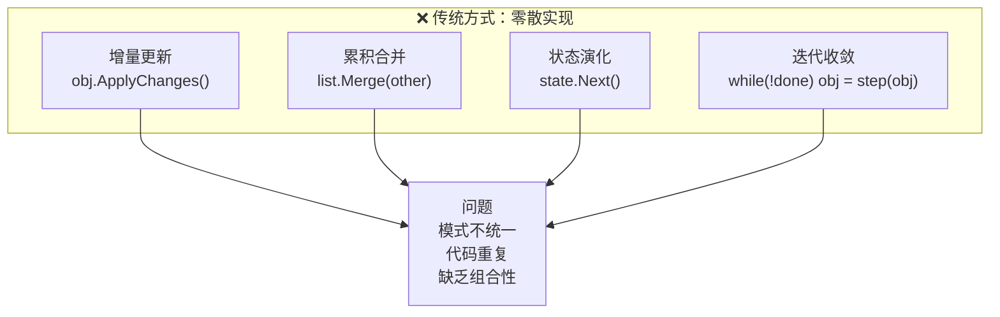
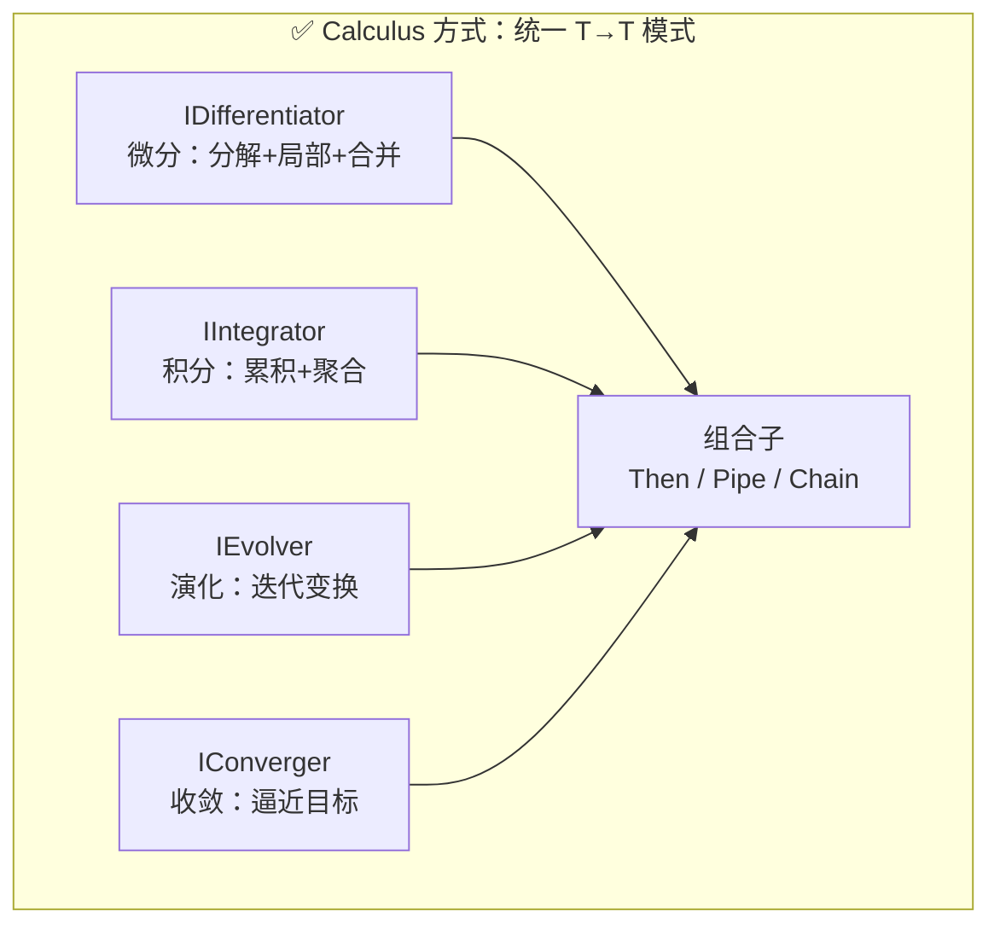
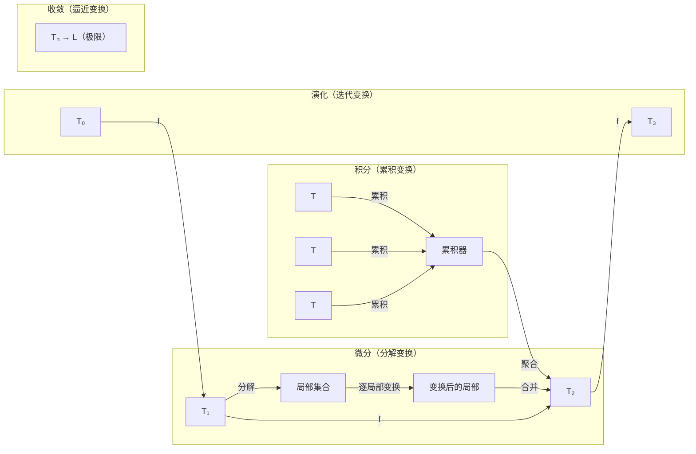
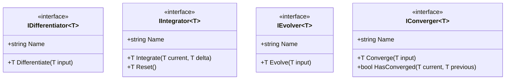
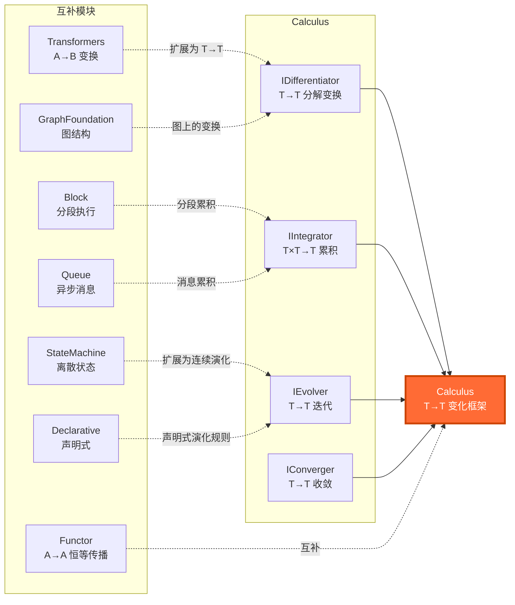
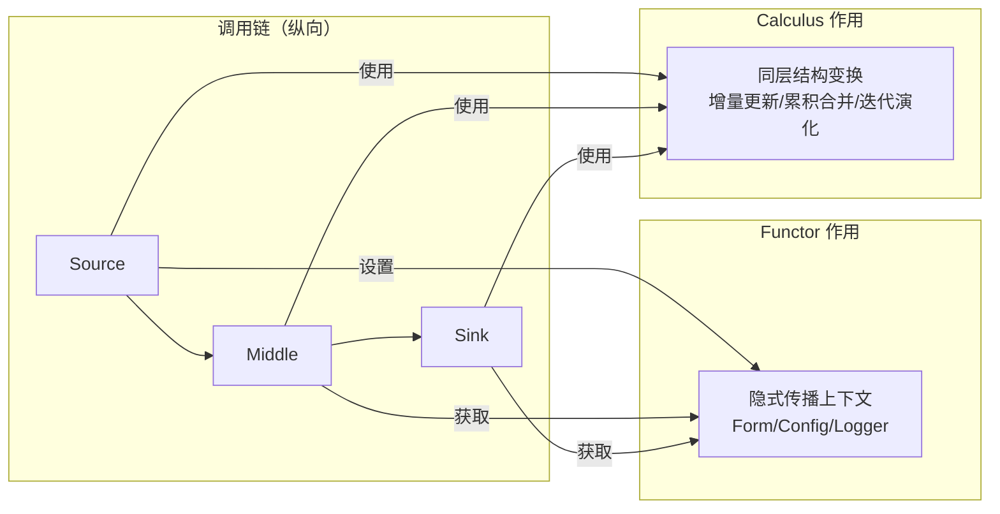

# BasicMethod.Calculus — 微积分框架

> **定位**：BasicMethod.Map 的第 10 个并行基础模块  
> **数学根基**：微积分（微分、积分、演化、收敛）  
> **核心公理**：微积分基本定理 `∫f'(x)dx = f(b)-f(a)`  
> **设计哲学**：输入 T → 输出 T，结构变换模式  
> **变换模式**：T → T（结构变换，值变化）

---

## 1. 概述

`BasicMethod.Calculus` 是 WorkFlowPrj 基础方法库（BasicMethod）的核心子体系，基于**微积分理念**构建通用的结构变换框架。与 Transformers（A→B）不同，Calculus 的核心模式是 **T → T**——专注于同一类型的内部变化与演化。

### 问题

传统编程中，同一类型的"变化"操作缺乏统一模式：



### 解决方案

基于微积分理论：**统一的 T→T 结构变换模式**。将「分解-局部变换-合并」「累积-聚合」「演化-迭代」「收敛-逼近」抽象为统一的接口体系：



### 与 Map 其他模块的变换模式对比

| 模块 | 变换模式 | 语义 | 维度 |
|------|---------|------|------|
| **Transformers** | A → B | 跨类型转换 | 横向（同层） |
| **Functor** | A → A | 恒等传播（值不变） | 纵向（跨层） |
| **Calculus** | T → T | 结构变换（值变化） | 横向（同层） |

---

## 2. 数学基础

### 微积分核心思想的结构映射

微积分不仅仅是数值计算，更是一种**普适的结构变换范式**：



### 四类抽象的数学对应

| 框架抽象 | 数学概念 | 核心公式 | 结构语义 |
|---------|---------|---------|---------|
| IDifferentiator | 导数 f'(x) | `f'(x) = lim [f(x+dx)-f(x)]/dx` | 变化率 → 局部变化的整体效应 |
| IIntegrator | 积分 ∫f(x)dx | `∫[a,b] f(x)dx = Σ f(xᵢ)Δx` | 累积 → 多个局部的整体聚合 |
| IEvolver | 微分方程 dx/dt = f(x) | `x(t+dt) ≈ x(t) + f(x)·dt` | 演化 → 状态的逐步更新 |
| IConverger | 极限 lim xₙ = L | `xₙ₊₁ = f(xₙ)` | 收敛 → 迭代逼近目标 |

---

## 3. 核心接口体系

### 接口全景图



### 接口汇总

| 接口 | 数学语义 | 职责 | 核心方法 |
|-----|---------|------|---------|
| `IDifferentiator<T>` | 导数 f'(x) | 分解 T 为局部，逐局部变换，合并回 T | `Differentiate(T)` |
| `IIntegrator<T>` | 积分 ∫f(x)dx | 累积多个 T，聚合为一个 T | `Integrate(T, T)` / `Reset()` |
| `IEvolver<T>` | 微分方程 dx/dt = f(x) | T→T 的迭代变换，状态逐步演化 | `Evolve(T)` |
| `IConverger<T>` | 极限 lim xₙ = L | 迭代直到满足收敛条件 | `Converge(T)` / `HasConverged(T, T)` |

### 3.1 IDifferentiator — 微分器

**数学基础**：导数 / 微分 — 分解整体为局部，逐局部变换，合并回整体

```csharp
public interface IDifferentiator<T>
{
    string Name { get; }
    T Differentiate(T input);
}
```

**典型应用场景**：

| 场景 | T | 说明 |
|------|---|------|
| 对象增量更新 | 复杂对象 | 只更新变化的属性，返回新对象 |
| 集合局部变换 | 集合 | 筛选出符合条件的元素变换，其他保持不变 |
| 树结构更新 | 树 | 递归遍历，变换满足条件的节点 |
| 图结构更新 | 图 | 变换满足条件的边或节点 |
| 配置增量合并 | 配置对象 | 合并增量配置到基础配置 |

### 3.2 IIntegrator — 积分器

**数学基础**：积分 / 求和 — 累积多个 T，聚合为一个 T

```csharp
public interface IIntegrator<T>
{
    string Name { get; }
    T Integrate(T current, T delta);
    T Reset();
}
```

**典型应用场景**：

| 场景 | T | 说明 |
|------|---|------|
| 对象属性合并 | 对象 | 多个对象的属性合并到一个对象 |
| 集合合并去重 | 集合 | 多个集合并集，去重 |
| 配置叠加 | 配置对象 | 多层配置叠加 |
| 事件累积 | 事件集合 | 累积多个事件到一个事件列表 |
| 状态聚合 | 状态对象 | 多个子状态聚合成父状态 |

### 3.3 IEvolver — 演化器

**数学基础**：微分方程 `dx/dt = f(x, t)` — 状态逐步演化

```csharp
public interface IEvolver<T>
{
    string Name { get; }
    T Evolve(T input);
}
```

**典型应用场景**：

| 场景 | T | 说明 |
|------|---|------|
| 状态机增量演进 | 状态对象 | 状态的渐进式更新 |
| 工作流步骤推进 | 工作流上下文 | 每一步推进到下一步 |
| 动画帧更新 | 位置/属性对象 | 每帧更新对象状态 |
| 数据流转 | 数据流对象 | 数据在管道中的逐步转换 |
| 生命周期阶段推进 | 生命周期对象 | 对象状态的逐步演进 |

### 3.4 IConverger — 收敛器

**数学基础**：极限 / 收敛 — 迭代逼近直到满足条件

```csharp
public interface IConverger<T>
{
    string Name { get; }
    T Converge(T input);
    bool HasConverged(T current, T previous);
}
```

**典型应用场景**：

| 场景 | T | 说明 |
|------|---|------|
| 重试策略 | 重试上下文 | 迭代重试直到成功或放弃 |
| 自洽计算 | 计算结果 | 反复迭代直到结果自洽 |
| 配置收敛 | 配置对象 | 多层配置合并直到稳定 |
| 状态稳定 | 状态对象 | 迭代直到状态不再变化 |
| 近似计算 | 近似值 | 迭代逼近精确值 |

---

## 4. 组合子体系

### 4.1 串联组合 Then()

通过扩展方法 `Then()` 实现两个组件的函数复合（`g ∘ f`），先执行 `first`，再将结果传给 `second`：

```csharp
var composed = differentiator1.Then(differentiator2);
var composed = integrator1.Then(integrator2);
var composed = evolver1.Then(evolver2);
var composed = converger1.Then(converger2);
```

**实现位置**：`Then()` 方法分别定义在 `DifferentiatorExtensions`、`IntegratorExtensions`、`EvolverExtensions`、`ConvergerExtensions` 中。

### 4.2 微分-积分管道（核心组合子）

**数学对应**：微积分基本定理 — 变化率的积分 = 总变化量

```csharp
public static T Pipe<T>(
    this IDifferentiator<T> differentiator,
    IIntegrator<T> integrator,
    params T[] inputs)
{
    var result = integrator.Reset();
    foreach (var input in inputs)
    {
        var diffResult = differentiator.Differentiate(input);
        result = integrator.Integrate(result, diffResult);
    }
    return result;
}
```

### 4.3 演化收敛循环

```csharp
public static T EvolveUntilConverged<T>(
    this IEvolver<T> evolver,
    IConverger<T> converger,
    T initial,
    int maxIterations = 100)
{
    var current = initial;
    var previous = default(T);
    
    for (int i = 0; i < maxIterations; i++)
    {
        previous = current;
        current = evolver.Evolve(current);
        current = converger.Converge(current);
        
        if (converger.HasConverged(current, previous))
            break;
    }
    
    return current;
}
```

---

## 5. 内置实现

### 5.1 微分器实现

| 实现类 | 用途 | 说明 |
|--------|------|------|
| `PropertyDifferentiator<T>` | 属性级变换 | 按属性筛选和变换对象 |
| `FilterDifferentiator<T>` | 集合过滤变换 | 筛选并变换集合中满足条件的元素 |
| `TreeDifferentiator<TNode>` | 树结构变换 | 递归遍历树，变换满足条件的节点 |
| `GraphDifferentiator<TNode, TEdge>` | 图结构变换 | 变换图中满足条件的节点和边 |

#### PropertyDifferentiator — 属性级微分器

```csharp
var differentiator = new PropertyDifferentiator<Configuration>(
    name: "ModifiablePropertyUpdater",
    propertyFilter: prop => prop.GetCustomAttribute<ModifiableAttribute>() != null,
    transform: value => TransformValue(value));
```

#### TreeDifferentiator — 树结构微分器

```csharp
var differentiator = new TreeDifferentiator<MyTreeNode>(
    name: "MarkDirtyNodes",
    nodeFilter: node => node.IsDirty,
    nodeTransform: node => node with { Status = "Modified" });
```

### 5.2 积分器实现

| 实现类 | 用途 | 说明 |
|--------|------|------|
| `MergeIntegrator<T>` | 对象合并 | 按属性合并两个对象，delta 优先 |
| `UnionIntegrator<T>` | 集合并集 | 多个集合并集去重 |
| `AccumulateIntegrator<T>` | 列表累积 | 将多个列表累积为一个列表 |
| `OverlayIntegrator<T>` | 条件叠加 | 按条件选择性叠加属性 |

#### MergeIntegrator — 合并积分器

```csharp
var integrator = new MergeIntegrator<Configuration>("ConfigMerger");
var final = integrator.Integrate(baseConfig, envConfig);
```

### 5.3 演化器实现

| 实现类 | 用途 | 说明 |
|--------|------|------|
| `StepEvolver<T>` | 步骤演化 | 按顺序执行多个演化步骤 |
| `ConditionalEvolver<T>` | 条件演化 | 根据条件选择不同的变换分支 |
| `PipelineEvolver<T>` | 管线演化 | 组合多个演化器形成管线 |
| `CompositeEvolver<T>` | 组合演化 | 组合多个演化器顺序执行 |

#### ConditionalEvolver — 条件演化器

```csharp
var evolver = new ConditionalEvolver<WorkflowContext>("WorkflowEvolver", ctx => ctx)
    .When(ctx => ctx.Status == "Pending", 
          ctx => ctx with { Status = "Running", StartedAt = DateTime.Now })
    .When(ctx => ctx.Status == "Running" && ctx.Steps.All(s => s.Completed), 
          ctx => ctx with { Status = "Completed", CompletedAt = DateTime.Now });
```

### 5.4 收敛器实现

| 实现类 | 用途 | 说明 |
|--------|------|------|
| `StableConverger<T>` | 稳定收敛 | 当值不再变化时收敛（需 IEquatable<T>） |
| `RetryConverger<T>` | 重试收敛 | 迭代重试直到成功或达到最大次数 |
| `ThresholdConverger<T>` | 阈值收敛 | 当距离小于阈值时收敛 |
| `TimeoutConverger<T>` | 超时收敛 | 达到超时时间时强制收敛 |

#### ThresholdConverger — 阈值收敛器

```csharp
var converger = new ThresholdConverger<Point>(
    name: "DistanceThreshold",
    distance: (p1, p2) => Math.Sqrt(Math.Pow(p1.X-p2.X, 2) + Math.Pow(p1.Y-p2.Y, 2)),
    threshold: 0.01);
```

---

## 6. 扩展方法速查

| 扩展方法 | 用途 | 定义位置 |
|---------|------|---------|
| `Then()` | 串联组合 `g ∘ f` | `DifferentiatorExtensions` / `IntegratorExtensions` / `EvolverExtensions` / `ConvergerExtensions` |
| `Pipe()` | 微分-积分管道 | `CalculusExtensions` |
| `EvolveUntilConverged()` | 演化收敛循环 | `CalculusExtensions` |

---

## 7. 与 Map 其他模块的关系



| 模块 | 关系 | 具体对应 |
|------|------|---------|
| **Transformers** | 互补 | Transformers 做 A→B 跨类型转换；Calculus 做 T→T 同类型变换 |
| **Functor** | 互补 | Functor 做跨层恒等传播 `A→A`（值不变）；Calculus 做同层结构变换 `T→T`（值变化） |
| **StateMachine** | 互补 | StateMachine 做离散状态跳跃；Calculus 做 T→T 连续状态演化 |
| **GraphFoundation** | 互补 | GraphFoundation 提供图结构；Calculus 提供图上的变换模式 |
| **Block** | 互补 | Block 做分段执行；Calculus 做分段累积 |
| **Queue** | 互补 | Queue 管理消息队列；Calculus 提供消息的累积聚合模式 |
| **Declarative** | 互补 | Declarative 声明"是什么"；Calculus 声明"如何变化" |

### 与 Functor 的协作模式



```csharp
using (var scope = Functor.Begin("Workflow"))
{
    scope.Set(baseConfig);
    
    var differentiator = new PropertyDifferentiator<Configuration>("Updater", ...);
    var integrator = new MergeIntegrator<Configuration>("Merger");
    
    var currentConfig = Functor.Current?.Get<Configuration>();
    var updated = differentiator.Differentiate(currentConfig);
    var merged = integrator.Integrate(currentConfig, updated);
}
```

---

## 8. 完整使用示例

### 示例 1：对象增量更新（微分器）

```csharp
var differentiator = new PropertyDifferentiator<Configuration>(
    name: "ModifiablePropertyUpdater",
    propertyFilter: prop => prop.GetCustomAttribute<ModifiableAttribute>() != null,
    transform: value => TransformValue(value));

var updatedConfig = differentiator.Differentiate(originalConfig);
```

### 示例 2：配置累积合并（积分器）

```csharp
var integrator = new MergeIntegrator<Configuration>("ConfigMerger");

var finalConfig = integrator.Reset();
finalConfig = integrator.Integrate(finalConfig, baseConfig);
finalConfig = integrator.Integrate(finalConfig, envConfig);
finalConfig = integrator.Integrate(finalConfig, localConfig);
```

### 示例 3：工作流步骤推进（演化器）

```csharp
var evolver = new ConditionalEvolver<WorkflowContext>("WorkflowEvolver", ctx => ctx)
    .When(ctx => ctx.Status == "Pending", 
          ctx => ctx with { Status = "Running", StartedAt = DateTime.Now })
    .When(ctx => ctx.Status == "Running" && ctx.Steps.All(s => s.Completed), 
          ctx => ctx with { Status = "Completed", CompletedAt = DateTime.Now });

var context = new WorkflowContext { Status = "Pending" };
context = evolver.Evolve(context);
```

### 示例 4：重试策略（收敛器）

```csharp
var converger = new RetryConverger<OperationResult>(
    name: "RetryConverger",
    action: result =>
    {
        if (result.Success) return (true, result);
        return (false, RetryOperation(result));
    },
    maxRetries: 3);

var result = new OperationResult { Success = false };
while (!converger.HasConverged(result, default))
{
    result = converger.Converge(result);
}
```

### 示例 5：微分-积分管道（组合使用）

```csharp
var differentiator = new FilterDifferentiator<DataItem>(
    name: "DataTransform",
    filter: item => item.IsActive,
    transform: item => TransformData(item));

var integrator = new UnionIntegrator<DataItem>("DataAggregator");

var result = differentiator.Pipe(integrator, data1, data2, data3, data4);
```

### 示例 6：演化-收敛循环（组合使用）

```csharp
var evolver = new StepEvolver<SystemState>("SystemEvolver",
    state => ApplyRules(state),
    state => ValidateState(state));

var converger = new StableConverger<SystemState>("StableConverger");

var stableState = evolver.EvolveUntilConverged(converger, initialState, maxIterations: 100);
```

---

## 9. 设计原则

1. **T→T 纯变换**：所有接口都是输入 T → 输出 T，保持类型不变
2. **数学思想映射**：每个接口都对应微积分的核心思想，但不涉及具体数值计算
3. **结构模式优先**：关注"变化的结构模式"，而非"数值计算技巧"
4. **可组合性**：支持 Then() 串联、Pipe() 管道等组合方式
5. **与现有体系互补**：不重复造轮子，填补 Map 体系在「同类型变化」维度的空白
6. **零外部依赖**：纯 .NET 基础类库，无需额外依赖
7. **平台无关**：适用于对象更新、集合操作、状态管理、工作流等各领域

---

## 10. 文件结构

```mermaid
graph TD
    root[BasicMethod/Calculus/]
    root --> Calculus.csproj
    root --> Interfaces.cs
    
    root --> Differentiators[Differentiators/]
    Differentiators --> DifferentiatorBase.cs
    Differentiators --> PropertyDifferentiator.cs
    Differentiators --> FilterDifferentiator.cs
    Differentiators --> TreeDifferentiator.cs
    Differentiators --> GraphDifferentiator.cs
    
    root --> Integrators[Integrators/]
    Integrators --> IntegratorBase.cs
    Integrators --> MergeIntegrator.cs
    Integrators --> UnionIntegrator.cs
    Integrators --> AccumulateIntegrator.cs
    Integrators --> OverlayIntegrator.cs
    
    root --> Evolvers[Evolvers/]
    Evolvers --> EvolverBase.cs
    Evolvers --> StepEvolver.cs
    Evolvers --> ConditionalEvolver.cs
    Evolvers --> PipelineEvolver.cs
    Evolvers --> CompositeEvolver.cs
    
    root --> Convergers[Convergers/]
    Convergers --> ConvergerBase.cs
    Convergers --> StableConverger.cs
    Convergers --> RetryConverger.cs
    Convergers --> ThresholdConverger.cs
    Convergers --> TimeoutConverger.cs
    
    root --> Extensions[Extensions/]
    Extensions --> CalculusExtensions.cs
    Extensions --> DifferentiatorExtensions.cs
    Extensions --> IntegratorExtensions.cs
    Extensions --> EvolverExtensions.cs
    Extensions --> ConvergerExtensions.cs
```



---

> **设计理念总结**：`BasicMethod.Calculus` 以微积分为思想源泉，将「分解-局部变换-合并」「累积-聚合」「演化-迭代」「收敛-逼近」这四种普适的结构变换模式抽象为统一的 T→T 接口体系。它不是数值计算库，而是一套关于「变化」的结构化编程方法。与 Functor（跨层恒等传播）互补，共同构建从跨层传递到同层变换的完整基础能力。