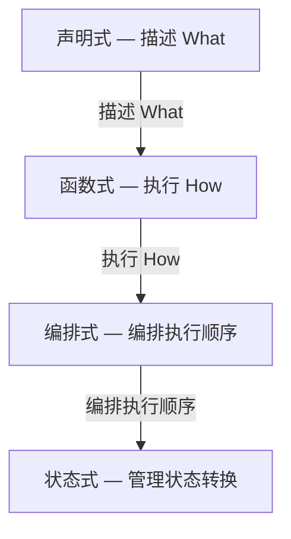
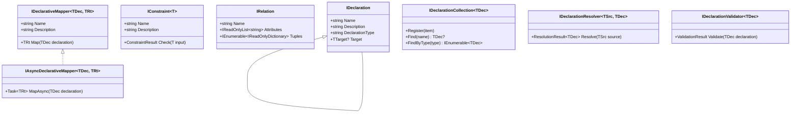
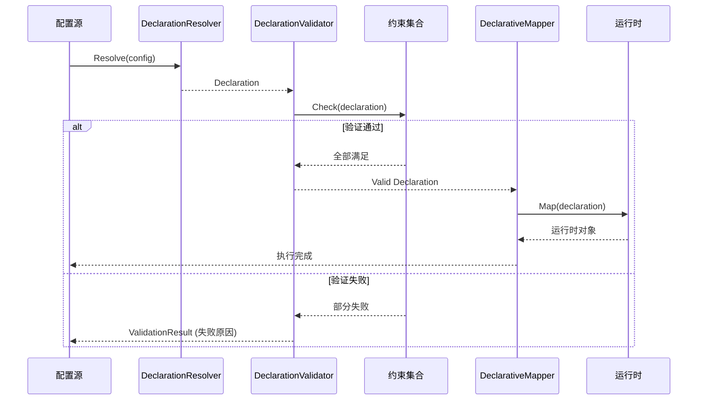

# BasicMethod.Declarative — 通用声明式框架

## 概述

**BasicMethod.Declarative** 是 WorkFlowPrj 的声明式编程基础框架，提供声明式编程的核心抽象和实现。

### 数学基础

- **关系代数（Relational Algebra）**：关系、选择、投影、连接、重命名
- **谓词逻辑（Predicate Logic）**：约束、谓词、复合逻辑
- **约束满足问题（Constraint Satisfaction Problem, CSP）**：声明验证

### 核心定义

> **声明式 = 描述"是什么"（What），而非"怎么做"（How）**

## 框架定位



## 框架架构



## 核心接口

### IDeclaration — 声明基接口

描述"某物是什么"，是声明式编程的核心抽象。

```csharp
public interface IDeclaration
{
    string Name { get; }
    string Description { get; }
    string DeclarationType { get; }
}
```

### IConstraint&lt;T&gt; — 约束

谓词 P(x)，描述 x 必须满足的条件。约束是声明式编程的核心机制。

```csharp
public interface IConstraint<in T>
{
    string Name { get; }
    string Description { get; }
    ConstraintResult Check(T input);
}
```

### IRelation — 关系

元组集合 R ⊆ D₁ × D₂ × ... × Dₙ，关系代数的核心。

```csharp
public interface IRelation
{
    string Name { get; }
    IReadOnlyList<string> Attributes { get; }
    IEnumerable<IReadOnlyDictionary<string, object?>> Tuples { get; }
}
```

### IDeclarativeMapper&lt;TDec, TRt&gt; — 声明式映射

从声明到运行时的态射 f: Declaration → Runtime。

```csharp
public interface IDeclarativeMapper<in TDeclaration, out TRuntime>
    where TDeclaration : IDeclaration
{
    string Name { get; }
    string Description { get; }
    TRuntime Map(TDeclaration declaration);
}
```

### 接口汇总

| 接口 | 数学语义 | 职责 |
|-----|---------|------|
| `IDeclaration` | P（命题） | 描述"某物是什么"，声明式编程的核心抽象 |
| `IDeclaration<TTarget>` | P: TTarget → bool | 声明目标应满足的条件 |
| `IConstraint<T>` | P: T → bool | 谓词约束，描述 x 必须满足的条件 |
| `IRelation` | R ⊆ D₁ × D₂ × ... × Dₙ | 关系代数的核心，元组集合 |
| `IDeclarativeMapper<TDec, TRt>` | f: Declaration → Runtime | 将声明映射为运行时对象 |
| `IAsyncDeclarativeMapper<TDec, TRt>` | f: Declaration → Task(Runtime) | 异步映射，适用于 I/O 密集场景 |
| `IDeclarationCollection<TDec>` | 集合管理 | 注册、查找、动态调整声明 |
| `IDeclarationResolver<TSrc, TDec>` | 配置 → 声明 | 将配置解析为声明对象 |
| `IDeclarationValidator<TDec>` | CSP 求解 | 验证声明是否满足所有约束 |

## 结果类型

框架提供四种核心结果类型：

### ConstraintResult — 约束检查结果

封装单个约束的检查结果，包含是否满足约束、失败原因等信息。

```csharp
public class ConstraintResult
{
    public bool IsSatisfied { get; }
    public string ConstraintName { get; }
    public string Description { get; }
    public string? FailureReason { get; }
    public object? CheckedValue { get; }

    public static ConstraintResult Satisfied(string name, string description, object? value = null);
    public static ConstraintResult Failed(string name, string description, string reason, object? value = null);
}
```

### ValidationResult — 验证结果

封装声明验证的完整结果，包含所有约束的检查结果汇总。

```csharp
public class ValidationResult
{
    public bool IsValid { get; }
    public string TargetName { get; }
    public IReadOnlyList<ConstraintResult> ConstraintResults { get; }
    public int PassedCount { get; }
    public int FailedCount { get; }
    public IReadOnlyList<string> FailureReasons { get; }
}
```

### ResolutionResult&lt;T&gt; — 解析结果

封装声明解析的结果，支持成功/失败两种状态，提供值解构方法。

```csharp
public class ResolutionResult<T>
{
    public bool IsSuccess { get; }
    public T? Value { get; }
    public string? ErrorMessage { get; }
    public Exception? Exception { get; }

    public T GetValueOrThrow();
    public T? GetValueOrDefault(T? defaultValue = default);
}
```

### 结果类型汇总

| 结果类型 | 用途 |
|---------|------|
| `ConstraintResult` | 单个约束检查结果 |
| `ValidationResult` | 声明验证的完整结果汇总 |
| `ResolutionResult<T>` | 配置解析结果，支持值解构 |
| `MappingResult<TRuntime>` | 声明到运行时的映射结果 |

## 执行流程



## 约束实现

框架提供五种内置约束类型，覆盖常见验证场景：

| 约束类型 | 数学语义 | 用途 |
|---------|---------|------|
| `PredicateConstraint<T>` | P(x) = true/false | 通用谓词约束，自定义验证逻辑 |
| `RangeConstraint<T>` | x ∈ [min, max] | 范围检查，支持 IComparable 类型 |
| `TypeConstraint` | x : T | 类型检查，精确/兼容匹配 |
| `RequiredConstraint` | x ≠ null | 必填检查，支持字符串和集合 |
| `CompositeConstraint<T>` | P ∧ Q / P ∨ Q / ¬P | 复合约束，支持 AND/OR/NOT |

### PredicateConstraint&lt;T&gt; — 谓词约束

最通用的约束形式，通过委托函数定义任意谓词逻辑。

```csharp
var constraint = new PredicateConstraint<Person>(
    "AgeCheck",
    "年龄必须大于18",
    p => p.Age > 18);
```

### RangeConstraint&lt;T&gt; — 范围约束

检查值是否在指定范围内，支持 `IComparable<T>` 类型（int、double、DateTime 等）。

```csharp
var constraint = new RangeConstraint<int>(
    "ScoreRange",
    "分数必须在0-100之间",
    min: 0,
    max: 100);
```

### CompositeConstraint&lt;T&gt; — 复合约束

支持三种组合模式：

| 模式 | 语义 | 说明 |
|-----|------|------|
| `All` | P₁ ∧ P₂ ∧ ... ∧ Pₙ | AND — 所有子约束必须满足 |
| `Any` | P₁ ∨ P₂ ∨ ... ∨ Pₙ | OR — 任一子约束满足即可 |
| `Not` | ¬P | NOT — 子约束必须不满足 |

```csharp
var constraint = new CompositeConstraint<Person>(
    "PersonValidation",
    "人员信息验证",
    CompositeMode.All,
    new RequiredConstraint("Name", "姓名必填"),
    new RangeConstraint<int>("Age", "年龄范围", 18, 65));
```

## 关系代数

框架实现了关系代数的核心操作，为声明式编程提供数学基础。

| 操作 | 数学符号 | SQL 对应 | 用途 |
|-----|---------|---------|------|
| `Relation` | R ⊆ D₁×...×Dₙ | 表 | 元组集合 |
| `Select` | σ_P(R) | WHERE | 筛选满足条件的元组 |
| `Project` | π_A(R) | SELECT | 选取指定属性列 |
| `Join` | R ⋈_P S | JOIN | 按条件连接两个关系 |
| `Rename` | ρ_A→B(R) | AS | 属性重命名 |

### Relation — 关系实现

关系是元组的集合，每个元组是一个属性名→值的字典。

```csharp
var relation = Relation.FromTuples("Users", new[]
{
    new Dictionary<string, object?> { ["Id"] = 1, ["Name"] = "张三", ["Age"] = 25 },
    new Dictionary<string, object?> { ["Id"] = 2, ["Name"] = "李四", ["Age"] = 30 }
});
```

### Select — 选择操作（σ）

从关系中筛选满足谓词 P 的元组，类似 SQL 的 WHERE 子句。

```csharp
var buttons = Select.Equal("Buttons", controls, "Type", "Button");
var enabledControls = new Select("EnabledControls", controls, t =>
{
    return t.TryGetValue("Enabled", out var enabled) && enabled is true;
});
```

### Project — 投影操作（π）

从关系中选取指定属性列，自动去除重复元组，类似 SQL 的 SELECT 子句。

```csharp
var names = new Project("Names", users, "Name");
var nameAndCity = new Project("NameAndCity", users, "Name", "City");
```

### Join — 连接操作（⋈）

将两个关系按指定条件连接，类似 SQL 的 JOIN 子句。

```csharp
var orderWithUser = Join.Equi("OrderWithUser", orders, users, "UserId", "UserId");
var naturalJoin = Join.Natural("NaturalJoin", orders, users);
```

## 映射器

### DeclarativeMapper&lt;TDec, TRt&gt; — 声明式映射器基类

提供 `IDeclarativeMapper` 的默认实现，子类只需重写 `Map` 方法。

```csharp
public class ControlFinderMapper : DeclarativeMapper<ControlDeclaration, object>
{
    public ControlFinderMapper() : base("ControlFinder", "查找控件") { }

    public override object Map(ControlDeclaration declaration)
    {
        var container = declaration.Target as Container;
        return container?.FindControl(declaration.ControlName);
    }
}
```

### MappingExtensions — 映射扩展方法

提供映射器的组合和链式调用能力。

```csharp
var combined = firstMapper.Then(secondMapper);
var asyncMapper = firstMapper.ToAsync();
```

### MappingRegistry — 映射注册表

管理多个声明式映射器的注册和查找。

```csharp
var registry = new MappingRegistry();
registry.Register(new ControlFinderMapper());
var mapper = registry.Find<ControlDeclaration, object>("ControlFinder");
```

## 文件结构

```mermaid
graph TD
    root[BasicMethod/Declarative/]
    root --> Interfaces.cs
    root --> Results.cs
    root --> DeclarationCollection.cs
    
    root --> Abstractions[Abstractions/]
    Abstractions --> DeclarationBase.cs
    Abstractions --> ConstraintBase.cs
    Abstractions --> RelationBase.cs
    
    root --> Constraints[Constraints/]
    Constraints --> PredicateConstraint.cs
    Constraints --> RangeConstraint.cs
    Constraints --> TypeConstraint.cs
    Constraints --> RequiredConstraint.cs
    Constraints --> CompositeConstraint.cs
    
    root --> Relations[Relations/]
    Relations --> Relation.cs
    Relations --> Select.cs
    Relations --> Project.cs
    Relations --> Join.cs
    Relations --> Rename.cs
    
    root --> Mappers[Mappers/]
    Mappers --> DeclarativeMapper.cs
    Mappers --> MappingExtensions.cs
    Mappers --> MappingRegistry.cs
    
    root --> Resolvers[Resolvers/]
    Resolvers --> DeclarationResolver.cs
    Resolvers --> DeclarationValidator.cs

    root --> Spec[Spec/]
    Spec --> ParameterModel.cs
    Spec --> ParameterState.cs
    Spec --> SemanticVocabulary.cs
    Spec --> SemanticClassRules.cs

    root --> Graph[Graph/]
    Graph --> DecisionLayer.cs
    Graph --> DecisionGraph.cs
```



## 声明原子扩展（Spec / Graph）

> 2026-09-17 自 `Strategy.DecisionRules` 上移的纯声明原子（零外部依赖，仅 BCL）。
> 判据：结构只描述"是什么"（轴/词元/规则/图），不含 IO、不含领域词汇。

| 类型族 | 能力 | 语义 |
|--------|------|------|
| `ParameterSchema` / `ParameterSpec` / `ParameterKind` / `AxisRole` | 轴空间声明 | 轴 = (role, kind, domain)；强制位 `IsForced`（确定性核心写路径单一）、闩锁位 `IsLatched`（吸收律：单调不降） |
| `ParameterState` / `ParameterWrite` / `ParameterWriteSource` | 声明驱动状态演进 | 不可变快照；`Engine` / `Reduce` / `Policy` 写来源分域，越权写强制位被拒并计入 `rejected` |
| `SemanticTerm` / `SemanticVocabulary` | 有限语义正交基 | 轴 → 词元集单一真源；one-hot 完备基，`Sample(Embed(x)) = x` |
| `SemanticClassRules` | 声明 → 判别向量编译 | 必需词元 AND 命中 ⇔ 得分 ≥ 0.5（`bias = -(n-0.5)`）；互斥裁决按「显式优先级 → 注册序」 |
| `DecisionLayer` / `LayerRule` / `CrossFeature` | 分层规则声明 | 面内互斥规则 + 终值吸收标签集；跨轴关联一处声明、多面共享 |
| `DecisionGraph` | 轴编排 DAG 求值 | 依赖拓扑求值 + 吸收短路剪枝 + 按「消费证据指纹」的增量重算 |

```csharp
var vocab = new SemanticVocabulary(new Dictionary<string, IReadOnlyList<string>>
{
    ["eval"] = new[] { "pass", "partial", "fail" },
    ["produced"] = new[] { "yes", "no" },
});
var rules = new SemanticClassRules(vocab).WhenAllOf("fail_prod", new("eval", "fail"), new("produced", "yes"));
var label = rules.ClassifyExclusive(new[] { new SemanticTerm("eval", "fail"), new SemanticTerm("produced", "yes") });
```

---

## 与现有代码的对应关系

| 现有代码 | 新框架中的对应 | 说明 |
|---------|---------------|------|
| `EventBindingDeclaration` | `IDeclaration` 的实现 | 声明"控件应该绑定什么事件" |
| `ParameterMapping` | `IRelation` 的元组 | 声明"参数从哪里来" |
| `EventRequest` | `IDeclaration` 的实现 | 声明"事件是什么" |
| `ControlFinderTransformer` | `IDeclarativeMapper` 的实现 | 将"控件声明"映射为"运行时控件" |
| `EventBinderTransformer` | `IDeclarativeMapper` 的实现 | 将"绑定声明"映射为"运行时事件绑定" |
| `EventBindingResolver` | `IDeclarationResolver` 的实现 | 解析声明式配置 |
| `ContainerBinderOptions` | `IConstraint` 的集合 | 声明绑定行为的约束 |

## 完整使用示例

### 1. 创建声明

```csharp
var declaration = new EventBindingDeclaration
{
    ControlName = "btnSubmit",
    EventName = "Click",
    FunctionName = "SubmitOrder",
    Parameters = new[]
    {
        new ParameterMapping { Target = "orderId", SourceType = "control", Source = "txtOrderId" }
    }
};
```

### 2. 使用约束验证

```csharp
var validator = new DeclarationValidator<EventBindingDeclaration>("EventBindingValidator")
    .AddConstraint(new RequiredConstraint("ControlName", "控件名称不能为空"))
    .AddConstraint(new PredicateConstraint<EventBindingDeclaration>(
        "FunctionName", "函数名不能为空", d => !string.IsNullOrWhiteSpace(d.FunctionName)));

var result = validator.Validate(declaration);
Console.WriteLine(result);
```

### 3. 使用关系代数

```csharp
var controls = Relation.FromTuples("Controls", new[]
{
    new Dictionary<string, object?> { ["Name"] = "btnSubmit", ["Type"] = "Button" },
    new Dictionary<string, object?> { ["Name"] = "txtOrderId", ["Type"] = "TextBox" },
});

var buttons = Select.Equal("Buttons", controls, "Type", "Button");
var names = new Project("Names", buttons, "Name");
```

### 4. 使用声明式映射

```csharp
var mapper = new ControlFinderMapper();
var control = mapper.Map(declaration);
```

## 设计原则

1. **声明式优先**：描述"是什么"，而非"怎么做"
2. **数学基础**：基于关系代数、谓词逻辑、约束满足问题
3. **零外部依赖**：纯 .NET 基础类库
4. **与现有框架互补**：与 Transformers、SortMent、StateMachine 形成完整体系
5. **平台无关**：不依赖任何 UI 技术
