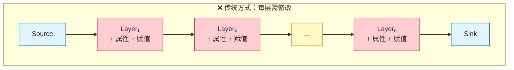
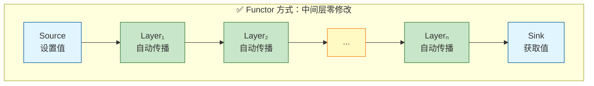
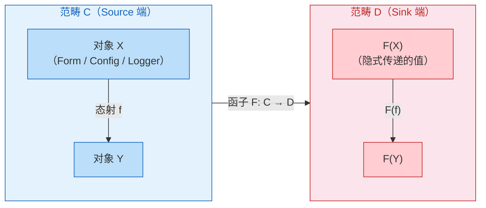
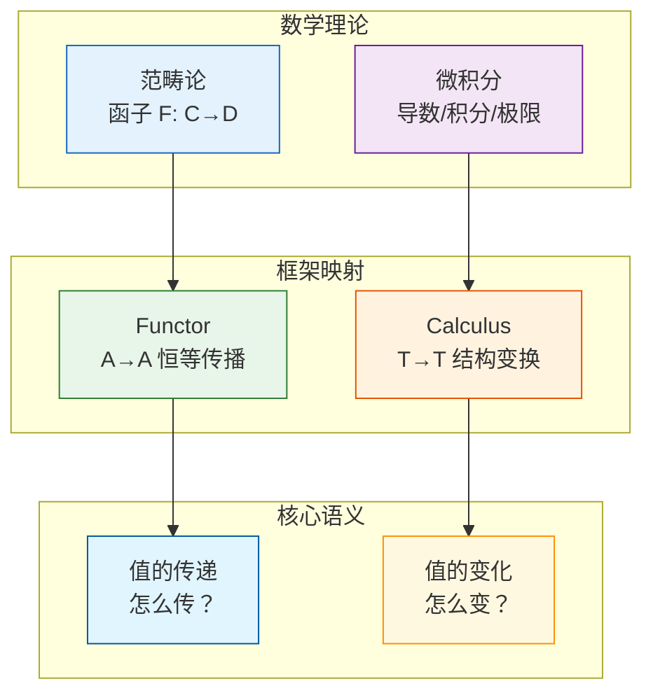
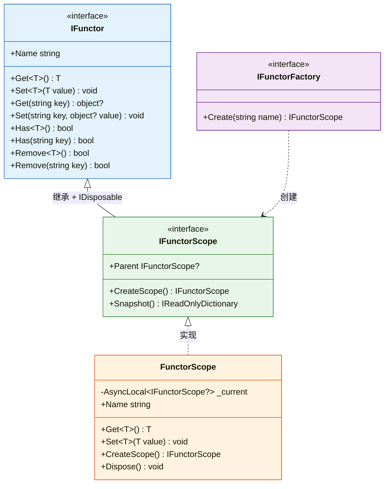
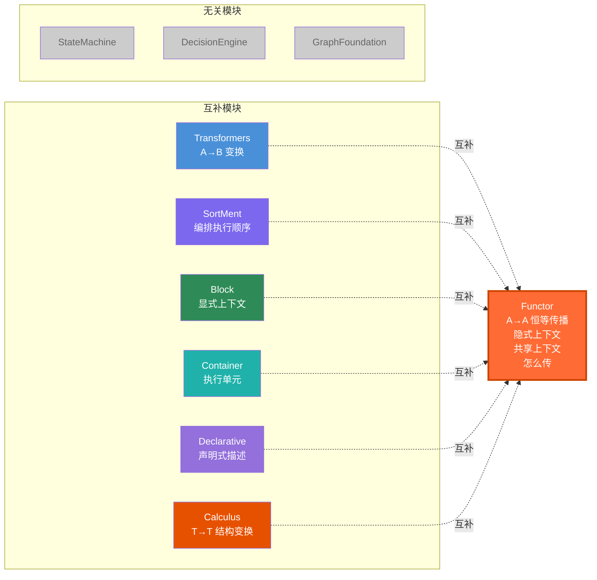
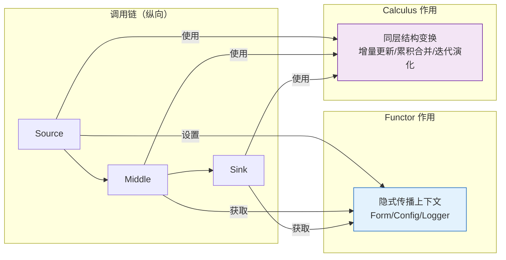

# BasicMethod.Functor — 函子框架

> **定位**：BasicMethod.Map 的第 9 个并行模块  
> **数学根基**：范畴论 — 函子理论（Functor Theory）  
> **核心公理**：`F(id) = id`，`F(g∘f) = F(g)∘F(f)`  
> **设计哲学**：中间层零修改，值自动传播  
> **变换模式**：A → A（恒等传播，值不变）

---

## 1. 概述

`BasicMethod.Functor` 是一个基于**函子理论**的通用跨层值传递框架。它解决了跨项目/跨模块调用链中，值从 Source 端传递到 Sink 端需要修改所有中间层的问题。

### 问题

传统方式下，每新增一个跨层传递的值，所有中间层都需要新增属性 + 赋值操作，复杂度 = O(n)：



### 解决方案

基于函子理论：**每个中间层对值的操作都是恒等函子** `F(v) = v`。通过 AsyncLocal 隐式传播，中间层无需任何修改：



### 与 Map 其他模块的变换模式对比

| 模块 | 变换模式 | 语义 | 维度 |
|------|---------|------|------|
| **Transformers** | A → B | 跨类型转换 | 横向（同层） |
| **Functor** | A → A | 恒等传播（值不变） | 纵向（跨层） |
| **Calculus** | T → T | 结构变换（值变化） | 横向（同层） |

**核心区别**：
- Functor 的 `A→A` 是**值不变地传播**（恒等函子），关注的是"怎么传"
- Calculus 的 `T→T` 是**值主动地变换**（微积分变换），关注的是"怎么变"

---

## 2. 数学基础

### 函子（Functor）

函子 `F: C → D` 是范畴间的结构保持映射：



**核心公理**：

- **对象映射**：对每个对象 `X ∈ C`，有 `F(X) ∈ D`
- **态射映射**：对每个态射 `f: X → Y ∈ C`，有 `F(f): F(X) → F(Y) ∈ D`
- **恒等保持**：`F(idₓ) = id_{F(x)}`
- **复合保持**：`F(g ∘ f) = F(g) ∘ F(f)`

### 在框架中的对应

| 函子概念 | 框架对应 |
|---------|---------|
| 范畴 C | Source 端（如 FileDriven） |
| 范畴 D | Sink 端（如 Operation） |
| 对象 X | 要传递的值（如 Form、Config、Logger） |
| 态射 f | 调用链中的每个中间层 |
| 恒等函子 Id | 中间层对值的操作：`F(v) = v`（值不变） |
| 函子复合 | 多个中间层的串联：`Fₙ ∘ ... ∘ F₁ = Id` |

### 与 Calculus 的理论对比



| 维度 | Functor（函子） | Calculus（微积分） |
|------|----------------|-------------------|
| **数学基础** | 范畴论 — 函子 F: C→D | 微积分 — 微分/积分/演化/收敛 |
| **核心公理** | `F(id) = id`，`F(g∘f) = F(g)∘F(f)` | 微积分基本定理：`∫f'(x)dx = f(b)-f(a)` |
| **变换模式** | A → A（恒等传播） | T → T（结构变换） |
| **语义** | **值的传递**（跨层隐式传递） | **值的变换**（同层结构变化） |
| **关注点** | **怎么传**（中间层零修改） | **怎么变**（分解-累积-迭代-收敛） |
| **维度** | **纵向**（跨模块/跨层） | **横向**（同模块/同层） |
| **实现方式** | `AsyncLocal` 隐式上下文 | 纯函数变换 `T → T` |
| **状态性** | 有状态（共享上下文存储） | 无状态（纯函数） |
| **数据流向** | Source → 中间层（零修改）→ Sink | T → T → T → T（每步都变换） |
| **核心能力** | 隐式上下文、共享作用域 | 分解变换、累积聚合、迭代演化、收敛逼近 |

---

## 3. 核心接口

### 接口继承体系



### IFunctor

```csharp
public interface IFunctor
{
    string Name { get; }
    T? Get<T>() where T : class;           // 按类型获取
    void Set<T>(T value) where T : class;  // 按类型设置
    object? Get(string key);               // 按键获取
    void Set(string key, object? value);   // 按键设置
    bool Has<T>();                         // 按类型检查
    bool Has(string key);                  // 按键检查
    bool Remove<T>();                      // 按类型移除
    bool Remove(string key);               // 按键移除
}
```

### IFunctorScope

```csharp
public interface IFunctorScope : IFunctor, IDisposable
{
    IFunctorScope? Parent { get; }         // 父作用域
    IFunctorScope CreateScope();           // 创建子作用域
    IReadOnlyDictionary<string, object> Snapshot();  // 快照
}
```

---

## 4. 使用方式

### 调用流程

```mermaid
sequenceDiagram
    participant Source as Source 端
    participant Functor as Functor 框架
    participant Middle as 中间层（零修改）
    participant Sink as Sink 端

    Source->>Functor: Functor.Begin("FileDriven")
    activate Functor
    Functor->>Functor: AsyncLocal 创建作用域
    Source->>Functor: scope.Set(mainForm)
    Source->>Functor: scope.Set("config", config)
    Source->>Middle: 调用中间层方法

    Note over Middle: 中间层无需任何<br/>Functor 相关代码

    Middle->>Sink: 调用 Sink 端方法
    Sink->>Functor: Functor.Current?.Get<Form>()
    Functor-->>Sink: 返回 mainForm
    Sink->>Functor: Functor.Current?.Get("config")
    Functor-->>Sink: 返回 config
    Sink-->>Middle: 返回结果
    Middle-->>Source: 返回结果

    Source->>Functor: scope.Dispose()
    deactivate Functor
    Note over Functor: AsyncLocal 自动恢复<br/>到上一个作用域
```



### 方式一：静态入口（推荐）

```csharp
// Source 端：创建作用域并设置值
using (var scope = Functor.Begin("FileDriven"))
{
    scope.Set(mainForm);           // 按类型：Set<Form>(mainForm)
    scope.Set("config", config);   // 按键：Set("config", config)
    scope.Set(logger);             // 按类型：Set<ILogger>(logger)

    // 调用链中的任意代码都可以获取
    // ...
}

// Sink 端：获取值
var form = Functor.Current?.Get<Form>();
var cfg = Functor.Current?.Get("config");
```

### 方式二：Fluent Builder

```csharp
using var scope = Functor.Create("FileDriven")
    .With(mainForm)           // 按类型
    .With("config", config)   // 按键
    .With(logger)             // 按类型
    .Build();

// 或直接执行代码块
Functor.Create("FileDriven")
    .With(mainForm)
    .BuildAndRun(scope =>
    {
        // 调用链中的代码
    });
```

### 方式三：嵌套作用域

```csharp
using var root = Functor.Begin("Root");
root.Set<Form>(mainForm);

using var child = root.CreateScope();
child.Set<ILogger>(logger);  // 子作用域可以覆盖或新增值

// 子作用域中获取：优先从当前作用域查找，递归到父作用域
var form = child.Get<Form>();    // 从父作用域获取
var log = child.Get<ILogger>();  // 从当前作用域获取

// 子作用域释放后，自动恢复父作用域
```

---

## 5. 与 Map 其他模块的关系



| 模块 | 关系 | 具体对应 |
|------|------|---------|
| **Transformers** | 互补 | Transformers 做类型变换 `A→B`，Functor 做恒等传播 `A→A` |
| **Calculus** | 互补 | Calculus 做同层结构变换 `T→T`（值变化），Functor 做跨层恒等传播 `A→A`（值不变） |
| **SortMent** | 互补 | SortMent 编排执行顺序，Functor 提供执行时的隐式上下文 |
| **Block** | 互补 | BlockContext 是显式上下文，Functor 是隐式上下文 |
| **StateMachine** | 无关 | |
| **DecisionEngine** | 无关 | |
| **GraphFoundation** | 无关 | |
| **Container** | 互补 | Container 提供执行单元，Functor 提供执行单元的共享上下文 |
| **Declarative** | 互补 | Declarative 声明"有什么"，Functor 实现"怎么传" |

### 与 Calculus 的协作模式

Functor 和 Calculus 可以互补使用，形成完整的"传递 + 变换"链路：



**协作代码示例**：

```csharp
// Functor：跨层传递配置上下文
using (var scope = Functor.Begin("Workflow"))
{
    scope.Set(baseConfig);  // 隐式传递基础配置
    
    // Calculus：同层进行配置的变换和合并
    var differentiator = new PropertyDifferentiator<Configuration>("Updater", ...);
    var integrator = new MergeIntegrator<Configuration>("Merger");
    
    // 在中间层获取配置，用 Calculus 变换
    var currentConfig = Functor.Current?.Get<Configuration>();
    var updated = differentiator.Differentiate(currentConfig);
    var merged = integrator.Integrate(currentConfig, updated);
    
    // 继续传递...
}
```

---

## 6. 文件结构

```
Functor/
├── Functor.csproj                    # 项目文件
├── Interfaces.cs                     # IFunctor, IFunctorScope, IFunctorFactory
├── FunctorScope.cs                   # 核心实现（AsyncLocal 隐式传播）
├── FunctorExtensions.cs              # 扩展方法
├── FunctorBuilder.cs                 # Fluent Builder + 静态入口
└── BasicMethod.Functor功能介绍.md    # 本文档
```

---

> **设计理念总结**：`BasicMethod.Functor` 以范畴论中的函子理论为思想源泉，将「跨层值传递」抽象为恒等函子的隐式传播模式。它的核心是**值在调用链中保持不变地流过**，中间层无需任何感知和修改。与 Calculus（同层结构变换）互补，共同构建从跨层传递到同层变换的完整基础能力。
