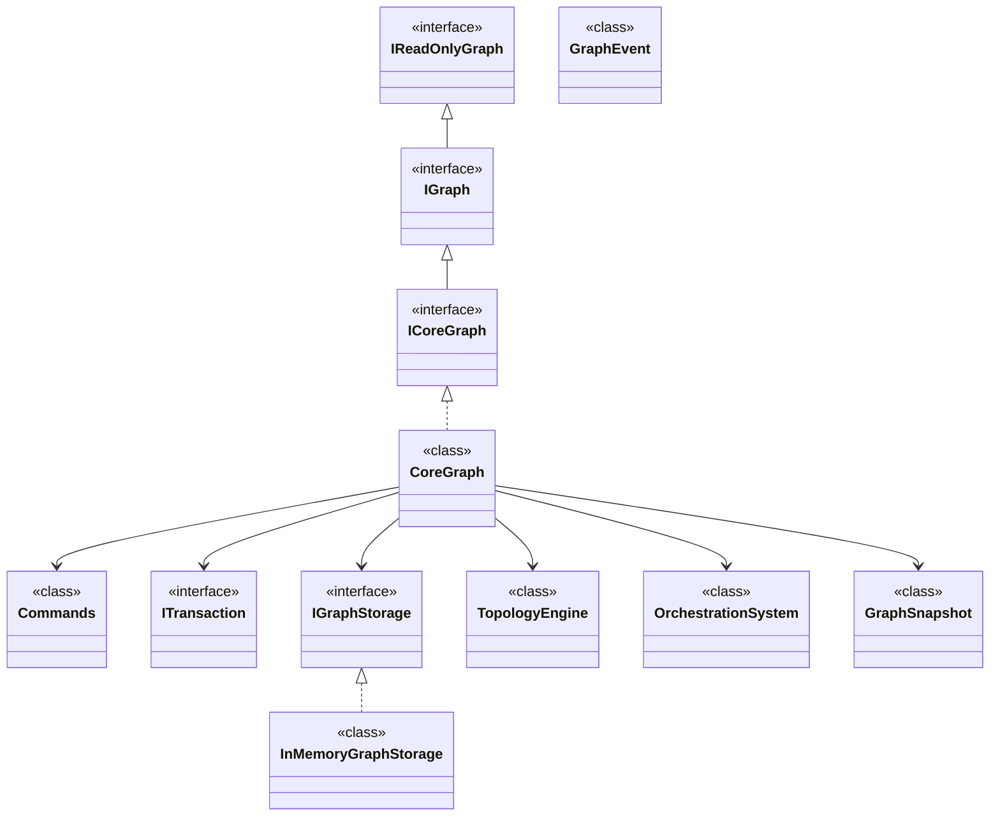
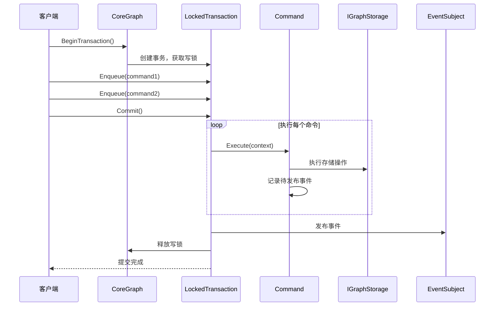
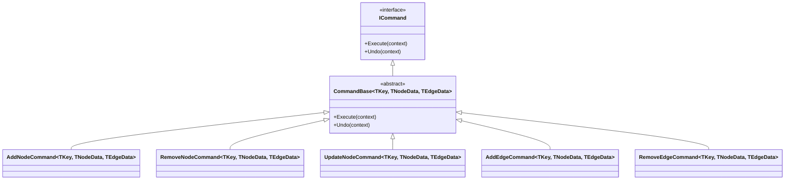
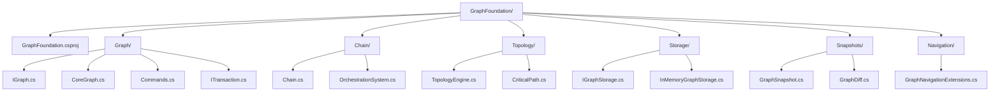

# GraphFoundation — 通用图基础框架

## 概述

**GraphFoundation** 是 WorkFlowPrj 的图数据结构基础框架，提供通用的图操作、事务管理、拓扑分析和快照机制。

### 核心特性

- **存储外置**：业务逻辑与存储解耦，支持内存、数据库等多种后端
- **事务支持**：命令模式实现可撤销事务，保证数据一致性
- **事件驱动**：Rx.NET 实现的图变更事件流
- **快照机制**：不可变快照作为执行凭证，确保执行过程不受图变更影响
- **拓扑分析**：支持关键路径等图分析算法

## 框架架构



## 核心接口

### IReadOnlyGraph — 只读图接口

提供图的只读访问能力，是所有图操作的基础。

```csharp
public interface IReadOnlyGraph<TKey, TNodeData, TEdgeData>
{
    TNodeData? GetNodeData(TKey key);
    TEdgeData? GetEdgeData(string edgeId);
    IReadOnlyList<TKey> GetAllNodeKeys();
    IReadOnlyList<string> GetAllEdgeIds();
    IReadOnlyList<(TKey Source, TKey Target, string EdgeId, bool IsDirected, double Weight, TEdgeData Data)> GetOutgoingEdges(TKey source);
    IReadOnlyList<(TKey Source, TKey Target, string EdgeId, bool IsDirected, double Weight, TEdgeData Data)> GetIncomingEdges(TKey target);
    IObservable<GraphEvent> Events { get; }
}
```

### IGraph — 可写图接口

继承只读接口，添加图的修改能力和事务支持。

```csharp
public interface IGraph<TKey, TNodeData, TEdgeData> : IReadOnlyGraph<TKey, TNodeData, TEdgeData>
{
    ITransaction BeginTransaction();
    void AddNode(TKey key, TNodeData data, string? symbol = null);
    void RemoveNode(TKey key);
    void AddEdge(string edgeId, TKey source, TKey target, bool isDirected, TEdgeData? data, double weight = 1.0);
    void RemoveEdge(string edgeId);
}
```

### 接口汇总

| 接口 | 职责 |
|-----|------|
| `IReadOnlyGraph` | 只读访问：节点/边查询、事件订阅 |
| `IGraph` | 读写访问：节点/边增删、事务管理 |
| `ICoreGraph` | 可释放的核心图接口 |
| `IGraphStorage` | 存储抽象：支持内存/数据库等后端 |

## 执行流程

### 事务执行流程



### 命令模式架构



## 核心模块

### CoreGraph — 核心图实现

**职责**：纯业务逻辑层，事务、事件、编排由本层管理，存储委托给 IGraphStorage。

| 特性 | 实现方式 |
|-----|---------|
| 并发控制 | ReaderWriterLockSlim |
| 事件发布 | Rx.NET Subject |
| 事务管理 | 命令模式 + 锁定事务 |
| 错误处理 | IErrorHandler 可注入 |

### GraphSnapshot — 不可变图快照

**职责**：作为执行凭证，创建后内容不会改变，确保执行过程不受图变更影响。

```csharp
public class GraphSnapshot<TKey, TNodeData, TEdgeData>
{
    public string SnapshotId { get; }
    public string GraphId { get; }
    public int Version { get; }
    public IReadOnlyDictionary<TKey, NodeDefinition<TKey, TNodeData>> Nodes { get; }
    public IReadOnlyList<EdgeDefinition<TKey>> Edges { get; }
    public DateTime CreatedAt { get; }

    public static GraphSnapshot<TKey, TNodeData, TEdgeData> CreateFrom(
        IReadOnlyGraph<TKey, TNodeData, TEdgeData> graph,
        string graphId = "graph", int version = 1);

    public bool Validate(out IReadOnlyList<string> errors);
}
```

### TopologyEngine — 拓扑引擎

**职责**：执行拓扑分析和转换，支持连接转换器链。

```csharp
public class TopologyEngine<TKey, TNodeData, TEdgeData>
{
    public void AddTransformer(IConnectionTransformer transformer);
    public void Execute();
}
```

### OrchestrationSystem — 编排系统

**职责**：协调图操作流程，支持多个编排步骤的有序执行。

```csharp
public class OrchestrationSystem<TKey, TNodeData, TEdgeData>
{
    public void AddStep(IOrchestrationStep step);
    public OrchestrationResult Execute();
}
```

## 文件结构



## 事件系统

框架使用 Rx.NET 实现事件驱动架构，所有图变更都会发布事件：

| 事件类型 | 触发时机 |
|---------|---------|
| `NodeAddedEvent` | 添加节点 |
| `NodeRemovedEvent` | 移除节点 |
| `NodeUpdatedEvent` | 更新节点 |
| `EdgeAddedEvent` | 添加边 |
| `EdgeRemovedEvent` | 移除边 |
| `EdgeUpdatedEvent` | 更新边 |

## 快速使用示例

### 创建图

```csharp
var graph = new CoreGraph<string, object, object>();
graph.AddNode("A", new { Label = "开始" }, "START");
graph.AddNode("B", new { Label = "处理" }, "PROCESS");
graph.AddNode("C", new { Label = "结束" }, "END");
graph.AddEdge("A->B", "A", "B", isDirected: true, data: null, weight: 1.0);
graph.AddEdge("B->C", "B", "C", isDirected: true, data: null, weight: 1.0);
```

### 使用事务

```csharp
using (var tx = graph.BeginTransaction())
{
    tx.Enqueue(new AddNodeCommand<string, object, object>("D", new { Label = "分支" }, "DECISION"));
    tx.Enqueue(new AddEdgeCommand<string, object, object>("B->D", "B", "D", true, null, 1.0));
    tx.Commit();
}
```

### 创建快照

```csharp
var snapshot = GraphSnapshot<string, object, object>.CreateFrom(graph, "workflow", version: 1);
bool isValid = snapshot.Validate(out var errors);
```

### 使用拓扑引擎

```csharp
var engine = new TopologyEngine<string, object, object>(graph);
engine.AddTransformer(new ConnectionValidationTransformer());
engine.Execute();
```

## 设计原则

1. **存储外置**：业务逻辑与存储解耦，支持多种后端实现
2. **命令模式**：所有变更操作封装为命令，支持事务和撤销
3. **事件驱动**：图变更通过事件发布，支持响应式编程
4. **不可变快照**：快照创建后不可变，确保执行一致性
5. **零外部依赖**：核心层仅依赖 .NET 基础类库和 Rx.NET

## 与现有代码的对应关系

| 现有代码 | GraphFoundation 中的对应 | 说明 |
|---------|------------------------|------|
| `GraphProcess` | `CoreGraph` + `GraphSnapshot` | 图处理和执行 |
| `WorkFlowMethod` | `OrchestrationSystem` + `Chain` | 工作流编排和链式处理 |
| `GraphDiff` | `Snapshots/GraphDiff` | 图差异比较 |
