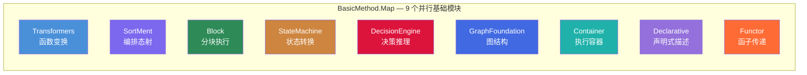
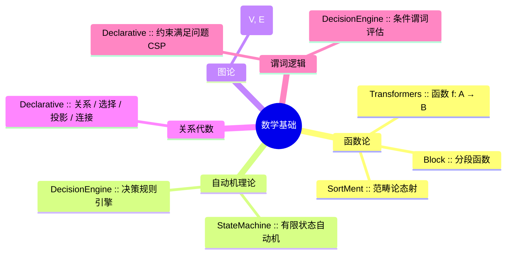
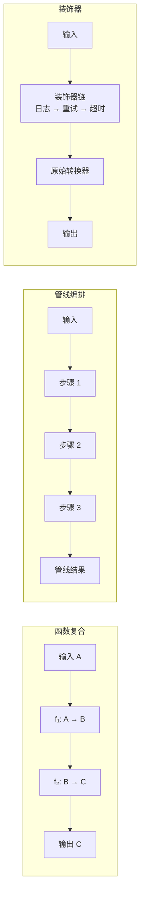
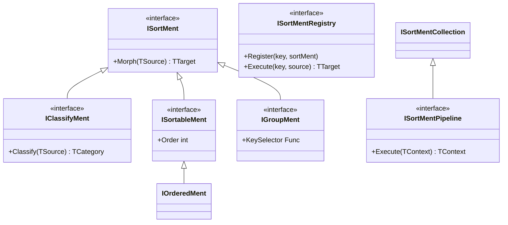
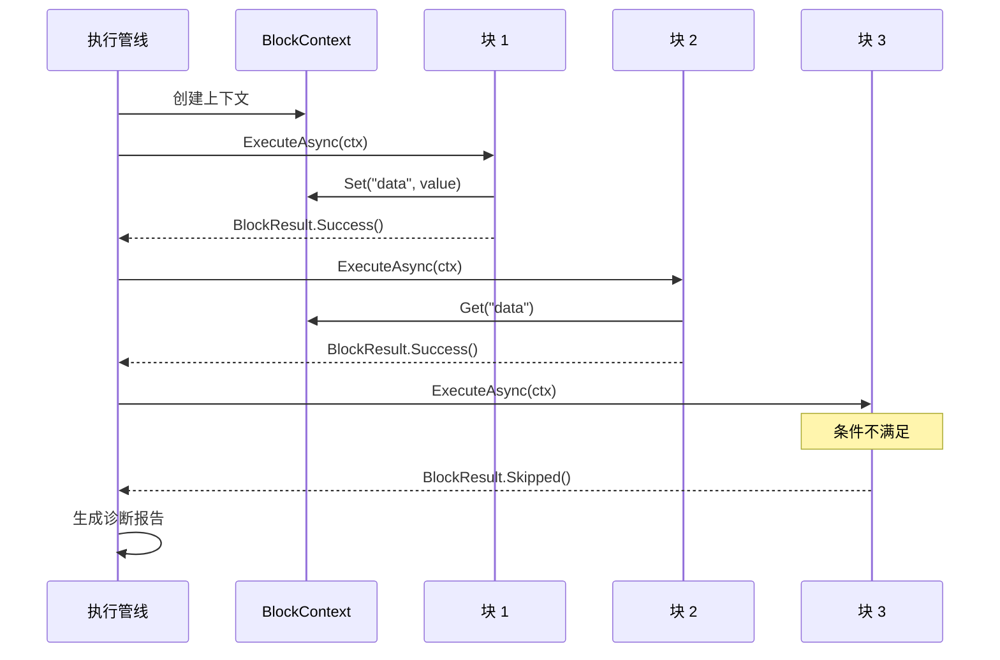
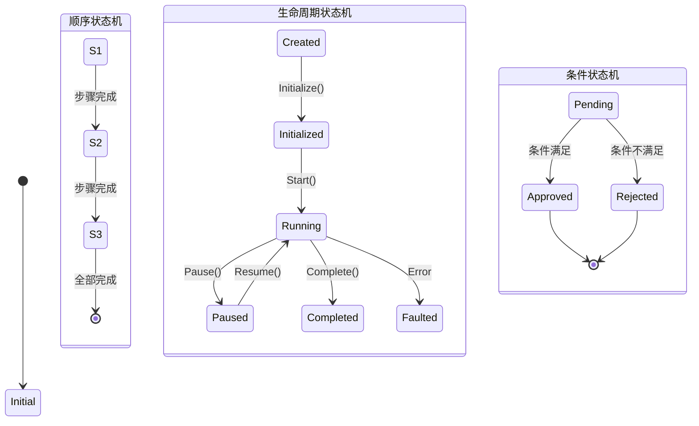
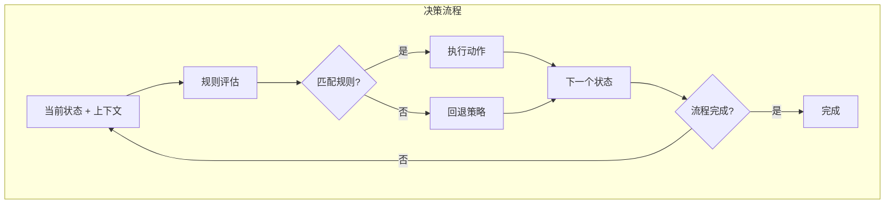
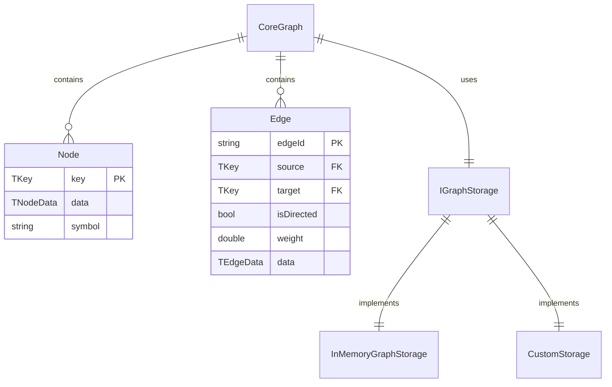
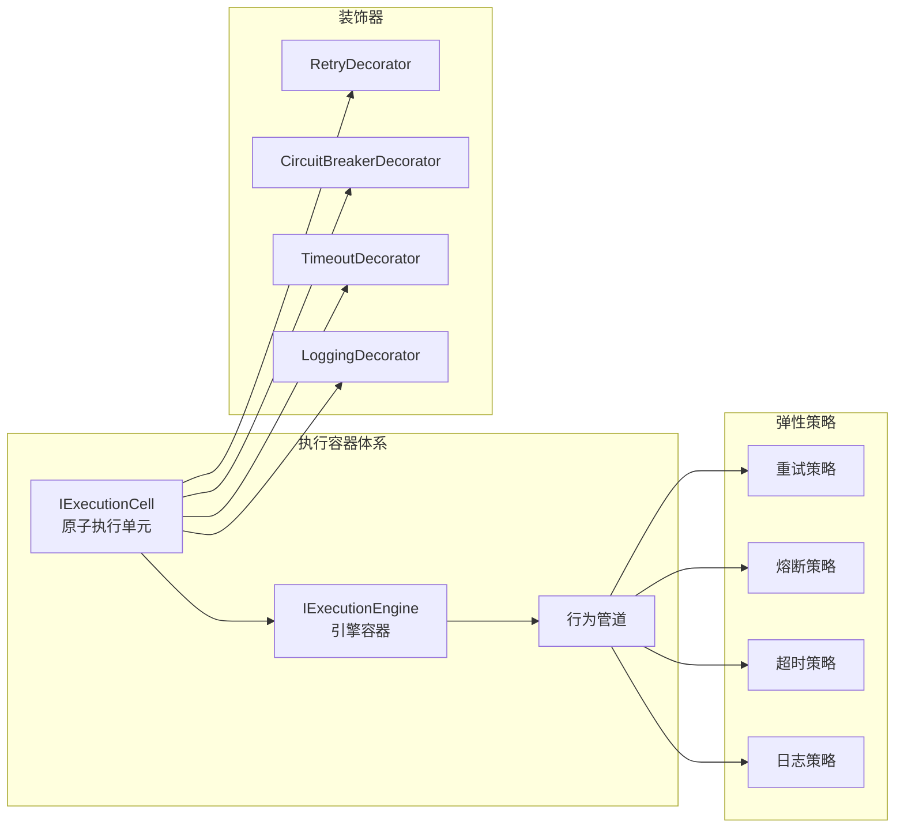
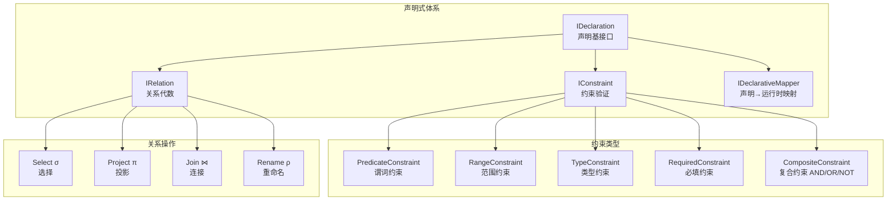

# BasicMethod.Map — 映射与编排基础框架

> **定位**：BasicMethod 层的"映射/编排/执行"基础体系  
> **设计哲学**：万物皆函数，一切皆可映射  
> **数学根基**：函数、态射、自动机、图论、关系代数、分段函数

---

## 1. 概述

`BasicMethod.Map` 是 WorkFlowPrj 基础方法库（BasicMethod）的核心子体系，提供了 **9 个并行的通用基础模块**，覆盖了软件开发中最基本的抽象模式：

| 模块 | 核心抽象 | 数学基础 |
| ------ | --------- | --------- |
| **Transformers** | 函数变换 `f: A → B` | 函数论（`Modules.Transformers`） |
| **SortMent** | 编排态射 | 范畴论态射（`BasicMethod.SortMent`） |
| **Block** | 分块执行 | 分段函数（`BasicMethod.Block`） |
| **StateMachine** | 状态转换 | 有限状态自动机（`Modules.StateMachine`） |
| **DecisionEngine** | 决策推理 | 决策规则引擎（`BasicMethod.DecisionEngine`） |
| **GraphFoundation** | 图数据结构 | 图论 `G = (V, E)`（`BasicMethod.GraphFoundation`） |
| **Container** | 弹性执行容器 | 命令模式 + 请求/响应（`Container.Abstractions`） |
| **Declarative** | 声明式描述 | 关系代数 + 谓词逻辑（`BasicMethod.Declarative`） |
| **Functor** | 函子传递 `F(v) = v` | 函子理论（`BasicMethod.Functor`） |

这些模块**彼此独立、互不依赖**，每个都是纯技术抽象，可被上层任意模块独立复用。

---

## 2. 模块全景图



> 所有模块**并行独立**，无依赖关系，可单独使用或任意组合。

---

## 3. 数学基础体系

每个模块都建立在明确的数学概念之上：



---

## 4. 核心模块详解

### 4.1 Transformers — 函数变换框架

**数学基础**：函数 `f: A → B`

将一切"从 A 到 B 的操作"统一抽象为 `ITransformer<TInput, TOutput>` 接口。



**核心能力**：

- **函数复合**：`g ∘ f` — 两个转换器组合为新转换器
- **管线编排**：多步骤顺序执行，支持失败策略
- **装饰器模式**：日志、重试、超时、缓存等横切关注点
- **上下文传播**：`TransformContext` 通过 AsyncLocal 隐式传递

**关键类型**：

| 类型 | 说明 |
| ------ | ------ |
| `ITransformer<TInput, TOutput>` | 同步转换器接口 |
| `IAsyncTransformer<TInput, TOutput>` | 异步转换器接口 |
| `CacheTransformer<TInput, TOutput>` | 缓存包装（`where TInput : notnull`） |
| `ConditionalTransformer<TInput, TOutput>` | 条件分支（条件为 false 且无 falseBranch 时抛出异常） |
| `TryTransformer<TInput, TOutput>` | 容错包装（输出 `Result<TOutput>`） |
| `GroupReducer<T>` | 分组归约（`IEnumerable<T> → IEnumerable<T>`） |
| `DelegateAdapter<TInput, TOutput>` | 委托适配器（函数/委托 → 转换器） |
| `AsyncComposition<TInput, TOutput>` | 异步组合器 |
| `TransformContext` | AsyncLocal 上下文 |
| `TransformerExtensions` | 扩展方法（复合/管线/装饰器） |

---

### 4.2 SortMent — 编排态射框架

**数学基础**：范畴论态射 `f: (A, ≤, ∼) → (B, ≤, ∼)`

在"纯函数变换"基础上，增加了**排序、分类、分组**等编排语义。



**核心能力**：

- **态射复合**：`g ∘ f` — 编排态射的组合
- **管线编排**：按 Order 排序后依次执行
- **分类处理**：按等价关系 ∼ 将输入划分到不同类别
- **分组处理**：按等价关系 ∼ 将集合划分为等价类
- **注册表模式**：按键注册和查找编排态射，支持策略模式

**关键类型**：

| 类型 | 说明 |
| ------ | ------ |
| `ISortMent<TSource, TTarget>` | 编排态射接口 |
| `IAsyncSortMent<TSource, TTarget>` | 异步编排态射 |
| `IClassifyMent<TSource, TCategory, TTarget>` | 分类态射 |
| `IGroupMent<TSource, TKey, TTarget>` | 分组态射 |
| `ISortMentPipeline<TContext>` | 编排管线 |
| `ISortMentRegistry<TKey, TSource, TTarget>` | 编排注册表 |

---

### 4.3 Block — 分块执行框架

**数学基础**：分段函数 `f(x) = { f₁(x), ..., fₙ(x) }`

将执行逻辑划分为多个独立块，每个块有独立的定义域和值域，通过 `BlockContext` 传递数据，每个块独立 try/catch 隔离。



**内置块类型**：

| 块类型 | 功能 |
| -------- | ------ |
| `DiagnosticBlock` | 执行前诊断检查 |
| `ConditionalBlock` | 条件分支（if-then-else） |
| `TimeoutBlock` | 超时控制 |
| `LogBlock` | 日志记录 |
| `SequenceBlock` | 子序列嵌套 |
| `DelayBlock` | 延迟执行 |

**关键类型**：

| 类型 | 说明 |
| ------ | ------ |
| `IBlock` | 执行块接口 |
| `BlockContext` | 块上下文（数据传递 + 诊断） |
| `ExecutionPipeline` | 执行管线 |
| `BlockResult` | 块执行结果 |
| `PipelineResult` | 管线执行报告 |

---

### 4.4 StateMachine — 状态机框架

**数学基础**：有限状态自动机 `(S, Σ, δ, s₀, F)`

提供四种状态转换型状态机模式，关注"状态如何合法变化"。



**四种模式**：

| 模式 | 说明 | 适用场景 |
| ------ | ------ | --------- |
| **Sequential** | 顺序执行，按步骤推进 | 工作流、安装向导 |
| **Lifecycle** | 生命周期管理，支持暂停/恢复 | 服务管理、会话管理 |
| **AsyncEvent** | 异步事件驱动 | 消息处理、事件驱动架构 |
| **Conditional** | 条件转换，带验证 | 审批流程、规则引擎 |

**配套组件**：

- `StateMachineStore` — 状态机存储，支持 TTL 自动清理
- `PauseManager` — 全局/局部暂停管理
- `ScopeStateManager` — 嵌套作用域状态管理

---

### 4.5 DecisionEngine — 决策引擎

**数学基础**：决策规则引擎

关注"下一步该做什么"——根据当前状态和上下文，通过规则评估做出决策。



**核心接口**：

```csharp
public interface IDecisionEngine<TState, TContext>
{
    Task<DecisionResult<TState>> DecideAsync(TContext context, ...);
    void SetCurrentState(TState state);
    void Reset();
}

```

**实现**：

- `RuleBasedDecisionEngine` — 基于规则的确定性决策
- `CompositeDecisionEngine` — 组合多个决策引擎
- `ConditionEvaluator` — 条件表达式评估器

---

### 4.6 GraphFoundation — 图基础框架

**数学基础**：图 `G = (V, E)`

提供通用的图数据结构和算法基础能力，存储与业务逻辑分离。



**核心能力**：

| 组件 | 功能 |
| ------ | ------ |
| `IGraph<TKey, TNodeData, TEdgeData>` | 图核心接口，定义图的基本操作 |
| `CoreGraph<TKey, TNodeData, TEdgeData>` | 图核心实现，事务 + 事件 + 编排 |
| `GraphFrame<TKey, TNodeData, TEdgeData>` | 图框架层，提供高级编排能力 |
| `IGraphStorage` | 存储抽象，支持内存/自定义存储 |
| `Chain` | 链式处理与编排系统 |
| `Topology` | 拓扑排序与关键路径 |
| `GraphSnapshot` | 图快照与差异比较 |
| `GraphNavigationExtensions` | 图遍历扩展方法 |
| `Commands.cs` | 图操作命令集 |

---

### 4.7 Container — 通用执行容器框架

**数学基础**：命令模式 + 请求/响应

提供原子执行单元和引擎容器，支持弹性策略（重试、熔断、超时、日志）。



**设计原则**：

- 所有输入输出通过不可变 record 传递，无 SharedData
- 运行时依赖通过构造函数注入，无隐式依赖
- 不依赖任何业务逻辑

---

### 4.8 Declarative — 声明式框架

**数学基础**：关系代数 + 谓词逻辑 + 约束满足问题

提供声明式编程的核心抽象——描述"是什么"（What），而非"怎么做"（How）。



**关键类型**：

| 类型 | 说明 |
| ------ | ------ |
| `IDeclaration` | 声明基接口 |
| `IDeclarationCollection` | 声明集合管理 |
| `IDeclarationResolver` | 声明解析器 |
| `IConstraint<T>` | 约束接口（谓词/范围/类型/必填/复合） |
| `IRelation` | 关系接口（选择/投影/连接/重命名） |
| `IDeclarativeMapper<TDeclaration, TRuntime>` | 声明→运行时映射器 |
| `DeclarationValidator<T>` | 声明验证器 |
| `DeclarationResult` | 声明执行结果 |

---

## 5. 使用场景指南

各模块可独立使用，也可按需自由组合：

| 场景 | 推荐模块 | 说明 |
| ------ | --------- | ------ |
| **数据清洗/ETL** | Transformers | 管线化数据转换 |
| **工作流引擎** | StateMachine | 状态驱动流程 |
| **策略模式** | SortMent Registry | 按键选择处理策略 |
| **声明式配置** | Declarative | 声明描述业务规则 |
| **弹性执行** | Container | 原子执行 + 重试/熔断/超时 |
| **图数据处理** | GraphFoundation | 图存储、拓扑排序、关键路径 |
| **分步隔离执行** | Block | 分段执行 + 诊断报告 |
| **规则验证** | Declarative Constraints | 约束满足问题求解 |
| **决策推理** | DecisionEngine | 规则驱动的下一步决策 |

---

## 6. 文件结构

```text
CsharpPrj/BasicMethod/Map/
├── Transformers/          # 函数变换框架（17 文件）
│   ├── Interfaces.cs      # 核心接口体系
│   ├── TransformContext.cs # AsyncLocal 上下文传播
│   ├── Decorator.cs       # 装饰器模式（日志/重试/超时）
│   ├── CacheTransformer.cs # 缓存包装
│   ├── ConditionalTransformer.cs # 条件分支
│   ├── TryTransformer.cs  # 容错包装
│   ├── GroupReducer.cs    # 分组归约
│   ├── DelegateAdapter.cs # 委托适配器
│   ├── AsyncComposition.cs # 异步组合器
│   ├── TransformerExtensions.cs # 扩展方法
│   └── ...
├── SortMent/              # 编排态射框架（5 文件）
│   ├── Interfaces.cs      # 10 个核心接口
│   ├── SortMentBase.cs    # 抽象基类体系
│   ├── SortMentCollection.cs # 集合与管线
│   ├── SortMentRegistry.cs   # 注册表模式
│   └── SortMentExtensions.cs # 扩展方法
├── Block/                 # 分块执行框架（6 文件）
│   ├── Interfaces.cs      # 核心接口
│   ├── BlockContext.cs    # 块上下文与结果类型
│   ├── ExecutionPipeline.cs # 执行管线
│   ├── BuiltInBlocks.cs   # 6 种内置块
│   ├── BlockBase.cs       # 抽象基类
│   └── BlockExtensions.cs # 扩展方法
├── StateMachine/          # 状态机框架（15 文件）
│   ├── StateMachine.Abstractions.cs # 核心接口
│   ├── SequentialStateMachine.cs    # 顺序状态机
│   ├── LifecycleStateMachine.cs     # 生命周期状态机
│   ├── ConditionalStateMachine.cs   # 条件状态机
│   ├── AsyncEventStateMachine.cs    # 异步事件状态机
│   ├── StateMachineStore.cs         # 状态机存储
│   ├── PauseManager.cs   # 暂停管理
│   ├── ScopeStateManager.cs # 作用域状态管理
│   └── ...
├── DecisionEngine/        # 决策引擎（4 文件）
│   ├── IDecisionEngine.cs # 核心接口 + 决策结果 + 规则定义
│   ├── RuleBasedDecisionEngine.cs   # 规则驱动实现
│   ├── CompositeDecisionEngine.cs   # 组合引擎
│   └── ConditionEvaluator.cs        # 条件评估器
├── GraphFoundation/       # 图基础框架（25 文件）
│   ├── Graph/             # 图核心（IGraph / CoreGraph / GraphFrame）
│   ├── Storage/           # 存储抽象（内存/自定义）
│   ├── Topology/          # 拓扑排序与关键路径
│   ├── Chain/             # 链式处理
│   ├── Navigation/        # 图遍历扩展
│   └── Snapshots/         # 图快照与差异比较
├── Container/             # 执行容器（24 文件）
│   ├── Abstractions/      # 核心接口
│   ├── Core/              # 执行单元与引擎
│   ├── Behaviors/         # 弹性策略行为
│   ├── Decorators/        # 装饰器实现
│   └── Extensions/        # 扩展方法
├── Declarative/           # 声明式框架（21 文件）
│   ├── Interfaces.cs      # 核心接口
│   ├── Abstractions/      # 抽象基类
│   ├── Constraints/       # 5 种约束类型
│   ├── Relations/         # 4 种关系操作
│   ├── Mappers/           # 声明→运行时映射
│   └── Resolvers/         # 声明解析器
└── Functor/               # 函子框架（5 文件）
    ├── Interfaces.cs      # IFunctor, IFunctorScope, IFunctorFactory
    ├── FunctorScope.cs    # 核心实现（AsyncLocal 隐式传播）
    ├── FunctorExtensions.cs # 扩展方法
    ├── FunctorBuilder.cs  # Fluent Builder + 静态入口
    └── BasicMethod.Functor功能介绍.md

```

---
代码仓库地址：`https://gitee.com/Ljy_111/ZhiLianStorage.git`
> **总结**：`BasicMethod.Map` 以明确的数学概念为根基，提供 **9 个并行独立**的通用基础模块。每个模块职责清晰、零外部依赖（Container 除外）、零业务耦合，可单独使用或按需自由组合，为上层应用提供从"声明式描述"到"函数式转换"到"编排执行"到"状态管理"到"函子传递"的完整基础能力。
