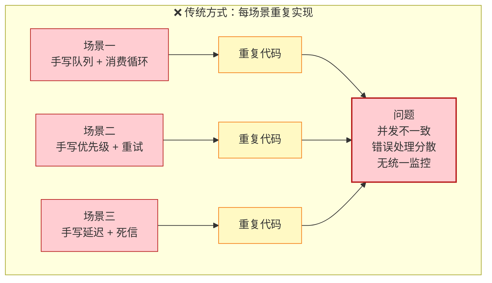
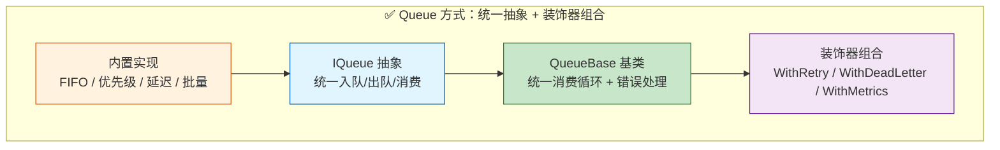
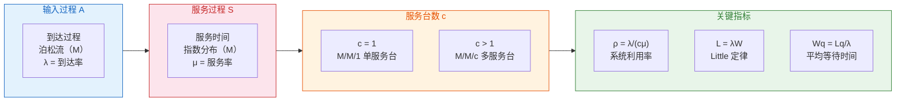
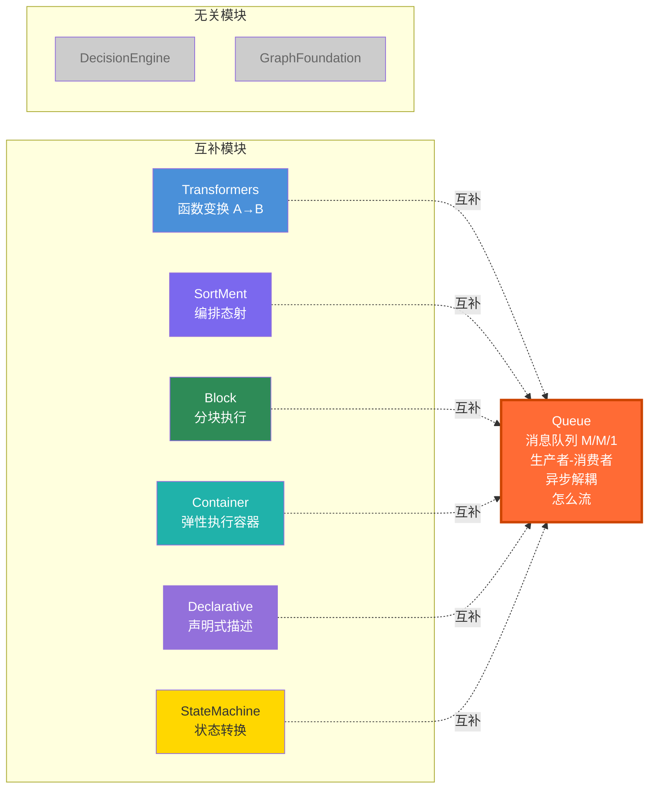

# BasicMethod.Queue — 消息队列框架

> **定位**：BasicMethod.Map 的第 9 个并行基础模块
> **数学根基**：队列理论（Queueing Theory）— M/M/1, M/M/c, 离散事件系统
> **核心公理**：`Enqueue: M → Queue(M)`，`Dequeue: Queue(M) → (bool, M)`
> **设计哲学**：万物皆队列，一切皆消息

---

## 1. 概述

`BasicMethod.Queue` 是 WorkFlowPrj 基础方法库（BasicMethod）的核心子体系，提供了 **消息队列的通用抽象**，覆盖了软件开发中最基本的队列模式。

### 问题

传统方式下，每个业务场景都需要手写一套消息处理逻辑：入队、出队、消费循环、失败重试、统计监控等，重复造轮子，且各场景的并发控制、错误处理策略不一致：



### 解决方案

基于队列理论：**统一抽象 + 装饰器扩展**。通过 `IQueue<TMessage>` 抽象 + `QueueBase<TMessage>` 基类统一消费循环，通过装饰器组合实现重试、死信、监控等横切关注点：



### 抽象层次

| 抽象 | 数学基础 | 说明 |
| ------ | --------- | ------ |
| **FIFO 队列** | M/M/1 队列模型 | 先进先出，生产者-消费者 |
| **优先级队列** | 偏序集 `(M, ≤)` | 按优先级出队 |
| **延迟队列** | 定时器 + 最小堆 | 消息延迟投递 |
| **批量队列** | 批处理理论 | 攒批后批量消费 |
| **死信队列** | 故障隔离 | 处理失败的消息自动转入 |
| **消息分发器** | 路由表 | 按消息类型/键分发 |

---

## 2. 数学基础

### 队列理论（Queueing Theory）

队列理论是研究排队现象的数学分支，核心模型为 Kendall 记号 `A/S/c`：



### 各类队列的数学对应

| 队列类型 | 数学模型 | 核心操作 |
|---------|---------|---------|
| **FIFO 队列** | M/M/1 — 先到先服务 | `Enqueue(m)` 追加末尾，`Dequeue()` 取头部 |
| **优先级队列** | 偏序集 `(M, ≤)` | `Enqueue(m, p)` 按 `p` 插入，`Dequeue()` 取最小 |
| **延迟队列** | 时间堆 `(M, t_due)` | `Enqueue(m, Δ)` 到期 `t_due = now + Δ` 后可消费 |
| **批量队列** | 批处理 `B = {m₁, ..., mₖ}` | 攒批到 `k = BatchSize` 或 `t = FlushInterval` 触发 |
| **死信队列** | 故障隔离 `DLQ = {(m, err)}` | 失败消息转入，支持重试 `DLQ → Queue` |
| **分发器** | 路由表 `R: Key → Queue` | `Dispatch(k, m)` 等价于 `R(k).Enqueue(m)` |

### 核心公理

- **入队语义**：`Enqueue: M → Queue(M)`，消息追加到队列
- **出队语义**：`Dequeue: Queue(M) → (bool, M)`，队列为空时返回 `false`
- **FIFO 不变量**：若 `m₁` 先于 `m₂` 入队，则 `m₁` 先于 `m₂` 出队
- **优先级不变量**：若 `p₁ ≤ p₂`，则 `m₁` 先于 `m₂` 出队（同优先级按 FIFO）

---

## 3. 核心接口体系

### 接口继承体系

```mermaid
classDiagram
    class IQueue~TMessage~ {
        <<interface>>
        +Name string
        +Count int
        +IsConsuming bool
        +EnqueueAsync(message, ct) Task~QueueResult~
        +EnqueueBatchAsync(messages, ct) Task~QueueResult~
        +TryDequeueAsync(ct) Task~(bool, TMessage)~
        +StartConsumingAsync(handler, ct) Task
        +StopConsumingAsync() Task
        +Clear() void
    }

    class IPriorityQueue~TMessage~ {
        <<interface>>
        +EnqueueAsync(message, priority, ct) Task~QueueResult~
    }

    class IDelayedQueue~TMessage~ {
        <<interface>>
        +EnqueueAsync(message, delay, ct) Task~QueueResult~
    }

    class IBatchQueue~TMessage~ {
        <<interface>>
        +BatchSize int
        +FlushInterval TimeSpan
        +StartConsumingAsync(batchHandler, ct) Task
    }

    class IQueueHandler~TMessage~ {
        <<interface>>
        +Name string
        +HandleAsync(message, ct) Task~QueueResult~
    }

    class IQueuePipeline~TMessage~ {
        <<interface>>
        +Name string
        +Handlers IReadOnlyList
        +AddHandler(handler) IQueuePipeline
        +InsertBefore(name, handler) IQueuePipeline
        +InsertAfter(name, handler) IQueuePipeline
        +Remove(name) IQueuePipeline
        +ExecuteAsync(message, ct) Task~QueueResult~
    }

    class IQueueDispatcher {
        <<interface>>
        +Name string
        +Register~T~(key, queue) IQueueDispatcher
        +Register~T~(key, handler) IQueueDispatcher
        +DispatchAsync~T~(key, message, ct) Task~QueueResult~
        +DispatchBatchAsync~T~(key, messages, ct) Task~QueueResult~
    }

    class IDeadLetterQueue~TMessage~ {
        <<interface>>
        +Name string
        +Count int
        +DeadLetterAsync(message, error, ct) Task
        +GetDeadLetters() IReadOnlyList
        +RetryAllAsync(targetQueue, ct) Task~int~
        +Clear() void
    }

    class IQueueMonitor~TMessage~ {
        <<interface>>
        +TotalEnqueued long
        +TotalDequeued long
        +TotalProcessed long
        +TotalFailed long
        +GetStats() QueueStats
    }

    IQueue <|-- IPriorityQueue : 继承
    IQueue <|-- IDelayedQueue : 继承
    IQueue <|-- IBatchQueue : 继承

    style IQueue fill:#e3f2fd,stroke:#1565c0
    style IPriorityQueue fill:#e8f5e9,stroke:#2e7d32
    style IDelayedQueue fill:#fff3e0,stroke:#e65100
    style IBatchQueue fill:#f3e5f5,stroke:#6a1b9a
    style IQueueHandler fill:#fce4ec,stroke:#c62828
    style IQueuePipeline fill:#fce4ec,stroke:#c62828
    style IQueueDispatcher fill:#fff9c4,stroke:#f57f17
    style IDeadLetterQueue fill:#ffcdd2,stroke:#b71c1c
    style IQueueMonitor fill:#c8e6c9,stroke:#2e7d32
```



### IQueue\<TMessage\> — 基础消息队列

**数学基础**：FIFO 队列，M/M/1 生产者-消费者模型

```csharp
public interface IQueue<TMessage>
{
    string Name { get; }
    int Count { get; }
    bool IsConsuming { get; }

    Task<QueueResult> EnqueueAsync(TMessage message, CancellationToken ct = default);
    Task<QueueResult> EnqueueBatchAsync(IEnumerable<TMessage> messages, CancellationToken ct = default);
    Task<(bool Success, TMessage? Message)> TryDequeueAsync(CancellationToken ct = default);
    Task StartConsumingAsync(Func<TMessage, CancellationToken, Task<QueueResult>> handler, CancellationToken ct = default);
    Task StopConsumingAsync();
    void Clear();
}
```

### IPriorityQueue\<TMessage\> — 优先级队列

**数学基础**：偏序集 `(M, ≤)`，优先级数值越小越优先出队

```csharp
public interface IPriorityQueue<TMessage> : IQueue<TMessage>
{
    Task<QueueResult> EnqueueAsync(TMessage message, int priority, CancellationToken ct = default);
}
```

### IDelayedQueue\<TMessage\> — 延迟队列

**数学基础**：定时器 + 最小堆，消息在指定延迟后投递

```csharp
public interface IDelayedQueue<TMessage> : IQueue<TMessage>
{
    Task<QueueResult> EnqueueAsync(TMessage message, TimeSpan delay, CancellationToken ct = default);
}
```

### IBatchQueue\<TMessage\> — 批量队列

**数学基础**：批处理理论，攒批后批量消费，提高吞吐量

```csharp
public interface IBatchQueue<TMessage> : IQueue<TMessage>
{
    int BatchSize { get; }
    TimeSpan FlushInterval { get; }

    Task StartConsumingAsync(
        Func<IReadOnlyList<TMessage>, CancellationToken, Task<QueueResult>> batchHandler,
        CancellationToken ct = default);
}
```

### IQueueHandler / IQueuePipeline — 处理器与管线

将消息处理逻辑封装为独立对象，支持注册、复用和管线式编排：

```csharp
public interface IQueueHandler<TMessage>
{
    string Name { get; }
    Task<QueueResult> HandleAsync(TMessage message, CancellationToken ct = default);
}

public interface IQueuePipeline<TMessage>
{
    string Name { get; }
    IReadOnlyList<IQueueHandler<TMessage>> Handlers { get; }
    IQueuePipeline<TMessage> AddHandler(IQueueHandler<TMessage> handler);
    IQueuePipeline<TMessage> InsertBefore(string name, IQueueHandler<TMessage> handler);
    IQueuePipeline<TMessage> InsertAfter(string name, IQueueHandler<TMessage> handler);
    IQueuePipeline<TMessage> Remove(string name);
    Task<QueueResult> ExecuteAsync(TMessage message, CancellationToken ct = default);
}
```

### IQueueDispatcher — 消息分发器

**数学基础**：路由表 `R: Key → Queue`，按消息类型/键分发到不同队列

```csharp
public interface IQueueDispatcher
{
    string Name { get; }
    IQueueDispatcher Register<TMessage>(string key, IQueue<TMessage> queue);
    IQueueDispatcher Register<TMessage>(string key, IQueueHandler<TMessage> handler);
    Task<QueueResult> DispatchAsync<TMessage>(string key, TMessage message, CancellationToken ct = default);
    Task<QueueResult> DispatchBatchAsync<TMessage>(string key, IEnumerable<TMessage> messages, CancellationToken ct = default);
}
```

### IDeadLetterQueue / IQueueMonitor — 死信与监控

```csharp
public interface IDeadLetterQueue<TMessage>
{
    string Name { get; }
    int Count { get; }
    Task DeadLetterAsync(TMessage message, string error, CancellationToken ct = default);
    IReadOnlyList<DeadLetterMessage<TMessage>> GetDeadLetters();
    Task<int> RetryAllAsync(IQueue<TMessage> targetQueue, CancellationToken ct = default);
    void Clear();
}

public interface IQueueMonitor<TMessage>
{
    long TotalEnqueued { get; }
    long TotalDequeued { get; }
    long TotalProcessed { get; }
    long TotalFailed { get; }
    QueueStats GetStats();
}
```

---

## 4. 抽象基类与实现体系

### 类继承体系

```mermaid
classDiagram
    class QueueBase~TMessage~ {
        <<abstract>>
        +Name string
        +Description string
        +Count int*
        +IsConsuming bool
        +MaxConsecutiveErrors int
        +event OnError
        +event OnMaxErrorsReached
        +EnqueueAsync(message, ct)* Task~QueueResult~
        +EnqueueBatchAsync(messages, ct) virtual Task~QueueResult~
        +TryDequeueAsync(ct)* Task~(bool, TMessage)~
        +StartConsumingAsync(handler, ct) virtual Task
        +StopConsumingAsync() virtual Task
        +Clear()* void
        #ConsumeLoopAsync(ct) virtual Task
        +Dispose() void
    }

    class QueueDecoratorBase~TMessage~ {
        <<abstract>>
        #_inner IQueue
        +Count int
        +EnqueueAsync(message, ct) Task~QueueResult~
        +TryDequeueAsync(ct) Task~(bool, TMessage)~
        +Clear() void
    }

    class MemoryQueue~TMessage~ {
        +Count int
        +TotalEnqueued long
        +TotalDequeued long
        +TotalProcessed long
        +TotalFailed long
        +GetStats() QueueStats
    }

    class MemoryPriorityQueue~TMessage~ {
        +Count int
        +EnqueueAsync(message, priority, ct) Task~QueueResult~
    }

    class MemoryDelayedQueue~TMessage~ {
        +Count int
        +EnqueueAsync(message, delay, ct) Task~QueueResult~
    }

    class MemoryBatchQueue~TMessage~ {
        +BatchSize int
        +FlushInterval TimeSpan
        +Count int
    }

    class DeadLetterQueue~TMessage~ {
        +Name string
        +Count int
        +DeadLetterAsync(message, error, ct) Task
        +GetDeadLetters() IReadOnlyList
        +RetryAllAsync(targetQueue, ct) Task~int~
    }

    class QueueHandlerBase~TMessage~ {
        <<abstract>>
        +Name string
        +Description string
        +HandleAsync(message, ct)* Task~QueueResult~
    }

    class DelegateQueueHandler~TMessage~ {
        -_handleFunc Func
        +HandleAsync(message, ct) Task~QueueResult~
    }

    class QueuePipeline~TMessage~ {
        +Name string
        +Handlers IReadOnlyList
        +AddHandler(handler) IQueuePipeline
        +ExecuteAsync(message, ct) Task~QueueResult~
    }

    class QueueDispatcher {
        +Name string
        +Description string
        +event OnConsumingError
        +Register~T~(key, queue) IQueueDispatcher
        +DispatchAsync~T~(key, msg, ct) Task~QueueResult~
        +Unregister(key) bool
    }

    QueueBase <|-- QueueDecoratorBase
    QueueBase <|-- MemoryQueue
    QueueBase <|-- MemoryPriorityQueue
    QueueBase <|-- MemoryDelayedQueue
    QueueBase <|-- MemoryBatchQueue
    QueueHandlerBase <|-- DelegateQueueHandler

    style QueueBase fill:#e3f2fd,stroke:#1565c0,stroke-width:3px
    style QueueDecoratorBase fill:#e8f5e9,stroke:#2e7d32
    style MemoryQueue fill:#fff3e0,stroke:#e65100
    style MemoryPriorityQueue fill:#fff3e0,stroke:#e65100
    style MemoryDelayedQueue fill:#fff3e0,stroke:#e65100
    style MemoryBatchQueue fill:#fff3e0,stroke:#e65100
    style DeadLetterQueue fill:#ffcdd2,stroke:#b71c1c
    style QueueHandlerBase fill:#f3e5f5,stroke:#6a1b9a,stroke-width:3px
    style DelegateQueueHandler fill:#fce4ec,stroke:#c62828
    style QueuePipeline fill:#fce4ec,stroke:#c62828
    style QueueDispatcher fill:#fff9c4,stroke:#f57f17
```



### QueueBase\<TMessage\> — 抽象基类

提供 `IQueue<TMessage>` 的默认实现，内置消费循环管理、批量入队默认实现、错误事件与连续失败保护：

```csharp
public abstract class QueueBase<TMessage> : IQueue<TMessage>, IDisposable
{
    public string Name { get; }
    public string Description { get; }
    public abstract int Count { get; }
    public bool IsConsuming { get; }
    public int MaxConsecutiveErrors { get; set; } = 10;

    public event EventHandler<Exception>? OnError;
    public event EventHandler<int>? OnMaxErrorsReached;

    public abstract Task<QueueResult> EnqueueAsync(TMessage message, CancellationToken ct = default);
    public virtual Task<QueueResult> EnqueueBatchAsync(IEnumerable<TMessage> messages, CancellationToken ct = default);
    public abstract Task<(bool Success, TMessage? Message)> TryDequeueAsync(CancellationToken ct = default);
    public virtual Task StartConsumingAsync(Func<TMessage, CancellationToken, Task<QueueResult>> handler, CancellationToken ct = default);
    public virtual Task StopConsumingAsync();
    public abstract void Clear();
    protected virtual Task ConsumeLoopAsync(CancellationToken ct);
}
```

**子类只需重写 3 个核心方法**：`EnqueueAsync`、`TryDequeueAsync`、`Clear`。

### 内置实现一览

| 实现 | 基类 | 接口 | 底层实现 |
| ------ | ------ | ------ | ------ |
| `MemoryQueue<T>` | `QueueBase` | `IQueue` + `IQueueMonitor` | `Channel<T>`（多生产者/多消费者） |
| `MemoryPriorityQueue<T>` | `QueueBase` | `IPriorityQueue` | `SortedSet<PriorityItem>`（按优先级+序列号排序） |
| `MemoryDelayedQueue<T>` | `QueueBase` | `IDelayedQueue` | `Timer` + `List<DelayedItem>`（最小堆 + 就绪子队列） |
| `MemoryBatchQueue<T>` | `QueueBase` | `IBatchQueue` | `List<T>` 缓冲区 + `Timer` 定时刷新 |
| `DeadLetterQueue<T>` | — | `IDeadLetterQueue` | `List<DeadLetterMessage>` |
| `QueueDispatcher` | — | `IQueueDispatcher` + `IDisposable` | `ConcurrentDictionary<string, object>` 路由表 |

---

## 5. 使用方式

### 消费流程

```mermaid
sequenceDiagram
    participant Producer as 生产者
    participant Queue as Queue
    participant Loop as 消费循环
    participant Handler as 处理器
    participant DLQ as 死信队列（可选）

    Producer->>Queue: EnqueueAsync(message)
    activate Queue
    Queue->>Queue: 写入 Channel / SortedSet / Buffer
    Queue-->>Producer: QueueResult.Ok

    Note over Queue,Loop: StartConsumingAsync 启动消费循环

    loop 持续消费
        Loop->>Queue: TryDequeueAsync()
        Queue-->>Loop: (true, message)
        Loop->>Handler: handler(message, ct)
        alt 处理成功
            Handler-->>Loop: QueueResult.Ok
            Loop->>Loop: 重置连续失败计数
        else 处理失败
            Handler-->>Loop: QueueResult.Fail / 异常
            Loop->>Loop: _consecutiveErrors++
            alt 达到 MaxConsecutiveErrors
                Loop->>Queue: 触发 OnMaxErrorsReached
                Note over Loop: 停止消费循环
            else 未达阈值
                Loop->>Loop: 退避等待 100ms
            end
            opt 装饰了 WithDeadLetter
                Loop->>DLQ: DeadLetterAsync(message, error)
            end
        end
    end

    Producer->>Queue: StopConsumingAsync()
    deactivate Queue
    Note over Queue: CancellationTokenSource.Cancel<br/>等待消费循环退出
```

### 方式一：基础 FIFO 队列

```csharp
// 创建内存队列
var queue = new MemoryQueue<string>("my-queue");

// 生产消息
await queue.EnqueueAsync("hello");
await queue.EnqueueAsync("world");

// 消费消息
await queue.StartConsumingAsync(async (msg, ct) =>
{
    Console.WriteLine($"收到: {msg}");
    return QueueResult.Ok();
});

// 停止消费
await queue.StopConsumingAsync();
```

### 方式二：优先级队列

```csharp
var pq = new MemoryPriorityQueue<WorkItem>("priority-queue");

// 优先级数值越小越优先
await pq.EnqueueAsync(new WorkItem("low", 10), priority: 10);
await pq.EnqueueAsync(new WorkItem("high", 1), priority: 1);
await pq.EnqueueAsync(new WorkItem("normal", 5), priority: 5);

// 出队顺序：high → normal → low
await pq.StartConsumingAsync(async (item, ct) =>
{
    Console.WriteLine($"处理: {item.Name}（优先级 {item.Priority}）");
    return QueueResult.Ok();
});
```

### 方式三：延迟队列

```csharp
var dq = new MemoryDelayedQueue<Notification>("delay-queue");

// 5 分钟后投递
await dq.EnqueueAsync(notification, delay: TimeSpan.FromMinutes(5));

// 立即投递（delay = TimeSpan.Zero）
await dq.EnqueueAsync(urgentNotification, delay: TimeSpan.Zero);

await dq.StartConsumingAsync(async (msg, ct) =>
{
    await SendNotificationAsync(msg);
    return QueueResult.Ok();
});
```

### 方式四：批量队列

```csharp
var bq = new MemoryBatchQueue<LogEntry>(
    name: "batch-queue",
    batchSize: 100,
    flushInterval: TimeSpan.FromSeconds(5));

// 消息先攒批，达到 100 条或 5 秒后触发批量消费
await bq.StartConsumingAsync(async (batch, ct) =>
{
    await SaveBatchAsync(batch);
    Console.WriteLine($"已保存 {batch.Count} 条日志");
    return QueueResult.Ok();
});

// 单条入队，自动攒批
foreach (var log in logs)
    await bq.EnqueueAsync(log);
```

### 方式五：装饰器组合

```csharp
// 创建基础队列
var baseQueue = new MemoryQueue<Order>("order-queue");

// 组合：重试 + 死信 + 监控
var queue = baseQueue
    .WithRetry(maxRetries: 3, retryDelay: TimeSpan.FromSeconds(1))
    .WithDeadLetter(deadLetterQueue: new DeadLetterQueue<Order>("order-dlq"))
    .WithMetrics();

await queue.StartConsumingAsync(async (order, ct) =>
{
    await ProcessOrderAsync(order);
    return QueueResult.Ok();
});

// 查看统计
if (queue is IQueueMonitor<Order> monitor)
{
    Console.WriteLine($"入队: {monitor.TotalEnqueued}, 成功: {monitor.TotalProcessed}, 失败: {monitor.TotalFailed}");
}
```

### 方式六：消息分发器

```csharp
var dispatcher = new QueueDispatcher("order-dispatcher");

// 按键注册队列
dispatcher.Register<Order>("normal", new MemoryQueue<Order>("normal-orders"));
dispatcher.Register<Order>("vip", new MemoryQueue<Order>("vip-orders"));

// 按键注册处理器（自动创建队列并启动消费）
dispatcher.Register<Order>("refund", new DelegateQueueHandler<Order>(
    "refund-handler",
    async (order, ct) =>
    {
        await ProcessRefundAsync(order);
        return QueueResult.Ok();
    }));

// 分发消息
await dispatcher.DispatchAsync("normal", normalOrder);
await dispatcher.DispatchAsync("vip", vipOrder);
await dispatcher.DispatchAsync("refund", refundOrder);

// 批量分发
await dispatcher.DispatchBatchAsync("normal", new[] { order1, order2, order3 });
```

### 方式七：处理管线

```csharp
// 构建处理管线
var pipeline = new QueuePipeline<Order>("order-pipeline")
    .AddHandler(new DelegateQueueHandler<Order>(
        "validate", async (order, ct) => ValidateOrder(order) ? QueueResult.Ok() : QueueResult.Fail("校验失败")))
    .AddHandler(new DelegateQueueHandler<Order>(
        "enrich", async (order, ct) => { EnrichOrder(order); return QueueResult.Ok(); }))
    .AddHandler(new DelegateQueueHandler<Order>(
        "persist", async (order, ct) => { await SaveOrderAsync(order); return QueueResult.Ok(); }));

// 插入到指定位置
pipeline.InsertBefore("persist", new DelegateQueueHandler<Order>(
    "audit", async (order, ct) => { AuditOrder(order); return QueueResult.Ok(); }));

// 执行管线
var result = await pipeline.ExecuteAsync(order);
if (!result.IsSuccess)
    Console.WriteLine($"管线失败: {result.Message}");
```

---

## 6. 与 Map 其他模块的关系



| 模块 | 关系 |
|------|------|
| **Transformers** | 互补 — Transformers 做同步函数变换 `A→B`，Queue 做异步消息传递 `M→Queue(M)→M'` |
| **SortMent** | 互补 — SortMent 编排同步执行顺序，Queue 解耦异步生产者-消费者 |
| **Block** | 互补 — Block 分块执行同步逻辑，Queue 分发异步消息流 |
| **StateMachine** | 互补 — StateMachine 描述消息状态机（Pending→Queued→Processing→Completed/Dead），Queue 实现状态流转 |
| **DecisionEngine** | 无关 |
| **GraphFoundation** | 无关 |
| **Container** | 互补 — Container 提供执行单元，Queue 提供执行单元间的消息通道 |
| **Declarative** | 互补 — Declarative 声明"有什么"，Queue 实现"怎么流" |

---

## 7. 重构记录

### 7.1 2026-07-11 — 抽象基类体系重构

**目标**：将 `QueueBase<TMessage>` 从接口实现提升为抽象基类，消除代码重复，统一消费循环管理。

**变更内容：**

| 变更 | 说明 |
| ------ | ------ |
| `QueueBase<TMessage>` 改为 `abstract class` | 提供 `IQueue<TMessage>` 的默认实现，子类只需重写核心入队/出队逻辑 |
| 新增 `QueueHandlerBase<TMessage>` | 消息处理器抽象基类，子类只需重写 `HandleAsync` |
| 新增 `DelegateQueueHandler<TMessage>` | 将 `Func` 委托包装为 `IQueueHandler`，方便快速创建处理器 |
| 新增 `QueuePipeline<TMessage>` | 多个消息处理器按顺序执行，形成处理管线 |
| 新增 `QueueDecoratorBase<TMessage>` | 队列装饰器抽象基类，自动转发核心方法到内部队列 |
| 内置队列改为继承 `QueueBase<TMessage>` | `MemoryQueue`、`MemoryPriorityQueue`、`MemoryDelayedQueue`、`MemoryBatchQueue` 均继承基类 |
| 消费循环统一 | 消费循环逻辑从各内置队列中提取到 `QueueBase.ConsumeLoopAsync` |
| `MessageEnvelope<TMessage>` 改为 `class` | 原为 `record`，`Headers` 属性改为可写 `set` 以支持运行时修改 |
| 统计字段改为 `private long` | `TotalEnqueued`/`TotalDequeued`/`TotalProcessed`/`TotalFailed` 改为字段 + 只读属性，支持 `Interlocked.Increment` |

**影响范围：**

- 所有内置队列的代码量减少约 40%（消费循环不再重复）
- 新增队列实现只需继承 `QueueBase<TMessage>` + 重写 3 个方法
- 向后兼容：`IQueue<TMessage>` 接口不变，所有公开 API 签名不变

---

## 8. 文件结构

```text
CsharpPrj/BasicMethod/Map/Queue/
├── Queue.csproj                    # 项目文件
├── BasicMethod.Queue功能介绍.md    # 功能介绍文档
├── Interfaces.cs                   # 核心接口体系（IQueue / IPriorityQueue / IDelayedQueue / IBatchQueue / IQueueHandler / IQueuePipeline / IQueueDispatcher / IDeadLetterQueue / IQueueMonitor）
├── QueueBase.cs                    # 抽象基类体系（QueueBase / QueueHandlerBase / DelegateQueueHandler / QueuePipeline / QueueDecoratorBase）
├── QueueContext.cs                 # 消息上下文与结果类型（MessageStatus / QueueResult / MessageEnvelope / DeadLetterMessage / QueueStats / QueueConsumeContext）
├── BuiltInQueues.cs                # 内置队列实现（MemoryQueue / MemoryPriorityQueue / MemoryDelayedQueue / MemoryBatchQueue / DeadLetterQueue）
├── QueueDispatcher.cs              # 消息分发器（QueueDispatcher）
└── QueueExtensions.cs              # 扩展方法（WithRetry / WithDeadLetter / WithMetrics / Compose + 内部装饰器实现）
```
