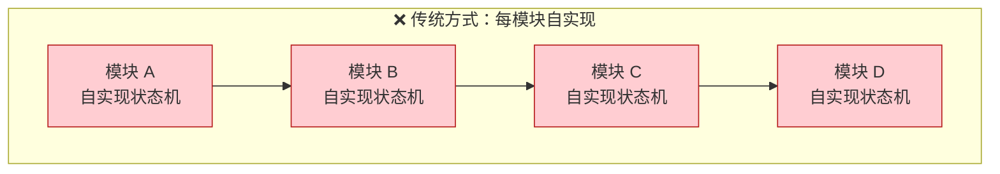
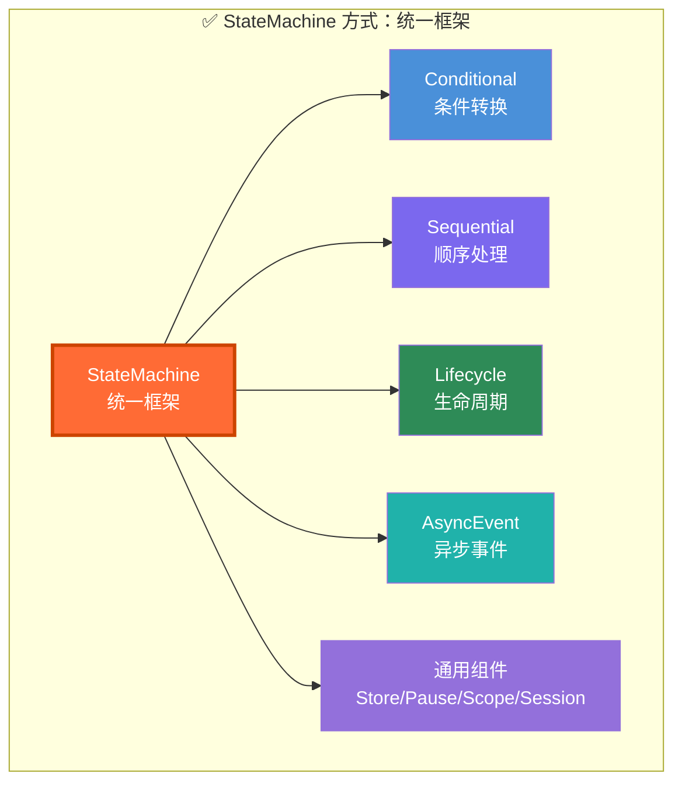
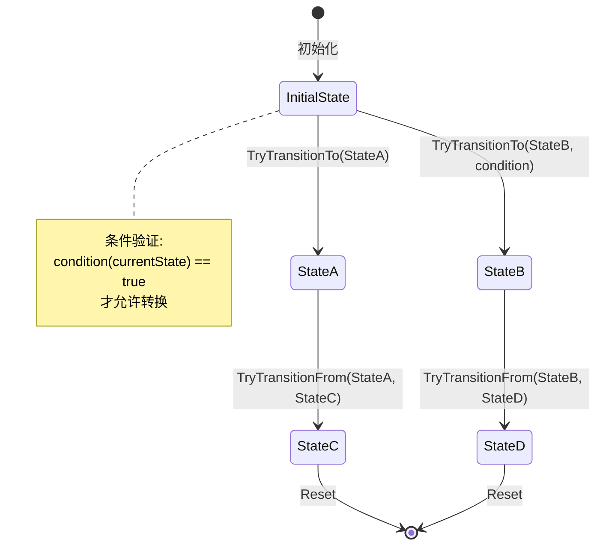
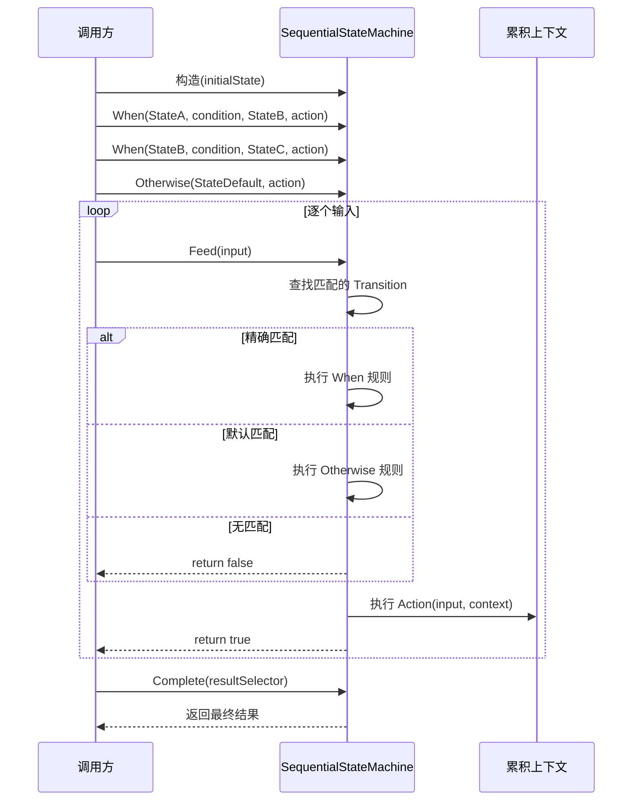
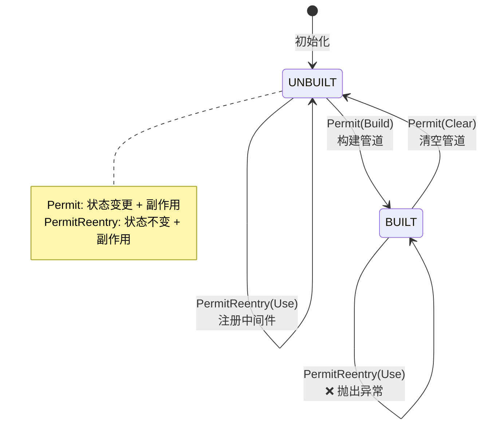
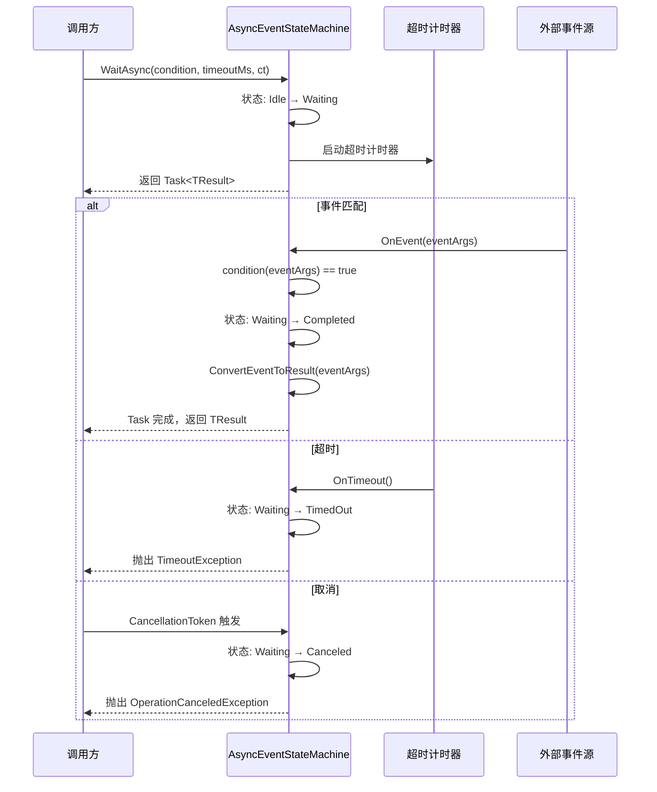
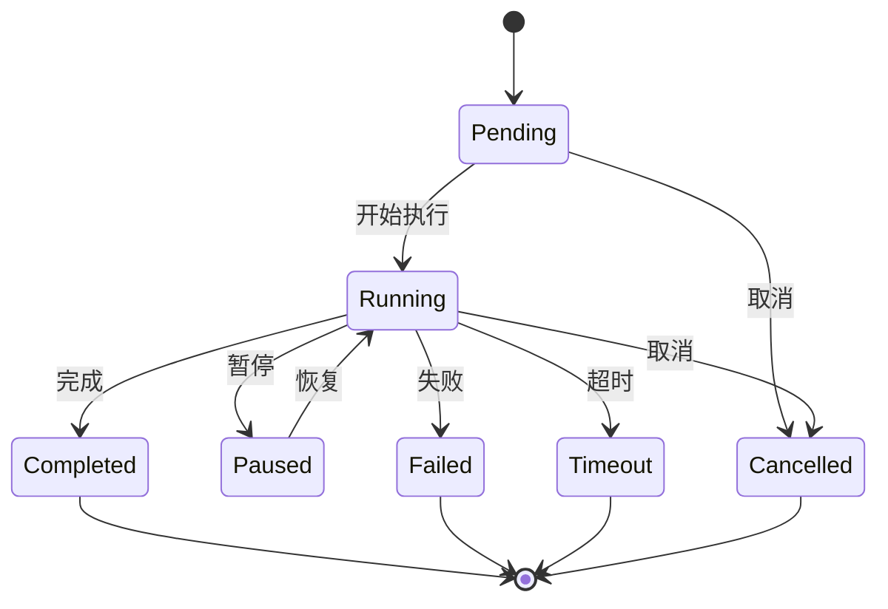
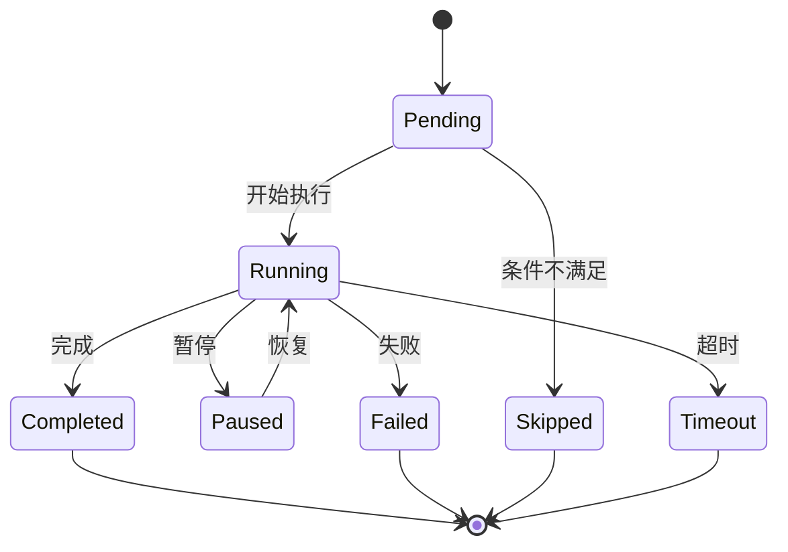
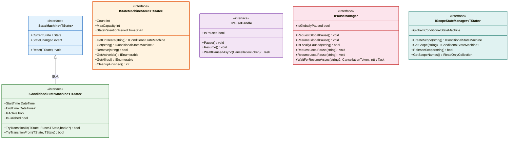
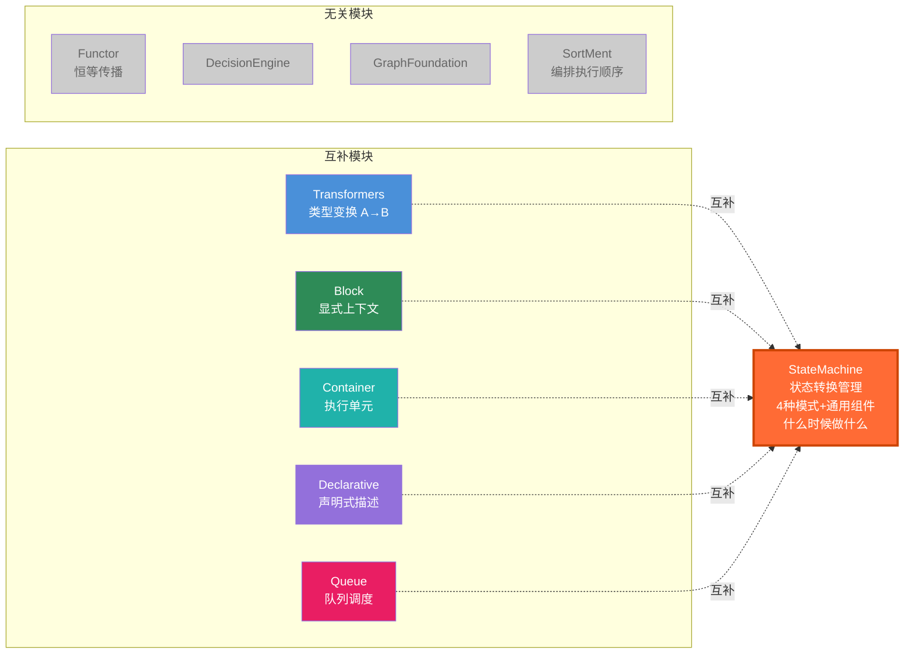

# BasicMethod.StateMachine — 状态机框架

> **定位**：BasicMethod.Map 的状态机基础框架模块  
> **核心能力**：4 种状态转换模式 + 4 个通用组件 + 2 个预定义状态枚举  
> **设计哲学**：零外部依赖，纯 .NET 基础类库  
> **适用场景**：工作流编排、执行单元生命周期管理、事件驱动协调、线性处理管道

---

## 1. 概述

`BasicMethod.StateMachine` 是一个**零外部依赖**的通用状态机基础框架。它解决了工作流/执行单元在不同场景下需要不同状态转换模式的问题，提供四种正交的状态机模式，覆盖从简单的条件转换到复杂的异步事件驱动的全场景。

### 问题

传统方式下，每个需要状态管理的模块都要自行实现状态转换逻辑，导致大量重复代码：



### 解决方案

基于四种正交的状态机模式 + 通用组件，统一状态管理：



---

## 2. 四种状态机模式

### 2.1 ConditionalStateMachine — 条件转换状态机

**核心特征**：通过 `TryTransitionTo/TryTransitionFrom` 进行状态转换，支持条件验证和时间追踪。

**适用场景**：执行状态管理（Pending→Running→Completed/Faulted）、工作流编排、资源生命周期管理。

**状态转换图**：



**使用示例**：

```csharp
enum Status { Idle, Running, Completed, Faulted }

var sm = new ConditionalStateMachine<Status>(Status.Idle);

// 无条件转换
sm.TryTransitionTo(Status.Running);  // true

// 条件转换：仅当当前状态为 Running 时才允许
sm.TryTransitionTo(Status.Completed, s => s == Status.Running);  // true

// 期望状态验证：仅当当前状态为 Running 时才允许转换到 Faulted
sm.TryTransitionFrom(Status.Running, Status.Faulted);  // false（当前是 Completed）

// 状态查询
Console.WriteLine(sm.CurrentState);  // Completed
Console.WriteLine(sm.IsFinished);    // false（需子类重写）
Console.WriteLine(sm.StartTime);     // 初始化时间
```

**与 LifecycleStateMachine 的区别**：

| 特性 | ConditionalStateMachine | LifecycleStateMachine |
|------|------------------------|----------------------|
| 转换方式 | 条件验证 `TryXxx` | 操作驱动 `Permit/Fire` |
| 非法转换 | 返回 false | 抛出 `InvalidTransitionException` |
| 时间追踪 | 内置 StartTime/EndTime | 无 |
| 状态快照 | `GetSnapshot()` | 无 |

---

### 2.2 SequentialStateMachine — 顺序处理状态机

**核心特征**：处理逐个输入的字符/Token 流，根据当前状态决定转换和累积输出。

**适用场景**：CommandTokenizer（char→token列表）、RestoreJsonObject（char→JSON）、ParseCondition（char→解析结果）、FindAdapter（Type→适配器）等线性处理管道。

**处理流程**：



**使用示例**：

```csharp
// 示例：简单的 Tokenizer
enum TokenizerState { NORMAL, IN_QUOTE }

var sm = new SequentialStateMachine<char, StringBuilder, List<string>>(
    (int)TokenizerState.NORMAL);

// 注册转换规则
sm.When((int)TokenizerState.NORMAL,  c => c == '"',
        (int)TokenizerState.IN_QUOTE);

sm.When((int)TokenizerState.NORMAL,  c => char.IsWhiteSpace(c),
        (int)TokenizerState.NORMAL, (c, ctx) => FlushToken(ctx));

sm.When((int)TokenizerState.NORMAL,  c => true,
        (int)TokenizerState.NORMAL, (c, ctx) => ctx.Append(c));

sm.When((int)TokenizerState.IN_QUOTE, c => c == '"',
        (int)TokenizerState.NORMAL, (c, ctx) => FlushToken(ctx));

sm.Otherwise((int)TokenizerState.NORMAL);

// 处理输入
foreach (char c in input) sm.Feed(c);

// 获取结果
var tokens = sm.Complete(ctx => ExtractTokens(ctx));
```

---

### 2.3 LifecycleStateMachine — 生命周期状态机

**核心特征**：通过操作触发状态转换，伴随副作用，可检测非法转换。

**适用场景**：MiddlewarePipeline（Use/Build/Clear）、CommandRouter（Register/Unregister/SetActive）等具有明确生命周期阶段的管理类。

**状态转换图**：



**使用示例**：

```csharp
enum PipelineOp { Use, Build, Clear }

var sm = new LifecycleStateMachine<PipelineOp>(UNBUILT);

// 注册许可转换
sm.Permit(UNBUILT, PipelineOp.Use,   UNBUILT, () => middlewares.Add(mw));
sm.Permit(UNBUILT, PipelineOp.Build, BUILT,   () => BuildPipeline());
sm.Permit(BUILT,   PipelineOp.Clear, UNBUILT, () => ClearPipeline());

// 执行操作
sm.Fire(PipelineOp.Use);    // 成功，状态不变
sm.Fire(PipelineOp.Build);  // 成功，状态变为 BUILT
sm.Fire(PipelineOp.Build);  // 抛出 InvalidTransitionException！

// 安全检查
if (sm.CanFire(PipelineOp.Clear))
    sm.Fire(PipelineOp.Clear);

// 获取允许的操作
var allowed = sm.GetAllowedOperations();
```

---

### 2.4 AsyncEventStateMachine — 异步事件状态机

**核心特征**：等待外部事件触发，支持超时和取消。

**适用场景**：WaitAsync（等待控件状态变化）、事件驱动的异步协调、UI 自动化等待。

**等待流程**：



**使用示例**：

```csharp
var awaiter = new AsyncEventStateMachine<EventArgs, bool>();

// 在另一个线程/事件处理器中触发
control.SomeEvent += (s, e) => awaiter.OnEvent(e);

// 等待事件发生（超时 5 秒）
try
{
    var result = await awaiter.WaitAsync(
        e => CheckCondition(control, expectedValue),
        timeoutMs: 5000,
        cancellationToken: ct);

    Console.WriteLine("事件匹配成功");
}
catch (TimeoutException)
{
    Console.WriteLine("等待超时");
}
catch (OperationCanceledException)
{
    Console.WriteLine("等待被取消");
}

// 重置状态机，可重复使用
awaiter.Reset();
```

---

## 3. 预定义状态枚举

### 3.1 ExecutionStatus — 执行单元生命周期

描述一个执行单元（工作流、任务、操作等）从创建到完成的完整生命周期状态。



| 状态 | 值 | 说明 |
|------|-----|------|
| `Pending` | 0 | 待执行 — 初始状态，尚未开始 |
| `Running` | 1 | 执行中 — 正在执行 |
| `Completed` | 2 | 已完成 — 执行成功 |
| `Failed` | 3 | 执行失败 — 发生错误 |
| `Cancelled` | 4 | 已取消 — 被外部取消 |
| `Paused` | 5 | 已暂停 — 执行被暂停（可恢复） |
| `Timeout` | 6 | 超时 — 超过指定时间未完成 |

### 3.2 NodeStatus — 工作流节点状态

描述工作流图中单个节点（步骤/活动）的执行状态，在 ExecutionStatus 基础上增加 `Skipped` 状态。



| 状态 | 值 | 说明 |
|------|-----|------|
| `Pending` | 0 | 待执行 — 初始状态，尚未开始 |
| `Running` | 1 | 执行中 — 正在执行 |
| `Completed` | 2 | 已完成 — 执行成功 |
| `Failed` | 3 | 执行失败 — 发生错误 |
| `Skipped` | 4 | 已跳过 — 因条件不满足被跳过 |
| `Paused` | 5 | 已暂停 — 执行被暂停（可恢复） |
| `Timeout` | 6 | 超时 — 超过指定时间未完成 |

---

## 4. 通用组件

### 4.1 StateMachineStore — 状态机存储

管理多个 `ConditionalStateMachine` 实例，支持 TTL 自动清理。

```csharp
var store = new StateMachineStore<ExecutionStatus>
{
    MaxCapacity = 1000,
    StateRetentionPeriod = TimeSpan.FromMinutes(5)
};

// 获取或创建状态机
var sm = store.GetOrCreate("execution-1");
sm.TryTransitionTo(ExecutionStatus.Running);

// 批量操作
store.CleanupFinished();  // 清理已结束的实例
var activeIds = store.GetActiveIds();  // 获取活跃实例
```

### 4.2 PauseHandle / PauseManager — 暂停/恢复控制

提供两级暂停控制：

- **PauseHandle**：单实例暂停/恢复，基于 `TaskCompletionSource` 实现高效异步等待
- **PauseManager**：全局暂停（Interlocked）+ 局部暂停（作用域）

```csharp
// PauseHandle — 单实例暂停
var handle = new PauseHandle();

// 在异步方法中等待暂停
await handle.WaitIfPausedAsync(cancellationToken);

// 在其他地方控制暂停/恢复
handle.Pause();
handle.Resume();

// PauseManager — 全局/局部暂停
var pm = new PauseManager();

// 全局暂停
pm.RequestGlobalPause();
await pm.WaitForResumeAsync(null, CancellationToken.None);

// 局部暂停（作用域级别）
pm.RequestLocalPause("scope-1");
await pm.WaitForResumeAsync("scope-1", CancellationToken.None);
```

### 4.3 ScopeStateManager — 作用域状态管理器

支持嵌套作用域，每个作用域可独立管理状态。

```csharp
var manager = new ScopeStateManager<ExecutionStatus>();

// 全局状态
manager.Global.TryTransitionTo(ExecutionStatus.Running);

// 创建作用域
var scope = manager.CreateScope("workflow-1");
scope.TryTransitionTo(ExecutionStatus.Running);

// 获取作用域
var s = manager.GetScope("workflow-1");

// 释放作用域
manager.ReleaseScope("workflow-1");
```

### 4.4 SessionManagerStateMachine — 会话管理器状态机

一站式会话管理：集成 `ExecutionStateMachineBase` + `CancellationTokenSource` + `PauseManager`。

```csharp
var manager = new SessionManagerStateMachine<ExecutionStatus>(
    maxCapacity: 1000,
    retentionPeriod: TimeSpan.FromMinutes(5));

// 创建会话
var session = manager.CreateSession(
    "session-1",
    ExecutionStatus.Pending,
    ExecutionStatus.Running,
    ExecutionStatus.Paused);

session.MarkRunning();    // Pending → Running
session.MarkPaused();     // Running → Paused
session.MarkRunning();    // Paused → Running
session.MarkCompleted();  // Running → Completed

// 取消会话
manager.CancelSession("session-1");

// 清理已结束会话
manager.CleanupFinished();

// 暂停/恢复
manager.RequestGlobalPause();
manager.ResumeGlobalPause();
```

---

## 5. 基础设施

### 5.1 接口继承体系



### 5.2 ExecutionStateMachineBase — 执行状态机基类

封装执行单元（会话/节点/任务等）的通用生命周期状态管理，提供语义化的 `MarkXxx()` 方法。

```csharp
// 会话场景
var session = new ExecutionStateMachineBase<ExecutionStatus>(
    "session-1", ExecutionStatus.Pending,
    ExecutionStatus.Running, ExecutionStatus.Paused);

session.MarkRunning();    // Pending → Running（递增 ExecutionCount）
session.MarkPaused();     // Running → Paused
session.MarkRunning();    // Paused → Running（递增 ExecutionCount）
session.MarkCompleted();  // Running → Completed

Console.WriteLine(session.Status);          // Completed
Console.WriteLine(session.IsFinished);      // true
Console.WriteLine(session.ExecutionCount);  // 2
Console.WriteLine(session.Duration);        // 持续时间

// 节点场景（支持重试）
var node = new ExecutionStateMachineBase<NodeStatus>(
    "node-1", NodeStatus.Pending,
    NodeStatus.Running, NodeStatus.Paused);

node.MarkRunning();     // Pending → Running
node.MarkFailed("Error occurred");
Console.WriteLine(node.ErrorMessage);  // "Error occurred"

node.Reset(NodeStatus.Pending);
node.MarkRunning();     // Pending → Running（重试）
node.MarkCompleted();   // Running → Completed
Console.WriteLine(node.ExecutionCount);  // 2
```

### 5.3 StateRecord — 状态记录

在状态追踪基础上，额外记录动作执行历史（CompletedActions/FailedActions）。

```csharp
var record = new StateRecord<ExecutionStatus>("workflow-1");

record.SetStatus(ExecutionStatus.Running);
record.SetCurrentAction("LoadData");
record.AddCompletedAction("LoadData");
record.Complete(ExecutionStatus.Completed);

Console.WriteLine(record.Duration);           // 持续时间
Console.WriteLine(record.CompletedActions.Count);  // 1
Console.WriteLine(record.FailedActions.Count);     // 0

// 获取不可变快照
var snapshot = record.GetSnapshot();
```

### 5.4 StateChangeEmitter — 状态变更事件触发器

消除多个状态机实现中重复的 event 声明与触发模式，提供线程安全的事件订阅/触发。

```csharp
// 所有状态机内部统一使用 StateChangeEmitter
// 对外暴露标准 event 接口
var sm = new ConditionalStateMachine<ExecutionStatus>();

sm.StateChanged += (sender, args) =>
{
    Console.WriteLine($"{args.FromState} → {args.ToState}");
    Console.WriteLine($"操作: {args.Operation}");
    Console.WriteLine($"时间: {args.Timestamp}");
};
```

### 5.5 异常定义

| 异常 | 说明 |
|------|------|
| `InvalidTransitionException` | 非法状态转换 — 当状态机不允许指定的转换时抛出 |
| `StateMachineConfigurationException` | 状态机配置异常 — 当状态机配置存在冲突或错误时抛出 |

---

## 6. 与 Map 其他模块的关系



| 模块 | 关系 |
|------|------|
| **Transformers** | 互补 — Transformers 做类型变换 `A→B`，StateMachine 管理变换过程中的状态 |
| **Block** | 互补 — BlockContext 提供显式上下文，StateMachine 管理上下文的生命周期状态 |
| **Container** | 互补 — Container 提供执行单元，StateMachine 管理执行单元的状态转换 |
| **Declarative** | 互补 — Declarative 声明"有什么"，StateMachine 管理"什么时候做什么" |
| **Queue** | 互补 — Queue 管理任务排队，StateMachine 管理队列中每个任务的状态 |
| **Functor** | 无关 — Functor 做恒等传播，StateMachine 做状态转换 |
| **DecisionEngine** | 无关 |
| **GraphFoundation** | 无关 |
| **SortMent** | 无关 — SortMent 编排执行顺序，StateMachine 管理单个执行单元的状态 |

---

## 7. 文件结构

```
StateMachine/
├── StateMachine.csproj                    # 项目文件（零外部依赖）
├── StateMachine.Abstractions.cs           # 接口定义 + 异常定义
├── ExecutionStatus.cs                     # 执行状态枚举（7 种状态）
├── NodeStatus.cs                          # 节点状态枚举（7 种状态）
│
├── ConditionalStateMachine.cs             # 条件转换状态机
├── SequentialStateMachine.cs              # 顺序处理状态机
├── LifecycleStateMachine.cs               # 生命周期状态机
├── AsyncEventStateMachine.cs              # 异步事件状态机
│
├── ExecutionStateMachineBase.cs           # 执行状态机基类（MarkXxx 语义化方法）
├── StateRecord.cs                         # 状态记录（动作执行历史追踪）
├── StateChangeEmitter.cs                  # 状态变更事件触发器
│
├── StateMachineStore.cs                   # 状态机存储（多实例管理 + TTL）
├── PauseHandle.cs                         # 暂停句柄（单实例暂停/恢复）
├── PauseManager.cs                        # 暂停管理器（全局/局部暂停）
├── ScopeStateManager.cs                   # 作用域状态管理器
├── SessionManagerStateMachine.cs          # 会话管理器状态机
│
└── BasicMethod.StateMachine功能介绍.md    # 本文档
```
