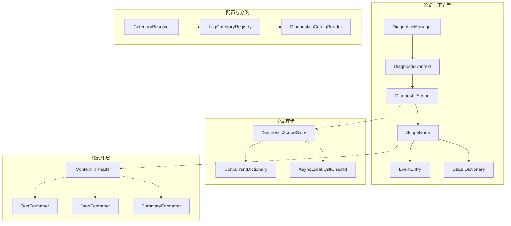
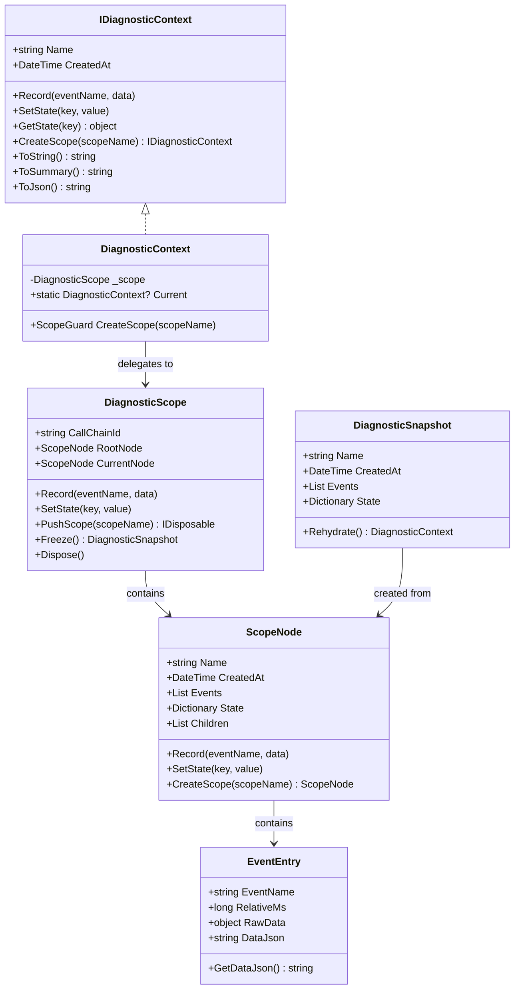
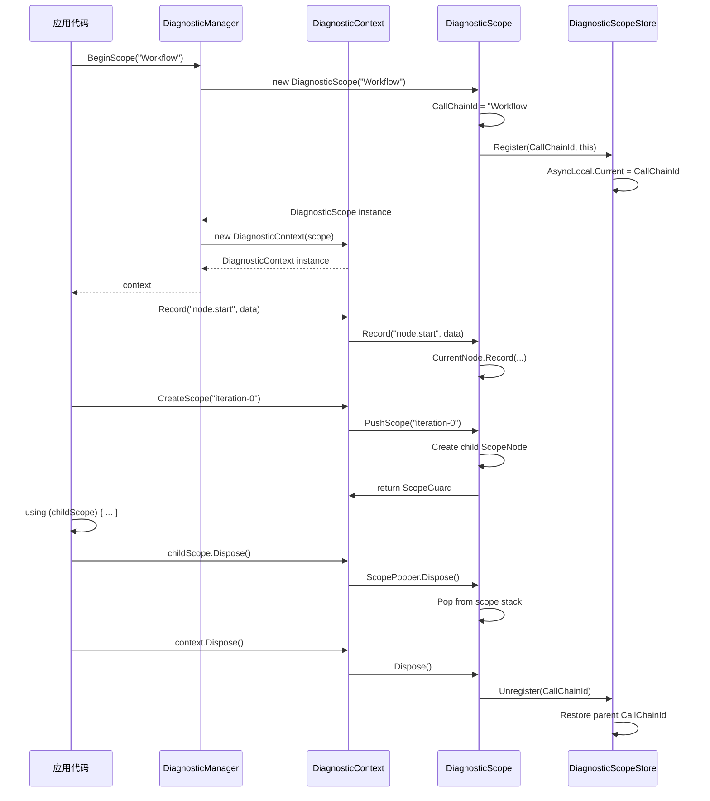
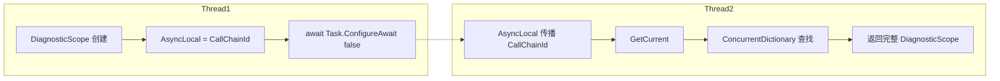
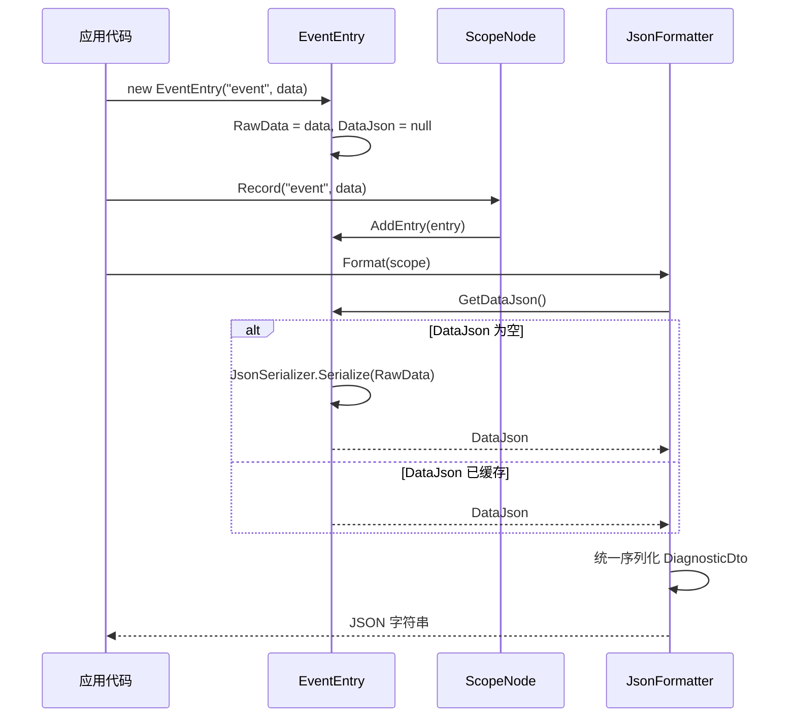
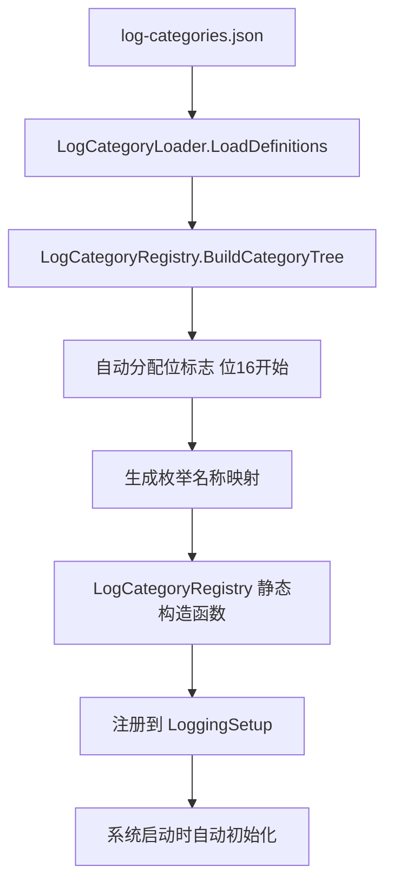

# DiagnosticContext 模块设计文档

> **版本：** v1.0
> **更新日期：** 2026-07-20
> **维护者：** WorkFlowPrj Team
>
> **配套文档：** [Document_Modular_Standard.md](../../../Structuring/Document_Modular_Standard.md)（文档模块化规范）

---

## 目录

- [DiagnosticContext 模块设计文档](#diagnosticcontext-模块设计文档)
  - [目录](#目录)
  - [第一部分：背景与方案](#第一部分背景与方案)
    - [1.1 现状与问题](#11-现状与问题)
    - [1.2 方案总览](#12-方案总览)
    - [1.3 目录索引](#13-目录索引)
  - [第二部分：核心设计](#第二部分核心设计)
    - [2.1 数据结构与接口](#21-数据结构与接口)
    - [2.2 核心流程](#22-核心流程)
    - [2.3 通信与适配](#23-通信与适配)
    - [2.3.4 API 使用示例](#234-api-使用示例)
  - [第三部分：实施步骤](#第三部分实施步骤)
    - [3.1 阶段划分](#31-阶段划分)
    - [3.2 优先级与顺序](#32-优先级与顺序)
    - [3.3 与现有系统的关系](#33-与现有系统的关系)
  - [总结](#总结)

---

## 第一部分：背景与方案

### 1.1 现状与问题

DiagnosticContext 模块是通用运行状态聚合框架，整合了原 Share/Diagnostics 层的诊断通用组件。该模块提供插桩点记录、状态跟踪、嵌套作用域管理等核心能力，替代散落在代码各处的 `Debug.WriteLine` 调用。

| 问题 | 表现 | 根因 |
|------|------|------|
| AsyncLocal 上下文丢失 | 在 `async/await + ConfigureAwait(false)` 场景下，诊断上下文无法正确传播 | AsyncLocal 在上下文切换时会丢失对大对象的引用 |
| 引用比较失败 | `DiagnosticContext.Current` 每次调用返回新实例，导致引用比较（`==`）始终为 false | 未缓存包装实例 |
| 双重序列化转义 | EventEntry 在构造时预序列化，JsonFormatter 再次序列化导致 JSON 字符串被转义 | 数据在多个环节重复序列化 |
| 代码重复 | Share 层存在 6 个重复的 DiagnosticContext 文件 | 缺乏统一的代理入口 |
| 配置分散 | 各模块硬编码日志分类定义，新增分类需修改代码 | 缺乏配置驱动的动态分类注册机制 |

### 1.2 方案总览

| 维度 | 当前方案 | 新方案 |
|------|----------|--------|
| 上下文传播 | AsyncLocal 传播完整对象 | AsyncLocal 只传播 CallChainId（字符串），数据存储在 ConcurrentDictionary |
| 生命周期管理 | 隐式传播，难以追踪 | 显式 `using` 管理，Dispose 时自动清理 |
| 包装实例 | 每次调用 `new` 创建新实例 | 缓存包装实例，同一 Scope 返回同一实例 |
| 序列化策略 | 构造时预序列化 | 延迟序列化，最终输出时统一处理 |
| Share 层入口 | 6 个重复文件 | 统一委托到 `DiagnosticContextProxy` |
| 日志分类 | 硬编码枚举 | 配置驱动，从 `log-categories.json` 动态加载 |



### 1.3 目录索引

| 文件路径 | 内容 |
|---------|------|
| `Abstractions/IDiagnosticContext.cs` | 诊断上下文抽象接口，定义核心契约 |
| `Core/DiagnosticContext.cs` | 诊断上下文（兼容性包装），委托给 DiagnosticScope |
| `Core/DiagnosticScope.cs` | 显式诊断作用域，解决 AsyncLocal 丢失问题 |
| `Core/DiagnosticScopeStore.cs` | 全局作用域存储，ConcurrentDictionary + AsyncLocal |
| `Core/DiagnosticManager.cs` | 全局入口，提供静态方法访问当前上下文 |
| `Core/ScopeNode.cs` | 嵌套作用域节点，树形结构数据模型 |
| `Core/EventEntry.cs` | 事件条目，记录插桩点调用 |
| `Core/DiagnosticSnapshot.cs` | 不可变快照，支持 Freeze/Rehydrate |
| `Core/DiagnosticContextProxy.cs` | Share 层统一代理入口 |
| `Formatting/IContextFormatter.cs` | 格式化器接口 |
| `Formatting/TextFormatter.cs` | 文本格式化器 |
| `Formatting/JsonFormatter.cs` | JSON 格式化器 |
| `Formatting/SummaryFormatter.cs` | 摘要格式化器 |
| `Formatting/JsonOptions.cs` | JSON 序列化选项 |
| `Factory/DiagnosticContextFactory.cs` | 诊断上下文工厂 |
| `Batch/BatchContextData.cs` | 批次上下文共享数据 |
| `Bootstrapping/LoggingBootstrapper.cs` | 日志系统引导程序 |
| `Categories/CategoryResolver.cs` | 日志分类解析器 |
| `Categories/LogCategoryLoader.cs` | 分类配置文件加载器 |
| `Categories/LogCategoryRegistry.cs` | 日志分类注册表 |
| `Config/DiagnosticsConfigReader.cs` | 配置文件读取器 |
| `ErrorHandling/FrameworkErrors.cs` | 框架错误定义 |
| `Query/LogJsonFormatter.cs` | 日志 JSON 格式化工具 |
| `Query/LogQueryFS.cs` | 日志文件系统查询服务 |
| `_Legacy/` | 遗留代码目录（已被 csproj 排除编译，待清理） |

---

## 第二部分：核心设计

### 2.1 数据结构与接口

#### 2.1.1 核心接口

```csharp
public interface IDiagnosticContext : IDisposable
{
    string Name { get; }
    DateTime CreatedAt { get; }
    void Record(string eventName, object? data = null);
    void SetState(string key, object? value);
    T? GetState<T>(string key);
    IDiagnosticContext CreateScope(string scopeName);
    string ToString();
    string ToSummary();
    string ToJson();
}
```

#### 2.1.2 核心类关系



#### 2.1.3 全局存储

```csharp
public static class DiagnosticScopeStore
{
    private static readonly AsyncLocal<string?> _currentCallChainId = new();
    private static readonly ConcurrentDictionary<string, DiagnosticScope> _scopes = new();
    
    public static string? CurrentCallChainId { get; set; }
    
    internal static void Register(string id, DiagnosticScope scope);
    internal static void Unregister(string id);
    public static DiagnosticScope? GetCurrent();
    public static DiagnosticScope? GetById(string callChainId);
    public static IReadOnlyCollection<DiagnosticScope> GetAllActive();
}
```

#### 2.1.4 格式化器体系

| 格式化器 | 接口 | 输出格式 | 用途 |
|----------|------|----------|------|
| `TextFormatter` | `IContextFormatter` | 紧凑文本 | 控制台输出、快速查看 |
| `JsonFormatter` | `IContextFormatter` | JSON | 程序化处理、日志存储 |
| `SummaryFormatter` | `IContextFormatter` | 统计摘要 | 运行概况、性能监控 |

### 2.2 核心流程

#### 2.2.1 作用域创建与传播



#### 2.2.2 AsyncLocal 传播机制



#### 2.2.3 延迟序列化流程



### 2.3 通信与适配

#### 2.3.1 Share 层代理

```csharp
public static class DiagnosticContextProxy
{
    public static void Record(string eventName, object? data = null)
    {
        var scope = DiagnosticScopeStore.GetCurrent();
        scope?.Record(eventName, data);
    }
}
```

所有 Share 模块统一调用 `DiagnosticContextProxy.Record()`，消除了 6 个重复的 DiagnosticContext 文件。

#### 2.3.2 日志分类注册机制



#### 2.3.3 配置读取层次

| 优先级 | 来源 | 说明 |
|--------|------|------|
| 1 | `FileDriven.Abstractions.PathMananger`（反射调用） | 优先通过框架路径管理器获取 |
| 2 | 调用方程序集所在目录 | 回退到程序集目录 |
| 3 | 当前工作目录 | 最终回退 |

#### 2.3.4 API 使用示例

```csharp
using (var context = DiagnosticManager.BeginScope("WorkflowExecution"))
{
    context.Record("workflow.start", new { ExecutionId = "abc123" });
    context.SetState("CurrentNode", "Step1");
    
    using (var childContext = context.CreateScope("iteration-0"))
    {
        childContext.Record("node.execute", new { NodeKey = "NodeA" });
        childContext.SetState("Result", "Success");
    }
    
    context.Record("workflow.complete");
    
    var snapshot = (context as DiagnosticContext)?.Freeze();
    Console.WriteLine(context.ToSummary());
    Console.WriteLine(context.ToJson());
}
```

---

## 第三部分：实施步骤

### 3.1 阶段划分

**已完成阶段：**

- **阶段 1（核心重构）**：DiagnosticScope 替代 AsyncLocal<DiagnosticContext> 的隐式传播，解决上下文丢失问题
- **阶段 2（兼容性桥接）**：DiagnosticContext 作为兼容性包装保留，所有旧调用方无需修改代码
- **阶段 3（模块整合）**：从 Share/Diagnostics 迁移剩余组件，统一到 DiagnosticContext 模块

**待完成工作：**

| 任务 | 描述 | 优先级 |
|------|------|--------|
| _Legacy 目录清理 | 移除被排除编译的遗留代码（`_Legacy/**/*.cs`） | 低 |
| JsonOptions 迁移 | 将 `JsonOptions.CompactRelaxed` 迁移到 `Plate.JsonMethod.Serialization.JsonSerializerFactory.Contexts.LogCompact` | 中 |
| 重复代码清理 | 检查并移除模块内部的重复逻辑 | 低 |

### 3.2 优先级与顺序

**高优先级：**
- 核心诊断上下文（DiagnosticScope, DiagnosticContext, DiagnosticScopeStore）
- 全局入口（DiagnosticManager）
- Share 层代理（DiagnosticContextProxy）
- 格式化器体系（TextFormatter, JsonFormatter, SummaryFormatter）

**中优先级：**
- 日志分类注册表（LogCategoryRegistry）
- 配置读取器（DiagnosticsConfigReader）
- 日志引导程序（LoggingBootstrapper）

**低优先级：**
- 查询服务（LogQueryFS）
- 错误定义（FrameworkErrors）
- 批次数据（BatchContextData）

### 3.3 与现有系统的关系

| 现有模块 | 集成方式 | 说明 |
|---------|---------|------|
| `BasicMethod.Logging` | 依赖注入 | LogQueryFS 通过委托注入查询实现 |
| `FileDriven.Abstractions` | 反射调用 | 配置路径优先通过 PathMananger 获取 |
| `Share` 各模块 | 统一代理 | 通过 DiagnosticContextProxy 调用，消除重复 |
| `Common.Diagnostics` | 引用 | 使用 LogCategory 基础枚举和 LogRepository |

---

## 总结

DiagnosticContext 模块是 WorkFlowPrj 的通用诊断框架，核心设计解决了以下关键问题：

1. **AsyncLocal 上下文丢失**：通过"AsyncLocal 传播 CallChainId + ConcurrentDictionary 存储数据"的架构，确保在 `async/await + ConfigureAwait(false)` 场景下上下文正确传播

2. **引用一致性**：缓存 DiagnosticContext 包装实例，同一 DiagnosticScope 返回同一实例，解决引用比较失败问题

3. **序列化优化**：延迟序列化策略，避免 EventEntry 预序列化导致的双重转义

4. **代码去重**：DiagnosticContextProxy 作为 Share 层统一入口，消除 6 个重复文件

5. **配置驱动**：日志分类从 `log-categories.json` 动态加载，新增模块只需修改配置文件

模块采用分层架构设计，核心层（Core）负责诊断上下文管理，格式化层（Formatting）负责多格式输出，配置层（Config/Categories）负责分类和配置管理，对外提供统一的静态入口（DiagnosticManager）和兼容性桥接（DiagnosticContext）。