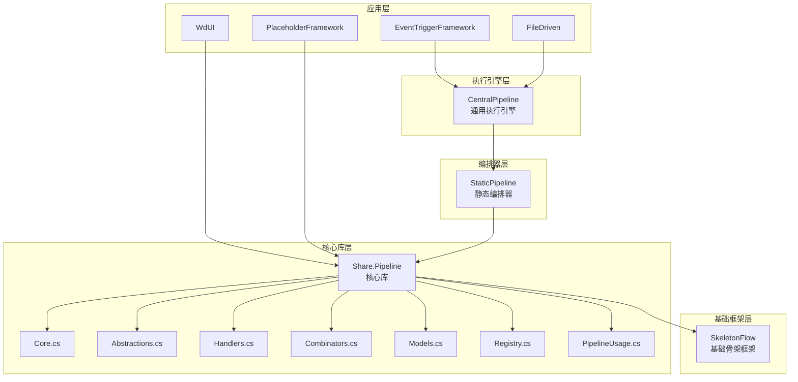
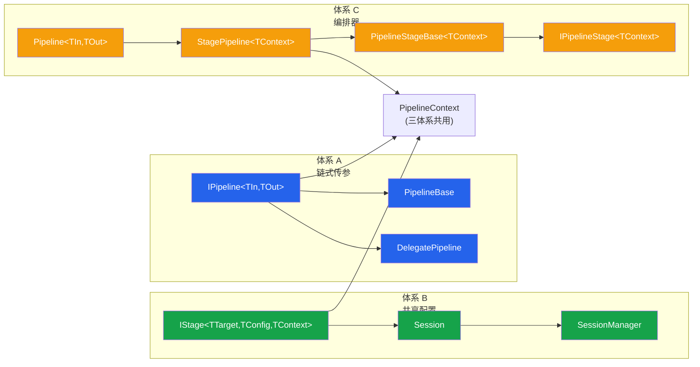
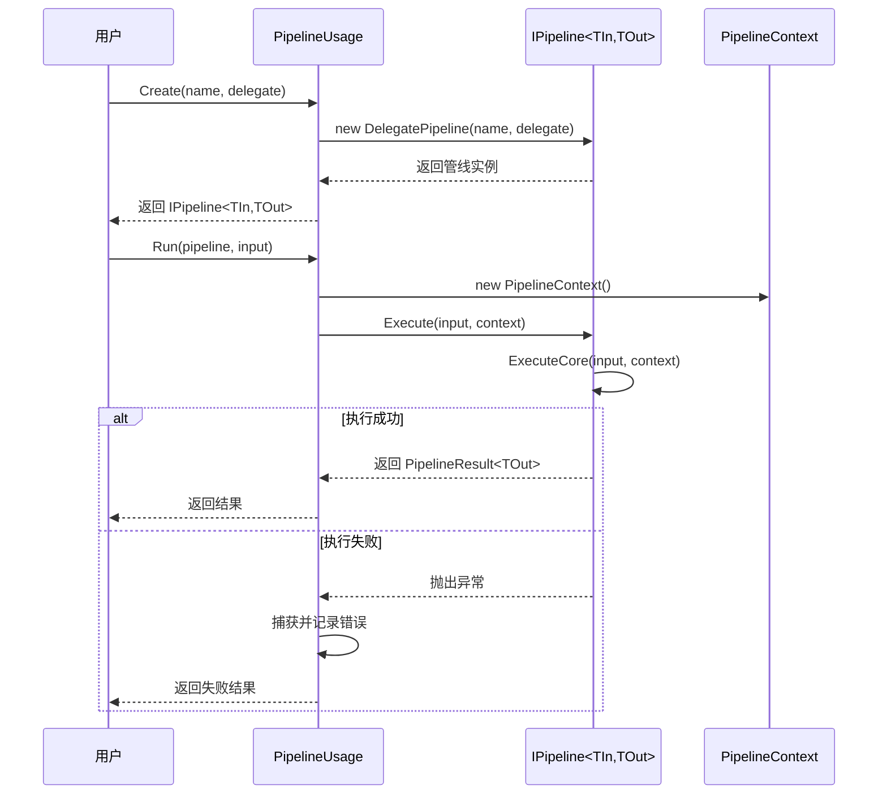
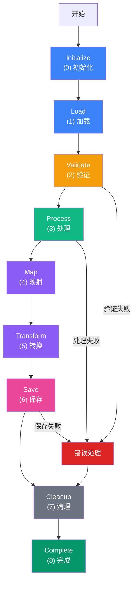
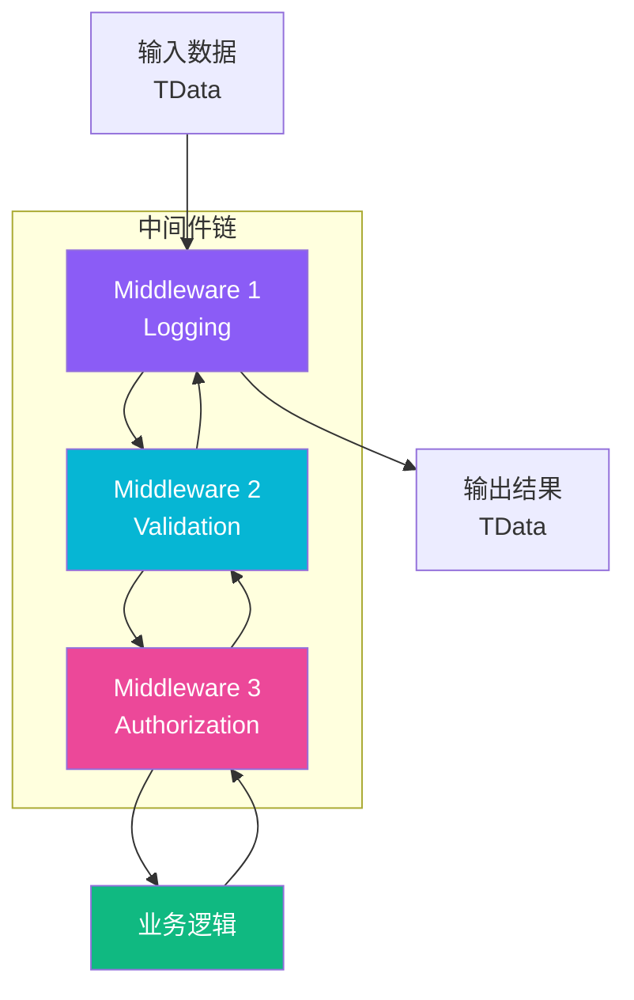

# Share.Pipeline 使用指南

## 目录

1. [项目概述](#1-项目概述)
2. [快速开始](#2-快速开始)
3. [引用项目清单](#3-引用项目清单)
4. [核心类型速查表](#4-核心类型速查表)
5. [三体系详解](#5-三体系详解)
6. [高级编排模式](#6-高级编排模式)
7. [StaticPipeline 静态管线](#7-staticpipeline-静态管线)
8. [CentralPipeline 执行引擎](#8-centralpipeline-执行引擎)
9. [中间件模式](#9-中间件模式)
10. [Transformer 集成](#10-transformer-集成)
11. [使用模式示例](#11-使用模式示例)
12. [迁移指南](#12-迁移指南)
13. [常见问题](#13-常见问题)

---

## 1. 项目概述

### 1.1 定位

`Share.Pipeline` 是 **WorkFlowPrj 的通用管线框架核心库**，提供统一的管线抽象、组合子、编排器和基础设施。所有需要使用"管线"模式的项目都应通过此库集中引用。

### 1.2 架构层次



### 1.3 三大体系



| 体系 | 名称 | 核心接口/类 | 适用场景 |
|------|------|-------------|---------|
| **体系 A** | 链式传参 | `IPipeline<TIn,TOut>`、`PipelineBase` | 数据流变换 |
| **体系 B** | 共享配置 | `IStage<TTarget,TConfig,TContext>`、`Session` | 共享上下文处理 |
| **体系 C** | 编排器 | `Pipeline`、`Pipeline<TIn,TOut>`、`StagePipeline<TContext>` | 多阶段处理流程 |

### 1.4 命名空间说明

管线模块使用 `Modules.Pipeline` 命名空间，而非旧版的 `BasicMethod.Pipeline`。所有核心类型都在此命名空间下。

---

## 2. 快速开始

### 2.1 添加项目引用

在目标项目的 `.csproj` 文件中添加：

```xml
<ItemGroup>
  <ProjectReference Include="..\..\Modules\Pipeline\Pipeline.csproj" />
</ItemGroup>
```

### 2.2 推荐方式：使用 PipelineUsage 统一入口

`PipelineUsage` 是 Facade（外观）封装类，通过一个类暴露所有核心功能，无需了解内部文件分布。



```csharp
using static Modules.Pipeline.PipelineUsage;

// 创建管线
var pipeline = Create("ToUpper", (string input) => input.ToUpper());

// 执行
var result = Run(pipeline, "hello");
Console.WriteLine(result); // "HELLO"
```

#### 创建带上下文的管线

```csharp
var pipeline = CreateWithContext<string, string>(
    "ContextPipeline",
    syncWithCtx: (input, ctx) =>
    {
        ctx.SetItem("key", "value");
        var val = ctx.GetItem<string>("key");
        return $"{input} + {val}";
    });

var result = Run(pipeline, "test");
```

#### 串联管线

```csharp
var step1 = Create("ParseInt", (string input) => int.Parse(input));
var step2 = Create("ToString", (int input) => $"Result: {input * 2}");

var combined = Then(step1, step2);
var result = Run(combined, "21"); // "Result: 42"
```

---

## 3. 引用项目清单

以下项目直接引用 `Share.Pipeline`：

| 项目 | 引用方式 | 主要用途 | 关键文件 |
|------|---------|---------|---------|
| **EventTriggerFramework** | ProjectReference | 事件触发管线，继承 `PipelineBase` | `EventPipeline.cs` |
| **WdUI** | ProjectReference | UI 渲染管线，使用 `Guard`、`ErrorCollector` | `WdUI.RenderPipeline.cs` |
| **FunctionStorage** | ProjectReference | 函数存储管线 | `CodePathLibrary.cs` |
| **PlaceholderFramework** | ProjectReference | 占位符框架管线，使用 `PipelineService` | `PipelineService.cs` |
| **UniversalJsonMiddleware** | ProjectReference | JSON 中间件管线 | `Core.cs` |
| **FileDriven.JsonRefer** | ProjectReference | JSON 引用处理管线 | — |
| **FileDriven.Utilities** | ProjectReference | 工具管线 | — |

以下项目通过 `CentralPipeline` **间接使用** `Share.Pipeline`：

| 项目 | 引用方式 | 主要用途 | 关键文件 |
|------|---------|---------|---------|
| **FileDriven.Pipeline** | 引用 CentralPipeline | 命令执行管线编排 | `PipelineEntry.cs` |

---

## 4. 核心类型速查表

### 4.1 核心接口

| 接口 | 文件 | 说明 |
|------|------|------|
| `IPipeline<TIn, TOut>` | `Core.cs` | 管线核心接口，继承 `ISkeleton` |
| `IStage<TTarget, TConfig, TContext>` | `Core.cs` | 阶段接口（体系 B） |
| `IPipelineStage<TInput, TOutput>` | `Core.cs` | 管线阶段接口（体系 C，泛型） |
| `IPipelineStage` | `Core.cs` | 管线阶段接口（体系 C，非泛型） |
| `IPipelineStage<TContext>` | `Abstractions.cs` | 通用管线阶段接口（带条件执行） |
| `IPipelineContext` | `Abstractions.cs` | 通用管线上下文接口 |
| `IStagePipeline<TContext>` | `Abstractions.cs` | 通用阶段编排器接口 |
| `IAsyncLifecycle` | `Abstractions.cs` | 异步生命周期接口 |
| `IBindingMode` | `Abstractions.cs` | 绑定模式接口 |
| `ICommandSource` / `ICommandTarget` | `Abstractions.cs` | 命令源/目标接口 |
| `IStrategy<TIn, TOut>` | `Registry.cs` | 策略接口 |
| `IExecutionStrategy` | `Registry.cs` | 执行策略接口 |
| `IMiddleware<TData, TContext>` | `Handlers.cs` | 通用中间件接口 |

### 4.2 核心类

| 类 | 文件 | 说明 |
|----|------|------|
| `PipelineContext` | `Core.cs` | 管线上下文（三体系共用） |
| `PipelineBase<TIn, TOut>` | `Core.cs` | 管线抽象基类 |
| `DelegatePipeline<TIn, TOut>` | `Core.cs` | 委托管线（快速创建） |
| `PipelineResult` | `Core.cs` | 管线执行结果（非泛型） |
| `PipelineResult<T>` | `Core.cs` | 管线执行结果（泛型） |
| `Pipeline` | `Core.cs` | 管线编排器（非泛型） |
| `Pipeline<TIn, TOut>` | `Core.cs` | 泛型管线编排器 |
| `StageCollection<TStage>` | `Core.cs` | 通用阶段集合管理基类 |
| `PipelineErrorHandler` | `Core.cs` | 统一错误处理辅助类 |
| `PipelineStageBase<TContext>` | `Core.cs` | 通用阶段基类（自动异常捕获） |
| `StagePipeline<TContext>` | `Core.cs` | 通用阶段编排器 |
| `ErrorCollector` | `Models.cs` | 线程安全错误收集容器 |
| `ErrorEntry` | `Models.cs` | 错误条目 |
| `Guard` | `Models.cs` | 守卫标志（重入保护） |
| `Session<TTarget, TConfig, TContext>` | `Models.cs` | 会话管理 |
| `SessionManager<TTarget, TConfig, TContext>` | `Models.cs` | 会话管理器 |
| `EventSubscriptionManager<TTarget>` | `Models.cs` | 事件订阅管理器 |
| `StrategyRegistry<TKey, TInput, TOutput>` | `Registry.cs` | 策略注册表 |
| `PipelineStageRegistry` | `Registry.cs` | 管线阶段注册表 |
| `UICommand` | `Abstractions.cs` | UI 命令 |
| `MiddlewareBase<TData, TContext>` | `Handlers.cs` | 中间件基类 |

### 4.3 组合子类（Combinators.cs）

| 类 | 说明 |
|----|------|
| `ForEachPipeline<TContext, TItem>` | 集合遍历管线 |
| `ParallelPipeline<TContext>` | 并行执行管线 |
| `PipelineSwitch<TContext, TKey>` | 多路分支管线 |
| `PipelineBranch<TContext>` | 双路条件分支管线 |
| `PipelineTryCatch<TContext>` | 异常处理/降级管线 |
| `PipelineRetry<TContext>` | 重试管线 |
| `ConditionalPipeline<TContext>` | 条件执行包装管线 |
| `PipelineAdapter<TContext, TIn, TOut>` | 类型转换适配管线 |

### 4.4 扩展方法（Handlers.cs）

| 方法 | 所属类 | 说明 |
|------|--------|------|
| `WithContext()` | `PipelineCombinators` | 添加上下文支持 |
| `WithStages()` | `PipelineCombinators` | 添加阶段支持 |
| `WithLifecycle()` | `PipelineCombinators` | 添加生命周期管理 |
| `WithErrorHandling()` | `PipelineCombinators` | 添加错误处理 |
| `Then()` | `PipelineExtensions` | 串联管线 |
| `Branch()` | `PipelineExtensions` | 条件分支 |
| `Loop()` | `PipelineExtensions` | 条件循环 |
| `Parallel()` | `PipelineExtensions` | 并行执行 |
| `ForEach()` | `PipelineExtensions` | 集合遍历 |
| `Compose()` | `PipelineExtensions` | 多步顺序组合 |
| `ParallelExec()` | `PipelineExtensions` | 并行执行多次 |
| `ParallelAll()` | `PipelineExtensions` | 并行执行多个管线 |
| `ForEachParallel()` | `PipelineExtensions` | 多输入并行执行 |
| `Switch()` | `PipelineExtensions` | 多路分支 |
| `TryCatch()` | `PipelineExtensions` | 异常处理 |
| `WithTimeout()` | `PipelineExtensions` | 超时控制 |
| `WithCache()` | `PipelineExtensions` | 缓存结果 |
| `WithRetry()` | `PipelineExtensions` | 重试 |
| `WithLogging()` | `PipelineExtensions` | 日志记录 |
| `Tap()` | `PipelineExtensions` | 副作用 |
| `WithTransform()` | `PipelineExtensions` | Transformer 集成 |
| `WithTransformAsync()` | `PipelineExtensions` | 异步 Transformer 集成 |

### 4.5 枚举

| 枚举 | 文件 | 说明 |
|------|------|------|
| `PipelineResultStatus` | `Core.cs` | 管线结果状态 |
| `PipelineStage` | `Models.cs` | 管线阶段枚举 |
| `PipelineStatus` | `Models.cs` | 管线运行状态 |
| `ErrorLevel` | `Models.cs` | 错误级别 |
| `SessionStatus` | `Models.cs` | 会话状态 |
| `BindingMode` | `Abstractions.cs` | 数据绑定模式 |
| `OperationType` | `Handlers.cs` | 操作类型 |

---

## 5. 三体系详解

### 5.1 体系 A：链式传参

体系 A 适合数据流变换场景，数据从一个阶段流向下一个阶段，每个阶段变换数据类型。

**核心组件：**
- `IPipeline<TInput, TOutput>` — 管线核心接口
- `PipelineBase<TInput, TOutput>` — 管线抽象基类
- `DelegatePipeline<TInput, TOutput>` — 委托管线

**使用方式：**

```csharp
// 创建管线
var pipeline = new DelegatePipeline<string, int>(
    "Parse",
    sync: input => int.Parse(input));

// 串联管线
var combined = pipeline.Then(new DelegatePipeline<int, string>(
    "ToString",
    sync: input => $"Result: {input * 2}"));

// 执行
var result = combined.Execute("21"); // "Result: 42"
```

### 5.2 体系 B：共享配置

体系 B 适合所有阶段共享同一个上下文的场景。

**核心组件：**
- `IStage<TTarget, TConfig, TContext>` — 阶段接口
- `Session<TTarget, TConfig, TContext>` — 会话管理
- `SessionManager<TTarget, TConfig, TContext>` — 会话管理器

**使用方式：**

```csharp
public class MyStage : IStage<MyTarget, MyConfig, MyContext>
{
    public string Name => "MyStage";
    
    public void Execute(MyTarget target, MyConfig config, MyContext context)
    {
        // 处理逻辑
    }
}
```

### 5.3 体系 C：编排器

体系 C 适合需要按顺序执行多个阶段，支持动态管理的场景。

**核心组件：**
- `Pipeline` / `Pipeline<TInput, TOutput>` — 管线编排器
- `StagePipeline<TContext>` — 通用阶段编排器
- `PipelineStageBase<TContext>` — 通用阶段基类
- `IPipelineStage<TContext>` — 通用管线阶段接口

**使用方式：**

```csharp
// 使用 StagePipeline
var pipeline = new StagePipeline<MyContext>("MyPipeline")
    .Register(new MyStage1())
    .Register(new MyStage2());

await pipeline.ExecuteAsync(context);
```

---

## 6. 高级编排模式

### 6.1 组合子模式

组合子类提供了丰富的管线组合能力：

```mermaid
graph TD
    classDef coreCombinator fill:#64748b,color:#fff
    classDef featureCombinator fill:#94a3b8,color:#fff
    classDef enhancement fill:#cbd5e1,color:#1e293b

    subgraph 核心组合子
        Pipeline1["原始管线<br/>IPipeline&lt;TContext&gt;"]
        
        ForEach["ForEachPipeline"]
        Parallel["ParallelPipeline"]
        Branch["PipelineBranch"]
        Switch["PipelineSwitch"]
        TryCatch["PipelineTryCatch"]
        Retry["PipelineRetry"]
        Conditional["ConditionalPipeline"]
        Adapter["PipelineAdapter"]
    end

    Pipeline1 --> ForEach
    Pipeline1 --> Parallel
    Pipeline1 --> Branch
    Pipeline1 --> Switch
    Pipeline1 --> TryCatch
    Pipeline1 --> Retry
    Pipeline1 --> Conditional
    Pipeline1 --> Adapter

    subgraph 组合子特性
        Loop["Loop()<br/>条件循环"]
        Then["Then()<br/>串联"]
        Compose["Compose()<br/>多步组合"]
        ParallelExec["ParallelExec()<br/>并行执行"]
        ForEachParallel["ForEachParallel()<br/>多输入并行"]
    end

    Pipeline1 --> Loop
    Pipeline1 --> Then
    Pipeline1 --> Compose
    Pipeline1 --> ParallelExec
    Pipeline1 --> ForEachParallel

    subgraph 增强特性
        Timeout["WithTimeout()<br/>超时控制"]
        Cache["WithCache()<br/>缓存"]
        Logging["WithLogging()<br/>日志"]
        Transform["WithTransform()<br/>Transformer"]
    end

    Pipeline1 --> Timeout
    Pipeline1 --> Cache
    Pipeline1 --> Logging
    Pipeline1 --> Transform

    class Pipeline1,ForEach,Parallel,Branch,Switch,TryCatch,Retry,Conditional,Adapter coreCombinator
    class Loop,Then,Compose,ParallelExec,ForEachParallel featureCombinator
    class Timeout,Cache,Logging,Transform enhancement
```



| 组合子 | 功能 | 适用场景 |
|--------|------|---------|
| `ForEachPipeline` | 集合遍历 | 批量处理列表项 |
| `ParallelPipeline` | 并行执行 | 多个独立管线同时执行 |
| `PipelineBranch` | 双路分支 | if-else 逻辑 |
| `PipelineSwitch` | 多路分支 | switch-case 逻辑 |
| `PipelineTryCatch` | 异常降级 | 容错处理 |
| `PipelineRetry` | 重试 | 临时故障恢复 |
| `ConditionalPipeline` | 条件执行 | 按需执行 |
| `PipelineAdapter` | 类型适配 | 桥接不同类型的管线 |

**使用示例：**

```csharp
// 创建条件分支管线
var branch = new PipelineBranch<MyContext>(
    ctx => ctx.IsValid,
    trueBranch: successPipeline,
    falseBranch: fallbackPipeline);

// 创建并行执行管线
var parallel = new ParallelPipeline<MyContext>(
    new[] { pipeline1, pipeline2, pipeline3 },
    maxDegreeOfParallelism: 4);

// 创建重试包装管线
var retry = new PipelineRetry<MyContext>(
    innerPipeline,
    maxRetries: 3,
    delayMs: 200);
```

### 6.2 扩展方法组合

通过扩展方法可以更简洁地组合管线：

```csharp
var pipeline = innerPipeline
    .WithRetry(maxRetries: 3, delayMs: 200)
    .WithTimeout(TimeSpan.FromSeconds(30))
    .WithLogging(msg => Console.WriteLine(msg));
```

---

## 7. StaticPipeline 静态管线

### 7.1 概述

`StaticPipeline` 是轻量级的静态管线编排器，步骤在编译时确定，按固定顺序执行。

**与 Modules.Pipeline 的区别：**

| 特性 | Modules.Pipeline | StaticPipeline |
|------|-----------------|----------------|
| 编排方式 | 动态编排 | 静态编排 |
| 步骤确定 | 运行时注册 | 编译时确定 |
| 依赖接口 | `IPipeline` | 委托 |
| 复杂度 | 高（组合子丰富） | 低（零接口依赖） |

### 7.2 使用方式

```csharp
using Modules.Pipeline.StaticPipeline;

var pipeline = new StaticPipeline<MyContext>(new[]
{
    new Step<MyContext>("Validate", ctx => ValidateInput(ctx), IsFatal: true),
    new Step<MyContext>("Process", ctx => ProcessData(ctx), IsFatal: true),
    new Step<MyContext>("Save", ctx => SaveResult(ctx), IsFatal: false),
});

var result = pipeline.Execute(context);
if (result.IsSuccess)
{
    // 全部成功
}
else if (result.HasFatalErrors)
{
    // 致命错误
}
```

### 7.3 步骤配置

每个 `Step<TContext>` 支持以下配置：

| 属性 | 类型 | 说明 |
|------|------|------|
| `Name` | `string` | 步骤名称（用于日志和异常追踪） |
| `Execute` | `Action<TContext>` | 步骤执行委托 |
| `IsFatal` | `bool` | 是否致命步骤（默认 true） |
| `CanExecute` | `StepCanExecute<TContext>` | 条件执行委托（可选） |

### 7.4 结果状态

| 状态 | 说明 |
|------|------|
| `Success` | 全部步骤成功 |
| `Failed` | 致命步骤失败 |
| `PartialSuccess` | 仅非致命步骤失败 |

---

## 8. CentralPipeline 执行引擎

### 8.1 概述

`CentralPipeline<TContext>` 是基于 SkeletonFlow 的通用管线执行引擎，将按阶段注册的 Skeleton 组合为完整的 Flow 管线并执行。

### 8.2 使用方式

```csharp
using Modules.CentralPipeline;

var pipeline = new CentralPipeline<MyContext>("MyPipeline");

// 注册 Skeleton 到指定阶段
pipeline.Register(PipelineStage.Validate, new ValidateSkeleton());
pipeline.Register(PipelineStage.Process, new ProcessSkeleton());
pipeline.Register(PipelineStage.Save, new SaveSkeleton());

// 执行
var result = pipeline.Execute(context);
```

### 8.3 阶段生命周期

`CentralPipeline` 使用标准的 `PipelineStage` 枚举定义生命周期阶段：



| 阶段 | 顺序 | 说明 |
|------|------|------|
| `Initialize` | 0 | 初始化管线上下文和资源 |
| `Load` | 1 | 加载输入数据和配置 |
| `Validate` | 2 | 验证输入数据的有效性 |
| `Process` | 3 | 执行业务处理逻辑 |
| `Map` | 4 | 数据映射和转换 |
| `Transform` | 5 | 数据格式转换 |
| `Save` | 6 | 保存处理结果 |
| `Cleanup` | 7 | 清理临时资源和状态 |
| `Complete` | 8 | 完成管线执行 |

---

## 9. 中间件模式

### 9.1 概述

中间件模式提供了类似 AOP 的拦截能力，支持在业务操作执行前后注入逻辑。



### 9.2 核心接口

```csharp
public interface IMiddleware<TData, TContext>
{
    string Name { get; }
    
    Task<TData> HandleAsync(
        TData data,
        TContext context,
        Func<TData, TContext, CancellationToken, Task<TData>> next,
        CancellationToken cancellationToken = default);
}
```

### 9.3 使用方式

```csharp
public class LoggingMiddleware : MiddlewareBase<MyData, MyContext>
{
    public LoggingMiddleware() : base("Logging") { }
    
    protected override async Task<MyData> HandleCoreAsync(
        MyData data, 
        MyContext context, 
        NextDelegate next,
        CancellationToken cancellationToken)
    {
        Console.WriteLine("Before handling");
        var result = await next(data, context, cancellationToken);
        Console.WriteLine("After handling");
        return result;
    }
}

// 创建中间件管线
var middlewarePipeline = CreateMiddlewarePipeline<MyData, MyContext>()
    .Use(new LoggingMiddleware())
    .Use(new ValidationMiddleware());
```

---

## 10. Transformer 集成

### 10.1 概述

Pipeline 模块支持与 `Modules.Transformers` 的无缝集成，将纯函数变换器直接接入管线链。

### 10.2 使用方式

```csharp
// 将管线与 Transformer 串联
var pipeline = Create("Input", (string input) => input)
    .WithTransform(new CountWordsTransformer()) // ITransformer<string, int>
    .WithTransform(new FormatResultTransformer()); // ITransformer<int, string>

var result = pipeline.Execute("Hello world"); // "Word count: 2"
```

### 10.3 组合子集成

还可以通过组合子从 Transformer 创建管线：

```csharp
// 创建带重试的 Transformer 管线
var pipeline = myTransformer.FromRetryTransformer(
    maxRetries: 3,
    delayMs: 100);

// 创建条件执行的 Transformer 管线
var conditional = myTransformer.FromConditionalTransformer(
    condition: ctx => ctx.ShouldExecute);
```

---

## 11. 使用模式示例

### 11.1 继承 PipelineBase

```csharp
using Modules.Pipeline;

public class MyCustomPipeline : PipelineBase<MyInput, MyOutput>
{
    public MyCustomPipeline() : base("MyCustomPipeline") { }

    protected override MyOutput ExecuteCore(MyInput input, PipelineContext context)
    {
        return new MyOutput { Result = Process(input) };
    }

    protected override async Task<MyOutput> ExecuteCoreAsync(MyInput input, PipelineContext context)
    {
        return await Task.Run(() => ExecuteCore(input, context));
    }
}
```

### 11.2 使用 StagePipeline

```csharp
public class ValidateStage : PipelineStageBase<MyContext>
{
    public ValidateStage() : base("Validate") { }
    
    protected override async Task ExecuteCoreAsync(MyContext context, CancellationToken cancellationToken)
    {
        // 验证逻辑
    }
}

var pipeline = new StagePipeline<MyContext>("MyPipeline")
    .Register(new ValidateStage())
    .Register(new ProcessStage())
    .Register(new SaveStage());

await pipeline.ExecuteAsync(context);
```

### 11.3 使用组合子

```csharp
// 条件分支
var pipeline = predicate.Branch(trueBranch, falseBranch);

// 重试
var pipeline = innerPipeline.WithRetry(maxRetries: 3, delayMs: 200);

// 超时控制
var pipeline = innerPipeline.WithTimeout(TimeSpan.FromSeconds(30));

// 缓存
var pipeline = innerPipeline.WithCache();

// 日志
var pipeline = innerPipeline.WithLogging(msg => Console.WriteLine(msg));
```

### 11.4 使用类实现组合模式

```csharp
var forEach = new ForEachPipeline<MyContext, string>(
    ctx => ctx.Items,
    itemPipeline,
    onItemBefore: (ctx, item, index) => Console.WriteLine($"Processing {item}"),
    onItemAfter: (ctx, item, index, success) => Console.WriteLine($"Done {item}: {success}"));

var parallel = new ParallelPipeline<MyContext>(
    new[] { pipeline1, pipeline2, pipeline3 },
    maxDegreeOfParallelism: 4);

var tryCatch = new PipelineTryCatch<MyContext>(
    mainPipeline,
    fallbackPipeline: fallback,
    onError: ex => Console.WriteLine($"Error: {ex.Message}"));
```

### 11.5 错误处理

```csharp
var errors = new ErrorCollector();
var context = new PipelineContext();

try
{
    var result = pipeline.Execute(input, context);
    if (result == null)
    {
        PipelineErrorHandler.RecordStageFailure(errors, "MyStage", isFatal: false);
    }
}
catch (Exception ex)
{
    PipelineErrorHandler.CaptureException(ex, errors, "MyStage", isFatal: true);
}

var finalResult = PipelineErrorHandler.DetermineResult(data, errors, context, hasNonFatalErrors: false);
```

### 11.6 重入保护

```csharp
var guard = new Guard();

if (guard.TryEnter())
{
    try { /* 临界区 */ }
    finally { guard.Exit(); }
}

guard.Execute(() => { /* 临界区 */ }, "MyGuard");

guard.TryExecute(() => { /* 临界区 */ });
```

---

## 12. 迁移指南

### 12.1 从 BasicMethod.Pipeline 迁移到 Share.Pipeline

`Share.Pipeline` 是 `BasicMethod.Pipeline` 的升级版，命名空间已变更为 `Modules.Pipeline`。

**需要检查的点：**

1. **项目引用**：确保 `.csproj` 中引用了 `Modules/Pipeline/Pipeline.csproj`
2. **命名空间**：将 `using BasicMethod.Pipeline;` 改为 `using Modules.Pipeline;`
3. **SkeletonFlow 依赖**：确保项目引用了 `BasicMethod.csproj`

### 12.2 从 CentralPipeline 迁移

`CentralPipeline` 已作为独立项目存在于 `Modules/CentralPipeline`，基于 `Share.Pipeline` 构建。如果直接使用 `CentralPipeline<TContext>`，无需迁移。

---

## 13. 常见问题

### Q: 我应该使用哪种体系？

- **体系 A（链式传参）**：数据从一个阶段流向下一个阶段，每个阶段变换数据类型 → 使用 `IPipeline<TIn,TOut>` + `Then()`
- **体系 B（共享配置）**：所有阶段共享同一个上下文 → 使用 `IStage<TTarget,TConfig,TContext>` + `Session`
- **体系 C（编排器）**：需要按顺序执行多个阶段，支持动态管理 → 使用 `StagePipeline<TContext>`

### Q: DelegatePipeline 和 PipelineBase 有什么区别？

- `DelegatePipeline`：通过委托快速创建管线实例，适合简单场景
- `PipelineBase`：抽象基类，需要继承并实现 `ExecuteCore`/`ExecuteCoreAsync`，适合复杂场景

### Q: StaticPipeline 和 StagePipeline 有什么区别？

- `StaticPipeline`：轻量级静态编排，编译时确定步骤，零接口依赖
- `StagePipeline`：动态编排，支持注册、插入、移除阶段，功能更丰富

### Q: 如何选择合适的组合方式？

- 需要**串联**多个管线 → `Then()`
- 需要**条件分支** → `Branch()` 或 `PipelineBranch<TContext>`
- 需要**循环执行** → `Loop()` 或 `ForEachPipeline<TContext, TItem>`
- 需要**并行执行** → `Parallel()` 或 `ParallelPipeline<TContext>`
- 需要**异常处理** → `TryCatch()` 或 `PipelineTryCatch<TContext>`
- 需要**重试** → `WithRetry()` 或 `PipelineRetry<TContext>`
- 需要**超时控制** → `WithTimeout()`
- 需要**缓存** → `WithCache()`

---

> **文档版本**：v2.0  
> **最后更新**：2026-07-17  
> **维护者**：WorkFlowPrj Team