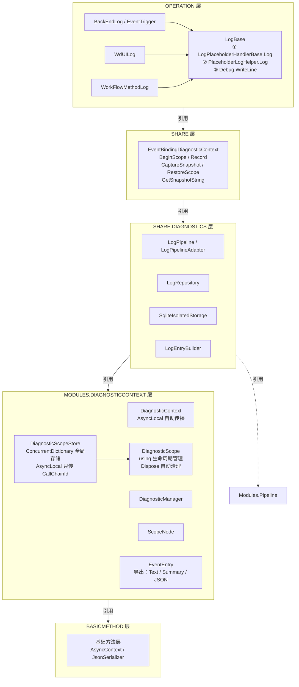
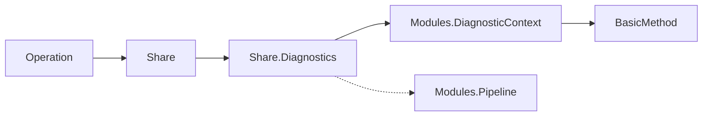

# C# 项目日志架构

> **版本：** v1.6
> **维护者：** WorkFlowPrj Team
> **更新日期：** 2026-07-16
>
> **★ 2026-07-16 显式作用域重构：** AsyncLocal 只传播轻量 CallChainId（字符串），
>    数据存储在全局 ConcurrentDictionary 中。任何线程/任何时刻都可以通过 CallChainId
>    访问对应的 DiagnosticScope，彻底解决 AsyncLocal 在 async/await + ConfigureAwait(false)
>    场景下诊断上下文丢失的问题。
>
>
> **配套文档：** 代码实现、接口契约、数据流、代码示例等请参阅 [`Implementation.md`](Implementation.md)。

---

## 目录

- [C# 项目日志架构](#c-项目日志架构)
  - [目录](#目录)
  - [1. 架构总览](#1-架构总览)
    - [1.1 分层架构图](#11-分层架构图)
    - [1.2 依赖方向](#12-依赖方向)
    - [1.3 角色职责矩阵](#13-角色职责矩阵)
  - [2. 模块定义](#2-模块定义)
    - [2.1 Operation 层：分级日志](#21-operation-层分级日志)
    - [2.2 Share 层：可维护插桩代码](#22-share-层可维护插桩代码)
    - [2.3 Share.Diagnostics 层：日志管线基础设施](#23-sharediagnostics-层日志管线基础设施)
    - [2.4 Modules 层：无日志，通过测试维护](#24-modules-层无日志通过测试维护)
    - [2.5 BasicMethod 层：工具/基础设施](#25-basicmethod-层工具基础设施)
    - [2.6 Modules.DiagnosticContext 层：插桩框架](#26-modulesdiagnosticcontext-层插桩框架)
    - [2.7 日志注册流程](#27-日志注册流程)
    - [2.8 日志初始化入口](#28-日志初始化入口)
  - [3. 规范与约定](#3-规范与约定)
    - [3.1 事件命名规范](#31-事件命名规范)
    - [3.2 消息 ID 命名规范](#32-消息-id-命名规范)
  - [4. 使用指南](#4-使用指南)
    - [4.1 场景对照表](#41-场景对照表)
    - [4.2 禁止事项](#42-禁止事项)
  - [5. 基础技术理念：全局字典显式储存上下文](#5-基础技术理念全局字典显式储存上下文)
    - [5.1 问题背景](#51-问题背景)
    - [5.2 设计模式：AsyncLocal 只传 ID，数据存字典](#52-设计模式asynclocal-只传-id数据存字典)
    - [5.3 核心类型](#53-核心类型)
    - [5.4 生命周期](#54-生命周期)
    - [5.5 与旧方案的对比](#55-与旧方案的对比)
    - [5.6 适用场景](#56-适用场景)

---

## 1. 架构总览

### 1.1 分层架构图



### 1.2 依赖方向



> **关键约束：** Share 层**不能**反向引用 Operation 层。Share 层只能引用 BasicMethod 层、Modules 层以及 TConfig。

### 1.3 角色职责矩阵

| 层 | 角色 | 职责 | 不负责 |
|----|------|------|--------|
| **Operation** | 日志消费者 | 控制日志输出时机、级别、持久化 | 不负责插桩事件的定义 |
| **Share** | 插桩生产者 | 记录结构化插桩事件 | 不关心日志如何输出 |
| **Share.Diagnostics** | 基础设施 | 日志管线编排、内存仓库、SQLite 持久化 | 不定义业务日志语义 |
| **Modules.DiagnosticContext** | 插桩框架 | AsyncLocal 传播（仅传 CallChainId）、全局字典存储（ConcurrentDictionary）、显式作用域管理（DiagnosticScope）、事件存储 | 不涉及日志输出策略 |

---

## 2. 模块定义

### 2.1 Operation 层：分级日志

Operation 层使用 **PlaceholderFramework** 的 `LogPlaceholderHandlerBase.Log` 作为统一日志入口，所有日志调用通过 `LogBase` 基类实现三级降级策略。

| 模块 | 日志类 | 命名空间 | KeyPrefix | 消息注册文件 |
|------|--------|----------|-----------|-------------|
| BackEndDriven | `BackEndLog` | `BackEndDriven.Diagnostics` | `backend:` | `backend_log_messages.json` |
| EventTrigger | `EventTriggerLog` | `EventTriggerFramework.Diagnostics` | `eventtrigger:` | 共用 BackEndDriven |
| WdUI | `WdUILog` | `WdUI.Diagnostics` | `wdui:` | `wdui_log_messages.json` |
| WorkFlowMethod | `WorkFlowMethodLog` | `WorkFlowMethod.Diagnostics` | `workflowmethod:` | `workflowmethod_log_messages.json` |
| **FileDriven.Execution** | `ExecutionLog` | `FileDriven.Execution.Diagnostics` | `exec:` | `execution_log_messages.json` |
| **FileDriven.Business** | `FsLog` | `FileDriven.Business.Diagnostics` | `fs:` | `business_log_messages.json` |
| **BackEndDriven.IoC** | `IocLog` | `BackEndDriven.Diagnostics` | `ioc:` | `ioc_log_messages.json` |


> **FileDriven.Execution** 和 **FileDriven.Business** 属于 FileDriven 子项目（Operation 层），使用独立的 PlaceholderFramework 日志实例，不依赖 FileDriven 全局的 `filedriven_log_messages.json`。
>
> 实现源码、降级策略详情请参阅 [`Implementation.md §1.1`](Implementation.md#11-operation-层日志入口)。

### 2.2 Share 层：可维护插桩代码

Share 层使用 `Modules.DiagnosticContext` 的 `DiagnosticContext.Record` 作为插桩方式，**不关心日志如何输出**，只负责记录结构化事件。

**位置：** `CsharpPrj/Share/EventBindingOrchestrator/Contexts/EventBindingDiagnosticContext.cs`

**核心 API：** `BeginScope()` / `Record()` / `CaptureSnapshot()` / `RestoreScope()` / `GetSnapshotString()`

**★ 2026-07-16 惰性 Scope 重构：** `Record()` 内部自动创建惰性 scope，调用方无需手动 `BeginScope()` / `Dispose()`。
   像使用 `Debug.Log` 一样直接调用 `Record()` 即可。`BeginScope()` 仍可用于需要显式控制 scope 生命周期的场景。

**API 职责划分：**
- `Record()` — **插桩写入（推荐）**，内部自动创建惰性 scope，无需手动管理。供 Share 层内部使用，记录结构化事件到 `DiagnosticContext.Current`
- `BeginScope()` — **显式作用域管理（可选）**，用于需要精确控制 scope 生命周期的场景（如管线编排器），返回 `IDisposable` 需手动 Dispose
- `CaptureSnapshot()` / `GetSnapshotString()` / `RestoreScope()` — **数据导出**，供 Operation 层消费，从 `DiagnosticContext.Current` 导出快照数据

**模块通用日志：** `ModuleLog.Log(msgId, data, moduleName, keyPrefix)` — 用于 Share 层各模块（如 GraphFramework、CommandFramework、PlaceholderFramework 等）输出结构化日志，自动绑定模块名和 Key 前缀。

> 实现源码、降级兼容机制请参阅 [`Implementation.md §1.3`](Implementation.md#13-share-层插桩代码)。

### 2.3 Share.Diagnostics 层：日志管线基础设施

Share.Diagnostics 提供日志管线的编排、日志仓库和持久化能力，被 Operation 层引用。

| 组件 | 命名空间 | 说明 |
|------|----------|------|
| `LogRepository` | `Common.Diagnostics` | 内存日志仓库 |
| `SqliteIsolatedStorage` | `Common.Diagnostics` | SQLite 持久化存储 |
| `BatchManager` | `UniversalWorkflowFramework.BatchIntegration` | 批次管理 |
| `BatchRouter` | `UniversalWorkflowFramework.BatchIntegration` | 批次路由 |
| `LogEntryBuilder` | `Common.Diagnostics` | 便捷日志 API |

> 管线编排、LogEntry 结构请参阅 [`Implementation.md §4`](Implementation.md#4-日志管线基础设施)。

### 2.4 Modules 层：无日志，通过测试维护

Modules 层（`CsharpPrj/Modules/`）**不包含任何日志代码**。Modules 层的正确性通过单元测试和集成测试维护，不依赖运行时日志。

| 子模块 | 说明 | 验证方式 |
|--------|------|----------|
| `Modules.ExecutionFramework` | 执行引擎（ExecutionEngine、NodeExecutor） | 单元测试 |
| `Modules.DiagnosticContext` | 插桩框架（AsyncLocal 传播、作用域管理） | 单元测试 |
| `Modules.Pipeline` | 管线基础设施 | 集成测试 |
| `Modules.Registry` | 注册表（UnifiedRegistryCenter） | 单元测试 |

> **设计原则：** Modules 层是纯逻辑层，不依赖外部 I/O，所有行为可通过测试覆盖。运行时问题通过 Operation 层的日志和 Share 层的插桩事件来诊断。
>
> **修复规则：** Modules 层中任何 `Debug.WriteLine` / `Console.WriteLine` / `Trace.WriteLine` 调用应**直接删除**，错误应通过异常向上传播（`throw new InvalidOperationException`），而非仅打印后静默返回。
>
> **Modules 层可以抛错：** 当 Modules 层检测到运行时状态异常（如反射获取子控件失败、配置数据不完整等），应抛出 `InvalidOperationException` 或 `ArgumentException`，将错误信息（含类型名、属性名、上下文等）封装在异常消息中，让上层 Operation 层或 Share 层捕获并记录。异常消息应包含足够的诊断信息（如已查找的属性列表、目标类型名等），避免上层需要额外反射才能定位问题。
>
> **例外：** `Modules/DiagnosticContext/Core/DiagnosticContext.cs` 自身的 `Debug.WriteLine` 是框架内部异常降级记录，属于日志框架自身的容错机制，**保留**。

### 2.5 BasicMethod 层：工具/基础设施

BasicMethod 层（`CsharpPrj/BasicMethod/`）提供基础工具类和日志框架基础设施。

**日志框架类（保留日志）：**
| 类 | 说明 |
|----|------|
| `LogRepository` | 内存日志仓库 |
| `LogCollapser` | 日志折叠工具 |
| `LogFilterLoader` | 日志过滤器加载器 |

**非日志框架代码（禁止日志）：**
- 序列化工具（`SystemJsonFramework`、`NewtonSoftJsonFramework`）
- 配置工具（`SharedTypes`）
- 步骤协调工具（`StepCoordinationExtensions`、`AsyncStepCoordinator`）
- UI 工具（`AsyncFormBase`）
- 布局框架（`LayoutFramework`）
- 响应式数据（`ReactorPipeline`）
- ECS 框架（`ECSFrame`）

> **修复规则：** 非日志框架代码中的 `Debug.WriteLine` / `Console.WriteLine` 应**删除**，错误应通过异常向上传播（`throw new InvalidOperationException` / `throw new JsonException`），而非仅打印后静默返回。
>
> **例外：** `Printer`（打印工具类设计如此）、`Print`（打印工具类）、`BuiltInBlocks`（工具类）、`UsageExamples`（示例代码）可保留 `Console.WriteLine`。

### 2.6 Modules.DiagnosticContext 层：插桩框架

Modules.DiagnosticContext 提供诊断上下文管理，是 Share 层插桩代码的底层框架。

**★ 2026-07-16 显式作用域重构：** 新增 `DiagnosticScopeStore` + `DiagnosticScope` 替代
`AsyncLocal<DiagnosticContext>` 的隐式传播。AsyncLocal 只传播轻量 CallChainId（字符串），
数据存储在全局 `ConcurrentDictionary` 中，任何线程/任何时刻都可以通过 CallChainId 访问
对应的 `DiagnosticScope`。

**核心类型（旧体系，★ 2026-07-16 已改造为委托到新体系）：** `IDiagnosticContext` / `DiagnosticContext` / `DiagnosticManager` / `DiagnosticContextFactory`
- `DiagnosticContext` — 内部包装 `DiagnosticScope`，所有实例方法委托给 `_scope`
- `DiagnosticManager` — 所有方法委托给 `DiagnosticScopeStore` + `DiagnosticScope`
- `DiagnosticContextFactory` — `Create()` 内部创建 `DiagnosticScope` 并包装
- **对外接口不变**，所有旧调用方无需修改代码
- 旧版实现已封存到 `_Legacy/` 目录

**核心类型（新体系，★ 推荐）：**

| 类型 | 说明 | 位置 |
|------|------|------|
| `DiagnosticScopeStore` | 全局诊断作用域存储。AsyncLocal 只传播 CallChainId（字符串），数据存储在 `ConcurrentDictionary` 中。线程安全，O(1) 查找。 | `Modules/DiagnosticContext/Core/DiagnosticScopeStore.cs` |
| `DiagnosticScope` | 显式诊断作用域。`using` 管理生命周期，`Dispose` 时自动从全局存储中注销。支持嵌套子作用域（`PushScope`）。 | `Modules/DiagnosticContext/Core/DiagnosticScope.cs` |
| `ScopeNode` | 作用域节点树。每个 `DiagnosticScope` 包含一个根节点，子作用域通过 `CreateScope` 创建。 | `Modules/DiagnosticContext/Core/ScopeNode.cs` |
| `DiagnosticSnapshot` | 不可变快照。通过 `Freeze()` 从 `ScopeNode` 创建，用于跨线程传递。 | `Modules/DiagnosticContext/Core/DiagnosticSnapshot.cs` |

**导出格式：** `ToString()`（文本快照）/ `ToSummary()`（摘要）/ `ToJson()`（JSON）


### 2.7 日志注册流程

新增一个 Operation 层日志模块时，需要在 `FileDriven/DiagnosticsConfig/` 中完成以下 3 步注册，日志系统才能正确识别和路由该模块的日志消息。

| 步骤 | 配置文件 | 位置 | 说明 |
|------|----------|------|------|
| 1 | `log-categories.json` | `FileDriven/DiagnosticsConfig/log-categories.json` | 在 `modules` 中声明模块及其日志分类 |
| 2 | `category-aliases.json` | `FileDriven/DiagnosticsConfig/category-aliases.json` | 在 `aliases` 中添加分类别名到枚举值的映射 |
| 3 | `diagnostics-settings.json` | `FileDriven/DiagnosticsConfig/diagnostics-settings.json` | 在 `paths` 中注册消息文件路径 |

**示例：以 `IocLog`（BackEndDriven.IoC 模块）的注册流程**

**步骤 1：`log-categories.json` — 声明日志分类**
```json
"BackEndDriven": {
  "description": "BackEndDriven 后端驱动引擎",
  "categories": {
    "IoC": { "description": "BackEndDriven IoC 容器日志" }
  }
}
```

**步骤 2：`category-aliases.json` — 添加别名映射**
```json
"backend_ioc": "BackEndDriven_IoC",
"backend.ioc": "BackEndDriven_IoC",
"bd.ioc": "BackEndDriven_IoC",
"ioc": "BackEndDriven_IoC",
"backend_all": "BackEndDriven_All",
"backend.all": "BackEndDriven_All",
"bd.all": "BackEndDriven_All"
```

**步骤 3：`diagnostics-settings.json` — 注册消息文件路径**
```json
"ioc_log_messages": "CsharpPrj/Operation/BackEndDriven/ioc_log_messages.json"
```

> **设计原则：** 日志注册集中管理在 `FileDriven/DiagnosticsConfig/` 中，各模块只需关注自己的日志类实现和消息文件定义，无需关心日志系统的路由和过滤配置。

### 2.8 日志初始化入口

所有 Operation 层日志模块的 `Initialize` 调用集中在 `FileDriven/FileDriven.Execution/Lifecycle/LoggingInitializer.cs` 的 `AutoInitialize()` 方法中。

**初始化清单（按添加顺序）：**

| 日志模块 | Initialize 调用 | 消息文件 |
|----------|----------------|----------|
| `ExecutionLog` | `ExecutionLog.Initialize(executionLogPath)` | `execution_log_messages.json` |
| `AbstractionsLog` | `AbstractionsLog.Initialize(abstractionsLogPath)` | `abstractions_log_messages.json` |
| `BusinessLog` | `BusinessLog.Initialize(businessLogPath)` | `business_log_messages.json` |
| `JsonReferLog` | `JsonReferLog.Initialize(jsonReferLogPath)` | `jsonrefer_log_messages.json` |
| `UILog` | `UILog.Initialize(uiLogPath)` | `ui_log_messages.json` |
| `UtilitiesLog` | `UtilitiesLog.Initialize(utilitiesLogPath)` | `utilities_log_messages.json` |
| `WorkFlowMethodLog` | `WorkFlowMethodLog.Initialize(workflowMethodLogPath)` | `workflowmethod_log_messages.json` |
| `BackEndLog` | `BackEndLog.Initialize(backendLogPath)` | `backend_log_messages.json` |
| `IocLog` | `IocLog.Initialize(iocLogPath)` | `ioc_log_messages.json` |

**路径函数**定义在 `FileDriven/FileDriven.Abstractions/PathMananger.cs` 中，每个日志模块对应一个 `GetXxxLogMessagesPath()` 方法。

**新增日志模块时的操作：**
1. 在 `PathMananger.cs` 中添加 `GetXxxLogMessagesPath()` 方法
2. 在 `LoggingInitializer.AutoInitialize()` 中添加 `XxxLog.Initialize(path)` 调用
3. 在 `DiagnosticsConfig/` 中完成日志注册（见 §2.7）

> **⚠️ 常见错误：** 新增日志模块后忘记在 `LoggingInitializer.AutoInitialize()` 中添加 `Initialize` 调用，会导致该模块的所有日志静默降级到 `PlaceholderLogHelper.Log`，日志不可见。这是框架最常见的 debug 困难原因之一。

---


## 3. 规范与约定

### 3.1 事件命名规范

**格式：** `领域.组件.动作[.状态]`

| 领域 | 事件名 | 含义 |
|------|--------|------|
| pipeline | `pipeline.execute_with_walk.start` | 管线遍历绑定开始 |
| pipeline | `pipeline.execute_with_walk.complete` | 管线遍历绑定完成 |
| pipeline | `pipeline.walk_and_bind.visiting` | 正在访问控件 |
| pipeline | `pipeline.walk_and_bind.executing` | 正在执行绑定 |
| pipeline | `pipeline.walk_and_bind.map_result` | 映射结果 |
| eventbinder | `eventbinder.transform.entry` | 转换器入口 |
| eventbinder | `eventbinder.transform.bind_from_declaration` | 从声明绑定 |
| eventbinder | `eventbinder.transform.skip_no_config` | 跳过无配置项 |
| eventbinder | `eventbinder.transform.for_each_bound_event` | 遍历绑定事件 |
| eventbinder | `eventbinder.function.success` | 函数执行成功 |
| eventbinder | `eventbinder.function.exception` | 函数执行异常 |
| eventbinder | `eventbinder.function.cancelled` | 函数执行取消 |
| eventbinder | `eventbinder.parameter.resolve_failed` | 参数解析失败 |
| eventbinder | `eventbinder.parameter.type_conversion_failed` | 类型转换失败 |
| eventbinder | `eventbinder.parameter.source_not_found` | 参数源未找到 |
| eventbinder | `eventbinder.parameter.empty_value` | 参数值为空 |
| eventbinder | `eventbinder.event.triggered` | 事件触发 |
| eventbinder | `eventbinder.reentry.skip` | 防重入跳过 |
| eventbinder | `eventbinder.scope.began` | 作用域开始 |
| eventbinder | `eventbinder.scope.restored` | 作用域恢复 |
| eventbinder | `eventbinder.workflow.check` | 工作流判断检查 |
| eventbinder | `eventbinder.workflow.executing` | 工作流正在执行 |
| eventbinder | `eventbinder.workflow.success` | 工作流执行成功 |
| eventbinder | `eventbinder.workflow.failed` | 工作流执行失败 |
| eventbinder | `eventbinder.execution_engine.missing` | 执行引擎未注入 |
| eventbinder | `eventbinder.task_unobserved_exception` | Task 未观察到的异常 |
| stagecoordinator | `stagecoordinator.wait_start` | 阶段协调等待开始 |
| stagecoordinator | `stagecoordinator.wait_result` | 阶段协调等待结果 |
| stagecoordinator | `stagecoordinator.wait_timeout` | 阶段协调等待超时 |
| stagecoordinator | `stagecoordinator.wait_exception` | 阶段协调等待异常 |
| stagecoordinator | `stagecoordinator.stage_completed` | 阶段完成 |
| controlfinder | `controlfinder.config_validation_warning` | 配置验证警告 |
| eventbindinghelper | `eventbindinghelper.output.written` | 输出写入成功 |
| eventbindinghelper | `eventbindinghelper.output.failed` | 输出写入失败 |
| eventbindinghelper | `eventbindinghelper.output.not_supported` | 输出类型不支持 |
| eventbindinghelper | `eventbindinghelper.listview.write_complete` | ListView 写入完成 |
| eventbindinghelper | `eventbindinghelper.listview.write_failed` | ListView 写入失败 |
| transformer | `transformer.{name}.enter` | 转换器进入 |
| transformer | `transformer.{name}.exit` | 转换器退出 |
| transformer | `transformer.{name}.exception` | 转换器异常 |

### 3.2 消息 ID 命名规范

**格式：** `ClassName_MethodName_description`

| 模块 | 命名格式 | 示例 |
|------|----------|------|
| BackEndDriven | `ClassName_MethodName_description` | `ExecutionEngine_StartFile` |
| WdUI | `ClassName_MethodName_description` | `ConfigContainer_RenderConfigAsync_ApplyLayout_done` |
| WorkFlowMethod | `class_function_position` | `WorkflowMethodExecution_Execute_start` |

> 消息注册文件格式请参阅 [`Implementation.md §6`](Implementation.md#6-消息注册文件格式)。

---

## 4. 使用指南

### 4.1 场景对照表

| # | 场景 | 使用方式 | 示例 |
|---|------|----------|------|
| 1 | **Operation 层**输出结构化日志 | `BackEndLog.Log` / `WdUILog.Log` / `WorkFlowMethodLog.Log` | `BackEndLog.Log("ExecutionEngine_StartFile", new { commandFile })` |
| 2 | **Share 层**记录插桩事件（★ 推荐） | `EventBindingDiagnosticContext.Record` — 通过 `DiagnosticScopeStore.GetCurrent()` 获取当前作用域，无活跃 scope 时静默忽略 | `Record("eventbinder.transform.entry", new { controlName })` |
| 3 | **Share 层**显式诊断作用域（★ 推荐） | `new DiagnosticScope("scopeName")` — 创建显式作用域，`using` 管理生命周期，`Dispose` 自动清理。AsyncLocal 只传 CallChainId，数据存全局字典。 | `using var scope = new DiagnosticScope("EventBinding");` |
| 4 | **Operation 层**获取诊断快照 | `EventBindingDiagnosticContext.GetSnapshotString()` | `var snap = GetSnapshotString();` |
| 5 | **Operation 层**便捷日志 API | `LogEntryBuilder.Info/Warn/Error/Debug` | `LogEntryBuilder.Info("Module", "message", "Category")` |
| 6 | **跨线程**传递诊断上下文（旧方案） | `CaptureSnapshot` + `RestoreScope` | 见 `Implementation.md` |
| 7 | **跨线程**传递诊断上下文（★ 推荐） | `DiagnosticScopeStore` 全局字典 + `CallChainId` — AsyncLocal 只传轻量 ID，数据存 `ConcurrentDictionary`，任何线程通过 `GetById(callChainId)` 访问 | `var scope = DiagnosticScopeStore.GetById(callChainId);` |

> **★ 2026-07-16 显式作用域重构：** 场景 3（`DiagnosticScope`）现在是最推荐的显式作用域管理方式。
> `DiagnosticScope` 通过 `DiagnosticScopeStore` 注册到全局 `ConcurrentDictionary`，AsyncLocal 只传播
> 轻量 `CallChainId`（字符串），彻底解决 `ConfigureAwait(false)` 场景下诊断上下文丢失的问题。
> 场景 2（`Record`）通过 `DiagnosticScopeStore.GetCurrent()` 获取当前作用域，无活跃 scope 时静默忽略。
>
> **注意：** Operation 层只应调用 `EventBindingDiagnosticContext` 的**导出方法**（`GetSnapshotString()` / `CaptureSnapshot()`），不应调用**插桩方法**（`Record()` / `BeginScope()`）。插桩方法属于 Share 层内部机制，Operation 层应通过 `XxxLog.Log` 直接打印到 ILogger。
>

### 4.2 禁止事项

| # | ❌ 禁止 | 原因 |
|---|---------|------|
| 1 | Share 层使用 `EventTriggerLog.Log` | 依赖消息字典注册，属于 Operation 层控制范畴 |
| 2 | Share 层使用 `WdUILog.Log` | Operation 层日志，Share 层不能引用 |
| 3 | Share 层使用 `UILog.Log` | FileDriven 层日志，Share 层不能引用 |
| 4 | Share 层使用任何需要消息字典注册的日志系统 | 消息字典注册属于 Operation 层控制范畴 |
| 5 | **Operation 层调用 `EventBindingDiagnosticContext.Record` 或 `DiagnosticContext.Record`** | Operation 层不应使用字符串框架基础设施（Share 层内部机制），应通过 `XxxLog.Log` 直接打印到 ILogger。Operation 层只应调用 `GetSnapshotString()` / `CaptureSnapshot()` 等导出方法 |
| 6 | **任何层使用 `System.Diagnostics.Debug.WriteLine` / `Console.WriteLine` / `Trace.WriteLine` 等直接打印方式** | 直接打印绕过框架日志管线，无法被日志系统统一管理和持久化。所有日志输出必须通过框架定义的日志 API（Share 层用 `EventBindingDiagnosticContext.Record` / `ModuleLog.Log`，Operation 层用各自模块的 `XxxLog.Log`） |
| 7 | **Modules 层包含任何日志代码** | Modules 层是纯逻辑层，正确性通过测试维护。错误应通过异常向上传播，而非打印后静默返回 |
| 8 | **BasicMethod 层非日志框架代码包含日志** | 工具类不应有日志行为，错误应通过异常向上传播。仅 `LogRepository` / `LogCollapser` / `LogFilterLoader` 等日志框架类可保留日志 |
| 9 | **Share 层在 catch 块中静默吞掉异常（仅 Record 不重新抛出）** | 事件触发时无活跃 DiagnosticContext，Record 降级到 Debug.WriteLine 不可见，错误被静默吞掉导致用户无感知。应抛出 `InvalidOperationException`（封装原始异常），让上层 Operation 层可以捕获并处理。 |

> **"Debug 打印为辅助"的正确定义：** 指使用框架日志系统的降级机制（如 `EventBindingDiagnosticContext.Record` 在无活跃 DiagnosticContext 时降级到 `Debug.WriteLine`），而非在业务代码中直接调用 `System.Diagnostics.Debug.WriteLine`。业务代码中禁止任何形式的直接打印。
>
> **异常抛出规则：** Share 层在 catch 块中，如果 `EventBindingDiagnosticContext.Record` 可能因无活跃 DiagnosticContext 而降级到不可见状态，必须抛出 `InvalidOperationException`（封装原始异常），而非仅 Record 后静默吞掉。示例：
> ```csharp
> catch (Exception ex)
> {
>     EventBindingDiagnosticContext.Record("eventbinder.function.exception", new { functionName, error = ex.Message });
>     throw new InvalidOperationException($"[组件名] 描述: {ex.Message}", ex);
> }
> ```

---

## 5. 基础技术理念：全局字典显式储存上下文

### 5.1 问题背景

在 async/await 异步编程模型中，`AsyncLocal<T>` 是 .NET 提供的隐式上下文传播机制。
然而在实际使用中，`AsyncLocal<T>` 存在以下局限性：

| 问题 | 说明 | 影响 |
|------|------|------|
| **ConfigureAwait(false) 丢失** | 在库代码中，`ConfigureAwait(false)` 会切断 AsyncLocal 的逻辑调用链，导致上下文丢失 | 诊断快照为空，`DiagnosticSnapshot_Empty` 警告 |
| **大对象传播开销** | `AsyncLocal<T>` 传播的是整个对象引用，跨异步边界时框架需要维护每个逻辑调用链的副本 | 内存和性能开销 |
| **跨线程访问困难** | `AsyncLocal<T>` 是线程绑定的，无法从其他线程访问当前线程的上下文 | 无法实现跨线程诊断聚合 |
| **调试困难** | AsyncLocal 的传播路径隐式且不可见，出现丢失时难以定位根因 | 排查成本高 |

### 5.2 设计模式：AsyncLocal 只传 ID，数据存字典

```
┌─────────────────────────────────────────────────────────┐
│                   全局 ConcurrentDictionary              │
│  ┌──────────────┐  ┌──────────────┐  ┌──────────────┐   │
│  │ CallChainId  │  │ CallChainId  │  │ CallChainId  │   │
│  │ #1           │  │ #2           │  │ #3           │   │
│  │ Diagnostic   │  │ Diagnostic   │  │ Diagnostic   │   │
│  │ Scope A      │  │ Scope B      │  │ Scope C      │   │
│  └──────────────┘  └──────────────┘  └──────────────┘   │
└─────────────────────────────────────────────────────────┘
          ▲                        ▲
          │ AsyncLocal<string>     │ AsyncLocal<string>
          │ CurrentCallChainId     │ CurrentCallChainId
          │ = "A#guid"             │ = "B#guid"
          ▼                        ▼
    ┌──────────────┐         ┌──────────────┐
    │  Thread 1    │         │  Thread 2    │
    │  async/await │         │  async/await │
    └──────────────┘         └──────────────┘
```

**核心思想：** AsyncLocal 只传播轻量字符串 ID（`CallChainId`），实际数据存储在全局
`ConcurrentDictionary` 中。任何线程/任何时刻都可以通过 `CallChainId` 访问对应的
`DiagnosticScope`。

**优势：**
- AsyncLocal 传播的是不可变字符串，`ConfigureAwait(false)` 不会丢失
- 全局字典 O(1) 查找，线程安全
- 任何线程都可以通过 `CallChainId` 访问任意作用域
- 生命周期由 `using` 显式管理，`Dispose` 时自动清理

### 5.3 核心类型

| 类型 | 职责 | 关键 API |
|------|------|----------|
| `DiagnosticScopeStore` | 全局存储，管理所有活跃 `DiagnosticScope` 的注册/注销/查找 | `Register()` / `Unregister()` / `GetCurrent()` / `GetById()` / `GetAllActive()` |
| `DiagnosticScope` | 显式作用域，`using` 管理生命周期，支持嵌套子作用域 | `Record()` / `SetState()` / `PushScope()` / `Freeze()` / `Dispose()` |
| `ScopeNode` | 作用域节点树，每个 `DiagnosticScope` 包含一个根节点 | `Record()` / `SetState()` / `CreateScope()` / `ToJson()` |
| `DiagnosticSnapshot` | 不可变快照，用于跨线程传递 | `FromScope()` / `ToJson()` |

### 5.4 生命周期

```
using var scope = new DiagnosticScope("EventBinding");
// 1. 构造函数：生成 CallChainId，创建根 ScopeNode
// 2. 注册到 DiagnosticScopeStore（ConcurrentDictionary）
// 3. 设置 AsyncLocal CurrentCallChainId

scope.Record("event.start", new { ... });
// 4. 通过 CurrentCallChainId 查找当前 scope
// 5. 记录事件到当前 ScopeNode

using (scope.PushScope("sub-scope"))
{
    scope.Record("sub.event", new { ... });
    // 6. 子作用域中的事件记录到子 ScopeNode
}

scope.Freeze();
// 7. 创建不可变快照，用于跨线程传递

// 8. Dispose：从全局存储注销，清理 AsyncLocal
```

### 5.5 与旧方案的对比

| 维度 | 旧方案（AsyncLocal\<DiagnosticContext\>） | 新方案（DiagnosticScopeStore + DiagnosticScope） |
|------|------------------------------------------|--------------------------------------------------|
| **传播内容** | 整个 `DiagnosticContext` 对象 | 轻量字符串 `CallChainId` |
| **数据存储** | AsyncLocal 隐式传播 | `ConcurrentDictionary` 全局字典 |
| **ConfigureAwait(false)** | 丢失上下文 | 不丢失（字符串不可变） |
| **跨线程访问** | 不支持 | 通过 `CallChainId` 任意线程访问 |
| **生命周期** | 隐式，难以控制 | 显式 `using`，`Dispose` 自动清理 |
| **查找性能** | 隐式，无查找开销 | O(1) 字典查找 |
| **调试难度** | 高（隐式传播路径不可见） | 低（显式 ID + 全局字典可枚举） |

### 5.6 适用场景

| 场景 | 说明 | 推荐方案 |
|------|------|----------|
| **管线编排** | 多个 Stage 共享诊断上下文，跨异步边界 | `using var scope = new DiagnosticScope("pipeline");` |
| **事件绑定** | 控件树遍历过程中记录诊断事件 | `DiagnosticScopeStore.GetCurrent()` + `Record()` |
| **跨线程诊断聚合** | 多个工作线程向同一个诊断作用域写入 | 通过 `CallChainId` 传递，`GetById()` 访问 |
| **异步工作流** | 复杂 async/await 链中保持诊断上下文 | AsyncLocal 只传 ID，`ConfigureAwait(false)` 安全 |
| **嵌套作用域** | 子操作需要独立的诊断上下文，但关联到父作用域 | `PushScope()` 创建子 ScopeNode |
