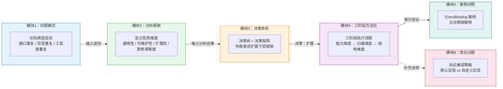
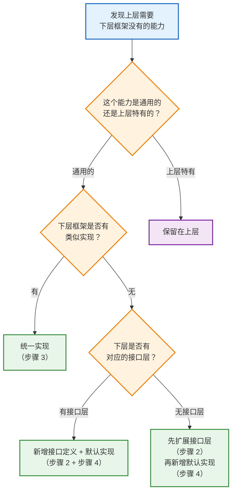

# 框架升级扩展方法论

> **模块元数据**
>
> | 属性 | 值 |
> |------|-----|
> | **模块名称** | Framework_Upgrade_Extension_Methodology |
> | **版本** | v1.3 |
> | **维护者** | WorkFlowPrj Team |
> | **更新日期** | 2026-07-18 |
> | **模块类型** | 方法论文档（索引 + 子模块聚合） |
> | **职责** | 定义"先扩展下层框架，再让上层基于新框架重新实现"的系统性方法论 |
>
> **核心理念：** 当上层应用需要依赖下层框架的能力，但下层框架能力不足时，
> **先扩展下层框架，再让上层基于新框架重新实现**，而非在上层重复实现下层应有的能力。
>
> **配套文档：** 具体重构案例请参阅 [`EventBinding_Modules_Refactoring_Plan.md`](EventBinding_Modules_Refactoring_Plan.md)。

---

## 目录

- [框架升级扩展方法论](#框架升级扩展方法论)
  - [目录](#目录)
  - [模块关系图](#模块关系图)
  - [1. 问题模式](#1-问题模式)
    - [1.1 典型症状](#11-典型症状)
  - [2. 分析框架](#2-分析框架)
    - [2.1 性质维度定义](#21-性质维度定义)
    - [2.2 做法对比分析](#22-做法对比分析)
  - [3. 决策体系](#3-决策体系)
    - [3.1 判断流程](#31-判断流程)
    - [3.2 决策矩阵](#32-决策矩阵)
  - [4. 三阶段方法论](#4-三阶段方法论)
    - [4.0 根本原因与核心理念](#40-根本原因与核心理念)
    - [4.1 阶段一：扩展下层框架（能力维度）](#41-阶段一扩展下层框架能力维度)
      - [步骤 1：新增工具类目录](#步骤-1新增工具类目录)
      - [步骤 2：扩展接口层](#步骤-2扩展接口层)
      - [步骤 3：统一核心实现](#步骤-3统一核心实现)
      - [步骤 4：新增通用服务实现](#步骤-4新增通用服务实现)
    - [4.2 阶段二：上层基于新框架重新实现（归属维度）](#42-阶段二上层基于新框架重新实现归属维度)
      - [步骤 5：更新上层引用](#步骤-5更新上层引用)
      - [步骤 6：删除上层中已由下层替代的文件](#步骤-6删除上层中已由下层替代的文件)
    - [4.3 阶段三：清理与验证（结构维度）](#43-阶段三清理与验证结构维度)
      - [步骤 7：编译验证](#步骤-7编译验证)
    - [4.4 规范与约定](#44-规范与约定)
      - [4.4.1 文件迁移规范](#441-文件迁移规范)
      - [4.4.2 接口迁移规范](#442-接口迁移规范)
      - [4.4.3 命名空间规范](#443-命名空间规范)
  - [5. 案例对照](#5-案例对照)
    - [5.1 EventBinding 重构案例](#51-eventbinding-重构案例)
    - [5.2 假设案例：日志框架扩展](#52-假设案例日志框架扩展)
  - [6. 常见问题](#6-常见问题)
    - [6.1 扩展框架时如何保证向后兼容？](#61-扩展框架时如何保证向后兼容)
    - [6.2 新增通用实现 vs 在上层保留自定义实现？](#62-新增通用实现-vs-在上层保留自定义实现)

---

## 模块关系图

本文档由 6 个功能模块组成，各模块职责分明、通过输入输出关系串联：



**模块导航速查：**

| 模块 | 章节 | 职责 | 前置依赖 |
|------|------|------|---------|
| 模块1 | [§1 问题模式](#1-问题模式) | 识别问题症状 | 无 |
| 模块2 | [§2 分析框架](#2-分析框架) | 定义分析维度 | 模块1 |
| 模块3 | [§3 决策体系](#3-决策体系) | 判断是否扩展 | 模块2 |
| 模块4 | [§4 三阶段方法论](#4-三阶段方法论) | 执行扩展流程 | 模块3（决策为"扩展"时） |
| 模块5 | [§5 案例对照](#5-案例对照) | 演示验证 | 模块4 |
| 模块6 | [§6 常见问题](#6-常见问题) | 补充说明 | 模块4 |

---


<!-- ==================== 模块1：问题模式 ==================== -->
<!-- 职责：识别问题症状，为分析框架提供输入 -->
<!-- 输出：问题症状清单 → 模块2（分析框架） -->

## 1. 问题模式

### 1.1 典型症状

在项目演进过程中，当上层应用需要依赖下层框架的能力时，如果下层框架能力不足，会出现以下症状：

| 症状 | 表现 | 后果 |
|------|------|------|
| **接口重复定义** | 上层定义了与下层语义相同的接口 | 接口分裂，调用方需要同时引用两个命名空间 |
| **实现重复** | 上层实现了与下层功能相同的类 | 代码重复，一处修复另一处遗漏 |
| **工具类重复** | 上层有工具类目录，下层没有，但上层的工具类逻辑是通用的 | 工具类无法被其他模块复用 |
| **条件分支判断** | 上层代码中出现 `if (isPlatformA) ... else ...` 等平台判断 | 违反开闭原则，新增平台需修改上层代码 |

> **模块间引用：** 识别到上述症状后，进入 [模块2：分析框架](#2-分析框架) 进行性质维度分析。

<!-- ==================== 模块1 结束 ==================== -->

---

<!-- ==================== 模块2：分析框架 ==================== -->
<!-- 职责：定义性质维度，对比做法优劣，为决策提供客观依据 -->
<!-- 输入：问题症状清单 ← 模块1（问题模式） -->
<!-- 输出：性质维度分析结果 → 模块3（决策体系） -->

## 2. 分析框架

在进入具体决策和执行之前，先定义一套客观的分析维度，用于评估不同做法的优劣。

### 2.1 性质维度定义

| 维度 | 含义 | 考察问题 |
|------|------|---------|
| **通用性** | 能力是否跨多个上层模块可复用 | 是否有多个上层模块需要此能力？ |
| **可维护性** | 修改时的影响范围 | 修改此能力需要改动多少处代码？ |
| **扩展性** | 新增场景时是否需要修改现有代码 | 新增平台/场景时是否需要改动现有代码？ |
| **职责清晰度** | 代码归属是否与架构层级一致 | 此能力属于下层框架的职责范畴吗？ |

### 2.2 做法对比分析

基于上述性质维度，对比两种做法：

| 维度 | 做法A：在上层直接实现 | 做法B：扩展下层框架后重新实现 |
|------|---------------------|---------------------------|
| **通用性** | 仅当前模块可用，其他模块需重复实现 | 下层框架提供，所有上层模块可复用 |
| **可维护性** | 重复实现导致一处修复多处遗漏 | 唯一来源，改一处即全局生效 |
| **扩展性** | 新增平台/场景需修改上层代码 | 下层扩展接口，上层无需改动 |
| **职责清晰度** | 上层做了下层该做的事，职责混淆 | 各层职责分明，下层提供能力，上层编排使用 |

**分析结论：**

| 步骤 | 做法A（在上层实现） | 做法B（扩展下层框架） | 性质依据 |
|------|-------------------|-------------------|---------|
| 1 | 在上层直接定义新接口 | 先在下层框架评估是否需要扩展 | 通用性：下层接口可被多个上层复用 |
| 2 | 在上层实现完整功能 | 扩展下层框架，新增接口和通用实现 | 职责清晰度：通用能力应归属下层 |
| 3 | 上层自给自足，下层不知情 | 上层基于扩展后的下层重新实现 | 可维护性：消除重复，唯一来源 |
| 4 | 重复代码累积，维护成本上升 | 重复代码消除，职责清晰 | 扩展性：下层扩展，上层无需改动 |

> **模块间引用：** 完成分析后，进入 [模块3：决策体系](#3-决策体系) 判断是否应该扩展下层框架。

<!-- ==================== 模块2 结束 ==================== -->


<!-- ==================== 模块3：决策体系 ==================== -->
<!-- 职责：提供决策树和决策矩阵，判断是否应该扩展下层框架 -->
<!-- 输入：性质维度分析结果 ← 模块2（分析框架） -->
<!-- 输出：决策结果（扩展下层框架 / 保留在上层） → 模块4（三阶段方法论） -->

## 3. 决策体系

在决定是否扩展下层框架之前，先通过决策树和决策矩阵进行判断。

### 3.1 判断流程



### 3.2 决策矩阵

基于 [§2.1 性质维度定义](#21-性质维度定义) 的四个维度，对常见场景进行归属分析：

| 场景 | 归属 | 通用性分析 | 可维护性分析 | 扩展性分析 | 职责分析 | 性质依据 |
|------|------|-----------|------------|-----------|---------|---------|
| 纯接口定义（无平台依赖） | 下层框架 ✅ | 多个上层可共用同一接口 | 接口唯一，修改一处即可 | 新增实现类不影响接口定义 | 接口属于下层抽象层职责 | 接口无平台依赖，下层提供可被所有上层复用 |
| 通用工具类（如反射缓存） | 下层框架 ✅ | 多个上层都可能使用 | 工具类集中，避免重复实现 | 新增工具方法不影响上层 | 纯逻辑工具属于下层基础能力 | 纯逻辑工具，多个上层都可能使用 |
| 通用实现（如默认查找策略） | 下层框架 ✅ | 覆盖多数上层场景 | 默认实现统一，减少重复 | 特殊场景可通过 DI 覆盖 | 默认实现属于下层服务层职责 | 覆盖 80% 场景，下层提供默认实现减少重复 |
| 编排器/协调器逻辑 | 上层应用 ❌ | 依赖具体业务场景 | 编排逻辑随业务变化频繁 | 业务变化需调整编排 | 编排属于上层业务逻辑 | 编排逻辑依赖具体业务场景，下层无法预知 |
| 管线编排（依赖特定管线模块） | 上层应用 ❌ | 仅特定场景使用 | 与管线模块强耦合 | 管线变更需同步修改 | 引入下层会造成循环依赖 | 依赖特定模块，下层引入不必要的耦合 |
| 平台适配（WinForms/WPF/Avalonia） | 上层应用 ❌ | 仅特定平台使用 | 平台差异需各自维护 | 新增平台只需新增适配 | 平台适配属于上层接入层 | 平台相关代码放入下层会破坏通用性 |
| 诊断上下文（依赖诊断模块） | 上层应用 ❌ | 仅诊断场景使用 | 与诊断模块耦合 | 诊断方式变更需修改 | 下层不应感知诊断上下文 | 依赖特定诊断上下文，下层不应感知 |
| 验证器（依赖第三方库） | 上层应用 ❌ | 依赖特定第三方库 | 第三方库升级需同步 | 验证规则变化频繁 | 引入第三方依赖污染下层 | 引入第三方依赖会污染下层框架 |
| 桥接类（实现多个接口的适配器） | 上层应用 ❌ | 仅当前适配场景使用 | 适配逻辑随接口变化 | 接口变更需修改适配 | 适配属于上层编排范畴 | 适配多个上层接口，属于上层编排范畴 |

> **模块间引用：**
> - 如果决策结果为 **"扩展下层框架"** → 进入 [模块4：三阶段方法论](#4-三阶段方法论) 执行具体操作
> - 如果决策结果为 **"保留在上层"** → 无需进一步操作

<!-- ==================== 模块3 结束 ==================== -->


<!-- ==================== 模块4：三阶段方法论 ==================== -->
<!-- 职责：提供三阶段执行流程和规范约定，指导如何扩展下层框架 -->
<!-- 输入：决策结果（"扩展下层框架"）← 模块3（决策体系） -->
<!-- 输出：执行结果（扩展后的下层框架 + 清理后的上层代码）→ 模块5（案例对照） -->
<!-- 子模块：4.0 根本驱动 → 4.1 阶段一（能力维度）→ 4.2 阶段二（归属维度）→ 4.3 阶段三（结构维度）→ 4.4 规范与约定 -->

## 4. 三阶段方法论

### 4.0 根本原因与核心理念


下层框架逻辑覆盖不全面是**客观存在的现实问题**，也是推动重构的**直接驱动力**。任何框架都无法预见所有使用场景，当上层遇到下层未覆盖的能力时，容易选择"自给自足"——在上层本地重复实现，导致代码膨胀和维护成本上升。

解决问题的关键不在于"让下层框架覆盖所有场景"（这是不现实的），而在于建立一套系统性的**通用性分解框架**，用于界定：

| 问题 | 含义 |
|------|------|
| **什么能力是通用的？** | 应下沉到下层框架，作为公共基础能力 |
| **什么能力是特有的？** | 应保留在上层应用，作为特定业务逻辑 |
| **边界如何界定？** | 通过性质维度（通用性、可维护性、扩展性、职责清晰度）进行客观分析 |

| 层次 | 内容 | 角色 |
|------|------|------|
| **事实问题** | 下层框架逻辑覆盖不全面 | 驱动原因（"为什么需要做"） |
| **基础理念** | 通用性的分解定义 | 理论框架（"怎么判断、怎么做"） |

事实问题是"为什么需要做"，通用性分解是"怎么做判断"。没有通用性分解框架，开发者只能凭感觉决策，导致该下沉的没下沉、该保留的没保留。

```mermaid
flowchart LR
    subgraph RootCause["⚡ 根本驱动"]
        direction TB
        RC1["下层框架<br/>逻辑覆盖不全面"]
        RC2["通用性的<br/>分解定义不清晰"]
    end

    RootCause -->|"触发"| Phase1

    subgraph Phase1["阶段一：能力维度 — 扩展下层框架"]
        direction TB
        S1["① 新增工具类目录<br/>迁入通用工具类"]
        S2["② 扩展接口层<br/>迁入通用接口"]
        S3["③ 统一核心实现<br/>消除重复实现"]
        S4["④ 新增通用服务实现<br/>提供开箱即用能力"]
    end

    Phase1 -->|"能力下沉完成"| Phase2

    subgraph Phase2["阶段二：归属维度 — 上层重新实现"]
        direction TB
        S5["⑤ 更新上层引用<br/>指向下层版本"]
        S6["⑥ 删除上层中已由<br/>下层替代的文件"]
    end

    Phase2 -->|"归属剥离完成"| Phase3

    subgraph Phase3["阶段三：结构维度 — 清理验证"]
        direction TB
        S7["⑦ 编译验证 +<br/>搜索外部引用"]
    end

    style RootCause fill:#fce4ec,stroke:#d32f2f,stroke-width:2px,color:#d32f2f
    style Phase1 fill:#e8f5e9,stroke:#388e3c,stroke-width:2px
    style Phase2 fill:#fff8e1,stroke:#f9a825,stroke-width:2px
    style Phase3 fill:#e3f2fd,stroke:#1565c0,stroke-width:2px
```



> **说明：** 根本驱动包含事实问题（下层框架覆盖不全面）和基础理念（通用性分解定义不清晰）两个层面。三个阶段从能力维度、归属维度、结构维度对通用性进行分解，彼此之间是**并行**关系。每个阶段内部的步骤也是**并行**的，无先后依赖关系。

<!-- ===== 子阶段 4.1：能力维度 ===== -->

### 4.1 阶段一：扩展下层框架（能力维度）

**目标：** 从"能力类型"维度分解通用性，将具有通用性的能力下沉到下层框架。

**核心问题：** 哪些能力具有通用性，应该下沉为框架能力？

阶段一内部的四个步骤是**并行**的，分别对应四种不同类型的通用能力。

#### 步骤 1：新增工具类目录

在下层框架中新建工具类目录，从上层迁入通用工具类。

```
下层框架项目/
├── Utils/                    ★ 新增
│   ├── SomeUtility.cs        ★ 从上层迁入
│   └── SomeCache.cs          ★ 从上层迁入
```

**操作规范：**
- 复制文件，更新命名空间为下层框架的命名空间
- 保持方法签名不变
- 上层版本改为 `using` 别名指向下层版本（阶段二删除）

#### 步骤 2：扩展接口层

将上层中通用的接口定义迁入下层，使下层成为所有接口的唯一来源。

```
下层框架项目/
├── Abstractions/
│   ├── IExistingInterface.cs  （已有）
│   ├── INewInterface.cs       ★ 从上层迁入
│   └── IAnotherInterface.cs   ★ 从上层迁入
```

**操作规范：**
- 复制接口定义，更新命名空间
- 保持方法签名不变
- 上层版本保留（阶段二删除），引用方逐步迁移

#### 步骤 3：统一核心实现

当下层和上层有功能相同的实现类时，统一为下层版本。

| 场景 | 操作 |
|------|------|
| 下层是静态类，上层是实例类 | 下层保留静态类，上层改为调用下层静态方法的包装器（Wrapper） |
| 下层是内联实现，上层多一层委托 | 下层统一为最简实现，上层删除 |
| 下层实现接口 A，上层实现接口 B | 下层同时实现两个接口（显式接口实现） |
| 下层是泛型，上层是非泛型 | 下层新增非泛型重载 |

#### 步骤 4：新增通用服务实现

下层提供可直接使用的默认实现，上层无需重复实现。

```
下层框架项目/
├── Services/
│   ├── ISomeService.cs        （已有接口）
│   ├── DefaultSomeService.cs  ★ 新增默认实现
│   └── DefaultAnotherService.cs ★ 新增默认实现
```

**设计原则：**
- 默认实现应覆盖 80% 的使用场景
- 特殊场景通过 DI 注入自定义实现
- 默认实现应零依赖或仅依赖下层接口

<!-- ===== 子阶段 4.2：归属维度 ===== -->

### 4.2 阶段二：上层基于新框架重新实现（归属维度）

**目标：** 从"代码归属"维度分解通用性，将已下沉的能力从上层剥离。

**核心问题：** 哪些能力是上层特有的，应该保留在上层？

阶段二内部的两个步骤是**并行**的。

#### 步骤 5：更新上层引用

- 上层中所有引用重复接口/实现的地方，改为引用下层版本
- 使用 `using` 别名或完全限定名
- 确保编译通过

**示例：**
```csharp
// 重构前：引用上层版本
using上层应用.Abstractions;

// 重构后：引用下层版本
using下层框架.Abstractions;
```

**过渡期 using 别名示例：**
```csharp
// 过渡期：通过 using 别名指向下层版本，逐步迁移
using IControlFinder =下层框架.Abstractions.IControlFinder;
```

#### 步骤 6：删除上层中已由下层替代的文件

删除上层中已由下层版本替代的文件（包括重复的接口定义、实现类、工具类等）。

**删除前检查清单：**
- [ ] 下层版本已包含所有方法
- [ ] 上层所有引用方已更新
- [ ] 外部模块无直接引用

### 4.3 阶段三：清理与验证（结构维度）

**目标：** 从"架构完整性"维度验证通用性分解的正确性。

**核心问题：** 通用性分解后，架构是否仍然正确、完整？

#### 步骤 7：编译验证

```
1. 下层先编译，上层后编译
2. 检查项目依赖关系是否正确
3. 搜索外部模块是否直接引用已删除文件
4. 运行相关单元测试和集成测试
```

### 4.4 规范与约定

#### 4.4.1 文件迁移规范

| 操作 | 规范 |
|------|------|
| **复制** | 从上层复制到下层，保持方法签名不变 |
| **更新命名空间** | `上层命名空间` → `下层命名空间` |
| **更新 using** | 更新文件内部的 using 引用 |
| **保留原文件** | 阶段二再删除，阶段一期间保留以保持编译通过 |

#### 4.4.2 接口迁移规范

| 操作 | 规范 |
|------|------|
| **复制接口定义** | 保持方法签名不变 |
| **更新命名空间** | `上层.Abstractions` → `下层.Abstractions` |
| **XML 注释** | 保留完整注释，标注迁移来源 |
| **向后兼容** | 上层版接口保留（阶段二删除），使用 `using` 别名过渡 |

#### 4.4.3 命名空间规范

| 层级 | 命名空间格式 | 示例 |
|------|-------------|------|
| 下层接口 | `{Framework}.Abstractions` | `EventFramework.Abstractions` |
| 下层实现 | `{Framework}.Core` | `EventFramework.Core` |
| 下层工具 | `{Framework}.Utils` | `EventFramework.Utils` |
| 下层服务 | `{Framework}.Services` | `EventFramework.Services` |
| 上层编排 | `{Application}.{Module}` | `EventBindingOrchestrator` |

<!-- ==================== 模块4 结束 ==================== -->

<!-- ==================== 模块5：案例对照 ==================== -->

<!-- 职责：通过实际案例演示三阶段方法论的具体应用 -->
<!-- 输入：三阶段方法论 ← 模块4 -->
<!-- 输出：案例验证结果，供读者参考类比 -->

---

## 5. 案例对照

> **说明：** 以下案例基于项目中的实际模块命名，用于演示 [模块4：三阶段方法论](#4-三阶段方法论) 的具体应用。

### 5.1 EventBinding 重构案例

**背景：** `上层应用.EventBindingOrchestrator` 需要依赖 `下层框架.EventFramework` 的能力，但下层框架缺少接口定义、工具类和默认实现。

**重构前 vs 重构后：**

```mermaid
flowchart LR
    subgraph Before["❌ 重构前"]
        direction TB
        B_Title["上层应用.EventBindingOrchestrator"]
        B1["Abstractions/IControlFinder.cs<br/>（重复定义）"]
        B2["Abstractions/IFunctionResolver.cs<br/>（重复定义）"]
        B3["Utils/ReflectionCache.cs<br/>（下层需要但未提供）"]
        B4["Invoke/ReflectionEventBinderStrategy.cs<br/>（与下层重复实现）"]
    end

    subgraph After["✅ 重构后"]
        direction TB
        A_Title["下层框架.EventFramework"]
        A1["Abstractions/IControlFinder.cs<br/>（唯一来源）"]
        A2["Abstractions/IFunctionResolver.cs<br/>（唯一来源）"]
        A3["Utils/ReflectionCache.cs<br/>（通用工具类）"]
        A4["Services/DefaultFunctionResolver.cs<br/>（默认实现）"]
        A5["上层应用.EventBindingOrchestrator<br/>（仅保留高层编排逻辑）"]
    end

    Before -->|"三阶段重构"| After

    style Before fill:#ffebee,stroke:#d32f2f,stroke-width:2px
    style After fill:#e8f5e9,stroke:#388e3c,stroke-width:2px
```



**三阶段应用：**

| 阶段 | 维度 | 操作 | 具体步骤 |
|------|------|------|---------|
| 一 | 能力维度 | 扩展下层框架 | ① 新增 `Utils/` 目录，迁入工具类 |
| | | | ② 扩展 `Abstractions/` 接口层 |
| | | | ③ 统一 Core 实现 |
| | | | ④ 新增多个默认服务实现 |
| 二 | 归属维度 | 上层重新实现 | ⑤ 更新引用指向下层版本 |
| | | | ⑥ 删除已替代的文件 |
| 三 | 结构维度 | 清理验证 | ⑦ 编译验证 |

### 5.2 假设案例：日志框架扩展

**背景：** 上层应用需要记录结构化日志，但下层框架只提供底层插桩能力，没有高层日志 API。

**三阶段应用：**

| 阶段 | 维度 | 操作 | 具体步骤 |
|------|------|------|---------|
| 一 | 能力维度 | 扩展下层框架 | ① 新增 `Services/` 目录 |
| | | | ② 定义 `ILogger` 接口 |
| | | | ③ 提供 `DefaultLogger` 实现 |
| 二 | 归属维度 | 上层重新实现 | ④ 上层日志类改为委托到下层版本 |
| | | | ⑤ 删除上层重复的日志实现 |
| 三 | 结构维度 | 清理验证 | ⑥ 编译验证 |

<!-- ==================== 模块5 结束 ==================== -->

<!-- ==================== 模块6：常见问题 ==================== -->

<!-- 职责：解答常见问题，补充说明三阶段方法论的实施细节 -->
<!-- 输入：三阶段方法论 ← 模块4 -->
<!-- 输出：常见问题解答，辅助读者正确应用方法论 -->

---

## 6. 常见问题

### 6.1 扩展框架时如何保证向后兼容？


1. **阶段一期间保留原文件**：下层新增文件后，上层原文件不删除
2. **使用 `using` 别名过渡**：上层引用方逐步迁移到下层版本

```csharp
// 过渡期示例：通过 using 别名指向下层版本
using IMyInterface =下层框架.Abstractions.IMyInterface;

// 迁移完成后，删除 using 别名，直接引用下层命名空间
using下层框架.Abstractions;
```

3. **接口签名不变**：迁移的接口保持方法签名完全一致
4. **编译验证**：每个步骤完成后编译验证

### 6.2 新增通用实现 vs 在上层保留自定义实现？

| 场景 | 推荐做法 |
|------|---------|
| 80% 场景可用默认实现 | 下层提供默认实现，上层直接使用 |
| 需要特殊配置 | 下层提供可配置的默认实现 |
| 完全不同的行为 | 上层实现自定义版本，通过 DI 注入 |
| 临时/实验性功能 | 先在上层实现，稳定后迁入下层 |

<!-- ==================== 模块6 结束 ==================== -->


