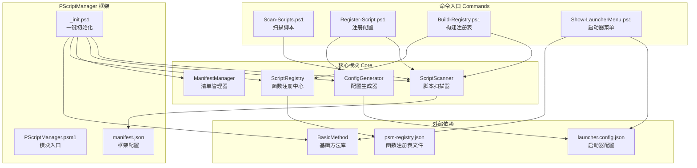
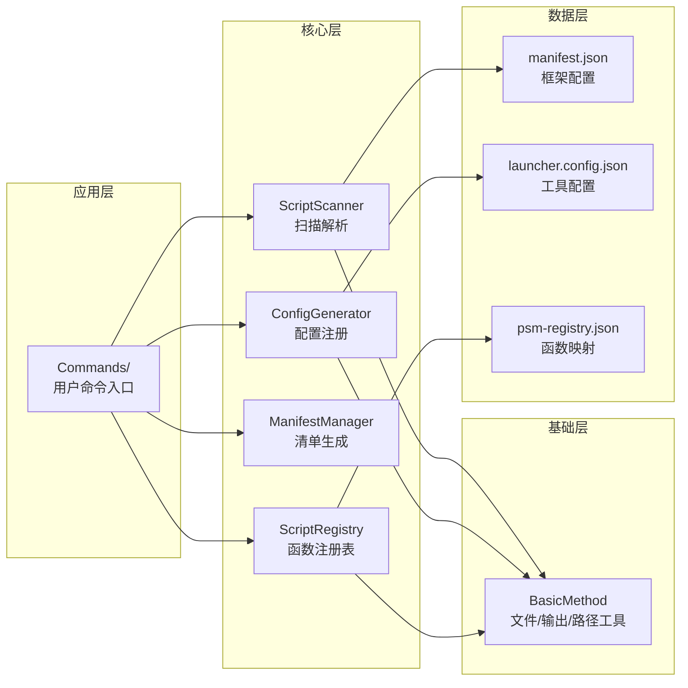
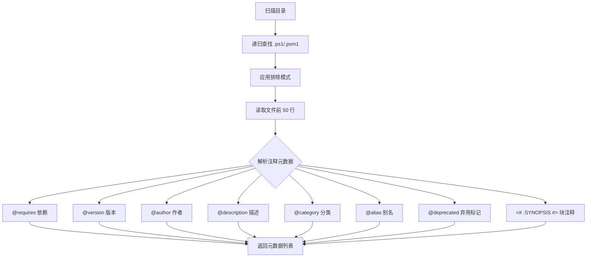
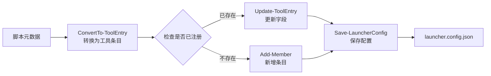
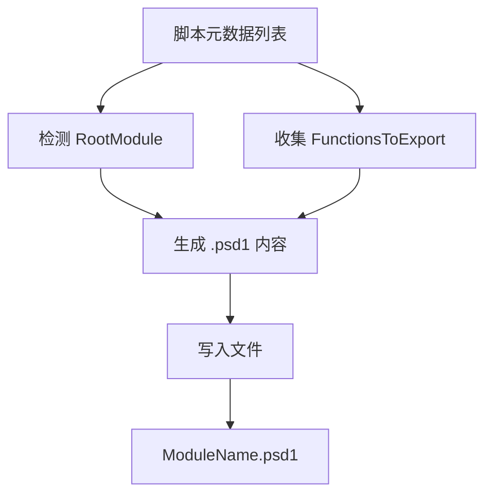
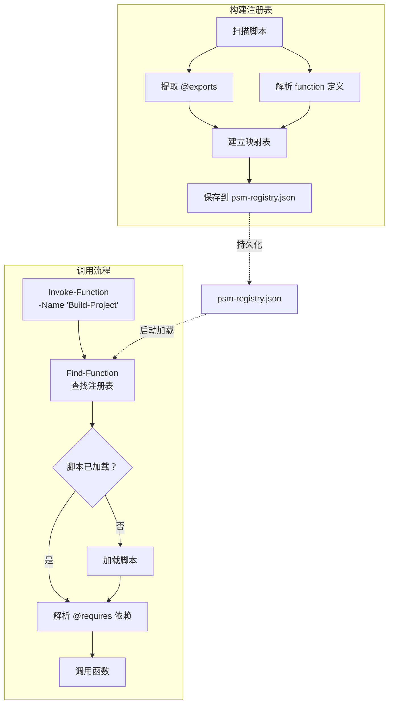
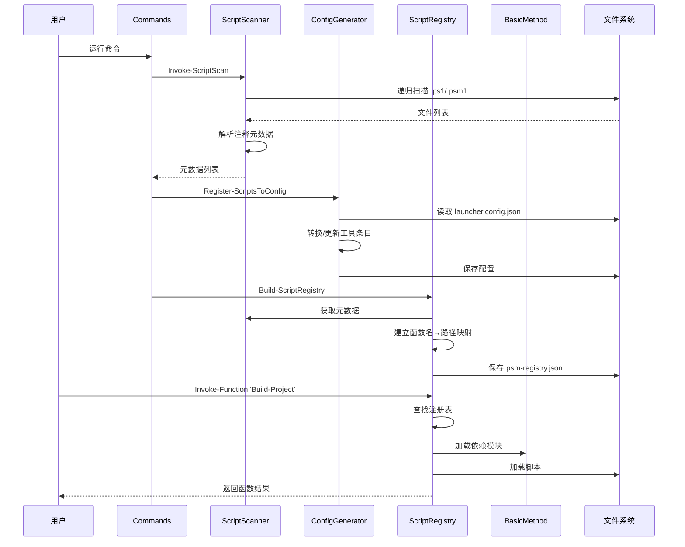
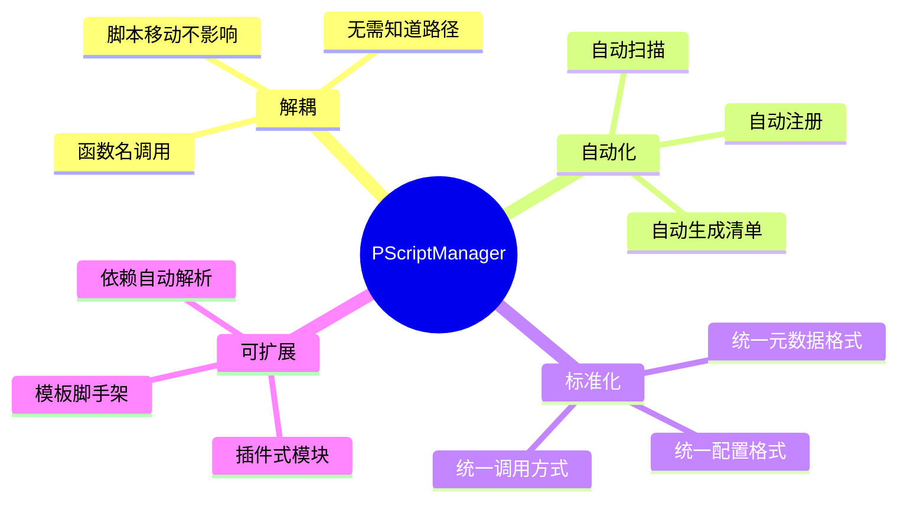
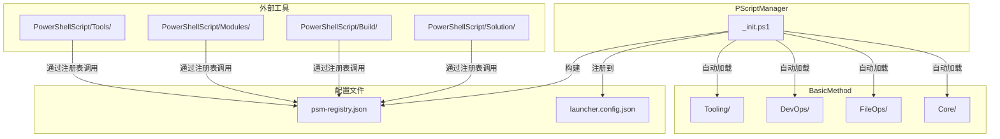

# PScriptManager — PowerShell 脚本管理框架

> **统一管理 WorkFlowPrj 项目中所有 PowerShell 脚本的核心框架**
> 版本：1.0.0 | 依赖：PowerShell 5.1+

---

## 概述

PScriptManager 是 WorkFlowPrj 项目的 PowerShell 脚本管理中枢，提供**自动扫描、元数据解析、配置注册、函数注册表、依赖解析**等核心能力。所有 PowerShell 脚本通过 PScriptManager 统一管理，实现**函数名解耦物理路径**的设计目标。



---

## 架构分层



---

## 核心模块

### 1. ScriptScanner — 脚本扫描器

递归扫描 `.ps1` / `.psm1` 文件，解析文件头注释中的元数据标签。



**关键函数：**

| 函数 | 说明 |
|------|------|
| `Invoke-ScriptScan` | 扫描目录，返回所有脚本的元数据 |
| `Get-ScriptMetadata` | 解析单个脚本文件的注释元数据 |
| `Get-ScriptSummary` | 生成扫描结果的统计摘要 |
| `Show-ScriptScanResult` | 格式化显示扫描结果 |
| `Parse-BlockComment` | 解析 `<# ... #>` 块注释 |

---

### 2. ConfigGenerator — 配置生成器

将扫描结果自动注册到 `launcher.config.json`，支持新增、更新、弃用移除。



**关键函数：**

| 函数 | 说明 |
|------|------|
| `Register-ScriptsToConfig` | 核心注册函数，将脚本注册到配置 |
| `ConvertTo-ToolEntry` | 脚本元数据 → 工具条目格式 |
| `Update-ToolEntry` | 更新已存在的工具条目 |
| `Add-CategoryIfNotExists` | 自动创建不存在的分类 |
| `Load-LauncherConfig` | 加载配置文件 |
| `Save-LauncherConfig` | 保存配置文件 |

---

### 3. ManifestManager — 清单管理器

根据扫描结果自动生成 `.psd1` 模块清单文件。



**关键函数：**

| 函数 | 说明 |
|------|------|
| `New-ModuleManifest` | 为指定目录生成 .psd1 模块清单 |

---

### 4. ScriptRegistry — 函数注册中心

核心设计：**函数名 ↔ 脚本路径** 的查找表，实现完全解耦。



**关键函数：**

| 函数 | 说明 |
|------|------|
| `Build-ScriptRegistry` | 扫描脚本并构建函数注册表 |
| `Invoke-Function` | 通过函数名调用脚本（核心调用代理） |
| `Find-Function` | 查找函数名对应的脚本信息 |
| `Show-Registry` | 显示注册表内容 |
| `Save-Registry` / `Load-Registry` | 注册表持久化 |

---

## 命令入口

### 一键初始化

```powershell
# 加载 PScriptManager 框架（自动加载所有核心模块 + BasicMethod）
. .\PScriptManager\_init.ps1
```

### 扫描脚本

```powershell
# 扫描 PowerShellScript 目录
.\PScriptManager\Commands\Scan-Scripts.ps1

# 扫描指定目录并显示详细信息
.\PScriptManager\Commands\Scan-Scripts.ps1 -Path "..\CentralTest" -ShowAll

# 输出 JSON 到文件
.\PScriptManager\Commands\Scan-Scripts.ps1 -OutputJson -OutputFile "scan-result.json"
```

### 注册到启动器配置

```powershell
# 预览模式（不实际写入）
.\PScriptManager\Commands\Register-Script.ps1 -DryRun

# 实际注册
.\PScriptManager\Commands\Register-Script.ps1

# 移除已弃用的脚本
.\PScriptManager\Commands\Register-Script.ps1 -RemoveDeprecated
```

### 构建函数注册表

```powershell
# 构建注册表
.\PScriptManager\Commands\Build-Registry.ps1

# 强制重新解析所有函数定义
.\PScriptManager\Commands\Build-Registry.ps1 -Force
```

### 启动器菜单

```powershell
# 显示交互菜单
.\PScriptManager\Commands\Show-LauncherMenu.ps1

# 直接运行指定工具
.\PScriptManager\Commands\Show-LauncherMenu.ps1 -Tool clean

# 列出所有工具
.\PScriptManager\Commands\Show-LauncherMenu.ps1 -List
```

---

## 数据流



---

## 配置说明

### manifest.json — 框架配置

```json
{
  "name": "PScriptManager",
  "version": "1.0.0",
  "managedPaths": ["PowerShellScript", "CentralTest"],
  "scanExcludePatterns": ["**/backups/**", "**/Temp/**", "**/node_modules/**"],
  "metadataTags": {
    "requires": "@requires",
    "version": "@version",
    "category": "@category"
  },
  "registry": {
    "enabled": true,
    "autoLoad": true,
    "file": "psm-registry.json"
  }
}
```

### 脚本元数据标签规范

在脚本文件头部注释中添加以下标签：

```powershell
# @requires: ModuleA, ModuleB
# @version: 1.0.0
# @author: YourName
# @description: 脚本功能描述
# @category: 构建
# @alias: build
# @deprecated
# @exports: FunctionName1, FunctionName2
```

---

## 目录结构

```
PScriptManager/
├── _init.ps1                  # 一键初始化入口
├── PScriptManager.psm1        # 模块入口
├── manifest.json              # 框架配置
├── psm-registry.json          # 函数注册表（自动生成）
│
├── Core/                      # 核心模块
│   ├── ScriptScanner.ps1      # 脚本扫描器（dot-source 版）
│   ├── ScriptScanner.psm1     # 脚本扫描器（模块版）
│   ├── ConfigGenerator.ps1    # 配置生成器（dot-source 版）
│   ├── ConfigGenerator.psm1   # 配置生成器（模块版）
│   ├── ManifestManager.ps1    # 清单管理器（dot-source 版）
│   ├── ManifestManager.psm1   # 清单管理器（模块版）
│   └── ScriptRegistry.ps1     # 函数注册中心
│
├── Commands/                  # 用户命令入口
│   ├── Scan-Scripts.ps1       # 扫描脚本
│   ├── Register-Script.ps1    # 注册到配置
│   ├── Build-Registry.ps1     # 构建注册表
│   └── Show-LauncherMenu.ps1  # 启动器菜单
│
└── Templates/                 # 模板
    └── script/                # 脚本模板
```

---

## 设计哲学



---

## 与其他模块的关系



---

## 快速开始

```powershell
# 1. 加载框架
. .\PScriptManager\_init.ps1

# 2. 扫描所有脚本
.\PScriptManager\Commands\Scan-Scripts.ps1

# 3. 注册到启动器配置
.\PScriptManager\Commands\Register-Script.ps1

# 4. 构建函数注册表
.\PScriptManager\Commands\Build-Registry.ps1

# 5. 通过函数名调用（无需知道路径）
Invoke-Function -Name 'Build-Project' -Arguments @{Configuration='Release'}
```

代码仓库地址：`https://gitee.com/Ljy_111/ZhiLianStorage.git`
