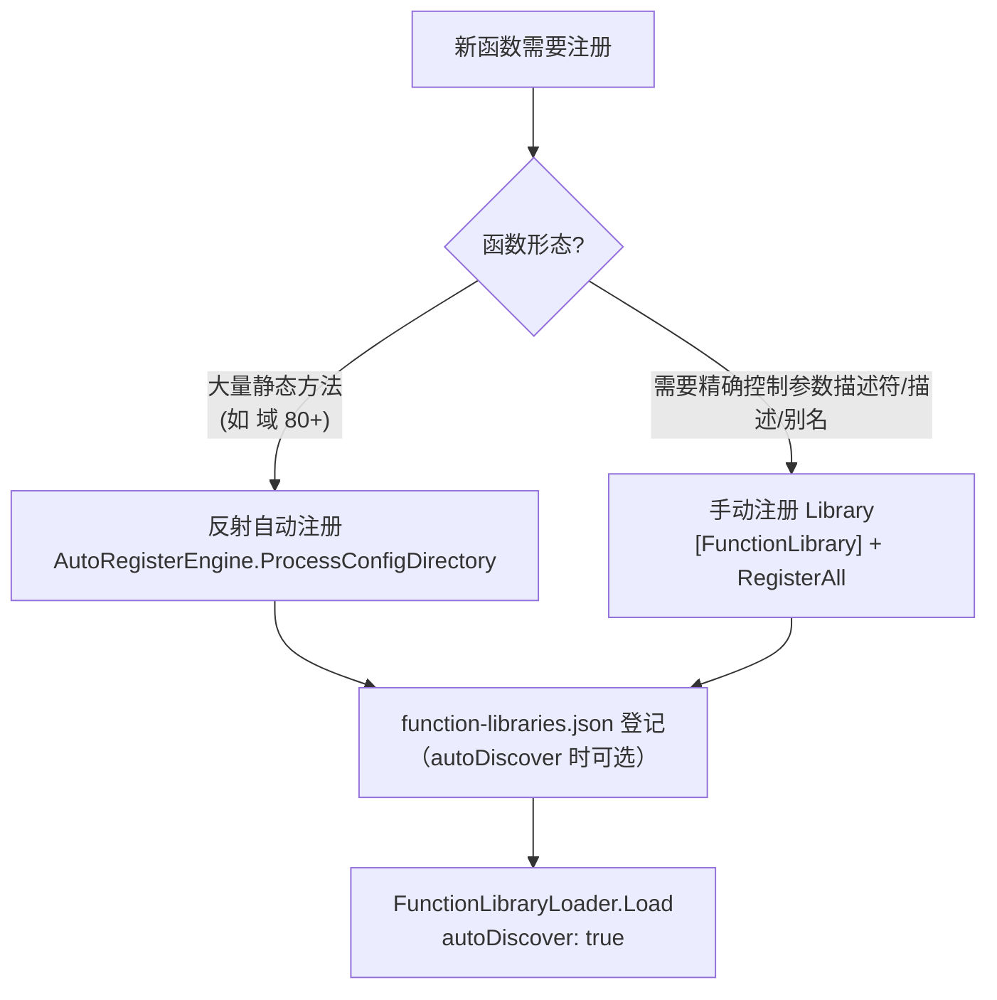

> 本文件为 `skills/SKILL.md` 的模块化拆分 —— **① 注册函数（C# 层）**（原 §1）。
> 完整三段式流程、模块导航与端到端示例见 [SKILL.md](SKILL.md)。本模块章节沿用原编号（§1.x），便于与 SKILL.md 导航表对照。
> 相关模块：② 配置（UI）→ [02-json-ui.md](02-json-ui.md) · ② 配置（工作流）→ [03-json-workflow.md](03-json-workflow.md) · ③ 脚本 → [04-json-script.md](04-json-script.md)。

---

## 1. 注册函数（C# 层）— 通用

### 1.1 两种注册方式与选择

| 方式 | 适用场景 | 文件位置 | 注册入口 |
|------|----------|----------|----------|
| **手动注册 Library**（推荐） | 需要精确控制参数描述符/描述/别名 | `FileDriven/FileDriven.Business/Registrations/<Domain>/<YourLibrary>.cs` | `[FunctionLibrary]` + `RegisterAll(ITrConfigRegistry)` |
| **反射自动注册** | 大量静态方法（如数学域 80+ 函数）零手写 | `DrivenConfig/FunctionRegistrations/*.registration.json` | `AutoRegisterEngine.ProcessConfigDirectory` |

> **登记与自动发现**：`FunctionLibraryLoader.Load(config, autoDiscover: true)` 时，带 `[FunctionLibrary]`（`AutoDiscover=true`，默认）的类可被自动发现并注册；仅当 `autoDiscover: false`（仅从清单加载）时才**必须**写入 `function-libraries.json`。跨程序集库建议仍显式登记（显式 `type` 更可控，避免依赖程序集扫描顺序，见 §1.4）。



### 1.2 手动注册 Library 类（通用模板）

**文件**：`FileDriven/FileDriven.Business/Registrations/<Domain>/<YourLibrary>.cs`

```csharp
using System.Threading.Tasks;         // Func<Task<T>> 异步委托（真实 AI/工具/数据库函数）
using CommandFramework.Abstractions;   // ListData
using Modules.Registry;                // [FunctionLibrary]
using TConfig;                         // ITrConfigRegistry / IParamConfig

namespace FunctionStorage.Registrations;

/// <summary>功能库说明（消费方: 工作流 / UI 配置）。</summary>
[FunctionLibrary]
public static class <YourLibrary>
{
    public static void RegisterAll(ITrConfigRegistry registry)
    {
        // 标量函数 → 返回 string 给 TextBox
        registry.Register("<FuncName>", (Func<double, double>)(x => x * 2), "示例标量函数: x*2");

        // 列表函数 → 返回 ListData 给 ListView/ComboBox
        registry.Register("<ListFunc>", (Func<ListData>)(() =>
            ListData.From(new[] { "项A", "项B" })), "示例列表函数");

        // 带显式参数描述符（可选/默认值）→ 支持参数默认值回填
        registry.Register("<OptionalFunc>",
            (Func<double, double, double>)((x, k) => x * k),
            new IParamConfig[]
            {
                new ParameterDescriptor { Name = "x", Type = typeof(double) },
                new ParameterDescriptor { Name = "k", Type = typeof(double), IsOptional = true, DefaultValue = 1.0 }
            },
            "带可选参数默认值的函数");

        // 异步函数（AI/工具/数据库等）→ 注册为 Func<Task<T>>，经 FunctionCallFacade 后台执行；
        // 勿在函数内同步阻塞（GetAwaiter().GetResult()）——UI 线程死锁根因（对齐 ClineLibrary 规则）
        registry.Register("<AsyncFunc>",
            (Func<string, Task<string>>)(input => Task.FromResult($"hello {input}")),
            new IParamConfig[] { new ParameterDescriptor { Name = "input", Type = typeof(string) } },
            "示例异步函数");
    }
}
```

**注册契约（同步/异步/参数/取消）**：

| 规则 | 说明 |
|------|------|
| 返回类型 | 文本 `string` / 列表 `ListData`（见 [SKILL.md §0.2](SKILL.md) 返回类型→控件表）；异步返回 `Task<string>` / `Task<ListData>` |
| 同步函数 | 注册 `Func<T>` / `Func<Args..., T>` |
| 异步函数 | 注册 `Func<..., Task<T>>`，经 `FunctionCallFacade` 后台执行；**勿在函数内同步阻塞**（`GetAwaiter().GetResult()` → UI 线程死锁根因） |
| 参数描述符 | 需可选/默认值参数时用 `Register(name, Delegate, IReadOnlyList<IParamConfig>, desc)` + `ParameterDescriptor` |
| `CancellationToken` | 可声明该参数，描述符自动剔除（`FromContract/FromDelegate` 过滤），UI/脚本无需传 |
| 函数名 | 前缀 `<Domain>_`（如 `Math_Add`、`AgentUi_GetStatus`），全局唯一（重复注册抛异常） |

**注册 API 速查**（`ITrConfigRegistry`）→ 独立小节见 §1.5。

### 1.3 反射自动注册（`FunctionRegistrations/*.registration.json`）

> 从已编译程序集反射提取静态方法，命名 `<NestedClass>_<MethodName>`（如 `Activation_ReLU`）。消费方：`AutoRegisterEngine`。

```json
{
  "registrations": [
    {
      "source": { "type": "assembly", "path": "<DomainAssembly>.dll" },
      "className": "<Namespace>.<DomainClass>",
      "naming": { "convention": "NestedClass_MethodName", "separator": "_" },
      "description": { "source": "xmlDoc" },
      "methodFilters": {
        "includeStaticOnly": true,
        "excludeByReturnType": ["Void"],
        "excludeMethodNames": ["GetType", "ToString", "Equals", "GetHashCode"]
      }
    }
  ]
}
```

### 1.4 注册清单 `function-libraries.json`

**文件**：`FileDriven/DrivenConfig/Configs/function-libraries.json` — 合法加载入口（`autoDiscover: true` 时非强制，见 §1.1；显式登记更可控）。

```json
{
  "libraries": [
    { "name": "<YourLibrary>", "type": "FunctionStorage.Registrations.<YourLibrary>, FileDriven.Business", "enabled": true }
  ]
}
```

| 字段 | 含义 |
|------|------|
| `name` | 库名（日志/诊断用） |
| `type` | **程序集限定名** `Namespace.Class, AssemblyName`；跨程序集库须用完整名（见下） |
| `enabled` | 是否启用（`false` 跳过） |
| `method` | 可选；指定注册方法名（缺省自动识别 `RegisterAll(ITrConfigRegistry)` 或 `Register()`） |

> ⚠️ **依赖顺序**：清单按序加载，被依赖库必须排在前面（如数学函数注册必须在浏览器辅助函数之前）。

**跨程序集注册**：`[FunctionLibrary]` 类可定义在 `FileDriven.Business` 之外的任何被引用程序集（如 `Agent.Launcher`）。需满足三条件：
1. 该库的 csproj 引用 `Modules/Registry`、`Plate/TConfig`、`Share/CommandFramework`（供 `[FunctionLibrary]` / `ITrConfigRegistry` / `ListData`）；
2. 清单 `type` 用 assembly-qualified name（如 `Agent.Launcher.AgentUiLibrary, Agent.Launcher`）；
3. 宿主（`FileDriven.Launcher`）能解析到该程序集——把该库加进宿主或其传递依赖的 csproj 引用，使其 DLL 进入输出目录（否则 `Type.GetType` 解析失败、该条目报「无法加载类型」）。

### 1.5 注册 API 速查（`ITrConfigRegistry`）

| 方法 | 用途 |
|------|------|
| `Register(name, Delegate, string? description)` | 注册委托（描述符由委托签名反射推断） |
| `Register(name, Delegate, IReadOnlyList<IParamConfig>, string?)` | 注册并显式声明参数（可选/默认值） |
| `Register(name, ITrConfig config)` | 注册一个已构件的配置对象 |
| `Unregister(name)` | 注销函数 |
| `GetRegisteredNames()` | 枚举全部注册名（构建库/搜索列表） |
| `TryGetConfig(name, out ITrConfig config)` | 取已注册配置对象 |
| `TryGetDescriptor(name, out IFunctionDescriptor?)` | 获取元数据（Name/Description/ReturnType/Parameters） |
| `TryGetDelegate(name, out Delegate?)` | 获取可执行委托（`DynamicInvoke`） |
| `Find(functionName)` | 取委托（未注册返回 null） |
| `Contains(name)` | 存在性判断 |
| `Clear()` | 清空全部注册 |

---

