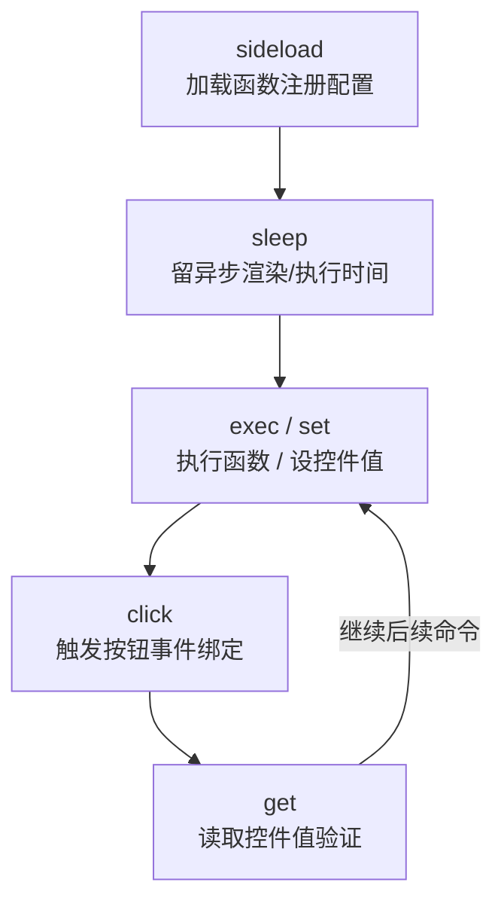

> 本文件为 `skills/SKILL.md` 的模块化拆分 —— **③ 创建运行脚本（Scripts/**/*.json）**（原 §3）。
> 完整三段式流程、模块导航与端到端示例见 [SKILL.md](SKILL.md)。本模块章节沿用原编号（§3.x），便于与 SKILL.md 导航表对照。
> 相关模块：① 注册 → [01-register-function.md](01-register-function.md) · ② 配置（UI）→ [02-json-ui.md](02-json-ui.md) · ② 配置（工作流）→ [03-json-workflow.md](03-json-workflow.md)。

---

## 3. 创建运行脚本（脚本层）— 通用

> 脚本目录：`FileDriven/DrivenConfig/Scripts/<分类>/*.json`（已有 `Math/`、`UI/`、`Workflow/`、`AI/`、`Cline/`、`Demo/`、`Agent/`）。脚本测试是**唯一批量回归形态**（旧"用例集"数据文件 + `Func_RunCases`/`Func_GetSuites` 已删除）。



### 3.1 脚本文件结构

```json
{
  "description": "脚本说明",
  "script": "<ScriptName>",
  "commands": [ /* 命令序列 */ ]
}
```

### 3.2 脚本创建逻辑（解析 → 参数绑定 → 执行）

**创建三步**：

1. **定义**：`commands` 数组，每条命令 `{ "action", "target", "value", "output", ... }` 或 `{ "template", ... }`（模板先展开为命令）。
2. **解析**：`ScriptDefinition` 反序列化 → `ScriptTemplateExpander.Expand`（`echo-section` 等模板展开）→ `MetaCommandExtensions.ToMetaCommand` 把 `value`/`output` 等字段组装为参数字典。
3. **执行**：`exec <函数名>` → `FunctionCallFacade` → 函数注册表/工作流 → 函数委托 `DynamicInvoke`；结果经格式化函数输出。

> **异步/取消约定**：函数注册规则（`Func<Task<T>>` 异步、`CancellationToken` 自动剔除、勿同步阻塞）见 [01-register-function.md §1.2](01-register-function.md) 注册契约。脚本 `exec` 对异步委托由 `FunctionCallFacade` 后台等待，命令成功/失败经 `Command_Exec_Success` / 错误日志传播到脚本整体结果。

**参数绑定（关键）**：`value` 字段经 `key=value` 空格分隔解析为命名字典，`ParameterTransformer` 按**函数形参名**精确绑定（缺失项回填默认值）：

| `value` 形态 | 解析结果 | 绑定行为 | 可靠性 |
|------|------|------|------|
| `value="keyword=ReLU"` | `{keyword:"ReLU"}` | 形参名匹配 → 正确执行 | ✅ 推荐 |
| `value="funcName=Add paramStr=[2.0,3.0]"` | `{funcName:"Add", paramStr:"[2.0,3.0]"}` | 双参函数按键名绑定 | ✅ 推荐 |
| `value="ReLU"`（裸值） | `{value:"ReLU"}` | 与形参名不匹配 → 落入默认值（**静默错值**） | ❌ 避免 |
| `value="configPath=X targetContainer=Y"` | 多键字典 | 按键名绑定 | ✅ 推荐 |

> 含空格的参数值用引号包裹：`value="paramStr=\"a b\""`。

**批量回归标准模式**（任何域通用的批量测试形态）：

- 目标函数：`Func_Execute`（通用执行器，形参 `funcName` + `paramStr`）。
- `paramStr` 内部经 `MathUtils.ParseMathParameters` 支持三种格式：JSON 数组 `[1.0,2.0]` / 命名对象 `{"x":1.0}` / 逗号分隔 `1.0,2.0`；嵌套数组、`false`、数字混合均支持；可选参数自动回填默认值。
- 期望值经 `echo-section` 标题标注；实际结果由 `exec` 命令日志（`Command_Exec_Success`）输出，命令失败会传播到脚本整体结果。
- 参考：`Scripts/Math/math_all_test.json`（36 用例）。

**创建脚本流程**：

1. 用 `Func_GetDetail` / `Math_GetFunctionDetail` 查看函数签名，确定形参名。
2. 以命名形式写 `exec`（形参名与函数声明一致）。
3. 校验 JSON：`Get-Content -Raw | ConvertFrom-Json`。
4. 运行：`dotnet run --project FileDriven/FileDriven.Launcher -- --script DrivenConfig/Scripts/<分类>/<ScriptName>.json`。

### 3.3 命令速查

**基础命令**：

| 命令 | 示例 | 含义 |
|------|------|------|
| `sideload` | `{ "action": "sideload", "target": "<ConfigName>.json" }` | 加载函数注册配置 |
| `sleep` | `{ "action": "sleep", "target": "500" }` | 等待（ms），给异步渲染留时间 |
| `exec` | `{ "action": "exec", "target": "<FuncName>", "output": "<ListView>" }` | 执行函数并写回控件 |
| `exec`(带值) | `{ "action": "exec", "target": "<FuncName>", "value": "keyword=ReLU", "output": "<ListView>" }` | 带参数执行 |
| `set` | `{ "action": "set", "target": "<TextBox>", "value": "10" }` | 设置控件值 |
| `click` | `{ "action": "click", "target": "<Button>" }` | 点击按钮（触发事件绑定） |
| `get` | `{ "action": "get", "target": "<TextBox>" }` | 读取控件值（打印结果） |

**模板命令**（`TempletConfig/JsonConfig/composites.json` 定义）：

| 模板 | 示例 | 展开为 |
|------|------|--------|
| `echo-section` | `{ "template": "echo-section", "title": "测试 1" }` | 输出标题段 |
| `load-config-show` | `{ "template": "load-config-show", "configPath": "<ConfigName>.json" }` | 加载 UI 配置并显示 |
| `select-workflow` | `{ "template": "select-workflow", "workflowName": "<WorkflowName>" }` | 选择工作流 |
| `click-execute` | `{ "template": "click-execute", "waitMs": "1500" }` | 点击执行并等待 |
| `switch-workflow` | `{ "template": "switch-workflow", "workflowName": "X" }` | 切换工作流 |
| `close-window` | `{ "template": "close-window" }` | 关闭窗口 |

### 3.4 运行方式

> 构建：编译路径见 `.clinerules/project.md`（`CsharpPrj\MainProj.sln`、`FileDriven\FileDriven.sln`），例如 `dotnet build FileDriven/FileDriven.sln`。

```bash
# GUI：加载指定 UI 配置并显示
dotnet run --project FileDriven/FileDriven.Launcher -- --config <ConfigName>.json --show

# CLI：执行 JSON 脚本（无窗口）
dotnet run --project FileDriven/FileDriven.Launcher -- --script DrivenConfig/Scripts/<分类>/<ScriptName>.json

# CLI：执行单条命令
dotnet run --project FileDriven/FileDriven.Launcher -- --exec "Math_Execute Activation_ReLU|-1.0"

# 也可用编译产物直接运行
FileDriven.Launcher.exe --config <ConfigName>.json --show
FileDriven.Launcher.exe --script <ScriptName>.json --auto-close

# 便捷启动（项目自带）
EnableMent\UI启动.bat          # GUI（配置选择器）
EnableMent\交互启动.bat        # CLI/交互
```

> 可用启动参数：`--file <commands.txt>` / `--script <script.json>` / `--exec "<command>"` / `--config <config.json>` / `--show` / `--show-gui` / `--cli` / `--log <categories>` / `--auto-close`。

> ⚠️ **运行前先构建**：以上命令依赖 `FileDriven.Launcher` 编译产物；先 `dotnet build FileDriven/FileDriven.sln`（编译路径见 `.clinerules/project.md`）。若构建失败，先修复其依赖项目（常见：`FileDriven.Execution` 等既有编译错误），否则 `--script`/`--config` 无法启动。

---
