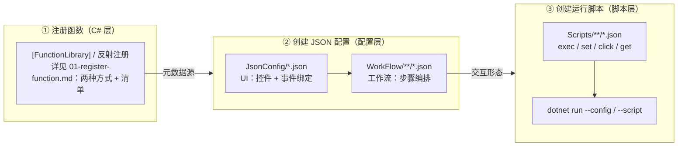

# Skill: 函数注册 → JSON 配置 → 运行脚本（通用三段式流水线）

> **目标**：以最短路径在 FileDriven 框架中新增一个"可浏览、可执行、可批量测试、可脚本化"的函数能力 —— 不限定领域，任何函数（数学/业务/工具/AI）统一走同一条流水线。
> **三段式模型**：① 注册函数（C#，`FileDriven.Business` 或其他被引用程序集，见 [01-register-function.md §1.4](01-register-function.md)）→ ② 创建 JSON 配置（`DrivenConfig`）→ ③ 创建运行脚本（`DrivenConfig/Scripts`）。
> **权威实现参考**：`MathFunctionBrowser.json` + `FunctionTesterWorkflow.json` + `FunctionTesterFunctions.cs` + `Scripts/Math/math_all_test.json`（数学域最完整实例；其余域见 `Scripts/AI|UI|Workflow|Demo`）。

---

## 0. 通用模型（先读）

### 0.1 能力三段模型

> 框架中"一个可交互/可测试能力"恒由三段构成，任一段缺一不可：

| 段 | 交付物 | 目录 | 作用 |
|----|--------|------|------|
| ① 注册 | C# 函数注册库 | `FileDriven.Business/Registrations/<Domain>/`（或其他被引用程序集，见 [01-register-function.md §1.4](01-register-function.md)） | 定义函数本身（唯一元数据源） |
| ② 配置 | JSON：UI + 工作流 | `DrivenConfig/JsonConfig/` + `DrivenConfig/WorkFlow/` | 决定交互形态（控件→步骤→函数） |
| ③ 脚本 | JSON 脚本测试 | `DrivenConfig/Scripts/<Domain>/` | 决定验证方式（回归/冒烟） |



**关键链路**：`注册函数` 是地基（`FunctionStorageRegistry` 元数据源）→ `JSON 配置` 决定交互形态（UI 事件绑定 → 工作流步骤 → 注册函数）→ `运行脚本` 决定验证方式（对 UI/函数驱动命令）。三者按序构建，缺一不可。

### 0.2 统一命名约定（占位符）

> 本 skill 全程用占位符指代任意能力；每个具体能力只需做一次"域/名"替换。

| 占位符 | 含义 | 示例值（Math 域） |
|--------|------|--------------------|
| `<Domain>` | 业务域目录名 | `Math` |
| `<YourLibrary>` | 注册库类名（C#） | `MathLibrary` |
| `<FuncName>` | 注册函数名（带域前缀） | `Math_Add` |
| `<WorkflowName>` | 工作流名（= 可调用函数名） | `MathOperationsWorkflow` |
| `<ConfigName>` | UI 配置文件（`JsonConfig/<ConfigName>.json`） | `MathFunctionBrowser` |
| `<ScriptName>` | 脚本名（`Scripts/<Domain>/<ScriptName>.json`） | `math_all_test` |

**目录速查**：

```
FileDriven/
├── FileDriven.Business/Registrations/<Domain>/<YourLibrary>.cs   # ① 注册库（亦可放其他被引用程序集，见 [01-register-function.md §1.4](01-register-function.md) 跨程序集注册）
├── DrivenConfig/Configs/function-libraries.json                 # ① 注册清单（autoDiscover 模式决定必做/可选，见 [01-register-function.md §1.1](01-register-function.md)）
├── DrivenConfig/FunctionRegistrations/*.registration.json       # ① 反射自动注册配置
├── DrivenConfig/JsonConfig/<ConfigName>.json                     # ② UI
├── DrivenConfig/WorkFlow/<Domain>/<WorkflowName>.json           # ② 工作流
├── DrivenConfig/TempletConfig/**/*.json                          # ② 模板/样式（composites.json / styles.json）
└── DrivenConfig/Scripts/<Domain>/<ScriptName>.json              # ③ 脚本
```

**返回类型 → 控件绑定约定**（决定 JSON 怎么写）：

| 返回类型 | 对应控件输出 | 说明 |
|----------|--------------|------|
| `string` | TextBox / Label | 直接写文本（可含 `\n` 多行） |
| `ListData`（`IControlValue`） | ListView / ComboBox / ListBox | 写为列表项集合 |
| `bool`/数值 | TextBox | 转为字符串写文本 |
| `Task<string>` | TextBox / Label | 异步文本（`IsAsync=true`；见 [01-register-function.md §1.2](01-register-function.md) 异步委托） |
| `Task<ListData>` | ListView / ComboBox / ListBox | 异步列表 |

> 注册后"函数名 → 描述符元数据"自动可查：`IFunctionDescriptor` → `Name/Description/ReturnType/Parameters`；`IParameterDescriptor` → `Name/Type/IsOptional/DefaultValue`。UI 详情展示与脚本参数校验均依赖它。

### 0.3 模块化结构（导航）

> 本文档已按三段式拆分为独立模块文件，每模块聚焦一段交付物；**按需直达，不必通读全文**。各模块保留原章节编号，便于本节与模板索引对照。

| 段 | 模块文件 | 内容（原章节） |
|----|----------|----------------|
| ① 注册 | **[01-register-function.md](01-register-function.md)** | 两种注册方式 / 手动 Library 模板 / 反射自动注册 / 注册清单 / API 速查（§1） |
| ② 配置 · UI | **[02-json-ui.md](02-json-ui.md)** | UI 顶层结构 / 控件速查 / 事件绑定 / 模板与样式复用（§2.1 + §2.5） |
| ② 配置 · 工作流 | **[03-json-workflow.md](03-json-workflow.md)** | 工作流配置 / `_stepSelector` 级联机制 / `initCommands`（§2.2–§2.4） |
| ③ 脚本 | **[04-json-script.md](04-json-script.md)** | 脚本结构 / 参数绑定 / 命令速查 / 运行方式（§3） |

**阅读建议**：
- **首次接入**：通读 §0（本文档）→ 按 ①→②UI→②工作流→③ 顺序读四个模块 → 对照 §4 端到端示例走一遍。
- **只改某段**：直达对应模块文件，无需回读全局。
- **只做回归测试**：只需 [04-json-script.md](04-json-script.md)。

### 0.4 模板与参考索引

| 目的 | 位置 |
|------|------|
| 注册库模板（同步/异步/参数/取消契约） | [01-register-function.md §1.2](01-register-function.md) |
| 注册 API 速查（`ITrConfigRegistry`） | [01-register-function.md §1.5](01-register-function.md) |
| 反射自动注册配置 | [01-register-function.md §1.3](01-register-function.md) |
| 注册清单 + 跨程序集 | [01-register-function.md §1.4](01-register-function.md) |
| UI 配置结构 + 控件速查 + 事件绑定 | [02-json-ui.md §2.1](02-json-ui.md) |
| 模板 / 样式复用 | [02-json-ui.md §2.5](02-json-ui.md) |
| 工作流配置 | [03-json-workflow.md §2.2](03-json-workflow.md) |
| `_stepSelector` 级联机制 | [03-json-workflow.md §2.3](03-json-workflow.md) |
| `initCommands` 两种形态 | [03-json-workflow.md §2.4](03-json-workflow.md) |
| 脚本文件结构 | [04-json-script.md §3.1](04-json-script.md) |
| 脚本参数绑定 / 命令速查 | [04-json-script.md §3.2 / §3.3](04-json-script.md) |
| 端到端示例（MiniMath） | 本文档 §4 |
| 检查清单 / 常见陷阱 / 速查命令 | 本文档 §5 |

---

## 4. 端到端示例（Math 域 · 完整走一遍）

> 本节把"通用模板"具体化为数学域：注册 `Mini_Squared` 函数 → 创建 UI + 工作流 → 创建批量测试脚本。**若已理解 §0 与四个模块（[01-register-function](01-register-function.md) / [02-json-ui](02-json-ui.md) / [03-json-workflow](03-json-workflow.md) / [04-json-script](04-json-script.md)），仅需对照 §4.1 映射表即可复用到任何域。**

### 4.1 占位符 → Math 映射

| 占位符 | Math 实际值 |
|--------|-------------|
| `<Domain>` | `Math` |
| `<YourLibrary>` | `MiniMathLibrary` |
| `<FuncName>` | `Mini_Squared` |
| `<WorkflowName>` | `MiniMathWorkflow` |
| `<ConfigName>` | `MiniMath` |
| `<ScriptName>` | `mini_math_test` |


### 4.2 注册（对 [01-register-function.md §1.2](01-register-function.md) 模板套值）

`FileDriven/FileDriven.Business/Registrations/Math/MiniMathLibrary.cs`：

```csharp
using CommandFramework.Abstractions;
using Modules.Registry;
using TConfig;

namespace FunctionStorage.Registrations;

[FunctionLibrary]
public static class MiniMathLibrary
{
    public static void RegisterAll(ITrConfigRegistry registry)
    {
        registry.Register("Mini_Squared", (Func<double, double>)(x => x * x), "平方: x²");
        registry.Register("Mini_Labels", (Func<ListData>)(() =>
            ListData.From(new[] { "Mini_Squared" })), "Mini 域函数列表");
    }
}
```

`FileDriven/DrivenConfig/Configs/function-libraries.json` 追加：

```json
{ "name": "MiniMathLibrary", "type": "FunctionStorage.Registrations.MiniMathLibrary, FileDriven.Business", "enabled": true }
```

### 4.3 配置（对 [03-json-workflow.md §2.2](03-json-workflow.md) / [02-json-ui.md §2.1](02-json-ui.md) 模板套值）

`WorkFlow/MathWorkflows/MiniMathWorkflow.json`：

```json
{
  "workflowName": "MiniMathWorkflow",
  "displayName": "Mini 数学工作流",
  "defaultInput": { "x": "", "funcName": "" },
  "steps": [
    { "stepName": "Execute", "funcName": "Mini_Squared", "inputKeys": ["x"], "outputKey": "result", "parameters": ["${x}"] }
  ],
  "outputMapping": { "result": "result" }
}
```

`JsonConfig/MiniMath.json`：

```json
{
  "form": { "title": "Mini 数学", "width": 480, "height": 260 },
  "views": [{
    "name": "MainView", "type": "Panel",
    "controls": [
      { "type": "label", "name": "xLabel", "text": "x:", "layout": { "left": 0.05, "top": 0.2, "width": 0.15, "height": 0.3 } },
      { "type": "textbox", "name": "xInput", "layout": { "left": 0.22, "top": 0.2, "width": 0.3, "height": 0.3 } },
      {
        "type": "button", "name": "runButton", "text": "计算 x²",
        "events": {
          "click": "MiniMathWorkflow",
          "bindings": { "parameters": [{ "target": "_stepSelector", "source": "Execute", "sourceType": "literal" }, { "target": "x", "source": "xInput", "sourceType": "control" }], "output": "resultTextBox" }
        },
        "layout": { "left": 0.55, "top": 0.2, "width": 0.2, "height": 0.3 }
      },
      { "type": "textbox", "name": "resultTextBox", "readOnly": true, "layout": { "left": 0.22, "top": 0.6, "width": 0.5, "height": 0.3 } }
    ]
  }]
}
```

### 4.4 脚本（对 [04-json-script.md §3.1](04-json-script.md) 模板套值）

`Scripts/Math/mini_math_test.json`：

```json
{
  "description": "Mini 数学冒烟测试",
  "script": "mini_math_test",
  "commands": [
    { "template": "echo-section", "title": "测试 Mini_Squared" },
    { "action": "exec", "target": "Mini_Squared", "value": "x=5.0", "output": "resultTextBox" },
    { "action": "get", "target": "resultTextBox" },
    { "template": "echo-section", "title": "完成" }
  ]
}
```

### 4.5 运行

```bash
dotnet run --project FileDriven/FileDriven.Launcher -- --script DrivenConfig/Scripts/Math/mini_math_test.json
dotnet run --project FileDriven/FileDriven.Launcher -- --config MiniMath.json --show   # GUI 交互
```

---

## 5. 检查清单与常见陷阱

### 5.1 上线前检查清单

**注册层**
- [ ] Library 类标记 `[FunctionLibrary]`，方法签名 `RegisterAll(ITrConfigRegistry)`（或 `Register()`）
- [ ] 已在 `function-libraries.json` 登记（`autoDiscover: false` 时必须；跨程序集库建议显式登记）
- [ ] 跨程序集库：csproj 引用 Registry/TConfig/CommandFramework；清单 `type` 用 assembly-qualified name；宿主已引用该程序集（DLL 进输出目录）
- [ ] 依赖顺序正确（被依赖库在前）
- [ ] 函数名无重复（`FunctionLibraryLoader.DuplicateNameTracker` 会抛异常）
- [ ] 列表输出返回 `ListData`，文本输出返回 `string`
- [ ] 异步函数注册为 `Func<Task<T>>`（勿在函数内同步阻塞 UI 线程）

**JSON 层**
- [ ] UI 事件 `target` 参数名与工作流 `defaultInput` 键一致
- [ ] 工作流 `inputKeys` 与步骤函数形参一致（引擎按 `inputKeys` 取参）
- [ ] `output` 控件名在配置中真实存在
- [ ] `initCommands` 语法正确（`exec <Workflow> _stepSelector=<Step>` / `exec <Func> output=<Control>`，或 `initCommandMode: "function"` + 裸函数名）
- [ ] 清单 `method` 字段（若写）与注册方法名匹配（缺省自动识别）
- [ ] JSON 通过校验（`Get-Content -Raw | ConvertFrom-Json`）
- [ ] 脚本测试 `exec` 的 `funcName`/`paramStr` 与注册函数匹配（参考 `math_all_test.json`）

**脚本层**
- [ ] 脚本命令 `target` 为注册函数名或控件名
- [ ] `exec` 带值用 `value` 字段；`output` 指向真实控件
- [ ] 步骤间加 `sleep`（异步渲染/工作流执行留时）

### 5.2 常见陷阱

| # | 陷阱 | 现象 | 对策 |
|---|------|------|------|
| 1 | **工作流级联执行** | 从 `_stepSelector` 起后续步骤全执行，`Search("")` 覆盖函数列表 | 见 [03-json-workflow.md §2.3](03-json-workflow.md) 级联机制（分离 outputKey / 精确跳转） |
| 2 | **`extends` 不能引用任意文件** | `"extends": "Base.json"` 找不到模板 | 改用模板 `template`/`styleRef` 或独立通用工作流复用 |
| 3 | **JSON 数组参数类型不匹配** | `DynamicInvoke` 收到 `JsonElement` 失败 | 用 `ParseMathParameters`（已做 `CoerceValue` 类型转换），勿手写反序列化 |
| 4 | **函数名重复注册** | 启动即抛 `InvalidOperationException` | 检查 `function-libraries.json` + 各 `RegisterAll` 是否重复 |
| 5 | **控件名拼写不一致** | 事件绑定 `output` 写不进控件（日志 `未找到目标控件`） | 用 `WinFormsHelper`/查找器核对控件注册名 |
| 6 | **工作目录非项目根** | 相对路径（如 Scripts/Math）找不到 | 运行时基于 `Environment.CurrentDirectory` + 向上回溯定位项目根 |
| 7 | **`ListData` 写 ListView 多列** | Details 视图只有首列有值 | 列表项返回纯字符串；多列结构化展示需专用渲染函数 |
| 8 | **注册后未生效** | 新函数找不到 | 重建 + 重启；`autoDiscover: false` 时确认已在 `function-libraries.json` 登记且 `enabled: true`（`autoDiscover: true` 时可能被自动发现，无需登记） |
| 9 | **异步函数同步阻塞** | UI 线程卡死/死锁 | 注册为 `Func<Task<T>>`，勿 `GetAwaiter().GetResult()`（经 FunctionCallFacade 后台执行） |
| 10 | **跨程序集库 type 解析失败** | 清单条目报「无法加载类型」 | `type` 用 assembly-qualified name（`Ns.Class, Asm`）+ 宿主已引用该程序集（DLL 进输出目录） |
| 11 | **autoDiscover 与登记混淆** | 库未加载或意外重复 | 明确 loader 模式；跨程序集库显式登记 `type` 更可控（见 [01-register-function.md §1.1/§1.4](01-register-function.md)） |

### 5.3 速查命令

> 启动 GUI / 执行脚本的完整运行方式与可用启动参数见 [04-json-script.md §3.4](04-json-script.md)（含编译前置）；此处仅保留诊断/校验速查：

```bash
# JSON 语法校验
Get-Content <file> -Raw | ConvertFrom-Json | Out-Null

# 调试日志（分类过滤）
dotnet run --project FileDriven/FileDriven.Launcher -- --config <ConfigName>.json --log "FileDriven.All,WdUI.All"

# 确认函数已注册（注册后未生效排查：先用冒烟脚本或 GetRegistered 查询函数是否出现）
dotnet run --project FileDriven/FileDriven.Launcher -- --script DrivenConfig/Scripts/<分类>/<ScriptName>_smoke_test.json
```

---

> **关联文件**：`FileDriven/FileDriven.Business/Registrations/`（注册库）· `FileDriven/DrivenConfig/`（配置/工作流/脚本/模板）· `FileDriven/DrivenConfig/FunctionRegistrations/`（反射注册配置）· `FileDriven/DrivenConfig/JsonUI构建文档.md`（UI 配置细节）· `FileDriven/DrivenConfig/Configs/function-libraries.json`（注册清单）。
> **权威实现参考**：`MathFunctionBrowser.json` + `FunctionTesterWorkflow.json` + `FunctionTesterFunctions.cs` + `Scripts/Math/math_all_test.json`。
