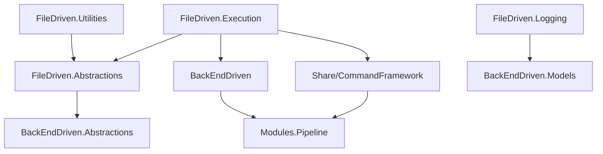
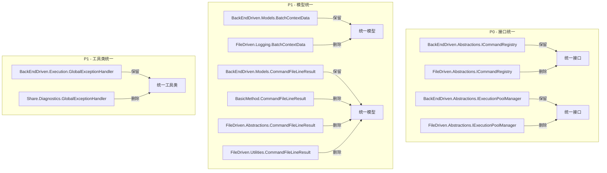

# BackEndDriven 通用化整理优化方案

> **目标**：以 BackEndDriven 为通用框架核心，消除 FileDriven 及其他模块中的重复逻辑，实现"一次定义，多处复用"。
>
> **日期**：2026-06-29
> **范围**：BackEndDriven（Operation/BackEndDriven）↔ FileDriven（FileDriven.Execution / FileDriven.Abstractions / FileDriven.Logging / FileDriven.Utilities）↔ Share/CommandFramework ↔ BasicMethod

---

## 目录

1. [现状分析](#1-现状分析)
2. [重复项清单](#2-重复项清单)
3. [优化方案](#3-优化方案)
4. [实施路线图](#4-实施路线图)
5. [影响评估](#5-影响评估)

---

## 1. 现状分析

### 1.1 架构定位

```
BackEndDriven（通用框架层）
    ↑ 继承 / 实现
FileDriven（业务实现层）
    ↑ 继承 / 实现
Share/CommandFramework（共享命令框架）
    ↑ 继承 / 实现
BasicMethod / Modules（基础方法层）
```

**当前问题**：BackEndDriven 已从 FileDriven 提取了大量通用逻辑，但提取不彻底，导致：

1. **接口重复**：`ICommandRegistry`、`IExecutionPoolManager` 在 FileDriven.Abstractions 和 BackEndDriven.Abstractions 中各有一份
2. **模型重复**：`BatchContextData`、`CommandFileLineResult` 在多个项目中各自定义
3. **工具类重复**：`GlobalExceptionHandler`、`LifecycleManager` 在多个位置存在
4. **管线组件重复**：`PipelineStageBase`、`PipelineEntry` 在多层中重复定义

### 1.2 当前依赖关系



---

## 2. 重复项清单

### 🔴 P0 - 必须消除（接口重复）

#### 2.1 `ICommandRegistry` 接口

| 位置 | 文件 | 方法数 | 差异 |
|------|------|--------|------|
| `FileDriven.Abstractions\ICommandRegistry.cs` | 53 行 | 9 个 | 包含 `ICommandExecutionResult` 子接口 |
| `BackEndDriven.Abstractions\ICommandRegistry.cs` | 92 行 | 9 个 | 包含 `ICommandExecutionResult` 子接口 |

**差异分析**：两个接口的方法签名完全相同（Register / RegisterAsync / TryGetHandler / TryGetAsyncHandler / Execute / ExecuteAsync / GetRegisteredCommands / IsRegistered / Count）。`BackEndDriven` 版本额外包含 `ICommandExecutionResult` 子接口。

**建议**：删除 `FileDriven.Abstractions.ICommandRegistry`，FileDriven 层通过 using 别名指向 `BackEndDriven.Abstractions.ICommandRegistry`。

#### 2.2 `IExecutionPoolManager` 接口

| 位置 | 文件 | 方法数 | 差异 |
|------|------|--------|------|
| `FileDriven.Abstractions\IExecutionPoolManager.cs` | 33 行 | 4 个 | 无 |
| `BackEndDriven.Abstractions\IExecutionPoolManager.cs` | 28 行 | 4 个 | 无 |

**差异分析**：两个接口完全相同（IsInitialized / Initialize / Shutdown / Pool）。

**建议**：删除 `FileDriven.Abstractions.IExecutionPoolManager`，统一使用 `BackEndDriven.Abstractions.IExecutionPoolManager`。

---

### 🟡 P1 - 建议消除（模型重复）

#### 2.3 `BatchContextData` 类

| 位置 | 文件 | 字段数 | 差异 |
|------|------|--------|------|
| `FileDriven.Logging\BatchContextData.cs` | 49 行 | 8 个 | 原始版本 |
| `BackEndDriven.Models\BatchContextData.cs` | 49 行 | 8 个 | 提取的通用版本 |

**差异分析**：两个类的 8 个字段完全相同（BatchId / BatchName / Source / Description / WorkflowId / ProjectRoot / IsPipeMode / PipeName）。

**建议**：删除 `FileDriven.Logging.BatchContextData`，FileDriven.Logging 通过 using 别名指向 `BackEndDriven.Models.BatchContextData`。

#### 2.4 `CommandFileLineResult` 类（5 个定义）

| 位置 | 文件 | 状态 |
|------|------|------|
| `BasicMethod\Common\Functions\CommandFileExecutor.cs` | 自有定义 | ❌ 应删除 |
| `FileDriven.Abstractions\IResultAdapter.cs` | 自有定义 | ❌ 应删除 |
| `FileDriven.Utilities\CommandExecution.cs` | 自有定义 | ❌ 应删除 |
| `BackEndDriven.Models\CommandFileLineResult.cs` | 通用版本 | ✅ 保留 |
| `FileDriven.Execution\ExecutionResult.cs` | using 别名引用 | ✅ 已迁移 |

**建议**：
1. 删除 `BasicMethod.Common.Functions.CommandFileLineResult`
2. 删除 `FileDriven.Abstractions.IResultAdapter.CommandFileLineResult`
3. 删除 `FileDriven.Utilities.CommandExecution.CommandFileLineResult`
4. 所有引用方改为 `using CommandFileLineResult = BackEndDriven.Models.CommandFileLineResult`

#### 2.5 `ExecutionResult` 类

| 位置 | 文件 | 状态 |
|------|------|------|
| `FileDriven.Execution\ExecutionResult.cs` | FileDriven 特有（含 CommandFileLineResult 列表） | ✅ 适配层 |
| `BackEndDriven.Models\ExecutionResult.cs` | 通用版本 | ✅ 保留 |

**差异分析**：`FileDriven.Execution.ExecutionResult` 包含 `List<CommandFileLineResult>` 等 FileDriven 特有字段，实现了 `BackEndDriven.Abstractions.IExecutionResult` 接口。这是合理的适配层模式，**不是重复**。

**建议**：保持现状。

---

### 🟡 P1 - 建议消除（工具类重复）

#### 2.6 `GlobalExceptionHandler` 类

| 位置 | 文件 | 依赖 | 状态 |
|------|------|------|------|
| `Share\Diagnostics\GlobalExceptionHandler.cs` | 39 行 | 包含 WinForms 依赖 | ❌ 应删除 |
| `BackEndDriven.Execution\GlobalExceptionHandler.cs` | 71 行 | 无 WinForms 依赖 | ✅ 保留 |

**差异分析**：`Share/Diagnostics` 版本包含 `Application.SetUnhandledExceptionMode` 和 `Application.ThreadException`（WinForms 依赖）。`BackEndDriven` 版本已剥离 WinForms 依赖，仅保留 AppDomain 级别的异常捕获。

**建议**：
1. 删除 `Share\Diagnostics\GlobalExceptionHandler.cs`
2. WinForms 异常捕获逻辑移至 `FileDriven` 层的 `WinFormsExceptionHandler`（如已存在）
3. 所有引用方改为 `using BackEndDriven.Execution.GlobalExceptionHandler`

#### 2.7 `LifecycleManager` 类

| 位置 | 文件 | 状态 |
|------|------|------|
| `BasicMethod.Framework.LifecycleManager` | 原始版本 | ❌ 应评估 |
| `BackEndDriven.Lifecycle.LifecycleManager` | 通用版本 | ✅ 保留 |

**建议**：评估 `BasicMethod.Framework.LifecycleManager` 是否被引用。如无引用，直接删除；如有引用，改为使用 `BackEndDriven.Lifecycle.LifecycleManager`。

---

### 🟡 P2 - 建议评估（管线组件重复）

#### 2.8 `PipelineStageBase` 类（3 个定义）

| 位置 | 文件 | 约束 | 状态 |
|------|------|------|------|
| `Modules.Pipeline\Core.cs` | `PipelineStageBase<TContext>` | 无约束 | ✅ 底层基类 |
| `Share\CommandFramework\Pipeline\PipelineStageBase.cs` | `PipelineStageBase<TContext>` | 无约束 | ❌ 应评估 |
| `BackEndDriven\Pipeline\PipelineStageBase.cs` | `PipelineStageBase<TContext>` | `where TContext : class, IBackEndPipelineContext` | ✅ 保留 |

**差异分析**：
- `Modules.Pipeline` 版本是最底层定义
- `CommandFramework` 版本是包装，继承自 `BP.IPipelineStage<TContext>`
- `BackEndDriven` 版本增加了 `IBackEndPipelineContext` 约束

**建议**：评估 `CommandFramework.Pipeline.PipelineStageBase` 是否可删除，或改为直接继承 `Modules.Pipeline.PipelineStageBase`。

#### 2.9 `PipelineEntry` 类（3 个定义）

| 位置 | 文件 | 类型 | 状态 |
|------|------|------|------|
| `FileDriven.Pipeline\PipelineEntry.cs` | 实例类（IConfigLoader, IDisposable） | ✅ FileDriven 特有 |
| `Share\CommandFramework\Pipeline\PipelineEntry.cs` | 静态工厂 + PipelineEntryInstance | ❌ 应评估 |
| `BackEndDriven\Pipeline\PipelineEntry.cs` | 静态工厂 | ✅ 保留 |

**差异分析**：
- `BackEndDriven.Pipeline.PipelineEntry` 是静态工厂，只包含 `RegisterBuiltInCommands()`
- `CommandFramework.Pipeline.PipelineEntry` 包含 `CreateDefaultPipeline()` 和 `PipelineEntryInstance` 实例类
- `FileDriven.Pipeline.PipelineEntry` 是实例类，职责不同

**建议**：评估 `CommandFramework.Pipeline.PipelineEntry` 的 `CreateDefaultPipeline()` 是否可委托给 `BackEndDriven.Pipeline.PipelineEntry`。

---

## 3. 优化方案

### 3.1 接口统一（P0）

#### 3.1.1 `ICommandRegistry` 统一

```csharp
// 删除 FileDriven.Abstractions.ICommandRegistry
// FileDriven 层通过 using 别名引用 BackEndDriven 版本

// FileDriven.Abstractions 中保留 using 别名
using ICommandRegistry = BackEndDriven.Abstractions.ICommandRegistry;
using ICommandExecutionResult = BackEndDriven.Abstractions.ICommandExecutionResult;
```

**影响文件**：
- `FileDriven.Abstractions\ICommandRegistry.cs` → 删除
- `FileDriven.Execution\Command\CommandRegistry.cs` → 移除 `FileDriven.Abstractions.ICommandRegistry` 接口实现
- `FileDriven.Execution\Command\FileDrivenCommandRegistrar.cs` → 更新引用

#### 3.1.2 `IExecutionPoolManager` 统一

```csharp
// 删除 FileDriven.Abstractions.IExecutionPoolManager
// FileDriven 层通过 using 别名引用 BackEndDriven 版本

using IExecutionPoolManager = BackEndDriven.Abstractions.IExecutionPoolManager;
```

**影响文件**：
- `FileDriven.Abstractions\IExecutionPoolManager.cs` → 删除
- 所有引用 `FileDriven.Abstractions.IExecutionPoolManager` 的文件 → 更新 using

### 3.2 模型统一（P1）

#### 3.2.1 `BatchContextData` 统一

```csharp
// 删除 FileDriven.Logging.BatchContextData
// FileDriven.Logging 通过 using 别名引用 BackEndDriven 版本

using BatchContextData = BackEndDriven.Models.BatchContextData;
```

**影响文件**：
- `FileDriven.Logging\BatchContextData.cs` → 删除
- `FileDriven.Logging` 中引用 `BatchContextData` 的文件 → 更新 using

#### 3.2.2 `CommandFileLineResult` 统一

```csharp
// 删除 3 个自有定义，统一使用 BackEndDriven.Models.CommandFileLineResult
using CommandFileLineResult = BackEndDriven.Models.CommandFileLineResult;
```

**影响文件**：
- `BasicMethod\Common\Functions\CommandFileExecutor.cs` → 删除自有定义，添加 using 别名
- `FileDriven.Abstractions\IResultAdapter.cs` → 删除自有定义，添加 using 别名
- `FileDriven.Utilities\CommandExecution.cs` → 删除自有定义，添加 using 别名

### 3.3 工具类统一（P1）

#### 3.3.1 `GlobalExceptionHandler` 统一

```csharp
// 删除 Share\Diagnostics\GlobalExceptionHandler.cs
// 统一使用 BackEndDriven.Execution.GlobalExceptionHandler
using GlobalExceptionHandler = BackEndDriven.Execution.GlobalExceptionHandler;
```

**影响文件**：
- `Share\Diagnostics\GlobalExceptionHandler.cs` → 删除
- `FileDriven.Execution\FileDrivenExecutor.cs` → 更新 using 别名
- 其他引用 `Common.Diagnostics.GlobalExceptionHandler` 的文件

#### 3.3.2 `LifecycleManager` 统一

**影响文件**：需先评估 `BasicMethod.Framework.LifecycleManager` 的引用情况。

### 3.4 管线组件评估（P2）

#### 3.4.1 `PipelineStageBase` 评估

**方案 A**（推荐）：`CommandFramework.Pipeline.PipelineStageBase` 改为直接继承 `Modules.Pipeline.PipelineStageBase`，删除中间包装层。

**方案 B**：保留现状，`CommandFramework` 版本作为 `Modules` 版本的适配层。

#### 3.4.2 `PipelineEntry` 评估

**方案**：`CommandFramework.Pipeline.PipelineEntry.CreateDefaultPipeline()` 委托给 `BackEndDriven.Pipeline.PipelineEntry`，消除重复的管线构建逻辑。

---

## 4. 实施路线图

### 阶段 1：P0 接口统一（1 天）

| 步骤 | 操作 | 风险 |
|------|------|------|
| 1.1 | 删除 `FileDriven.Abstractions.ICommandRegistry`，添加 using 别名 | 低 |
| 1.2 | 删除 `FileDriven.Abstractions.IExecutionPoolManager`，添加 using 别名 | 低 |
| 1.3 | 更新 `CommandRegistry` 类，移除重复接口实现 | 低 |
| 1.4 | 编译验证，修复引用错误 | 中 |

### 阶段 2：P1 模型统一（1 天）

| 步骤 | 操作 | 风险 |
|------|------|------|
| 2.1 | 删除 `FileDriven.Logging.BatchContextData`，添加 using 别名 | 低 |
| 2.2 | 删除 `BasicMethod` 中的 `CommandFileLineResult` | 中 |
| 2.3 | 删除 `FileDriven.Abstractions` 中的 `CommandFileLineResult` | 中 |
| 2.4 | 删除 `FileDriven.Utilities` 中的 `CommandFileLineResult` | 中 |
| 2.5 | 编译验证，修复引用错误 | 中 |

### 阶段 3：P1 工具类统一（1 天）

| 步骤 | 操作 | 风险 |
|------|------|------|
| 3.1 | 删除 `Share\Diagnostics\GlobalExceptionHandler.cs` | 中 |
| 3.2 | 更新 `FileDrivenExecutor.cs` 中的 using 别名 | 低 |
| 3.3 | 评估并统一 `LifecycleManager` | 中 |

### 阶段 4：P2 管线组件评估（2 天）

| 步骤 | 操作 | 风险 |
|------|------|------|
| 4.1 | 评估 `CommandFramework.Pipeline.PipelineStageBase` 的去留 | 中 |
| 4.2 | 评估 `CommandFramework.Pipeline.PipelineEntry` 的去留 | 高 |
| 4.3 | 编译验证，修复引用错误 | 高 |

---

## 5. 影响评估

### 5.1 删除文件清单

| 文件 | 阶段 | 影响范围 |
|------|------|---------|
| `FileDriven.Abstractions\ICommandRegistry.cs` | P0 | FileDriven.Execution, FileDriven.Utilities |
| `FileDriven.Abstractions\IExecutionPoolManager.cs` | P0 | FileDriven.Execution |
| `FileDriven.Logging\BatchContextData.cs` | P1 | FileDriven.Logging |
| `Share\Diagnostics\GlobalExceptionHandler.cs` | P1 | FileDriven.Execution, 其他引用方 |
| `BasicMethod\Common\Functions\CommandFileExecutor.cs` 中的 `CommandFileLineResult` | P1 | BasicMethod |
| `FileDriven.Abstractions\IResultAdapter.cs` 中的 `CommandFileLineResult` | P1 | FileDriven.Abstractions |
| `FileDriven.Utilities\CommandExecution.cs` 中的 `CommandFileLineResult` | P1 | FileDriven.Utilities |

### 5.2 保留现状清单

| 项 | 原因 |
|----|------|
| `FileDriven.Execution.ExecutionResult` | FileDriven 特有，含 `List<CommandFileLineResult>`，是适配层模式 |
| `FileDriven.Pipeline.PipelineEntry` | 实例类，职责与 BackEndDriven 的静态工厂不同 |
| `Modules.Pipeline.PipelineStageBase` | 最底层基类，不可删除 |

### 5.3 预期收益

| 指标 | 当前 | 优化后 | 减少 |
|------|------|--------|------|
| 接口定义数 | 2 组 | 1 组 | 50% |
| 模型定义数 | 5 个 | 1 个 | 80% |
| 工具类定义数 | 2 组 | 1 组 | 50% |
| 总代码行数（重复部分） | ~400 行 | ~100 行 | 75% |

---

## 附录 A：引用关系图



---

## 附录 B：编译验证清单

完成每个阶段后，执行以下命令验证编译：

```bash
dotnet build CsharpPrj/MainProj.sln --no-restore 2>&1 | findstr /i "error"
```

确保零错误后再进入下一阶段。
