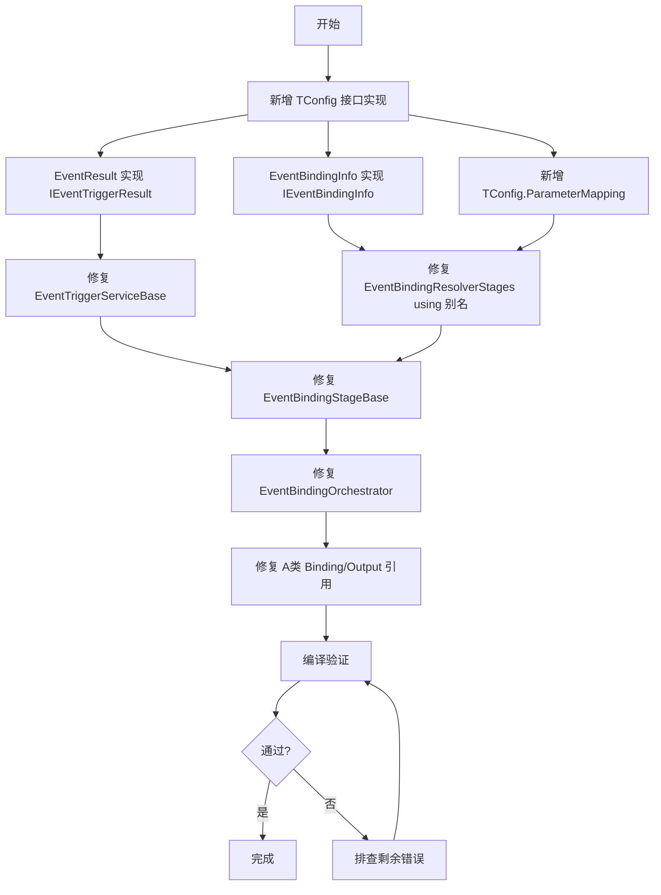

# EventBindingOrchestrator 编译错误分析与重构计划

> 日期：2026-07-14
> 状态：分析完成，待实施重构

---

## 一、编译错误总览

共 **28 个错误**，分为 **5 大类**：

| 类别 | 错误数 | 错误描述 |
|------|--------|----------|
| **A类** | 6 | 命名空间 `Share.EventBindingOrchestrator.Parameters` 中缺少 `Binding` 和 `Output` 类型 |
| **B类** | 4 | `TConfig.EventDescriptor` 不能用作 `IDeclarationResolver<TSource, TDeclaration>` 的类型参数（未实现 `IDeclaration`） |
| **C类** | 2 | `EventBindingService` 不实现 `IEventBindingService` 接口成员 |
| **D类** | 6 | `EventTriggerServiceBase.cs` — `EventResult` → `IEventTriggerResult` 转换 |
| **E类** | 3 | `EventBindingResolverStages.cs` — `ParameterMapping` / `EventBindingInfo` 类型不匹配 |
| **F类** | 4 | `EventBindingStageBase.cs` — `ParameterBuilder` 构造/调用参数不匹配 |
| **G类** | 3 | `EventBindingOrchestrator.cs` — `ExecutionResult.IsSuccess` 只读属性 |

> **核心原则**：所有类型统一在 TConfig 中定义，Share 层不再定义自己的类型，消除所有参数转换。

---

## 二、详细错误分析

### A类错误：缺少 Binding / Output 类型（6个）

**错误信息：**
```
CS0234: 命名空间 "Share.EventBindingOrchestrator.Parameters" 中不存在类型或命名空间名 "Output"
CS0234: 命名空间 "Share.EventBindingOrchestrator.Parameters" 中不存在类型或命名空间名 "Binding"
```

**涉及文件：**
| 文件 | 行号 | 引用 |
|------|------|------|
| `ConfigBindingStage.cs` | 28,29 | `Parameters.Binding`, `Parameters.Output` |
| `DeclarationBindingStage.cs` | 28,29 | `Parameters.Binding`, `Parameters.Output` |
| `BindingMetadataTransformer.cs` | 151 | `Parameters.Binding` |
| `EventBindingContext.cs` | 156 | `Parameters.Binding` |

**根因分析：**
- `Share.EventBindingOrchestrator.Parameters` 命名空间下目前只有 `EventBindingResolver`、`EventBindingResolverStages`、`EventBindingValidator`、`EventBindingHelper` 四个类型
- `Binding` 和 `Output` 类型从未被定义，但被多处引用
- 这些引用可能是旧代码迁移后未清理的残留，或者是需要新增的 DTO 类型

**修复方案：**
- 在 `TConfig` 中定义 `Binding` 和 `Output` 类，统一类型定义
- 引用方通过 `TConfig.Binding` / `TConfig.Output` 访问

---

### B类错误：EventDescriptor 未实现 IDeclaration（4个）

**错误信息：**
```
CS0311: 类型 "TConfig.EventDescriptor" 不能用作泛型类型或方法
"IDeclarationResolver<TSource, TDeclaration>" 中的类型参数 "TDeclaration"。
没有从 "TConfig.EventDescriptor" 到 "BasicMethod.Declarative.IDeclaration" 的隐式引用转换。
```

**涉及文件：**
| 文件 | 行号 | 详情 |
|------|------|------|
| `EventBindingResolver.cs` | 47,131,134,162 | `IDeclarationResolver<IDictionary<string, object>, EventBindingDeclaration>` |

**根因分析：**
- `EventBindingResolver` 实现了 `IDeclarationResolver<IDictionary<string, object>, EventBindingDeclaration>`
- `IDeclarationResolver<TSource, TDeclaration>` 有泛型约束 `where TDeclaration : IDeclaration`
- `EventBindingDeclaration` 没有实现 `BasicMethod.Declarative.IDeclaration` 接口
- `IDeclaration` 接口要求实现：`string Name { get; }`、`string Description { get; }`、`string DeclarationType { get; }`

**关键发现：**
- `EventBindingValidator.cs` 的注释说："EventBindingDeclaration 已改为 TConfig.EventDescriptor 的别名"
- 但 `EventBindingDeclaration` 没有 `using` 别名定义，也没有 `class` 定义
- 说明 `EventBindingDeclaration` 可能是一个**未完成的迁移**——原本计划改为 `TConfig.EventDescriptor` 的别名，但别名定义被遗漏了

**修复方案：**
- 让 `TConfig.EventDescriptor` 实现 `IDeclaration` 接口（新增 `Name`/`Description`/`DeclarationType` 属性）
- 将 `EventBindingDeclaration` 改为 `TConfig.EventDescriptor` 的 using 别名

---

### C类错误：EventBindingService 接口不匹配（2个）

**错误信息：**
```
CS0738: "EventBindingService" 不实现接口成员 "IEventBindingService.FindBinding(IEventSourceNode)"
CS0535: "EventBindingService" 不实现接口成员 "IEventBindingService.Subscribe(IEventSourceNode, EventBindingInfo, Delegate)"
```

**涉及文件：**
| 文件 | 行号 | 详情 |
|------|------|------|
| `EventBindingService.cs` | 28 | `class EventBindingService : IEventBindingService` |

**根因分析：**
- `IEventBindingService` 接口定义在 `Modules.EventFramework.Services` 中
- 接口方法签名：
  - `EventBindingInfo? FindBinding(IEventSourceNode sourceNode)` — 返回 `Modules.EventFramework.Models.EventBindingInfo`
  - `bool Subscribe(IEventSourceNode sourceNode, EventBindingInfo binding, Delegate handler)` — 参数 `EventBindingInfo` 是 `Modules.EventFramework.Models.EventBindingInfo`
- `EventBindingService` 的实现：
  - `FindBinding` 返回 `Modules.EventFramework.Models.EventBindingInfo` ✅ 类型正确
  - `Subscribe` 参数类型也是 `Modules.EventFramework.Models.EventBindingInfo` ✅ 类型正确

**问题可能在于：**
- `EventBindingService.cs` 中 `using Modules.EventFramework.Models;` 可能被注释或缺失
- 或者 `EventBindingService` 中使用了 `Modules.EventFramework.Models.EventBindingInfo` 的完整限定名，但接口期望的是不带命名空间的 `EventBindingInfo`
- 实际上接口和实现使用的是**同一个类型**，只是 using 指令的问题

---

## 三、涉及文件清单

### 需要修改的文件（10个）

| 文件路径 | 错误类别 | 修改内容 |
|----------|----------|----------|
| `CsharpPrj/Share/EventBindingOrchestrator/Stages/ConfigBindingStage.cs` | A | 修复 `Binding`/`Output` 引用 |
| `CsharpPrj/Share/EventBindingOrchestrator/Stages/DeclarationBindingStage.cs` | A | 修复 `Binding`/`Output` 引用 |
| `CsharpPrj/Share/EventBindingOrchestrator/Transformers/BindingMetadataTransformer.cs` | A | 修复 `Binding` 引用 |
| `CsharpPrj/Share/EventBindingOrchestrator/Contexts/EventBindingContext.cs` | A | 修复 `Binding` 引用 |
| `CsharpPrj/Share/EventBindingOrchestrator/Invoke/Pipeline/EventBindingResolver.cs` | B | 修复 `IDeclarationResolver` 约束问题 |
| `CsharpPrj/Share/EventBindingOrchestrator/Invoke/Pipeline/EventBindingResolverStages.cs` | B/E | 修复 `EventBindingDeclaration` 使用 + `ParameterMapping`/`EventBindingInfo` 类型 |
| `CsharpPrj/Share/EventBindingOrchestrator/Services/EventBindingService.cs` | C | 修复接口实现 |
| `CsharpPrj/Share/EventBindingOrchestrator/Invoke/Pipeline/EventBindingStageBase.cs` | F | 修复 `ParameterBuilder` 构造/调用 |
| `CsharpPrj/Share/EventBindingOrchestrator/EventBindingOrchestrator.cs` | G | 用静态工厂方法替代对象初始化器 |
| `CsharpPrj/Share/EventBindingOrchestrator/Invoke/EventTriggerServiceBase.cs` | D | 自动修复（EventResult 实现接口后） |

### 需要新增/修改的文件（TConfig 层）

| 文件路径 | 用途 |
|----------|------|
| `CsharpPrj/Plate/TConfig/TrConfig/Models/EventResult.cs` | 实现 `IEventTriggerResult` 接口 |
| `CsharpPrj/Plate/TConfig/TrConfig/Models/EventBindingInfo.cs` | 实现 `IEventBindingInfo` 接口 |
| `CsharpPrj/Plate/TConfig/TrConfig/Models/ParameterMapping.cs` | 从 `ParameterResolver.Abstractions` 下沉 |

### 需要参考的文件（不修改）

| 文件路径 | 用途 |
|----------|------|
| `CsharpPrj/Modules/EventFramework/Services/IEventBindingService.cs` | 接口定义参考 |
| `CsharpPrj/Modules/EventFramework/Models/EventBindingInfo.cs` | 返回类型参考 |
| `CsharpPrj/BasicMethod/Map/Declarative/Interfaces.cs` | `IDeclaration` 接口定义 |
| `CsharpPrj/Plate/TConfig/TrConfig/Models/EventDescriptor.cs` | `TConfig.EventDescriptor` 定义 |

---

## 四、推荐重构方案

### 方案总览

| 错误类别 | 推荐方案 | 理由 |
|----------|----------|------|
| **A类** | 新增 `Binding` 和 `Output` 类 | 最小改动，不影响其他模块 |
| **B类** | 让 `EventBindingDeclaration` 实现 `IDeclaration` | 保持声明式框架一致性 |
| **C类** | 修复 `EventBindingService` 的 using 和签名 | 接口契约必须匹配 |
| **D类** | `TConfig.EventResult` 实现 `IEventTriggerResult` | 统一在 TConfig 中定义 |
| **E类** | `TConfig.EventBindingInfo` 实现 `IEventBindingInfo` + `TConfig.ParameterMapping` | 统一在 TConfig 中定义 |
| **F类** | 修复 `ParameterBuilder` 构造/调用参数 | 修正调用方式 |
| **G类** | 用静态工厂方法替代对象初始化器 | 适配只读属性 |

### D类：EventResult 实现 IEventTriggerResult

让 `TConfig.EventResult` 实现 `IEventTriggerResult` 接口：

```csharp
// TConfig/TrConfig/Models/EventResult.cs
public class EventResult : ExecutionResult<object>, IEventTriggerResult
{
    // IEventTriggerResult 接口成员
    bool IEventTriggerResult.IsSuccess => IsSuccess;
    object? IEventTriggerResult.Value => Value;
    string? IEventTriggerResult.ErrorMessage => ErrorMessage;
    TimeSpan IEventTriggerResult.ExecutionTime => ExecutionTime;
    string? IEventTriggerResult.EventName => EventType;
    string? IEventTriggerResult.FunctionName => FunctionName;
    string? IEventTriggerResult.OutputTarget => OutputTarget;
}
```

### E类：EventBindingInfo 实现 IEventBindingInfo + ParameterMapping 下沉

**EventBindingInfo** 让 `TConfig.EventBindingInfo` 实现 `IEventBindingInfo` 接口：

```csharp
// TConfig/TrConfig/Models/EventBindingInfo.cs
public class EventBindingInfo : IEventBindingInfo
{
    public string FunctionName => FunctionNames is { Count: > 0 } ? FunctionNames[0] : "";
    public string EventType { get; set; } = "";
    public string? Output { get; set; }
    public IReadOnlyList<string> FunctionNames { get; set; } = Array.Empty<string>();
}
```

**ParameterMapping** 在 `TConfig` 中定义 `ParameterMapping` 类（从 `ParameterResolver.Abstractions` 下沉），然后在 `EventBindingResolverStages.cs` 中将 using 别名改为 `TConfig.ParameterMapping`。

### F类：修复 ParameterBuilder 构造/调用

`EventBindingStageBase.cs` 中的 4 个错误：

1. **第 78 行**：`new ParameterBuilder(typeConversionService)` → 构造函数需要 `IParameterMatcher[]`，改为 `new ParameterBuilder(new IParameterMatcher[] { typeConversionService })` 或适配
2. **第 144 行**：`_parameterBuilder.Build(sender, parameterBindings)` → `Build` 需要 `(IReadOnlyList<IParameterDescriptor>, object?)`，需要先转换参数
3. **第 211 行**：`parameters?.Count` → `ParameterBuildResult` 没有 `Count`，改为 `parameters?.Args.Length`
4. **第 215 行**：`parameters` 是 `ParameterBuildResult` 类型，需要转换为 `Dictionary<string, object?>?`

### G类：静态工厂方法替代对象初始化器

`EventBindingOrchestrator.cs` 第 577/602/618 行：

```csharp
// 原代码（错误）：
new EventTriggerResult { IsSuccess = true, ... }

// 修复后：
EventResult.SuccessResult(/* ... */)
// 或
EventResult.FailureResult(/* ... */)
```

---

## 五、实施步骤



### 步骤详情

1. **步骤1**：在 `TConfig` 中新增/修改 3 个类型文件
   - `EventResult.cs` — 实现 `IEventTriggerResult`
   - `EventBindingInfo.cs` — 实现 `IEventBindingInfo`
   - `ParameterMapping.cs` — 从 `ParameterResolver.Abstractions` 下沉
2. **步骤2**：修复 `EventTriggerServiceBase.cs`（自动修复，EventResult 实现接口后）
3. **步骤3**：修复 `EventBindingResolverStages.cs` — 改 using 别名
4. **步骤4**：修复 `EventBindingStageBase.cs` — ParameterBuilder 构造/调用
5. **步骤5**：修复 `EventBindingOrchestrator.cs` — 静态工厂方法
6. **步骤6**：修复 A 类错误 — Binding/Output 引用
7. **步骤7**：执行 `dotnet build` 验证
8. **步骤8**：根据编译结果迭代修复

---

## 六、附录

### 关键接口定义

#### IDeclaration（BasicMethod.Declarative）
```csharp
public interface IDeclaration
{
    string Name { get; }
    string Description { get; }
    string DeclarationType { get; }
}
```

#### IDeclarationResolver（BasicMethod.Declarative）
```csharp
public interface IDeclarationResolver<in TSource, TDeclaration>
    where TDeclaration : IDeclaration
{
    string Name { get; }
    ResolutionResult<TDeclaration> Resolve(TSource source);
    ResolutionResult<IReadOnlyList<TDeclaration>> ResolveAll(IEnumerable<TSource> sources);
}
```

#### IEventBindingService（Modules.EventFramework.Services）
```csharp
public interface IEventBindingService
{
    string Name { get; }
    EventBindingInfo? FindBinding(IEventSourceNode sourceNode);
    bool Subscribe(IEventSourceNode sourceNode, EventBindingInfo binding, Delegate handler);
}
```

#### IEventTriggerResult（Modules.EventFramework.Abstractions）
```csharp
public interface IEventTriggerResult
{
    bool IsSuccess { get; }
    object? Value { get; }
    string? ErrorMessage { get; }
    TimeSpan ExecutionTime { get; }
    string? EventName { get; }
    string? FunctionName { get; }
    string? OutputTarget { get; }
}
```

#### IEventBindingInfo（Modules.EventFramework.Abstractions）
```csharp
public interface IEventBindingInfo
{
    string FunctionName { get; }
    string EventType { get; }
    string? Output { get; }
    IReadOnlyList<string> FunctionNames { get; }
}
```
