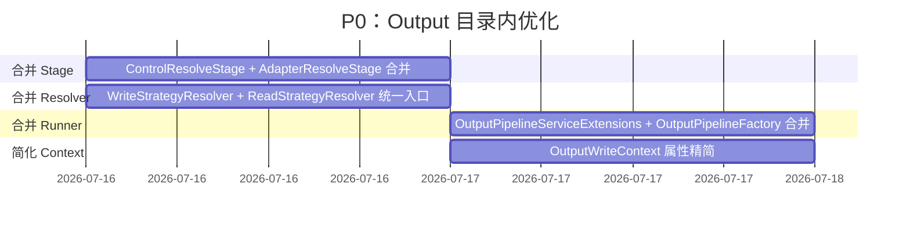
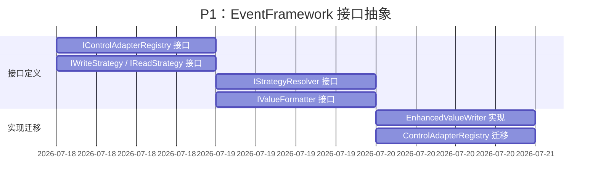
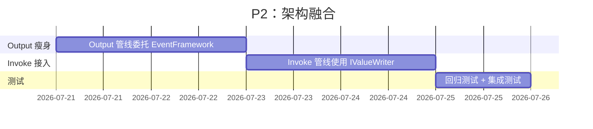

# Output 控件逻辑通用性优化重构方案

> **版本：** v1.0
> **维护者：** WorkFlowPrj Team
> **更新日期：** 2026-07-15
> **定位：** `WorkFlowMethod.Output` 管线 + `Modules.EventFramework` 融合分析

---

## 目录

- [Output 控件逻辑通用性优化重构方案](#output-控件逻辑通用性优化重构方案)
  - [目录](#目录)
  - [1. 现状分析](#1-现状分析)
    - [1.1 Output 管线架构](#11-output-管线架构)
    - [1.2 已完成的优化](#12-已完成的优化)
    - [1.3 EventFramework 现有能力矩阵](#13-eventframework-现有能力矩阵)
  - [2. 通用性问题清单](#2-通用性问题清单)
    - [P0 — 短期（Output 目录内优化）](#p0--短期output-目录内优化)
    - [P1 — 中期（EventFramework 接口抽象）](#p1--中期eventframework-接口抽象)
    - [P2 — 长期（架构融合）](#p2--长期架构融合)
  - [3. DefaultValueWriter 缺失逻辑分析](#3-defaultvaluewriter-缺失逻辑分析)
    - [3.1 当前实现](#31-当前实现)
    - [3.2 缺失的 5 项能力](#32-缺失的-5-项能力)
    - [3.3 EnhancedValueWriter 设计方案](#33-enhancedvaluewriter-设计方案)
  - [4. EventFramework 融合方案](#4-eventframework-融合方案)
    - [4.1 Phase 1：接口抽象（EventFramework.Abstractions + Services）](#41-phase-1接口抽象eventframeworkabstractions--services)
    - [4.2 Phase 2：实现迁移（EventFramework.Core）](#42-phase-2实现迁移eventframeworkcore)
    - [4.3 Phase 3：Output 管线瘦身](#43-phase-3output-管线瘦身)
    - [4.4 Phase 4：Invoke 管线接入](#44-phase-4invoke-管线接入)
  - [5. 实施路线图](#5-实施路线图)
    - [5.1 P0：Output 目录内优化（1-2 天）](#51-p0output-目录内优化1-2-天)
    - [5.2 P1：EventFramework 接口抽象（2-3 天）](#52-p1eventframework-接口抽象2-3-天)
    - [5.3 P2：架构融合（3-5 天）](#53-p2架构融合3-5-天)

---

## 1. 现状分析

### 1.1 Output 管线架构

`WorkFlowMethod.Output` 管线由 5 个 Stage 组成，将值写入 WinForms 控件：

```
Output 管线（5 Stage）：
  ControlResolveStage  (Order=10)  → 查找目标控件
  AdapterResolveStage  (Order=20)  → 获取适配器配置
  StrategyResolveStage (Order=30)  → 解析写入策略
  ValueFormatStage     (Order=40)  → 格式化值
  StrategyExecuteStage (Order=50)  → 执行写入
```

**核心类型关系：**

```
OutputWriteContext (PipelineContext)
  ├── Sender          (object)      — 事件触发控件
  ├── OutputTarget    (string?)     — 输出目标控件名
  ├── RawValue        (object?)     — 原始值
  ├── TargetControl   (object?)     — 解析到的目标控件
  ├── Adapter         (OutputAdapter?) — 适配器配置
  ├── ResolvedStrategy (IWriteStrategy<OutputAdapter>?) — 写入策略
  ├── FormattedValue  (string?)     — 格式化后的值
  └── WriteSuccess    (bool)        — 执行结果

ControlAdapterRegistry
  └── 从 unified.json 加载控件适配配置（控件名 → ControlAdapter）

WriteStrategyResolver : StrategyResolver<IWriteStrategy<OutputAdapter>, OutputAdapter>
  ├── "text"  → TextWriteStrategy
  ├── "list"  → ListWriteStrategy
  └── "items" → ListWriteStrategy

ReadStrategyResolver : StrategyResolver<IReadStrategy<InputAdapter>, InputAdapter>
  ├── "text"          → TextReadStrategy
  ├── "selectedItem"  → SelectedItemReadStrategy
  ├── "selectedItems" → SelectedItemReadStrategy
  └── "value"         → TextReadStrategy
```

### 1.2 已完成的优化

| 优化项 | 说明 | 日期 |
|-------|------|------|
| **OutputStageBase 基类** | 消除 5 个 Stage 的类型检查样板代码 | 2026-07-15 |
| **ControlAdapterRegistry 可配置路径** | `ControlsJsonPath` 等参数可配置，消除硬编码 | 2026-07-15 |
| **StrategyResolver 泛型基类** | 消除 WriteStrategyResolver / ReadStrategyResolver 的对称重复 | 2026-07-15 |
| **WriteStrategyBase 泛型基类** | 封装跨线程调度、重入保护、异常处理 | 2026-07-15 |
| **ControlAdapter 迁移到 ParameterResolver** | 模型从 Output 迁移到 ParameterResolver.Models | 2026-07-15 |
| **StrategyResolver 迁移到 ParameterResolver** | 基类从 Output 迁移到 ParameterResolver.Strategies | 2026-07-15 |
| **WriteStrategyBase 迁移到 ParameterResolver** | 基类从 Output 迁移到 ParameterResolver.Strategies.Abstractions | 2026-07-15 |
| **ValueFormatter 迁移到 ParameterResolver** | 格式化逻辑从 Output 迁移到 ParameterResolver.Formatting | 2026-07-15 |

### 1.3 EventFramework 现有能力矩阵

`Modules.EventFramework` 已经定义了控件作为事件源的完整基础设施：

| 能力 | 接口 | 已有实现 | Output 管线现状 |
|------|------|---------|----------------|
| **事件源节点** | `IEventSourceNode` = `IEventSource` + `IValueContainer` + `ITreeNode` | `WinFormsEventSourceNode`（反射包装 Control） | ❌ 未使用 |
| **值读写** | `IValueContainer`（`GetValue/SetValue`） | `WinFormsEventSourceNode` 实现了 Text 读写 | ⚠️ Output 有自己的 Strategy 体系 |
| **值写入器** | `IValueWriter`（`WriteAsync`） | `DefaultValueWriter`（简单实现） | ❌ 未使用 |
| **控件查找** | `IControlFinderStrategy` | 接口已定义 | ⚠️ Output 有内联实现 |
| **控件遍历** | `IControlTreeWalker<TNode>` | 接口已定义 | ❌ 未使用 |
| **事件绑定** | `IEventBinderStrategy` | 接口已定义 | ❌ 不适用 |
| **函数执行** | `IFunctionExecutor` | 接口已定义 | ❌ 未使用 |
| **事件触发** | `IEventTriggerService` | 接口已定义 | ❌ 不适用 |

---

## 2. 通用性问题清单

### P0 — 短期（Output 目录内优化）

| # | 问题 | 当前状态 | 优化方案 |
|---|------|---------|---------|
| 1 | **ControlResolveStage + AdapterResolveStage 可合并** | 两个 Stage 都操作 TargetControl，可合并为一次反射遍历 | 合并为 `ControlAdapterResolveStage` |
| 2 | **WriteStrategyResolver + ReadStrategyResolver 可合并** | 两个 Resolver 继承同一个泛型基类，可统一入口 | 合并为 `StrategyResolver`，通过泛型参数区分 |
| 3 | **OutputPipelineServiceExtensions + OutputPipelineFactory 重复** | 两个 Runner 都做同样的 Stage 注册和 Pipeline 构建 | 合并为一个 `OutputPipelineBuilder` |
| 4 | **OutputWriteContext 属性过多** | 5 个 Stage 各设 1-2 个属性，共 10+ 属性 | 减少中间传递属性，使用 Storage 层替代 |

### P1 — 中期（EventFramework 接口抽象）

| # | 问题 | 当前状态 | 优化方案 |
|---|------|---------|---------|
| 5 | **控件查找逻辑重复** | Output 的 `ControlResolveStage` 和 EventFramework 的 `IControlFinderStrategy` 功能重叠 | Output 委托给 `IControlFinderStrategy` |
| 6 | **ControlAdapterRegistry 未抽象为接口** | Output 直接依赖具体类 | 提取 `IControlAdapterRegistry` 接口到 EventFramework |
| 7 | **WriteStrategy / ReadStrategy 未抽象为通用接口** | Output 的 Strategy 体系与 EventFramework 的 `IValueWriter` 未对接 | 提取 `IWriteStrategy` / `IReadStrategy` 接口到 EventFramework |

### P2 — 长期（架构融合）

| # | 问题 | 当前状态 | 优化方案 |
|---|------|---------|---------|
| 8 | **Output 管线整体可被 IValueWriter 替代** | Output 5 Stage 管线 = `IValueWriter.WriteAsync()` 的细化实现 | Output 管线委托给 `EnhancedValueWriter` |

---

## 3. DefaultValueWriter 缺失逻辑分析

### 3.1 当前实现

`Modules.EventFramework.Services.DefaultValueWriter`（67 行）当前只做了两件事：

```csharp
public class DefaultValueWriter : IValueWriter
{
    public Task WriteAsync(IEventSourceNode source, string outputTarget, object? value)
    {
        // 1. 如果 outputTarget == source.Name，直接 SetValue
        if (string.Equals(outputTarget, ((IEventSource)source).Name, ...))
        {
            if (source.CanWrite) source.SetValue(value);
            return Task.CompletedTask;
        }

        // 2. 否则 FindChild → SetValue
        var target = source.FindChild(outputTarget);
        if (target is IValueContainer container && container.CanWrite)
            container.SetValue(value);

        return Task.CompletedTask;
    }
}
```

### 3.2 缺失的 5 项能力

| # | 缺失能力 | Output 管线来源 | 说明 |
|---|---------|----------------|------|
| 1 | **多策略控件查找** | `ControlResolveStage` | 当前只用了 `FindChild`，缺少 FindForm → Controls.Find → Parent 链的多策略回退 |
| 2 | **适配器解析** | `AdapterResolveStage` + `ControlAdapterRegistry` | 缺少从 unified.json 加载的 `OutputAdapter`/`InputAdapter` 配置 |
| 3 | **策略解析** | `StrategyResolveStage` + `WriteStrategyResolver` | 缺少根据 `adapter.Mode` 解析 `IWriteStrategy`/`IReadStrategy` 的能力 |
| 4 | **值格式化** | `ValueFormatStage` + `ValueFormatter` | 缺少集合类型 Join、格式化等预处理 |
| 5 | **策略执行** | `StrategyExecuteStage` + `WriteStrategyBase` | 缺少跨线程调度 + 重入保护 + 具体写入逻辑 |

### 3.3 EnhancedValueWriter 设计方案

在 `Modules.EventFramework.Services` 中新增 `EnhancedValueWriter`，将 Output 管线的 5 项能力作为可选的依赖注入：

```csharp
/// <summary>
/// 增强值写入器 — 将 Output 管线的 5 项能力注入 IValueWriter
/// <para>所有依赖均为可选（可为 null），未注入时走默认行为。</para>
/// </summary>
public class EnhancedValueWriter : IValueWriter
{
    // 可选的依赖注入
    private readonly IControlFinderStrategy? _controlFinder;
    private readonly IControlAdapterRegistry? _adapterRegistry;
    private readonly IWriteStrategyResolver? _writeStrategyResolver;
    private readonly IValueFormatter? _valueFormatter;
    private readonly IThreadDispatcher? _threadDispatcher;

    public EnhancedValueWriter(
        IControlFinderStrategy? controlFinder = null,
        IControlAdapterRegistry? adapterRegistry = null,
        IWriteStrategyResolver? writeStrategyResolver = null,
        IValueFormatter? valueFormatter = null,
        IThreadDispatcher? threadDispatcher = null)
    { ... }

    public async Task WriteAsync(IEventSourceNode source, string outputTarget, object? value)
    {
        // Step 1: 控件查找（多策略）
        var target = ResolveTarget(source, outputTarget);

        // Step 2: 适配器解析
        var adapter = _adapterRegistry?.GetOutputAdapter(target);

        // Step 3: 策略解析
        var strategy = ResolveWriteStrategy(adapter);

        // Step 4: 值格式化
        var formattedValue = FormatValue(value, adapter);

        // Step 5: 策略执行（含跨线程调度 + 重入保护）
        strategy.Write(target, formattedValue, adapter);
    }
}
```

**回退链：**

```
EnhancedValueWriter.WriteAsync()
  ├── 有 IControlFinderStrategy → 委托查找
  │   └── 未找到 → 回退 IEventSourceNode.FindChild()
  ├── 有 IControlAdapterRegistry → 获取 OutputAdapter
  │   └── 未配置 → 使用默认策略（Text 写入）
  ├── 有 IWriteStrategyResolver → 解析策略
  │   └── 未配置 → 使用默认 TextWriteStrategy
  ├── 有 IValueFormatter → 格式化
  │   └── 未配置 → 直接 ToString()
  └── 有 IThreadDispatcher → 跨线程调度
      └── 未配置 → 当前线程直接写入
```

---

## 4. EventFramework 融合方案

### 4.1 Phase 1：接口抽象（EventFramework.Abstractions + Services）

将 Output 的核心概念抽象为 EventFramework 的接口：

| 新增接口 | 命名空间 | 来源 | 说明 |
|---------|---------|------|------|
| `IControlAdapterRegistry` | `EventFramework.Abstractions` | Output `ControlAdapterRegistry` | 适配器注册表接口 |
| `IControlAdapter` | `EventFramework.Abstractions` | Output `ControlAdapter` | 适配器模型接口 |
| `IWriteStrategy` | `EventFramework.Services` | Output `IWriteStrategy<OutputAdapter>` | 写入策略接口（去泛型化） |
| `IReadStrategy` | `EventFramework.Services` | Output `IReadStrategy<InputAdapter>` | 读取策略接口（去泛型化） |
| `IStrategyResolver` | `EventFramework.Services` | Output `StrategyResolver` | 策略解析器接口 |
| `IValueFormatter` | `EventFramework.Services` | Output `ValueFormatter` | 值格式化器接口 |

### 4.2 Phase 2：实现迁移（EventFramework.Core）

| 新增实现 | 命名空间 | 来源 | 说明 |
|---------|---------|------|------|
| `EnhancedValueWriter` | `EventFramework.Services` | Output 管线 5 Stage | 合并为单一 `IValueWriter` 实现 |
| `ControlAdapterRegistry` | `EventFramework.Core` | Output `ControlAdapterRegistry` | 迁移，改为依赖 `IControlAdapterRegistry` |
| `ReflectionWriteStrategy` | `EventFramework.Core` | `TextWriteStrategy` / `ListWriteStrategy` | 通用反射写入 |
| `ReflectionReadStrategy` | `EventFramework.Core` | `TextReadStrategy` / `SelectedItemReadStrategy` | 通用反射读取 |

### 4.3 Phase 3：Output 管线瘦身

Output 管线改为委托给 EventFramework：

```
Output 管线（简化版）：
  ControlResolveStage     → 委托 IControlFinderStrategy
  AdapterResolveStage     → 委托 IControlAdapterRegistry
  StrategyResolveStage    → 委托 IStrategyResolver
  ValueFormatStage        → 委托 IValueFormatter
  StrategyExecuteStage    → 委托 EnhancedValueWriter
```

最终 Output 管线可简化为：

```
Output 管线（最终版）：
  OutputWriteStage (Order=10) → 委托 EnhancedValueWriter.WriteAsync()
```

### 4.4 Phase 4：Invoke 管线接入

Invoke 的 `EventTriggerStage` 触发事件后，通过 `IValueWriter` 写回输出：

```
EventTriggerStage
  → 触发事件
  → 执行函数（IFunctionExecutor）
  → 写回输出（IValueWriter / EnhancedValueWriter）
```

---

## 5. 实施路线图

### 5.1 P0：Output 目录内优化（1-2 天）



**具体任务：**

1. **合并 ControlResolveStage + AdapterResolveStage**
   - 新建 `ControlAdapterResolveStage`（Order=10）
   - 在一次反射遍历中完成控件查找 + 适配器解析
   - 删除原 `ControlResolveStage` 和 `AdapterResolveStage`

2. **合并 WriteStrategyResolver + ReadStrategyResolver**
   - 新建 `StrategyResolver` 统一入口类
   - 通过 `ResolveWrite(adapter)` / `ResolveRead(adapter)` 方法区分
   - 内部维护两个策略字典

3. **合并 OutputPipelineServiceExtensions + OutputPipelineFactory**
   - 新建 `OutputPipelineBuilder` 流式 API
   - 统一 Stage 注册和 Pipeline 构建入口

4. **简化 OutputWriteContext**
   - 移除 `FormattedValue`、`HasExplicitConfig` 等中间传递属性
   - 使用 `Storage.Transient` 层替代

### 5.2 P1：EventFramework 接口抽象（2-3 天）



**具体任务：**

1. **EventFramework.Abstractions 新增接口**
   - `IControlAdapterRegistry` — `GetOutputAdapter(object control)` / `GetInputAdapter(object control)`
   - `IControlAdapter` — `OutputAdapter? Output` / `InputAdapter? Input`

2. **EventFramework.Services 新增接口**
   - `IWriteStrategy` — `void Write(object target, object? value, object? adapter)`
   - `IReadStrategy` — `object? Read(object control, object? adapter)`
   - `IStrategyResolver` — `(object Strategy, bool HasConfig) Resolve(object? adapter)`
   - `IValueFormatter` — `string Format(object? value)`

3. **EventFramework.Services 新增 EnhancedValueWriter**
   - 实现上述 5 项能力的可选注入
   - 完整的回退链

### 5.3 P2：架构融合（3-5 天）



**具体任务：**

1. **Output 管线委托 EventFramework**
   - 5 个 Stage 改为委托 `EnhancedValueWriter`
   - 最终简化为 1 个 `OutputWriteStage`

2. **Invoke 管线接入 IValueWriter**
   - `EventTriggerStage` 执行函数后通过 `IValueWriter` 写回

3. **回归测试**
   - 确保所有现有功能正常
   - 验证 WinForms 控件写入行为一致

---

## 附录 A：核心类型关系图

```
┌─────────────────────────────────────────────────────────────────┐
│                     Modules.EventFramework                       │
│                                                                  │
│  Abstractions/                                                   │
│    IEventSourceNode (IEventSource + IValueContainer + ITreeNode) │
│    IControlFinderStrategy                                        │
│    IControlAdapterRegistry          ← P1 新增                    │
│    IControlAdapter                  ← P1 新增                    │
│                                                                  │
│  Services/                                                       │
│    IValueWriter                                                  │
│      ├── DefaultValueWriter    (简单 Text 写入)                   │
│      └── EnhancedValueWriter   ← P1 新增（5 项能力注入）          │
│    IWriteStrategy               ← P1 新增                        │
│    IReadStrategy                ← P1 新增                        │
│    IStrategyResolver            ← P1 新增                        │
│    IValueFormatter              ← P1 新增                        │
│    IFunctionExecutor                                             │
│    IEventTriggerService                                          │
│                                                                  │
│  Core/                                                           │
│    EventSourceNodeBase                                           │
│    WinFormsEventSourceNode    (反射包装 Control → IEventSourceNode)│
│    ControlAdapterRegistry     ← P2 迁移                          │
│    ReflectionWriteStrategy    ← P2 迁移                          │
│    ReflectionReadStrategy     ← P2 迁移                          │
└─────────────────────────────────────────────────────────────────┘
                              │
                              ▼ 委托
┌─────────────────────────────────────────────────────────────────┐
│                  WorkFlowMethod.Output（瘦身后）                   │
│                                                                  │
│  OutputWriteStage (Order=10)                                     │
│    └── 委托 EnhancedValueWriter.WriteAsync()                     │
│                                                                  │
│  OutputWriteContext (精简版)                                      │
│    ├── Sender                                                     │
│    ├── OutputTarget                                               │
│    ├── RawValue                                                   │
│    └── WriteSuccess                                               │
└─────────────────────────────────────────────────────────────────┘
```

## 附录 B：EnhancedValueWriter 完整回退链

```
EnhancedValueWriter.WriteAsync(source, outputTarget, value)

Step 1 — 控件查找：
  a. IControlFinderStrategy?.GetChildControls / CanHandle
  b. IEventSourceNode.FindChild(outputTarget)
  c. 回退：直接使用 source（写回触发控件）

Step 2 — 适配器解析：
  a. IControlAdapterRegistry?.GetOutputAdapter(target)
  b. 回退：adapter = null（使用默认策略）

Step 3 — 策略解析：
  a. IWriteStrategyResolver?.Resolve(adapter)
  b. 回退：使用默认 TextWriteStrategy

Step 4 — 值格式化：
  a. IValueFormatter?.Format(value)
  b. 回退：value?.ToString() ?? string.Empty

Step 5 — 策略执行：
  a. IThreadDispatcher?.TryBeginInvoke / TryInvokeOnUIThread
  b. ReentryGuard.IsReentering 检查
  c. strategy.Write(target, formattedValue, adapter)
```
