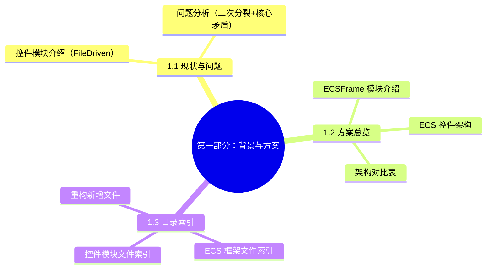
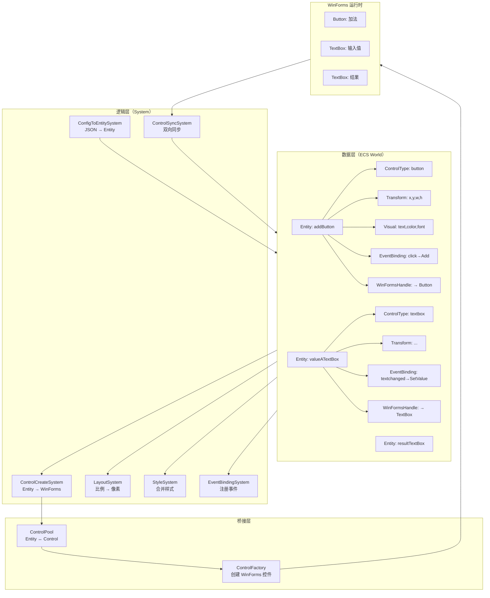
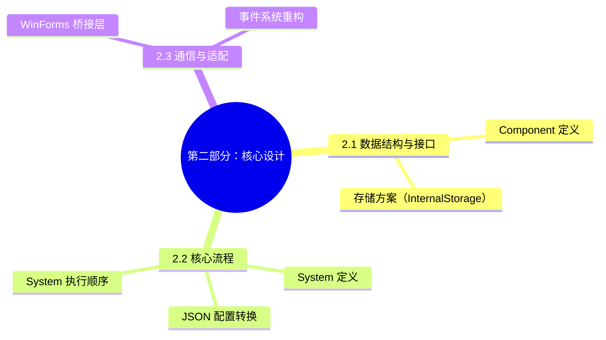
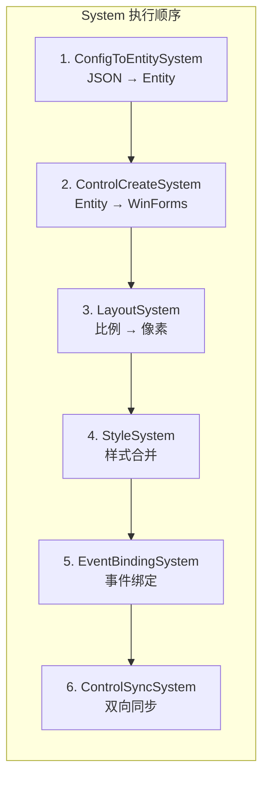
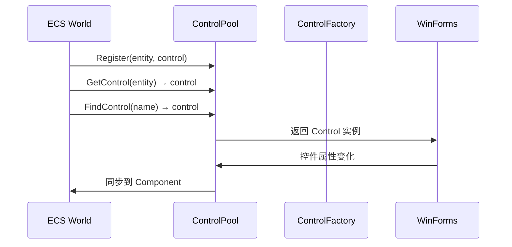
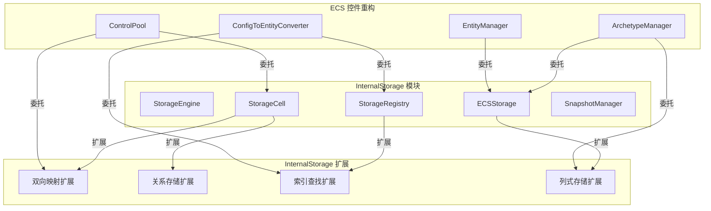
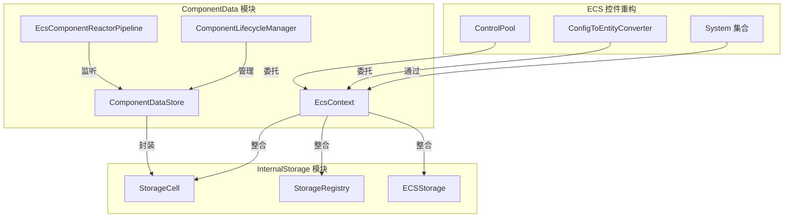
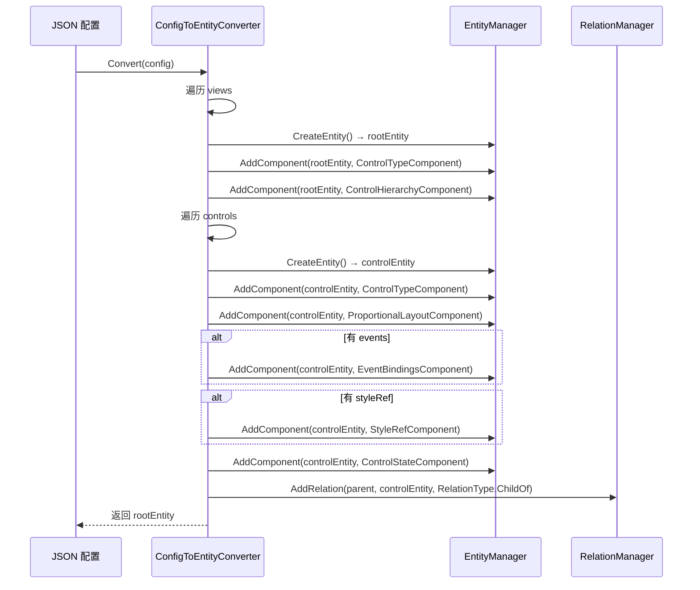
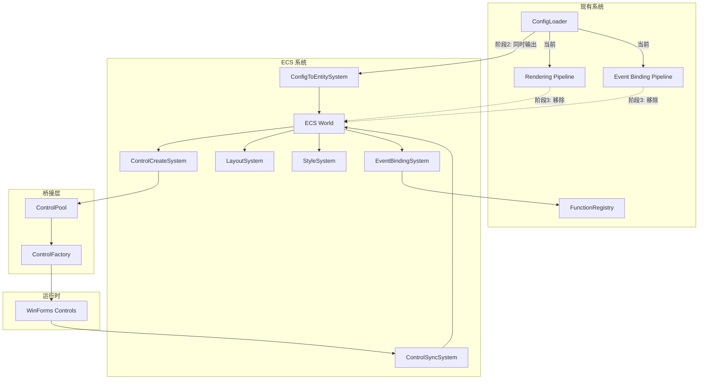

# 基于 ECS 的控件重构方案

> **版本：** v2.1
> **更新日期：** 2026-07-19
> **维护者：** WorkFlowPrj Team
> **基础框架：** `BasicMethod/ECS/ECSFrame.cs`（Archetype 存储引擎）
> **配套文档：** [`ECS_Extension_Optimization.md`](ECS_Extension_Optimization.md)（ECS 扩展）、[`ControlFlow.md`](ControlFlow.md)（当前控件流程）、[`ECS_Storage_Extension.md`](ECS_Storage_Extension.md)（存储扩展方案）


---

# 第一部分：背景与方案

---



## 1.1 现状与问题

### 1.1.1 控件模块现状（FileDriven）

当前控件系统位于 `FileDriven/` 模块，采用传统的 JSON 配置驱动 + WinForms 运行时模式：

```
JSON 配置（.unified.json）
    ↓ ConfigLoader
    ↓
控件配置对象（ControlConfig / ViewConfig）
    ↓ 渲染管线（Rendering Pipeline）
    ├── 创建 WinForms 控件
    ├── 应用布局（比例→像素）
    └── 应用样式
    ↓
WinForms 运行时控件
    ↓ 事件绑定管线（Event Binding Pipeline）
    ├── 遍历配置树
    ├── 按 name 反射查找控件实例
    └── 注册 WinForms 事件 handler
```

**核心文件：**
- `FileDriven/FileDriven.UI/Rendering/` — 渲染管线
- `FileDriven/FileDriven.UI/EventBinding/` — 事件绑定管线
- `FileDriven/FileDriven.UI/Pipeline/ControlFinderStep.cs` — 控件查找步骤（反射）

### 1.1.2 问题分析

#### 三次分裂

**第一次分裂：配置中的控件 vs 运行时的控件**

```
JSON 配置中的控件（ControlConfig）：
  { "type": "button", "name": "addButton", "text": "加法", "events": {...} }

WinForms 运行时控件（Button 实例）：
  Button addButton = new Button();
  addButton.Name = "addButton";
  addButton.Text = "加法";
  addButton.Click += handler;
```

两者之间没有直接的映射关系，全靠 **name 字符串** 来桥接。事件绑定阶段要通过 `ControlFinderStep` 用反射按 name 查找控件实例。

**第二次分裂：渲染管线 vs 事件绑定管线**

```
渲染管线：   配置 → 创建控件 → 布局 → 样式（完全不管 events）
事件绑定管线：配置 → 遍历控件树 → 按 name 查找 → 绑定事件（重新遍历）
```

同一个配置，两条管线各遍历一次。事件绑定管线还要通过反射重新查找已经创建好的控件。

**第三次分裂：控件属性分散在多个地方**

```
控件的 text  → 配置中的 "text" 字段
控件的布局  → 配置中的 "layout" 对象
控件的样式  → styles.json 中的 styleRef
控件的事件  → 配置中的 "events" 对象 + functions 注册
控件的运行时 → WinForms 控件实例
```

一个控件的完整信息分散在 4-5 个地方，事件绑定需要跨多个子系统拼凑。

#### 核心矛盾

```
控件 = JSON 配置片段（数据） + WinForms 实例（视图） + 事件绑定（控制）
        ↑                      ↑                      ↑
      分散                   无关联                  晚绑定
```

本质上，**控件没有一个统一的、自包含的抽象**。它被切成了三块，分别由三个不同的子系统管理，靠 name 字符串维系。

#### 问题汇总

| 问题 | 表现 | 根因 |
|------|------|------|
| 重复遍历 | 渲染管线 + 事件绑定管线各遍历一次配置树 | 控件属性分散，无法一次完成 |
| 反射查找 | 事件绑定阶段按 name 反射查找控件实例 | 配置和运行时无直接关联 |
| name 桥接 | SearchRoot 一错就全崩 | 控件实例和配置靠 name 字符串维系 |
| 事件晚绑定 | 渲染完成后才绑定事件，需要第二条管线 | 事件不是控件创建的一部分 |
| 继承僵化 | 新增控件类型需要继承 Control 基类 | WinForms 继承体系限制 |
| 测试困难 | 控件逻辑和 WinForms 耦合，难以单元测试 | 没有数据层抽象 |

## 1.2 方案总览

### 1.2.1 ECSFrame 模块介绍

`BasicMethod/ECS/` 是基于 Archetype 存储引擎的 ECS（Entity-Component-System）框架，提供高性能、缓存友好的数据驱动架构。

#### 底层存储引擎：Archetype

传统 ECS 使用字典存储，每个 Entity 独立存储 Component，导致 CPU 缓存不友好。本框架采用 **Archetype 存储引擎**，将相同 Component 组合的 Entity 分组存储在连续内存块（Chunk）中：

```
传统 ECS 存储：
  EntityManager
    └── Dictionary<Entity, Dictionary<Type, IComponent>>  ← 每个 Entity 独立存储

Archetype 存储引擎（当前框架）：
  ArchetypeManager
    ├── Archetype[ControlType+Transform]  ← 相同 Component 组合的 Entity 组
    │     ├── Chunk[0] (最多 64 Entity)    ← 连续内存块
    │     │     ├── Entity[]              ← Entity 数组
    │     │     ├── ControlTypeComponent[] ← 列式存储
    │     │     └── TransformComponent[]   ← 列式存储
    │     └── Chunk[1] ...
    ├── Archetype[ControlType+Transform+EventBinding]
    │     └── Chunk[0] ...
    └── Archetype[empty]  ← 空 Component 的 Entity
```

**核心优势：**

| 特性 | 说明 |
|------|------|
| **列式存储** | 每个 Component 类型一个数组，遍历时 CPU 缓存友好 |
| **Archetype 迁移** | 添加/移除 Component 时自动迁移到对应 Archetype |
| **零分配查询** | `ChunkAccessor` 使用 `ref struct`，无堆分配 |
| **批量操作** | `ChunkJob.ForEach` 支持 1-3 个 Component 的批量处理 |
| **位图签名** | `ArchetypeSignature` 使用 BitArray 快速匹配 |

#### 高级封装：EcsContext

框架提供 `EcsContext` 高级封装（位于 `CsharpPrj/Modules/ComponentData/Enhanced/EcsContext.cs`），整合了以下子系统：

```csharp
public class EcsContext : IDisposable
{
    public EcsWorld World { get; }              // ECS 核心（EntityManager + SystemManager）
    public RelationManager Relations { get; }    // 关系管理（Modules.ComponentData.Enhanced）
    public IndexManager Indexes { get; }         // 索引管理（Modules.ComponentData.Enhanced）
    public NotificationCenter Notifications { get; }  // 事件通知（Modules.ComponentData.Enhanced）
}
```

| 子系统 | 功能 | 控件重构中的应用 |
|--------|------|-----------------|
| `RelationManager` | Entity 间关系管理 | 控件父子关系、事件源→目标关系 |
| `IndexManager` | 按 Component 属性快速查找 | 按 name 查找控件 Entity |
| `NotificationCenter` | Component 添加/移除通知 | 控件状态变化通知 |

> **模块归属：** `EcsContext`、`RelationManager`、`IndexManager`、`NotificationCenter` 的实际实现在 `CsharpPrj/Modules/ComponentData/Enhanced/` 命名空间下，是 ComponentData 模块的核心组件。该模块还提供以下增强能力：
>
> - **`ComponentDataStore`**（`Core/ComponentDataStore.cs`）— 可观察的 Component 数据存储，支持变更通知和批量更新
> - **`ComponentLifecycleManager`**（`Lifecycle/ComponentLifecycleManager.cs`）— Component 生命周期管理，支持初始化、激活、停用、销毁四阶段
> - **`EcsComponentReactorPipeline`**（`Reactor/EcsComponentReactorPipeline.cs`）— 反应器链，支持 Component 变更的链式响应处理
> - **`ContextAwareSystem`**（`ContextDriven/ContextAwareSystem.cs`）— 上下文感知 System 基类，自动注入 EcsContext

#### 查询系统：EntityQueryBuilder

框架提供链式 API 构建查询条件，替代传统的 `GetEntities<T1,T2>()`：

```csharp
// 链式查询构建
var query = world.CreateQuery()
    .WithAll<ControlTypeComponent, WinFormsHandleComponent>()  // 必须包含
    .WithAny<EventBindingsComponent>()                          // 至少包含一个
    .WithNone<ControlStateComponent>()                          // 不能包含
    .Build();

// 批量处理（零分配）
query.ForEach(EntityManager, (ChunkAccessor<ControlTypeComponent> accessor) =>
{
    for (int i = 0; i < accessor.Length; i++)
    {
        var entity = accessor.GetEntity(i);
        ref var type = ref accessor[i];  // 直接引用，避免拷贝
        // 处理逻辑...
    }
});
```

### 1.2.2 ECS 控件架构总览

#### 设计理念

```
控件 = Entity（唯一 ID）
     + Component 集合（所有属性）
     + System 处理（所有逻辑）
```

- **Entity** = 控件的唯一标识（替代 name 字符串）
- **Component** = 控件的属性（替代分散的配置 + 运行时状态）
- **System** = 控件的逻辑（替代分散的管线 + 事件绑定）

#### 架构对比

| 维度 | 当前架构 | ECS 架构 |
|------|----------|----------|
| 控件标识 | name 字符串 | Entity ID |
| 控件属性 | 分散在 JSON + WinForms + events | 统一的 Component 集合 |
| 控件创建 | ConfigLoader 硬编码 | ControlCreateSystem |
| 布局计算 | 渲染管线内嵌 | LayoutSystem（基于 UniversalLayout） |
| 样式应用 | 渲染管线内嵌 | StyleSystem |
| 事件绑定 | 独立管线 + 反射查找 | EventBindingSystem（直接操作 Entity） |
| 新增类型 | 继承 Control + 修改 ConfigLoader | 新增 Component + System |
| 测试 | 需要 WinForms 环境 | 纯数据测试 |

#### 整体架构图



## 1.3 目录索引

### 1.3.1 ECS 框架文件索引

| 文件路径 | 内容 | 说明 |
|---------|------|------|
| `BasicMethod/ECS/ECSFrame.cs` | ECS 核心（EntityManager, ArchetypeManager, SystemManager） | 核心引擎 |
| `BasicMethod/ECS/Archetype/Chunk.cs` | Chunk 列式存储 | 连续内存块 |
| `BasicMethod/ECS/Archetype/Archetype.cs` | Archetype 定义 | Entity 分组 |
| `BasicMethod/ECS/Archetype/ArchetypeManager.cs` | Archetype 管理器 | 迁移/查询 |
| `BasicMethod/ECS/Archetype/ArchetypeSignature.cs` | 位图签名 | 快速匹配 |
| `BasicMethod/ECS/Archetype/ComponentTypeId.cs` | 类型 ID 注册表 | 类型→ID 映射 |
| `BasicMethod/ECS/Query/EntityQueryBuilder.cs` | 链式查询构建器 | WithAll/WithAny/WithNone |
| `BasicMethod/ECS/Iteration/ArchetypeQueryResult.cs` | 查询结果迭代器 | Chunk 遍历 |
| `BasicMethod/ECS/Iteration/ChunkAccessor.cs` | Chunk 访问器 | 零分配 Span 访问 |
| `BasicMethod/ECS/Batch/ChunkJob.cs` | 批量操作调度器 | ForEach 模式 |
| `BasicMethod/ECS/Relations/RelationComponent.cs` | 关系组件 + RelationManager | Entity 间关系 |
| `BasicMethod/ECS/Relations/RelationComponent.cs` | IndexManager + NotificationCenter | 索引 + 通知 |
| `BasicMethod/ECS/ContextDriven/ContextAwareSystem.cs` | 上下文感知 System | SkeletonFlow 集成 |
| `BasicMethod/ECS/ContextDriven/EcsSkeletonContext.cs` | ECS 骨架上下文 | 上下文集成 |
| `CsharpPrj/Modules/InternalStorage/Core/StorageEngine.cs` | 存储引擎 | 生命周期 + 会话管理 |
| `CsharpPrj/Modules/InternalStorage/Core/StorageCell.cs` | 存储单元 | 三层键值存储 |
| `CsharpPrj/Modules/InternalStorage/Core/ECSStorage.cs` | ECS 专用存储 | Entity/Archetype/Chunk 存储 |
| `CsharpPrj/Modules/InternalStorage/Core/StorageRegistry.cs` | 存储注册中心 | 类型安全注册 + ID 生成 |
| `CsharpPrj/Modules/InternalStorage/Core/SnapshotManager.cs` | 快照管理器 | 创建/恢复/差异计算 |
| `CsharpPrj/Modules/InternalStorage/Extensions/StorageBidirectionalMap.cs` | 双向映射扩展 | Entity↔Control 双向查找 |
| `CsharpPrj/Modules/InternalStorage/Extensions/StorageRelationExtensions.cs` | 关系存储扩展 | 父子关系、事件源→目标 |
| `CsharpPrj/Modules/InternalStorage/Extensions/StorageIndexExtensions.cs` | 索引查找扩展 | 按 name/type 查找 Entity |
| `CsharpPrj/Modules/InternalStorage/Extensions/StorageColumnExtensions.cs` | 列式存储扩展 | Component 序列化/反序列化 |
| `CsharpPrj/Modules/InternalStorage/Integration/EcsSessionManager.cs` | ECS 会话管理器 | 存储引擎与 ECS 框架集成 |
| `CsharpPrj/Modules/ComponentData/Core/ComponentDataStore.cs` | 可观察数据存储 | 变更通知 + 批量更新 |
| `CsharpPrj/Modules/ComponentData/Enhanced/EcsContext.cs` | ECS 上下文封装 | 整合 World/Relation/Index/Notification |
| `CsharpPrj/Modules/ComponentData/Enhanced/RelationManager.cs` | 关系管理器 | Entity 间关系管理 |
| `CsharpPrj/Modules/ComponentData/Enhanced/IndexManager.cs` | 索引管理器 | 按 Component 属性快速查找 |
| `CsharpPrj/Modules/ComponentData/Enhanced/NotificationCenter.cs` | 事件通知中心 | Component 添加/移除通知 |
| `CsharpPrj/Modules/ComponentData/Lifecycle/ComponentLifecycleManager.cs` | 生命周期管理器 | 初始化/激活/停用/销毁四阶段 |
| `CsharpPrj/Modules/ComponentData/Reactor/EcsComponentReactorPipeline.cs` | 反应器管道 | Component 变更链式响应 |
| `CsharpPrj/Modules/ComponentData/Reactor/ReactorSystemBase.cs` | 反应器 System 基类 | 反应器模式 System 基类 |
| `CsharpPrj/Modules/ComponentData/Reactor/PriorityChain.cs` | 优先级链 | 反应器优先级排序 |
| `CsharpPrj/Modules/ComponentData/ContextDriven/ContextAwareSystem.cs` | 上下文感知 System | 自动注入 EcsContext |
| `CsharpPrj/Modules/ComponentData/ContextDriven/EcsSkeletonContext.cs` | ECS 骨架上下文 | SkeletonFlow 上下文集成 |
| `CsharpPrj/Modules/ComponentData/Extensions/EntityManagerExtensions.cs` | EntityManager 扩展 | 便捷操作方法 |

### 1.5.2 控件模块文件索引


| 文件路径 | 内容 | 说明 |
|---------|------|------|
| `BasicMethod/Framework/ConfigLoader.cs` | 通用配置加载器 | JSON 加载 + Extends 继承 |
| `BasicMethod/Framework/ConfigMerger.cs` | 配置合并器 | 递归合并 |
| `BasicMethod/Framework/ConfigValidator.cs` | 配置验证器 | 属性验证 |
| `BasicMethod/Framework/LayoutPositionConverter.cs` | 布局位置转换器 | 比例/百分比/对齐计算 |
| `BasicMethod/Framework/ObjectFactory.cs` | 对象工厂 | 反射创建 |
| `BasicMethod/Framework/ViewManager.cs` | 视图管理器 | 视图生命周期 |
| `BasicMethod/UniversalLayout/LayoutFramework.cs` | 布局框架核心 | 布局算法 |
| `BasicMethod/UniversalLayout/ProportionalMath.cs` | 比例数学计算 | 比例→像素 |
| `BasicMethod/UniversalLayout/StackLayoutMath.cs` | 堆叠布局 | 自动排列 |
| `BasicMethod/UniversalLayout/AutoLayoutOptimizer.cs` | 自动布局优化 | 冲突检测 |
| `BasicMethod/UniversalLayout/ConflictGraph.cs` | 冲突图 | 布局冲突检测 |
| `BasicMethod/UniversalLayout/MultiObjectiveOptimizer.cs` | 多目标优化 | 布局优化 |

### 1.5.3 重构新增文件

```
BasicMethod/ECS/Components/          ← 新建：Component 定义
  ├── ControlTypeComponent.cs
  ├── ControlHierarchyComponent.cs
  ├── ControlTagComponent.cs
  ├── ProportionalLayoutComponent.cs
  ├── PixelLayoutComponent.cs
  ├── ComputedLayoutComponent.cs
  ├── ColorStyleComponent.cs
  ├── FontStyleComponent.cs
  ├── StyleRefComponent.cs
  ├── MergedStyleComponent.cs
  ├── EventBindingComponent.cs
  ├── EventBindingsComponent.cs
  ├── WinFormsHandleComponent.cs
  └── ControlStateComponent.cs

BasicMethod/ECS/Systems/             ← 新建：System 定义
  ├── ConfigToEntitySystem.cs
  ├── ControlCreateSystem.cs
  ├── LayoutSystem.cs
  ├── StyleSystem.cs
  ├── EventBindingSystem.cs
  └── ControlSyncSystem.cs

BasicMethod/ECS/Bridge/              ← 新建：桥接层
  ├── ControlPool.cs
  └── ControlFactory.cs

BasicMethod/ECS/Conversion/          ← 新建：配置转换
  └── ConfigToEntityConverter.cs

Operation/FrontEndDriven/ECS/        ← 新建：FrontEndDriven 集成（阶段 2）
  ├── FrontEndEcsIntegration.cs      ← ECS 集成入口，管理 EcsWorld 生命周期
  ├── GlobalUsings.cs                ← 全局 using 别名（Entity/IComponent 桥接）
  ├── EcsControlRegistryAdapter.cs   ← IControlRegistry 桥接（阶段 2.5）
  ├── EcsEventBridge.cs              ← 事件绑定桥接（阶段 2.5）
  └── EcsLayoutStyleBridge.cs        ← 布局/样式同步桥接（阶段 2.5）

Operation/FrontEndDriven/Diagnostics/ ← 新建：日志模块（阶段 2.5）
  └── FrontEndDrivenLog.cs           ← FrontEndDriven 统一日志入口
```

---

# 第二部分：核心设计

---



## 2.1 数据结构与接口

### 2.1.1 Component 定义

> **说明：** 以下 Component 定义是控件重构的设计方案，尚未在代码中实现。
> 实现位置：`BasicMethod/ECS/Components/`（新建目录）

### 2.1.1 控件基础 Component

```csharp
// 控件类型标识
public struct ControlTypeComponent : IComponent
{
    public string Type;       // "label" | "button" | "textbox" | "groupbox" | "panel" | ...
    public string Name;       // 控件名称（用于查找）
    public string Text;       // 显示文本
    public bool Enabled;      // 是否启用
    public bool Visible;      // 是否可见
}

// 控件层级（父子关系）
public struct ControlHierarchyComponent : IComponent
{
    public Entity Parent;              // 父控件 Entity
    public List<Entity> Children;      // 子控件 Entity 列表
}

// 控件标签（用于分类和查找）
public struct ControlTagComponent : IComponent
{
    public HashSet<string> Tags;       // 标签集合
}
```

### 2.1.2 布局 Component

```csharp
// 比例布局（0.0 ~ 1.0）
public struct ProportionalLayoutComponent : IComponent
{
    public float Left;      // 左边界比例
    public float Top;       // 上边界比例
    public float Width;     // 宽度比例
    public float Height;    // 高度比例
    public bool PreserveAspectRatio;  // 保持宽高比
}

// 像素布局（绝对坐标）
public struct PixelLayoutComponent : IComponent
{
    public int Left;
    public int Top;
    public int Width;
    public int Height;
}

// 布局计算后的结果
public struct ComputedLayoutComponent : IComponent
{
    public int Left;
    public int Top;
    public int Width;
    public int Height;
    public int ParentWidth;   // 计算时的父容器宽度
    public int ParentHeight;  // 计算时的父容器高度
}
```

### 2.1.3 样式 Component

```csharp
// 颜色样式
public struct ColorStyleComponent : IComponent
{
    public string BackColor;     // 背景色（十六进制）
    public string ForeColor;     // 前景色
    public string BorderColor;   // 边框色
    public int BorderWidth;      // 边框宽度
}

// 字体样式
public struct FontStyleComponent : IComponent
{
    public string FontFamily;    // 字体名称
    public float FontSize;       // 字号
    public bool Bold;
    public bool Italic;
    public bool Underline;
}

// 样式引用（指向 styles.json 中的命名样式）
public struct StyleRefComponent : IComponent
{
    public string StyleRef;      // 样式名称
}

// 合并后的完整样式
public struct MergedStyleComponent : IComponent
{
    public string BackColor;
    public string ForeColor;
    public string FontFamily;
    public float FontSize;
    public bool Bold;
    // ... 所有合并后的样式属性
}
```

### 2.1.4 事件 Component

```csharp
// 事件绑定定义
public struct EventBindingComponent : IComponent
{
    public string EventName;         // "click" | "textchanged" | ...
    public string FunctionName;      // 绑定的函数名
    public ParameterBinding[] Parameters;  // 参数绑定
    public string OutputTarget;      // 输出目标控件名
}

// 参数绑定
public struct ParameterBinding
{
    public string Target;        // 函数参数名
    public string Source;        // 源控件名
    public string SourceType;    // "control"
    public string Type;          // "double" | "string" | "int"
}

// 事件绑定集合（一个控件可能有多个事件）
public struct EventBindingsComponent : IComponent
{
    public List<EventBindingComponent> Bindings;
}
```

### 2.1.5 运行时 Component

```csharp
// WinForms 控件句柄
public struct WinFormsHandleComponent : IComponent
{
    public IntPtr Handle;           // WinForms 控件句柄
    public string ControlType;      // 实际创建的控件类型
}

// 控件状态
public struct ControlStateComponent : IComponent
{
    public bool IsCreated;          // 控件是否已创建
    public bool IsLayoutApplied;    // 布局是否已应用
    public bool IsStyleApplied;     // 样式是否已应用
    public bool IsEventsBound;      // 事件是否已绑定
    public DateTime LastUpdated;    // 最后更新时间
}
```

### 2.1.6 Component 组合示例

```csharp
// Button 控件的 Component 组合
Entity addButton = world.CreateEntity();
em.AddComponent(addButton, new ControlTypeComponent {
    Type = "button", Name = "addButton", Text = "加法 (Add)"
});
em.AddComponent(addButton, new ProportionalLayoutComponent {
    Left = 0.05f, Top = 0.1f, Width = 0.4f, Height = 0.3f
});
em.AddComponent(addButton, new ColorStyleComponent {
    BackColor = "#2563EB", ForeColor = "White"
});
em.AddComponent(addButton, new FontStyleComponent {
    FontSize = 11, Bold = true
});
em.AddComponent(addButton, new EventBindingsComponent {
    Bindings = new List<EventBindingComponent> {
        new EventBindingComponent {
            EventName = "click",
            FunctionName = "Add",
            Parameters = new[] {
                new ParameterBinding { Target = "a", Source = "valueATextBox", SourceType = "control", Type = "double" },
                new ParameterBinding { Target = "b", Source = "valueBTextBox", SourceType = "control", Type = "double" }
            },
            OutputTarget = "resultTextBox"
        }
    }
});
em.AddComponent(addButton, new ControlStateComponent());

// GroupBox 控件的 Component 组合
Entity inputGroup = world.CreateEntity();
em.AddComponent(inputGroup, new ControlTypeComponent {
    Type = "groupbox", Name = "inputGroupBox", Text = "输入值"
});
em.AddComponent(inputGroup, new ProportionalLayoutComponent {
    Left = 0.05f, Top = 0.08f, Width = 0.9f, Height = 0.22f
});
em.AddComponent(inputGroup, new ControlHierarchyComponent {
    Children = new List<Entity> { valueAEntity, valueBEntity }
});
```

---

## 2.2 System 定义

### 2.2.1 System 总览

| System | 查询的 Component | 处理的 Component | 说明 |
|--------|-----------------|-----------------|------|
| ConfigToEntitySystem | - | 所有 Component | JSON → Entity 转换 |
| ControlCreateSystem | ControlTypeComponent + ControlHierarchyComponent | WinFormsHandleComponent + ControlStateComponent | 创建 WinForms 控件 |
| LayoutSystem | ProportionalLayoutComponent + ControlHierarchyComponent | ComputedLayoutComponent | 比例→像素计算 |
| StyleSystem | ColorStyleComponent + FontStyleComponent + StyleRefComponent | MergedStyleComponent | 样式合并 |
| EventBindingSystem | EventBindingsComponent + WinFormsHandleComponent | ControlStateComponent | 注册事件 handler |
| ControlSyncSystem | WinFormsHandleComponent + 其他 Component | WinFormsHandleComponent | 双向同步 |

### 2.2.2 ConfigToEntitySystem

```csharp
public class ConfigToEntitySystem : SystemBase
{
    private readonly ConfigToEntityConverter _converter;

    public ConfigToEntitySystem(ConfigToEntityConverter converter)
    {
        _converter = converter;
    }

    public override void Update(float deltaTime)
    {
        // 此 System 由外部触发，不在 Update 中轮询
    }

    // 加载配置
    public Entity LoadConfig(string configPath)
    {
        var json = File.ReadAllText(configPath);
        var config = JsonSerializer.Deserialize<UIConfiguration>(json);
        return _converter.Convert(config, EntityManager);
    }

    // 加载 UnifiedConfig
    public Entity LoadUnifiedConfig(string configPath)
    {
        var json = File.ReadAllText(configPath);
        var config = JsonSerializer.Deserialize<UnifiedConfiguration>(json);
        var root = _converter.Convert(config.UI, EntityManager);
        _converter.RegisterFunctions(config.Functions, EntityManager);
        return root;
    }
}
```

### 2.2.3 ControlCreateSystem

```csharp
public class ControlCreateSystem : SystemBase
{
    private readonly ControlPool _controlPool;
    private readonly ControlFactory _controlFactory;

    public ControlCreateSystem(ControlPool controlPool, ControlFactory controlFactory)
    {
        _controlPool = controlPool;
        _controlFactory = controlFactory;
    }

    public override void Update(float deltaTime)
    {
        // 使用 EntityQueryBuilder 查询需要创建的控件
        var query = EntityManager.CreateQuery()
            .WithAll<ControlTypeComponent, ControlStateComponent>()
            .WithNone<WinFormsHandleComponent>()
            .Build();

        foreach (var entity in query.GetEntities(EntityManager))
        {
            CreateControl(entity);
        }
    }

    private void CreateControl(Entity entity)
    {
        var type = EntityManager.GetComponent<ControlTypeComponent>(entity);
        var state = EntityManager.GetComponent<ControlStateComponent>(entity);

        // 通过 ControlFactory 创建 WinForms 控件
        var control = _controlFactory.Create(type.Type);
        control.Name = type.Name;
        control.Text = type.Text;

        // 注册到 ControlPool
        _controlPool.Register(entity, control);

        // 更新状态
        state.IsCreated = true;
        EntityManager.SetComponent(entity, state);

        // 添加 WinFormsHandle
        EntityManager.AddComponent(entity, new WinFormsHandleComponent
        {
            Handle = control.Handle,
            ControlType = type.Type
        });

        // 递归创建子控件
        if (EntityManager.TryGetComponent<ControlHierarchyComponent>(entity, out var hierarchy))
        {
            foreach (var child in hierarchy.Children)
            {
                CreateControl(child);
            }
        }
    }
}
```

### 2.2.4 LayoutSystem

```csharp
public class LayoutSystem : SystemBase
{
    private readonly LayoutPositionConverter _converter = new();

    public override void Update(float deltaTime)
    {
        // 使用 EntityQueryBuilder 查询需要布局的控件
        var query = EntityManager.CreateQuery()
            .WithAll<ProportionalLayoutComponent, ControlHierarchyComponent>()
            .Build();

        query.ForEach(EntityManager,
            (ChunkAccessor<ProportionalLayoutComponent, ControlHierarchyComponent> accessor) =>
        {
            for (int i = 0; i < accessor.Length; i++)
            {
                CalculateLayout(accessor.GetEntity(i));
            }
        });
    }

    private void CalculateLayout(Entity entity)
    {
        var layout = EntityManager.GetComponent<ProportionalLayoutComponent>(entity);
        var hierarchy = EntityManager.GetComponent<ControlHierarchyComponent>(entity);

        // 获取父容器尺寸
        int parentWidth, parentHeight;
        if (hierarchy.Parent.IsValid &&
            EntityManager.TryGetComponent<ComputedLayoutComponent>(hierarchy.Parent, out var parentLayout))
        {
            parentWidth = parentLayout.Width;
            parentHeight = parentLayout.Height;
        }
        else
        {
            parentWidth = 800;  // 默认
            parentHeight = 600;
        }

        // 使用 LayoutPositionConverter 进行比例→像素转换
        var rect = _converter.ConvertFromPercent(
            layout.Left, layout.Top,
            layout.Width, layout.Height,
            parentWidth, parentHeight);

        var computed = new ComputedLayoutComponent
        {
            Left = (int)rect.X,
            Top = (int)rect.Y,
            Width = (int)rect.Width,
            Height = (int)rect.Height,
            ParentWidth = parentWidth,
            ParentHeight = parentHeight
        };

        // 添加或更新 ComputedLayout
        if (EntityManager.HasComponent<ComputedLayoutComponent>(entity))
            EntityManager.SetComponent(entity, computed);
        else
            EntityManager.AddComponent(entity, computed);
    }
}
```

### 2.2.5 StyleSystem

```csharp
public class StyleSystem : SystemBase
{
    private readonly Dictionary<string, StyleDefinition> _styleDefinitions;

    public StyleSystem(Dictionary<string, StyleDefinition> styleDefinitions)
    {
        _styleDefinitions = styleDefinitions;
    }

    public override void Update(float deltaTime)
    {
        // 使用 EntityQueryBuilder 查询需要合并样式的控件
        var query = EntityManager.CreateQuery()
            .WithAll<ControlTypeComponent, ControlStateComponent>()
            .Build();

        query.ForEach(EntityManager, (ChunkAccessor<ControlStateComponent> accessor) =>
        {
            for (int i = 0; i < accessor.Length; i++)
            {
                var entity = accessor.GetEntity(i);
                var state = accessor[i];
                if (!state.IsStyleApplied)
                {
                    ApplyStyle(entity);
                }
            }
        });
    }

    private void ApplyStyle(Entity entity)
    {
        var state = EntityManager.GetComponent<ControlStateComponent>(entity);

        // 如果有 StyleRef，从定义中合并
        if (EntityManager.TryGetComponent<StyleRefComponent>(entity, out var styleRef))
        {
            if (_styleDefinitions.TryGetValue(styleRef.StyleRef, out var definition))
            {
                // 合并样式到 ColorStyleComponent 和 FontStyleComponent
                if (!EntityManager.HasComponent<ColorStyleComponent>(entity))
                    EntityManager.AddComponent(entity, new ColorStyleComponent());
                if (!EntityManager.HasComponent<FontStyleComponent>(entity))
                    EntityManager.AddComponent(entity, new FontStyleComponent());

                // 应用定义中的属性
                ApplyStyleProperties(entity, definition.Properties);
            }
        }

        // 更新状态
        state.IsStyleApplied = true;
        EntityManager.SetComponent(entity, state);
    }
}
```

### 2.2.6 EventBindingSystem

```csharp
public class EventBindingSystem : SystemBase
{
    private readonly ControlPool _controlPool;
    private readonly FunctionRegistry _functionRegistry;

    public EventBindingSystem(ControlPool controlPool, FunctionRegistry functionRegistry)
    {
        _controlPool = controlPool;
        _functionRegistry = functionRegistry;
    }

    public override void Update(float deltaTime)
    {
        // 使用 EntityQueryBuilder 查询需要绑定事件的控件
        var query = EntityManager.CreateQuery()
            .WithAll<EventBindingsComponent, WinFormsHandleComponent, ControlStateComponent>()
            .Build();

        query.ForEach(EntityManager, (ChunkAccessor<ControlStateComponent> accessor) =>
        {
            for (int i = 0; i < accessor.Length; i++)
            {
                var entity = accessor.GetEntity(i);
                var state = accessor[i];
                if (!state.IsEventsBound)
                {
                    BindEvents(entity);
                }
            }
        });
    }

    private void BindEvents(Entity entity)
    {
        var bindings = EntityManager.GetComponent<EventBindingsComponent>(entity);
        var state = EntityManager.GetComponent<ControlStateComponent>(entity);
        var control = _controlPool.GetControl(entity);

        foreach (var binding in bindings.Bindings)
        {
            // 注册 WinForms 事件
            switch (binding.EventName.ToLower())
            {
                case "click":
                    if (control is Button button)
                    {
                        button.Click += (s, e) =>
                        {
                            var parameters = ResolveParameters(binding, entity);
                            var result = _functionRegistry.Execute(binding.FunctionName, parameters);
                            WriteOutput(binding.OutputTarget, result);
                        };
                    }
                    break;

                case "textchanged":
                    if (control is TextBox textBox)
                    {
                        textBox.TextChanged += (s, e) =>
                        {
                            var parameters = ResolveParameters(binding, entity);
                            var result = _functionRegistry.Execute(binding.FunctionName, parameters);
                            WriteOutput(binding.OutputTarget, result);
                        };
                    }
                    break;
            }
        }

        // 更新状态
        state.IsEventsBound = true;
        EntityManager.SetComponent(entity, state);
    }

    private Dictionary<string, object> ResolveParameters(EventBindingComponent binding, Entity sourceEntity)
    {
        var parameters = new Dictionary<string, object>();
        foreach (var param in binding.Parameters)
        {
            // 通过 ControlPool 查找源控件
            var sourceControl = _controlPool.FindControl(param.Source);
            if (sourceControl != null)
            {
                var value = Convert.ChangeType(sourceControl.Text, Type.GetType(param.Type));
                parameters[param.Target] = value;
            }
        }
        return parameters;
    }

    private void WriteOutput(string outputTarget, object result)
    {
        var outputControl = _controlPool.FindControl(outputTarget);
        if (outputControl != null)
        {
            outputControl.Text = result?.ToString() ?? "";
        }
    }
}
```

### 2.2.7 ControlSyncSystem

```csharp
public class ControlSyncSystem : SystemBase
{
    private readonly ControlPool _controlPool;

    public ControlSyncSystem(ControlPool controlPool)
    {
        _controlPool = controlPool;
    }

    public override void Update(float deltaTime)
    {
        // 同步 Component → WinForms
        SyncComponentToControl();

        // 同步 WinForms → Component（可选）
        SyncControlToComponent();
    }

    private void SyncComponentToControl()
    {
        var query = EntityManager.CreateQuery()
            .WithAll<ControlTypeComponent, WinFormsHandleComponent>()
            .Build();

        query.ForEach(EntityManager, (ChunkAccessor<ControlTypeComponent> accessor) =>
        {
            for (int i = 0; i < accessor.Length; i++)
            {
                var entity = accessor.GetEntity(i);
                var type = accessor[i];
                var control = _controlPool.GetControl(entity);

                if (control.Text != type.Text)
                    control.Text = type.Text;
                if (control.Enabled != type.Enabled)
                    control.Enabled = type.Enabled;
                if (control.Visible != type.Visible)
                    control.Visible = type.Visible;
            }
        });
    }

    private void SyncControlToComponent()
    {
        // 对于 TextBox 等需要从控件读取值的类型
        var query = EntityManager.CreateQuery()
            .WithAll<ControlTypeComponent, WinFormsHandleComponent>()
            .Build();

        query.ForEach(EntityManager, (ChunkAccessor<ControlTypeComponent> accessor) =>
        {
            for (int i = 0; i < accessor.Length; i++)
            {
                var entity = accessor.GetEntity(i);
                var type = accessor[i];
                var control = _controlPool.GetControl(entity);

                if (type.Type == "textbox" && control.Text != type.Text)
                {
                    type.Text = control.Text;
                    EntityManager.SetComponent(entity, type);
                }
            }
        });
    }
}
```

### 2.2.8 System 执行顺序



---

## 2.3 WinForms 桥接层

### 2.3.1 ControlPool

`ControlPool` 是 ECS Entity 和 WinForms 控件之间的双向映射表。

> **存储方案：** ControlPool 的底层存储将委托给 `InternalStorage` 模块的 `IStorageCell` 和 `IStorageRegistry`，替代当前的 `Dictionary<Entity, Control>` 和 `Dictionary<string, Control>`。详见 [`ECS_Storage_Extension.md`](ECS_Storage_Extension.md) §3.2。

当前设计方案（基于 Dictionary）：

```csharp
public class ControlPool
{
    private readonly Dictionary<Entity, Control> _entityToControl = new();
    private readonly Dictionary<string, Control> _nameToControl = new();

    /// <summary>注册 Entity 和 Control 的映射</summary>
    public void Register(Entity entity, Control control)
    {
        _entityToControl[entity] = control;
        _nameToControl[control.Name] = control;
    }

    /// <summary>通过 Entity 获取 Control</summary>
    public Control GetControl(Entity entity)
        => _entityToControl.TryGetValue(entity, out var control) ? control
           : throw new KeyNotFoundException($"Control not found for entity {entity}");

    /// <summary>通过名称获取 Control</summary>
    public Control FindControl(string name)
        => _nameToControl.TryGetValue(name, out var control) ? control : null;

    /// <summary>通过 Entity 获取关联的 WinForms 控件（泛型版本）</summary>
    public T GetControl<T>(Entity entity) where T : Control
        => (T)GetControl(entity);

    /// <summary>通过名称查找 Entity</summary>
    public Entity? FindEntity(string name)
    {
        foreach (var kvp in _entityToControl)
            if (kvp.Value.Name == name) return kvp.Key;
        return null;
    }

    /// <summary>移除映射</summary>
    public void Unregister(Entity entity)
    {
        if (_entityToControl.TryGetValue(entity, out var control))
        {
            _nameToControl.Remove(control.Name);
            _entityToControl.Remove(entity);
        }
    }
}
```

### 2.3.2 ControlFactory

```csharp
public class ControlFactory
{
    private readonly Dictionary<string, Func<Control>> _registry = new()
    {
        ["label"] = () => new Label(),
        ["button"] = () => new Button(),
        ["textbox"] = () => new TextBox(),
        ["groupbox"] = () => new GroupBox(),
        ["panel"] = () => new Panel(),
        ["checkbox"] = () => new CheckBox(),
        ["combobox"] = () => new ComboBox(),
        ["listbox"] = () => new ListBox(),
        ["numericupdown"] = () => new NumericUpDown(),
        ["progressbar"] = () => new ProgressBar(),
        ["datagridview"] = () => new DataGridView(),
    };

    public Control Create(string type)
    {
        if (_registry.TryGetValue(type.ToLower(), out var factory))
            return factory();
        throw new ArgumentException($"Unknown control type: {type}");
    }

    /// <summary>注册自定义控件类型</summary>
    public void Register(string type, Func<Control> factory)
    {
        _registry[type.ToLower()] = factory;
    }
}
```

### 2.3.3 桥接流程



---

## 2.4 存储方案（基于 InternalStorage）

> **完整方案：** 详见独立文档 [`ECS_Storage_Extension.md`](ECS_Storage_Extension.md)（ECS 控件重构的存储扩展方案）。

### 2.4.1 设计理念

ECS 控件重构的存储方案以 `CsharpPrj/Modules/InternalStorage` 为核心存储模块，遵循以下设计原则：

| 原则 | 说明 |
|------|------|
| **存储分层** | Config（配置）/ Session（运行时）/ Transient（临时）三层隔离 |
| **控制反转** | ECS 只通过接口（`IStorageCell` / `IStorageRegistry` / `IECSStorage`）访问存储 |
| **统一入口** | 所有存储操作通过 `IStorageEngine` 管理 |
| **扩展优先** | InternalStorage 功能不足时，优先扩展 InternalStorage 而非引入新存储 |

### 2.4.2 存储架构总览



### 2.4.3 存储分层映射

| 存储层 | 生命周期 | 快照行为 | 控件重构中的用途 |
|--------|---------|---------|----------------|
| **Config 层** | 引擎生命周期 | Preserve（保留） | JSON 配置、样式定义、函数注册 |
| **Session 层** | 会话生命周期 | Snapshot（参与快照） | 控件 Entity、运行时状态、事件绑定 |
| **Transient 层** | 瞬态 | Exclude（排除） | 临时计算结果、布局缓存 |

### 2.4.4 核心委托关系

| 控件重构组件 | 委托给 InternalStorage | 说明 |
|-------------|----------------------|------|
| **ControlPool** | `IStorageCell` + 双向映射扩展 | Entity↔Control 双向映射 |
| **ConfigToEntityConverter** | `IStorageRegistry` + 索引扩展 | 名称→Entity 映射 |
| **EntityManager** | `IECSStorage` | Entity→Archetype、Entity ID 管理 |
| **ArchetypeManager** | `IECSStorage` + 列式存储扩展 | Chunk 列式存储 |
| **ViewManager** | `IStorageEngine` | 会话管理、控件生命周期 |

### 2.4.5 需要 InternalStorage 扩展的功能

InternalStorage 当前已实现 11 项核心能力，以下 4 项需要扩展：

| 扩展 | 接口 | 用途 |
|------|------|------|
| **双向映射** | `StorageBidirectionalExtensions` | Entity↔Control 双向查找 |
| **关系存储** | `StorageRelationExtensions` | 父子关系、事件源→目标 |
| **索引查找** | `StorageIndexExtensions` | 按 name/type 查找 Entity |
| **强类型列式存储** | `StorageColumnExtensions` | Component 序列化/反序列化 |

> 详见 [`ECS_Storage_Extension.md`](ECS_Storage_Extension.md) 第二部分。

### 2.4.6 ComponentData 模块的存储协作

`CsharpPrj/Modules/ComponentData` 模块在 InternalStorage 之上提供可观察的数据存储和反应式处理能力，两者协作关系如下：

| ComponentData 组件 | 底层存储 | 协作方式 |
|-------------------|---------|---------|
| **`ComponentDataStore`** | `IStorageCell`（Session 层） | 封装存储单元的键值操作，添加变更通知和批量更新 |
| **`EcsComponentReactorPipeline`** | `ComponentDataStore` | 监听 Component 变更事件，按优先级链式响应 |
| **`ComponentLifecycleManager`** | `ComponentDataStore` | 管理 Component 的初始化/激活/停用/销毁四阶段 |
| **`EcsContext`** | `IStorageCell` + `IStorageRegistry` | 整合 World/Relation/Index/Notification 的统一入口 |



> **设计说明：** ComponentData 模块不替代 InternalStorage，而是在其基础上提供更高层次的抽象。InternalStorage 负责原始键值存储和分层管理，ComponentData 负责数据变更的观察、响应和生命周期管理。两者形成"存储层 → 观察层 → 响应层"的三层协作架构。

---

## 2.5 事件系统重构

### 2.5.1 当前事件系统的痛点

```
当前事件绑定流程：
  1. 渲染管线创建控件（不关心事件）
  2. 事件绑定管线遍历配置树
  3. 按 name 反射查找控件实例
  4. 解析参数绑定
  5. 注册 WinForms 事件 handler
  6. 在 handler 中调用 FunctionRegistry

问题：
  - 两条管线，两次遍历
  - 反射查找，性能差
  - name 字符串桥接，脆弱
  - 事件不是控件的一部分，而是"附加"的
```

### 2.5.2 ECS 事件模型

```
ECS 事件绑定流程：
  1. ConfigToEntitySystem 将 events 转换为 EventBindingsComponent
  2. ControlCreateSystem 创建控件时，EventBindingsComponent 已在 Entity 上
  3. EventBindingSystem 查询 EventBindingsComponent + WinFormsHandleComponent
  4. 直接通过 ControlPool 获取控件实例（无需反射）
  5. 注册 WinForms 事件 handler
  6. 在 handler 中通过 ControlPool 解析参数（无需反射）

优势：
  - 一次遍历（ConfigToEntitySystem 完成所有转换）
  - 无需反射（ControlPool 直接映射）
  - 事件是 Component，是控件不可分割的一部分
  - 新增事件类型只需新增 EventBindingComponent 实例
```

### 2.5.3 事件处理流程对比

| 步骤 | 当前架构 | ECS 架构 |
|------|----------|----------|
| 配置解析 | 渲染管线解析 layout + style | ConfigToEntitySystem 一次解析所有属性 |
| 控件创建 | 渲染管线创建控件 | ControlCreateSystem 创建 + 注册到 ControlPool |
| 事件绑定 | 第二条管线遍历配置树 | EventBindingSystem 查询 Entity 上的 Component |
| 控件查找 | 反射按 name 查找 | ControlPool 直接映射 |
| 参数解析 | 反射读取控件属性 | ControlPool 直接获取控件实例 |
| 事件注册 | 注册 WinForms handler | 注册 WinForms handler |
| 事件触发 | handler 调用 FunctionRegistry | handler 调用 FunctionRegistry |

### 2.5.4 使用 NotificationCenter 实现控件间通信

除了 WinForms 事件，ECS 框架的 `NotificationCenter` 还可用于控件间的松耦合通信：

```csharp
// 订阅控件状态变化
ecsContext.Notifications.SubscribeAdded<ControlStateComponent>(
    (entity, state) =>
    {
        if (state.IsCreated)
            Console.WriteLine($"控件已创建: {entity}");
    });

// 订阅特定类型的事件
ecsContext.Notifications.SubscribeAdded<EventBindingsComponent>(
    (entity, bindings) =>
    {
        Console.WriteLine($"控件 {entity} 注册了 {bindings.Bindings.Count} 个事件绑定");
    });
```

---

## 2.6 JSON 配置到 ECS 的转换

### 2.6.1 转换流程



### 2.6.2 ConfigToEntityConverter

> **存储方案：** `_entityNameMap` 的底层存储将委托给 `InternalStorage` 模块的 `IStorageRegistry`，替代当前的 `Dictionary<string, Entity>`。详见 [`ECS_Storage_Extension.md`](ECS_Storage_Extension.md) §3.3。

```csharp
public class ConfigToEntityConverter
{
    private readonly Dictionary<string, Entity> _entityNameMap = new();

    public Entity Convert(UIConfiguration config, EntityManager em)
    {
        _entityNameMap.Clear();

        // 创建根 Entity
        var rootEntity = em.CreateEntity();
        em.AddComponent(rootEntity, new ControlTypeComponent
        {
            Type = "container",
            Name = config.Name ?? "root"
        });
        em.AddComponent(rootEntity, new ControlHierarchyComponent());

        // 转换 views
        foreach (var view in config.Views)
        {
            var viewEntity = ConvertView(view, em, rootEntity);
            var hierarchy = em.GetComponent<ControlHierarchyComponent>(rootEntity);
            hierarchy.Children.Add(viewEntity);
            em.SetComponent(rootEntity, hierarchy);
        }

        return rootEntity;
    }

    private Entity ConvertView(ViewConfig view, EntityManager em, Entity parent)
    {
        var entity = em.CreateEntity();
        em.AddComponent(entity, new ControlTypeComponent
        {
            Type = view.Type.ToLower(),
            Name = view.Name,
            Text = view.Text ?? ""
        });
        em.AddComponent(entity, ConvertLayout(view.Layout));
        em.AddComponent(entity, new ControlHierarchyComponent { Parent = parent });
        em.AddComponent(entity, new ControlStateComponent());

        _entityNameMap[view.Name] = entity;

        // 转换子控件
        if (view.Controls != null)
        {
            var hierarchy = em.GetComponent<ControlHierarchyComponent>(entity);
            foreach (var control in view.Controls)
            {
                var childEntity = ConvertControl(control, em, entity);
                hierarchy.Children.Add(childEntity);
            }
            em.SetComponent(entity, hierarchy);
        }

        return entity;
    }

    private Entity ConvertControl(ControlConfig control, EntityManager em, Entity parent)
    {
        var entity = em.CreateEntity();

        // 基础属性
        em.AddComponent(entity, new ControlTypeComponent
        {
            Type = control.Type.ToLower(),
            Name = control.Name,
            Text = control.Text ?? ""
        });

        // 布局
        if (control.Layout != null)
            em.AddComponent(entity, ConvertLayout(control.Layout));

        // 样式
        if (!string.IsNullOrEmpty(control.BackColor) || !string.IsNullOrEmpty(control.ForeColor))
        {
            em.AddComponent(entity, new ColorStyleComponent
            {
                BackColor = control.BackColor ?? "",
                ForeColor = control.ForeColor ?? ""
            });
        }
        if (control.Font != null)
        {
            em.AddComponent(entity, new FontStyleComponent
            {
                FontFamily = control.Font.Family ?? "Microsoft Sans Serif",
                FontSize = control.Font.Size,
                Bold = control.Font.Bold
            });
        }
        if (!string.IsNullOrEmpty(control.StyleRef))
        {
            em.AddComponent(entity, new StyleRefComponent { StyleRef = control.StyleRef });
        }

        // 事件
        if (control.Events != null)
        {
            var bindings = new List<EventBindingComponent>();
            foreach (var kvp in control.Events.EventsDictionary)
            {
                bindings.Add(new EventBindingComponent
                {
                    EventName = kvp.Key,
                    FunctionName = kvp.Value,
                    Parameters = control.Events.Bindings?.Parameters?
                        .Select(p => new ParameterBinding
                        {
                            Target = p.Target,
                            Source = p.Source,
                            SourceType = p.SourceType,
                            Type = p.Type
                        }).ToArray() ?? Array.Empty<ParameterBinding>(),
                    OutputTarget = control.Events.Bindings?.Output ?? ""
                });
            }
            em.AddComponent(entity, new EventBindingsComponent { Bindings = bindings });
        }

        // 层级
        em.AddComponent(entity, new ControlHierarchyComponent { Parent = parent });
        em.AddComponent(entity, new ControlStateComponent());

        _entityNameMap[control.Name] = entity;

        // 递归子控件
        if (control.Controls != null)
        {
            var hierarchy = em.GetComponent<ControlHierarchyComponent>(entity);
            foreach (var child in control.Controls)
            {
                var childEntity = ConvertControl(child, em, entity);
                hierarchy.Children.Add(childEntity);
            }
            em.SetComponent(entity, hierarchy);
        }

        return entity;
    }

    private ProportionalLayoutComponent ConvertLayout(LayoutConfig layout)
    {
        return new ProportionalLayoutComponent
        {
            Left = layout.Left,
            Top = layout.Top,
            Width = layout.Width,
            Height = layout.Height
        };
    }
}
```

### 2.6.3 转换示例

以 MathFunctions.unified.json 为例：

```
JSON 配置
  ↓ ConfigToEntityConverter.Convert()
  ↓

ECS World 中的 Entity 树：

rootEntity (container)
  └── mainViewEntity (panel)
        ├── titleLabel (label)
        │     ├── ControlTypeComponent { Type: "label", Name: "titleLabel", Text: "内置数学函数测试" }
        │     ├── ProportionalLayoutComponent { Left: 0, Top: 0, Width: 1, Height: 1 }
        │     ├── ColorStyleComponent { BackColor: "#1E293B", ForeColor: "#F8FAFC" }
        │     ├── FontStyleComponent { FontSize: 18, Bold: true }
        │     └── ControlStateComponent { IsCreated: false, ... }
        │
        ├── inputGroupBox (groupbox)
        │     ├── ControlTypeComponent { Type: "groupbox", Name: "inputGroupBox", Text: "输入值" }
        │     ├── ProportionalLayoutComponent { Left: 0.05, Top: 0.08, Width: 0.9, Height: 0.22 }
        │     ├── ControlHierarchyComponent { Children: [valueAEntity, valueBEntity] }
        │     └── ControlStateComponent { ... }
        │
        ├── valueATextBox (textbox)
        │     ├── ControlTypeComponent { Type: "textbox", Name: "valueATextBox", Text: "" }
        │     ├── ProportionalLayoutComponent { Left: 0.05, Top: 0.35, Width: 0.4, Height: 0.08 }
        │     ├── EventBindingsComponent { Bindings: [textchanged → SetValueA] }
        │     └── ControlStateComponent { ... }
        │
        ├── valueBTextBox (textbox)
        │     ├── ControlTypeComponent { Type: "textbox", Name: "valueBTextBox", Text: "" }
        │     ├── ProportionalLayoutComponent { Left: 0.55, Top: 0.35, Width: 0.4, Height: 0.08 }
        │     ├── EventBindingsComponent { Bindings: [textchanged → SetValueB] }
        │     └── ControlStateComponent { ... }
        │
        ├── addButton (button)
        │     ├── ControlTypeComponent { Type: "button", Name: "addButton", Text: "加法 (Add)" }
        │     ├── ProportionalLayoutComponent { Left: 0.05, Top: 0.5, Width: 0.4, Height: 0.1 }
        │     ├── ColorStyleComponent { BackColor: "#2563EB", ForeColor: "White" }
        │     ├── FontStyleComponent { FontSize: 11, Bold: true }
        │     ├── EventBindingsComponent { Bindings: [click → Add(a←valueATextBox, b←valueBTextBox) → resultTextBox] }
        │     └── ControlStateComponent { ... }
        │
        └── resultTextBox (textbox)
              ├── ControlTypeComponent { Type: "textbox", Name: "resultTextBox", Text: "" }
              ├── ProportionalLayoutComponent { Left: 0.05, Top: 0.65, Width: 0.9, Height: 0.1 }
              ├── ColorStyleComponent { BackColor: "#0F172A", ForeColor: "#38BDF8" }
              ├── FontStyleComponent { FontSize: 14, Bold: true }
              └── ControlStateComponent { ... }
```

---

# 第三部分：重构具体步骤

---

## 3.1 迁移策略总览

采用**渐进式迁移**策略，不一次性替换现有系统：

```
阶段 1：并行运行（当前 → 短期）
  - 现有系统照常运行
  - ECS 框架作为独立模块运行
  - 验证 ECS 框架的正确性和性能

阶段 2：混合运行（中期）
  - 新控件使用 ECS 方式创建
  - 旧控件逐步迁移到 ECS
  - ControlPool 作为新旧系统的桥梁

阶段 3：完全迁移（长期）
  - 所有控件使用 ECS 方式
  - 移除旧的渲染管线和事件绑定管线
  - 移除 ControlFinderStep 等桥接代码
```

---

## 3.2 阶段 1：并行运行 ✅ 已完成

```
目标：ECS 框架与现有系统并行运行，验证可行性

状态：✅ 已完成 — 所有基础设施已实现并通过测试

已完成的组件：
  - Component 定义（TConfig.ECS.Components 命名空间）：
    - ControlTypeComponent — 控件类型/名称/文本/启用状态
    - ControlHierarchyComponent — 父子层级关系（Parent + Children）
    - ControlStateComponent — 控件生命周期状态（IsCreated/IsLayoutApplied/IsStyleApplied/IsEventsBound）
    - ProportionalLayoutComponent — 比例布局（Left/Top/Width/Height 0~1）
    - PixelLayoutComponent — 像素布局（X/Y/Width/Height）
    - ComputedLayoutComponent — 计算后的像素布局
    - ColorStyleComponent — 颜色样式（BackColor/ForeColor/BorderColor/BorderWidth）
    - FontStyleComponent — 字体样式（FontFamily/FontSize/Bold/Italic/Underline）
    - StyleRefComponent — 样式引用
    - MergedStyleComponent — 合并后的完整样式
    - EventBindingsComponent / EventBindingComponent — 事件绑定
    - WinFormsHandleComponent — WinForms 控件句柄
    - ScreenRootComponent — 屏幕根容器尺寸

  - System 实现（BasicMethod/ECS/Systems/）：
    - ConfigToEntitySystem — 第 1 阶段：配置→Entity 转换
    - ControlCreateSystem — 第 2 阶段：控件实例化（事件驱动）
    - LayoutSystem — 第 3 阶段：比例→像素布局计算
    - StyleSystem — 第 4 阶段：样式合并（内联 > StyleRef > 默认）
    - EventBindingSystem — 第 5 阶段：事件绑定（事件驱动）
    - ControlSyncSystem — 第 6 阶段：运行时双向同步（事件驱动）

  - Bridge 层（BasicMethod/ECS/Bridge/）：
    - ControlPool — Entity↔Control 双向映射（基于 IStorageCell）
    - ControlFactory — 根据 ControlConfig 创建 Entity 并添加 Component

  - Conversion 层（BasicMethod/ECS/Conversion/）：
    - ConfigToEntityConverter — UIConfiguration → Entity 树递归转换

  - ECS 核心框架（BasicMethod/ECS/）：
    - EntityManager — Archetype 存储引擎的 Entity 管理器
    - ArchetypeManager / Archetype / ArchetypeSignature / Chunk — Archetype 列式存储
    - EcsWorld — 世界容器（EntityManager + SystemManager）
    - SystemManager — System 注册/生命周期管理
    - EntityQueryBuilder — 链式查询构建器
    - ChunkJob / ChunkAccessor — 批量处理

  - 测试覆盖（CentralTest/CSharpTest/BasicMethod.Tests/ECS.Tests/）：
    - EntityManagerTests — Entity 创建/销毁/Component CRUD/生命周期事件（14 个测试）
    - ControlHierarchyComponentTests — 父子关系维护（5 个测试）
    - ControlFactoryTests — 控件工厂创建 Entity（10 个测试）
    - ConfigToEntityConverterTests — 配置→Entity 转换（10 个测试）
    - ConfigToEntitySystemTests — 转换 System 执行（7 个测试）
    - LayoutSystemTests — 布局计算（6 个测试）
    - StyleSystemTests — 样式合并（7 个测试）
    - PipelineTests — 完整管线集成测试（4 个测试）
    - 总计：71 个测试，全部通过 ✅

涉及文件（已实现）：
  - TConfig/ECS/Components/*.cs — Component 定义（由 TConfig 模块提供）
  - BasicMethod/ECS/Systems/ConfigToEntitySystem.cs
  - BasicMethod/ECS/Systems/ControlCreateSystem.cs
  - BasicMethod/ECS/Systems/LayoutSystem.cs
  - BasicMethod/ECS/Systems/StyleSystem.cs
  - BasicMethod/ECS/Systems/EventBindingSystem.cs
  - BasicMethod/ECS/Systems/ControlSyncSystem.cs
  - BasicMethod/ECS/Bridge/ControlPool.cs
  - BasicMethod/ECS/Bridge/ControlFactory.cs
  - BasicMethod/ECS/Conversion/ConfigToEntityConverter.cs
  - BasicMethod/ECS/ECSFrame.cs（EntityManager, EcsWorld, SystemManager 等）
  - BasicMethod/ECS/Archetype/*.cs（Archetype 存储引擎）
  - CentralTest/CSharpTest/BasicMethod.Tests/ECS.Tests/（71 个测试）
```

---

## 3.3 阶段 2：混合运行 ✅ 已完成

```
目标：新控件使用 ECS，旧控件逐步迁移

状态：✅ 已完成 — FrontEndEcsIntegration 集成层已实现并编译通过

步骤：
  1. ✅ 在 FrontEndDriven 中创建 ECS 集成层（FrontEndEcsIntegration）
  2. ✅ 添加全局 using 别名（GlobalUsings.cs），桥接 Entity/IComponent 类型
  3. ✅ 实现 EcsWorld 生命周期管理（创建/销毁/清除）
  4. ✅ 实现 6 个 System 的管线编排（ConfigToEntity → ControlCreate → Layout → Style → EventBinding → ControlSync）
  5. ✅ 实现事件桥接机制（ConversionCompleted / ControlCreated / EventBindRequested / LayoutSyncRequested / StyleSyncRequested / StateSyncRequested）
  6. ✅ 实现按阶段执行管线（ExecuteStage）
  7. ✅ 实现 ControlPool 的 Entity↔Control 映射管理
  8. ✅ 实现布局重算（RecalculateLayout，窗口大小变化时调用）
  9. ✅ 编译通过（0 错误 0 警告）

设计决策：
  - 不依赖 EcsContext（Modules.ComponentData），直接使用 EcsWorld + EntityManager
  - 通过事件机制与 FrontEndDriven 现有系统解耦，而非直接调用
  - 使用 GlobalUsings.cs 解决 TConfig.ECS.Entity 的类型别名问题
  - 使用 EcsParameterBinding 别名解决 ParameterBinding 的命名空间歧义

涉及文件：
  - Operation/FrontEndDriven/ECS/FrontEndEcsIntegration.cs（新建）— ECS 集成入口
  - Operation/FrontEndDriven/GlobalUsings.cs（新建）— 全局 using 别名
  - BasicMethod/ECS/Systems/ConfigToEntitySystem.cs（修改）— 添加 Converter 公开属性
```

---

## 3.4 阶段 3：完全迁移

```
目标：完全移除旧系统

步骤：
  1. 确认所有控件已迁移到 ECS
  2. 移除旧的渲染管线
  3. 移除旧的事件绑定管线
  4. 移除 ControlFinderStep
  5. 清理不再需要的桥接代码

涉及文件：
  - FileDriven/FileDriven.UI/Rendering/（清理）
  - FileDriven/FileDriven.UI/EventBinding/（清理）
  - FileDriven/FileDriven.UI/Pipeline/ControlFinderStep.cs（删除）
```

---

## 3.5 推荐实现顺序 ✅ 已完成

```
第 1 步：基础 Component 定义 ✅
  → ControlTypeComponent, ControlStateComponent, ControlHierarchyComponent
  → 验证：创建 Entity，添加 Component，读取 Component
  → 测试：EntityManagerTests（14 个测试）+ ControlHierarchyComponentTests（5 个测试）

第 2 步：ControlPool + ControlFactory ✅
  → Entity ↔ Control 双向映射（基于 IStorageCell）
  → 验证：注册 Entity，获取 Control，通过名称查找
  → 测试：ControlFactoryTests（10 个测试）

第 3 步：ConfigToEntityConverter ✅
  → JSON 配置 → Entity 树（递归转换 UIConfiguration）
  → 验证：加载配置，检查 Entity 树结构
  → 测试：ConfigToEntityConverterTests（10 个测试）+ ConfigToEntitySystemTests（7 个测试）

第 4 步：ControlCreateSystem ✅
  → Entity → WinForms 控件（事件驱动模式）
  → 验证：System 执行后，WinForms 控件正确创建
  → 测试：通过 PipelineTests 集成验证

第 5 步：LayoutSystem ✅
  → 比例布局 → 像素坐标（支持父容器继承 + ScreenRootComponent 回退）
  → 验证：布局计算正确，控件位置正确
  → 测试：LayoutSystemTests（6 个测试）

第 6 步：EventBindingSystem ✅
  → 事件绑定 → WinForms handler（事件驱动模式）
  → 验证：点击按钮，函数正确执行，输出正确
  → 测试：通过 PipelineTests 集成验证

第 7 步：StyleSystem ✅
  → 样式合并 → 控件样式（内联 > StyleRef > 默认）
  → 验证：样式正确应用
  → 测试：StyleSystemTests（7 个测试）

第 8 步：ControlSyncSystem ✅
  → 双向同步（事件驱动 + 全量同步）
  → 验证：Component 变化同步到控件，控件变化同步到 Component
  → 测试：通过 PipelineTests 集成验证

第 9 步：完整管线集成测试 ✅
  → 端到端验证：ConfigToEntity → Layout → Style
  → 测试：PipelineTests（4 个测试，含嵌套控件/多 View/重新配置场景）

总计：71 个测试，全部通过 ✅
```

---

## 3.6 迁移优先级

```
高优先级（立即迁移）：
  - Button、Label、TextBox 等基础控件
  - Click、TextChanged 等常用事件
  - 比例布局计算

中优先级（短期迁移）：
  - GroupBox、Panel 等容器控件
  - 样式合并
  - 参数绑定

低优先级（长期迁移）：
  - 自定义控件
  - 复杂事件处理
  - 动画和过渡效果
```

---

## 3.7 与现有系统的关系

### 3.7.1 系统关系图



### 3.7.2 与现有模块的集成

| 现有模块 | 集成方式 | 说明 |
|---------|---------|------|
| `ConfigLoader` | 阶段2：同时输出 JSON 配置和 ECS Entity | 保持向后兼容 |
| `FunctionRegistry` | EventBindingSystem 直接调用 | 无需修改 |
| `ControlFinderStep` | 阶段3：移除，由 ControlPool 替代 | 不再需要反射查找 |
| `RenderingPipeline` | 阶段2：从 ECS 读取布局，阶段3：移除 | 逐步替换 |
| `EventBindingPipeline` | 阶段2：从 ECS 读取事件绑定，阶段3：移除 | 逐步替换 |
| `SkeletonFlow` | 通过 `EcsSkeletonContext` 集成 | 上下文感知 System |
| `ContextFrame` | 通过 `ContextAwareSystem` 集成 | 上下文数据读写 |
| `UniversalLayout` | LayoutSystem 内部使用 | 布局计算算法 |
| `LayoutPositionConverter` | LayoutSystem 内部使用 | 比例→像素转换 |

### 3.7.3 与 ECS 框架高级特性的集成

> **存储方案：** 以下高级特性的底层存储将委托给 `InternalStorage` 模块。详见 [`ECS_Storage_Extension.md`](ECS_Storage_Extension.md) §3.4–§3.6。

```csharp
// 使用 RelationManager 管理控件父子关系
ecsContext.Relations.AddRelation(parentEntity, childEntity, RelationType.ChildOf);

// 使用 IndexManager 按名称快速查找控件
ecsContext.Indexes.RegisterIndex<ControlTypeComponent>(
    c => c.Name, unique: true);

// 通过索引查找
Entity found = ecsContext.Indexes.FindEntity<ControlTypeComponent>("addButton");

// 使用 NotificationCenter 监听控件创建事件
ecsContext.Notifications.SubscribeAdded<WinFormsHandleComponent>(
    (entity, handle) =>
    {
        Console.WriteLine($"控件已创建: {entity}, Handle: {handle.Handle}");
    });
```

> **模块归属：** 上述 `RelationManager`、`IndexManager`、`NotificationCenter` 的实际实现在 `CsharpPrj/Modules/ComponentData/Enhanced/` 命名空间下。ComponentData 模块还提供以下高级特性，可与控件重构集成：

**反应器链（EcsComponentReactorPipeline）**

`EcsComponentReactorPipeline` 基于 `ComponentDataStore` 的变更通知，提供按优先级排序的链式响应处理。适用于控件状态变化的级联处理：

```csharp
// 注册反应器：控件创建后自动应用布局
pipeline.RegisterReactor<WinFormsHandleComponent>(
    async (entity, handle, ct) =>
    {
        // 控件创建后，自动触发布局计算
        var layoutSystem = ecsContext.World.GetSystem<LayoutSystem>();
        layoutSystem.ScheduleLayout(entity);
        return ReactorResult.Success;
    },
    priority: 100  // 优先级数值越小越先执行
);

// 注册反应器：布局计算完成后同步到 WinForms
pipeline.RegisterReactor<ComputedLayoutComponent>(
    async (entity, layout, ct) =>
    {
        var control = controlPool.GetControl(entity);
        control.Location = new Point(layout.Left, layout.Top);
        control.Size = new Size(layout.Width, layout.Height);
        return ReactorResult.Success;
    },
    priority: 200
);
```

**生命周期管理（ComponentLifecycleManager）**

`ComponentLifecycleManager` 管理 Component 的初始化、激活、停用、销毁四阶段，适用于控件状态的生命周期管理：

```csharp
// 定义控件生命周期阶段
var lifecycle = new ComponentLifecycleManager(componentDataStore);

// 注册生命周期回调
lifecycle.OnActivate<WinFormsHandleComponent>((entity, handle) =>
{
    Console.WriteLine($"控件 {entity} 已激活，Handle: {handle.Handle}");
});

lifecycle.OnDeactivate<WinFormsHandleComponent>((entity, handle) =>
{
    Console.WriteLine($"控件 {entity} 已停用");
});
```

**上下文感知 System（ContextAwareSystem）**

`ContextAwareSystem` 是 System 基类，自动注入 `EcsContext`，简化 System 的上下文访问：

```csharp
public class MyControlSystem : ContextAwareSystem
{
    protected override void OnUpdate(float deltaTime)
    {
        // 直接通过 Context 访问 EcsContext 的所有能力
        var entities = Context.Indexes.FindAllByIndex<ControlTypeComponent>(
            c => c.Type == "button");

        foreach (var entity in entities)
        {
            // 处理逻辑...
        }
    }
}
```

### 3.7.4 ECS 框架能力矩阵

| 能力 | 框架支持 | 控件重构中的应用 | 状态 |
|------|---------|-----------------|------|
| **Archetype 存储** | `ArchetypeManager` + `Chunk` 列式存储 | 控件 Entity 按 Component 组合分组存储 | ✅ 已实现 |
| **Entity 生命周期** | `EntityManager.CreateEntity/DestroyEntity` | 控件创建/销毁 | ✅ 已实现 |
| **Component CRUD** | `AddComponent/RemoveComponent/SetComponent/GetComponent` | 控件属性读写 | ✅ 已实现 |
| **Archetype 迁移** | 添加/移除 Component 时自动迁移 | 控件动态添加事件/样式 | ✅ 已实现 |
| **链式查询** | `EntityQueryBuilder.WithAll/WithAny/WithNone` | System 查询匹配的控件 | ✅ 已实现 |
| **批量处理** | `ChunkJob.ForEach` + `ChunkAccessor` | 批量布局/样式/同步 | ✅ 已实现 |
| **关系管理** | `RelationManager`（`Modules.ComponentData.Enhanced`） | 控件父子关系、事件源→目标 | ✅ 已实现 |
| **索引查找** | `IndexManager`（`Modules.ComponentData.Enhanced`） | 按 name 查找控件 Entity | ✅ 已实现 |
| **事件通知** | `NotificationCenter`（`Modules.ComponentData.Enhanced`） | 控件状态变化通知 | ✅ 已实现 |
| **可观察数据存储** | `ComponentDataStore`（`Modules.ComponentData.Core`） | 变更通知 + 批量更新 | ✅ 已实现 |
| **反应器链** | `EcsComponentReactorPipeline`（`Modules.ComponentData.Reactor`） | Component 变更链式响应 | ✅ 已实现 |
| **生命周期管理** | `ComponentLifecycleManager`（`Modules.ComponentData.Lifecycle`） | 初始化/激活/停用/销毁四阶段 | ✅ 已实现 |
| **上下文感知 System** | `ContextAwareSystem`（`Modules.ComponentData.ContextDriven`） | 自动注入 EcsContext | ✅ 已实现 |
| **命令队列** | `CommandSystem<TCommand, TResult>` | 异步控件操作 | ✅ 已实现 |
| **上下文集成** | `EcsSkeletonContext` + `ContextAwareSystem` | 上下文感知控件逻辑 | ✅ 已实现 |
| **配置加载** | `ConfigLoader<T>` + Extends 继承链 | JSON 配置加载 | ✅ 已实现 |
| **布局计算** | `LayoutPositionConverter` | 比例→像素转换 | ✅ 已实现 |
| **控件 Component** | `TConfig.ECS.Components` 命名空间 | 控件属性定义 | ✅ 已实现 |
| **控件 System** | `BasicMethod/ECS/Systems/` 6 个 System | 控件创建/布局/样式/事件 | ✅ 已实现 |
| **配置转换器** | `ConfigToEntityConverter` + `ConfigToEntitySystem` | JSON → Entity 转换 | ✅ 已实现 |
| **ControlPool** | `BasicMethod/ECS/Bridge/ControlPool.cs`（基于 IStorageCell） | Entity ↔ Control 映射 | ✅ 已实现 |
| **ControlFactory** | `BasicMethod/ECS/Bridge/ControlFactory.cs` | 根据 ControlConfig 创建 Entity | ✅ 已实现 |

---

> **总结：** 本方案通过 ECS 架构将控件的**数据（Component）**、**逻辑（System）** 和**视图（WinForms）** 分离，解决了当前控件设计中数据分散、重复遍历、反射查找、事件晚绑定等核心问题。基于最新的 Archetype 存储引擎和 EcsContext 高级封装，提供了高性能、可测试、易扩展的控件管理方案。框架层（Archetype 存储、链式查询、关系管理、索引查找、事件通知）已全部实现，控件层的 Component 和 System 定义作为设计方案待后续实现。
