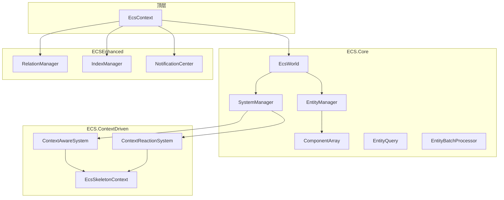
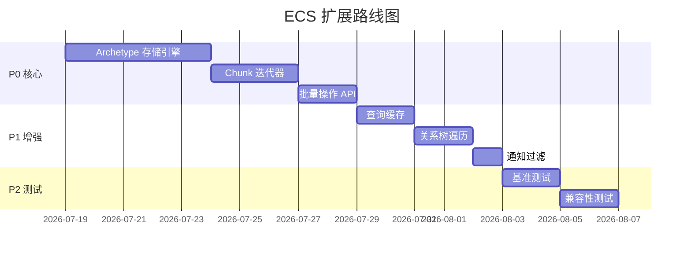

# ECS 框架扩展与优化方案

> **版本：** v1.0
> **更新日期：** 2026-07-18
> **基础文件：** `BasicMethod/ECS/ECSFrame.cs`（1926 行）
> **配套文档：** [`ECS_Based_Control_Refactoring.md`](ECS_Based_Control_Refactoring.md)（控件重构）

---

## 目录

- [ECS 框架扩展与优化方案](#ecs-框架扩展与优化方案)
  - [目录](#目录)
  - [1. 现有能力评估](#1-现有能力评估)
    - [1.1 模块总览](#11-模块总览)
    - [1.2 核心架构图](#12-核心架构图)
    - [1.3 优势分析](#13-优势分析)
    - [1.4 不足分析](#14-不足分析)
  - [2. Archetype 存储引擎](#2-archetype-存储引擎)
    - [2.1 为什么需要 Archetype](#21-为什么需要-archetype)
    - [2.2 设计对比](#22-设计对比)
    - [2.3 Archetype 存储结构](#23-archetype-存储结构)
    - [2.4 ArchetypeManager 设计](#24-archetypemanager-设计)
    - [2.5 与现有 ComponentArray 的兼容](#25-与现有-componentarray-的兼容)
  - [3. Chunk 迭代器](#3-chunk-迭代器)
    - [3.1 设计目标](#31-设计目标)
    - [3.2 Chunk 结构](#32-chunk-结构)
    - [3.3 迭代器 API](#33-迭代器-api)
    - [3.4 使用示例](#34-使用示例)
  - [4. 批量操作优化](#4-批量操作优化)
    - [4.1 批量 AddComponent](#41-批量-addcomponent)
    - [4.2 批量 RemoveComponent](#42-批量-removecomponent)
    - [4.3 批量 SetComponent](#43-批量-setcomponent)
    - [4.4 事务性批量操作](#44-事务性批量操作)
  - [5. 查询系统增强](#5-查询系统增强)
    - [5.1 当前 EntityQuery 的局限](#51-当前-entityquery-的局限)
    - [5.2 增强查询 API](#52-增强查询-api)
    - [5.3 缓存查询结果](#53-缓存查询结果)
  - [6. 关系系统增强](#6-关系系统增强)
    - [6.1 当前 RelationManager 的局限](#61-当前-relationmanager-的局限)
    - [6.2 树遍历 API](#62-树遍历-api)
    - [6.3 关系缓存优化](#63-关系缓存优化)
  - [7. 通知系统增强](#7-通知系统增强)
    - [7.1 当前 NotificationCenter 的局限](#71-当前-notificationcenter-的局限)
    - [7.2 事件过滤](#72-事件过滤)
    - [7.3 批量通知](#73-批量通知)
  - [8. 性能基准与测试](#8-性能基准与测试)
    - [8.1 关键性能指标](#81-关键性能指标)
    - [8.2 基准测试用例](#82-基准测试用例)
  - [9. 扩展优先级与路线图](#9-扩展优先级与路线图)

---

## 1. 现有能力评估

### 1.1 模块总览

| 模块 | 命名空间 | 行数 | 核心类 | 成熟度 |
|------|----------|------|--------|--------|
| **ECS.Core** | `ECS.Core` | ~600 | Entity, ComponentArray\<T\>, EntityManager, EntityQuery, SystemBase, SystemManager, EcsWorld | ✅ 完整 |
| **ECS.ContextDriven** | `ECS.ContextDriven` | ~310 | EcsSkeletonContext, ContextAwareSystem, ContextReactionSystem, 数据读写骨架 | ✅ 完整 |
| **ECSEnhanced** | `ECSEnhanced` | ~690 | RelationIndex, RelationManager, IndexManager, NotificationCenter | ✅ 完整 |
| **CommandSystem** | `ECS.Core` | ~25 | CommandBase\<TResult\>, CommandSystem\<TCommand, TResult\> | ⚠️ 基础 |
| **EcsContext** | `ECS.Core` | ~95 | EcsContext（World + Relations + Indexes + Notifications + 后台更新） | ✅ 完整 |

### 1.2 核心架构图



### 1.3 优势分析

| 优势 | 说明 |
|------|------|
| **完整的基础设施** | EntityManager、System、Query 一应俱全 |
| **关系系统** | RelationManager 支持泛型枚举关系，双向索引 |
| **索引系统** | IndexManager 支持唯一/非唯一索引，自动维护 |
| **通知系统** | NotificationCenter 支持 Component 增删订阅，三种执行上下文 |
| **Context 集成** | 与 SkeletonContext 深度集成，支持数据驱动 |
| **线程安全** | 全局读写锁 + 关系锁 + 索引锁，分层锁定 |
| **后台更新** | EcsContext 支持后台线程自动更新 |

### 1.4 不足分析

| 不足 | 影响 | 严重程度 |
|------|------|----------|
| **稀疏数组存储** | ComponentArray\<T\> 为每个 Entity 分配一个槽位，大量 Entity 时内存浪费 | 🔴 高 |
| **缺少 Archetype** | 相同 Component 组合的 Entity 分散存储，缓存不友好 | 🔴 高 |
| **缺少 Chunk 迭代** | System.Update 中逐个 Entity 操作，无法批量处理 | 🔴 高 |
| **查询无缓存** | 每次 GetEntities 都遍历所有 Entity | 🟡 中 |
| **批量操作缺失** | 批量 Add/Remove/Set 需要多次调用，锁竞争严重 | 🟡 中 |
| **树遍历缺失** | RelationManager 不支持树结构遍历 | 🟢 低 |
| **通知无过滤** | NotificationCenter 无法按条件过滤事件 | 🟢 低 |

---

## 2. Archetype 存储引擎

### 2.1 为什么需要 Archetype

当前 `ComponentArray<T>` 是**稀疏数组**存储：

```
Entity ID:  0   1   2   3   4   5   6   7   8   9
Component:  [A] [ ] [A] [B] [A] [ ] [B] [A] [ ] [B]
             ↑   ↑   ↑   ↑   ↑   ↑   ↑   ↑   ↑   ↑
             每个 Entity 一个槽位，空槽位浪费内存
```

Archetype 存储将**相同 Component 组合**的 Entity 放在连续内存中：

```
Archetype[A]:     Entity 0, 2, 4, 7  → 连续存储
Archetype[A,B]:   Entity 3, 6, 9      → 连续存储
Archetype[]:      Entity 1, 5, 8      → 连续存储
```

### 2.2 设计对比

| 维度 | 当前（稀疏数组） | Archetype |
|------|-----------------|-----------|
| 内存布局 | 每个 Component 一个数组，按 Entity ID 索引 | 按 Component 组合分组，每组连续存储 |
| 迭代性能 | 遍历所有 Entity，跳过空槽位 | 直接遍历连续内存块 |
| 缓存友好性 | 差（跳跃访问） | 好（顺序访问） |
| 添加 Component | O(1) 设置数组 | O(n) 迁移到新 Archetype |
| 删除 Component | O(1) 清除数组 | O(n) 迁移到新 Archetype |
| 实现复杂度 | 简单 | 中等 |

### 2.3 Archetype 存储结构

```csharp
// Component 组合的唯一标识
internal readonly struct ArchetypeSignature : IEquatable<ArchetypeSignature>
{
    public readonly BitArray Components;  // 位图标识哪些 Component 存在
    public readonly int HashCode;

    public ArchetypeSignature(Type[] componentTypes)
    {
        Components = new BitArray(64);  // 支持最多 64 种 Component
        foreach (var t in componentTypes)
            Components.Set(ComponentTypeId.GetId(t), true);
        HashCode = ComputeHash(Components);
    }
}

// Archetype = 一组相同 Component 组合的 Entity
internal sealed class Archetype
{
    public ArchetypeSignature Signature { get; }
    public int EntityCount => _entities.Count;

    // Chunk 列表，每个 Chunk 是连续内存块
    private readonly List<Chunk> _chunks = new();

    // Entity → Chunk 映射
    private readonly Dictionary<Entity, (Chunk Chunk, int Index)> _entityMap = new();

    public void AddEntity(Entity entity, IComponent[] components);
    public void RemoveEntity(Entity entity);
    public void MoveEntity(Entity entity, Archetype targetArchetype);
    public Chunk GetChunk(int index);
}

// Chunk = 连续内存块
internal sealed class Chunk
{
    public const int Capacity = 64;  // 每个 Chunk 最多 64 个 Entity

    public int Count { get; private set; }

    // 每个 Component 一个数组，连续存储
    private readonly Dictionary<int, Array> _componentColumns = new();

    public void AddEntity(Entity entity, IComponent[] components);
    public void RemoveEntity(int index);
    public T GetComponent<T>(int index) where T : struct, IComponent;
    public void SetComponent<T>(int index, T component) where T : struct, IComponent;
    public Span<T> GetComponentSpan<T>() where T : struct, IComponent;
}
```

### 2.4 ArchetypeManager 设计

```csharp
public sealed class ArchetypeManager
{
    private readonly Dictionary<ArchetypeSignature, Archetype> _archetypes = new();
    private readonly Dictionary<Entity, Archetype> _entityArchetype = new();

    // 创建 Entity（空 Archetype）
    public Entity CreateEntity();

    // 销毁 Entity
    public void DestroyEntity(Entity entity);

    // 添加 Component（可能触发 Archetype 迁移）
    public void AddComponent<T>(Entity entity, T component) where T : struct, IComponent;

    // 移除 Component（可能触发 Archetype 迁移）
    public void RemoveComponent<T>(Entity entity) where T : struct, IComponent;

    // 查询所有匹配 Archetype 的 Chunk
    public IEnumerable<Chunk> QueryChunks(params Type[] componentTypes);

    // 获取 Entity 所在 Archetype
    public Archetype GetArchetype(Entity entity);
}
```

### 2.5 与现有 ComponentArray 的兼容

为了平滑迁移，建议采用**双轨制**：

```
阶段 1：ArchetypeManager 作为可选存储后端
  - 新代码使用 ArchetypeManager
  - 旧代码继续使用 ComponentArray
  - 通过适配器桥接

阶段 2：EntityManager 内部切换
  - EntityManager 内部使用 ArchetypeManager
  - ComponentArray API 保持不变（内部委托给 ArchetypeManager）

阶段 3：废弃 ComponentArray
  - 移除 ComponentArray 实现
  - 全部使用 Archetype 存储
```

---

## 3. Chunk 迭代器

### 3.1 设计目标

- 允许 System 直接遍历连续内存块
- 减少虚函数调用和边界检查
- 支持 SIMD 优化

### 3.2 Chunk 结构

```csharp
public ref struct ChunkAccessor<T> where T : struct, IComponent
{
    private readonly Span<T> _components;
    private readonly Span<Entity> _entities;

    public int Length => _components.Length;
    public ref T this[int index] => ref _components[index];
    public Entity GetEntity(int index) => _entities[index];
}

public ref struct ArchetypeQueryResult
{
    private readonly List<Chunk> _chunks;
    private int _currentChunk;

    // 获取下一个 Chunk
    public bool MoveNext(out ChunkAccessor accessor);

    // 重置
    public void Reset();
}
```

### 3.3 迭代器 API

```csharp
// 在 System 中使用
public class RenderSystem : SystemBase
{
    public override void Update(float deltaTime)
    {
        // 方式 1：Chunk 迭代（高性能）
        foreach (var chunk in EntityManager.QueryChunks(typeof(Transform), typeof(Visual)))
        {
            var transforms = chunk.GetSpan<Transform>();
            var visuals = chunk.GetSpan<Visual>();
            for (int i = 0; i < chunk.Count; i++)
            {
                ref var t = ref transforms[i];
                ref var v = ref visuals[i];
                // 处理...
            }
        }

        // 方式 2：Entity 迭代（兼容）
        foreach (var entity in EntityManager.GetEntities<Transform, Visual>())
        {
            var t = EntityManager.GetComponent<Transform>(entity);
            var v = EntityManager.GetComponent<Visual>(entity);
            // 处理...
        }
    }
}
```

### 3.4 使用示例

```csharp
// 批量更新 Transform
EntityBatchProcessor.ProcessChunked<Transform>(
    EntityManager,
    (Span<Transform> transforms) =>
    {
        for (int i = 0; i < transforms.Length; i++)
            transforms[i].X += 1.0f;
    }
);
```

---

## 4. 批量操作优化

### 4.1 批量 AddComponent

```csharp
public static class BatchOperations
{
    // 批量添加相同 Component
    public static void AddComponent<T>(
        EntityManager em,
        IEnumerable<Entity> entities,
        Func<Entity, T> componentFactory
    ) where T : struct, IComponent;

    // 批量添加多个 Component
    public static void AddComponents(
        EntityManager em,
        IEnumerable<Entity> entities,
        IEnumerable<(Type Type, IComponent Component)> components
    );
}
```

### 4.2 批量 RemoveComponent

```csharp
public static class BatchOperations
{
    // 批量移除 Component
    public static void RemoveComponent<T>(
        EntityManager em,
        IEnumerable<Entity> entities
    ) where T : struct, IComponent;

    // 批量移除多个 Component
    public static void RemoveComponents(
        EntityManager em,
        IEnumerable<Entity> entities,
        params Type[] componentTypes
    );
}
```

### 4.3 批量 SetComponent

```csharp
public static class BatchOperations
{
    // 批量设置 Component
    public static void SetComponent<T>(
        EntityManager em,
        IEnumerable<Entity> entities,
        T component
    ) where T : struct, IComponent;

    // 批量更新（按 Entity 不同值）
    public static void SetComponents<T>(
        EntityManager em,
        IDictionary<Entity, T> componentMap
    ) where T : struct, IComponent;
}
```

### 4.4 事务性批量操作

```csharp
// 批量操作事务
public sealed class BatchTransaction : IDisposable
{
    // 在事务中执行批量操作，最后一次性提交
    public void AddComponent<T>(Entity entity, T component);
    public void RemoveComponent<T>(Entity entity);
    public void SetComponent<T>(Entity entity, T component);

    // 提交事务
    public void Commit();

    // 回滚事务
    public void Rollback();
}
```

---

## 5. 查询系统增强

### 5.1 当前 EntityQuery 的局限

```csharp
// 当前：每次查询都遍历所有 Entity
var query = new EntityQuery(em)
    .WithComponent<Transform>()
    .WithoutComponent<Visual>();
var result = query.Execute();  // 每次遍历
```

### 5.2 增强查询 API

```csharp
// 增强：支持缓存、排序、分页
public class EnhancedQuery
{
    // 缓存查询结果（在 Component 变化时自动失效）
    public EnhancedQuery Cached(TimeSpan? ttl = null);

    // 排序
    public EnhancedQuery OrderBy<T>(Func<T, IComparable> keySelector);

    // 分页
    public EnhancedQuery Skip(int count);
    public EnhancedQuery Take(int count);

    // 过滤
    public EnhancedQuery Where(Func<Entity, bool> predicate);

    // 执行
    public IEnumerable<Entity> Execute();
    public int Count();
    public bool Any();
    public Entity First();
    public Entity Single();
}
```

### 5.3 缓存查询结果

```csharp
// 查询缓存
internal sealed class QueryCache
{
    private readonly Dictionary<int, CachedResult> _cache = new();
    private readonly HashSet<Type> _dependencies = new();

    // 注册查询依赖的 Component 类型
    public void AddDependency(Type componentType);

    // 当依赖的 Component 变化时，使缓存失效
    public void Invalidate(Type changedComponentType);

    // 获取/设置缓存
    public bool TryGet(int queryHash, out IEnumerable<Entity> result);
    public void Set(int queryHash, IEnumerable<Entity> result);
}
```

---

## 6. 关系系统增强

### 6.1 当前 RelationManager 的局限

```csharp
// 当前：只支持按关系类型查询
var targets = relations.GetRelatedTargets(entity, RelationType.ParentOf);
```

### 6.2 树遍历 API

```csharp
// 树遍历扩展
public static class RelationTreeExtensions
{
    // 前序遍历
    public static IEnumerable<Entity> WalkTreePreOrder(
        this RelationManager rm,
        Entity root,
        Enum relationType
    );

    // 后序遍历
    public static IEnumerable<Entity> WalkTreePostOrder(
        this RelationManager rm,
        Entity root,
        Enum relationType
    );

    // 广度优先遍历
    public static IEnumerable<Entity> WalkTreeBFS(
        this RelationManager rm,
        Entity root,
        Enum relationType
    );

    // 获取所有祖先
    public static IEnumerable<Entity> GetAncestors(
        this RelationManager rm,
        Entity entity,
        Enum relationType
    );

    // 获取所有后代
    public static IEnumerable<Entity> GetDescendants(
        this RelationManager rm,
        Entity entity,
        Enum relationType
    );

    // 获取深度
    public static int GetDepth(
        this RelationManager rm,
        Entity entity,
        Enum relationType
    );

    // 查找满足条件的祖先
    public static Entity? FindAncestor(
        this RelationManager rm,
        Entity entity,
        Enum relationType,
        Func<Entity, bool> predicate
    );
}
```

### 6.3 关系缓存优化

```csharp
// 关系缓存
internal sealed class RelationCache
{
    // 缓存子树
    public void CacheSubtree(Entity root, Enum relationType);
    public void Invalidate(Entity entity);

    // 快速查询
    public bool IsCached(Entity entity);
    public IEnumerable<Entity> GetCachedDescendants(Entity entity);
}
```

---

## 7. 通知系统增强

### 7.1 当前 NotificationCenter 的局限

```csharp
// 当前：只能按 Component 类型订阅
nc.SubscribeAdded<Transform>((entity, component) => { ... });
```

### 7.2 事件过滤

```csharp
// 增强：支持条件过滤
public class FilteredSubscription<T> where T : struct, IComponent
{
    // 按 Entity 条件过滤
    public FilteredSubscription<T> Where(Func<Entity, bool> predicate);

    // 按 Component 值过滤
    public FilteredSubscription<T> WhereComponent(Func<T, bool> predicate);

    // 按 Entity 的另一个 Component 过滤
    public FilteredSubscription<T> WhereHas<T2>() where T2 : struct, IComponent;

    // 注册
    public IDisposable Subscribe(Action<Entity, T> handler);
}
```

### 7.3 批量通知

```csharp
// 批量通知模式
public class BatchedNotificationCenter
{
    // 开启批量模式（事件暂存）
    public IDisposable BeginBatch();

    // 批量提交
    public void EndBatch();

    // 内部：暂存的事件
    private readonly ConcurrentQueue<NotificationEvent> _pending = new();
}
```

---

## 8. 性能基准与测试

### 8.1 关键性能指标

| 指标 | 当前 | 目标 | 测试方法 |
|------|------|------|----------|
| 10K Entity 创建 | ~5ms | ~2ms | CreateEntity x 10000 |
| 10K Component 添加 | ~8ms | ~3ms | AddComponent x 10000 |
| 10K Entity 查询（单 Component） | ~3ms | ~0.5ms | GetEntities\<T\> |
| 10K Entity 查询（双 Component） | ~5ms | ~1ms | GetEntities\<T1, T2\> |
| 10K Entity System 更新 | ~10ms | ~2ms | System.Update |
| 100K Entity 内存占用 | ~50MB | ~10MB | Archetype 存储 |

### 8.2 基准测试用例

```csharp
[Benchmark]
public void ArchetypeVsSparseArray_Create()
{
    // 创建 10000 个 Entity，每个添加 3 个 Component
}

[Benchmark]
public void ArchetypeVsSparseArray_Query()
{
    // 查询所有包含 Transform + Visual 的 Entity
}

[Benchmark]
public void ArchetypeVsSparseArray_Update()
{
    // 更新所有 Entity 的 Transform
}

[Benchmark]
public void ChunkVsEntityIteration()
{
    // Chunk 迭代 vs Entity 迭代
}
```

---

## 9. 扩展优先级与路线图



| 优先级 | 功能 | 预计工作量 | 依赖 |
|--------|------|-----------|------|
| **P0** | Archetype 存储引擎 | 5 天 | 无 |
| **P0** | Chunk 迭代器 | 3 天 | Archetype |
| **P0** | 批量操作 API | 2 天 | Archetype |
| **P1** | 查询缓存 | 2 天 | Archetype |
| **P1** | 关系树遍历 | 2 天 | 无 |
| **P1** | 通知过滤 | 1 天 | 无 |
| **P2** | 基准测试 | 2 天 | P0 完成 |
| **P2** | 兼容性测试 | 2 天 | P0 完成 |
