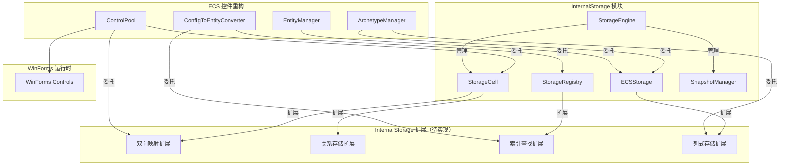

# ECS 控件重构的存储扩展方案

> **版本：** v1.0
> **更新日期：** 2026-07-19
> **维护者：** WorkFlowPrj Team
>
> **核心模块：** `CsharpPrj/Modules/InternalStorage`（通用运行时内存存储管理框架）
>
> **配套文档：** [`ECS_Based_Control_Refactoring.md`](ECS_Based_Control_Refactoring.md)（ECS 控件重构方案）

---

## 目录

- [ECS 控件重构的存储扩展方案](#ecs-控件重构的存储扩展方案)
  - [目录](#目录)
  - [1. 第一部分：模块介绍与方案](#1-第一部分模块介绍与方案)
  - [2. 第二部分：核心逻辑与接口](#2-第二部分核心逻辑与接口)
  - [3. 第三部分：实施步骤](#3-第三部分实施步骤)
  - [总结](#总结)

---

# 1. 第一部分：模块介绍与方案

---

## 1.1 InternalStorage 模块定位

`InternalStorage` 是 WorkFlowPrj 的**通用运行时内存存储管理框架**，位于 `CsharpPrj/Modules/InternalStorage/`，依赖 `TConfig` 层。

其设计目标是**覆盖并统一现有 4 套独立的内存存储体系**，为上层模块（包括 ECS 框架）提供统一的存储抽象。

在 ECS 控件重构方案中，`InternalStorage` 承担以下角色：

| 角色 | 说明 |
|------|------|
| **ECS World 的底层存储** | Entity 映射、Archetype 管理、Chunk 列式存储委托给 `IECSStorage` |
| **ControlPool 的存储后端** | Entity↔Control 双向映射从 `Dictionary` 迁移到 `IStorageCell` |
| **ConfigToEntityConverter 的注册中心** | 名称→Entity 映射从 `Dictionary` 迁移到 `IStorageRegistry` |
| **会话管理器** | 每个 View/Container 一个会话，生命周期由 `IStorageEngine` 管理 |
| **快照引擎** | 控件状态的保存/恢复/差异计算由 `ISnapshotManager` 提供 |

---

## 1.2 核心接口与能力矩阵

### 1.2.1 接口总览

```
IStorageEngine（存储引擎）
  ├── 生命周期管理（Created → Running → Paused → Disposed）
  ├── 会话管理（CreateSession / GetSession / DisposeSession）
  └── 快照管理（CreateSnapshot / RestoreSnapshot）
        │
        ├── IStorageCell（存储单元）
        │     ├── 三层键值存储（Config / Session / Transient）
        │     ├── 级联查找（子单元 → 父单元）
        │     ├── 集合操作（SetAdd / SetRemove / SetGetAll）
        │     ├── 数组/列式存储（SetArray / GetArray / GetArrayAt）
        │     └── 数据变更通知（DataChanged 事件）
        │
        ├── IStorageRegistry（存储注册中心）
        │     ├── 类型安全注册（Register<T> / Resolve<T>）
        │     ├── JSON 批量注册（RegisterFromJsonElement）
        │     └── ID 生成器（NextId / CurrentId / ResetId）
        │
        ├── IECSStorage（ECS 专用存储）
        │     ├── Entity 映射（EntityId → ArchetypeId）
        │     ├── Archetype 管理（SignatureHash → ArchetypeData）
        │     ├── Entity ID 管理（FreeEntityIds / EntityVersion）
        │     └── Chunk 列式存储（ChunkColumn / ChunkEntityIds）
        │
        └── ISnapshotManager（快照管理器）
              ├── 创建快照（CreateSnapshot）
              ├── 恢复快照（RestoreSnapshot）
              └── 差异计算（CalculateDiff）
```

### 1.2.2 能力矩阵

| 能力 | 接口 | 控件重构中的应用 | 状态 |
|------|------|-----------------|------|
| **键值存储** | `IStorageCell.Set<T>/Get<T>` | 控件属性、运行时状态存储 | ✅ 已实现 |
| **三层分层** | `StorageLayer` 枚举 | Config（配置）/ Session（运行时）/ Transient（临时） | ✅ 已实现 |
| **级联查找** | `IStorageCell.Parent` | 子控件继承父容器的配置数据 | ✅ 已实现 |
| **集合操作** | `IStorageCell.SetAdd/SetRemove/SetGetAll` | 事件绑定集合、子控件列表 | ✅ 已实现 |
| **列式存储** | `IStorageCell.SetArray/GetArray` | Chunk 的 Component 列存储 | ✅ 已实现 |
| **数据变更通知** | `IStorageCell.DataChanged` | 控件属性变化监听 | ✅ 已实现 |
| **类型安全注册** | `IStorageRegistry.Register<T>/Resolve<T>` | 函数注册、类型映射 | ✅ 已实现 |
| **ID 生成器** | `IStorageRegistry.NextId` | Entity ID 生成 | ✅ 已实现 |
| **ECS 专用存储** | `IECSStorage` | Entity→Archetype、Chunk 列存储 | ✅ 已实现 |
| **会话管理** | `IStorageEngine.CreateSession/DisposeSession` | 视图/容器生命周期 | ✅ 已实现 |
| **快照** | `ISnapshotManager` | 控件状态保存/恢复 | ✅ 已实现 |
| **双向映射** | 需扩展（§2.1） | Entity↔Control 双向查找 | 📝 待扩展 |
| **关系存储** | 需扩展（§2.2） | 父子关系、事件源→目标 | 📝 待扩展 |
| **索引查找** | 需扩展（§2.3） | 按 name 查找 Entity | 📝 待扩展 |
| **强类型列式存储** | 需扩展（§2.4） | Component 序列化/反序列化 | 📝 待扩展 |

---

## 1.3 三层存储模型

`IStorageCell` 提供三层独立的 `ConcurrentDictionary` 存储，互不干扰：

```
StorageCell
  ├── Config 层（_configStore）
  │     ├── 生命周期：引擎生命周期
  │     ├── 快照行为：Preserve（保留，不受快照影响）
  │     ├── 用途：JSON 配置、样式定义、函数注册、WorkflowDefinitions
  │     └── 示例：styleDefinitions、functionRegistry、workflowConfigs
  │
  ├── Session 层（_sessionStore）
  │     ├── 生命周期：会话生命周期
  │     ├── 快照行为：Snapshot（参与快照）
  │     ├── 用途：控件 Entity、运行时状态、事件绑定
  │     └── 示例：entityArchetypeMap、controlState、eventBindings
  │
  └── Transient 层（_transientStore）
        ├── 生命周期：瞬态（随时可清理）
        ├── 快照行为：Exclude（不参与快照）
        ├── 用途：临时计算结果、布局缓存、中间数据
        └── 示例：computedLayout、tempQueryResults
```

**跨层查找顺序：** Config → Session → Transient（不指定层级时）
**级联查找：** 当前单元未找到 → 父单元（按相同规则查找）

---

## 1.4 当前问题分析

### 1.4.1 问题 1：存储分散

ECS 控件重构涉及多个数据容器（ControlPool 的 Dictionary、ConfigToEntityConverter 的 Dictionary、ECS World 的 37 个数据容器），各自独立管理存储，缺乏统一抽象。

### 1.4.2 问题 2：能力缺失

| 缺失能力 | 影响 |
|---------|------|
| 双向映射 | Entity↔Control 查找需要遍历 O(n) |
| 关系存储 | 父子关系、事件源→目标无统一管理 |
| 索引查找 | 仅支持按 name 查找，不支持 type/tag 等 |
| 强类型列式存储 | Component 存储使用 Array 类型，无泛型支持 |
| 会话管理 | 视图间数据无隔离，靠命名约定 |
| 快照支持 | 无状态保存/恢复能力 |

### 1.4.3 问题汇总

| 问题 | 表现 | 根因 |
|------|------|------|
| 存储分散 | 多个 Dictionary 各自管理 | 缺乏统一存储抽象 |
| 查找效率低 | Entity↔Control 双向查找 O(n) | 无双向映射机制 |
| 关系管理缺失 | 父子关系靠手动维护 | 无关系存储抽象 |
| 查询能力有限 | 仅支持 name 查找 | 无通用索引机制 |
| 无会话隔离 | 视图间数据互相干扰 | 无会话管理 |
| 无快照支持 | 无法保存/恢复状态 | 无快照引擎 |

---

## 1.5 文件目录

### 1.5.1 InternalStorage 现有文件

| 文件路径 | 内容 | 说明 |
|---------|------|------|
| `CsharpPrj/Modules/InternalStorage/InternalStorage.csproj` | 项目文件 | 依赖 TConfig |
| `CsharpPrj/Modules/InternalStorage/Abstractions/StorageLayer.cs` | 层级枚举 using 别名 | 指向 TConfig.StorageLayer |
| `CsharpPrj/Modules/InternalStorage/Core/StorageEngine.cs` | 存储引擎实现 | 生命周期 + 会话管理 |
| `CsharpPrj/Modules/InternalStorage/Core/StorageCell.cs` | 存储单元实现 | 三层键值存储 |
| `CsharpPrj/Modules/InternalStorage/Core/StorageRegistry.cs` | 存储注册中心实现 | 类型安全注册 + ID 生成 |
| `CsharpPrj/Modules/InternalStorage/Core/ECSStorage.cs` | ECS 专用存储实现 | Entity/Archetype/Chunk 存储 |
| `CsharpPrj/Modules/InternalStorage/Core/SnapshotManager.cs` | 快照管理器实现 | 创建/恢复/差异计算 |
| `CsharpPrj/Modules/InternalStorage/Core/LayeredSnapshot.cs` | 分层快照实现 | 不可变快照 |
| `CsharpPrj/Modules/InternalStorage/Extensions/StorageCellExtensions.cs` | 存储单元扩展 | 便捷方法 + 批量操作 |

### 1.5.2 新增扩展文件

| 文件路径 | 内容 | 说明 |
|---------|------|------|
| `CsharpPrj/Modules/InternalStorage/Extensions/StorageBidirectionalMap.cs` | 双向映射扩展 | Entity↔Control 双向查找 |
| `CsharpPrj/Modules/InternalStorage/Extensions/StorageRelationExtensions.cs` | 关系存储扩展 | 父子关系、事件源→目标 |
| `CsharpPrj/Modules/InternalStorage/Extensions/StorageIndexExtensions.cs` | 索引查找扩展 | 按属性查找 Entity |
| `CsharpPrj/Modules/InternalStorage/Extensions/StorageColumnExtensions.cs` | 列式存储扩展 | 强类型 Component 列存储 |

---

# 2. 第二部分：核心逻辑与接口

---

## 2.1 双向映射查询（Entity↔Control）

### 2.1.1 设计目标

`ControlPool` 需要以下双向查找能力：

| 操作 | 当前实现 | 目标 |
|------|---------|------|
| Entity → Control | `Dictionary<Entity, Control>` | `IStorageCell` Session 层 |
| Name → Control | `Dictionary<string, Control>` | `IStorageCell` Session 层 |
| Name → Entity | 遍历 `_entityToControl` | `IStorageRegistry` 索引 |
| Control → Entity | 不支持 | 新增反向查找 |

### 2.1.2 接口定义

```csharp
// 新增文件：CsharpPrj/Modules/InternalStorage/Extensions/StorageBidirectionalMap.cs

namespace Modules.InternalStorage.Extensions;

/// <summary>
/// 双向映射扩展
/// <para>在 IStorageCell 基础上实现 Entity↔Control 双向映射。</para>
/// </summary>
public static class StorageBidirectionalExtensions
{
    // ========== 正向映射（TKey → TValue） ==========

    /// <summary>
    /// 注册正向映射
    /// <para>存储键值对到 Session 层，同时维护反向索引。</para>
    /// </summary>
    public static void MapForward<TKey, TValue>(
        this IStorageCell cell,
        string mapName,
        TKey key,
        TValue value)
        where TKey : notnull
        where TValue : notnull;

    /// <summary>
    /// 通过正向键获取值
    /// </summary>
    public static TValue? GetForward<TKey, TValue>(
        this IStorageCell cell,
        string mapName,
        TKey key)
        where TKey : notnull
        where TValue : notnull;

    // ========== 反向映射（TValue → TKey） ==========

    /// <summary>
    /// 通过反向键（值）获取正向键
    /// </summary>
    public static TKey? GetBackward<TKey, TValue>(
        this IStorageCell cell,
        string mapName,
        TValue value)
        where TKey : notnull
        where TValue : notnull;

    // ========== 移除 ==========

    /// <summary>
    /// 移除映射（同时移除正向和反向）
    /// </summary>
    public static void Unmap<TKey, TValue>(
        this IStorageCell cell,
        string mapName,
        TKey key)
        where TKey : notnull
        where TValue : notnull;
}
```

### 2.1.3 使用示例

```csharp
// ControlPool 内部使用
public class ControlPool
{
    private readonly IStorageCell _cell;
    private const string EntityToControlMap = "control_pool:entity_to_control";
    private const string NameToControlMap = "control_pool:name_to_control";

    public void Register(Entity entity, Control control)
    {
        // Entity → Control 映射
        _cell.MapForward<int, IntPtr>(EntityToControlMap, entity.Id, control.Handle);
        // Name → Control 映射
        _cell.MapForward<string, IntPtr>(NameToControlMap, control.Name, control.Handle);
    }

    public Control GetControl(Entity entity)
    {
        var handle = _cell.GetForward<int, IntPtr>(EntityToControlMap, entity.Id);
        return Control.FromHandle(handle);
    }

    public Control FindControl(string name)
    {
        var handle = _cell.GetForward<string, IntPtr>(NameToControlMap, name);
        return handle != IntPtr.Zero ? Control.FromHandle(handle) : null;
    }
}
```

---

## 2.2 关系存储与查询

### 2.2.1 设计目标

ECS 控件重构中需要管理以下关系：

| 关系类型 | 示例 | 用途 |
|---------|------|------|
| 父子关系 | GroupBox → Button | 控件树层级 |
| 事件源→目标 | Button → TextBox | 事件输出目标 |
| 容器→子控件 | Panel → Label | 容器包含关系 |
| 样式引用 | Button → StyleDefinition | 样式继承 |

### 2.2.2 接口定义

```csharp
// 新增文件：CsharpPrj/Modules/InternalStorage/Extensions/StorageRelationExtensions.cs

namespace Modules.InternalStorage.Extensions;

/// <summary>
/// 关系存储扩展
/// <para>在 IStorageCell 的集合操作基础上实现关系存储和查询。</para>
/// </summary>
public static class StorageRelationExtensions
{
    // ========== 关系操作 ==========

    /// <summary>
    /// 添加关系
    /// <para>存储格式：relations:{type}:{from} → Set[{to}]</para>
    /// </summary>
    public static void AddRelation(
        this IStorageCell cell,
        string from,
        string to,
        string relationType,
        StorageLayer layer = StorageLayer.Session);

    /// <summary>
    /// 移除关系
    /// </summary>
    public static void RemoveRelation(
        this IStorageCell cell,
        string from,
        string to,
        string relationType,
        StorageLayer layer = StorageLayer.Session);

    /// <summary>
    /// 检查关系是否存在
    /// </summary>
    public static bool HasRelation(
        this IStorageCell cell,
        string from,
        string to,
        string relationType,
        StorageLayer layer = StorageLayer.Session);

    // ========== 正向查询 ==========

    /// <summary>
    /// 获取指定实体的所有指定类型的关系目标
    /// <para>例如：GetRelated(cell, "groupBox1", "contains") → ["button1", "label1"]</para>
    /// </summary>
    public static IEnumerable<string> GetRelated(
        this IStorageCell cell,
        string from,
        string relationType,
        StorageLayer layer = StorageLayer.Session);

    // ========== 反向查询 ==========

    /// <summary>
    /// 获取所有指向指定实体的指定类型的关系源
    /// <para>例如：GetRelatedTo(cell, "button1", "contains") → ["groupBox1"]</para>
    /// </summary>
    public static IEnumerable<string> GetRelatedTo(
        this IStorageCell cell,
        string to,
        string relationType,
        StorageLayer layer = StorageLayer.Session);

    // ========== 批量查询 ==========

    /// <summary>
    /// 获取指定实体的所有关系（按类型分组）
    /// </summary>
    public static IReadOnlyDictionary<string, IEnumerable<string>> GetAllRelations(
        this IStorageCell cell,
        string from,
        StorageLayer layer = StorageLayer.Session);
}
```

### 2.2.3 使用示例

```csharp
// 管理控件父子关系
var cell = storageEngine.GetSession("mainView");

// 添加父子关系
cell.AddRelation("inputGroupBox", "valueATextBox", "contains");
cell.AddRelation("inputGroupBox", "valueBTextBox", "contains");

// 查询子控件
var children = cell.GetRelated("inputGroupBox", "contains");
// → ["valueATextBox", "valueBTextBox"]

// 反向查询：查找包含 valueATextBox 的父容器
var parents = cell.GetRelatedTo("valueATextBox", "contains");
// → ["inputGroupBox"]

// 管理事件源→目标关系
cell.AddRelation("addButton", "resultTextBox", "event_output");

// 查询事件输出目标
var outputs = cell.GetRelated("addButton", "event_output");
// → ["resultTextBox"]
```

---

## 2.3 索引查找

### 2.3.1 设计目标

ECS 控件重构中需要按控件属性快速查找 Entity：

| 查找方式 | 当前实现 | 目标 |
|---------|---------|------|
| 按 name 查找 | `_entityNameMap[name]` | `IStorageRegistry` 索引 |
| 按 type 查找 | 不支持 | 新增索引 |
| 按 tag 查找 | 不支持 | 新增索引 |
| 自定义属性查找 | 不支持 | 通用索引 |

### 2.3.2 接口定义

```csharp
// 新增文件：CsharpPrj/Modules/InternalStorage/Extensions/StorageIndexExtensions.cs

namespace Modules.InternalStorage.Extensions;

/// <summary>
/// 索引查找扩展
/// <para>在 IStorageRegistry 基础上实现按属性快速查找 Entity。</para>
/// </summary>
public static class StorageIndexExtensions
{
    // ========== 索引注册 ==========

    /// <summary>
    /// 注册索引
    /// <para>keySelector 从 Entity 中提取索引键。</para>
    /// </summary>
    public static void RegisterIndex<TEntity>(
        this IStorageRegistry registry,
        string indexName,
        Func<TEntity, string> keySelector,
        bool unique = false);

    // ========== 索引维护 ==========

    /// <summary>
    /// 向索引中添加条目
    /// </summary>
    public static void IndexAdd<TEntity>(
        this IStorageRegistry registry,
        string indexName,
        TEntity entity,
        string entityId);

    /// <summary>
    /// 从索引中移除条目
    /// </summary>
    public static void IndexRemove(
        this IStorageRegistry registry,
        string indexName,
        string entityId);

    /// <summary>
    /// 更新索引中的条目
    /// </summary>
    public static void IndexUpdate<TEntity>(
        this IStorageRegistry registry,
        string indexName,
        TEntity entity,
        string entityId);

    // ========== 索引查询 ==========

    /// <summary>
    /// 通过索引键查找 Entity ID
    /// <para>unique=true 时返回单个 ID，unique=false 时返回第一个匹配。</para>
    /// </summary>
    public static string? FindByIndex(
        this IStorageRegistry registry,
        string indexName,
        string key);

    /// <summary>
    /// 通过索引键查找所有匹配的 Entity ID
    /// </summary>
    public static IEnumerable<string> FindAllByIndex(
        this IStorageRegistry registry,
        string indexName,
        string key);
}
```

### 2.3.3 使用示例

```csharp
// 在 ConfigToEntityConverter 中使用
public class ConfigToEntityConverter
{
    private readonly IStorageRegistry _registry;

    public ConfigToEntityConverter(IStorageRegistry registry)
    {
        _registry = registry;
        // 注册 name 索引（唯一）
        _registry.RegisterIndex<ControlTypeComponent>(
            "control:name",
            c => c.Name,
            unique: true);
    }

    private Entity ConvertControl(ControlConfig control, EntityManager em, Entity parent)
    {
        var entity = em.CreateEntity();
        // ... 添加 Component ...

        // 添加到索引
        _registry.IndexAdd("control:name",
            em.GetComponent<ControlTypeComponent>(entity),
            entity.Id.ToString());

        return entity;
    }

    // 通过 name 查找 Entity
    public Entity? FindByName(string name)
    {
        var idStr = _registry.FindByIndex("control:name", name);
        if (idStr != null && int.TryParse(idStr, out var id))
            return new Entity(id);
        return null;
    }
}
```

---

## 2.4 强类型 Component 列式存储

### 2.4.1 设计目标

ECS 的 Archetype 存储引擎使用 Chunk 列式存储，每个 Component 类型一个数组。当前 `IECSStorage` 使用 `Array` 类型存储，需要序列化/反序列化支持。

| 需求 | 当前 | 目标 |
|------|------|------|
| Component 存储 | `Array` 类型 | 支持泛型 `T[]` |
| 序列化 | 无 | 内置 `IMemoryPackable` 或 `MessagePack` 序列化 |
| 批量读写 | 单列操作 | 支持批量列操作 |
| 零拷贝 | 无 | 支持 `Span<T>` / `Memory<T>` 访问 |

### 2.4.2 接口定义

```csharp
// 新增文件：CsharpPrj/Modules/InternalStorage/Extensions/StorageColumnExtensions.cs

namespace Modules.InternalStorage.Extensions;

/// <summary>
/// 强类型列式存储扩展
/// <para>在 IECSStorage 基础上提供强类型 Component 列存储。</para>
/// </summary>
public static class StorageColumnExtensions
{
    // ========== 强类型列操作 ==========

    /// <summary>
    /// 设置强类型 Component 列
    /// </summary>
    public static void SetComponentColumn<TComponent>(
        this IECSStorage storage,
        int chunkId,
        int componentTypeId,
        TComponent[] column)
        where TComponent : struct;

    /// <summary>
    /// 获取强类型 Component 列
    /// </summary>
    public static TComponent[]? GetComponentColumn<TComponent>(
        this IECSStorage storage,
        int chunkId,
        int componentTypeId)
        where TComponent : struct;

    /// <summary>
    /// 获取 Component 列的 Span 视图（零拷贝）
    /// </summary>
    public static Span<TComponent> GetColumnSpan<TComponent>(
        this IECSStorage storage,
        int chunkId,
        int componentTypeId)
        where TComponent : struct;

    // ========== 批量列操作 ==========

    /// <summary>
    /// 批量设置多个 Component 列
    /// </summary>
    public static void SetComponentColumns(
        this IECSStorage storage,
        int chunkId,
        IDictionary<int, Array> columns);

    /// <summary>
    /// 批量获取多个 Component 列
    /// </summary>
    public static IDictionary<int, Array> GetComponentColumns(
        this IECSStorage storage,
        int chunkId,
        IEnumerable<int> componentTypeIds);
}
```

### 2.4.3 使用示例

```csharp
// 在 ArchetypeManager 中使用
public class ArchetypeManager
{
    private readonly IECSStorage _storage;

    // 存储 Chunk 的 ControlTypeComponent 列
    public void StoreControlTypeColumn(int chunkId, ControlTypeComponent[] components)
    {
        _storage.SetComponentColumn<ControlTypeComponent>(
            chunkId,
            ComponentTypeId<ControlTypeComponent>.Value,
            components);
    }

    // 读取 Chunk 的 ControlTypeComponent 列
    public Span<ControlTypeComponent> GetControlTypeColumn(int chunkId)
    {
        return _storage.GetColumnSpan<ControlTypeComponent>(
            chunkId,
            ComponentTypeId<ControlTypeComponent>.Value);
    }

    // 批量设置所有 Component 列
    public void StoreChunk(int chunkId, ChunkData data)
    {
        _storage.SetComponentColumns(chunkId, new Dictionary<int, Array>
        {
            [ComponentTypeId<ControlTypeComponent>.Value] = data.ControlTypes,
            [ComponentTypeId<ProportionalLayoutComponent>.Value] = data.Layouts,
            [ComponentTypeId<ControlStateComponent>.Value] = data.States,
        });
    }
}
```

---

## 2.5 整体集成架构



---

## 2.6 ControlPool 的存储重构

### 2.6.1 当前实现

```csharp
public class ControlPool
{
    private readonly Dictionary<Entity, Control> _entityToControl = new();
    private readonly Dictionary<string, Control> _nameToControl = new();
    // 双向查找需要遍历 _entityToControl
}
```

### 2.6.2 重构后实现

```csharp
public class ControlPool
{
    private readonly IStorageCell _cell;
    private readonly IStorageRegistry _registry;

    private const string EntityToControlMap = "pool:entity_to_control";
    private const string NameToControlMap = "pool:name_to_control";
    private const string NameToEntityIndex = "pool:name_to_entity";

    public ControlPool(IStorageCell cell, IStorageRegistry registry)
    {
        _cell = cell;
        _registry = registry;
    }

    public void Register(Entity entity, Control control)
    {
        // Entity → Control（使用双向映射扩展）
        _cell.MapForward<int, IntPtr>(EntityToControlMap, entity.Id, control.Handle);
        // Name → Control（使用双向映射扩展）
        _cell.MapForward<string, IntPtr>(NameToControlMap, control.Name, control.Handle);
        // Name → Entity（使用索引扩展）
        _registry.IndexAdd(NameToEntityIndex, control.Name, entity.Id.ToString());
    }

    public Control GetControl(Entity entity)
    {
        var handle = _cell.GetForward<int, IntPtr>(EntityToControlMap, entity.Id);
        return Control.FromHandle(handle);
    }

    public Control FindControl(string name)
    {
        var handle = _cell.GetForward<string, IntPtr>(NameToControlMap, name);
        return handle != IntPtr.Zero ? Control.FromHandle(handle) : null;
    }

    public Entity? FindEntity(string name)
    {
        var idStr = _registry.FindByIndex(NameToEntityIndex, name);
        if (idStr != null && int.TryParse(idStr, out var id))
            return new Entity(id);
        return null;
    }

    public void Unregister(Entity entity)
    {
        var handle = _cell.GetForward<int, IntPtr>(EntityToControlMap, entity.Id);
        if (handle != IntPtr.Zero)
        {
            var control = Control.FromHandle(handle);
            _cell.Unmap<int, IntPtr>(EntityToControlMap, entity.Id);
            _cell.Unmap<string, IntPtr>(NameToControlMap, control.Name);
            _registry.IndexRemove(NameToEntityIndex, entity.Id.ToString());
        }
    }
}
```

### 2.6.3 优势

| 维度 | 当前实现 | 重构后 |
|------|---------|--------|
| **存储后端** | 内存 Dictionary | `IStorageCell`（三层可扩展） |
| **双向查找** | 遍历 O(n) | 索引 O(1) |
| **数据变更通知** | 无 | `DataChanged` 事件 |
| **快照支持** | 无 | 可通过 `ISnapshotManager` 快照 |
| **会话隔离** | 无 | 不同视图不同会话 |

---

## 2.7 ConfigToEntityConverter 的存储重构

### 2.7.1 当前实现

```csharp
public class ConfigToEntityConverter
{
    private readonly Dictionary<string, Entity> _entityNameMap = new();
    // 只能按 name 查找，不支持其他属性
}
```

### 2.7.2 重构后实现

```csharp
public class ConfigToEntityConverter
{
    private readonly IStorageRegistry _registry;
    private readonly IStorageCell _cell;

    public ConfigToEntityConverter(IStorageRegistry registry, IStorageCell cell)
    {
        _registry = registry;
        _cell = cell;

        // 注册索引
        _registry.RegisterIndex<ControlTypeComponent>("control:name", c => c.Name, unique: true);
        _registry.RegisterIndex<ControlTypeComponent>("control:type", c => c.Type, unique: false);
    }

    public Entity Convert(UIConfiguration config, EntityManager em)
    {
        // 将配置写入 Config 层
        _cell.SetConfig("config:source_path", config.SourcePath);
        _cell.SetConfig("config:version", config.Version ?? "1.0");

        // ... 转换逻辑 ...

        return rootEntity;
    }

    private Entity ConvertControl(ControlConfig control, EntityManager em, Entity parent)
    {
        var entity = em.CreateEntity();

        // 将控件配置写入 Session 层
        _cell.SetSession($"control:{control.Name}:type", control.Type);
        _cell.SetSession($"control:{control.Name}:text", control.Text ?? "");

        // 添加到索引
        var typeComponent = new ControlTypeComponent
        {
            Type = control.Type.ToLower(),
            Name = control.Name,
            Text = control.Text ?? ""
        };
        _registry.IndexAdd("control:name", typeComponent, entity.Id.ToString());
        _registry.IndexAdd("control:type", typeComponent, entity.Id.ToString());

        return entity;
    }

    // 通过 name 查找 Entity
    public Entity? FindByName(string name)
    {
        var idStr = _registry.FindByIndex("control:name", name);
        if (idStr != null && int.TryParse(idStr, out var id))
            return new Entity(id);
        return null;
    }

    // 通过 type 查找所有 Entity
    public IEnumerable<Entity> FindByType(string type)
    {
        return _registry.FindAllByIndex("control:type", type)
            .Select(idStr => int.TryParse(idStr, out var id) ? new Entity(id) : null)
            .Where(e => e.HasValue)
            .Select(e => e!.Value);
    }
}
```

---

## 2.8 ECS World 的存储委托

### 2.8.1 设计目标

将 ECS 框架中 37 个数据容器的所有权从 ECS 转移到 `InternalStorage`，ECS 只通过 `IECSStorage` 接口访问存储。

### 2.8.2 委托映射

| ECS 数据容器 | IECSStorage 方法 | 存储层级 |
|-------------|-----------------|---------|
| `Entity → ArchetypeId` 映射 | `GetEntityArchetypeId / SetEntityArchetypeId` | Session |
| `ArchetypeSignature → Archetype` 数据 | `GetArchetypeData / SetArchetypeData` | Session |
| 空闲 Entity ID 集合 | `GetFreeEntityIds / AddFreeEntityId / TakeFreeEntityId` | Session |
| Entity 版本号 | `GetEntityVersion / SetEntityVersion` | Session |
| Chunk 的 Component 列 | `GetChunkColumn / SetChunkColumn` | Session |
| Chunk 的 Entity ID 数组 | `GetChunkEntityIds / SetChunkEntityIds` | Session |

### 2.8.3 使用示例

```csharp
// EntityManager 内部使用 IECSStorage
public class EntityManager
{
    private readonly IECSStorage _storage;
    private int _nextEntityId;

    public Entity CreateEntity()
    {
        // 优先复用空闲 ID
        var id = _storage.TakeFreeEntityId() ?? _nextEntityId++;
        var entity = new Entity(id, _storage.GetEntityVersion(id));

        // 记录 Entity 属于空 Archetype
        _storage.SetEntityArchetypeId(id, EmptyArchetypeId);

        return entity;
    }

    public void DestroyEntity(Entity entity)
    {
        var id = entity.Id;
        // 回收 ID
        _storage.AddFreeEntityId(id);
        // 移除 Archetype 映射
        _storage.RemoveEntityArchetypeId(id);
        // 递增版本号（使旧 Entity 失效）
        _storage.SetEntityVersion(id, _storage.GetEntityVersion(id) + 1);
    }
}

// ArchetypeManager 内部使用 IECSStorage
public class ArchetypeManager
{
    private readonly IECSStorage _storage;

    public void StoreChunkData(int chunkId, int[] entityIds, IDictionary<int, Array> columns)
    {
        _storage.SetChunkEntityIds(chunkId, entityIds);
        foreach (var kvp in columns)
        {
            _storage.SetChunkColumn(chunkId, kvp.Key, kvp.Value);
        }
    }

    public int[]? GetChunkEntityIds(int chunkId)
    {
        return _storage.GetChunkEntityIds(chunkId);
    }
}
```

---

## 2.9 会话管理与控件生命周期

### 2.9.1 设计目标

利用 `IStorageEngine` 的会话管理能力，将每个 View/Container 映射为一个独立会话：

```
StorageEngine
  ├── RootCell（Config 层：全局配置、样式定义、函数注册）
  │
  ├── Session "mainView"
  │     ├── Config 层：mainView 的 JSON 配置
  │     ├── Session 层：mainView 的控件 Entity、运行时状态
  │     └── Transient 层：mainView 的布局缓存
  │
  ├── Session "sidePanel"
  │     ├── Config 层：sidePanel 的 JSON 配置
  │     ├── Session 层：sidePanel 的控件 Entity、运行时状态
  │     └── Transient 层：sidePanel 的布局缓存
  │
  └── Session "dialogModal"
        ├── Config 层：dialogModal 的 JSON 配置
        ├── Session 层：dialogModal 的控件 Entity、运行时状态
        └── Transient 层：dialogModal 的布局缓存
```

### 2.9.2 生命周期管理

```csharp
// 创建视图时创建会话
public class ViewManager
{
    private readonly IStorageEngine _engine;

    public void OpenView(string viewName, string configPath)
    {
        // 创建会话
        var session = _engine.CreateSession(viewName);

        // 将配置写入 Config 层
        var configJson = File.ReadAllText(configPath);
        session.SetConfig("config:json", configJson);

        // 创建 ECS World（使用会话的 StorageCell）
        var ecsStorage = new ECSStorage(session, registry);
        var world = new EcsWorld(ecsStorage);

        // ... 后续控件创建流程 ...
    }

    public void CloseView(string viewName)
    {
        // 销毁会话（自动清理所有 Session/Transient 层数据）
        _engine.DisposeSession(viewName);
    }
}
```

### 2.9.3 优势

| 场景 | 当前实现 | 使用会话管理后 |
|------|---------|---------------|
| 打开新视图 | 手动管理控件生命周期 | `CreateSession` 自动创建隔离存储 |
| 关闭视图 | 手动清理所有控件 | `DisposeSession` 自动清理 |
| 视图间数据隔离 | 无隔离，靠命名约定 | 会话天然隔离 |
| 视图间共享配置 | 重复加载 | RootCell Config 层共享 |

---

## 2.10 快照与状态恢复

### 2.10.1 设计目标

利用 `ISnapshotManager` 实现控件状态的保存、恢复和差异计算：

| 场景 | 说明 |
|------|------|
| 表单状态保存 | 用户填写表单后切换视图，返回时恢复 |
| 撤销/重做 | 记录控件状态快照，支持撤销操作 |
| 状态差异检测 | 比较两个快照，找出变化的控件属性 |
| 调试/日志 | 记录关键节点的控件状态快照 |

### 2.10.2 使用示例

```csharp
// 控件状态快照
public class ControlStateManager
{
    private readonly IStorageEngine _engine;
    private readonly Stack<ILayeredSnapshot> _undoStack = new();
    private readonly Stack<ILayeredSnapshot> _redoStack = new();

    // 保存当前状态
    public void SaveState(string sessionId)
    {
        var snapshot = _engine.CreateSnapshot(sessionId);
        _undoStack.Push(snapshot);
        _redoStack.Clear(); // 新操作清空重做栈
    }

    // 撤销
    public void Undo(string sessionId)
    {
        if (_undoStack.Count == 0) return;

        // 保存当前状态到重做栈
        var current = _engine.CreateSnapshot(sessionId);
        _redoStack.Push(current);

        // 恢复上一个状态
        var previous = _undoStack.Pop();
        _engine.RestoreSnapshot(sessionId, previous);
    }

    // 重做
    public void Redo(string sessionId)
    {
        if (_redoStack.Count == 0) return;

        // 保存当前状态到撤销栈
        var current = _engine.CreateSnapshot(sessionId);
        _undoStack.Push(current);

        // 恢复重做状态
        var next = _redoStack.Pop();
        _engine.RestoreSnapshot(sessionId, next);
    }

    // 计算状态差异
    public IReadOnlyList<ISnapshotDiff> GetChanges(
        string sessionId,
        ILayeredSnapshot before,
        ILayeredSnapshot after)
    {
        return _snapshotManager.CalculateDiff(before, after);
    }
}
```

### 2.10.3 快照行为配置

通过 `GetSnapshotBehavior` 控制每个键的快照行为：

| 行为 | 值 | 说明 |
|------|-----|------|
| `Snapshot` | 0 | 参与快照，恢复时覆盖（默认） |
| `Preserve` | 1 | 参与快照，恢复时保留（不覆盖） |
| `Exclude` | 2 | 不参与快照 |

```csharp
// 配置快照行为
// Config 层数据默认 Preserve（不受快照影响）
// Session 层数据默认 Snapshot（参与快照）
// Transient 层数据默认 Exclude（不参与快照）

// 自定义快照行为
cell.Set("user_input:name", "张三", StorageLayer.Session);
// 标记为 Preserve，恢复快照时保留
// （通过 StorageEntry 的 SnapshotBehavior 属性设置）
```

---

# 3. 第三部分：实施步骤

---

## 3.1 策略总览

采用**渐进式迁移**策略，分 4 个阶段实施：

```
阶段 1：InternalStorage 扩展实现（当前 → 短期）
  - 实现 4 个扩展模块
  - 编写单元测试
  - 验证扩展的正确性

阶段 2：ControlPool 迁移（短期）
  - 将 Dictionary 迁移到 IStorageCell
  - 使用双向映射和索引扩展
  - 添加数据变更通知支持

阶段 3：ECS World 迁移（中期）
  - 将 ECS 框架的存储委托给 IECSStorage
  - 使用强类型列式存储扩展
  - 验证 Entity 创建/销毁/查询的正确性

阶段 4：会话管理集成（长期）
  - 集成 StorageEngine 会话管理
  - 每个 View/Container 独立会话
  - 利用快照实现状态保存/恢复
```

---

## 3.2 阶段 1：InternalStorage 扩展实现

```
目标：实现 4 个扩展模块，为控件重构提供存储基础设施

步骤：
  1. 实现双向映射扩展（StorageBidirectionalMap.cs）
  2. 实现关系存储扩展（StorageRelationExtensions.cs）
  3. 实现索引查找扩展（StorageIndexExtensions.cs）
  4. 实现强类型列式存储扩展（StorageColumnExtensions.cs）
  5. 编写单元测试，验证扩展的正确性

涉及文件：
  - CsharpPrj/Modules/InternalStorage/Extensions/StorageBidirectionalMap.cs（新建）
  - CsharpPrj/Modules/InternalStorage/Extensions/StorageRelationExtensions.cs（新建）
  - CsharpPrj/Modules/InternalStorage/Extensions/StorageIndexExtensions.cs（新建）
  - CsharpPrj/Modules/InternalStorage/Extensions/StorageColumnExtensions.cs（新建）
```

---

## 3.3 阶段 2：ControlPool 迁移

```
目标：将 ControlPool 的底层存储从 Dictionary 迁移到 IStorageCell

步骤：
  1. 修改 ControlPool 构造函数，接收 IStorageCell + IStorageRegistry
  2. 使用双向映射扩展替代 Dictionary<Entity, Control>
  3. 使用索引扩展替代 Dictionary<string, Entity>
  4. 添加数据变更通知支持
  5. 编写集成测试

涉及文件：
  - BasicMethod/ECS/Bridge/ControlPool.cs（修改）
```

---

## 3.4 阶段 3：ECS World 迁移

```
目标：将 ECS 框架的底层存储委托给 IECSStorage

步骤：
  1. 修改 EntityManager，接收 IECSStorage
  2. 修改 ArchetypeManager，接收 IECSStorage
  3. 使用强类型列式存储扩展替代 Array 操作
  4. 验证 Entity 创建/销毁/查询的正确性
  5. 验证 Chunk 列存储的正确性

涉及文件：
  - BasicMethod/ECS/ECSFrame.cs（修改）
  - BasicMethod/ECS/Archetype/ArchetypeManager.cs（修改）
```

---

## 3.5 阶段 4：会话管理集成

```
目标：利用 StorageEngine 的会话管理能力管理控件生命周期

步骤：
  1. 在 ViewManager 中集成 StorageEngine
  2. 每个 View/Container 创建时 CreateSession
  3. 视图销毁时 DisposeSession
  4. 利用快照实现控件状态保存/恢复
  5. 编写集成测试

涉及文件：
  - BasicMethod/Framework/ViewManager.cs（修改）
  - FileDriven/FileDriven.UI/ECS/EcsIntegration.cs（新建）
```

---

## 3.6 推荐实现顺序

```
第 1 步：基础扩展实现
  → 实现 StorageBidirectionalMap、StorageRelationExtensions、StorageIndexExtensions、StorageColumnExtensions
  → 验证方式：单元测试覆盖所有扩展方法

第 2 步：ControlPool 重构
  → 将 ControlPool 的 Dictionary 迁移到 IStorageCell + IStorageRegistry
  → 验证方式：集成测试验证双向查找和索引查询

第 3 步：ECS World 存储委托
  → 将 EntityManager 和 ArchetypeManager 的存储委托给 IECSStorage
  → 验证方式：集成测试验证 Entity 生命周期和 Chunk 存储

第 4 步：会话管理集成
  → 集成 StorageEngine 会话管理和快照功能
  → 验证方式：端到端测试验证视图生命周期和状态恢复
```

---

## 3.7 优先级划分

```
高优先级（立即）：
  - 实现 4 个扩展模块（StorageBidirectionalMap、StorageRelationExtensions、StorageIndexExtensions、StorageColumnExtensions）
  - 编写扩展模块的单元测试

中优先级（短期）：
  - ControlPool 存储重构
  - ECS World 存储委托

低优先级（长期）：
  - 会话管理集成
  - 快照与状态恢复集成
  - 端到端集成测试
```

---

> **总结：** 本文档基于 `Document_Modular_Standard.md` 模板规范，将 ECS 控件重构的存储扩展方案重组为三部分标准结构。第一部分介绍了 InternalStorage 模块的定位、核心接口、三层存储模型和当前问题分析；第二部分详细定义了 4 个扩展模块的接口设计（双向映射、关系存储、索引查找、强类型列式存储）以及集成架构、各模块的重构方案、会话管理和快照机制；第三部分规划了 4 个阶段的渐进式实施路径和优先级划分。通过将 InternalStorage 的扩展与 ECS 控件重构方案相结合，为控件系统的存储层提供了统一、可扩展的解决方案。


