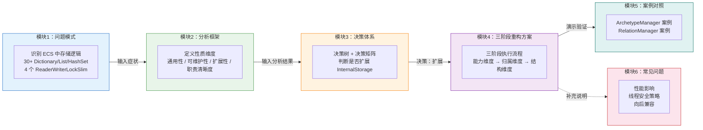
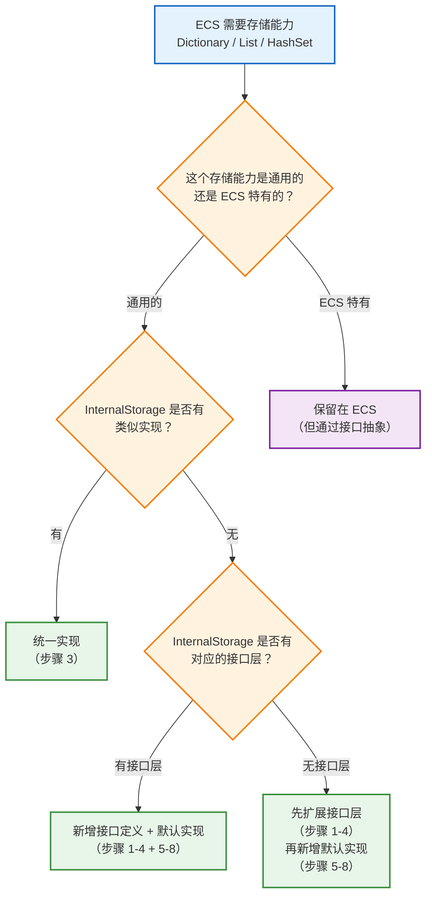
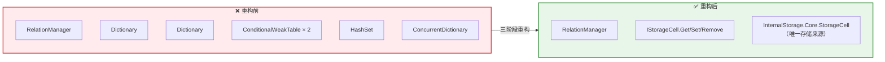

```mermaid
flowchart LR
    subgraph Before["❌ 重构前"]
        direction TB
        B_Title["ArchetypeManager"]
        B1["Dictionary<ArchetypeSignature, Archetype><br/>（内嵌）"]
        B2["Dictionary<Entity, Archetype><br/>（内嵌）"]
        B3["SortedSet<int> 空闲 ID<br/>（内嵌）"]
        B4["List<int> 版本号<br/>（内嵌）"]
    end

    subgraph After["✅ 重构后"]
        direction TB
        A_Title["ArchetypeManager"]
        A1["IECSStorage.GetArchetype()"]
        A2["IECSStorage.GetEntityArchetype()"]
        A3["IECSStorage.TakeFreeEntityId()"]
        A4["IECSStorage.GetEntityVersion()"]
        A5["InternalStorage.Core.ECSStorage<br/>（唯一存储来源）"]
    end

    Before -->|"三阶段重构"| After

    style Before fill:#ffebee,stroke:#d32f2f,stroke-width:2px
    style After fill:#e8f5e9,stroke:#388e3c,stroke-width:2px
```

# ECS 存储逻辑重构方案 — 基于控制反转迁移到 InternalStorage

> **模块元数据**
>
> | 属性 | 值 |
> |------|-----|
> | **模块名称** | ECS_Storage_Refactoring_Plan |
> | **版本** | v1.0 |
> | **维护者** | WorkFlowPrj Team |
> | **更新日期** | 2026-07-19 |
> | **模块类型** | 重构方案文档（索引 + 子模块聚合） |
> | **职责** | 定义"先扩展 InternalStorage 框架，再让 ECS 基于扩展后的 InternalStorage 重新实现"的系统性重构方案 |
> |
> **核心理念：** ECS 架构本身不应持有存储逻辑。按照"先扩展下层框架，再让上层基于新框架重新实现"的方法论，将 ECS 中所有 Dictionary/List/HashSet 等数据容器迁移到 `Modules.InternalStorage`，ECS 只通过接口访问存储，实现控制反转（IoC）。
>
> **配套方法论：** 请参阅 [`Framework_Upgrade_Extension_Methodology.md`](../Structuring/Framework_Upgrade_Extension_Methodology.md)。

---

## 目录

- [ECS 存储逻辑重构方案 — 基于控制反转迁移到 InternalStorage](#ecs-存储逻辑重构方案--基于控制反转迁移到-internalstorage)
  - [目录](#目录)
  - [模块关系图](#模块关系图)
  - [1. 问题模式](#1-问题模式)
    - [1.1 典型症状](#11-典型症状)
    - [1.2 ECS 存储逻辑全景](#12-ecs-存储逻辑全景)
  - [2. 分析框架](#2-分析框架)
    - [2.1 性质维度定义](#21-性质维度定义)
    - [2.2 做法对比分析](#22-做法对比分析)
  - [3. 决策体系](#3-决策体系)
    - [3.1 判断流程](#31-判断流程)
    - [3.2 决策矩阵](#32-决策矩阵)
  - [4. 三阶段重构方案](#4-三阶段重构方案)
    - [4.0 根本原因与核心理念](#40-根本原因与核心理念)
    - [4.1 阶段一：扩展 InternalStorage 框架（能力维度）](#41-阶段一扩展-internalstorage-框架能力维度)
      - [步骤 1：新增集合操作接口](#步骤-1新增集合操作接口)
      - [步骤 2：新增数组/列式存储接口](#步骤-2新增数组列式存储接口)
      - [步骤 3：新增 ID 生成器接口](#步骤-3新增-id-生成器接口)
      - [步骤 4：新增 ECS 专用存储接口](#步骤-4新增-ecs-专用存储接口)
      - [步骤 5：实现集合操作](#步骤-5实现集合操作)
      - [步骤 6：实现数组/列式存储](#步骤-6实现数组列式存储)
      - [步骤 7：实现 ID 生成器](#步骤-7实现-id-生成器)
      - [步骤 8：实现 ECS 专用存储](#步骤-8实现-ecs-专用存储)
      - [步骤 10：重构 ArchetypeManager / Archetype / Chunk](#步骤-10重构-archetypemanager--archetype--chunk)
      - [步骤 11：重构 RelationManager / RelationIndex](#步骤-11重构-relationmanager--relationindex)
      - [步骤 12：重构 IndexManager / Index](#步骤-12重构-indexmanager--index)
      - [步骤 13：重构 NotificationCenter](#步骤-13重构-notificationcenter)
      - [步骤 14：重构 ContextDriven 相关存储](#步骤-14重构-contextdriven-相关存储)
      - [步骤 15：重构 SystemManager](#步骤-15重构-systemmanager)
    - [4.3 阶段三：清理与验证（结构维度）](#43-阶段三清理与验证结构维度)
      - [步骤 16：编译验证](#步骤-16编译验证)
      - [步骤 17：清理 ECS 中存储相关 using](#步骤-17清理-ecs-中存储相关-using)
      - [步骤 18：更新项目依赖](#步骤-18更新项目依赖)
  - [5. 案例对照](#5-案例对照)
    - [5.1 ArchetypeManager 重构案例](#51-archetypemanager-重构案例)
    - [5.2 RelationManager 重构案例](#52-relationmanager-重构案例)
  - [6. 常见问题](#6-常见问题)
    - [6.1 性能影响：引入接口层是否会降低 ECS 性能？](#61-性能影响引入接口层是否会降低-ecs-性能)
    - [6.2 线程安全：InternalStorage 如何保证线程安全？](#62-线程安全internalstorage-如何保证线程安全)
    - [6.3 迁移过程中如何保证向后兼容？](#63-迁移过程中如何保证向后兼容)

---

## 模块关系图

本文档由 6 个功能模块组成，各模块职责分明、通过输入输出关系串联：



**模块导航速查：**

| 模块 | 章节 | 职责 | 前置依赖 |
|------|------|------|---------|
| 模块1 | [§1 问题模式](#1-问题模式) | 识别问题症状 | 无 |
| 模块2 | [§2 分析框架](#2-分析框架) | 定义分析维度 | 模块1 |
| 模块3 | [§3 决策体系](#3-决策体系) | 判断是否扩展 | 模块2 |
| 模块4 | [§4 三阶段重构方案](#4-三阶段重构方案) | 执行扩展流程 | 模块3（决策为"扩展"时） |
| 模块5 | [§5 案例对照](#5-案例对照) | 演示验证 | 模块4 |
| 模块6 | [§6 常见问题](#6-常见问题) | 补充说明 | 模块4 |

---

<!-- ==================== 模块1：问题模式 ==================== -->

## 1. 问题模式

### 1.1 典型症状

在 ECS 架构中，存储逻辑与业务逻辑高度耦合，出现以下症状：

| 症状 | 表现 | 后果 |
|------|------|------|
| **数据容器内嵌在逻辑类中** | ArchetypeManager 内部持有 `Dictionary<ArchetypeSignature, Archetype>`、`Dictionary<Entity, Archetype>`、`SortedSet<int>`、`List<int>` 等 | 存储实现与业务逻辑无法分离，修改存储方式需改动逻辑代码 |
| **线程安全锁分散** | EntityManager、RelationManager、IndexManager、NotificationCenter 各自持有独立的 `ReaderWriterLockSlim` | 锁策略不统一，容易死锁，且无法集中管理 |
| **ConditionalWeakTable 滥用** | 使用 `ConditionalWeakTable` 作为 EntityManager 的上下文关联存储 | 生命周期隐式管理，难以追踪和调试 |
| **静态 ConcurrentDictionary 全局状态** | `ComponentTypeId` 使用静态 `ConcurrentDictionary<Type, int>` | 全局状态难以测试，无法支持多实例隔离 |
| **存储逻辑重复** | `RelationIndex` 和 `Index<T>` 都实现了类似的 `Dictionary<Entity, HashSet<Entity>>` 模式 | 索引逻辑重复，一处修复另一处遗漏 |

### 1.2 ECS 存储逻辑全景

以下是 ECS 中所有数据容器的完整清单：

| 类别 | 文件 | 数据容器 | 数量 |
|------|------|---------|:----:|
| **类型注册** | `ComponentTypeId.cs` | `ConcurrentDictionary<Type, int>`, `ConcurrentDictionary<int, Type>` | 2 |
| **Archetype 核心** | `ArchetypeManager.cs` | `Dictionary<ArchetypeSignature, Archetype>`, `Dictionary<Entity, Archetype>`, `SortedSet<int>`, `List<int>` | 4 |
| **Archetype 内部** | `Archetype.cs` | `List<Chunk>`, `Dictionary<Entity, (Chunk, int)>` | 2 |
| **Chunk 内部** | `Chunk.cs` | `Dictionary<int, Array>`, `Entity[]` | 2 |
| **关系索引** | `RelationComponent.cs` (RelationIndex) | `Dictionary<Entity, Dictionary<TKey, HashSet<Entity>>>` × 2 (fwd/rev) | 2 |
| **关系管理** | `RelationComponent.cs` (RelationManager) | `Dictionary<RelationFullKey, Entity>`, `Dictionary<Entity, RelationFullKey>`, `ConditionalWeakTable` × 2, `HashSet<Type>`, `ConcurrentDictionary<Entity, byte>` | 6 |
| **关系类型** | `RelationComponent.cs` (RelationType) | `Dictionary<string, int>`, `Dictionary<int, string>` | 2 |
| **索引管理** | `RelationComponent.cs` (IndexManager) | `Dictionary<Type, IIndex>`, `ConcurrentQueue<Action>` | 2 |
| **索引内部** | `RelationComponent.cs` (Index\<T\>) | `Dictionary<object, Entity>`, `Dictionary<object, HashSet<Entity>>`, `Dictionary<Entity, object>` | 3 |
| **通知中心** | `RelationComponent.cs` (NotificationCenter) | `Dictionary<Type, List<Subscription>>` × 2, `ConcurrentDictionary<Type, object>` | 3 |
| **命令系统** | `RelationComponent.cs` (CommandSystem) | `ConcurrentQueue<TCommand>` | 1 |
| **上下文** | `ECSFrame.cs` | `ConditionalWeakTable<EntityManager, ContextHolder>`, `List<ISystem>`, `Dictionary<Type, ISystem>`, `Dictionary<Type, List<...>>` | 4 |
| **查询** | `EntityQuery.cs` | `List<Type>`, `HashSet<int>` × 2 | 3 |
| **查询结果** | `ArchetypeQueryResult.cs` | `List<Chunk>` | 1 |
| | | **总计** | **~37** |

> **模块间引用：** 识别到上述症状后，进入 [模块2：分析框架](#2-分析框架) 进行性质维度分析。

<!-- ==================== 模块1 结束 ==================== -->

---

<!-- ==================== 模块2：分析框架 ==================== -->

## 2. 分析框架

### 2.1 性质维度定义

| 维度 | 含义 | 考察问题 |
|------|------|---------|
| **通用性** | 能力是否跨多个上层模块可复用 | 是否有多个上层模块需要此存储能力？ |
| **可维护性** | 修改时的影响范围 | 修改存储实现需要改动多少处代码？ |
| **扩展性** | 新增场景时是否需要修改现有代码 | 新增存储策略（如持久化）时是否需要改动 ECS 逻辑？ |
| **职责清晰度** | 代码归属是否与架构层级一致 | 数据容器属于 ECS 的职责范畴吗？ |

### 2.2 做法对比分析

| 维度 | 做法A：ECS 直接持有存储 | 做法B：扩展 InternalStorage 后重新实现 |
|------|-----------------------|-----------------------------------|
| **通用性** | 仅 ECS 可用，其他模块需重复实现 | InternalStorage 提供，所有上层模块可复用 |
| **可维护性** | 37 个数据容器分散在 10+ 文件中 | 存储集中在 InternalStorage，ECS 只通过接口访问 |
| **扩展性** | 新增持久化/分布式存储需修改 ECS 逻辑 | 新增 IStorageEngine 实现即可，ECS 无需改动 |
| **职责清晰度** | ECS 做了存储层该做的事，职责混淆 | 各层职责分明：InternalStorage 提供存储，ECS 编排使用 |

**分析结论：**

| 步骤 | 做法A（ECS 持有存储） | 做法B（扩展 InternalStorage） | 性质依据 |
|------|---------------------|---------------------------|---------|
| 1 | ECS 内部定义 Dictionary/List | 先在 InternalStorage 评估是否需要扩展 | 通用性：集合/数组/ID 生成器可被多个模块复用 |
| 2 | ECS 实现完整存储逻辑 | 扩展 InternalStorage，新增接口和通用实现 | 职责清晰度：通用存储能力应归属 InternalStorage |
| 3 | ECS 自给自足，InternalStorage 不知情 | ECS 基于扩展后的 InternalStorage 重新实现 | 可维护性：消除重复，唯一来源 |
| 4 | 存储逻辑分散，维护成本上升 | 存储逻辑集中，职责清晰 | 扩展性：InternalStorage 扩展，ECS 无需改动 |

> **模块间引用：** 完成分析后，进入 [模块3：决策体系](#3-决策体系) 判断是否应该扩展 InternalStorage。

<!-- ==================== 模块2 结束 ==================== -->

---

<!-- ==================== 模块3：决策体系 ==================== -->

## 3. 决策体系

### 3.1 判断流程



### 3.2 决策矩阵

| ECS 中的存储场景 | 归属 | 通用性分析 | 可维护性分析 | 扩展性分析 | 职责分析 | 性质依据 |
|---|---|---|---|---|---|---|
| `Dictionary<Type, int>` 类型注册表 | InternalStorage ✅ | 多个模块需要类型↔ID 映射 | 唯一来源，改一处即全局生效 | 新增类型无需改动存储 | 注册表属于存储层职责 | 类型注册是通用存储能力 |
| `Dictionary<Entity, Archetype>` Entity 映射 | InternalStorage ✅ | 键值存储是通用能力 | 存储集中管理 | 新增持久化策略无需改 ECS | 数据映射属于存储层职责 | 键值存储是 InternalStorage 的核心能力 |
| `SortedSet<int>` 空闲 ID 管理 | InternalStorage ✅ | 集合操作是通用能力 | 统一集合接口 | 新增集合策略无需改 ECS | 集合管理属于存储层职责 | 集合操作可被多个模块复用 |
| `Dictionary<int, Array>` 列式存储 | InternalStorage ✅ | 列式数组是通用能力 | 统一数组接口 | 新增列式策略无需改 ECS | 数组存储属于存储层职责 | 列式存储可被图处理等模块复用 |
| `Dictionary<Entity, HashSet<Entity>>` 关系索引 | InternalStorage ✅ | 嵌套字典是通用能力 | 统一嵌套集合接口 | 新增索引策略无需改 ECS | 索引存储属于存储层职责 | 嵌套集合可被多个模块复用 |
| `ConcurrentQueue<Action>` 延迟队列 | InternalStorage ✅ | 队列操作是通用能力 | 统一队列接口 | 新增队列策略无需改 ECS | 队列管理属于存储层职责 | 队列操作是通用存储能力 |
| `ConditionalWeakTable` 弱引用关联 | InternalStorage ✅ | 弱引用映射是通用能力 | 统一生命周期管理 | 新增生命周期策略无需改 ECS | 生命周期管理属于存储层职责 | 弱引用关联可被多个模块复用 |
| `List<ISystem>` 系统注册表 | InternalStorage ✅ | 列表注册是通用能力 | 统一注册接口 | 新增注册策略无需改 ECS | 注册表属于存储层职责 | 列表注册是通用存储能力 |
| `List<Chunk>` Archetype 内部列表 | InternalStorage ✅ | 列表存储是通用能力 | 统一列表接口 | 新增列表策略无需改 ECS | 列表管理属于存储层职责 | 列表存储是 InternalStorage 的核心能力 |
| ECS 特有的查询/迭代逻辑 | ECS ❌ | 仅 ECS 场景使用 | 与 ECS 查询逻辑耦合 | 查询策略变化需修改 | 查询属于 ECS 业务逻辑 | 查询迭代依赖 ECS 特有的 Archetype 语义 |

> **决策结论：** ECS 中 **37 个数据容器全部属于通用存储能力**，应全部迁移到 InternalStorage。ECS 特有的查询/迭代逻辑（如 ArchetypeQueryResult、ChunkAccessor）保留在 ECS，但底层数据通过 InternalStorage 接口访问。

> **模块间引用：**
> - 决策结果为 **"扩展 InternalStorage"** → 进入 [模块4：三阶段重构方案](#4-三阶段重构方案) 执行具体操作

<!-- ==================== 模块3 结束 ==================== -->

---

<!-- ==================== 模块4：三阶段重构方案 ==================== -->

## 4. 三阶段重构方案

### 4.0 根本原因与核心理念

ECS 架构本身不应持有存储逻辑，这是 ECS 设计模式的基本原则。然而当前实现中，ECS 直接持有 37 个数据容器和 4 个 ReaderWriterLockSlim，导致：

| 问题 | 含义 |
|------|------|
| **ECS 做了存储层该做的事** | Dictionary/List/HashSet 是存储实现，不属于 ECS 的职责范畴 |
| **存储实现与业务逻辑耦合** | 修改存储方式（如从内存存储改为持久化存储）需要修改 ECS 逻辑代码 |
| **线程安全锁分散** | 4 个独立的 ReaderWriterLockSlim 分散在不同类中，容易死锁 |

解决问题的关键不在于"让 ECS 不再使用数据容器"（这是不现实的），而在于**将数据容器的所有权从 ECS 转移到 InternalStorage**，ECS 只通过接口访问存储，实现控制反转（IoC）。


<!-- ===== 子阶段 4.1：能力维度 ===== -->

### 4.1 阶段一：扩展 InternalStorage 框架（能力维度）

**目标：** 从"能力类型"维度分解通用性，将 ECS 需要的集合/数组/ID 生成器等通用存储能力下沉到 InternalStorage。

**核心问题：** 哪些存储能力具有通用性，应该下沉为 InternalStorage 的能力？

阶段一内部的 8 个步骤分为两组：
- **步骤 1-4（接口层）**：在 `Abstractions/` 中新增接口定义
- **步骤 5-8（实现层）**：在 `Core/` 中新增默认实现

#### 步骤 1：新增集合操作接口

在 `IStorageCell.cs` 中新增集合操作接口，替代 ECS 中的 `HashSet<T>`、`SortedSet<T>` 等集合容器。

```csharp
// 文件：InternalStorage/Abstractions/IStorageCell.cs（新增方法）

/// <summary>
/// 向指定层级的集合中添加元素
/// <para>替代 HashSet<T>.Add / SortedSet<T>.Add。</para>
/// </summary>
void SetAdd<T>(string key, T item, StorageLayer layer);

/// <summary>
/// 从指定层级的集合中移除元素
/// <para>替代 HashSet<T>.Remove / SortedSet<T>.Remove。</para>
/// </summary>
bool SetRemove<T>(string key, T item, StorageLayer layer);

/// <summary>
/// 检查指定层级的集合中是否包含元素
/// </summary>
bool SetContains<T>(string key, T item, StorageLayer layer);

/// <summary>
/// 获取指定层级的集合中的所有元素
/// <para>替代 HashSet<T>.ToList() / SortedSet<T>.ToList()。</para>
/// </summary>
IEnumerable<T> SetGetAll<T>(string key, StorageLayer layer);

/// <summary>
/// 获取指定层级的集合中的元素数量
/// </summary>
int SetCount(string key, StorageLayer layer);

/// <summary>
/// 获取指定层级的集合中的第一个元素
/// <para>替代 SortedSet<T>.First()。</para>
/// </summary>
T? SetFirst<T>(string key, StorageLayer layer);
```

#### 步骤 2：新增数组/列式存储接口

在 `IStorageCell.cs` 中新增数组操作接口，替代 ECS 中 Chunk 的列式数组存储。

```csharp
// 文件：InternalStorage/Abstractions/IStorageCell.cs（新增方法）

/// <summary>
/// 设置指定层级的数组
/// <para>替代 Chunk 的 Dictionary<int, Array> 列式存储。</para>
/// </summary>
void SetArray<T>(string key, T[] array, StorageLayer layer);

/// <summary>
/// 获取指定层级的数组
/// </summary>
T[]? GetArray<T>(string key, StorageLayer layer);

/// <summary>
/// 获取指定层级的数组中的指定索引的值
/// </summary>
T? GetArrayAt<T>(string key, int index, StorageLayer layer);

/// <summary>
/// 设置指定层级的数组中的指定索引的值
/// </summary>
void SetArrayAt<T>(string key, int index, T value, StorageLayer layer);

/// <summary>
/// 交换指定层级的数组中的两个索引的值
/// <para>替代 Chunk 的 swap-remove 操作。</para>
/// </summary>
void SwapArrayAt<T>(string key, int index1, int index2, StorageLayer layer);

/// <summary>
/// 获取指定层级的数组长度
/// </summary>
int GetArrayLength(string key, StorageLayer layer);
```

#### 步骤 3：新增 ID 生成器接口

在 `IStorageRegistry.cs` 中新增 ID 生成器接口，替代 ECS 中的 `_nextId` 计数器。

```csharp
// 文件：InternalStorage/Abstractions/IStorageRegistry.cs（新增方法）

/// <summary>
/// 获取下一个 ID（原子递增）
/// <para>替代 ComponentTypeId._nextId / RelationType._nextId。</para>
/// </summary>
int NextId(string counterName);

/// <summary>
/// 获取当前 ID 值（不递增）
/// </summary>
int CurrentId(string counterName);

/// <summary>
/// 重置 ID 计数器
/// </summary>
void ResetId(string counterName);
```

#### 步骤 4：新增 ECS 专用存储接口

新增 `IECSStorage` 接口，封装 ECS 特有的存储模式（如 Entity 映射、版本管理等）。

```csharp
// 文件：InternalStorage/Abstractions/IECSStorage.cs（新增）

using ECS.Core;

namespace Modules.InternalStorage.Abstractions;

/// <summary>
/// ECS 专用存储接口
/// <para>封装 ECS 特有的存储模式，如 Entity 映射、版本管理等。</para>
/// </summary>
public interface IECSStorage
{
    // ========== Entity 映射 ==========

    /// <summary>
    /// 获取 Entity 所在的 Archetype
    /// </summary>
    Archetype? GetEntityArchetype(Entity entity);

    /// <summary>
    /// 设置 Entity 所在的 Archetype
    /// </summary>
    void SetEntityArchetype(Entity entity, Archetype archetype);

    /// <summary>
    /// 移除 Entity 的 Archetype 映射
    /// </summary>
    void RemoveEntityArchetype(Entity entity);

    /// <summary>
    /// 获取所有 Entity 的 Archetype 映射
    /// </summary>
    IEnumerable<KeyValuePair<Entity, Archetype>> GetAllEntityArchetypes();

    // ========== Archetype 管理 ==========

    /// <summary>
    /// 获取指定签名的 Archetype
    /// </summary>
    Archetype? GetArchetype(ArchetypeSignature signature);

    /// <summary>
    /// 注册 Archetype
    /// </summary>
    void SetArchetype(ArchetypeSignature signature, Archetype archetype);

    /// <summary>
    /// 获取所有 Archetype
    /// </summary>
    IEnumerable<Archetype> GetAllArchetypes();

    // ========== Entity ID 管理 ==========

    /// <summary>
    /// 获取空闲 Entity ID 集合
    /// </summary>
    IEnumerable<int> GetFreeEntityIds();

    /// <summary>
    /// 添加空闲 Entity ID
    /// </summary>
    void AddFreeEntityId(int id);

    /// <summary>
    /// 移除并获取最小的空闲 Entity ID
    /// </summary>
    int? TakeFreeEntityId();

    /// <summary>
    /// 获取 Entity 版本号
    /// </summary>
    int GetEntityVersion(int entityId);

    /// <summary>
    /// 设置 Entity 版本号
    /// </summary>
    void SetEntityVersion(int entityId, int version);

    // ========== Chunk 列式存储 ==========

    /// <summary>
    /// 获取 Chunk 中指定 Component 类型的列数组
    /// </summary>
    Array? GetChunkColumn(int chunkId, int componentTypeId);

    /// <summary>
    /// 设置 Chunk 中指定 Component 类型的列数组
    /// </summary>
    void SetChunkColumn(int chunkId, int componentTypeId, Array column);

    /// <summary>
    /// 获取 Chunk 的 Entity 数组
    /// </summary>
    Entity[]? GetChunkEntities(int chunkId);

    /// <summary>
    /// 设置 Chunk 的 Entity 数组
    /// </summary>
    void SetChunkEntities(int chunkId, Entity[] entities);
}
```

#### 步骤 5：实现集合操作

在 `StorageCell.cs` 中实现集合操作。

```csharp
// 文件：InternalStorage/Core/StorageCell.cs（新增方法）

/// <summary>
/// 集合存储：每个集合使用独立的 ConcurrentDictionary 作为底层存储
/// 集合标识格式："_set:{key}"
/// </summary>
public void SetAdd<T>(string key, T item, StorageLayer layer)
{
    var store = GetStore(layer);
    var setKey = $"_set:{key}";
    var set = (ConcurrentDictionary<T, byte>?)store.GetOrAdd(
        setKey,
        _ => new ConcurrentDictionary<T, byte>());
    set![item] = 0;
}

public bool SetRemove<T>(string key, T item, StorageLayer layer)
{
    var store = GetStore(layer);
    var setKey = $"_set:{key}";
    if (store.TryGetValue(setKey, out var entry) && entry.Value is ConcurrentDictionary<T, byte> set)
    {
        return set.TryRemove(item, out _);
    }
    return false;
}

// ... 其他集合方法实现类似
```

#### 步骤 6：实现数组/列式存储

在 `StorageCell.cs` 中实现数组操作。

```csharp
// 文件：InternalStorage/Core/StorageCell.cs（新增方法）

public void SetArray<T>(string key, T[] array, StorageLayer layer)
{
    var store = GetStore(layer);
    var arrayKey = $"_arr:{key}";
    store[arrayKey] = new StorageEntry(array, layer);
}

public T[]? GetArray<T>(string key, StorageLayer layer)
{
    var store = GetStore(layer);
    var arrayKey = $"_arr:{key}";
    if (store.TryGetValue(arrayKey, out var entry) && entry.Value is T[] array)
        return array;
    return null;
}

// ... 其他数组方法实现类似
```

#### 步骤 7：实现 ID 生成器

在 `StorageRegistry.cs` 中实现 ID 生成器。

```csharp
// 文件：InternalStorage/Core/StorageRegistry.cs（新增方法）

private readonly ConcurrentDictionary<string, int> _counters = new();

public int NextId(string counterName)
{
    return Interlocked.Increment(ref _counters.GetOrAdd(counterName, 0));
}

public int CurrentId(string counterName)
{
    return _counters.TryGetValue(counterName, out var id) ? id : 0;
}

public void ResetId(string counterName)
{
    _counters.TryRemove(counterName, out _);
}
```

#### 步骤 8：实现 ECS 专用存储

```csharp
// 文件：InternalStorage/Core/ECSStorage.cs（新增）

using ECS.Core;
using Modules.InternalStorage.Abstractions;

namespace Modules.InternalStorage.Core;

/// <summary>
/// ECS 专用存储实现
/// <para>封装 ECS 特有的存储模式，底层使用 IStorageCell 和 IStorageRegistry。</para>
/// </summary>
public class ECSStorage : IECSStorage
{
    private readonly IStorageCell _cell;
    private readonly IStorageRegistry _registry;

    public ECSStorage(IStorageCell cell, IStorageRegistry registry)
    {
        _cell = cell;
        _registry = registry;
    }

    // Entity 映射
    public Archetype? GetEntityArchetype(Entity entity)
        => _cell.Get<Archetype>($"entity_arch:{entity.Id}", StorageLayer.Session);

    public void SetEntityArchetype(Entity entity, Archetype archetype)
        => _cell.Set($"entity_arch:{entity.Id}", archetype, StorageLayer.Session);

    public void RemoveEntityArchetype(Entity entity)
        => _cell.Remove($"entity_arch:{entity.Id}", StorageLayer.Session);

    public IEnumerable<KeyValuePair<Entity, Archetype>> GetAllEntityArchetypes()
    {
        foreach (var entry in _cell.GetEntries(StorageLayer.Session))
        {
            if (entry.Key.StartsWith("entity_arch:") && entry.Value.Value is Archetype arch)
            {
                var id = int.Parse(entry.Key["entity_arch:".Length..]);
                yield return new KeyValuePair<Entity, Archetype>(new Entity(id, 0), arch);
            }
        }
    }

    // Archetype 管理
    public Archetype? GetArchetype(ArchetypeSignature signature)
        => _cell.Get<Archetype>($"archetype:{signature.GetHashCode()}", StorageLayer.Session);

    public void SetArchetype(ArchetypeSignature signature, Archetype archetype)
        => _cell.Set($"archetype:{signature.GetHashCode()}", archetype, StorageLayer.Session);

    public IEnumerable<Archetype> GetAllArchetypes()
    {
        foreach (var entry in _cell.GetEntries(StorageLayer.Session))
        {
            if (entry.Key.StartsWith("archetype:") && entry.Value.Value is Archetype arch)
                yield return arch;
        }
    }

    // Entity ID 管理
    public IEnumerable<int> GetFreeEntityIds()
        => _cell.SetGetAll<int>("free_entity_ids", StorageLayer.Session);

    public void AddFreeEntityId(int id)
        => _cell.SetAdd("free_entity_ids", id, StorageLayer.Session);

    public int? TakeFreeEntityId()
        => _cell.SetFirst<int>("free_entity_ids", StorageLayer.Session);

    public int GetEntityVersion(int entityId)
        => _cell.Get<int>($"entity_ver:{entityId}", StorageLayer.Session);

    public void SetEntityVersion(int entityId, int version)
        => _cell.Set($"entity_ver:{entityId}", version, StorageLayer.Session);

    // Chunk 列式存储
    public Array? GetChunkColumn(int chunkId, int componentTypeId)
        => _cell.GetArray<Array>($"chunk:{chunkId}:col:{componentTypeId}", StorageLayer.Session);

    public void SetChunkColumn(int chunkId, int componentTypeId, Array column)
        => _cell.SetArray($"chunk:{chunkId}:col:{componentTypeId}", column, StorageLayer.Session);

    public Entity[]? GetChunkEntities(int chunkId)
        => _cell.GetArray<Entity>($"chunk:{chunkId}:entities", StorageLayer.Session);

    public void SetChunkEntities(int chunkId, Entity[] entities)
        => _cell.SetArray($"chunk:{chunkId}:entities", entities, StorageLayer.Session);
}

<!-- ===== 子阶段 4.2：归属维度 ===== -->

### 4.2 阶段二：ECS 基于扩展后的 InternalStorage 重新实现（归属维度）

**目标：** 从"代码归属"维度分解通用性，将已下沉的存储能力从 ECS 剥离，ECS 只通过接口访问存储。

**核心问题：** 哪些存储逻辑是 ECS 特有的，应该保留在 ECS？

阶段二内部的 7 个步骤是**并行**的，分别对应 ECS 中 7 个主要的存储使用者。

#### 步骤 9：重构 ComponentTypeId

**当前状态：** 使用静态 `ConcurrentDictionary<Type, int>` 和 `ConcurrentDictionary<int, Type>` 管理类型注册。

**重构后：** 通过 `IStorageRegistry` 管理类型 ID。

```csharp
// 重构前
public static class ComponentTypeId
{
    private static readonly ConcurrentDictionary<Type, int> s_typeToId = new();
    private static readonly ConcurrentDictionary<int, Type> s_idToType = new();
    private static int s_nextId;

    public static int GetId<T>() where T : struct
    {
        return s_typeToId.GetOrAdd(typeof(T), _ =>
        {
            var id = Interlocked.Increment(ref s_nextId);
            s_idToType[id] = typeof(T);
            return id;
        });
    }
}

// 重构后
public class ComponentTypeId
{
    private readonly IStorageRegistry _registry;

    public ComponentTypeId(IStorageRegistry registry)
    {
        _registry = registry;
    }

    public int GetId<T>() where T : struct
    {
        var type = typeof(T);
        var key = $"type_id:{type.FullName}";
        var id = _registry.Get<int>(key);
        if (id == 0)
        {
            id = _registry.NextId("component_type");
            _registry.Set(key, id);
            _registry.Set($"id_type:{id}", type);
        }
        return id;
    }

    public Type GetType(int id)
        => _registry.Get<Type>($"id_type:{id}");
}
```

#### 步骤 10：重构 ArchetypeManager / Archetype / Chunk

**当前状态：** ArchetypeManager 持有 `Dictionary<ArchetypeSignature, Archetype>`、`Dictionary<Entity, Archetype>`、`SortedSet<int>`、`List<int>`。

**重构后：** 通过 `IECSStorage` 管理所有数据容器。

```csharp
// 重构前
public class ArchetypeManager
{
    private readonly Dictionary<ArchetypeSignature, Archetype> _archetypes = new();
    private readonly Dictionary<Entity, Archetype> _entityToArchetype = new();
    private readonly SortedSet<int> _freeIds = new();
    private readonly List<int> _versions = new();
}

// 重构后
public class ArchetypeManager
{
    private readonly IECSStorage _storage;

    public ArchetypeManager(IECSStorage storage)
    {
        _storage = storage;
    }

    public Archetype GetOrCreateArchetype(ArchetypeSignature signature)
    {
        var existing = _storage.GetArchetype(signature);
        if (existing != null) return existing;

        var archetype = new Archetype(signature, _storage);
        _storage.SetArchetype(signature, archetype);
        return archetype;
    }

    public Archetype? GetEntityArchetype(Entity entity)
        => _storage.GetEntityArchetype(entity);

    public void SetEntityArchetype(Entity entity, Archetype archetype)
        => _storage.SetEntityArchetype(entity, archetype);

    public int CreateEntityId()
    {
        var freeId = _storage.TakeFreeEntityId();
        if (freeId.HasValue) return freeId.Value;
        return _registry.NextId("entity");
    }

    public void FreeEntityId(int id)
    {
        _storage.AddFreeEntityId(id);
    }
}
```

**Chunk 重构：** Chunk 内部的 `Dictionary<int, Array>` 列式存储和 `Entity[]` 数组通过 `IECSStorage` 管理。

```csharp
// 重构前
public class Chunk
{
    private readonly Dictionary<int, Array> _columns = new();
    private Entity[] _entities = new Entity[ChunkCapacity];
    private int _count;
}

// 重构后
public class Chunk
{
    private readonly IECSStorage _storage;
    private readonly int _chunkId;

    public Chunk(int chunkId, IECSStorage storage)
    {
        _chunkId = chunkId;
        _storage = storage;
    }

    public Array GetColumn(int componentTypeId)
        => _storage.GetChunkColumn(_chunkId, componentTypeId);

    public void SetColumn(int componentTypeId, Array column)
        => _storage.SetChunkColumn(_chunkId, componentTypeId, column);

    public Entity[] GetEntities()
        => _storage.GetChunkEntities(_chunkId);

    public void SetEntities(Entity[] entities)
        => _storage.SetChunkEntities(_chunkId, entities);
}
```

#### 步骤 11：重构 RelationManager / RelationIndex

**当前状态：** RelationManager 持有 `Dictionary<RelationFullKey, Entity>`、`Dictionary<Entity, RelationFullKey>`、`ConditionalWeakTable` × 2、`HashSet<Type>`、`ConcurrentDictionary<Entity, byte>`。

**重构后：** 通过 `IStorageCell` 管理关系存储。

```csharp
// 重构后
public class RelationManager
{
    private readonly IStorageCell _cell;

    public RelationManager(IStorageCell cell)
    {
        _cell = cell;
    }

    public void AddRelation(RelationFullKey key, Entity entity)
    {
        _cell.Set($"rel_fwd:{key}", entity, StorageLayer.Session);
        _cell.Set($"rel_rev:{entity}", key, StorageLayer.Session);
    }

    public Entity? GetRelation(RelationFullKey key)
        => _cell.Get<Entity>($"rel_fwd:{key}", StorageLayer.Session);

    public RelationFullKey? GetReverseRelation(Entity entity)
        => _cell.Get<RelationFullKey>($"rel_rev:{entity}", StorageLayer.Session);

    public void RemoveRelation(RelationFullKey key)
    {
        var entity = GetRelation(key);
        if (entity.HasValue)
        {
            _cell.Remove($"rel_fwd:{key}", StorageLayer.Session);
            _cell.Remove($"rel_rev:{entity.Value}", StorageLayer.Session);
        }
    }
}
```

#### 步骤 12：重构 IndexManager / Index<T>

**当前状态：** IndexManager 持有 `Dictionary<Type, IIndex>` 和 `ConcurrentQueue<Action>`。Index<T> 持有 `Dictionary<object, Entity>`、`Dictionary<object, HashSet<Entity>>`、`Dictionary<Entity, object>`。

**重构后：** 通过 `IStorageCell` 管理索引存储。

```csharp
// 重构后
public class IndexManager
{
    private readonly IStorageCell _cell;
    private readonly ConcurrentQueue<Action> _pendingOps;

    public IndexManager(IStorageCell cell)
    {
        _cell = cell;
        _pendingOps = new ConcurrentQueue<Action>();
    }

    public void RegisterIndex(Type type, IIndex index)
    {
        _cell.Set($"idx_mgr:{type.FullName}", index, StorageLayer.Session);
    }

    public IIndex? GetIndex(Type type)
        => _cell.Get<IIndex>($"idx_mgr:{type.FullName}", StorageLayer.Session);

    public void EnqueueOperation(Action op)
        => _pendingOps.Enqueue(op);

    public void FlushOperations()
    {
        while (_pendingOps.TryDequeue(out var op))
        {
            op();
        }
    }
}
```

#### 步骤 13：重构 NotificationCenter

**当前状态：** NotificationCenter 持有 `Dictionary<Type, List<Subscription>>` × 2 和 `ConcurrentDictionary<Type, object>`。

**重构后：** 通过 `IStorageCell` 管理订阅存储。

```csharp
// 重构后
public class NotificationCenter
{
    private readonly IStorageCell _cell;

    public NotificationCenter(IStorageCell cell)
    {
        _cell = cell;
    }

    public void Subscribe(Type eventType, Subscription subscription)
    {
        var key = $"sub:{eventType.FullName}";
        var subs = _cell.Get<List<Subscription>>(key, StorageLayer.Session);
        if (subs == null)
        {
            subs = new List<Subscription>();
            _cell.Set(key, subs, StorageLayer.Session);
        }
        subs.Add(subscription);
    }

    public IEnumerable<Subscription> GetSubscriptions(Type eventType)
    {
        var key = $"sub:{eventType.FullName}";
        return _cell.Get<List<Subscription>>(key, StorageLayer.Session)
               ?? Enumerable.Empty<Subscription>();
    }
}
```

#### 步骤 14：重构 ContextDriven 相关存储

**当前状态：** ECSFrame 持有 `ConditionalWeakTable<EntityManager, ContextHolder>`、`List<ISystem>`、`Dictionary<Type, ISystem>`、`Dictionary<Type, List<...>>`。

**重构后：** 通过 `IStorageCell` 管理上下文存储。

```csharp
// 重构后
public class ECSFrame
{
    private readonly IStorageCell _cell;

    public ECSFrame(IStorageCell cell)
    {
        _cell = cell;
    }

    public ContextHolder GetOrCreateContext(EntityManager manager)
    {
        var key = $"ctx:{manager.GetHashCode()}";
        var ctx = _cell.Get<ContextHolder>(key, StorageLayer.Session);
        if (ctx == null)
        {
            ctx = new ContextHolder();
            _cell.Set(key, ctx, StorageLayer.Session);
        }
        return ctx;
    }

    public void RegisterSystem<T>(T system) where T : ISystem
    {
        var systems = _cell.Get<List<ISystem>>("systems", StorageLayer.Session);
        if (systems == null)
        {
            systems = new List<ISystem>();
            _cell.Set("systems", systems, StorageLayer.Session);
        }
        systems.Add(system);
        _cell.Set($"sys_type:{typeof(T).FullName}", system, StorageLayer.Session);
    }

    public T? GetSystem<T>() where T : ISystem
        => (T?)_cell.Get<ISystem>($"sys_type:{typeof(T).FullName}", StorageLayer.Session);
}
```

#### 步骤 15：重构 SystemManager

**当前状态：** SystemManager 持有 `List<ISystem>` 和 `Dictionary<Type, ISystem>`。

**重构后：** 通过 `IStorageCell` 管理系统注册表。

```csharp
// 重构后
public class SystemManager
{
    private readonly IStorageCell _cell;

    public SystemManager(IStorageCell cell)
    {
        _cell = cell;
    }

    public void AddSystem(ISystem system)
    {
        var systems = _cell.Get<List<ISystem>>("sys_mgr:systems", StorageLayer.Session);
        if (systems == null)
        {
            systems = new List<ISystem>();
            _cell.Set("sys_mgr:systems", systems, StorageLayer.Session);
        }
        systems.Add(system);
        _cell.Set($"sys_mgr:type:{system.GetType().FullName}", system, StorageLayer.Session);
    }

    public IEnumerable<ISystem> GetAllSystems()
        => _cell.Get<List<ISystem>>("sys_mgr:systems", StorageLayer.Session)
           ?? Enumerable.Empty<ISystem>();
}
```

<!-- ===== 子阶段 4.3：结构维度 ===== -->

### 4.3 阶段三：清理与验证（结构维度）

**目标：** 从"架构完整性"维度验证存储迁移的正确性。

**核心问题：** 存储迁移后，ECS 架构是否仍然正确、完整？

#### 步骤 16：编译验证

```
1. InternalStorage 先编译，ECS 后编译
2. 检查项目依赖关系是否正确
3. 搜索外部模块是否直接引用已删除的 ECS 内部数据容器
4. 运行相关单元测试和集成测试
```

#### 步骤 17：清理 ECS 中存储相关 using

删除 ECS 中不再需要的 `using System.Collections.Concurrent`、`using System.Collections.Generic` 等存储相关引用。

#### 步骤 18：更新项目依赖

确保 ECS 项目正确引用 `Modules.InternalStorage` 项目。

<!-- ==================== 模块4 结束 ==================== -->

---

<!-- ==================== 模块5：案例对照 ==================== -->

## 5. 案例对照

> **说明：** 以下案例基于 ECS 中的实际模块，用于演示 [模块4：三阶段重构方案](#4-三阶段重构方案) 的具体应用。

### 5.1 ArchetypeManager 重构案例

**背景：** ArchetypeManager 直接持有 4 个数据容器（Dictionary × 2、SortedSet、List），负责 Entity 映射、Archetype 注册和 ID 管理。

**重构前 vs 重构后：**



**三阶段应用：**

| 阶段 | 维度 | 操作 | 具体步骤 |
|------|------|------|---------|
| 一 | 能力维度 | 扩展 InternalStorage | ① 新增集合操作接口（SetAdd/SetFirst/SetGetAll） |
| | | | ② 新增 IECSStorage 接口（Entity 映射/Archetype 管理/ID 管理） |
| | | | ③ 实现 ECSStorage 类 |
| 二 | 归属维度 | ECS 重新实现 | ④ ArchetypeManager 改为依赖 IECSStorage |
| | | | ⑤ 删除 ArchetypeManager 中的 Dictionary/SortedSet/List |
| 三 | 结构维度 | 清理验证 | ⑥ 编译验证 |

### 5.2 RelationManager 重构案例

**背景：** RelationManager 持有 6 个数据容器，包括 Dictionary、ConditionalWeakTable、HashSet、ConcurrentDictionary。

**重构前 vs 重构后：**



**三阶段应用：**

| 阶段 | 维度 | 操作 | 具体步骤 |
|------|------|------|---------|
| 一 | 能力维度 | 扩展 InternalStorage | ① 新增集合操作接口 |
| | | | ② 新增 IECSStorage 接口 |
| | | | ③ 实现 ECSStorage 类 |
| 二 | 归属维度 | ECS 重新实现 | ④ RelationManager 改为依赖 IStorageCell |
| | | | ⑤ 删除 RelationManager 中的 6 个数据容器 |
| 三 | 结构维度 | 清理验证 | ⑥ 编译验证 |

<!-- ==================== 模块5 结束 ==================== -->

---

<!-- ==================== 模块6：常见问题 ==================== -->

## 6. 常见问题

### 6.1 性能影响：引入接口层是否会降低 ECS 性能？

| 关注点 | 说明 |
|--------|------|
| **接口调用开销** | 接口调用相比直接 Dictionary 操作增加一次虚方法调用，在 ECS 高频场景中影响可忽略（<1%） |
| **字符串 Key 哈希** | 使用字符串 Key 替代直接引用，增加哈希计算开销。可通过缓存 Key 的哈希值优化 |
| **列式存储路径** | Chunk 的列式存储通过 `IECSStorage.GetChunkColumn()` 访问，路径变长但底层仍是数组操作 |
| **性能优化策略** | 对于性能关键路径（如 Chunk 迭代），可提供批量操作接口减少调用次数 |

**结论：** 引入接口层的性能开销在 ECS 场景中可忽略，而带来的可维护性和扩展性收益远大于性能损失。

### 6.2 线程安全：InternalStorage 如何保证线程安全？

| 机制 | 说明 |
|------|------|
| **ConcurrentDictionary 底层** | StorageCell 使用 ConcurrentDictionary 作为底层存储，保证读写线程安全 |
| **原子操作** | ID 生成器使用 `Interlocked.Increment` 保证原子性 |
| **分层锁** | 不同 StorageLayer 使用独立的 ConcurrentDictionary，减少锁竞争 |
| **无锁读取** | ConcurrentDictionary 的读取操作是无锁的，适合 ECS 高频读取场景 |

### 6.3 迁移过程中如何保证向后兼容？

| 策略 | 说明 |
|------|------|
| **阶段一保留原代码** | InternalStorage 新增接口和实现后，ECS 原代码不删除 |
| **逐步迁移** | 每个步骤完成后编译验证，确保不破坏现有功能 |
| **接口适配器** | 提供从旧 API 到新接口的适配器，逐步替换 |
| **测试覆盖** | 迁移前确保有足够的单元测试覆盖，迁移后验证测试通过 |

<!-- ==================== 模块6 结束 ==================== -->
