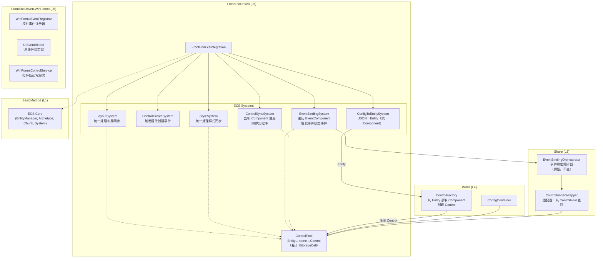
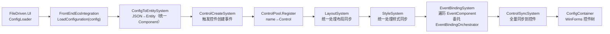
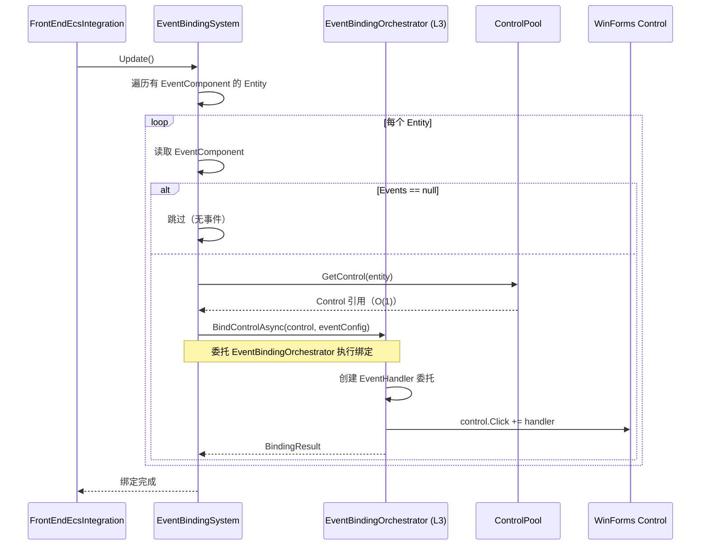
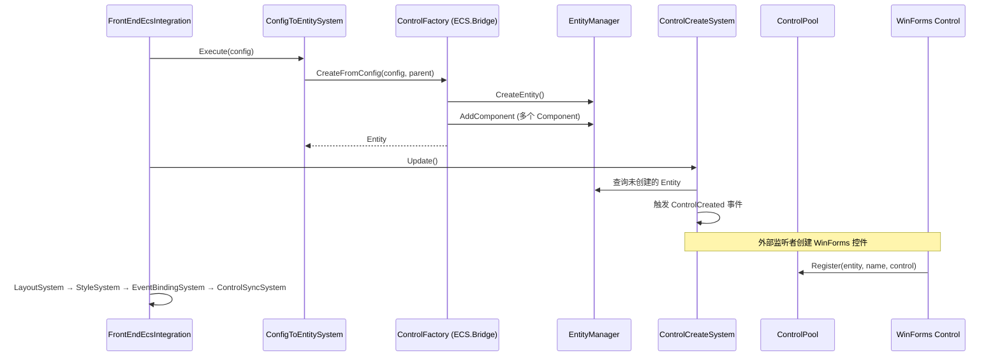
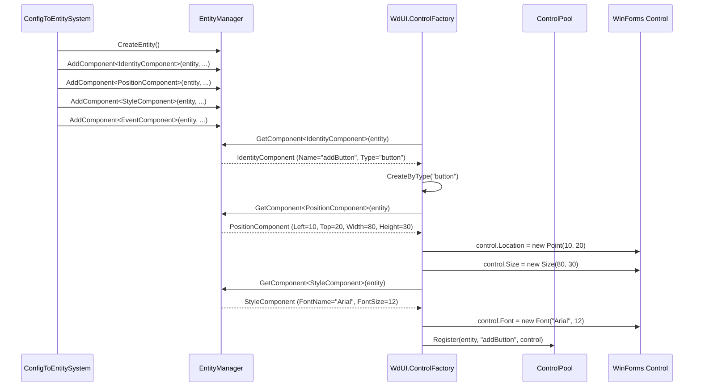
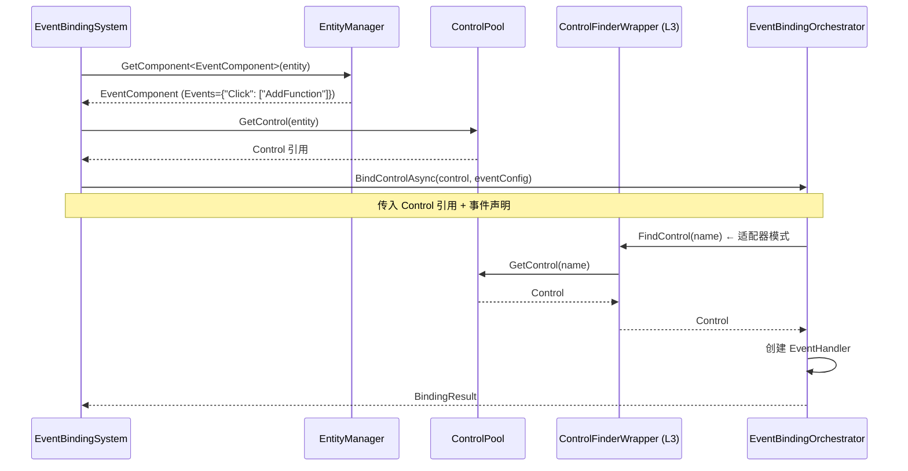

# WdUI 渲染管线迁移到 FrontEndDriven + ECS 重构计划

> **版本：** v4.1
> **更新日期：** 2026-07-19
> **维护者：** WorkFlowPrj Team
>
> **配套文档：**
> - [`Document_Modular_Standard.md`](../../CsharpPrj/Structuring/Document_Modular_Standard.md)（文档编写规范）
> - [`ControlFlow.md`](../../CsharpPrj/Structuring/ControlFlow.md)（控制流文档）

---

## 目录

- [WdUI 渲染管线迁移到 FrontEndDriven + ECS 重构计划](#wdui-渲染管线迁移到-frontenddriven--ecs-重构计划)
  - [目录](#目录)
  - [第一部分：背景与方案](#第一部分背景与方案)
    - [1.1 现状与问题](#11-现状与问题)
      - [1.1.1 模块介绍](#111-模块介绍)
      - [1.1.2 问题分析](#112-问题分析)
    - [1.2 方案总览](#12-方案总览)
      - [1.2.1 设计理念](#121-设计理念)
      - [1.2.2 为什么引入 ECS（奥卡姆剃刀分析）](#122-为什么引入-ecs奥卡姆剃刀分析)
      - [1.2.3 ECS 的定位](#123-ecs-的定位)
      - [1.2.4 方案对比](#124-方案对比)
      - [1.2.5 架构图](#125-架构图)
    - [1.3 目录索引](#13-目录索引)
      - [1.3.1 现有文件列表](#131-现有文件列表)
      - [1.3.2 新增文件列表](#132-新增文件列表)
      - [1.3.3 删除文件列表](#133-删除文件列表)
  - [第二部分：核心设计](#第二部分核心设计)
    - [2.1 数据结构与接口](#21-数据结构与接口)
      - [2.1.1 ControlPool](#211-controlpool)
      - [2.1.2 ECS Component 定义](#212-ecs-component-定义)
      - [2.1.3 现有 Component 映射表](#213-现有-component-映射表)
      - [2.1.4 ControlPool 实现说明](#214-controlpool-实现说明)
    - [2.2 核心流程](#22-核心流程)
      - [2.2.1 管线执行顺序](#221-管线执行顺序)
      - [2.2.2 事件绑定流程](#222-事件绑定流程)
      - [2.2.3 控件创建流程](#223-控件创建流程)
      - [2.2.4 控件值读写流程](#224-控件值读写流程)
    - [2.3 通信机制](#23-通信机制)
      - [2.3.1 WdUI 从 ECS 读取 Component 创建控件](#231-wdui-从-ecs-读取-component-创建控件)
      - [2.3.2 EventBindingOrchestrator 通过 ControlPool 查找控件](#232-eventbindingorchestrator-通过-controlpool-查找控件)
    - [2.4 新增 WinForms 控件逻辑文件](#24-新增-winforms-控件逻辑文件)
      - [2.4.1 WinFormsEventRegistrar](#241-winformseventregistrar)
      - [2.4.2 UIEventBinder](#242-uieventbinder)
      - [2.4.3 WinFormsControlService](#243-winformscontrolservice)
  - [第三部分：实施步骤](#第三部分实施步骤)
    - [3.1 阶段划分](#31-阶段划分)
      - [阶段 1（整体骨架）：搭建 ECS 管线骨架 + 切换调用方 ✅](#阶段-1整体骨架搭建-ecs-管线骨架--切换调用方-)
      - [阶段 2（填充局部）：逐个 System 实现 + 验证 ✅](#阶段-2填充局部逐个-system-实现--验证-)
      - [阶段 3（清理旧体系）：删除桥接器 + 旧管线 ✅](#阶段-3清理旧体系删除桥接器--旧管线-)
      - [阶段 4（优化）：ControlFactory 改造 + 控件值读写集成](#阶段-4优化controlfactory-改造--控件值读写集成)
    - [3.2 优先级与顺序](#32-优先级与顺序)
    - [3.3 与现有系统的关系](#33-与现有系统的关系)
      - [3.3.1 集成方式](#331-集成方式)
      - [3.3.2 能力矩阵](#332-能力矩阵)
    - [3.4 各维度实现要点](#34-各维度实现要点)
      - [3.4.1 管线入口：WinFormsRenderPipeline → FrontEndEcsIntegration](#341-管线入口winformsrenderpipeline--frontendecsintegration)
      - [3.4.2 控件属性模型：JSON 分散层级 → 统一 Component 结构](#342-控件属性模型json-分散层级--统一-component-结构)
      - [3.4.3 控件查找：反射递归 → ControlPool O(1) 查表](#343-控件查找反射递归--controlpool-o1-查表)
      - [3.4.4 控件创建方式：直接解析 JSON → 从 Entity 读取 Component](#344-控件创建方式直接解析-json--从-entity-读取-component)
      - [3.4.5 事件绑定：反射查找 + 绑定 → EventBindingSystem 统一遍历](#345-事件绑定反射查找--绑定--eventbindingsystem-统一遍历)
      - [3.4.6 布局计算：LayoutPipeline → LayoutSystem](#346-布局计算layoutpipeline--layoutsystem)
      - [3.4.7 样式合并：分散处理 → StyleSystem 统一处理](#347-样式合并分散处理--stylesystem-统一处理)
      - [3.4.8 控件值读写：散落调用 → IControlValueAccessor 统一接口](#348-控件值读写散落调用--icontrolvalueaccessor-统一接口)
      - [3.4.9 配置加载：JSON 在 PlaceholderFramework 一处解析后立即转换为 Entity](#349-配置加载json-在-placeholderframework-一处解析后立即转换为-entity)
  - [总结](#总结)

---

## 第一部分：背景与方案

### 1.1 现状与问题

#### 1.1.1 模块介绍

`WdUI` 是 WorkFlowPrj 的 WinForms UI 渲染层（L4），负责将 JSON 配置渲染为 WinForms 控件树，并绑定事件。`FrontEndDriven`（L5）是前端驱动层，已设计 ECS 集成架构但未启用。`BasicMethod`（L1）提供 ECS 框架基础设施（EntityManager、Archetype、Chunk、System）。

当前 `FrontEndDriven` 的 ECS 集成存在以下架构问题：

- **`EcsEventBridge`** 和 **`EcsLayoutStyleBridge`** 作为桥接器，通过监听 `FrontEndEcsIntegration` 的事件 + `ConfigContainer.FindControl()` 反射查找来操作 WinForms 控件
- **`EcsControlRegistryAdapter`** 作为另一个桥接适配器，维护 `name→control` 字典
- 桥接器模式导致事件绑定流程间接、控件查找依赖反射，是 sideload 场景事件绑定失败的根本原因

#### 1.1.2 问题分析

| 问题 | 表现 | 根因 |
|------|------|------|
| 事件绑定失败 | sideload 场景下 `ControlFinderStep` 找不到 `valueATextBox`、`addButton` 等控件，事件绑定全部跳过 | `EventBindingOrchestrator` 通过反射递归查找控件，但 sideload 场景的控件树结构与预期不符 |
| 控件属性模型混乱 | 有的控件有 events、有的没有，每处逻辑都要 `if (ContainsKey)` 单独判断 | JSON 配置的控件属性分散在不同层级，缺乏统一的属性模型 |
| 桥接器间接操作 | `EcsEventBridge` 通过事件监听 + `FindControl` 反射查找来操作控件，流程间接 | 桥接器模式导致 ECS System 不直接持有控件引用，依赖反射查找 |
| 三套体系并存 | WdUI 旧体系（反射查找）+ BasicMethod ECS 框架（基础设施）+ FrontEndDriven ECS 集成（设计未启用），功能重叠但互不集成 | 渐进式重构过程中未及时清理旧体系，导致三层代码维护成本高 |
| 逻辑分散 | 渲染管线逻辑分散在 L3（`EventBindingOrchestrator`）、L4（`WdUI`）、L5（`FrontEndDriven`）三层 | 缺乏统一的管线入口和职责划分 |
| JSON 多段解析 | PlaceholderFramework 的 TemplateExpansion 管线（6 个 Converter）全部基于 `JsonObject`/`JsonArray` 操作，输出 `JsonObject` 后 WdUI 再解析一次 | JSON 在管线中多次解析，`ContainsKey("style")`、`ContainsKey("events")` 等字符串键名判断遍布各处，无编译期检查 |


### 1.2 方案总览

#### 1.2.1 设计理念

将 WdUI 的渲染管线完整迁移到 `FrontEndDriven` 项目，并基于 ECS 框架重构。**核心思路：ECS 作为控件定义的规范容器，WdUI 作为控件创建的执行者。**

- **JSON 只在初始化阶段解析一次**：`ConfigLoader` 加载 JSON → `ConfigToEntitySystem` 转换为 Entity，之后全部以 Entity/Component 形式传递和运算，不在管线层级中传递 JSON
- **ECS 定义"有什么"**：Component 定义控件的属性、样式、事件声明，所有控件有统一的 Component 结构
- **WdUI 执行"怎么创建"**：`ControlFactory` 从 ECS Entity 读取 Component 来创建 WinForms 控件
- **System 统一处理"怎么做"**：`LayoutSystem`、`StyleSystem`、`EventBindingSystem` 统一处理所有控件的对应逻辑
- **ControlPool 桥接**：维护 Entity↔controlName↔Control 三向映射，O(1) 控件查找


#### 1.2.2 为什么引入 ECS（奥卡姆剃刀分析）

**问题一：反射查找控件失败**

| 方案 | 实体数 | 说明 |
|------|--------|------|
| 不用 ECS | 1 个字典 | `ConcurrentDictionary<string, Control>` |
| 用 ECS | ControlPool（1 个类） | 同样是字典，但多了 Entity 映射 |

→ 两者复杂度相当，ECS 没有增加额外负担。

**问题二：控件属性模型混乱**

| 方案 | 实体数 | 说明 |
|------|--------|------|
| 不用 ECS | 1 个 DTO 类 | `ControlDescriptor`，纯数据无行为 |
| 用 ECS | 4 个 Component + 3 个 System | Component 定义契约，System 统一处理 |

→ 不用 ECS 的方案虽然实体少，但**没有约束力**——开发者可以绕过 `ControlDescriptor` 直接操作 JSON，属性混乱问题会复发。ECS 的 Component 定义即契约，System 强制统一处理，**从根本上规范了流程**。

**复杂度分析：**

```
不用 ECS：复杂度分散在业务代码中（到处是 if/switch/反射）
         每次新增功能 → 改 ControlDescriptor + 改 ControlFactory + 改业务逻辑

用 ECS：  复杂度集中在 L1 BasicMethod 框架中（对 L4/L5 业务透明）
         业务代码只需要理解 Entity、Component、System 三个概念
         每次新增功能 → 加 Component + 加 System（开闭原则）
```

**结论：应该引入 ECS。** ECS 框架的复杂度在 L1 基础设施层，对业务代码透明。业务代码获得的规范性和扩展性超过了引入 ECS 的成本。

#### 1.2.3 ECS 的定位

**ECS 是控件定义的规范容器，WdUI 是控件创建的执行者。**

```
ECS Entity (控件定义规范)
  ├── IdentityComponent   (Name, Type)          ← 所有控件都有
  ├── PositionComponent   (Left, Top, W, H)     ← 所有控件都有
  ├── StyleComponent      (Font, ForeColor)      ← 所有控件都有
  ├── EventComponent      (Events 字典)          ← 所有控件都有（可能为空）
  └── TextComponent       (Text)                 ← 有文本的控件才有
```

| 层 | 职责 | 实现 |
|----|------|------|
| **ECS (L5 FrontEndDriven)** | 控件定义规范容器 | Entity + Component 定义控件的属性契约 |
| **WdUI (L4)** | WinForms 控件实例化 | `ControlFactory` 从 Entity 读取 Component 创建 Control，注册到 ControlPool |
| **EventBindingOrchestrator (L3 Share)** | 事件绑定执行 | 通过 ControlPool 获取 Control 引用，执行绑定 |

**ECS 不直接创建或操作 WinForms Control**，它只存储"控件应该有什么属性"的定义。WdUI 根据这个定义来创建控件。

```
当前流程（反射查找 + 属性混乱）：
  JSON → WdUI创建Control（到处 if ContainsKey）→ EventBindingOrchestrator反射查找Control → 绑定

ECS 流程（统一属性模型 + ControlPool 查表）：
  JSON → ConfigToEntitySystem → Entity(统一Component) → 
  WdUI.ControlFactory 从 Component 读取属性 → 创建 Control → 
  ControlPool 注册 → EventBindingOrchestrator 从 ControlPool 查找 → 绑定
```

#### 1.2.4 方案对比

| 维度 | 当前方案 | 新方案 |
|------|----------|--------|
| 管线入口 | `WinFormsRenderPipeline`（WdUI） | `FrontEndEcsIntegration`（FrontEndDriven） |
| 控件属性模型 | JSON 分散层级，到处 `if ContainsKey` | 统一 Component 结构，System 统一处理 |
| 控件查找 | 反射递归查找（`ControlFinderStep`） | `ControlPool.GetControl(name)`（O(1) 查表） |
| 控件创建方式 | `ControlFactory` 直接解析 JSON | `ControlFactory` 从 ECS Entity 读取 Component |
| 事件绑定 | `EventBindingOrchestrator` 反射查找 + 绑定 | `EventBindingSystem` 遍历 EventComponent → `EventBindingOrchestrator` 绑定 |
| 布局计算 | `LayoutPipeline`（WdUI） | `LayoutSystem` 统一处理（Component→Control 同步） |
| 样式合并 | 分散在多个文件 | `StyleSystem` 统一处理 |
| 控件值读写 | `WinFormsControlService`（单例，散落调用） | 集成到 ECS，通过 `IControlValueAccessor` 统一接口 |
| JSON 传递方式 | PlaceholderFramework 的 TemplateExpansion 管线输出 `JsonObject` → WdUI 再解析一次 → 控件属性 | PlaceholderFramework 的 TemplateExpansion 管线输出 `JsonObject` → **`ConfigToEntitySystem` 立即转换为 Entity** → 之后全部以 Entity/Component 形式传递 |
| 配置加载 | `IConfigLoader`（UniversalMiddleware） | 保持不变（复用现有 `IConfigLoader`） |


#### 1.2.5 架构图



### 1.3 目录索引

#### 1.3.1 现有文件列表

| 文件路径 | 内容 | 处理方式 |
|---------|------|---------|
| `CsharpPrj/Operation/WdUI/WdUI.RenderPipeline.cs` | `WinFormsRenderPipeline` 渲染管线 | 迁移到 `FrontEndEcsIntegration` |
| `CsharpPrj/Operation/WdUI/UI/WdUI.Container.cs` | `ConfigContainer` 控件容器 | 修改（集成 ECS） |
| `CsharpPrj/Operation/WdUI/UI/WdUI.ControlFactory.cs` | 控件工厂 | 修改（从 Entity 读取 Component 创建控件） |
| `CsharpPrj/Operation/WdUI/UI/WdUI.Core.cs` | `WdUIComposer` 统一入口 | 修改（更新初始化流程） |
| `CsharpPrj/Operation/WdUI/UI/WdUI.EventManagement.cs` | 事件管理 | 保留（ETF 事件隔离） |
| `CsharpPrj/Operation/WdUI/UI/WdUI.Layout.cs` | 布局管理 | 保留（布局计算逻辑） |
| `CsharpPrj/Operation/WdUI/UI/WdUI.LayoutEngine.cs` | 布局引擎 | 保留 |
| `CsharpPrj/Operation/WdUI/UI/WdUI.ViewManager.cs` | 视图管理器 | 保留 |
| `CsharpPrj/Operation/FrontEndDriven/ECS/FrontEndEcsIntegration.cs` | ECS 集成入口 | 修改（移除桥接器事件，System 通过 ControlPool 操作） |
| `CsharpPrj/Operation/FrontEndDriven/ECS/EcsEventBridge.cs` | ECS→WinForms 事件桥接 | **删除**（逻辑合并到 `EventBindingSystem`） |
| `CsharpPrj/Operation/FrontEndDriven/ECS/EcsLayoutStyleBridge.cs` | ECS→WinForms 布局/样式桥接 | **删除**（逻辑合并到 `LayoutSystem`/`StyleSystem`） |
| `CsharpPrj/Operation/FrontEndDriven/ECS/EcsControlRegistryAdapter.cs` | ControlPool→IControlRegistry 适配器 | **删除**（逻辑合并到增强的 `ControlPool`） |
| `CsharpPrj/Operation/FrontEndDriven/WinForms/Registration/WinFormsEventRegistrar.cs` | WinForms 控件事件注册器 | **保留**（被 EventBindingSystem 直接使用） |
| `CsharpPrj/Operation/FrontEndDriven/WinForms/EventBinding/UIEventBinder.cs` | UI 事件绑定器 | **保留**（MainForm 代码驱动事件） |
| `CsharpPrj/Operation/FrontEndDriven/WinForms/Implementation/WinFormsControlService.cs` | 控件值读写服务 | **保留**（集成到 ECS 控件值读写） |
| `CsharpPrj/Share/EventBindingOrchestrator/` | 事件绑定编排器（整个项目） | **保留**（不变） |
| `CsharpPrj/Operation/BackEndDriven/Pipeline/RenderPipelineOrchestrator.cs` | 渲染管线编排器 | 删除 |
| `FileDriven/FileDriven.UI/WinForms/Loading/ConfigLoader.cs` | 配置加载器 | 修改（切换到 ECS 管线） |

#### 1.3.2 新增文件列表

| 文件路径 | 内容 |
|---------|------|
| `CsharpPrj/Operation/FrontEndDriven/ECS/ControlPool.cs` | ControlPool（Entity↔controlName↔Control 三向映射） |
| `CsharpPrj/Operation/FrontEndDriven/ECS/Components/IdentityComponent.cs` | 控件标识 Component |
| `CsharpPrj/Operation/FrontEndDriven/ECS/Components/PositionComponent.cs` | 控件位置 Component |
| `CsharpPrj/Operation/FrontEndDriven/ECS/Components/StyleComponent.cs` | 控件样式 Component |
| `CsharpPrj/Operation/FrontEndDriven/ECS/Components/EventComponent.cs` | 控件事件 Component |
| `CsharpPrj/Operation/FrontEndDriven/ECS/Components/TextComponent.cs` | 控件文本 Component |
| `CsharpPrj/Operation/FrontEndDriven/ECS/Systems/ConfigToEntitySystem.cs` | 配置→Entity 转换 System |
| `CsharpPrj/Operation/FrontEndDriven/ECS/Systems/LayoutSystem.cs` | 布局同步 System |
| `CsharpPrj/Operation/FrontEndDriven/ECS/Systems/StyleSystem.cs` | 样式同步 System |
| `CsharpPrj/Operation/FrontEndDriven/ECS/Systems/EventBindingSystem.cs` | 事件绑定 System（委托给 EventBindingOrchestrator） |
| `CsharpPrj/Share/EventBindingOrchestrator/ControlFinderWrapper.cs` | ControlFinder 适配器（从 ControlPool 查找） |

#### 1.3.3 删除文件列表

| 文件路径 | 替代 |
|------|------|
| `FrontEndDriven/ECS/EcsEventBridge.cs` | 逻辑合并到 `EventBindingSystem` |
| `FrontEndDriven/ECS/EcsLayoutStyleBridge.cs` | 逻辑合并到 `LayoutSystem`/`StyleSystem` |
| `FrontEndDriven/ECS/EcsControlRegistryAdapter.cs` | 逻辑合并到增强的 `ControlPool` |
| `WdUI/WdUI.RenderPipeline.cs` | `FrontEndEcsIntegration` |
| `WdUI/WinForms/ReflectionEventBinder.cs` | `ControlPool` + `EventBindingOrchestrator` |
| `WdUI/WinForms/WinFormsControlFinderService.cs` | `ControlPool` |
| `WdUI/WinForms/WinFormsControlFinderStrategy.cs` | `ControlPool` |
| `WdUI/Framework/Shared/ControlFinder.cs` | `ControlPool` |
| `WdUI/Framework/Shared/ControlIndex.cs` | `ControlPool` |
| `BackEndDriven/Pipeline/RenderPipelineOrchestrator.cs` | `FrontEndEcsIntegration` |

> **注意：** `Share/EventBindingOrchestrator/` **保留不变**。事件绑定逻辑仍由 L3 的 `EventBindingOrchestrator` 执行，新增 `ControlFinderWrapper` 适配器从 ControlPool 查找控件。

---

## 第二部分：核心设计

### 2.1 数据结构与接口

#### 2.1.1 ControlPool

`ControlPool` 维护 Entity↔controlName↔Control 三向映射，提供 O(1) 控件查找能力。

```csharp
public class ControlPool
{
    private readonly ConcurrentDictionary<Entity, string> _entityToName = new();
    private readonly ConcurrentDictionary<string, Entity> _nameToEntity = new(StringComparer.OrdinalIgnoreCase);
    private readonly ConcurrentDictionary<string, Control> _nameToControl = new(StringComparer.OrdinalIgnoreCase);
    
    public void Register(Entity entity, string controlName, Control control) { ... }
    public Control? GetControl(string controlName) { ... }
    public Control? GetControl(Entity entity) { ... }
    public Entity GetEntity(string controlName) { ... }
    public string? GetControlName(Entity entity) { ... }
    public void Unregister(Entity entity) { ... }
    public void Clear() { ... }
}
```

#### 2.1.2 ECS Component 定义

所有控件都有统一的 Component 结构。`IdentityComponent`、`PositionComponent`、`StyleComponent`、`EventComponent` 是所有 Entity 都有的（EventComponent 的 Events 可能为空），`TextComponent` 仅文本控件有。

```csharp
/// <summary>控件标识组件 — 所有控件都有</summary>
public struct IdentityComponent
{
    public string Name;
    public string Type;       // "label", "textbox", "button" 等
    public string? Template;  // 模板引用（可选）
}

/// <summary>控件位置组件 — 所有控件都有</summary>
public struct PositionComponent
{
    public int Left;
    public int Top;
    public int Width;
    public int Height;
    public AnchorStyles Anchor;
    public DockStyle Dock;
}

/// <summary>控件样式组件 — 所有控件都有</summary>
public struct StyleComponent
{
    public string? FontName;
    public float FontSize;
    public Color ForeColor;
    public Color BackColor;
    public ContentAlignment TextAlign;
    public bool ReadOnly;
}

/// <summary>控件事件组件 — 所有控件都有（Events 可能为空）</summary>
public struct EventComponent
{
    /// <summary>事件名 → 函数名列表（如 Click → ["AddFunction"]）</summary>
    public Dictionary<string, List<string>>? Events;
    
    /// <summary>参数绑定定义</summary>
    public List<ParameterBinding>? Parameters;
    
    /// <summary>输出目标</summary>
    public string? Output;
}

/// <summary>控件文本组件 — 有文本的控件才有（Label、Button、TextBox 等）</summary>
public struct TextComponent
{
    public string Text;
}
```

#### 2.1.3 现有 Component 映射表

文档定义的 5 个简化 Component 与 `TConfig.ECS.Components/` 中已有的 14 个细粒度 Component 的对应关系：

| 文档 Component | 实际 Component | 说明 |
|---------------|---------------|------|
| `IdentityComponent` | `ControlTypeComponent` | Type, Name, Text, Enabled |
| `PositionComponent` | `ProportionalLayoutComponent` + `PixelLayoutComponent` | 比例布局 + 像素坐标 |
| `StyleComponent` | `ColorStyleComponent` + `FontStyleComponent` + `StyleRefComponent` | 颜色 + 字体 + 样式引用 |
| `EventComponent` | `EventBindingsComponent`（含 `EventBindingComponent` 列表） | 事件绑定列表 |
| `TextComponent` | 已内联到 `ControlTypeComponent.Text` | 文本属性 |
| — | `ControlHierarchyComponent` | Parent, Children 层级关系 |
| — | `ControlStateComponent` | IsCreated, IsLayoutApplied, IsStyleApplied, IsEventsBound |
| — | `ComputedLayoutComponent` | 布局计算结果（像素坐标） |
| — | `MergedStyleComponent` | 样式合并结果 |
| — | `WinFormsHandleComponent` | 控件句柄 |
| — | `ControlTagComponent` | 自定义标签 |

**重构目标**：将上述细粒度 Component 映射到文档定义的统一 Component 模型，简化外部理解成本。实际实现中，`ConfigToEntitySystem` 内部使用细粒度 Component，对外暴露统一 Component 视图。

#### 2.1.4 ControlPool 实现说明

文档设计使用 `ConcurrentDictionary`，但实际实现（`BasicMethod/ECS/Bridge/ControlPool.cs`）基于 `IStorageCell`（存储层）：

| 维度 | 文档设计 | 实际实现 |
|------|---------|---------|
| 存储方式 | `ConcurrentDictionary<string, Control>` | `IStorageCell`（持久化存储层） |
| 映射关系 | Entity↔controlName↔Control 三向 | Entity↔controlName 双向 + name→Entity 唯一索引 |
| 控件引用 | 直接持有 Control 引用 | 不直接持有，通过 `IControlValueAccessor` 桥接 |
| 查询方式 | `GetControl(name)` 返回 Control | `GetEntity(name)` 返回 Entity，控件引用由外部管理 |
| 生命周期 | 内存管理 | 存储层管理（支持 Session 层隔离） |

**重构目标**：增强 `ControlPool`，使其同时持有 Control 引用（通过 `ConcurrentDictionary<string, Control>`），提供 O(1) 控件查找能力，同时保留与 IStorageCell 的映射关系。

### 2.2 核心流程

#### 2.2.1 管线执行顺序



**关键设计点：**

- `ConfigToEntitySystem` 将 JSON 解析为统一 Entity（所有控件都有 Identity + Position + Style + Event Component）
- `ControlCreateSystem` 遍历未创建的 Entity，触发 `ControlCreated` 事件（不自建控件）
- `LayoutSystem`/`StyleSystem` 做 Component→Control 的属性同步
- `EventBindingSystem` 遍历所有有 EventComponent 的 Entity，委托 `EventBindingOrchestrator` 绑定
- `ControlSyncSystem` 监听 Component 变更，同步到实际控件

#### 2.2.2 事件绑定流程



**当前实际流程（重构前）：**

```
EventBindingSystem.Update()
  → 遍历有 EventBindingsComponent 的 Entity
  → 触发 EventBindRequested 事件
    → EcsEventBridge.OnEventBindRequested()
      → _integration.GetControlName(entity)  // 从 ControlPool 获取控件名
      → _container.FindControl<Control>(controlName)  // 反射查找控件（问题点）
      → RegisterEvent(control, eventName, funcName)  // switch 分发
        → WinFormsEventRegistrar.RegisterClick/TextChanged/...()
```

**关键问题**：`EcsEventBridge` 仍然通过 `ConfigContainer.FindControl()` 反射查找控件，这正是文档要解决的问题。

**重构后流程：**

```
EventBindingSystem.Update()
  → 遍历有 EventComponent 的 Entity
  → 从 ControlPool 直接获取 Control 引用（O(1)，无需反射）
  → 委托 EventBindingOrchestrator 执行绑定
```

**关键变更点：**

1. **`EventBindingSystem` 统一遍历**：所有 Entity 都有 EventComponent，空的自动跳过，不需要 `if ContainsKey`
2. **`EventBindingOrchestrator` 不再需要 `ControlFinderStep`**：通过 `ControlFinderWrapper` 适配器从 ControlPool 查找
3. **`ControlFinderWrapper` 适配器**：位于 L3 Share，通过接口访问 L5 的 ControlPool，解决跨层引用问题

#### 2.2.3 控件创建流程

**当前实际流程（重构前）：**

```
FrontEndEcsIntegration.LoadConfiguration(config)
  → ConfigToEntitySystem.Execute(config)
    → ConfigToEntityConverter.Convert(config)
      → ControlFactory.CreateFromConfig(controlConfig, parentEntity)
        → EntityManager.CreateEntity()
        → AddComponent<ControlTypeComponent>(...)
        → AddComponent<ControlHierarchyComponent>(...)
        → AddComponent<ProportionalLayoutComponent>(...)
        → AddComponent<PixelLayoutComponent>(...)
        → AddComponent<ColorStyleComponent>(...)
        → AddComponent<FontStyleComponent>(...)
        → AddComponent<EventBindingsComponent>(...)
        → AddComponent<ControlStateComponent>(...)
    → 触发 ConversionCompleted 事件

FrontEndEcsIntegration.ExecutePipeline()
  → ControlCreateSystem.Update()
    → 遍历未创建的 Entity
    → 触发 ControlCreated 事件
      → 外部监听者创建实际 WinForms 控件
  → LayoutSystem.Update()
    → 比例→像素计算 → ComputedLayoutComponent
  → StyleSystem.Update()
    → 样式合并 → MergedStyleComponent
  → EventBindingSystem.Update()
    → 触发 EventBindRequested 事件
  → ControlSyncSystem.SyncAll()
    → 触发 Layout/StyleSyncRequested 事件
      → EcsLayoutStyleBridge 应用布局/样式到控件
```

**重构后流程：**



#### 2.2.4 控件值读写流程

`WinFormsControlService`（`FrontEndDriven/WinForms/Implementation/WinFormsControlService.cs`）是单例的控件值读写服务，支持常见 WinForms 控件的值读写：

| 控件类型 | 读取属性 | 写入方式 |
|---------|---------|---------|
| `TextBox` | `.Text` | `.Text = value` |
| `ComboBox` | `.SelectedItem` | 遍历 Items 匹配 ToString() |
| `CheckBox` | `.Checked` | `bool.TryParse` |
| `DateTimePicker` | `.Value` | `DateTime.TryParse` |
| `NumericUpDown` | `.Value` | `decimal.TryParse` |
| `ListView` | `SelectedItems[0].Text` | 只读 |
| `Label` | `.Text` | `.Text = value` |

**集成到 ECS 的方式：**

```
ECS System 需要读写控件值
  → 通过 ControlPool 获取 Control 引用
  → 调用 WinFormsControlService.Instance.GetValue/SetValue(control)
  → 或通过 IControlValueAccessor 统一接口
```

### 2.3 通信机制

#### 2.3.1 WdUI 从 ECS 读取 Component 创建控件



#### 2.3.2 EventBindingOrchestrator 通过 ControlPool 查找控件



### 2.4 新增 WinForms 控件逻辑文件

以下文件已在 `FrontEndDriven.WinForms` 中实现，但文档 v4.0 未收录。这些文件在重构后保留，并集成到 ECS 管线中。

#### 2.4.1 WinFormsEventRegistrar

**文件路径**：`CsharpPrj/Operation/FrontEndDriven/WinForms/Registration/WinFormsEventRegistrar.cs`

**职责**：WinForms 控件事件注册器，提供类型安全的事件注册方法，返回 `Action` 取消委托。

```csharp
public class WinFormsEventRegistrar
{
    // 注册 Click 事件，返回取消委托
    public Action RegisterClick(ButtonBase button, EventHandler handler) { ... }
    public Action RegisterClick(Control control, EventHandler handler) { ... }
    
    // 注册 TextChanged 事件
    public Action RegisterTextChanged(Control control, EventHandler handler) { ... }
    
    // 注册 SelectedIndexChanged 事件
    public Action RegisterSelectedIndexChanged(Control control, EventHandler handler) { ... }
    
    // 注册 CheckedChanged 事件
    public Action RegisterCheckedChanged(Control control, EventHandler handler) { ... }
    
    // 注册 ValueChanged 事件
    public Action RegisterValueChanged(Control control, EventHandler handler) { ... }
}
```

**集成方式**：被 `EventBindingSystem` 直接使用，替代 `EcsEventBridge` 中的 switch 分发逻辑。

#### 2.4.2 UIEventBinder

**文件路径**：`CsharpPrj/Operation/FrontEndDriven/WinForms/EventBinding/UIEventBinder.cs`

**职责**：UI 事件绑定器，继承 `EventSubscriptionManager`，用于 MainForm 的代码驱动事件绑定。

**集成方式**：保留不变，用于 MainForm 中手动绑定的事件（非 JSON 配置驱动的事件）。

#### 2.4.3 WinFormsControlService

**文件路径**：`CsharpPrj/Operation/FrontEndDriven/WinForms/Implementation/WinFormsControlService.cs`

**职责**：控件值读写服务（单例），支持常见 WinForms 控件的值读写。

**集成方式**：集成到 ECS 作为控件值读写能力。ECS System 通过 `ControlPool` 获取 Control 引用后，调用 `WinFormsControlService.Instance.GetValue/SetValue` 进行值读写。

---

## 第三部分：实施步骤

### 3.1 阶段划分

> **设计原则**：从整体到局部，先搭骨架再填肉。JSON 只在初始化阶段（`ConfigToEntitySystem`）解析一次，之后全部以 Entity/Component 形式传递和运算，不在层级中传递 JSON。

#### 阶段 1（整体骨架）：搭建 ECS 管线骨架 + 切换调用方 ✅

**目标**：搭建 ECS 管线整体骨架，新增基础设施（ControlPool、Component、ConfigToEntitySystem），创建 `FrontEndEcsIntegration` 作为统一入口，直接切换 FileDriven 调用方。System 内部先做占位实现，后续阶段逐个填充。

| 任务 | 文件 | 状态 | 说明 |
|------|------|------|------|
| 1.1 新增 `ControlPool` | `BasicMethod/ECS/Bridge/ControlPool.cs` | ✅ | 三向映射：Entity↔controlName↔Control（基础设施） |
| 1.2 新增 Component 定义 | `FrontEndDriven/ECS/Components/*.cs` | ✅ | Identity、Position、Style、Event、Text（基础设施） |
| 1.3 新增 `ConfigToEntitySystem` | `BasicMethod/ECS/Systems/ConfigToEntitySystem.cs` | ✅ | **JSON→Entity 转换（JSON 唯一解析点）** |
| 1.4 新增 `FrontEndEcsIntegration` | `FrontEndDriven/ECS/FrontEndEcsIntegration.cs` | ✅ | **管线入口，注册所有 System** |
| 1.5 新增 `ControlFinderWrapper` | `Share/EventBindingOrchestrator/ControlFinderWrapper.cs` | ✅ | 适配器（从 ControlPool 查找） |
| 1.6 修改 `ConfigLoader` | `FileDriven.UI/WinForms/Loading/ConfigLoader.cs` | ✅ | **直接切换到新管线**，调用 `FrontEndEcsIntegration` |
| 1.7 集成 WinForms 控件逻辑文件 | `WinFormsEventRegistrar.cs`、`UIEventBinder.cs`、`WinFormsControlService.cs` | ✅ | 确认保留，更新引用 |

**验证方式**：新管线能跑通，JSON→Entity 转换正确。System 内部是占位实现，只做 Entity 创建和 Component 赋值，不操作 WinForms 控件。

> **关键设计决策**：阶段 1 完成后，JSON 不再在管线中传递。`ConfigLoader` 加载 JSON → `ConfigToEntitySystem` 转换为 Entity → 之后所有 System 只操作 Entity/Component。

#### 阶段 2（填充局部）：逐个 System 实现 + 验证 ✅

**目标**：在阶段 1 的整体骨架基础上，逐个实现 System 的逻辑，每个 System 实现后立即验证。

| 任务 | 文件 | 状态 | 说明 |
|------|------|------|------|
| 2.1 实现 `ControlCreateSystem` | `BasicMethod/ECS/Systems/ControlCreateSystem.cs` | ✅ | 遍历未创建的 Entity，通过 ControlPool 注册控件 |
| 2.2 实现 `LayoutSystem` | `BasicMethod/ECS/Systems/LayoutSystem.cs` | ✅ | 比例→像素计算，通过 ControlPool 同步到控件 |
| 2.3 实现 `StyleSystem` | `BasicMethod/ECS/Systems/StyleSystem.cs` | ✅ | StyleRef 解析 + 内联样式合并，通过 ControlPool 同步到控件 |
| 2.4 实现 `EventBindingSystem` | `BasicMethod/ECS/Systems/EventBindingSystem.cs` | ✅ | 遍历 EventComponent，委托 EventBindingOrchestrator 绑定 |
| 2.5 实现 `ControlSyncSystem` | `BasicMethod/ECS/Systems/ControlSyncSystem.cs` | ✅ | 监听 Component 变更，全量同步到控件 |

> **注意：** `EventBindingOrchestrator`（L3 Share）**保留不变**，`EventBindingSystem` 委托给它执行实际绑定。

**验证方式**：每个 System 实现后，通过单元测试验证其功能。所有 System 完成后，整体 UI 渲染功能正常。

#### 阶段 3（清理旧体系）：删除桥接器 + 旧管线 ✅

**目标**：阶段 2 的 System 已覆盖桥接器所有功能，删除旧代码。

| 任务 | 文件 | 状态 | 说明 |
|------|------|------|------|
| 3.1 删除 `EcsEventBridge` | `FrontEndDriven/ECS/EcsEventBridge.cs` | ✅ | 被 `EventBindingSystem` 替代 |
| 3.2 删除 `EcsLayoutStyleBridge` | `FrontEndDriven/ECS/EcsLayoutStyleBridge.cs` | ✅ | 被 `LayoutSystem`/`StyleSystem` 替代 |
| 3.3 删除 `EcsControlRegistryAdapter` | `FrontEndDriven/ECS/EcsControlRegistryAdapter.cs` | ✅ | 被增强的 `ControlPool` 替代 |
| 3.4 删除反射查找组件 | `WdUI/WinForms/ReflectionEventBinder.cs` 等 | ⏳ | 待确认是否存在 |
| 3.5 删除 `WinFormsRenderPipeline` | `WdUI/WdUI.RenderPipeline.cs` | ⏳ | 待确认是否存在 |
| 3.6 删除 `RenderPipelineOrchestrator` | `BackEndDriven/Pipeline/RenderPipelineOrchestrator.cs` | ⏳ | 待确认是否存在 |
| 3.7 更新 `.csproj` 引用 | 各项目 | ⏳ | 待确认是否需要 |

> **注意：** `Share/EventBindingOrchestrator/` **不删除**，它作为 L3 共享层的事件绑定编排器继续使用。

**验证方式**：编译通过，所有 UI 渲染功能正常。

#### 阶段 4（优化）：ControlFactory 改造 + 控件值读写集成

**目标**：在整体骨架稳定后，对 ControlFactory 和控件值读写进行优化。这是改动最大的部分，放在最后做。

| 任务 | 文件 | 说明 |
|------|------|------|
| 4.1 改造 `ControlFactory` | `WdUI.ControlFactory.cs` | 从 Entity 读取 Component 创建控件，不再直接解析 JSON |
| 4.2 新增 `IControlValueAccessor` | `FrontEndDriven/ECS/Abstractions/IControlValueAccessor.cs` | 控件值读写统一接口 |
| 4.3 新增 `WinFormsControlValueAccessor` | `FrontEndDriven/WinForms/Implementation/WinFormsControlValueAccessor.cs` | 基于 WinFormsControlService 的适配器 |
| 4.4 集成控件值读写到 ECS | `FrontEndDriven/ECS/Systems/ControlValueSyncSystem.cs` | 通过 IControlValueAccessor 统一接口操作 |

**验证方式**：功能一致，日志确认 ControlFactory 从 Component 读取属性而非 JSON。

### 3.2 优先级与顺序

**高优先级**（阶段 1 — 整体骨架）：
- 1.1-1.5 新增 ControlPool、Component、ConfigToEntitySystem、FrontEndEcsIntegration、ControlFinderWrapper
- 1.6 直接切换 FileDriven 调用方到新管线
- 1.7 集成 WinForms 控件逻辑文件

**中优先级**（阶段 2 — 填充局部）：
- 2.1-2.5 逐个实现 System，每个独立验证

**低优先级**（阶段 3-4 — 清理 + 优化）：
- 3.1-3.7 删除桥接器和旧管线
- 4.1-4.4 ControlFactory 改造 + 控件值读写集成


### 3.3 与现有系统的关系

#### 3.3.1 集成方式

| 现有模块 | 集成方式 | 说明 |
|---------|---------|------|
| `WdUI.ConfigContainer` | 修改（集成 ECS） | 构造函数中创建 `FrontEndEcsIntegration` 实例 |
| `WdUI.ControlFactory` | 修改（从 Entity 读取 Component） | `CreateControl` 改为接收 Entity 参数 |
| `WdUI.WdUIComposer` | 修改（更新初始化） | 初始化流程中注册 ECS 组件 |
| `WdUI.WinFormsRenderPipeline` | 迁移（逻辑移到 FrontEndDriven） | 保留兼容适配器，内部委托到 `FrontEndEcsIntegration` |
| `FrontEndDriven.EcsEventBridge` | **删除** | 逻辑合并到 `EventBindingSystem` |
| `FrontEndDriven.EcsLayoutStyleBridge` | **删除** | 逻辑合并到 `LayoutSystem`/`StyleSystem` |
| `FrontEndDriven.EcsControlRegistryAdapter` | **删除** | 逻辑合并到增强的 `ControlPool` |
| `FrontEndDriven.WinFormsEventRegistrar` | **保留** | 被 `EventBindingSystem` 直接使用 |
| `FrontEndDriven.UIEventBinder` | **保留** | MainForm 代码驱动事件 |
| `FrontEndDriven.WinFormsControlService` | **保留** | 集成到 ECS 控件值读写 |
| `Share.EventBindingOrchestrator` | **保留（不变）** | 事件绑定编排器，`EventBindingSystem` 委托给它 |
| `Share.ControlFinderWrapper` | **新增** | 适配器，从 ControlPool 查找控件 |
| `BackEndDriven.RenderPipelineOrchestrator` | 删除 | 被 `FrontEndEcsIntegration` 替代 |
| `FileDriven.UI.ConfigLoader` | 修改（切换到 ECS 管线） | 调用 `FrontEndEcsIntegration` |
| `BasicMethod.ECS.*` | 保持不变 | 基础设施层，无需修改 |

#### 3.3.2 能力矩阵

| 能力 | 当前方案 | 新方案 | 提升 |
|------|----------|--------|------|
| 控件属性模型 | JSON 分散层级，到处 `if ContainsKey` | 统一 Component 结构，System 统一处理 | 规范性 |
| 控件查找 | O(n) 反射递归 | O(1) ControlPool 查表 | 性能提升 |
| 控件创建方式 | `ControlFactory` 直接解析 JSON | `ControlFactory` 从 Entity 读取 Component | 解耦 |
| 事件绑定 | 反射 + 字符串匹配 | EventBindingSystem 遍历 EventComponent → EventBindingOrchestrator 绑定 | 统一处理 |
| 布局计算 | LayoutPipeline（WdUI） | LayoutSystem（ECS）统一处理 | 统一管理 |
| 样式合并 | 分散在多个文件 | StyleSystem（ECS）统一处理 | 统一管理 |
| 控件值读写 | WinFormsControlService 散落调用 | 集成到 ECS，通过 IControlValueAccessor 统一接口 | 统一管理 |
| 管线编排 | RenderPipelineOrchestrator | FrontEndEcsIntegration | 统一入口 |
| 配置加载 | IConfigLoader | 保持不变 | 无变化 |

### 3.4 各维度实现要点

> 本节针对 1.2.4 方案对比表中的 9 个维度，提供具体的代码级实现指引。每个维度包含：当前方案的问题、新方案的目标、关键代码变更、验证方式。

#### 3.4.1 管线入口：WinFormsRenderPipeline → FrontEndEcsIntegration

**当前问题**：`WinFormsRenderPipeline` 是 WdUI 内部的静态管线，被多处代码直接引用（`WinFormsRenderPipeline.Instance.Render()`），无法统一控制。

**目标**：`FrontEndEcsIntegration` 作为唯一管线入口，所有渲染请求通过它执行。

**关键代码变更：**

```csharp
// 当前：WdUI 内部静态管线
public class WinFormsRenderPipeline
{
    public static WinFormsRenderPipeline Instance { get; } = new();
    
    public void Render(JToken config) { ... }
    public void ApplyLayout() { ... }
    public async Task BindEventsAsync() { ... }
}

// 目标：FrontEndDriven 统一入口
public class FrontEndEcsIntegration
{
    private readonly EntityManager _entityManager;
    private readonly ControlPool _controlPool;
    private readonly List<IEcsSystem> _systems;
    
    public void LoadConfiguration(ControlConfig config)
    {
        // 1. ConfigToEntitySystem: JSON → Entity
        // 2. ControlCreateSystem: 触发控件创建
        // 3. LayoutSystem: 布局同步
        // 4. StyleSystem: 样式同步
        // 5. EventBindingSystem: 事件绑定
        // 6. ControlSyncSystem: 全量同步
    }
}

// 注意：不提供 JToken 入口，JSON 只在 ConfigLoader 阶段解析一次
// 所有调用方必须传入已解析的 ControlConfig

```

**验证方式**：`WinFormsRenderPipeline.Instance` 的调用方改为 `FrontEndEcsIntegration`，功能不变。

---

#### 3.4.2 控件属性模型：JSON 分散层级 → 统一 Component 结构

**当前问题**：JSON 配置中控件属性分散在不同层级，每处逻辑都要 `if (ContainsKey)` 单独判断。

**目标**：所有控件有统一的 Component 结构（Identity + Position + Style + Event），`ConfigToEntitySystem` 负责将 JSON 映射为统一 Component。

**关键代码变更：**

```csharp
// 当前：WdUI.ControlFactory 直接解析 JSON
public Control CreateControl(JToken config)
{
    var type = config["type"]?.ToString();
    if (config["events"] != null) { ... }  // 到处 if ContainsKey
    if (config["style"] != null) { ... }
}

// 目标：ConfigToEntitySystem 统一转换
public class ConfigToEntitySystem
{
    public Entity ConvertToEntity(ControlConfig config, Entity parentEntity)
    {
        var entity = _entityManager.CreateEntity();
        
        // 统一添加所有 Component（即使为空）
        _entityManager.AddComponent(entity, new IdentityComponent 
        { 
            Name = config.Name ?? "", 
            Type = config.Type 
        });
        _entityManager.AddComponent(entity, new PositionComponent 
        { 
            Left = config.X, Top = config.Y, 
            Width = config.Width, Height = config.Height 
        });
        _entityManager.AddComponent(entity, new StyleComponent 
        { 
            FontName = config.Style?.FontFamily,
            FontSize = config.Style?.FontSize ?? 9f,
            ForeColor = ParseColor(config.Style?.ForeColor),
            BackColor = ParseColor(config.Style?.BackColor)
        });
        _entityManager.AddComponent(entity, new EventComponent 
        { 
            Events = config.Events?.ToDictionary() 
        });
        
        return entity;
    }
}

// ControlFactory 从 Entity 读取 Component
public Control CreateControl(Entity entity)
{
    var identity = _entityManager.GetComponent<IdentityComponent>(entity);
    var position = _entityManager.GetComponent<PositionComponent>(entity);
    var style = _entityManager.GetComponent<StyleComponent>(entity);
    
    var control = CreateByType(identity.Type);
    control.Name = identity.Name;
    control.Location = new Point(position.Left, position.Top);
    control.Size = new Size(position.Width, position.Height);
    control.Font = new Font(style.FontName ?? "Microsoft Sans Serif", style.FontSize);
    
    return control;
}
```

**验证方式**：所有控件创建后，检查 Component 是否完整（Identity + Position + Style + Event 都存在）。

---

#### 3.4.3 控件查找：反射递归 → ControlPool O(1) 查表

**当前问题**：`EventBindingOrchestrator` 通过 `ControlFinderStep` 反射递归查找控件，sideload 场景下控件树结构与预期不符导致查找失败。

**目标**：`ControlPool` 维护 Entity↔controlName↔Control 三向映射，O(1) 查表。

**关键代码变更：**

```csharp
// 新增：增强的 ControlPool（同时持有 Control 引用）
public class ControlPool
{
    // 基于 IStorageCell 的映射（保留现有实现）
    private readonly IStorageCell _cell;
    
    // 新增：ConcurrentDictionary 持有 Control 引用
    private readonly ConcurrentDictionary<string, Control> _nameToControl = new(StringComparer.OrdinalIgnoreCase);
    private readonly ConcurrentDictionary<Entity, string> _entityToName = new();
    
    public void Register(Entity entity, string controlName, Control control)
    {
        // 1. 写入 IStorageCell（保留现有逻辑）
        MapForward(entity, controlName);
        var dataKey = $"{IndexDataPrefix}{NameToEntityIndex}:{controlName}";
        _cell.Set(dataKey, entity.ToString(), StorageLayer.Session);
        
        // 2. 新增：持有 Control 引用
        _nameToControl[controlName] = control;
        _entityToName[entity] = controlName;
        
        _count++;
    }
    
    public Control? GetControl(string controlName)
        => _nameToControl.TryGetValue(controlName, out var c) ? c : null;
    
    public Control? GetControl(Entity entity)
        => _entityToName.TryGetValue(entity, out var name) 
            ? GetControl(name) : null;
}

// ControlFinderWrapper 适配器
public class ControlFinderWrapper : IControlFinder
{
    private readonly ControlPool _controlPool;
    
    public Control? FindControl(string name) 
        => _controlPool.GetControl(name);
}
```

**验证方式**：sideload 场景下事件绑定成功，日志确认通过 ControlPool 查找而非反射。

---

#### 3.4.4 控件创建方式：直接解析 JSON → 从 Entity 读取 Component

**当前问题**：`WdUI.ControlFactory` 直接解析 JSON，与配置格式强耦合。

**目标**：`ControlFactory` 从 ECS Entity 读取 Component 创建控件，与配置格式解耦。

**关键代码变更：**

```csharp
// 当前：WdUI.ControlFactory.CreateControl(JToken config)
public Control CreateControl(JToken config, Control parent)
{
    var type = config["type"]?.ToString();
    var control = CreateByType(type);
    // 直接解析 JSON 属性
    if (config["x"] != null) control.Left = (int)config["x"];
    if (config["y"] != null) control.Top = (int)config["y"];
    // ... 大量 if ContainsKey
    return control;
}

// 目标：从 Entity 读取 Component
public class ControlFactory
{
    private readonly EntityManager _entityManager;
    
    public Control CreateControl(Entity entity)
    {
        var identity = _entityManager.GetComponent<IdentityComponent>(entity);
        var position = _entityManager.GetComponent<PositionComponent>(entity);
        var style = _entityManager.GetComponent<StyleComponent>(entity);
        
        var control = CreateByType(identity.Type);
        control.Name = identity.Name;
        control.Text = identity.Text ?? "";
        control.Location = new Point(position.Left, position.Top);
        control.Size = new Size(position.Width, position.Height);
        control.Enabled = identity.Enabled;
        
        // 样式
        if (!string.IsNullOrEmpty(style.BackColor))
            control.BackColor = ColorTranslator.FromHtml(style.BackColor);
        if (!string.IsNullOrEmpty(style.ForeColor))
            control.ForeColor = ColorTranslator.FromHtml(style.ForeColor);
        control.Font = new Font(style.FontFamily ?? "Microsoft Sans Serif", 
                                style.FontSize > 0 ? style.FontSize : 9f);
        
        return control;
    }
    
    private Control CreateByType(string type) => type.ToLower() switch
    {
        "button" => new Button(),
        "label" => new Label(),
        "textbox" => new TextBox(),
        "combobox" => new ComboBox(),
        "checkbox" => new CheckBox(),
        "listview" => new ListView(),
        "panel" => new Panel(),
        "datetimepicker" => new DateTimePicker(),
        "numericupdown" => new NumericUpDown(),
        _ => new Control()
    };
}
```

**验证方式**：对比新旧 ControlFactory 创建的控件属性一致。

---

#### 3.4.5 事件绑定：反射查找 + 绑定 → EventBindingSystem 统一遍历

**当前问题**：`EventBindingOrchestrator` 内部通过反射查找控件，`EcsEventBridge` 通过事件监听 + switch 分发。

**目标**：`EventBindingSystem` 统一遍历 EventComponent，通过 ControlPool 获取 Control 引用，委托 `EventBindingOrchestrator` 绑定。

**关键代码变更：**

```csharp
// 当前：EcsEventBridge 通过事件 + 反射
public class EcsEventBridge
{
    public void OnEventBindRequested(Entity entity)
    {
        var controlName = _integration.GetControlName(entity);
        var control = _container.FindControl<Control>(controlName); // 反射
        RegisterEvent(control, eventName, funcName); // switch 分发
    }
}

// 目标：EventBindingSystem 直接操作
public class EventBindingSystem : IEcsSystem
{
    private readonly EntityManager _entityManager;
    private readonly ControlPool _controlPool;
    private readonly WinFormsEventRegistrar _eventRegistrar;
    private readonly EventBindingOrchestrator _orchestrator;
    
    public void Update()
    {
        foreach (var entity in _entityManager.GetAllEntities())
        {
            if (!_entityManager.HasComponent<EventComponent>(entity))
                continue;
                
            var eventComp = _entityManager.GetComponent<EventComponent>(entity);
            if (eventComp.Events == null || eventComp.Events.Count == 0)
                continue;
            
            // 从 ControlPool 直接获取 Control 引用（O(1)）
            var control = _controlPool.GetControl(entity);
            if (control == null) continue;
            
            // 委托 EventBindingOrchestrator 绑定
            _orchestrator.BindControlAsync(control, eventComp);
        }
    }
}
```

**验证方式**：事件绑定成功触发，日志显示通过 ControlPool 查找而非反射。

---

#### 3.4.6 布局计算：LayoutPipeline → LayoutSystem

**当前问题**：布局计算在 WdUI 的 `LayoutPipeline` 中，与 ECS 无关。

**目标**：`LayoutSystem` 统一处理比例→像素计算，通过 ControlPool 直接同步到控件。

**关键代码变更：**

```csharp
// 当前：EcsLayoutStyleBridge 通过事件 + FindControl
public class EcsLayoutStyleBridge
{
    public void OnLayoutSyncRequested(Entity entity)
    {
        var controlName = _integration.GetControlName(entity);
        var control = _container.FindControl<Control>(controlName); // 反射
        var layout = _entityManager.GetComponent<ComputedLayoutComponent>(entity);
        control.Location = new Point((int)layout.Left, (int)layout.Top);
        control.Size = new Size((int)layout.Width, (int)layout.Height);
    }
}

// 目标：LayoutSystem 直接操作
public class LayoutSystem : IEcsSystem
{
    private readonly EntityManager _entityManager;
    private readonly ControlPool _controlPool;
    
    public void Update()
    {
        foreach (var entity in _entityManager.GetAllEntities())
        {
            if (!_entityManager.HasComponent<ProportionalLayoutComponent>(entity))
                continue;
                
            var prop = _entityManager.GetComponent<ProportionalLayoutComponent>(entity);
            var parent = _entityManager.GetComponent<ControlHierarchyComponent>(entity);
            
            // 比例 → 像素计算
            var computed = CalculatePixelLayout(prop, parent);
            _entityManager.AddComponent(entity, computed);
            
            // 直接同步到控件
            var control = _controlPool.GetControl(entity);
            if (control != null)
            {
                control.Location = new Point((int)computed.Left, (int)computed.Top);
                control.Size = new Size((int)computed.Width, (int)computed.Height);
            }
        }
    }
}
```

**验证方式**：控件位置/大小正确，日志显示通过 ControlPool 直接操作。

---

#### 3.4.7 样式合并：分散处理 → StyleSystem 统一处理

**当前问题**：样式合并逻辑分散在多个文件（`WdUI.Layout.cs`、`WdUI.ControlFactory.cs` 等）。

**目标**：`StyleSystem` 统一处理 StyleRef 解析 + 内联样式合并 → `MergedStyleComponent`，通过 ControlPool 直接同步到控件。

**关键代码变更：**

```csharp
// 目标：StyleSystem 统一处理
public class StyleSystem : IEcsSystem
{
    private readonly EntityManager _entityManager;
    private readonly ControlPool _controlPool;
    
    public void Update()
    {
        foreach (var entity in _entityManager.GetAllEntities())
        {
            if (!_entityManager.HasComponent<ColorStyleComponent>(entity) &&
                !_entityManager.HasComponent<StyleRefComponent>(entity))
                continue;
            
            // 合并样式
            var merged = MergeStyles(entity);
            _entityManager.AddComponent(entity, merged);
            
            // 直接同步到控件
            var control = _controlPool.GetControl(entity);
            if (control != null)
            {
                ApplyStyle(control, merged);
            }
        }
    }
    
    private MergedStyleComponent MergeStyles(Entity entity)
    {
        var merged = new MergedStyleComponent();
        
        // 1. 解析 StyleRef（如果有）
        if (_entityManager.HasComponent<StyleRefComponent>(entity))
        {
            var styleRef = _entityManager.GetComponent<StyleRefComponent>(entity);
            // 查找引用的样式定义
            // merged = ApplyStyleRef(styleRef);
        }
        
        // 2. 内联样式覆盖
        if (_entityManager.HasComponent<ColorStyleComponent>(entity))
        {
            var inline = _entityManager.GetComponent<ColorStyleComponent>(entity);
            merged.BackColor = inline.BackColor;
            merged.ForeColor = inline.ForeColor;
        }
        if (_entityManager.HasComponent<FontStyleComponent>(entity))
        {
            var font = _entityManager.GetComponent<FontStyleComponent>(entity);
            merged.FontFamily = font.FontFamily;
            merged.FontSize = font.FontSize;
        }
        
        return merged;
    }
}
```

**验证方式**：控件样式正确应用，StyleRef 引用解析成功。

---

#### 3.4.8 控件值读写：散落调用 → IControlValueAccessor 统一接口

**当前问题**：`WinFormsControlService` 是单例，各处代码直接调用 `WinFormsControlService.Instance.GetValue()`，与 ECS 无关。

**目标**：定义 `IControlValueAccessor` 接口，集成到 ECS System 中，通过 ControlPool 获取 Control 引用后统一读写。

**关键代码变更：**

```csharp
// 新增：IControlValueAccessor 接口
public interface IControlValueAccessor
{
    /// <summary>读取控件值</summary>
    object? GetValue(Control control);
    
    /// <summary>写入控件值</summary>
    void SetValue(Control control, object? value);
}

// 实现：基于 WinFormsControlService 的适配器
public class WinFormsControlValueAccessor : IControlValueAccessor
{
    public object? GetValue(Control control)
        => WinFormsControlService.Instance.GetValue(control);
    
    public void SetValue(Control control, object? value)
        => WinFormsControlService.Instance.SetValue(control, value);
}

// 在 ECS System 中使用
public class ControlValueSyncSystem : IEcsSystem
{
    private readonly EntityManager _entityManager;
    private readonly ControlPool _controlPool;
    private readonly IControlValueAccessor _valueAccessor;
    
    public void SyncValue(Entity entity, object? newValue)
    {
        var control = _controlPool.GetControl(entity);
        if (control != null)
        {
            _valueAccessor.SetValue(control, newValue);
        }
    }
    
    public object? ReadValue(Entity entity)
    {
        var control = _controlPool.GetControl(entity);
        return control != null ? _valueAccessor.GetValue(control) : null;
    }
}
```

**验证方式**：控件值读写功能正常，ECS System 通过 `IControlValueAccessor` 统一接口操作。

---

#### 3.4.9 配置加载：JSON 在 PlaceholderFramework 一处解析后立即转换为 Entity

**当前方案**：`IConfigLoader`（UniversalMiddleware）加载 JSON → PlaceholderFramework 的 TemplateExpansion 管线（6 个 Converter）全部基于 `JsonObject`/`JsonArray` 操作 → 输出 `JsonObject` → WdUI 再解析一次 → 控件属性。

**当前问题**：JSON 在管线中多次解析，`ContainsKey("style")`、`ContainsKey("events")` 等字符串键名判断遍布 L3 Share 的 PlaceholderFramework 各处，无编译期检查。具体分布：

| 位置 | JSON 操作 | 问题 |
|------|----------|------|
| `TemplateExpandConverter.cs` | `control.ContainsKey("template")` | 字符串键名 |
| `StyleApplyConverter.cs` | `obj.ContainsKey("style")`、`style.ContainsKey("applyTo")` | 字符串键名 |
| `ParameterResolveConverter.cs` | `defObj.ContainsKey("default")`、`defObj.ContainsKey("env")` | 字符串键名 |
| `PlaceholderResolver.cs` | `input.ContainsKey(param.Key)`、`subObj.ContainsKey("defaults")` | 字符串键名 |
| `DefaultsApplyConverter.cs` | `obj.ContainsKey("type")` | 字符串键名 |
| `ConfigMergeConverter.cs` | `json.ContainsKey("baseConfig")`、`view.ContainsKey("config")` | 字符串键名 |
| `ConfigValidateConverter.cs` | `json.ContainsKey("views")`、`control.ContainsKey("type")` | 字符串键名 |
| `JsonFileTemplateStorage.cs` | `obj.ContainsKey("controls")` | 字符串键名 |

**目标**：JSON 在 PlaceholderFramework 的 TemplateExpansion 管线**一处反序列化解析后**，立即通过 `ConfigToEntitySystem` 转换为 ECS Entity/Component，之后全部以 Entity/Component 形式传递和运算，不再以 `JsonObject`/`JToken` 形式继续传递。

**关键代码变更**：

```csharp
// 当前：PlaceholderFramework 输出 JsonObject → WdUI 再解析一次
// PlaceholderFramework/TemplateExpansion/Pipeline.cs
public JsonObject ExecutePipeline(JsonObject input)
{
    // 6 个 Converter 全部操作 JsonObject
    input = _extendsConverter.Convert(input, errors, context);
    input = _templateExpandConverter.Convert(input, errors, context);
    input = _styleApplyConverter.Convert(input, errors, context);
    input = _parameterResolveConverter.Convert(input, errors, context);
    input = _defaultsApplyConverter.Convert(input, errors, context);
    input = _configMergeConverter.Convert(input, errors, context);
    input = _configValidateConverter.Convert(input, errors, context);
    return input;  // 输出 JsonObject → WdUI 再解析一次
}

// 目标：PlaceholderFramework 输出 JsonObject 后立即转换为 Entity
// FileDriven.UI/WinForms/Loading/ConfigLoader.cs
public async Task LoadConfigurationAsync(string configPath)
{
    // 1. IConfigLoader 加载 JSON（保持不变）
    var rawJson = await _configLoader.LoadAsync(configPath);
    
    // 2. PlaceholderFramework 的 TemplateExpansion 管线（保持不变）
    var expandedJson = _pipeline.ExecutePipeline(rawJson);
    
    // 3. ★ 立即转换为 ECS Entity（新增）
    //    expandedJson 在此处被解析为 ControlConfig 后传递给 FrontEndEcsIntegration
    //    之后不再以 JsonObject 形式传递
    var controlConfig = JsonSerializer.Deserialize<ControlConfig>(expandedJson);
    _ecsIntegration.LoadConfiguration(controlConfig);
    
    // 4. 后续所有 System 只操作 Entity/Component
    //    - ConfigToEntitySystem: JSON → Entity（内部使用）
    //    - LayoutSystem: 操作 PositionComponent
    //    - StyleSystem: 操作 StyleComponent
    //    - EventBindingSystem: 操作 EventComponent
    //    - 不再有任何地方 ContainsKey("style") 或 ContainsKey("events")
}

// FrontEndEcsIntegration 只接收 ControlConfig，不接收 JToken/JsonObject
public class FrontEndEcsIntegration
{
    public void LoadConfiguration(ControlConfig config)
    {
        // ConfigToEntitySystem 将 ControlConfig 转换为 Entity
        // 这是 JSON 在管线中的最后一次出现
        _configToEntitySystem.Execute(config);
        
        // 后续 System 全部操作 Entity/Component
        ExecutePipeline();
    }
}
```

**验证方式**：
1. 配置加载功能不变
2. 日志确认 `ConfigToEntitySystem` 执行后，管线中不再出现 `JsonObject`/`JToken` 操作
3. 所有 System 只通过 `EntityManager.GetComponent<T>()` 读取 Component，不再有 `ContainsKey` 字符串判断


---

---

## 总结


本方案将 WdUI 的渲染管线完整迁移到 `FrontEndDriven` 项目，并基于 ECS 框架重构。**核心思路**是让 ECS 作为控件定义的规范容器，WdUI 作为控件创建的执行者，各司其职。

**关键设计决策：**
- **ECS 是控件定义的规范容器**，存储控件的属性、样式、事件声明，所有控件有统一的 Component 结构
- **WdUI.ControlFactory 从 Entity 读取 Component 创建控件**，不再直接解析 JSON
- **`EventBindingOrchestrator`（L3 Share）保留不变**，事件绑定逻辑仍由它执行
- **`EventBindingSystem` 委托给 `EventBindingOrchestrator`**，统一遍历 EventComponent
- **`ControlFinderWrapper` 适配器**解决 L3→L5 跨层引用问题
- **`ControlFinderStep` 的实现从反射查找改为 `ControlPool.GetControl()`**，解决 sideload 场景事件绑定失败问题
- **`WinFormsEventRegistrar`、`UIEventBinder`、`WinFormsControlService` 保留**，集成到 ECS 管线

**核心收益：**
- 统一控件属性模型，消除"有的有、有的没有"的碎片化逻辑
- 解决 sideload 场景事件绑定失败问题（ControlPool 提供 O(1) 控件查找，无需反射）
- 消除桥接器间接层（`EcsEventBridge`、`EcsLayoutStyleBridge`、`EcsControlRegistryAdapter`）
- 统一渲染管线入口，降低维护成本
- 提升控件查找性能（O(n) → O(1)）
- 控件值读写能力集成到 ECS，统一管理
- ECS 框架复杂度在 L1 基础设施层，对业务代码透明

**关键风险：**
- `ControlFactory` 需要从直接解析 JSON 改为从 Entity 读取 Component，改动较大
- `WinFormsRenderPipeline.Instance` 被多处代码引用，迁移后需要提供兼容适配器
- 建议采用渐进式迁移策略，每阶段完成后验证功能正常再进入下一阶段
