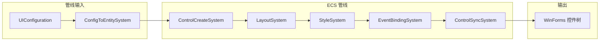
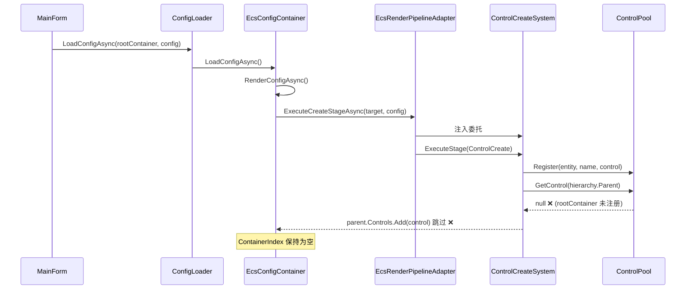
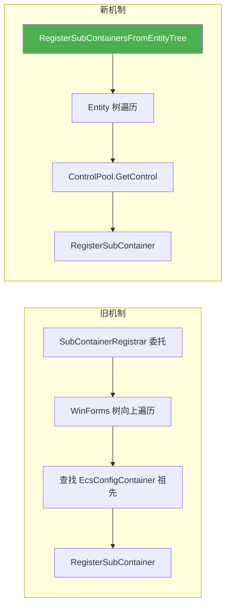

# ECS 渲染管线重构 — rootContainer 纳入 ECS 体系

> **版本：** v2.0
> **更新日期：** 2026-07-20
> **维护者：** WorkFlowPrj Team
>
> **配套文档：**
> - [`ECS渲染管线重构-ConfigContainer迁移实施记录.md`](./ECS渲染管线重构-ConfigContainer迁移实施记录.md) — ConfigContainer 迁移实施记录
> - [`ECS渲染管线重构-旧体系迁移方案.md`](./ECS渲染管线重构-旧体系迁移方案.md) — 方案设计文档
> - [`Document_Modular_Standard.md`](../../CsharpPrj/Structuring/Document_Modular_Standard.md) — 文档模块化规范

---

## 目录

- [ECS 渲染管线重构 — rootContainer 纳入 ECS 体系](#ecs-渲染管线重构--rootcontainer-纳入-ecs-体系)
  - [目录](#目录)
  - [第一部分：背景与方案](#第一部分背景与方案)
    - [1.1 现状与问题](#11-现状与问题)
      - [1.1.1 模块介绍](#111-模块介绍)
      - [1.1.2 问题分析](#112-问题分析)
    - [1.2 方案总览](#12-方案总览)
      - [1.2.1 设计理念](#121-设计理念)
      - [1.2.2 方案对比](#122-方案对比)
      - [1.2.3 选定方案](#123-选定方案)
    - [1.3 目录索引](#13-目录索引)
      - [1.3.1 现有文件](#131-现有文件)
      - [1.3.2 后续阶段新增文件](#132-后续阶段新增文件)
  - [第二部分：核心设计](#第二部分核心设计)
    - [2.1 数据结构与接口](#21-数据结构与接口)
      - [2.1.1 核心数据结构](#211-核心数据结构)
      - [2.1.2 接口契约](#212-接口契约)
    - [2.2 核心流程](#22-核心流程)
      - [2.2.1 执行顺序](#221-执行顺序)
      - [2.2.2 关键代码](#222-关键代码)
    - [2.3 通信与适配](#23-通信与适配)
      - [2.3.1 委托机制变更](#231-委托机制变更)
      - [2.3.2 桥接层设计](#232-桥接层设计)
  - [第三部分：实施步骤](#第三部分实施步骤)
    - [3.1 阶段划分](#31-阶段划分)
      - [3.1.1 阶段 1（并行）：新增方法 + 保留旧逻辑](#311-阶段-1并行新增方法--保留旧逻辑)
      - [3.1.2 阶段 2（混合）：启用新逻辑](#312-阶段-2混合启用新逻辑)
      - [3.1.3 阶段 3（迁移）：清理旧代码](#313-阶段-3迁移清理旧代码)
    - [3.2 优先级与顺序](#32-优先级与顺序)
    - [3.3 与现有系统的关系](#33-与现有系统的关系)
  - [4. 后续重构建议 — 控件全量纳入 ECS 体系](#4-后续重构建议--控件全量纳入-ecs-体系)
    - [4.1 当前 ECS 体系资产总览](#41-当前-ecs-体系资产总览)
      - [4.1.1 已有 Component（15 个）](#411-已有-component15-个)
      - [4.1.2 已有 System（6 个）](#412-已有-system6-个)
      - [4.1.3 核心桥接层](#413-核心桥接层)
    - [4.2 缺失的控件运行时状态](#42-缺失的控件运行时状态)
    - [4.3 分步骤彻底迁移路线图](#43-分步骤彻底迁移路线图)
    - [4.4 Phase 0：rootContainer 纳入 ECS 体系](#44-phase-0rootcontainer-纳入-ecs-体系)
    - [4.5 Phase 1：控件运行时值 Component 化](#45-phase-1控件运行时值-component-化)
      - [4.5.1 新增 Component 定义](#451-新增-component-定义)
      - [4.5.2 扩展已有 Component](#452-扩展已有-component)
    - [4.6 Phase 2：ControlValueSyncSystem 实现](#46-phase-2controlvaluesyncsystem-实现)
    - [4.7 Phase 3：旧体系适配器迁移](#47-phase-3旧体系适配器迁移)
      - [4.7.1 涉及文件清单](#471-涉及文件清单)
      - [4.7.2 WinFormsControlService 迁移](#472-winformscontrolservice-迁移)
      - [4.7.3 WinFormsControlHelper 迁移](#473-winformscontrolhelper-迁移)
    - [4.8 Phase 4：冗余清理](#48-phase-4冗余清理)
      - [4.8.1 涉及文件清单](#481-涉及文件清单)
      - [4.8.2 WdUIContainerManager 容器跟踪统一](#482-wduicontainermanager-容器跟踪统一)
    - [4.9 各 Phase 依赖关系与验证](#49-各-phase-依赖关系与验证)
    - [4.10 关键发现](#410-关键发现)

---

## 第一部分：背景与方案

### 1.1 现状与问题

#### 1.1.1 模块介绍

`EcsRenderPipelineAdapter` 是 ECS 渲染管线的核心适配器，负责将 UI 配置（`UIConfiguration`）通过 ECS 管线转换为 WinForms 控件树。其执行流程为：



`rootContainer`（`EcsConfigContainer` 类型）是管线的渲染目标（`target`），在 `MainForm` 构造函数中预先创建，直接添加到 `MainForm.Controls` 集合。

#### 1.1.2 问题分析

| 问题 | 表现 | 根因 |
|------|------|------|
| `contentContainer` 找不到 | 启动日志报告 `[FATAL] UI 初始化失败: MainLayout must contain a 'contentContainer'` | `rootContainer` 不在 ECS 体系内，`ContainerIndex` 为空 |
| 子容器无法注册 | `rootContainer.GetSubContainers()` 返回空列表 | `SubContainerRegistrar` 因 `ParentFinder` 返回 null 而跳过 |
| 控件无法添加到父容器 | 所有直接子控件无法添加到 `rootContainer.Controls` | `ControlPool.GetControl(hierarchy.Parent)` 返回 null |

**调用链分析：**



**根因：** `rootContainer` 是 `MainForm` 构造函数中预先创建的 `EcsConfigContainer` 实例，直接添加到 `MainForm.Controls` 集合，**从未经过 ECS 管线**，也未注册到 `ControlPool`。

**三棵树对比：**

| 树结构 | 状态 | 说明 |
|--------|------|------|
| Entity 树 | ✅ 正确 | `root → MainView → [sideContainer, contentContainer, ...]` |
| WinForms 控件树 | ✅ 正确 | `rootContainer → MainView → [sideContainer, contentContainer, ...]` |
| ContainerIndex | ❌ 为空 | 因 `SubContainerRegistrar` 未执行，子容器未注册 |

---

### 1.2 方案总览

#### 1.2.1 设计理念

| 维度 | 当前方案 | 新方案 |
|------|----------|--------|
| 子容器注册机制 | `SubContainerRegistrar` 委托（WinForms 树遍历） | `RegisterSubContainersFromEntityTree`（Entity 树遍历） |
| 父控件查找 | `ControlPool.GetControl(hierarchy.Parent)` | 同上（但 rootContainer 注册到 ControlPool 后可用） |
| 依赖关系 | 依赖 `ParentFinder` 查找结果 | 直接遍历 Entity 树，不依赖 `ParentFinder` |
| 一致性 | ❌ rootContainer 特殊处理 | ✅ 所有容器统一注册 |

#### 1.2.2 方案对比

| 方案 | 思路 | 优点 | 缺点 |
|------|------|------|------|
| **A: rootContainer 注册到 ControlPool** | 在管线执行前将 `rootContainer` 注册到 `ControlPool` | 改动最小 | 需要特殊处理 rootContainer 的 Entity 映射 |
| **B: ParentFinder 回退到 WinForms 树** | `ParentFinder` 找不到时递归查找 WinForms 控件树 | 兼容性好 | 引入回退逻辑，不够纯粹 |
| **C: Entity 树遍历注册** | 管线执行完成后，遍历 Entity 树统一注册子容器 | **彻底、一致** | 需要新增方法 |
| **D: 移除 SubContainerRegistrar，改为 Entity 树驱动** | 完全移除委托机制，`ContainerIndex` 由 Entity 树驱动 | **最彻底** | 改动较大 |

#### 1.2.3 选定方案

**方案 C** 是最佳平衡点：

```mermaid
graph TB
    subgraph 选定方案：Entity 树遍历注册
        A[管线执行前] --> B[注入委托]
        B --> C[创建 Entity 树]
        C --> D[创建 WinForms 控件]
        D --> E[★ RegisterSubContainersFromEntityTree]
        E --> F[遍历 Entity 树]
        F --> G[注册子容器到 ContainerIndex]
    end

    subgraph 优势
        H[不依赖 ParentFinder]
        I[Entity 树关系明确]
        J[逻辑清晰一致]
    end

    E -.-> H
    E -.-> I
    E -.-> J
```

- 不依赖 `ParentFinder` 查找父控件（绕过了 `ControlPool` 找不到根容器的问题）
- 直接遍历 Entity 树，Entity 树中的父子关系是明确的
- 在 `ControlCreateSystem.Update()` 完成后执行，此时所有控件都已创建并注册到 `ControlPool`
- 逻辑清晰：Entity 树 → WinForms 控件树 → ContainerIndex 树，三者保持一致

---

### 1.3 目录索引

#### 1.3.1 现有文件

| 文件路径 | 内容 | 操作 |
|---------|------|------|
| `CsharpPrj/Operation/FrontEndDriven/ECS/EcsRenderPipelineAdapter.cs` | ECS 渲染管线适配器 | **修改**：新增方法 + 修改流程 |
| `CsharpPrj/Operation/FrontEndDriven/WdUI.Container.cs` | `EcsConfigContainer` / `WdUIContainerManager` | **无需修改**（`RegisterSubContainer` 已存在） |
| `CsharpPrj/BasicMethod/ECS/Systems/ControlCreateSystem.cs` | 控件创建 System | **无需修改**（`SubContainerRegistrar` 保留接口） |
| `CsharpPrj/BasicMethod/ECS/Bridge/ControlPool.cs` | Entity↔Control 桥接层 | **无需修改** |

#### 1.3.2 后续阶段新增文件

| 阶段 | 文件路径 | 操作 |
|------|---------|------|
| Phase 1 | `CsharpPrj/Operation/FrontEndDriven/ECS/Components/SelectionComponent.cs` | **新增** |
| Phase 1 | `CsharpPrj/Operation/FrontEndDriven/ECS/Components/CheckStateComponent.cs` | **新增** |
| Phase 1 | `CsharpPrj/Operation/FrontEndDriven/ECS/Components/NumericValueComponent.cs` | **新增** |
| Phase 1 | `CsharpPrj/Operation/FrontEndDriven/ECS/Components/DateTimeValueComponent.cs` | **新增** |
| Phase 1 | `CsharpPrj/Operation/FrontEndDriven/ECS/Components/ListSelectionComponent.cs` | **新增** |
| Phase 2 | `CsharpPrj/BasicMethod/ECS/Systems/ControlValueSyncSystem.cs` | **新增** |

---

## 第二部分：核心设计

### 2.1 数据结构与接口

#### 2.1.1 核心数据结构

```csharp
// Entity 树中的父子关系
public struct ControlHierarchyComponent : IComponent
{
    public Entity Parent;           // 父 Entity
    public List<Entity> Children;   // 子 Entity 列表
}

// 容器索引（EcsContainer 基类）
public class ContainerIndex
{
    // O(1) 名称 → 容器查找
    public EcsConfigContainer? Find(string name);

    // 注册子容器
    public void RegisterSubContainer(EcsConfigContainer child);

    // 清空索引
    public void Clear();
}
```

#### 2.1.2 接口契约

| 接口/方法 | 调用方 | 职责 |
|-----------|--------|------|
| `RegisterSubContainersFromEntityTree(target)` | `ExecuteCreateStageAsync` | 遍历 Entity 树注册子容器 |
| `RegisterSubContainersRecursive(entity, parentContainer)` | 递归调用 | 递归遍历辅助方法 |
| `ControlPool.GetControl(entity)` | `RegisterSubContainersRecursive` | 通过 Entity 获取 Control 引用 |
| `EntityManager.TryGetComponent<T>(entity, out T)` | `RegisterSubContainersRecursive` | 获取 Entity 的 Component |

---

### 2.2 核心流程

#### 2.2.1 执行顺序

```mermaid
graph TB
    subgraph 修改前流程
        A1[注入委托] --> B1[LoadConfiguration]
        B1 --> C1[ExecuteStage ControlCreate]
        C1 --> D1[SubContainerRegistrar 执行]
        D1 -.-> E1[ParentFinder 返回 null]
        E1 -.-> F1[子容器注册跳过 ❌]
    end

    subgraph 修改后流程
        A2[注入委托] --> B2[LoadConfiguration]
        B2 --> C2[ExecuteStage ControlCreate]
        C2 --> D2[★ RegisterSubContainersFromEntityTree]
        D2 --> E2[遍历 Entity 树]
        E2 --> F2[ControlPool.GetControl]
        F2 --> G2[注册子容器到 ContainerIndex ✅]
    end

    style D2 fill:#4CAF50,color:#fff
    style G2 fill:#4CAF50,color:#fff
```



#### 2.2.2 关键代码

**新增方法：`RegisterSubContainersFromEntityTree`**

```csharp
/// <summary>
/// 从 Entity 树遍历注册子容器到 ContainerIndex
/// <para>★ 2026-07-20 重构：替代 SubContainerRegistrar 委托机制。</para>
/// <para>   在 ControlCreateSystem.Update() 完成后调用，此时所有控件已创建并注册到 ControlPool。</para>
/// <para>   直接遍历 Entity 树，不依赖 ParentFinder 查找父控件，</para>
/// <para>   解决 rootContainer 不在 ControlPool 中导致子容器无法注册的问题。</para>
/// </summary>
private void RegisterSubContainersFromEntityTree(object target)
{
    if (target is not WdEcsConfigContainer rootContainer)
        return;

    var rootEntity = _integration.RootEntity;
    if (!rootEntity.IsValid)
        return;

    // 递归遍历 Entity 树，为每个 EcsConfigContainer 注册到父容器
    RegisterSubContainersRecursive(rootEntity, rootContainer);
}

/// <summary>
/// 递归遍历 Entity 树，注册子容器
/// </summary>
private void RegisterSubContainersRecursive(
    Entity entity, WdEcsConfigContainer parentContainer)
{
    if (_integration.EntityManager == null || _integration.ControlPool == null)
        return;

    if (!_integration.EntityManager.TryGetComponent<ControlHierarchyComponent>(
        entity, out var hierarchy))
        return;

    foreach (var childEntity in hierarchy.Children)
    {
        var control = _integration.ControlPool.GetControl(childEntity);
        if (control is WdEcsConfigContainer childContainer
            && childContainer != parentContainer)
        {
            // 注册子容器到父容器的 ContainerIndex
            parentContainer.RegisterSubContainer(childContainer);
        }

        // 递归处理子 Entity
        // 如果当前控件是 EcsConfigContainer，以它作为新的父容器继续遍历
        // 否则沿用原来的 parentContainer
        RegisterSubContainersRecursive(childEntity,
            control is WdEcsConfigContainer ec ? ec : parentContainer);
    }
}
```

**修改 `ExecuteCreateStageAsync`：**

```csharp
public Task ExecuteCreateStageAsync(object target, object config)
{
    ThrowIfDisposed();

    if (config is not UIConfiguration uiConfig)
        throw new ArgumentException(
            "config 必须是 UIConfiguration 类型", nameof(config));

    // ★ 注入工厂委托到 ControlCreateSystem
    var createSystem = _integration.ControlCreateSystem;
    if (createSystem != null)
    {
        createSystem.ControlFactory = (type) =>
        {
            return WdUISettings.Instance.ControlTypes.CreateControl(type);
        };

        createSystem.ParentFinder = (entity) =>
        {
            if (_integration.EntityManager != null &&
                _integration.EntityManager.TryGetComponent<ControlHierarchyComponent>(
                    entity, out var hierarchy) &&
                hierarchy.Parent.IsValid)
            {
                return _integration.ControlPool?.GetControl(hierarchy.Parent);
            }
            return null;
        };

        // ★ 2026-07-20 重构：子容器注册移至 RegisterSubContainersFromEntityTree
        createSystem.SubContainerRegistrar = null;
    }

    // 初始化 + 加载配置 + 控件创建
    if (!_integration.IsInitialized)
        _integration.Initialize();

    _integration.LoadConfiguration(uiConfig);
    _integration.ExecuteStage(PipelineStage.ControlCreate);

    // ★ 2026-07-20 重构：Entity 树遍历注册子容器
    RegisterSubContainersFromEntityTree(target);

    return Task.CompletedTask;
}
```

---

### 2.3 通信与适配

#### 2.3.1 委托机制变更



| 维度 | 旧机制（SubContainerRegistrar） | 新机制（Entity 树遍历） |
|------|-------------------------------|------------------------|
| 遍历对象 | WinForms 控件树 | Entity 树 |
| 查找方式 | `subContainer.Parent` 向上遍历 | `ControlHierarchyComponent.Children` 向下遍历 |
| 依赖 | `ParentFinder` 返回非 null | 无依赖 |
| 性能 | O(n) 递归遍历 | O(n) 递归遍历（但无 WinForms 控件树开销） |
| 一致性 | ❌ rootContainer 不在 ControlPool 中时失效 | ✅ 始终有效 |

#### 2.3.2 桥接层设计

```
EcsRenderPipelineAdapter
  │
  ├── _integration (FrontEndEcsIntegration)
  │     ├── EntityManager        → Component 读写
  │     ├── ControlPool          → Entity↔Control 映射
  │     ├── ControlCreateSystem  → 控件创建（含委托注入）
  │     └── RootEntity           → Entity 树根节点
  │
  └── RegisterSubContainersFromEntityTree(target)
        ├── 获取 RootEntity
        ├── 递归遍历 Entity 树
        ├── ControlPool.GetControl(entity) → Control
        └── parentContainer.RegisterSubContainer(child)
```

---

## 第三部分：实施步骤

### 3.1 阶段划分

#### 3.1.1 阶段 1（并行）：新增方法 + 保留旧逻辑

- 在 `EcsRenderPipelineAdapter` 中新增 `RegisterSubContainersFromEntityTree` 和 `RegisterSubContainersRecursive` 方法
- **保留** `SubContainerRegistrar` 旧逻辑（设为 null 但可回滚）
- 验证：编译通过，功能不变

#### 3.1.2 阶段 2（混合）：启用新逻辑

- 在 `ExecuteCreateStageAsync` 中调用 `RegisterSubContainersFromEntityTree`
- 将 `SubContainerRegistrar` 设为 `null`
- 验证：`rootContainer.GetSubContainers()` 返回非空列表

#### 3.1.3 阶段 3（迁移）：清理旧代码

- 移除 `SubContainerRegistrar` 委托中的旧逻辑注释
- 确认无其他代码依赖 `SubContainerRegistrar`

### 3.2 优先级与顺序

| 优先级 | 任务 | 文件 | 依赖 |
|--------|------|------|------|
| **P0** | 新增 `RegisterSubContainersFromEntityTree` 方法 | `EcsRenderPipelineAdapter.cs` | 无 |
| **P0** | 新增 `RegisterSubContainersRecursive` 方法 | `EcsRenderPipelineAdapter.cs` | 无 |
| **P1** | 修改 `ExecuteCreateStageAsync` 调用新方法 | `EcsRenderPipelineAdapter.cs` | P0 |
| **P1** | 将 `SubContainerRegistrar` 设为 null | `EcsRenderPipelineAdapter.cs` | P0 |
| **P2** | 构建验证 | `FrontEndDriven.csproj` | P1 |
| **P2** | 运行测试 | `math_browser_simple_test.json` | P1 |

### 3.3 与现有系统的关系

| 现有模块 | 集成方式 | 说明 |
|---------|---------|------|
| `ControlCreateSystem` | `SubContainerRegistrar` 设为 null | 接口保留，未来可复用 |
| `EcsConfigContainer.RegisterSubContainer` | 被 `RegisterSubContainersFromEntityTree` 调用 | 方法已存在，无需修改 |
| `ControlPool` | 通过 `GetControl(entity)` 查找控件 | 需确保 rootContainer 注册到 ControlPool |
| `ContainerIndex` | 由 `RegisterSubContainer` 维护 | 无需修改 |

---

## 4. 后续重构建议 — 控件全量纳入 ECS 体系

> **分析日期：** 2026-07-20
> **核心理念：** 控件的**所有运行时状态**都应存储在 ECS Component 中，而非直接操作 WinForms 控件属性。
> **设计原则：** Component 是唯一数据源，WinForms 控件属性仅作为渲染目标。

### 4.1 当前 ECS 体系资产总览

#### 4.1.1 已有 Component（15 个）

| 层级 | 文件路径 | Component | 用途 |
|------|---------|-----------|------|
| TConfig | `CsharpPrj/Plate/TConfig/ECS/Components/ControlTypeComponent.cs` | `ControlTypeComponent` | 类型/名称/文本/启用/可见 |
| TConfig | `CsharpPrj/Plate/TConfig/ECS/Components/ControlStateComponent.cs` | `ControlStateComponent` | 生命周期标志 |
| TConfig | `CsharpPrj/Plate/TConfig/ECS/Components/ControlHierarchyComponent.cs` | `ControlHierarchyComponent` | Entity 树父子关系 |
| TConfig | `CsharpPrj/Plate/TConfig/ECS/Components/ControlTagComponent.cs` | `ControlTagComponent` | 控件标签 |
| TConfig | `CsharpPrj/Plate/TConfig/ECS/Components/WinFormsHandleComponent.cs` | `WinFormsHandleComponent` | 控件句柄 |
| TConfig | `CsharpPrj/Plate/TConfig/ECS/Components/ComputedLayoutComponent.cs` | `ComputedLayoutComponent` | 计算后布局 |
| TConfig | `CsharpPrj/Plate/TConfig/ECS/Components/MergedStyleComponent.cs` | `MergedStyleComponent` | 合并后样式 |
| TConfig | `CsharpPrj/Plate/TConfig/ECS/Components/ColorStyleComponent.cs` | `ColorStyleComponent` | 颜色样式 |
| TConfig | `CsharpPrj/Plate/TConfig/ECS/Components/FontStyleComponent.cs` | `FontStyleComponent` | 字体样式 |
| TConfig | `CsharpPrj/Plate/TConfig/ECS/Components/StyleRefComponent.cs` | `StyleRefComponent` | 样式引用 |
| TConfig | `CsharpPrj/Plate/TConfig/ECS/Components/EventBindingsComponent.cs` | `EventBindingsComponent` | 事件绑定列表 |
| TConfig | `CsharpPrj/Plate/TConfig/ECS/Components/EventBindingComponent.cs` | `EventBindingComponent` | 单条事件绑定 |
| TConfig | `CsharpPrj/Plate/TConfig/ECS/Components/PixelLayoutComponent.cs` | `PixelLayoutComponent` | 像素布局 |
| TConfig | `CsharpPrj/Plate/TConfig/ECS/Components/ProportionalLayoutComponent.cs` | `ProportionalLayoutComponent` | 比例布局 |
| BasicMethod | `CsharpPrj/BasicMethod/ECS/Components/ScreenRootComponent.cs` | `ScreenRootComponent` | 屏幕根容器 |

**FrontEndDriven 层扩展 Component（5 个）：**

| 文件路径 | Component | 用途 |
|---------|-----------|------|
| `CsharpPrj/Operation/FrontEndDriven/ECS/Components/IdentityComponent.cs` | `IdentityComponent` | 标识（名称/类型/文本/启用） |
| `CsharpPrj/Operation/FrontEndDriven/ECS/Components/PositionComponent.cs` | `PositionComponent` | 位置（Left/Top/Width/Height/Anchor/Dock） |
| `CsharpPrj/Operation/FrontEndDriven/ECS/Components/StyleComponent.cs` | `StyleComponent` | 样式（字体/颜色/对齐/只读） |
| `CsharpPrj/Operation/FrontEndDriven/ECS/Components/TextComponent.cs` | `TextComponent` | 文本内容 |
| `CsharpPrj/Operation/FrontEndDriven/ECS/Components/EventComponent.cs` | `EventComponent` | 事件映射 |

#### 4.1.2 已有 System（6 个）

| 文件路径 | System | 管线阶段 | 职责 |
|---------|--------|---------|------|
| `CsharpPrj/BasicMethod/ECS/Systems/ConfigToEntitySystem.cs` | `ConfigToEntitySystem` | 1-配置→Entity | 将 UI 配置转换为 Entity 树 |
| `CsharpPrj/BasicMethod/ECS/Systems/ControlCreateSystem.cs` | `ControlCreateSystem` | 2-控件创建 | 创建 WinForms 控件并注册到 ControlPool |
| `CsharpPrj/BasicMethod/ECS/Systems/LayoutSystem.cs` | `LayoutSystem` | 3-布局计算 | 计算控件布局位置 |
| `CsharpPrj/BasicMethod/ECS/Systems/StyleSystem.cs` | `StyleSystem` | 4-样式合并 | 合并样式并写入 Component |
| `CsharpPrj/BasicMethod/ECS/Systems/EventBindingSystem.cs` | `EventBindingSystem` | 5-事件绑定 | 绑定事件到 WinForms 控件 |
| `CsharpPrj/BasicMethod/ECS/Systems/ControlSyncSystem.cs` | `ControlSyncSystem` | 6-运行时同步 | 将布局/样式 Component 同步到控件 |

#### 4.1.3 核心桥接层

| 文件路径 | 类 | 职责 |
|---------|-----|------|
| `CsharpPrj/BasicMethod/ECS/Bridge/ControlPool.cs` | `ControlPool` | Entity↔controlName↔Control 三向映射 |
| `CsharpPrj/BasicMethod/ECS/Bridge/ControlFactory.cs` | `ControlFactory` | 控件实例工厂 |

---

### 4.2 缺失的控件运行时状态

以下 WinForms 控件属性**当前未纳入 ECS Component**，仍通过 `WinFormsControlService` 直接操作控件实例：

| 控件属性 | 当前处理方式 | 应纳入的 Component | 涉及文件 |
|----------|-------------|-------------------|---------|
| `TextBox.Text` | `WinFormsControlService` 直接读写 | `TextComponent`（已有，但未运行时同步） | `FrontEndDriven/WinForms/Implementation/WinFormsControlService.cs` |
| `ComboBox.SelectedItem` | `WinFormsControlService` 直接读写 | **新增** `SelectionComponent` | 同上 |
| `CheckBox.Checked` | `WinFormsControlService` 直接读写 | **新增** `CheckStateComponent` | 同上 |
| `Control.Enabled` | `ControlTypeComponent.Enabled`（仅初始化） | **扩展** `ControlTypeComponent` 运行时同步 | 同上 |
| `Control.Visible` | `ControlTypeComponent.Visible`（仅初始化） | **扩展** `ControlTypeComponent` 运行时同步 | 同上 |
| `NumericUpDown.Value` | `WinFormsControlService` 直接读写 | **新增** `NumericValueComponent` | 同上 |
| `DateTimePicker.Value` | `WinFormsControlService` 直接读写 | **新增** `DateTimeValueComponent` | 同上 |
| `ListView.SelectedItems` | `WinFormsControlService` 直接读写 | **新增** `ListSelectionComponent` | 同上 |

---

### 4.3 分步骤彻底迁移路线图

```mermaid
graph TB
    subgraph Phase 0[rootContainer 纳入 ECS 体系]
        P0A[实现 RegisterSubContainersFromEntityTree]
        P0B[清理 SubContainerRegistrar]
        P0C[rootContainer 注册到 ControlPool]
        P0A --> P0B --> P0C
    end

    subgraph Phase 1[控件运行时值 Component 化]
        P1A[新增 SelectionComponent]
        P1B[新增 CheckStateComponent]
        P1C[新增 NumericValueComponent]
        P1D[新增 DateTimeValueComponent]
        P1E[新增 ListSelectionComponent]
        P1F[扩展 TextComponent]
        P1G[扩展 ControlTypeComponent]
    end

    subgraph Phase 2[ControlValueSyncSystem 实现]
        P2A[监听 Component 变更 → 同步到控件]
        P2B[监听控件事件 → 同步回 Component]
        P2C[替代 WinFormsControlService]
    end

    subgraph Phase 3[旧体系适配器迁移]
        P3A[WinFormsControlService → 委托给 ControlValueSyncSystem]
        P3B[WinFormsControlHelper → 委托给 ControlPool]
        P3C[Finder/Writer 适配器 → 委托给 ControlPool]
    end

    subgraph Phase 4[冗余清理]
        P4A[移除 WdUIContainerManager._containers]
        P4B[统一使用 ContainerIndex]
        P4C[统一事件类型为 ECS 驱动]
    end

    Phase 0 --> Phase 1 --> Phase 2 --> Phase 3 --> Phase 4
```

---

### 4.4 Phase 0：rootContainer 纳入 ECS 体系

> 本文档第 2 章已详细描述，此处仅列出文件清单。

**涉及文件：**

| 操作 | 文件路径 |
|------|---------|
| **新增** `RegisterSubContainersFromEntityTree` 方法 | `CsharpPrj/Operation/FrontEndDriven/ECS/EcsRenderPipelineAdapter.cs` |
| **新增** `RegisterSubContainersRecursive` 方法 | 同上 |
| **修改** `ExecuteCreateStageAsync` 调用新方法 | 同上 |
| **修改** `SubContainerRegistrar` 设为 null | 同上 |

---

### 4.5 Phase 1：控件运行时值 Component 化

#### 4.5.1 新增 Component 定义

**文件：** `CsharpPrj/Operation/FrontEndDriven/ECS/Components/SelectionComponent.cs`

```csharp
/// <summary>
/// 选择型控件值 Component — ComboBox/ListBox 等
/// <para>存储当前选中项和选项列表。</para>
/// </summary>
public struct SelectionComponent : IComponent
{
    /// <summary>当前选中项（字符串形式）</summary>
    public string? SelectedItem;
    /// <summary>选中项索引（-1 表示无选中）</summary>
    public int SelectedIndex;
    /// <summary>最后更新时间</summary>
    public DateTime LastUpdated;
}
```

**文件：** `CsharpPrj/Operation/FrontEndDriven/ECS/Components/CheckStateComponent.cs`

```csharp
/// <summary>
/// 勾选状态 Component — CheckBox/RadioButton 等
/// </summary>
public struct CheckStateComponent : IComponent
{
    /// <summary>是否勾选</summary>
    public bool Checked;
    /// <summary>最后更新时间</summary>
    public DateTime LastUpdated;
}
```

**文件：** `CsharpPrj/Operation/FrontEndDriven/ECS/Components/NumericValueComponent.cs`

```csharp
/// <summary>
/// 数值型控件值 Component — NumericUpDown 等
/// </summary>
public struct NumericValueComponent : IComponent
{
    /// <summary>当前数值</summary>
    public decimal Value;
    /// <summary>最后更新时间</summary>
    public DateTime LastUpdated;
}
```

**文件：** `CsharpPrj/Operation/FrontEndDriven/ECS/Components/DateTimeValueComponent.cs`

```csharp
/// <summary>
/// 日期型控件值 Component — DateTimePicker 等
/// </summary>
public struct DateTimeValueComponent : IComponent
{
    /// <summary>当前日期时间</summary>
    public DateTime Value;
    /// <summary>最后更新时间</summary>
    public DateTime LastUpdated;
}
```

**文件：** `CsharpPrj/Operation/FrontEndDriven/ECS/Components/ListSelectionComponent.cs`

```csharp
/// <summary>
/// 列表选择 Component — ListView/DataGridView 等
/// </summary>
public struct ListSelectionComponent : IComponent
{
    /// <summary>选中项文本列表</summary>
    public List<string>? SelectedItems;
    /// <summary>选中项索引列表</summary>
    public List<int>? SelectedIndices;
    /// <summary>最后更新时间</summary>
    public DateTime LastUpdated;
}
```

#### 4.5.2 扩展已有 Component

**文件：** `CsharpPrj/Operation/FrontEndDriven/ECS/Components/TextComponent.cs`

```csharp
// 扩展：增加运行时同步字段
public struct TextComponent : IComponent
{
    /// <summary>文本内容</summary>
    public string Text;
    /// <summary>★ 新增：最后更新时间（用于 ControlValueSyncSystem 判断是否需要同步）</summary>
    public DateTime LastUpdated;
}
```

**文件：** `CsharpPrj/Plate/TConfig/ECS/Components/ControlTypeComponent.cs`

```csharp
// 扩展：增加运行时同步字段
public struct ControlTypeComponent : IComponent
{
    public string Type;
    public string Name;
    public string Text;
    public bool Enabled;
    public bool Visible;
    /// <summary>★ 新增：运行时 Enabled 最后更新时间</summary>
    public DateTime EnabledLastUpdated;
    /// <summary>★ 新增：运行时 Visible 最后更新时间</summary>
    public DateTime VisibleLastUpdated;
}
```

---

### 4.6 Phase 2：ControlValueSyncSystem 实现

**文件：** `CsharpPrj/BasicMethod/ECS/Systems/ControlValueSyncSystem.cs`（**新增**）

```csharp
// ============================================================
// ControlValueSyncSystem — 控件运行时值同步 System
//
// 职责：实现 ECS Component ↔ WinForms 控件属性的双向同步。
//  - Component 变更 → 同步到 WinForms 控件
//  - WinForms 控件事件 → 同步回 Component
//
// 设计原则：
//  - Component 是唯一数据源
//  - WinForms 控件属性仅作为渲染目标
//  - 通过 ControlPool 获取控件引用
//  - 通过 EntityManager 监听 Component 变更
// ============================================================

namespace ECS.Systems;

public class ControlValueSyncSystem : IDisposable
{
    private readonly EntityManager _entityManager;
    private readonly ControlPool _controlPool;
    private bool _disposed;

    public ControlValueSyncSystem(EntityManager entityManager, ControlPool controlPool)
    {
        _entityManager = entityManager;
        _controlPool = controlPool;

        // 监听 Component 变更事件
        _entityManager.ComponentUpdated += OnComponentUpdated;
    }

    private void OnComponentUpdated(Entity entity, Type componentType, object? oldValue, object newValue)
    {
        var control = _controlPool.GetControl(entity);
        if (control == null || control.IsDisposed)
            return;

        // 根据 Component 类型分发同步
        if (componentType == typeof(TextComponent))
            SyncText(control, (TextComponent)newValue);
        else if (componentType == typeof(SelectionComponent))
            SyncSelection(control, (SelectionComponent)newValue);
        else if (componentType == typeof(CheckStateComponent))
            SyncCheckState(control, (CheckStateComponent)newValue);
        else if (componentType == typeof(NumericValueComponent))
            SyncNumericValue(control, (NumericValueComponent)newValue);
        else if (componentType == typeof(DateTimeValueComponent))
            SyncDateTimeValue(control, (DateTimeValueComponent)newValue);
        else if (componentType == typeof(ListSelectionComponent))
            SyncListSelection(control, (ListSelectionComponent)newValue);
        else if (componentType == typeof(ControlTypeComponent))
            SyncControlType(control, (ControlTypeComponent)newValue);
    }

    // ========== Component → WinForms 同步方法 ==========

    private static void SyncText(Control control, TextComponent text)
    {
        if (control is TextBox textBox)
            textBox.Text = text.Text ?? string.Empty;
        else if (control is Label label)
            label.Text = text.Text ?? string.Empty;
        else if (control is Button button)
            button.Text = text.Text ?? string.Empty;
    }

    private static void SyncSelection(Control control, SelectionComponent selection)
    {
        if (control is ComboBox comboBox)
        {
            if (selection.SelectedIndex >= 0 && selection.SelectedIndex < comboBox.Items.Count)
                comboBox.SelectedIndex = selection.SelectedIndex;
            else if (selection.SelectedItem != null)
                comboBox.SelectedItem = selection.SelectedItem;
        }
    }

    private static void SyncCheckState(Control control, CheckStateComponent checkState)
    {
        if (control is CheckBox checkBox)
            checkBox.Checked = checkState.Checked;
    }

    private static void SyncNumericValue(Control control, NumericValueComponent numeric)
    {
        if (control is NumericUpDown numericUpDown)
            numericUpDown.Value = numeric.Value;
    }

    private static void SyncDateTimeValue(Control control, DateTimeValueComponent dateTime)
    {
        if (control is DateTimePicker dateTimePicker)
            dateTimePicker.Value = dateTime.Value;
    }

    private static void SyncListSelection(Control control, ListSelectionComponent listSelection)
    {
        if (control is ListView listView)
        {
            listView.SelectedItems.Clear();
            if (listSelection.SelectedIndices != null)
            {
                foreach (var index in listSelection.SelectedIndices)
                {
                    if (index >= 0 && index < listView.Items.Count)
                        listView.Items[index].Selected = true;
                }
            }
        }
    }

    private static void SyncControlType(Control control, ControlTypeComponent type)
    {
        control.Enabled = type.Enabled;
        control.Visible = type.Visible;
    }

    // ========== WinForms → Component 同步（由控件事件触发） ==========

    /// <summary>
    /// 从 WinForms 控件读取值并更新到 Component
    /// <para>由控件事件处理器调用（如 TextBox.TextChanged、CheckBox.CheckedChanged 等）。</para>
    /// </summary>
    public void SyncFromControl(Entity entity, Control control)
    {
        // 读取 Text
        if (_entityManager.HasComponent<TextComponent>(entity))
        {
            var text = _entityManager.GetComponent<TextComponent>(entity);
            text.Text = control.Text;
            text.LastUpdated = DateTime.UtcNow;
            _entityManager.SetComponent(entity, text);
        }

        // 根据控件类型读取特定值
        switch (control)
        {
            case ComboBox comboBox:
                if (_entityManager.HasComponent<SelectionComponent>(entity))
                {
                    var sel = _entityManager.GetComponent<SelectionComponent>(entity);
                    sel.SelectedItem = comboBox.SelectedItem?.ToString();
                    sel.SelectedIndex = comboBox.SelectedIndex;
                    sel.LastUpdated = DateTime.UtcNow;
                    _entityManager.SetComponent(entity, sel);
                }
                break;

            case CheckBox checkBox:
                if (_entityManager.HasComponent<CheckStateComponent>(entity))
                {
                    var cs = _entityManager.GetComponent<CheckStateComponent>(entity);
                    cs.Checked = checkBox.Checked;
                    cs.LastUpdated = DateTime.UtcNow;
                    _entityManager.SetComponent(entity, cs);
                }
                break;

            case NumericUpDown numericUpDown:
                if (_entityManager.HasComponent<NumericValueComponent>(entity))
                {
                    var nv = _entityManager.GetComponent<NumericValueComponent>(entity);
                    nv.Value = numericUpDown.Value;
                    nv.LastUpdated = DateTime.UtcNow;
                    _entityManager.SetComponent(entity, nv);
                }
                break;

            case DateTimePicker dateTimePicker:
                if (_entityManager.HasComponent<DateTimeValueComponent>(entity))
                {
                    var dv = _entityManager.GetComponent<DateTimeValueComponent>(entity);
                    dv.Value = dateTimePicker.Value;
                    dv.LastUpdated = DateTime.UtcNow;
                    _entityManager.SetComponent(entity, dv);
                }
                break;
        }
    }

    public void Dispose()
    {
        if (!_disposed)
        {
            _entityManager.ComponentUpdated -= OnComponentUpdated;
            _disposed = true;
        }
    }
}
```

---

### 4.7 Phase 3：旧体系适配器迁移

#### 4.7.1 涉及文件清单

| 文件路径 | 当前职责 | 迁移目标 |
|---------|---------|---------|
| `CsharpPrj/Operation/FrontEndDriven/WinForms/Implementation/WinFormsControlService.cs` | 控件值直接读写 | 委托给 `ControlValueSyncSystem` |
| `CsharpPrj/Operation/FrontEndDriven/Implementation/WinFormsControlHelper.cs` | 控件递归查找 | 委托给 `ControlPool` |
| `CsharpPrj/Operation/FrontEndDriven/Implementation/ControlRegistryAwareFinder.cs` | 控件查找 | 委托给 `ControlPool` |
| `CsharpPrj/Operation/FrontEndDriven/WdUI.Core.cs`（适配器部分） | Finder/Writer 适配器 | 委托给 `ControlPool` + `ControlValueSyncSystem` |

#### 4.7.2 WinFormsControlService 迁移

```csharp
// ★ 迁移后：WinFormsControlService 委托给 ControlValueSyncSystem
public class WinFormsControlService
{
    private readonly ControlValueSyncSystem _syncSystem;
    private readonly ControlPool _controlPool;

    public object? GetValue(Control control)
    {
        // 通过 ControlPool 获取 Entity
        var entity = _controlPool.GetEntity(control.Name);
        if (!entity.IsValid)
            return null;

        // 通过 Component 读取值
        if (_syncSystem.TryGetComponentValue(entity, out var value))
            return value;

        return null;
    }

    public void SetValue(Control control, object? value)
    {
        var entity = _controlPool.GetEntity(control.Name);
        if (!entity.IsValid)
            return;

        // 通过 Component 写入值（触发同步）
        _syncSystem.SetComponentValue(entity, value?.ToString() ?? string.Empty);
    }
}
```

#### 4.7.3 WinFormsControlHelper 迁移

```csharp
// ★ 迁移后：所有控件查找统一走 ControlPool
public static class WinFormsControlHelper
{
    private static ControlPool? _controlPool;

    public static void Initialize(ControlPool controlPool)
    {
        _controlPool = controlPool;
    }

    public static Control? FindControlByName(Control parent, string name)
    {
        // O(1) 查找，无需递归遍历
        return _controlPool?.GetControl(name);
    }
}
```

---

### 4.8 Phase 4：冗余清理

#### 4.8.1 涉及文件清单

| 文件路径 | 当前问题 | 清理方案 |
|---------|---------|---------|
| `CsharpPrj/Operation/FrontEndDriven/WdUI.Container.cs`（`WdUIContainerManager`） | 独立 `ConcurrentDictionary` 跟踪容器 | 统一使用 `ContainerIndex` |
| `CsharpPrj/Operation/FrontEndDriven/WdUI.Container.cs`（`RenderConfigAsync`） | 旧事件类型 `EventsBoundEventArgs` | 统一为 ECS Component 驱动 |

#### 4.8.2 WdUIContainerManager 容器跟踪统一

```csharp
// ★ 迁移后：移除 _containers 字典，统一使用 ContainerIndex
public class WdUIContainerManager
{
    // 移除：
    // private readonly ConcurrentDictionary<string, EcsConfigContainer> _containers = new();

    public EcsConfigContainer? GetContainer(string name)
    {
        // 统一使用 ContainerIndex
        return ContainerIndex.Find(name);
    }

    public void RegisterContainer(EcsConfigContainer container)
    {
        // ContainerIndex 已在 EcsContainer 基类中维护
        // 无需额外注册
    }
}
```

---

### 4.9 各 Phase 依赖关系与验证

```
Phase 0 ──────────────────────────────────────────────
  依赖：无（独立实施）
  验证：rootContainer.GetSubContainers() 返回非空列表
  文件：EcsRenderPipelineAdapter.cs

Phase 1 ──────────────────────────────────────────────
  依赖：Phase 0（ControlPool 可用）
  验证：新增 Component 编译通过，Entity 可附加对应 Component
  文件：新增 5 个 Component 文件 + 修改 2 个已有 Component

Phase 2 ──────────────────────────────────────────────
  依赖：Phase 1（Component 定义就绪）
  验证：Component 变更自动同步到控件，控件事件自动同步回 Component
  文件：新增 ControlValueSyncSystem.cs

Phase 3 ──────────────────────────────────────────────
  依赖：Phase 2（ControlValueSyncSystem 可用）
  验证：旧适配器调用结果与 ECS 体系一致
  文件：WinFormsControlService.cs、WinFormsControlHelper.cs 等

Phase 4 ──────────────────────────────────────────────
  依赖：Phase 0（ContainerIndex 可用）
  验证：移除冗余后功能不变
  文件：WdUI.Container.cs
```

---

### 4.10 关键发现

> **文档与代码不一致：** 本文档第 2.2.2 节描述的 `SubContainerRegistrar = null` 在实际代码（`EcsRenderPipelineAdapter.cs` 第 250-281 行）中**并未实施**，旧逻辑仍然保留。这是 Phase 0 中应优先修复的问题。
>
> **核心矛盾：** 当前 ECS 体系已有 6 个 System 和 15+ 个 Component，但控件运行时值（Text、Enabled、Visible、Checked、SelectedItem 等）仍通过 `WinFormsControlService` 直接操作 WinForms 控件属性，完全绕过 ECS。这是 Phase 1-3 要解决的核心问题。


