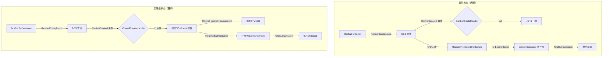
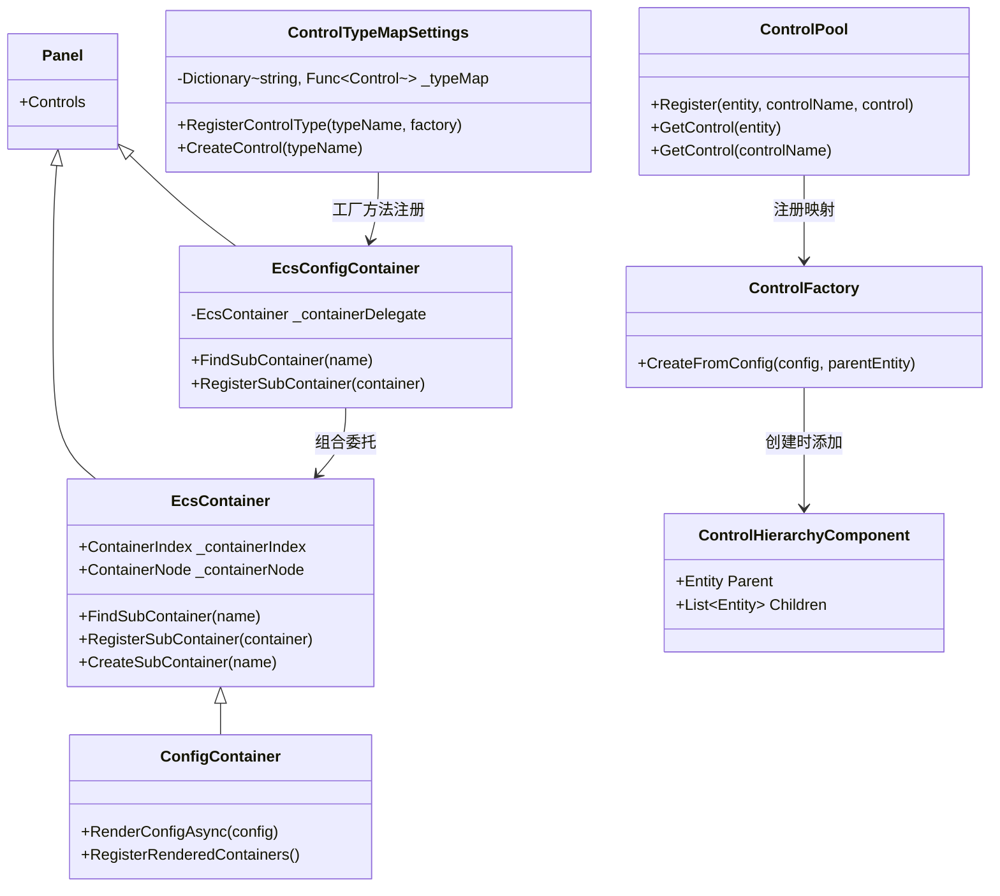
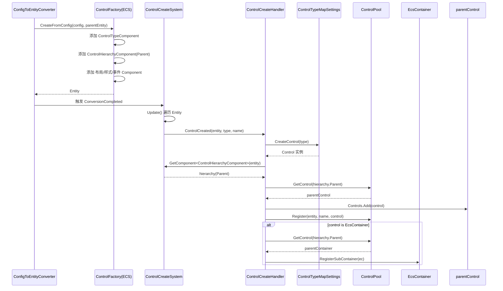

# ECS 渲染管线重构 — 旧体系迁移方案

> **版本：** v2.0
> **更新日期：** 2026-07-20
> **维护者：** WorkFlowPrj Team
>
> **配套文档：**
> - [`WdUI 容器实现`](../../CsharpPrj/Operation/WdUI/UI/WdUI.Container.cs) — `ConfigContainer` 源码
> - [`EcsContainer 基类`](../../CsharpPrj/Share/UniversalMiddleware/Container/EcsContainer.cs) — 容器基类实现
> - [`ControlFactory`](../../CsharpPrj/BasicMethod/ECS/Bridge/ControlFactory.cs) — ECS 控件工厂
> - [`ControlPool`](../../CsharpPrj/BasicMethod/ECS/Bridge/ControlPool.cs) — ECS↔WinForms 桥接层
> - [`ControlTypeMapSettings`](../../CsharpPrj/Operation/WdUI/WdUI.Settings.cs) — 控件类型映射配置
> - [`文档模块化规范`](../../CsharpPrj/Structuring/Document_Modular_Standard.md) — 本文档遵循的规范

---

## 目录

- [第一部分：背景与方案](#第一部分背景与方案)
  - [1.1 现状与问题](#11-现状与问题)
  - [1.2 方案总览](#12-方案总览)
  - [1.3 目录索引](#13-目录索引)
- [第二部分：核心设计](#第二部分核心设计)
  - [2.1 数据结构与接口](#21-数据结构与接口)
  - [2.2 核心流程](#22-核心流程)
  - [2.3 通信与适配](#23-通信与适配)
- [第三部分：实施步骤](#第三部分实施步骤)
  - [3.1 阶段划分](#31-阶段划分)
  - [3.2 优先级与顺序](#32-优先级与顺序)
  - [3.3 与现有系统的关系](#33-与现有系统的关系)
- [决策记录](#决策记录)

---

## 第一部分：背景与方案

### 1.1 现状与问题

#### 1.1.1 模块介绍

ECS 渲染管线重构旨在将 WinForms 控件的创建、布局、样式同步从旧体系（`WinFormsRenderPipeline`）迁移到 ECS 新体系。当前 `ConfigContainer` 使用 ECS 管线渲染，但控件创建逻辑仍依赖旧体系的 `RegisterRenderedContainers` 回退机制。

#### 1.1.2 问题分析

| 问题 | 表现 | 根因 |
|------|------|------|
| `contentContainer` 找不到 | `[FATAL] UI 初始化失败: MainLayout must contain a 'contentContainer'` | `ControlCreateHandler` 从未被设置，ECS 管线创建 Entity 后不创建 WinForms 控件 |
| 容器未注册到 `ContainerIndex` | `FindSubContainer("contentContainer")` 返回 null | ECS 管线创建容器后未调用 `RegisterSubContainer` |
| `EcsConfigContainer` 未使用 | 新容器已实现但 `WdUIContainerManager` 仍使用 `ConfigContainer` | 替换工作未完成 |

**根本原因：** 旧体系（`WinFormsRenderPipeline`）重构不完全，ECS 新体系未接管控件创建逻辑。

**调用链：**

```text
ConfigContainer.RenderConfigAsync()
  → _orchestrator.RenderFullAsync(this, config)    // 使用 ECS 管线
    → EcsRenderPipelineAdapter.RenderAsync()
      → _integration.LoadConfiguration(uiConfig)    // ConfigToEntitySystem
      → _integration.ExecutePipeline()              // 执行 5 个 System
        → ControlCreateSystem.Update()              // 触发 ControlCreated 事件
          → EcsRenderPipelineAdapter 中 ControlCreated 事件处理
            → ControlCreateHandler == null → 只记录日志，不创建控件
  → RegisterRenderedContainers()                    // 遍历子控件注册到 ContainerIndex
    → 没有 EcsContainer 类型的子控件 → contentContainer 未注册
  → FindSubContainer("contentContainer")            // 在 ContainerIndex 中查找
    → 找不到 → 抛出 "MainLayout must contain a 'contentContainer'"
```

### 1.2 方案总览

#### 1.2.1 设计理念

将 `ConfigContainer` 完全替换为 `EcsConfigContainer`，ECS 管线接管所有控件创建。核心思路：

1. **复用已有机制**：`ControlTypeMapSettings` 已提供 30+ 标准控件类型映射，只需注册 `container` 类型
2. **复用已有组件**：`ControlHierarchyComponent` 已承载父子关系，无需新增 `ParentComponent`
3. **组合而非继承**：`EcsConfigContainer` 通过内部组合 `EcsContainer` 保持 API 兼容

#### 1.2.2 方案对比

| 维度 | 完整迁移 |
|------|----------|
| 工作量 | 大（3-5天） |
| 风险 | 高（可能引入新问题） |
| 长期维护 | 好（无旧体系残留） |
| 兼容性 | 需要全面测试 |

#### 1.2.3 架构图



### 1.3 目录索引

#### 1.3.1 现有文件

| 文件路径 | 内容 | 状态 |
|---------|------|------|
| `CsharpPrj/Operation/WdUI/UI/WdUI.Container.cs` | `ConfigContainer` 实现 | 待替换 |
| `CsharpPrj/Share/UniversalMiddleware/Container/EcsContainer.cs` | `EcsContainer` 基类 | 保留 |
| `CsharpPrj/BasicMethod/ECS/Bridge/ControlFactory.cs` | ECS 控件工厂 | 保留 |
| `CsharpPrj/BasicMethod/ECS/Bridge/ControlPool.cs` | ECS↔WinForms 桥接层 | 保留 |
| `CsharpPrj/BasicMethod/ECS/Systems/ControlCreateSystem.cs` | 控件创建 System | 保留 |
| `CsharpPrj/BasicMethod/ECS/Systems/ControlSyncSystem.cs` | 控件同步 System | 保留 |
| `CsharpPrj/BasicMethod/ECS/Conversion/ConfigToEntityConverter.cs` | 配置→Entity 转换器 | 保留 |
| `CsharpPrj/Operation/WdUI/WdUI.Settings.cs` | `ControlTypeMapSettings` | 保留 |
| `CsharpPrj/Operation/FrontEndDriven/ECS/FrontEndEcsIntegration.cs` | ECS 集成层 | 保留 |

#### 1.3.2 新增/修改文件

| 文件路径 | 内容 | 操作 |
|---------|------|------|
| `CsharpPrj/Operation/WdUI/UI/WdUI.Container.cs` | `ConfigContainer` → `EcsConfigContainer` | 修改 |
| `CsharpPrj/Operation/FrontEndDriven/Implementation/WdUIContainerManager.cs` | 改为创建 `EcsConfigContainer` | 修改 |
| `CsharpPrj/Operation/WdUI/UI/WdUI.Core.cs` | 设置 `ControlCreateHandler` | 修改 |

---

## 第二部分：核心设计

### 2.1 数据结构与接口

#### 2.1.1 核心类关系



#### 2.1.2 接口契约

```csharp
// IConfigContainer — 容器统一接口（已有）
public interface IConfigContainer
{
    IConfigContainer? FindSubContainer(string name);
    IConfigContainer CreateSubContainer(string name, ContainerConfig? config);
    IEnumerable<IConfigContainer> GetSubContainers();
    object? FindControlByName(string name);
    T? FindControl<T>(string name) where T : class;
    void ClearContent();
}

// ControlCreateHandler — 控件创建委托（已有）
public delegate void ControlCreateHandler(Entity entity, string type, string name);
```

#### 2.1.3 两层映射关系

| 层级 | 组件 | 职责 | 输入 | 输出 |
|------|------|------|------|------|
| **ECS Entity 层** | `ControlFactory.CreateFromConfig()` | 将 `ControlConfig` 转为 Entity + Component | `ControlConfig` | `Entity` |
| **ECS Entity 层** | `ControlHierarchyComponent` | 承载父子 Entity 关系 | — | `Parent` / `Children` |
| **WinForms 控件层** | `ControlTypeMapSettings.CreateControl()` | 根据 type 创建 WinForms 控件 | `typeName` | `Control` |
| **WinForms 控件层** | `ControlPool.Register()` | 维护 Entity↔controlName↔Control 三向映射 | `Entity`, `name`, `Control` | — |
| **桥接层** | `ControlCreateHandler` | 监听 `ControlCreated` 事件，协调两层映射 | `Entity`, `type`, `name` | — |

### 2.2 核心流程

#### 2.2.1 控件创建流程



#### 2.2.2 关键代码

**注册 `container` 类型到 `ControlTypeMap`：**

```csharp
// WdUIContainerManager.Initialize() 中
var ecsStorage = AppServiceProvider.Resolve<IECSStorage>();
var storageRegistry = AppServiceProvider.Resolve<IStorageRegistry>();
WdUISettings.Instance.ControlTypes.RegisterControlType("container",
    () => new EcsConfigContainer(ecsStorage, storageRegistry) { Name = "container" });
```

**设置 `ControlCreateHandler`：**

```csharp
// WdUIContainerManager.Initialize() 中
ecsPipeline.ControlCreateHandler = (entity, type, name) =>
{
    // 1. 通过 ControlTypeMap 创建 WinForms 控件
    var config = new ControlConfig { Type = type, Name = name };
    var control = WdUIComposer.Controls.CreateControl(config);

    // 2. 通过 ControlHierarchyComponent 获取父 Entity → 父 Control
    var hierarchy = entityManager.GetComponent<ControlHierarchyComponent>(entity);
    if (hierarchy.Parent.IsValid)
    {
        var parentControl = controlPool.GetControl(hierarchy.Parent);
        parentControl?.Controls.Add(control);
    }

    // 3. 注册到 ControlPool（三向映射）
    controlPool.Register(entity, name, control);

    // 4. 如果是容器，注册到父容器的 ContainerIndex
    if (control is EcsContainer ec && hierarchy.Parent.IsValid)
    {
        var parentContainer = controlPool.GetControl(hierarchy.Parent) as EcsContainer;
        parentContainer?.RegisterSubContainer(ec);
    }
};
```

### 2.3 通信与适配

#### 2.3.1 事件机制

| 事件 | 触发方 | 监听方 | 参数 |
|------|--------|--------|------|
| `ControlCreated` | `ControlCreateSystem.Update()` | `EcsRenderPipelineAdapter` | `(Entity entity, string type, string name)` |
| `ConversionCompleted` | `ConfigToEntitySystem.Execute()` | `EcsRenderPipelineAdapter` | `(Entity rootEntity)` |
| `ComponentUpdated` | `EntityManager` | `ControlSyncSystem` | `(Entity entity, Type componentType, object? oldValue, object newValue)` |

#### 2.3.2 桥接层设计

`ControlCreateHandler` 是 ECS 管线与 WinForms 控件层之间的唯一桥接点：

```
ECS Entity 层                   桥接层                          WinForms 控件层
─────────────              ──────────────                    ──────────────
ControlFactory             ControlCreateHandler              ControlTypeMapSettings
  → Entity + Component       → 监听 ControlCreated 事件        → CreateControl(type)
                              → 通过 ControlHierarchyComponent  → 返回 Control 实例
                                获取父 Entity
                              → 通过 ControlPool 获取父 Control
                              → parent.Controls.Add(control)
                              → controlPool.Register(entity, name, control)
```

#### 2.3.3 关键兼容性分析：`EcsConfigContainer` 的继承问题

**现状：**

| 类 | 继承 | 关键能力 |
|----|------|----------|
| `EcsContainer`（基类） | `Panel` | `ContainerIndex`、`FindSubContainer()`、`RegisterSubContainer()`、`CreateSubContainer()` |
| `ConfigContainer`（旧体系） | `EcsContainer` | 继承上述所有能力 |
| `EcsConfigContainer`（新体系） | `Panel`（**不是** `EcsContainer`） | **没有** `ContainerIndex`、`FindSubContainer`、`RegisterSubContainer` |

**矛盾：** `ConfigContainer` 的调用方（如 `MainLayout`）依赖 `FindSubContainer("contentContainer")`，如果 `EcsConfigContainer` 没有这个方法，替换后业务代码会编译失败。

**三种兼容方案：**

| 方案 | 做法 | 优点 | 缺点 |
|------|------|------|------|
| **A：改为继承 `EcsContainer`** | `EcsConfigContainer : EcsContainer` | 完全兼容，零改动 | `EcsContainer` 的 `ContainerIndex` 与 ECS Entity 树职责重叠 |
| **B：内部组合 `EcsContainer`** | 持有 `EcsContainer` 实例，委托调用 | 保持 `Panel` 继承，API 兼容 | 增加间接层 |
| **C：通过 `ControlPool` + Entity 树实现** | 通过 `ControlPool.GetControl()` 和 Entity 树遍历实现 | 纯 ECS 方式，无冗余 | 与现有 `ContainerIndex` O(1) 查找性能有差距 |

**推荐方案 B（内部组合）：**

```csharp
public class EcsConfigContainer : Panel, IConfigContainer
{
    private readonly EcsContainer _containerDelegate;  // 组合而非继承

    public EcsConfigContainer(IECSStorage ecsStorage, IStorageRegistry storageRegistry)
    {
        _containerDelegate = new EcsContainer(Name);
    }

    // 委托 FindSubContainer 到 EcsContainer
    public EcsContainer? FindSubContainer(string name)
        => _containerDelegate.FindSubContainer(name);

    // 委托 RegisterSubContainer 到 EcsContainer
    public void RegisterSubContainer(EcsContainer container)
        => _containerDelegate.RegisterSubContainer(container);
}
```

---

## 第三部分：实施步骤

### 3.1 阶段划分

#### 阶段 1：ECS 管线控件创建（2天）

| 步骤 | 任务 | 详情 |
|------|------|------|
| 1.1 | 注册 `container` 类型到 `ControlTypeMap` | 在 `WdUIContainerManager.Initialize()` 中调用 `RegisterControlType("container", ...)` |
| 1.2 | 设置 `ControlCreateHandler` | 在 `WdUIContainerManager.Initialize()` 中为 `ecsPipeline` 设置委托 |
| 1.3 | 复用 `ControlHierarchyComponent` | 通过 `ControlHierarchyComponent.Parent` 获取父 Entity，无需新增 `ParentComponent` |
| 1.4 | 确认 `ConfigToEntitySystem` 已设置父子关系 | `ConfigToEntityConverter` 递归遍历时已设置 `ControlHierarchyComponent.Parent` |

**验证标准：** `ControlCreateHandler` 被调用时能正确创建 WinForms 控件并添加到父容器。

#### 阶段 2：替换容器（1天）

| 步骤 | 任务 | 详情 |
|------|------|------|
| 2.1 | `WdUIContainerManager` 改为创建 `EcsConfigContainer` | 替换 `new ConfigContainer()` 为 `new EcsConfigContainer(ecsStorage, storageRegistry)` |
| 2.2 | 更新容器跟踪字典 | `ConcurrentDictionary<string, ConfigContainer>` → `ConcurrentDictionary<string, EcsConfigContainer>` |

**验证标准：** `EcsConfigContainer` 创建后 `FindSubContainer("contentContainer")` 返回正确容器。

#### 阶段 3：清理旧体系（1天）

| 步骤 | 任务 | 详情 |
|------|------|------|
| 3.1 | ECS 管线直接注册容器到 `ContainerIndex` | `ControlCreateHandler` 中创建 `EcsContainer` 后调用 `parentContainer.RegisterSubContainer(ec)` |
| 3.2 | 移除 `ConfigContainer` 中的旧管线引用 | 删除 `_orchestrator = new RenderPipelineOrchestrator(...)` |
| 3.3 | 移除 `WdUIComposer.RenderPipeline` 的 fallback | 未注册时抛出明确异常，而非静默降级 |

> **⚠️ 注意：** `RegisterRenderedContainers` 作为旧体系 fallback 保留到阶段 3 完成后再移除。

### 3.2 优先级与顺序

| 优先级 | 任务 | 依赖 |
|--------|------|------|
| **P0（阻塞）** | 设置 `ControlCreateHandler`（1.2） | 无 |
| **P0（阻塞）** | 注册 `container` 类型（1.1） | 无 |
| **P1（核心）** | 替换 `ConfigContainer` 为 `EcsConfigContainer`（2.1） | 1.1, 1.2 |
| **P1（核心）** | ECS 管线注册容器到 `ContainerIndex`（3.1） | 1.2 |
| **P2（清理）** | 移除旧管线引用（3.2） | 2.1 |
| **P2（清理）** | 移除 fallback（3.3） | 3.1 |

**推荐实现顺序：** 1.1 → 1.2 → 2.1 → 3.1 → 2.2 → 3.2 → 3.3

### 3.3 与现有系统的关系

#### 3.3.1 集成方式

| 现有模块 | 集成方式 | 说明 |
|---------|---------|------|
| `WdUIComposer` | 通过 `RegisterRenderPipeline` 注入 ECS 管线 | 已集成，无需修改 |
| `WdUIContainerManager` | 改为创建 `EcsConfigContainer` | 修改创建逻辑 |
| `FrontEndEcsIntegration` | 提供 `EntityManager`、`ControlPool`、`ControlFactory` | 已集成，无需修改 |
| `ControlTypeMapSettings` | 注册 `container` 类型 | 新增注册调用 |
| `EcsContainer` | 通过组合委托保持 API 兼容 | 新增组合关系 |

#### 3.3.2 能力矩阵

| 能力 | `ConfigContainer`（旧） | `EcsConfigContainer`（新） | 迁移方式 |
|------|------------------------|---------------------------|----------|
| `FindSubContainer(name)` | ✅ 继承自 `EcsContainer` | ✅ 委托到 `EcsContainer` | 组合委托 |
| `RegisterSubContainer(container)` | ✅ 继承自 `EcsContainer` | ✅ 委托到 `EcsContainer` | 组合委托 |
| `CreateSubContainer(name)` | ✅ 继承自 `EcsContainer` | ✅ 委托到 `EcsContainer` | 组合委托 |
| `FindControlByName(name)` | ✅ 继承自 `EcsContainer` | ✅ 委托到 `EcsContainer` | 组合委托 |
| `RenderConfigAsync(config)` | ✅ 使用 ECS 管线 | ✅ 使用 ECS 管线 | 相同逻辑 |
| `ContainerIndex` | ✅ 继承 | ✅ 通过委托的 `EcsContainer` | 间接持有 |

---

## 决策记录

| 日期 | 决策 | 理由 |
|------|------|------|
| 2026-07-20 | 采用完整迁移方案 | 旧体系重构不完全导致 `contentContainer` 找不到，彻底迁移消除技术债务 |
| 2026-07-20 | `EcsConfigContainer` 继承 `Panel` 而非 `EcsContainer` | 避免双重继承复杂度，ECS 容器职责单一 |
| 2026-07-20 | `ControlCreateHandler` 委托模式 | 保持 `EcsRenderPipelineAdapter` 平台无关，控件创建由外部注入 |
| 2026-07-20 | `EcsConfigContainer` 通过 `ControlPool` 查找控件 | 优先使用 ECS 三向映射（Entity↔controlName↔Control），回退到 WinForms 递归查找 |
| 2026-07-20 | `EcsConfigContainer` 不实现 `ContainerIndex` | ECS 容器通过 Entity 树查询子容器，无需维护独立的 `ContainerIndex` |
| 2026-07-20 | `EcsConfigContainer` 内部组合 `EcsContainer` 而非继承 | 保持 `Panel` 继承，通过委托保持 `FindSubContainer` API 兼容 |
| 2026-07-20 | 复用 `ControlHierarchyComponent` 而非新增 `ParentComponent` | `ControlFactory.CreateFromConfig()` 已添加该组件，避免组件职责重叠 |
| 2026-07-20 | `RegisterRenderedContainers` 保留为 fallback | 真正问题是 ECS 管线未调用 `RegisterSubContainer`，而非该方法本身 |
