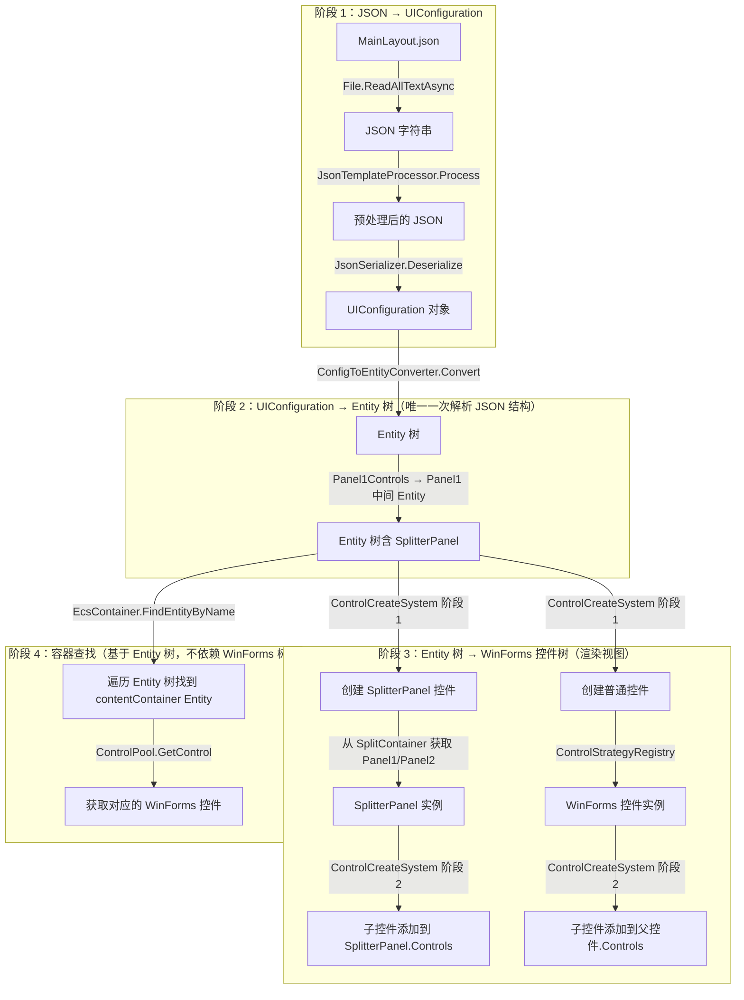

# ECS 控件树重构：JSON 只在一处解析为 Entity 实例

> **版本：** v1.0
> **更新日期：** 2026-07-22
> **维护者：** WorkFlowPrj Team
>
> **配套文档：**
> - [`Document_Modular_Standard.md`](../../CsharpPrj/Structuring/Document_Modular_Standard.md)（文档规范）

---

## 目录

- [ECS 控件树重构：JSON 只在一处解析为 Entity 实例](#ecs-控件树重构json-只在一处解析为-entity-实例)
  - [目录](#目录)
  - [第一部分：背景与方案](#第一部分背景与方案)
    - [1.1 现状与问题](#11-现状与问题)
      - [模块介绍](#模块介绍)
      - [问题分析](#问题分析)
      - [当前流程](#当前流程)
      - [当前 Entity 树（错误）](#当前-entity-树错误)
      - [当前 WinForms 控件树（错误）](#当前-winforms-控件树错误)
    - [1.2 方案总览](#12-方案总览)
      - [核心设计理念](#核心设计理念)
      - [修复后 Entity 树](#修复后-entity-树)
      - [WinForms 控件树 → Entity 树查找](#winforms-控件树--entity-树查找)
    - [1.3 目录索引](#13-目录索引)
      - [现有文件](#现有文件)
      - [新增文件](#新增文件)
  - [第二部分：核心设计](#第二部分核心设计)
    - [2.1 数据结构与接口](#21-数据结构与接口)
      - [2.1.1 新增：`SplitterPanelComponent`](#211-新增splitterpanelcomponent)
      - [2.1.2 修改：`ConfigToEntityConverter`](#212-修改configtoentityconverter)
      - [2.1.3 修改：`ControlCreateSystem`](#213-修改controlcreatesystem)
      - [2.1.4 修改：`EcsControlCreationStrategy.FindParent`](#214-修改ecscontrolcreationstrategyfindparent)
      - [2.1.5 新增：`IEntityTreeService` 接口 + `EntityTreeService` 实现（Entity 树查找服务）](#215-新增ientitytreeservice-接口--entitytreeservice-实现entity-树查找服务)
      - [2.1.6 修改：`EcsContainer.FindSubContainer`（委托到 IEntityTreeService，移除回退）](#216-修改ecscontainerfindsubcontainer委托到-ientitytreeservice移除回退)
      - [2.1.7 修改：`ContainerFinder`（委托到 EntityTreeService）](#217-修改containerfinder委托到-entitytreeservice)
    - [2.2 核心流程](#22-核心流程)
      - [2.2.1 修复后完整流程](#221-修复后完整流程)
      - [2.2.2 重构后的函数调用链（JSON 集中解析，Entity 实例传递）](#222-重构后的函数调用链json-集中解析entity-实例传递)
      - [关键变化总结](#关键变化总结)
      - [Entity 树与 WinForms 控件树的关系](#entity-树与-winforms-控件树的关系)
    - [2.3 通信与适配](#23-通信与适配)
      - [事件机制](#事件机制)
      - [桥接层设计](#桥接层设计)
  - [第三部分：实施步骤](#第三部分实施步骤)
    - [3.1 阶段划分](#31-阶段划分)
      - [阶段 1：新增 `SplitterPanelComponent`（独立，无风险）](#阶段-1新增-splitterpanelcomponent独立无风险)
      - [阶段 2：修改 `ConfigToEntityConverter`（核心修改）](#阶段-2修改-configtoentityconverter核心修改)
      - [阶段 3：修改 `ControlCreateSystem`（控件创建适配）](#阶段-3修改-controlcreatesystem控件创建适配)
      - [阶段 4：修改 `EcsControlCreationStrategy.FindParent`（父控件查找适配）](#阶段-4修改-ecscontrolcreationstrategyfindparent父控件查找适配)
      - [阶段 5：新增 `EntityTreeService`（Entity 树查找服务）](#阶段-5新增-entitytreeserviceentity-树查找服务)
      - [阶段 6：修改 `EcsContainer.FindSubContainer`（注入 IEntityTreeService，移除回退）](#阶段-6修改-ecscontainerfindsubcontainer注入-ientitytreeservice移除回退)
      - [阶段 7：修改 `ContainerFinder`（委托到 EntityTreeService）](#阶段-7修改-containerfinder委托到-entitytreeservice)
      - [阶段 8：集成测试（待手动验证）](#阶段-8集成测试待手动验证)
    - [3.2 优先级与顺序](#32-优先级与顺序)
    - [3.3 与现有系统的关系](#33-与现有系统的关系)
      - [能力矩阵](#能力矩阵)
  - [总结](#总结)

---

## 第一部分：背景与方案

### 1.1 现状与问题

#### 模块介绍

当前 UI 渲染管线由以下模块组成：

| 模块 | 路径 | 职责 |
|------|------|------|
| `ConfigToEntityConverter` | `CsharpPrj/BasicMethod/ECS/Conversion/` | 将 `UIConfiguration` 转换为 ECS Entity 树 |
| `ControlFactory` | `CsharpPrj/BasicMethod/ECS/Bridge/` | 根据 `ControlConfig` 创建 Entity 并添加 Component |
| `ControlCreateSystem` | `CsharpPrj/Operation/FrontEndDriven/ECS/Systems/` | 遍历 Entity 树，创建 WinForms 控件实例 |
| `EcsControlCreationStrategy` | `CsharpPrj/Operation/FrontEndDriven/ECS/` | 控件创建策略（创建 + 找父控件） |
| `ControlStrategyRegistry` | `CsharpPrj/Operation/FrontEndDriven/ECS/` | 控件类型→策略的映射注册表 |
| `ContainerStrategy` | `CsharpPrj/Operation/FrontEndDriven/Container/` | `container` 类型控件的创建策略 |
| `EcsConfigContainer` | `CsharpPrj/Operation/FrontEndDriven/Container/` | ECS 配置容器（继承 `EcsContainer`） |
| `EcsContainer` | `CsharpPrj/Share/UniversalMiddleware/Container/` | ECS 容器基类，提供 `FindRecursive` 控件查找 |
| `ContainerFinder` | `CsharpPrj/Operation/FrontEndDriven/Container/` | 容器查找与绑定工具 |
| `EcsRenderPipeline` | `CsharpPrj/Operation/FrontEndDriven/ECS/` | ECS 渲染管线，编排各 System 执行 |

#### 问题分析

| 问题 | 表现 | 根因 |
|------|------|------|
| `contentContainer` 找不到 | `MainForm` 初始化失败：`Root container must contain a 'contentContainer'` | `ConfigToEntityConverter` 处理 `Panel1Controls`/`Panel2Controls` 时，子控件 Entity 被直接挂到 `splitContainer` Entity 下，丢失了 Panel1/Panel2 的归属信息 |
| WinForms 控件树结构错误 | `contentContainer` 被添加到 `SplitContainer.Controls` 而非 `SplitContainer.Panel1.Controls` | `ControlCreateSystem` 阶段 2 的 `FindParent` 返回 `SplitContainer` 实例，执行 `parent.Controls.Add(control)` |
| `FindRecursive` 遍历失败 | `EcsContainer.FindRecursive` 遍历 `parent.Controls` 找不到 `contentContainer` | `SplitContainer.Controls` 只包含 `SplitterPanel` 对象，不包含直接添加的子控件 |

#### 当前流程

```
MainLayout.json (文件)
  ↓ File.ReadAllTextAsync
JSON 字符串
  ↓ JsonTemplateProcessor.Process (模板展开)
预处理后的 JSON 字符串
  ↓ JsonSerializer.Deserialize<UIConfiguration>
UIConfiguration 对象
  ↓
ConfigLoader.LoadConfigAsync(container, configPath)
  → JsonConfigService.LoadConfigAsync(configPath)  ← 读取文件 → 预处理 → 反序列化
  → container.LoadConfigAsync(config)              ← 传入 UIConfiguration 对象
    → EcsConfigContainer.RenderConfigAsync(config)
      → _renderPipeline.ExecuteCreateStageAsync(this, config)  ← 传入 UIConfiguration
        → LoadConfiguration(uiConfig)  ← 再次解析 UIConfiguration
          → ConfigToEntitySystem.Execute(config)
            → ConfigToEntityConverter.Convert(config)  ← 遍历 UIConfiguration 创建 Entity 树
```

JSON 的结构信息在流程中经历了三次映射：

| 步骤 | 输入 | 输出 | 信息损失 |
|------|------|------|---------|
| 1. JSON → UIConfiguration | JSON 字符串 | UIConfiguration 对象 | 无 |
| 2. UIConfiguration → Entity 树 | UIConfiguration | Entity 树 | **Panel1/Panel2 归属信息丢失** |
| 3. Entity 树 → WinForms 控件树 | Entity 树 | WinForms 控件 | 子控件被添加到 SplitContainer.Controls 而非 Panel1.Controls |

#### 当前 Entity 树（错误）

```
splitContainer Entity (type: "splitcontainer")
  └── contentContainer Entity (type: "container")  ← 父 Entity 是 splitContainer
```

#### 当前 WinForms 控件树（错误）

```
SplitContainer
  ├── SplitterPanel (Panel1)
  └── SplitterPanel (Panel2)
  └── EcsConfigContainer (contentContainer)  ← 被直接添加到了 SplitContainer.Controls
```

### 1.2 方案总览

| 维度 | 当前方案 | 新方案 |
|------|----------|--------|
| Entity 树结构 | 子控件 Entity 直接挂到 `splitContainer` Entity 下 | 为 Panel1/Panel2 创建中间 Entity，保留归属信息 |
| JSON 解析次数 | 多次（文件读取 + 反序列化 + Entity 转换） | 一次（JSON → Entity 树） |
| 后续操作基础 | `UIConfiguration` 对象 | Entity 树 |
| 容器查找方式 | 遍历 WinForms 控件树（`FindRecursive`） | **遍历 Entity 树**（通过 `ControlHierarchyComponent`） |
| 两棵树的关系 | 两棵树共存，容器查找依赖 WinForms 树 | **Entity 树是主树，WinForms 树是渲染视图** |

#### 核心设计理念

**JSON 只在一处解析为 Entity 实例，后续传递 Entity 实例而不是 `UIConfiguration` 对象。**

1. **`JsonConfigService.LoadConfigAsync`** 只负责读取文件、预处理、反序列化为 `UIConfiguration`
2. **`ConfigToEntityConverter.Convert`** 将 `UIConfiguration` 转换为 Entity 树（这是唯一一次解析 JSON 结构）
3. **后续所有操作**（控件创建、布局、事件绑定、容器查找）都基于 Entity 树，不再需要 `UIConfiguration`

#### 修复后 Entity 树

```
splitContainer Entity (type: "splitcontainer")
  ├── Panel1 Entity (type: "splitterpanel", name: "contentSplitter_Panel1")
  │   └── contentContainer Entity (type: "container")
  └── Panel2 Entity (type: "splitterpanel", name: "contentSplitter_Panel2")
      └── sideContainer Entity (type: "container")
```

#### WinForms 控件树 → Entity 树查找

重构完成后，容器查找不再依赖 WinForms 控件树，而是直接遍历 Entity 树：

```
重构前：EcsContainer.FindSubContainer("contentContainer")
          → FindControlByName("contentContainer")
            → FindRecursive(this, "contentContainer")  ← 遍历 WinForms 控件树
              → this.Controls → SplitContainer.Controls → 找不到！

重构后：EcsContainer.FindSubContainer("contentContainer")
          → FindEntityByName("contentContainer")        ← 遍历 Entity 树
            → FindEntityRecursive(rootEntity, "contentContainer")
              → rootEntity → splitContainer Entity
                → Panel1 Entity → contentContainer Entity  ← 找到！
```

WinForms 控件树仅作为渲染输出存在，不再承担容器查找职责。

---

### 1.3 目录索引

#### 现有文件

| 文件路径 | 内容 | 修改类型 |
|---------|------|---------|
| `CsharpPrj/BasicMethod/ECS/Conversion/ConfigToEntityConverter.cs` | JSON→Entity 转换器 | **修改** |
| `CsharpPrj/Operation/FrontEndDriven/ECS/Systems/ControlCreateSystem.cs` | 控件创建 System | **修改** |
| `CsharpPrj/Operation/FrontEndDriven/ECS/EcsControlCreationStrategy.cs` | 控件创建策略 | **修改** |
| `CsharpPrj/Share/UniversalMiddleware/Container/EcsContainer.cs` | ECS 容器基类 | **修改**（注入 `EntityTreeService`） |
| `CsharpPrj/Operation/FrontEndDriven/Container/ContainerFinder.cs` | 容器查找与绑定工具 | **修改**（委托到 `EntityTreeService`） |

#### 新增文件

| 文件路径 | 内容 |
|---------|------|
| `CsharpPrj/Operation/FrontEndDriven/ECS/Components/SplitterPanelComponent.cs` | SplitterPanel 组件（`struct`） |
| `CsharpPrj/Share/UniversalMiddleware/Abstractions/IEntityTreeService.cs` | Entity 树查找服务接口 |
| `CsharpPrj/Operation/FrontEndDriven/ECS/Services/EntityTreeService.cs` | Entity 树查找服务实现 |

---

## 第二部分：核心设计

### 2.1 数据结构与接口

#### 2.1.1 新增：`SplitterPanelComponent`

```csharp
// CsharpPrj/Operation/FrontEndDriven/ECS/Components/SplitterPanelComponent.cs
// ★ 2026-07-22 新增：标记 Entity 为 SplitContainer 的 Panel1/Panel2

using ECS.Core;

namespace FrontEndDriven.ECS.Components;

/// <summary>
/// SplitterPanel 组件 — 标记 Entity 为 SplitContainer 的 Panel1/Panel2
/// <para>用于 ControlCreateSystem 阶段 1 中从 SplitContainer 获取对应的 SplitterPanel 实例。</para>
/// <para>★ 注意：IComponent 约束为 struct，因此使用可变 struct 而非 class。</para>
/// </summary>
public struct SplitterPanelComponent : IComponent
{
    /// <summary>Panel 侧："Panel1" 或 "Panel2"</summary>
    public string PanelSide;
}
```

#### 2.1.2 修改：`ConfigToEntityConverter`

在 `ConvertControl` 方法中，为 `Panel1Controls`/`Panel2Controls` 创建中间 Entity：

```csharp
// ★ 2026-07-22 修复：处理 SplitContainer Panel1 的子控件
if (control.Panel1Controls is { Count: > 0 })
{
    var panel1Entity = CreateSplitterPanelEntity(entity, $"{control.Name}_Panel1", "Panel1");
    foreach (var child in control.Panel1Controls)
    {
        var childAncestor = isContainer ? entity : ancestor;
        var childEntity = ConvertControl(child, panel1Entity, childAncestor);
        AddChild(panel1Entity, childEntity);
    }
}

// ★ 2026-07-22 修复：处理 SplitContainer Panel2 的子控件
if (control.Panel2Controls is { Count: > 0 })
{
    var panel2Entity = CreateSplitterPanelEntity(entity, $"{control.Name}_Panel2", "Panel2");
    foreach (var child in control.Panel2Controls)
    {
        var childAncestor = isContainer ? entity : ancestor;
        var childEntity = ConvertControl(child, panel2Entity, childAncestor);
        AddChild(panel2Entity, childEntity);
    }
}
```

新增 `CreateSplitterPanelEntity` 方法：

```csharp
/// <summary>
/// 创建 SplitterPanel 中间 Entity
/// <para>★ 2026-07-22 新增：为 SplitContainer 的 Panel1/Panel2 创建中间 Entity，</para>
/// <para>   保证 Entity 树与 WinForms 控件树结构一致。</para>
/// </summary>
private Entity CreateSplitterPanelEntity(Entity parentEntity, string name, string panelSide)
{
    var panelEntity = _controlFactory.CreateFromConfig(new ControlConfig
    {
        Type = "splitterpanel",
        Name = name,
        Text = name
    }, parentEntity);

    _entityManager.AddComponent(panelEntity, new SplitterPanelComponent
    {
        PanelSide = panelSide
    });

    _entityManager.AddComponent(panelEntity, new ContainerAncestorComponent
    {
        AncestorEntity = parentEntity,
        IsContainer = false
    });

    AddChild(parentEntity, panelEntity);
    return panelEntity;
}
```

#### 2.1.3 修改：`ControlCreateSystem`

阶段 1 中处理 `splitterpanel` 类型：

```csharp
// 阶段 1：创建所有控件并注册到 ControlPool
foreach (var entity in sortedEntities)
{
    var typeComp = _entityManager.GetComponent<ControlTypeComponent>(entity);

    // ★ 2026-07-22 新增：处理 SplitterPanel 类型
    if (string.Equals(typeComp.Type, "splitterpanel", StringComparison.OrdinalIgnoreCase))
    {
        var panelControl = CreateSplitterPanelControl(entity);
        if (panelControl != null)
        {
            created.Add((entity, panelControl));
        }
        else
        {
            RemoveEntityFromTree(entity);
        }
        continue;
    }

    // 原有逻辑：优先使用策略接口创建控件
    var control = _strategy?.CreateControl(typeComp.Type);
    // ...
}
```

阶段 2 中跳过 `SplitterPanel` 的父子关系建立：

```csharp
// 阶段 2：建立父子关系
foreach (var (entity, control) in created)
{
    // ★ 2026-07-22 新增：跳过 SplitterPanel，其父子关系由 SplitContainer 自身管理
    if (_entityManager.TryGetComponent<ControlTypeComponent>(entity, out var typeComp) &&
        string.Equals(typeComp.Type, "splitterpanel", StringComparison.OrdinalIgnoreCase))
    {
        var state = _entityManager.GetComponent<ControlStateComponent>(entity);
        state.IsCreated = true;
        state.LastUpdated = DateTime.UtcNow;
        _entityManager.SetComponent(entity, state);
        continue;
    }

    // 原有逻辑：查找父控件
    var parent = _strategy?.FindParent(entity);
    // ...
}
```

新增 `CreateSplitterPanelControl` 方法：

```csharp
/// <summary>
/// 创建 SplitterPanel 控件
/// <para>★ 2026-07-22 新增：从父 SplitContainer 获取对应的 SplitterPanel 实例。</para>
/// </summary>
private Control? CreateSplitterPanelControl(Entity entity)
{
    if (!_entityManager.TryGetComponent<ControlHierarchyComponent>(entity, out var hierarchy))
        return null;

    var parentEntity = hierarchy.Parent;
    if (!parentEntity.IsValid)
        return null;

    var parentControl = _controlPool.GetControl(parentEntity);
    if (parentControl is not SplitContainer splitter)
        return null;

    if (!_entityManager.TryGetComponent<SplitterPanelComponent>(entity, out var panelComp))
        return null;

    var panel = panelComp.PanelSide == "Panel2" ? splitter.Panel2 : splitter.Panel1;
    _controlPool.Register(entity, panel.Name, panel);
    return panel;
}
```

#### 2.1.4 修改：`EcsControlCreationStrategy.FindParent`

```csharp
public Control? FindParent(Entity entity)
{
    if (!_entityManager.TryGetComponent<ControlHierarchyComponent>(entity, out var hierarchy))
        return null;

    var parentEntity = hierarchy.Parent;
    if (!parentEntity.IsValid)
        return null;

    // ★ 2026-07-22 新增：如果父 Entity 是 SplitterPanel，直接返回其对应的 Control
    if (_entityManager.TryGetComponent<ControlTypeComponent>(parentEntity, out var parentTypeComp) &&
        string.Equals(parentTypeComp.Type, "splitterpanel", StringComparison.OrdinalIgnoreCase))
    {
        return _controlPool.GetControl(parentEntity);
    }

    return _controlPool.GetControl(parentEntity);
}
```

#### 2.1.5 新增：`IEntityTreeService` 接口 + `EntityTreeService` 实现（Entity 树查找服务）

**核心变更：容器查找从 WinForms 控件树迁移到 Entity 树。**

`EcsContainer` 是 WinForms `Panel` 的子类，没有 `EntityManager` 和 `ControlPool` 的引用。因此新增 `IEntityTreeService` 接口（位于 `UniversalMiddleware.Abstractions`）和 `EntityTreeService` 实现（位于 `FrontEndDriven`），通过 `EcsWorld` 提供的 `EntityManager` 和 `ControlPool` 完成 Entity 树遍历。

**接口定义（`IEntityTreeService`）：**

```csharp
// CsharpPrj/Share/UniversalMiddleware/Abstractions/IEntityTreeService.cs
// ★ 2026-07-22 新增：Entity 树查找服务接口，解耦 UniversalMiddleware 与 FrontEndDriven

namespace UniversalMiddleware.Abstractions;

/// <summary>
/// Entity 树查找服务接口
/// <para>★ 2026-07-22 新增：基于 Entity 树遍历查找容器和控件。</para>
/// <para>Entity 树是主树，WinForms 树是渲染视图。</para>
/// </summary>
public interface IEntityTreeService
{
    /// <summary>通过 Entity 名称查找对应的 WinForms 控件</summary>
    Control? FindControlByName(object rootEntity, string name);

    /// <summary>通过 Entity 名称查找对应的 IConfigContainer</summary>
    IConfigContainer? FindContainerByName(object rootEntity, string name);
}
```

**实现（`EntityTreeService`）：**

```csharp
// CsharpPrj/Operation/FrontEndDriven/ECS/Services/EntityTreeService.cs
// ★ 2026-07-22 新增：Entity 树查找服务，替代 WinForms 控件树的 FindRecursive

using ECS.Core;
using ECS.Bridge;
using FrontEndDriven.ECS.Components;

namespace FrontEndDriven.ECS.Services;

/// <summary>
/// Entity 树查找服务
/// <para>★ 2026-07-22 新增：基于 Entity 树遍历查找容器和控件，</para>
/// <para>   不再依赖 WinForms 控件树。Entity 树是主树，WinForms 树是渲染视图。</para>
/// </summary>
public class EntityTreeService : IEntityTreeService
{
    private readonly EntityManager _entityManager;
    private readonly ControlPool _controlPool;

    public EntityTreeService(EntityManager entityManager, ControlPool controlPool)
    {
        _entityManager = entityManager ?? throw new ArgumentNullException(nameof(entityManager));
        _controlPool = controlPool ?? throw new ArgumentNullException(nameof(controlPool));
    }

    /// <summary>
    /// 在 Entity 树中递归查找指定名称的 Entity
    /// </summary>
    public Entity? FindEntityByName(Entity rootEntity, string name)
    {
        if (!rootEntity.IsValid || string.IsNullOrEmpty(name))
            return null;

        return FindEntityRecursive(rootEntity, name);
    }

    private Entity? FindEntityRecursive(Entity entity, string name)
    {
        if (!_entityManager.TryGetComponent<ControlTypeComponent>(entity, out var typeComp))
            return null;

        if (string.Equals(typeComp.Name, name, StringComparison.OrdinalIgnoreCase))
            return entity;

        if (!_entityManager.TryGetComponent<ControlHierarchyComponent>(entity, out var hierarchy))
            return null;

        foreach (var child in hierarchy.Children)
        {
            var found = FindEntityRecursive(child, name);
            if (found != null) return found;
        }

        return null;
    }

    /// <summary>
    /// 通过 Entity 名称查找对应的 WinForms 控件（IEntityTreeService 接口实现）
    /// </summary>
    public Control? FindControlByName(object rootEntity, string name)
    {
        if (rootEntity is not Entity entity || !entity.IsValid || string.IsNullOrEmpty(name))
            return null;

        var found = FindEntityRecursive(entity, name);
        return found != null ? _controlPool.GetControl(found.Value) : null;
    }

    /// <summary>
    /// 通过 Entity 名称查找对应的 IConfigContainer（IEntityTreeService 接口实现）
    /// </summary>
    public IConfigContainer? FindContainerByName(object rootEntity, string name)
    {
        return FindControlByName(rootEntity, name) as IConfigContainer;
    }
}
```

#### 2.1.6 修改：`EcsContainer.FindSubContainer`（委托到 IEntityTreeService，移除回退）

```csharp
// EcsContainer.cs
// ★ 2026-07-22 重构：FindSubContainer 委托到 IEntityTreeService，
//   不再依赖 WinForms 控件树。Entity 树是主树，WinForms 树是渲染视图。
// ★ 2026-07-22 修复：移除 WinForms 回退逻辑，失败时抛出异常。

/// <summary>
/// Entity 树查找服务（由外部注入）
/// <para>★ 2026-07-22 新增：替代 WinForms 控件树的 FindRecursive。</para>
/// </summary>
[DesignerSerializationVisibility(DesignerSerializationVisibility.Hidden)]
public IEntityTreeService? TreeService { get; set; }

/// <summary>
/// 获取根 Entity
/// <para>★ 2026-07-22 新增：供 EntityTreeService 查找时使用。</para>
/// <para>子类（如 EcsConfigContainer）可重写此方法以提供根 Entity。</para>
/// </summary>
protected virtual object? GetRootEntity() => null;

/// <summary>
/// 查找子容器（基于 Entity 树）
/// <para>★ 2026-07-22 重构：基于 Entity 树查找，不再依赖 WinForms 控件树。</para>
/// <para>★ 2026-07-22 修复：移除 WinForms 回退逻辑，失败时抛出异常。</para>
/// </summary>
/// <param name="name">容器名称</param>
/// <returns>找到的 IConfigContainer</returns>
/// <exception cref="ArgumentNullException">name 为 null 或空时抛出</exception>
/// <exception cref="InvalidOperationException">TreeService 未注入、根 Entity 不可用或容器未找到时抛出</exception>
public IConfigContainer FindSubContainer(string name)
{
    if (string.IsNullOrEmpty(name))
        throw new ArgumentNullException(nameof(name), "容器名称不能为空");

    if (TreeService == null)
        throw new InvalidOperationException(
            $"EntityTreeService 未注入，无法查找容器 '{name}'。请确保在 InitializeRenderPipeline 中创建了 EntityTreeService。");

    var rootEntity = GetRootEntity();
    if (rootEntity == null)
        throw new InvalidOperationException(
            $"根 Entity 不可用，无法查找容器 '{name}'。请确保渲染管线已初始化。");

    var container = TreeService.FindContainerByName(rootEntity, name);
    if (container == null)
        throw new InvalidOperationException(
            $"容器 '{name}' 未在 Entity 树中找到。请检查配置中是否包含名为 '{name}' 的容器。");

    return container;
}
```

#### 2.1.7 修改：`ContainerFinder`（委托到 EntityTreeService）

```csharp
// ContainerFinder.cs
// ★ 2026-07-22 重构：FindSubContainer 内部委托给 EcsContainer.FindSubContainer，
//   而 EcsContainer.FindSubContainer 已改为优先使用 EntityTreeService。
//   不再需要 WinForms 控件树遍历。

public static class ContainerFinder
{
    /// <summary>
    /// 查找并注册子容器
    /// <para>★ 2026-07-22 重构：基于 Entity 树查找，不再依赖 WinForms 控件树。</para>
    /// </summary>
    public static EcsConfigContainer FindSubContainer(
        EcsConfigContainer rootContainer, string containerName, string logPrefix)
    {
        var container = rootContainer.FindSubContainer(containerName) as EcsConfigContainer;
        if (container != null)
            return container;

        // 收集诊断信息
        var rootType = rootContainer?.GetType().Name ?? "null";
        var rootName = rootContainer?.Name ?? "null";
        var availableContainers = rootContainer != null
            ? string.Join(", ", rootContainer.GetSubContainers().Select(c => $"'{c.ContainerName}'"))
            : "(null)";

        throw new InvalidOperationException(
            $"Root container must contain a '{containerName}'" +
            $"\n  → 根容器类型: {rootType}" +
            $"\n  → 根容器名称: {rootName}" +
            $"\n  → 可用子容器: [{availableContainers}]" +
            $"\n  → 来源: {logPrefix}");
    }
}
```


### 2.2 核心流程

#### 2.2.1 修复后完整流程



#### 2.2.2 重构后的函数调用链（JSON 集中解析，Entity 实例传递）

重构后，JSON 只在 `ConfigToEntityConverter.Convert` 处解析一次，后续所有操作都基于 Entity 实例传递：

```
MainLayout.json (文件)
  │
  │  【第 1 步：JSON → UIConfiguration】
  │  JsonConfigService.LoadConfigAsync(configPath)
  │    → File.ReadAllTextAsync(configPath)          ← 读取文件
  │    → JsonTemplateProcessor.Process(json)         ← 模板展开
  │    → JsonSerializer.Deserialize<UIConfiguration>  ← 反序列化
  │
  ▼
UIConfiguration 对象
  │
  │  【第 2 步：UIConfiguration → Entity 树（唯一一次解析 JSON 结构）】
  │  EcsConfigContainer.RenderConfigAsync(config)
  │    → _renderPipeline.ExecuteCreateStageAsync(this, config)
  │      → ConfigToEntitySystem.Execute(config)
  │        → ConfigToEntityConverter.Convert(config)
  │          ├── ConvertView(view, rootEntity, rootEntity)
  │          │     └── ConvertControl(control, viewEntity, containerAncestor)
  │          │           ├── _controlFactory.CreateFromConfig(control, parentEntity)  ← 创建 Entity
  │          │           ├── _entityManager.AddComponent(entity, ...)                 ← 添加组件
  │          │           ├── [处理 Controls] → ConvertControl(child, entity, ...)     ← 递归子控件
  │          │           ├── [处理 Panel1Controls]                                    ← ★ 修复点
  │          │           │     ├── CreateSplitterPanelEntity(entity, "xxx_Panel1", "Panel1")
  │          │           │     │     └── _controlFactory.CreateFromConfig(...)        ← 创建 Panel1 中间 Entity
  │          │           │     └── ConvertControl(child, panel1Entity, ...)           ← 子控件挂到 Panel1 Entity 下
  │          │           └── [处理 Panel2Controls]                                    ← ★ 修复点
  │          │                 ├── CreateSplitterPanelEntity(entity, "xxx_Panel2", "Panel2")
  │          │                 └── ConvertControl(child, panel2Entity, ...)
  │          └── AddChild(parent, child)  ← 建立 Entity 树父子关系
  │
  ▼
Entity 树（根 Entity + View Entity + Control Entity + SplitterPanel Entity）
  │
  │  【第 3 步：Entity 树 → WinForms 控件树（基于 Entity 实例，不再需要 UIConfiguration）】
  │  _renderPipeline.ExecuteCreateStageAsync (续)
  │    → ControlCreateSystem.Update()
  │      ├── 拓扑排序：保证父 Entity 先于子 Entity 处理
  │      │
  │      ├── 阶段 1：创建控件并注册到 ControlPool
  │      │     ├── Entity 类型 = "splitterpanel"
  │      │     │     → CreateSplitterPanelControl(entity)
  │      │     │       ├── _controlPool.GetControl(parentEntity)  ← 获取父 SplitContainer 控件
  │      │     │       ├── SplitterPanelComponent.PanelSide       ← 判断 Panel1/Panel2
  │      │     │       └── _controlPool.Register(entity, panel.Name, panel)  ← 注册 SplitterPanel
  │      │     │
  │      │     ├── Entity 类型 = "container"
  │      │     │     → _strategy.CreateControl("container")
  │      │     │       → ControlStrategyRegistry.Create("container")
  │      │     │         → ContainerStrategy.Create()
  │      │     │           → new EcsConfigContainer()             ← 创建 EcsConfigContainer 实例
  │      │     │
  │      │     └── Entity 类型 = 其他（button/textbox 等）
  │      │           → _strategy.CreateControl(type)
  │      │             → ControlStrategyRegistry.Create(type)
  │      │               → _factoryMap[type]()                    ← 创建标准 WinForms 控件
  │      │
  │      └── 阶段 2：建立父子关系
  │            ├── Entity 类型 = "splitterpanel" → 跳过（由 SplitContainer 自身管理）
  │            │
  │            ├── 父 Entity 类型 = "splitterpanel"
  │            │     → _strategy.FindParent(entity)
  │            │       → _controlPool.GetControl(parentEntity)    ← 返回 SplitterPanel 控件
  │            │     → parent.Controls.Add(control)               ← 添加到 SplitterPanel.Controls
  │            │
  │            └── 父 Entity 类型 = 其他
  │                  → _strategy.FindParent(entity)
  │                    → _controlPool.GetControl(parentEntity)    ← 返回父控件
  │                  → parent.Controls.Add(control)               ← 添加到父控件.Controls
  │
  ▼
WinForms 控件树（渲染视图，仅用于显示）
  │
  │  【第 4 步：容器查找（基于 Entity 树，不依赖 WinForms 控件树）】
  │  ContainerFinder.FindAndBindMainContainers(rootContainer, ...)
  │    → rootContainer.FindSubContainer("contentContainer")
  │      → EcsContainer.FindEntityByName("contentContainer")     ← ★ 遍历 Entity 树
  │        → FindEntityRecursive(rootEntity, "contentContainer")
  │          ├── rootEntity
  │          │     └── splitContainer Entity
  │          │           ├── Panel1 Entity (splitterpanel)
  │          │           │     └── contentContainer Entity        ← 找到！
  │          │           └── Panel2 Entity (splitterpanel)
  │          │                 └── sideContainer Entity
  │          └── 返回 contentContainer Entity
  │      → _controlPool.GetControl(contentContainerEntity)       ← 通过 ControlPool 获取 WinForms 控件
  │
  ▼
contentContainer / sideContainer 绑定成功 → MainForm 初始化完成
```

#### 关键变化总结

| 步骤 | 重构前 | 重构后 |
|------|--------|--------|
| JSON 解析 | 多次（文件读取 + 反序列化 + Entity 转换） | **一次**（`ConfigToEntityConverter.Convert`） |
| 后续传递 | `UIConfiguration` 对象 | **Entity 实例** |
| Panel1/Panel2 归属 | 丢失（子控件直接挂到 splitContainer Entity） | **保留**（通过 SplitterPanel 中间 Entity） |
| 控件创建 | `FindParent` 返回 `SplitContainer` | `FindParent` 返回 `SplitterPanel` |
| 容器查找方式 | 遍历 WinForms 控件树（`FindRecursive`） | **遍历 Entity 树**（`FindEntityRecursive`） |
| 两棵树的关系 | 两棵树共存，容器查找依赖 WinForms 树 | **Entity 树是主树，WinForms 树是渲染视图** |

#### Entity 树与 WinForms 控件树的关系

重构完成后，两棵树的关系如下：

```
Entity 树（主树 — 承载所有业务逻辑）
  ├── 控件创建（ControlCreateSystem 遍历 Entity 树）
  ├── 布局计算（LayoutSystem 遍历 Entity 树）
  ├── 事件绑定（EventBindingSystem 遍历 Entity 树）
  ├── 容器查找（FindSubContainer 遍历 Entity 树）
  └── 渲染输出（通过 ControlPool 映射到 WinForms 控件）
        │
        ▼
WinForms 控件树（渲染视图 — 仅用于显示）
  ├── 控件层级关系（Panel.Controls）
  ├── 布局渲染（Dock/Anchor）
  └── 用户交互（鼠标/键盘事件）
```

```mermaid
graph TB
    subgraph "Entity 树（主树）"
        E1[splitContainer Entity<br/>type: splitcontainer]
        E2[Panel1 Entity<br/>type: splitterpanel<br/>name: contentSplitter_Panel1]
        E3[Panel2 Entity<br/>type: splitterpanel<br/>name: contentSplitter_Panel2]
        E4[contentContainer Entity<br/>type: container]
        E5[sideContainer Entity<br/>type: container]
        E1 --> E2
        E1 --> E3
        E2 --> E4
        E3 --> E5
    end

    subgraph "ControlPool（Entity ↔ Control 映射）"
        CP[ControlPool<br/>三向映射]
    end

    subgraph "WinForms 控件树（渲染视图）"
        W1[SplitContainer]
        W2[SplitterPanel Panel1]
        W3[SplitterPanel Panel2]
        W4[EcsConfigContainer<br/>contentContainer]
        W5[EcsConfigContainer<br/>sideContainer]
        W1 --> W2
        W1 --> W3
        W2 --> W4
        W3 --> W5
    end

    E1 -.->|ControlPool| W1
    E2 -.->|ControlPool| W2
    E3 -.->|ControlPool| W3
    E4 -.->|ControlPool| W4
    E5 -.->|ControlPool| W5

    subgraph "容器查找路径"
        direction LR
        S[FindSubContainer<br/>"contentContainer"]
        S -->|Entity 树遍历| E4
        E4 -->|ControlPool| W4
    end
```

### 2.3 通信与适配

#### 事件机制

| 事件 | 触发方 | 监听方 | 说明 |
|------|--------|--------|------|
| `ControlCreated` | `ControlCreateSystem` | 外部（回退路径） | 策略接口创建失败时触发 |
| `ConfigLoaded` | `EcsConfigContainer` | `MainForm` | 配置加载完成通知 |

#### 桥接层设计

| 桥接层 | 职责 | 修改影响 |
|--------|------|---------|
| `ControlPool` | Entity↔Control 三向映射 | 无修改 |
| `ControlFactory` | ControlConfig→Entity | 无修改 |
| `ControlStrategyRegistry` | 控件类型→策略映射 | 无修改（`splitterpanel` 不由策略创建） |

---

## 第三部分：实施步骤

### 3.1 阶段划分

#### 阶段 1：新增 `SplitterPanelComponent`（独立，无风险）

新增文件 `CsharpPrj/BasicMethod/ECS/Components/SplitterPanelComponent.cs`。

**验证：** 编译通过，新增组件不影响现有逻辑。

#### 阶段 2：修改 `ConfigToEntityConverter`（核心修改）

修改 `ConvertControl` 方法，为 `Panel1Controls`/`Panel2Controls` 创建中间 Entity。

**验证：**
- 单元测试：`ConvertControl` 处理 `Panel1Controls` 时创建 `splitterpanel` Entity
- Entity 树结构：`splitContainer → splitterpanel → contentContainer`

#### 阶段 3：修改 `ControlCreateSystem`（控件创建适配）

- 阶段 1 中处理 `splitterpanel` 类型
- 阶段 2 中跳过 `SplitterPanel` 的父子关系建立

**验证：**
- `SplitterPanel` 控件从 `SplitContainer.Panel1`/`Panel2` 获取
- 子控件正确添加到 `SplitterPanel.Controls`

#### 阶段 4：修改 `EcsControlCreationStrategy.FindParent`（父控件查找适配）

当父 Entity 是 `SplitterPanel` 时，返回对应的 `SplitterPanel` 控件。

**验证：**
- `contentContainer` 的父控件是 `SplitterPanel (Panel1)`
- `sideContainer` 的父控件是 `SplitterPanel (Panel2)`

#### 阶段 5：新增 `EntityTreeService`（Entity 树查找服务）

**核心变更：** 新增独立的 Entity 树查找服务，替代 WinForms 控件树的 `FindRecursive`。

- 新增文件 `CsharpPrj/Operation/FrontEndDriven/ECS/Services/EntityTreeService.cs`
- 通过 `EntityManager` 遍历 `ControlHierarchyComponent.Children` 递归查找
- 通过 `ControlPool` 将 Entity 映射回 WinForms 控件

**验证：**
- `FindEntityByName(rootEntity, "contentContainer")` 通过 Entity 树找到 `contentContainer`
- `FindEntityByName(rootEntity, "sideContainer")` 通过 Entity 树找到 `sideContainer`

#### 阶段 6：修改 `EcsContainer.FindSubContainer`（注入 IEntityTreeService，移除回退）

- 在 `EcsContainer` 中添加 `TreeService` 属性（类型为 `IEntityTreeService` 接口）
- 添加 `GetRootEntity()` 虚方法供子类重写
- `FindSubContainer` 完全基于 `IEntityTreeService` 查找
- **移除 WinForms 控件树回退逻辑**，失败时抛出明确异常：
  - `TreeService` 未注入 → `InvalidOperationException`
  - 根 Entity 不可用 → `InvalidOperationException`
  - 容器未找到 → `InvalidOperationException`

**验证：**
- `FindSubContainer("contentContainer")` 通过 `IEntityTreeService` 找到 `contentContainer`
- `FindSubContainer("sideContainer")` 通过 `IEntityTreeService` 找到 `sideContainer`
- 容器不存在时抛出 `InvalidOperationException` 而非静默返回 null

#### 阶段 7：修改 `ContainerFinder`（委托到 EntityTreeService）

`ContainerFinder.FindSubContainer` 内部委托给 `EcsContainer.FindSubContainer`，无需额外修改。

**验证：** 集成测试中 `ContainerFinder.FindAndBindMainContainers` 正确绑定所有容器。

#### 阶段 8：集成测试（待手动验证）

启动应用，验证完整流程。

**验证项：**
- [ ] 应用启动成功，无异常
- [ ] `contentContainer` 和 `sideContainer` 正确绑定
- [ ] SplitContainer 的子控件正确显示在 Panel1/Panel2 中
- [ ] 容器查找（`FindSubContainer`）基于 Entity 树工作正常
- [ ] 容器不存在时抛出 `InvalidOperationException`

### 3.2 优先级与顺序

| 优先级 | 任务 | 阶段 | 预估工时 |
|--------|------|------|---------|
| **P0** | 新增 `SplitterPanelComponent` | 阶段 1 | 10 min |
| **P0** | 修改 `ConfigToEntityConverter` | 阶段 2 | 30 min |
| **P0** | 修改 `ControlCreateSystem` | 阶段 3 | 30 min |
| **P0** | 修改 `EcsControlCreationStrategy.FindParent` | 阶段 4 | 10 min |
| **P0** | 新增 `EntityTreeService` | 阶段 5 | 20 min |
| **P0** | 修改 `EcsContainer.FindSubContainer`（注入 EntityTreeService） | 阶段 6 | 10 min |
| **P1** | 修改 `ContainerFinder` | 阶段 7 | 5 min |
| **P1** | 集成测试 | 阶段 8 | 30 min |

**推荐实现顺序：** 阶段 1 → 阶段 2 → 阶段 3 → 阶段 4 → 阶段 5 → 阶段 6 → 阶段 7 → 阶段 8

### 3.3 与现有系统的关系

| 现有模块 | 集成方式 | 说明 |
|---------|---------|------|
| `ControlStrategyRegistry` | 无修改 | `splitterpanel` 不由策略创建，由 `ControlCreateSystem` 直接处理 |
| `ContainerStrategy` | 无修改 | `container` 类型策略不变 |
| `EcsContainer.FindControlByName` | 保留（标记 `[Obsolete]`） | 兼容旧代码，新代码应使用 `FindEntityByName` |
| `ContainerFinder` | 委托给 `EcsContainer.FindSubContainer` | 查找逻辑不变，底层实现改为 Entity 树遍历 |
| `EcsRenderPipeline` | 无修改 | 管线编排逻辑不变 |
| `ControlFactory` | 无修改 | Entity 创建逻辑不变 |
| `ControlPool` | 无修改 | 映射逻辑不变 |

#### 能力矩阵

| 场景 | 修改前 | 修改后 |
|------|--------|--------|
| `SplitContainer.Panel1` 包含 `contentContainer` | ❌ 失败 | ✅ 成功 |
| `SplitContainer.Panel2` 包含 `sideContainer` | ❌ 失败 | ✅ 成功 |
| 嵌套 `SplitContainer` | ❌ 失败 | ✅ 成功 |
| 普通容器（无 SplitContainer） | ✅ 成功 | ✅ 成功 |
| 普通控件（Button/TextBox 等） | ✅ 成功 | ✅ 成功 |
| 容器查找（基于 WinForms 树） | ❌ 找不到 contentContainer | ✅ 正确找到（基于 Entity 树） |

---

## 总结

本次重构的核心是**在 `ConfigToEntityConverter.ConvertControl` 中为 `SplitContainer` 的 `Panel1Controls`/`Panel2Controls` 创建中间 Entity**，让 Entity 树与 WinForms 控件树结构完全一致。

**关键原则：JSON 只在一处解析为 Entity 实例，后续传递 Entity 实例而不是 `UIConfiguration` 对象。**

**架构变更：容器查找从 WinForms 控件树迁移到 Entity 树。** Entity 树成为主树，承载所有业务逻辑（控件创建、布局、事件绑定、容器查找），WinForms 控件树仅作为渲染视图存在。

修改涉及 6 个文件（1 个新增 + 5 个修改），不改变现有接口和管线编排逻辑，风险可控。
