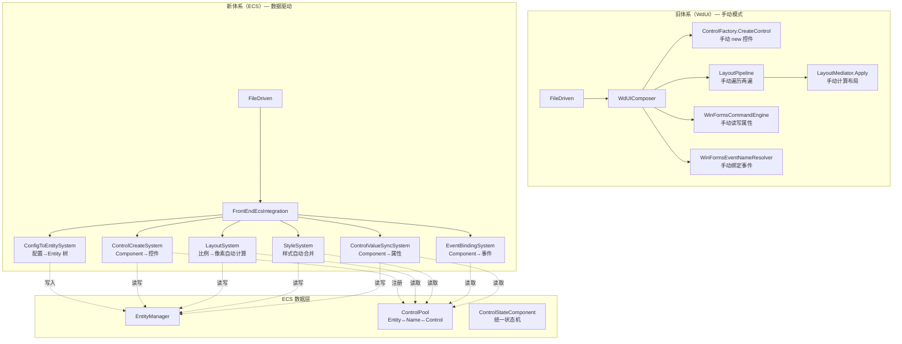
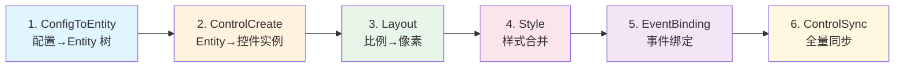
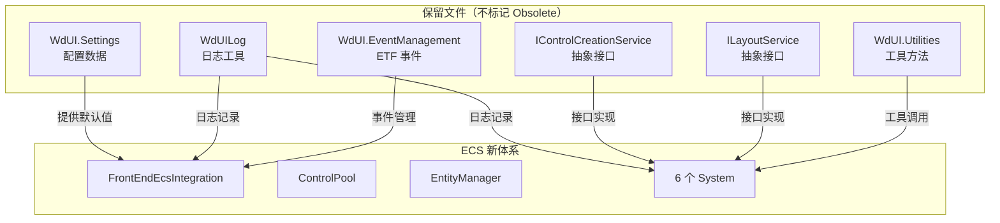
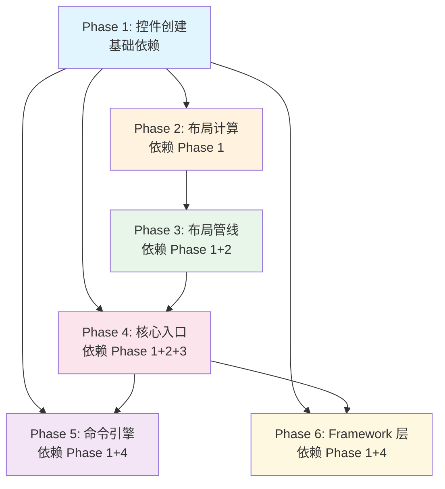

# WdUI ECS 彻底重构计划

> **版本：** v3.0
> **更新日期：** 2026-07-21
> **维护者：** WorkFlowPrj Team
>
> **配套文档：**
> - [`ECS子容器注册重构-彻底移除WinForms树遍历.md`](ECS子容器注册重构-彻底移除WinForms树遍历.md)（子容器注册方案）
> - [`Document_Modular_Standard.md`](../../CsharpPrj/Structuring/Document_Modular_Standard.md)（文档规范）

---

## 目录

- [第一部分：背景与方案](#第一部分背景与方案)
  - [1.1 现状与问题](#11-现状与问题)
  - [1.2 方案总览](#12-方案总览)
  - [1.3 目录索引](#13-目录索引)
- [第二部分：核心设计](#第二部分核心设计)
  - [2.1 ECS 数据驱动模型](#21-ecs-数据驱动模型)
  - [2.2 核心流程](#22-核心流程)
  - [2.3 通信与适配](#23-通信与适配)
- [第三部分：实施步骤](#第三部分实施步骤)
  - [3.1 阶段划分](#31-阶段划分)
  - [3.2 优先级与顺序](#32-优先级与顺序)
  - [3.3 与现有系统的关系](#33-与现有系统的关系)
- [总结](#总结)

---

## 第一部分：背景与方案

### 1.1 现状与问题

`WdUI` 是 `FrontEndDriven` 的旧 UI 层，位于 `CsharpPrj/Operation/FrontEndDriven/WdUI/` 目录，共 **25 个文件**。经过多次迭代已积累了大量冗余逻辑：

| 问题 | 表现 | 根因 |
|------|------|------|
| **功能完全重叠** | 控件创建、布局计算、布局管线、配置加载等 40+ 功能点与 ECS 体系重复 | 旧体系（SkeletonFlow + WdUIComposer + LayoutPipeline）未随 ECS 新体系同步清理 |
| **手动遍历模式** | 大量 `foreach` + `FindControl` + `Dictionary` 手动管理控件列表 | 旧代码未利用 ECS 的 `GetEntities<T>()` + `ControlPool` 三向映射 |
| **状态管理分散** | `IsDirty` / `isLayoutApplied` 等状态分散在各处，无统一状态机 | 旧代码未利用 `ControlStateComponent` 的统一状态管理 |
| **调用链路混乱** | FileDriven 等外部模块同时引用 WdUI 旧 API 和 ECS 新 API | 缺乏统一的入口委托层 |

### 1.2 方案总览

#### 核心策略：从"委托模式"升级为"ECS 数据驱动重构"

| 维度 | 旧模式（WdUI） | ECS 数据驱动模式 |
|------|---------------|------------------|
| **控件查找** | `FindControl("name")` 递归遍历控件树 | `ControlPool.GetEntity("name")` O(1) 三向映射 |
| **控件遍历** | `foreach` + `if` 手动筛选 | `GetEntities<TComponent>()` 自动查询 |
| **状态管理** | `bool isDirty` / `DateTime lastUpdated` 分散在各处 | `ControlStateComponent` 统一状态机 |
| **布局计算** | `ApplyProportional(control, left, top, ...)` 手动计算 | `ProportionalLayoutComponent` → `LayoutSystem` 自动计算 |
| **样式合并** | `ControlConfigApplier.ApplyConfig()` 手动合并 | `StyleRefComponent` + `ColorStyleComponent` + `FontStyleComponent` → `StyleSystem` 自动合并 |
| **值同步** | `WinFormsCommandEngine` 手动读写控件属性 | `TextComponent` / `SelectionComponent` → `ControlValueSyncSystem` 自动同步 |
| **事件绑定** | `WinFormsEventNameResolver` 手动解析事件名 | `EventBindingsComponent` → `EventBindingSystem` 自动绑定 |
| **配置加载** | `WdUIConfigLoader` 手动构建控件树 | `UIConfiguration` → `ConfigToEntitySystem` 自动转换为 Entity 树 |
| **管线编排** | `LayoutPipeline` 手动管理执行顺序 | `FrontEndEcsIntegration.ExecutePipeline()` 6 阶段自动编排 |

#### 架构对比



### 1.3 目录索引

#### 现有文件清单

| 文件路径 | 状态 | 说明 |
|---------|------|------|
| `WdUI.RenderPipeline.cs` | ✅ 保留 | 已部分重构，继承 `RenderPipelineBase` |
| `WdUI.Settings.cs` | ✅ 保留 | 纯配置数据类 |
| `Abstractions/IControlCreationService.cs` | ✅ 保留 | 抽象接口 |
| `Diagnostics/WdUILog.cs` | ✅ 保留 | 日志工具 |
| `Layout/ILayoutService.cs` | ✅ 保留 | 抽象接口 |
| `UI/WdUI.EventManagement.cs` | ✅ 保留 | ETF 特有逻辑 |
| `UI/WdUI.Utilities.cs` | ✅ 保留 | 纯工具方法 |
| `Framework/Shared/` | 🟡 评估 | 工具方法，按需迁移 |
| `WinForms/FrameworkContextWinFormsExtensions.cs` | 🟡 评估 | 适配层，按需迁移 |
| `Layout/Skeletons/CreateLayoutPanelSkeleton.cs` | 🔴 重构 | → `ControlCreateSystem` |
| `UI/WdUI.ControlFactory.cs` | 🔴 重构 | → `EcsControlCreationStrategy` |
| `UI/WdUI.Layout.cs` | 🔴 重构 | → `LayoutSystem` |
| `UI/WdUI.LayoutEngine.cs` | 🔴 重构 | → `LayoutSystem` |
| `Layout/LayoutMediator.cs` | 🔴 重构 | → `LayoutSystem` |
| `Layout/LayoutContext.cs` | 🔴 重构 | → `LayoutSystem` |
| `Layout/LayoutState.cs` | 🔴 重构 | → `ComputedLayoutComponent` |
| `Layout/LayoutStrategies.cs` | 🔴 重构 | → `ControlStrategyRegistry` |
| `Layout/LayoutPipeline.cs` | 🔴 重构 | → `FrontEndEcsIntegration` |
| `Layout/LayoutService.cs` | 🔴 重构 | → `LayoutSystem` |
| `Layout/RenderSession.cs` | 🔴 重构 | → `EcsWorld` 生命周期 |
| `UI/WdUI.Core.cs` | 🔴 重构 | → `FrontEndEcsIntegration` |
| `UI/WdUI.Management.cs` | 🔴 重构 | → ECS Systems |
| `UI/WdUI.ViewManager.cs` | 🔴 重构 | → `ConfigToEntitySystem` |
| `UI/WdUI.Configuration.cs` | 🔴 重构 | 枚举保留，扩展方法迁移 |
| `UI/WinFormsCommandEngine.cs` | 🔴 重构 | → `ControlValueSyncSystem` |
| `WinForms/WinFormsInitializer.cs` | 🔴 重构 | → `FrontEndEcsIntegration` |
| `WinForms/EventBindingContextExtensions.cs` | 🔴 重构 | → `EventBindingSystem` |
| `WinForms/WinFormsEventNameResolver.cs` | 🔴 重构 | → `EventBindingSystem` |
| `Framework/ConfigurationFramework.cs` | 🔴 重构 | → `ConfigToEntitySystem` |
| `Framework/ControlFactoryFramework.cs` | 🔴 重构 | → `StyleSystem` |

#### 新增/目标文件清单

| 文件路径 | 说明 |
|---------|------|
| `ECS/Systems/ControlCreateSystem.cs` | 控件创建 System |
| `ECS/Systems/EcsControlCreationStrategy.cs` | 控件创建策略 |
| `ECS/Systems/ControlStrategyRegistry.cs` | 策略注册中心 |
| `ECS/Systems/LayoutSystem.cs` | 布局计算 System |
| `ECS/Systems/StyleSystem.cs` | 样式合并 System |
| `ECS/Systems/EventBindingSystem.cs` | 事件绑定 System |
| `ECS/Systems/ControlValueSyncSystem.cs` | 控件值同步 System |
| `ECS/Systems/ControlSyncSystem.cs` | 控件全量同步 System |
| `ECS/Systems/ConfigToEntitySystem.cs` | 配置→Entity 转换 System |
| `ECS/FrontEndEcsIntegration.cs` | ECS 入口集成 |
| `ECS/Components/ComputedLayoutComponent.cs` | 计算后布局 Component |
| `ECS/Components/ControlStateComponent.cs` | 控件状态 Component |
| `ECS/Components/EventBindingsComponent.cs` | 事件绑定 Component |
| `Container/EcsConfigContainer.cs` | ECS 配置容器 |
| `Container/WdUIContainerManager.cs` | 容器管理器 |

---

## 第二部分：核心设计

### 2.1 ECS 数据驱动模型

#### 2.1.1 核心概念

ECS 重构的核心不是"把旧方法体替换为对新方法的调用"，而是**让数据（Component）驱动 System 自动执行**：

```
旧模式：  外部调用 → 旧方法 → 手动遍历 → 手动计算 → 手动赋值
ECS 模式： Component 写入 → System 自动检测 → 自动计算 → 自动同步
```

#### 2.1.2 Component 数据模型

| Component | 用途 | 写入者 | 读取者 |
|-----------|------|--------|--------|
| `ControlTypeComponent` | 控件类型 + 名称 | `ConfigToEntitySystem` | `ControlCreateSystem` |
| `ProportionalLayoutComponent` | 比例布局参数 | `ConfigToEntitySystem` | `LayoutSystem` |
| `StyleRefComponent` | 样式引用 | `ConfigToEntitySystem` | `StyleSystem` |
| `ColorStyleComponent` | 内联颜色样式 | `ConfigToEntitySystem` | `StyleSystem` |
| `FontStyleComponent` | 内联字体样式 | `ConfigToEntitySystem` | `StyleSystem` |
| `EventBindingsComponent` | 事件绑定列表 | `ConfigToEntitySystem` | `EventBindingSystem` |
| `TextComponent` | 文本值 | `ControlValueSyncSystem` | `ControlValueSyncSystem` |
| `SelectionComponent` | 选择值 | `ControlValueSyncSystem` | `ControlValueSyncSystem` |
| `ControlHierarchyComponent` | 父子关系 | `ConfigToEntitySystem` | `LayoutSystem` |
| `ScreenRootComponent` | 屏幕根信息 | `ConfigToEntitySystem` | `LayoutSystem` |
| `ControlStateComponent` | 统一状态机 | 各 System | 各 System |
| `ComputedLayoutComponent` | 计算后布局 | `LayoutSystem` | `ControlSyncSystem` |
| `MergedStyleComponent` | 合并后样式 | `StyleSystem` | `ControlSyncSystem` |

#### 2.1.3 ControlStateComponent 状态机

```csharp
public struct ControlStateComponent : IComponent
{
    public bool IsCreated;          // ControlCreateSystem 标记
    public bool IsLayoutApplied;    // LayoutSystem 标记
    public bool IsStyleApplied;     // StyleSystem 标记
    public bool IsEventsBound;      // EventBindingSystem 标记
    public DateTime LastUpdated;
}
```

每个 System 通过 `ControlStateComponent` 判断是否需要处理该 Entity：

```csharp
// ControlCreateSystem — 只处理未创建的
var entities = entityManager.GetEntities<ControlTypeComponent, ControlStateComponent>()
    .Where(e => !entityManager.GetComponent<ControlStateComponent>(e).IsCreated);

// LayoutSystem — 只处理未布局的
var entities = entityManager.GetEntities<ProportionalLayoutComponent, ControlStateComponent>()
    .Where(e => !entityManager.GetComponent<ControlStateComponent>(e).IsLayoutApplied);
```

#### 2.1.4 ControlPool 三向映射

```csharp
// Entity ↔ controlName ↔ Control 三向映射
controlPool.Register(entity, "button1", buttonControl);

// O(1) 查找
var entity = controlPool.GetEntity("button1");       // name → Entity
var control = controlPool.GetControl(entity);         // Entity → Control
var name = controlPool.GetControlName(entity);        // Entity → name
```

消除旧代码中所有 `FindControl("name")` 递归遍历。

### 2.2 核心流程

#### 2.2.1 6 阶段管线



| 阶段 | System | 输入 Component | 输出 Component | 旧体系对应 |
|------|--------|---------------|---------------|-----------|
| 1 | `ConfigToEntitySystem` | `UIConfiguration` | `ControlTypeComponent` + `ProportionalLayoutComponent` + ... | `WdUIConfigLoader` + `ViewManager` |
| 2 | `ControlCreateSystem` | `ControlTypeComponent` | WinForms Control（通过 `ControlPool` 注册） | `CreateLayoutPanelSkeleton` + `ControlFactory` |
| 3 | `LayoutSystem` | `ProportionalLayoutComponent` + `ControlHierarchyComponent` | `ComputedLayoutComponent` | `LayoutPipeline` + `LayoutMediator` + `WdUILayout` |
| 4 | `StyleSystem` | `StyleRefComponent` + `ColorStyleComponent` + `FontStyleComponent` | `MergedStyleComponent` | `ControlConfigApplier` + `LayoutManager` |
| 5 | `EventBindingSystem` | `EventBindingsComponent` | 事件绑定完成 | `WinFormsEventNameResolver` + `EventBindingContextExtensions` |
| 6 | `ControlSyncSystem` | `ComputedLayoutComponent` + `MergedStyleComponent` | 控件同步完成 | `WinFormsCommandEngine` + `DataBindingManager` |

#### 2.2.2 旧代码 → ECS 数据驱动对照

| 旧代码模式 | 旧实现 | ECS 数据驱动实现 |
|-----------|--------|-----------------|
| **手动创建控件** | `new Button() { Name = "btn1", Text = "Click" }` | `ConfigToEntitySystem` 写入 `ControlTypeComponent` → `ControlCreateSystem` 自动创建 |
| **手动布局** | `control.Left = (int)(0.5 * parent.Width)` | `ConfigToEntitySystem` 写入 `ProportionalLayoutComponent` → `LayoutSystem` 自动计算 |
| **手动样式** | `control.BackColor = Color.Red; control.Font = new Font(...)` | `StyleSystem` 自动合并 `StyleRefComponent` + `ColorStyleComponent` → 写入 `MergedStyleComponent` |
| **手动事件** | `button.Click += (s,e) => Handler()` | `EventBindingsComponent` → `EventBindingSystem` 自动绑定 |
| **手动值同步** | `textBox.Text = model.Text` | `TextComponent` → `ControlValueSyncSystem` 自动同步 |
| **手动查找** | `FindControl("name", this)` 递归遍历 | `ControlPool.GetEntity("name")` O(1) |
| **手动遍历** | `foreach(Control c in parent.Controls)` | `GetEntities<ControlTypeComponent>()` |
| **手动状态** | `bool _isDirty; DateTime _lastUpdated` | `ControlStateComponent.IsCreated / IsLayoutApplied / ...` |

### 2.3 通信与适配

#### 2.3.1 旧代码改造模式

旧代码不再"委托到 ECS 方法"，而是**直接操作 ECS Component**，让 System 自动处理：

```csharp
// ❌ 旧模式：手动计算布局
WdUILayout.ApplyProportional(control, 0.1, 0.1, 0.8, 0.8);

// ✅ ECS 模式：写入 Component，让 LayoutSystem 自动计算
var entity = controlPool.GetEntity(control.Name);
if (entity.IsValid)
{
    entityManager.SetComponent(entity, new ProportionalLayoutComponent
    {
        Left = 0.1, Top = 0.1, Width = 0.8, Height = 0.8
    });
    var state = entityManager.GetComponent<ControlStateComponent>(entity);
    state.IsLayoutApplied = false;  // 标记为"需要重新布局"
    entityManager.SetComponent(entity, state);
    layoutSystem.Update();  // 或 ExecuteStage(PipelineStage.Layout)
}
```

#### 2.3.2 保留文件与 ECS 的协作关系



#### 2.3.3 风险与缓解

| 风险 | 影响 | 缓解措施 |
|------|------|---------|
| FileDriven 直接调用 WdUI 旧 API | 重构后旧 API 行为变化 | 旧方法标记 `[Obsolete]`，方法体改为操作 Component 后触发对应 System |
| `EcsConfigContainer` 注册时序 | 子容器注册可能失败 | 使用 `nearestConfigContainerAncestor` 参数传递 |
| EventScope（ETF）事件隔离 | 事件传播链可能断裂 | 保留 `ContainerEventManager` 的 ETF 逻辑 |
| SplitContainer 分割比例 | 运行时比例可能丢失 | 保留 `LayoutContext.GetSplitterRatio` |
| `WdUILog` 日志格式变更 | 日志分析工具可能失效 | 保留 `WdUILog` 日志接口不变 |

---

## 第三部分：实施步骤

### 3.1 阶段划分

#### Phase 1：控件创建（基础依赖）

| 属性 | 值 |
|------|-----|
| **目标** | 旧控件创建逻辑改为操作 `ControlTypeComponent` + `ControlStateComponent`，由 `ControlCreateSystem` 自动创建 |
| **涉及文件** | `CreateLayoutPanelSkeleton.cs` + `WdUI.ControlFactory.cs` |
| **ECS 目标** | `ControlCreateSystem` / `EcsControlCreationStrategy` / `ControlPool` |
| **前置依赖** | 无 |
| **验证方式** | 创建 UI 配置，确认控件树结构与重构前一致 |

**操作步骤：**

1. **`CreateLayoutPanelSkeleton.ExecuteCreateLayoutPanel()`**
   - 旧：手动创建 Panel，手动遍历配置，手动 Add 到 Controls
   - 新：改为写入 `ControlTypeComponent` + `ControlHierarchyComponent`，调用 `ControlCreateSystem.Update()`

2. **`CreateLayoutPanelSkeleton.CreateControlWithChildren()`**
   - 旧：递归创建控件，手动建立父子关系
   - 新：改为写入 Component 树，由 `ControlCreateSystem` 阶段 1（创建）+ 阶段 2（建立父子关系）自动处理

3. **`ControlFactory.CreateControl()`**
   - 旧：`new Button()`, `new Panel()`, `new TextBox()` 等手动实例化
   - 新：改为调用 `EcsControlCreationStrategy.CreateControl(type)`，由策略接口统一创建

4. 添加 `[Obsolete("已废弃，请使用 FrontEndDriven.ECS.Systems.ControlCreateSystem")]` 标记

**关键代码变化：**

```csharp
// 旧代码
public bool ExecuteCreateLayoutPanel(Control parent, LayoutConfig config)
{
    var panel = new Panel();
    panel.Name = config.Name;
    panel.Dock = DockStyle.Fill;
    foreach (var child in config.Children)
    {
        var control = CreateControlWithChildren(child);
        panel.Controls.Add(control);
    }
    parent.Controls.Add(panel);
    return true;
}

// 新代码 — 写入 Component，让 ControlCreateSystem 自动处理
[Obsolete("已废弃，请使用 FrontEndDriven.ECS.Systems.ControlCreateSystem")]
public bool ExecuteCreateLayoutPanel(Control parent, LayoutConfig config)
{
    var integration = FrontEndEcsIntegration.Instance;
    // 写入 ControlTypeComponent 触发 ControlCreateSystem
    var entity = integration.EntityManager.CreateEntity();
    integration.EntityManager.AddComponent(entity, new ControlTypeComponent
    {
        Type = "Panel",
        Name = config.Name
    });
    integration.EntityManager.AddComponent(entity, new ControlStateComponent());
    // 执行控件创建阶段
    integration.ExecuteStage(PipelineStage.ControlCreate);
    return true;
}
```

---

#### Phase 2：布局计算（依赖 Phase 1）

| 属性 | 值 |
|------|-----|
| **目标** | 旧布局方法改为操作 `ProportionalLayoutComponent` + `ComputedLayoutComponent`，由 `LayoutSystem` 自动计算 |
| **涉及文件** | `WdUI.Layout.cs` / `WdUI.LayoutEngine.cs` / `LayoutMediator.cs` / `LayoutContext.cs` / `LayoutState.cs` / `LayoutStrategies.cs` |
| **ECS 目标** | `LayoutSystem` / `ComputedLayoutComponent` / `ControlStateComponent` |
| **前置依赖** | Phase 1（控件必须先创建才能布局） |
| **验证方式** | 窗口 Resize 后布局重新计算，控件位置/尺寸正确 |

**操作步骤：**

1. **`WdUILayout.ApplyProportional()`**
   - 旧：手动计算 `control.Left = (int)(left * parentWidth)` 并赋值
   - 新：改为写入 `ProportionalLayoutComponent`，标记 `IsLayoutApplied = false`，调用 `LayoutSystem.Update()`

2. **`WdUILayout.ApplyMinMaxConstraints()`**
   - 旧：手动 `if (newWidth < minWidth) newWidth = minWidth`
   - 新：改为写入 `ProportionalLayoutComponent.MinWidth/MinHeight/MaxWidth/MaxHeight`，由 `LayoutSystem` 自动约束

3. **`WdUILayout.DetectOverlaps()`**
   - 旧：手动遍历 `parent.Controls` 检测重叠
   - 新：改为通过 `GetEntities<ComputedLayoutComponent>()` 获取所有已计算布局的 Entity，检测重叠

4. **`WdUILayout.Optimize()`**
   - 旧：手动遍历 + 调用 `AutoLayoutOptimizer`
   - 新：改为操作 `ProportionalLayoutComponent`，由 `LayoutSystem` 自动优化

5. **`WdUILayout.GetParentSize()`**
   - 旧：`parent.ClientSize.Width > 0 ? ... : parent.Width`
   - 新：改为从 `ComputedLayoutComponent` 或 `ScreenRootComponent` 读取

6. **`LayoutMediator` 全部方法**
   - 旧：手动计算布局 + 手动同步到控件
   - 新：改为操作 Component，由 `LayoutSystem` 自动处理

7. **`LayoutContext` 全部方法**
   - 旧：`FindControlInParent()` 递归查找 + `TryExecuteStrategy()` 手动执行
   - 新：`FindControlInParent()` → `ControlPool.GetEntity()`；`TryExecuteStrategy()` → `ControlStrategyRegistry`

8. **`LayoutState`**
   - 旧：`record class LayoutState` 手动管理
   - 新：替换为 `ComputedLayoutComponent`，附加到 Entity

9. **`LayoutStrategies`**
   - 旧：`ILayoutStrategy` / `SplitContainerStrategy` 手动策略
   - 新：委托到 `ControlStrategyRegistry`

10. 添加 `[Obsolete]` 标记

**关键代码变化：**

```csharp
// 旧代码
public static void ApplyProportional(Control control, double left, double top,
    double? widthRatio = null, double? heightRatio = null)
{
    var (pw, ph) = GetParentSize(control.Parent);
    control.Left = (int)(left * pw);
    control.Top = (int)(top * ph);
    if (widthRatio.HasValue) control.Width = (int)(widthRatio.Value * pw);
    if (heightRatio.HasValue) control.Height = (int)(heightRatio.Value * ph);
}

// 新代码 — 写入 ProportionalLayoutComponent，让 LayoutSystem 自动计算
[Obsolete("已废弃，请使用 FrontEndDriven.ECS.Systems.LayoutSystem")]
public static void ApplyProportional(Control control, double left, double top,
    double? widthRatio = null, double? heightRatio = null)
{
    var integration = FrontEndEcsIntegration.Instance;
    var entity = integration.GetEntity(control.Name);
    if (!entity.IsValid) return;

    integration.EntityManager.SetComponent(entity, new ProportionalLayoutComponent
    {
        Left = left, Top = top,
        Width = widthRatio ?? 0,
        Height = heightRatio ?? 0
    });
    var state = integration.EntityManager.GetComponent<ControlStateComponent>(entity);
    state.IsLayoutApplied = false;
    integration.EntityManager.SetComponent(entity, state);
    integration.ExecuteStage(PipelineStage.Layout);
}
```

---

#### Phase 3：布局管线（依赖 Phase 1 + 2）

| 属性 | 值 |
|------|-----|
| **目标** | `LayoutPipeline` 手动两遍遍历 → `FrontEndEcsIntegration.ExecutePipeline()` 6 阶段自动编排 |
| **涉及文件** | `LayoutPipeline.cs` / `LayoutService.cs` / `RenderSession.cs` |
| **ECS 目标** | `FrontEndEcsIntegration` / `LayoutSystem` |
| **前置依赖** | Phase 1 + 2 |
| **验证方式** | 布局管线执行结果与重构前一致 |

**操作步骤：**

1. **`LayoutPipeline.ExecuteLayout()`**
   - 旧：手动两遍遍历（第一遍创建控件，第二遍布局）
   - 新：改为调用 `FrontEndEcsIntegration.ExecutePipeline()`，6 阶段自动编排

2. **`LayoutPipeline.Relayout()`**
   - 旧：手动重置 `isLayoutApplied` 标志，重新遍历
   - 新：改为调用 `LayoutSystem.RecalculateAll()`，自动重置所有 `IsLayoutApplied = false` 并重新计算

3. **`LayoutPipeline.SubscribeResize()`**
   - 旧：手动订阅 `Control.Resize` 事件
   - 新：改为由 `LayoutSystem` 内部处理 Resize 事件

4. **`LayoutPipeline.ApplySplitterDistance()`**
   - 旧：手动计算 Splitter 距离
   - 新：改为由 `LayoutSystem` 的 Splitter 处理逻辑自动计算

5. **`LayoutPipeline.ApplyPostLayoutProperties()`**
   - 旧：手动应用后属性
   - 新：改为由 `LayoutSystem.ApplyPostProperties()` 自动处理

6. **`LayoutService` 全部方法**
   - 旧：手动转发到 `LayoutPipeline` + `LayoutMediator`
   - 新：改为转发到 `LayoutSystem`

7. **`RenderSession`**
   - 旧：手动管理渲染生命周期
   - 新：替换为 `EcsWorld` 生命周期

8. 添加 `[Obsolete]` 标记

**关键代码变化：**

```csharp
// 旧代码
public class LayoutPipeline
{
    public void ExecuteLayout(Control parent, LayoutConfig config)
    {
        // 第一遍：创建控件
        foreach (var child in config.Children)
            CreateControl(parent, child);
        // 第二遍：布局
        foreach (Control child in parent.Controls)
            ApplyLayout(child);
    }
}

// 新代码 — 直接调用 ECS 管线
[Obsolete("已废弃，请使用 FrontEndDriven.ECS.FrontEndEcsIntegration")]
public class LayoutPipeline
{
    public void ExecuteLayout(Control parent, LayoutConfig config)
    {
        FrontEndEcsIntegration.Instance.ExecutePipeline();
    }
}
```

---

#### Phase 4：核心入口 + 容器管理（依赖 Phase 1 + 2 + 3）

| 属性 | 值 |
|------|-----|
| **目标** | `WdUIComposer` 手动管理组件生命周期 → `FrontEndEcsIntegration` 统一管理 |
| **涉及文件** | `WdUI.Core.cs` / `WdUI.Management.cs` / `WdUI.ViewManager.cs` / `WdUI.Configuration.cs` |
| **ECS 目标** | `FrontEndEcsIntegration` / `ConfigToEntitySystem` / `EcsConfigContainer` |
| **前置依赖** | Phase 1 + 2 + 3 |
| **验证方式** | 完整 UI 渲染流程正常运行 |

**操作步骤：**

1. **`WdUIComposer.Initialize()`**
   - 旧：手动初始化 `Middleware` + `CommandFrameworkHost` + `ControlFactory` + `LayoutService`
   - 新：改为调用 `FrontEndEcsIntegration.Instance.Initialize()`

2. **`WdUIComposer.Shutdown()`**
   - 旧：手动清理 `DataBindingManager` + `EventBus` + `CommandHost` + `Middleware`
   - 新：改为调用 `FrontEndEcsIntegration.Instance.Shutdown()`

3. **`WdUIComposer.RenderPipeline`**
   - 旧：通过 `RegisterRenderPipeline()` 注入的旧管线
   - 新：改为返回 `FrontEndEcsIntegration.Instance`

4. **`WdUIComposer.ControlCreationService`**
   - 旧：通过 `RegisterControlCreationService()` 注入
   - 新：改为返回 `ControlCreateSystem`

5. **`WdUIComposer.LayoutService`**
   - 旧：`new LayoutService(new LayoutPipeline(), ...)`
   - 新：改为返回 `LayoutSystem`

6. **`WdUIComposer.LayoutContext`**
   - 旧：`new WdUILayoutContext(StrategyRegistry)`
   - 新：改为返回 `LayoutSystem`

7. **`WdUIComposer.StrategyRegistry`**
   - 旧：`new LayoutStrategyRegistry()` 手动注册
   - 新：改为返回 `ControlStrategyRegistry`

8. **`WdUIComposer.ControlPool`**
   - 旧：通过 `RegisterControlPool()` 注入
   - 新：改为返回 `FrontEndEcsIntegration.Instance.ControlPool`

9. **`WdUIComposer.CommandHost`**
   - 旧：`new CommandFrameworkHost()` 手动配置
   - 新：改为委托到 `ControlValueSyncSystem`

10. **`DataBindingManager`**
    - 旧：手动管理数据绑定字典
    - 新：改为写入 `TextComponent` / `SelectionComponent` 等，由 `ControlValueSyncSystem` 自动同步

11. **`LayoutManager`**
    - 旧：`ApplyLayout()` / `ApplyDefaultStyle()` / `ApplyDarkStyle()` 手动应用
    - 新：改为写入 Component，由 `LayoutSystem` + `StyleSystem` 自动处理

12. **`AsyncFormBase` / `AsyncLoadManager`**
    - 旧：手动管理异步加载生命周期
    - 新：改为委托到 `FrontEndEcsIntegration` + `EcsConfigContainer.LoadConfigAsync()`

13. **`ViewManager`**
    - 旧：`RegisterForm()` / `UnregisterForm()` / `NavigateTo()` 手动管理视图
    - 新：改为委托到 `ConfigToEntitySystem`

14. **`WdUI.Configuration.cs`**
    - 枚举定义（`NavigationBarPosition`, `RefreshMode`）→ **保留**
    - `ConfigurationModelExtensions` → 添加 `[Obsolete]`，改为操作 ECS Component

15. **`EcsConfigContainer.RenderConfigAsync()`**
    - 旧：调用 `WdUIComposer.RenderPipeline.ExecuteCreateStageAsync()` + `ExecuteLayoutStageAsync()`
    - 新：改为直接调用 `FrontEndEcsIntegration.LoadConfiguration()` + `ExecutePipeline()`

**关键代码变化：**

```csharp
// EcsConfigContainer.RenderConfigAsync — 旧代码
private async Task RenderConfigAsync(UIConfiguration config)
{
    var pipeline = WdUIComposer.RenderPipeline;
    await pipeline.ExecuteCreateStageAsync(this, config);
    await pipeline.ExecuteLayoutStageAsync(this);
}

// EcsConfigContainer.RenderConfigAsync — 新代码
private async Task RenderConfigAsync(UIConfiguration config)
{
    var integration = FrontEndEcsIntegration.Instance;
    integration.LoadConfiguration(config);     // ConfigToEntity → Entity 树
    integration.ExecutePipeline();             // ControlCreate → Layout → Style → EventBinding → ControlSync
}
```

---

#### Phase 5：命令引擎 + WinForms 层（依赖 Phase 1 + 4）

| 属性 | 值 |
|------|-----|
| **目标** | 手动命令执行 + 事件绑定 → `ControlValueSyncSystem` + `EventBindingSystem` 自动处理 |
| **涉及文件** | `WinFormsCommandEngine.cs` / `WinFormsInitializer.cs` / `EventBindingContextExtensions.cs` / `WinFormsEventNameResolver.cs` |
| **ECS 目标** | `ControlValueSyncSystem` / `EventBindingSystem` / `EventBindingsComponent` |
| **前置依赖** | Phase 1（控件创建）+ Phase 4（核心入口） |
| **验证方式** | 命令执行后控件值正确同步，事件正确触发 |

**操作步骤：**

1. **`WinFormsCommandEngine.ExecuteCommand()`**
   - 旧：手动解析命令 → 手动查找控件 → 手动读写属性
   - 新：改为写入 `TextComponent` / `SelectionComponent` / `CheckStateComponent` 等，由 `ControlValueSyncSystem` 自动同步

2. **`WinFormsCommandEngine.SetValue()`**
   - 旧：`control.Text = value` 直接赋值
   - 新：改为 `entityManager.SetComponent(entity, new TextComponent { Text = value })`，由 `ControlValueSyncSystem` 自动同步

3. **`WinFormsCommandEngine.GetValue()`**
   - 旧：`return control.Text` 直接读取
   - 新：改为 `return entityManager.GetComponent<TextComponent>(entity).Text`

4. **`WinFormsInitializer.InitializeWinFormsSubsystem()`**
   - 旧：手动注册 `IControlFinder` + `IControlValueAccessor` + `EventBindingOrchestrator`
   - 新：改为调用 `FrontEndEcsIntegration.Instance.Initialize()`，由 ECS 统一管理

5. **`EventBindingContextExtensions.BindEvents()`**
   - 旧：手动遍历 `EventBindingsComponent` → 手动解析事件名 → 手动绑定
   - 新：改为写入 `EventBindingsComponent`，由 `EventBindingSystem` 自动绑定

6. **`WinFormsEventNameResolver.ResolveEventName()`**
   - 旧：手动 `switch(eventName)` 解析 WinForms 事件名
   - 新：改为由 `EventBindingSystem` 内部的事件名解析逻辑处理

7. 添加 `[Obsolete]` 标记

**关键代码变化：**

```csharp
// 旧代码
public class WinFormsCommandEngine
{
    public void SetValue(string controlName, string propertyName, object value)
    {
        var control = FindControl(controlName);
        if (control == null) return;
        control.Text = value?.ToString() ?? "";
    }
}

// 新代码 — 写入 Component，让 ControlValueSyncSystem 自动同步
[Obsolete("已废弃，请使用 FrontEndDriven.ECS.Systems.ControlValueSyncSystem")]
public class WinFormsCommandEngine
{
    public void SetValue(string controlName, string propertyName, object value)
    {
        var integration = FrontEndEcsIntegration.Instance;
        var entity = integration.GetEntity(controlName);
        if (!entity.IsValid) return;

        integration.EntityManager.SetComponent(entity, new TextComponent
        {
            Text = value?.ToString() ?? "",
            LastUpdated = DateTime.UtcNow
        });
        integration.ExecuteStage(PipelineStage.ControlValueSync);
    }
}
```

---

#### Phase 6：Framework 层（依赖 Phase 1 + 4）

| 属性 | 值 |
|------|-----|
| **目标** | 手动配置加载 + 控件工厂 → `ConfigToEntitySystem` + `StyleSystem` 自动处理 |
| **涉及文件** | `ConfigurationFramework.cs` / `ControlFactoryFramework.cs` |
| **ECS 目标** | `ConfigToEntitySystem` / `StyleSystem` / `ControlStrategyRegistry` |
| **前置依赖** | Phase 1（控件创建）+ Phase 4（核心入口） |
| **验证方式** | 配置加载后 Entity 树正确，样式正确合并 |

**操作步骤：**

1. **`ConfigurationFramework.LoadConfiguration()`**
   - 旧：手动解析 JSON → 手动构建控件树 → 手动应用配置
   - 新：改为输出 `UIConfiguration`，由 `ConfigToEntitySystem` 自动转换为 Entity 树

2. **`ConfigurationFramework.ApplyConfiguration()`**
   - 旧：手动遍历控件树 → 手动应用样式/布局/事件
   - 新：改为调用 `FrontEndEcsIntegration.LoadConfiguration()` + `ExecutePipeline()`

3. **`ControlFactoryFramework.CreateControl()`**
   - 旧：手动 `new Button()` / `new Panel()` 等
   - 新：改为委托到 `ControlStrategyRegistry`，由策略接口统一创建

4. **`ControlFactoryFramework.ApplyStyle()`**
   - 旧：手动 `control.BackColor = Color.Red` 等
   - 新：改为写入 `ColorStyleComponent` + `FontStyleComponent`，由 `StyleSystem` 自动合并

5. 添加 `[Obsolete]` 标记

**关键代码变化：**

```csharp
// 旧代码
public class ConfigurationFramework
{
    public void LoadConfiguration(string jsonPath)
    {
        var json = File.ReadAllText(jsonPath);
        var config = JsonSerializer.Deserialize<UIConfiguration>(json);
        ApplyConfiguration(config);
    }

    private void ApplyConfiguration(UIConfiguration config)
    {
        foreach (var form in config.Forms)
        {
            var formControl = new Form();
            formControl.Text = form.Title;
            foreach (var control in form.Controls)
            {
                var ctrl = CreateControl(control);
                formControl.Controls.Add(ctrl);
            }
        }
    }
}

// 新代码 — 输出 UIConfiguration，让 ConfigToEntitySystem 自动处理
[Obsolete("已废弃，请使用 FrontEndDriven.ECS.Systems.ConfigToEntitySystem")]
public class ConfigurationFramework
{
    public void LoadConfiguration(string jsonPath)
    {
        var json = File.ReadAllText(jsonPath);
        var config = JsonSerializer.Deserialize<UIConfiguration>(json);
        var integration = FrontEndEcsIntegration.Instance;
        integration.LoadConfiguration(config);
        integration.ExecutePipeline();
    }
}
```

---

### 3.2 优先级与顺序



| 执行顺序 | Phase | 依赖 | 预计工作量 | 风险等级 |
|---------|-------|------|-----------|---------|
| 1 | Phase 1：控件创建 | 无 | 中 | 低 |
| 2 | Phase 2：布局计算 | Phase 1 | 大 | 中 |
| 3 | Phase 3：布局管线 | Phase 1 + 2 | 中 | 低 |
| 4 | Phase 4：核心入口 | Phase 1 + 2 + 3 | 大 | 高 |
| 5 | Phase 5：命令引擎 | Phase 1 + 4 | 中 | 中 |
| 6 | Phase 6：Framework 层 | Phase 1 + 4 | 小 | 低 |

### 3.3 与现有系统的关系

#### 3.3.1 外部模块影响

| 外部模块 | 当前引用 | 重构后引用 | 影响 |
|---------|---------|-----------|------|
| `FileDriven.UI` | `WdUIComposer` / `EcsConfigContainer` | `FrontEndEcsIntegration` | 需更新引用 |
| `FileDriven.Business` | `WdUIComposer.LayoutService` | `LayoutSystem` | 需更新引用 |
| `FileDriven.Execution` | `WdUIComposer.CommandHost` | `ControlValueSyncSystem` | 需更新引用 |
| `FileDriven.Pipeline` | `WdUIComposer.RenderPipeline` | `FrontEndEcsIntegration` | 需更新引用 |
| `FileDriven.Launcher` | `WdUIComposer.Initialize()` | `FrontEndEcsIntegration.Instance.Initialize()` | 需更新引用 |

#### 3.3.2 回退策略

如果某个 Phase 重构后出现问题，可以：

1. **临时回退**：将 `[Obsolete]` 方法的方法体改回旧实现
2. **逐步切换**：通过配置开关控制使用旧体系还是 ECS 体系
3. **并行运行**：旧体系和新体系可以同时存在，通过 `WdUIComposer` 的 `IsInitialized` 标志控制

---

## 总结

本重构计划的核心思想是**从"委托模式"升级为"ECS 数据驱动重构"**：

1. **旧模式**：旧方法体替换为对 ECS 方法的调用（方法体委托）
2. **ECS 模式**：旧方法改为操作 ECS Component，由 System 自动检测、自动计算、自动同步

| 对比维度 | 委托模式（旧方案） | 数据驱动模式（新方案） |
|---------|------------------|---------------------|
| 核心思想 | "把旧方法体替换为对新方法的调用" | "让数据（Component）驱动 System 自动执行" |
| 旧代码改造 | 方法体替换 | 方法体改为操作 Component |
| 状态管理 | 仍然分散在各处 | 统一由 `ControlStateComponent` 管理 |
| 控件查找 | 仍然需要 `FindControl` | `ControlPool.GetEntity()` O(1) |
| 控件遍历 | 仍然需要 `foreach` | `GetEntities<TComponent>()` 自动查询 |
| 执行顺序 | 手动编排 | 6 阶段管线自动编排 |
| 可测试性 | 需要 mock 整个旧体系 | 只需 mock Component + System |
| 可扩展性 | 新增功能需要修改旧代码 | 新增功能只需添加新的 Component + System |

**6 个 Phase 共涉及 25 个旧文件**，重构完成后：
- 6 个文件保留（纯配置/工具/抽象接口）
- 2 个文件评估中
- 17 个文件标记 `[Obsolete]`，方法体改为操作 ECS Component
- 15 个 ECS 新文件已就绪（6 个 System + 1 个入口 + 5 个 Component + 2 个容器 + 1 个策略）

> **下一步行动：** 按 Phase 1 → Phase 6 顺序逐个实施，每个 Phase 完成后编译验证。
> 建议从 Phase 1（控件创建）开始，这是所有后续 Phase 的基础依赖。
