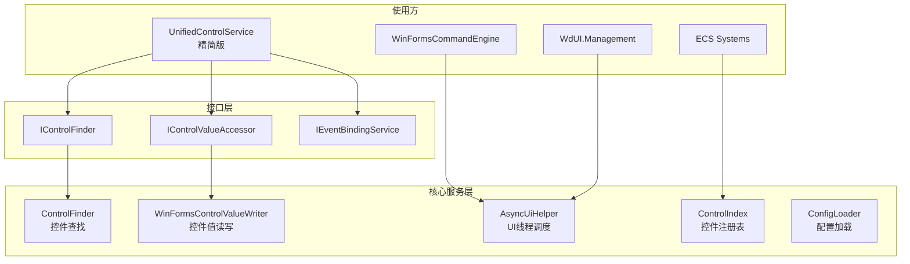
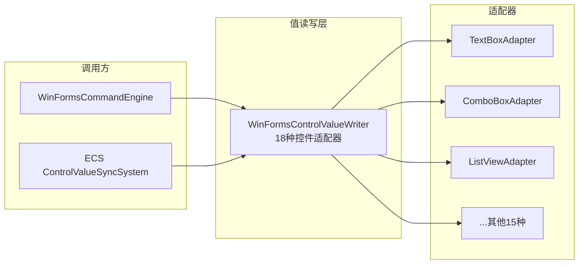
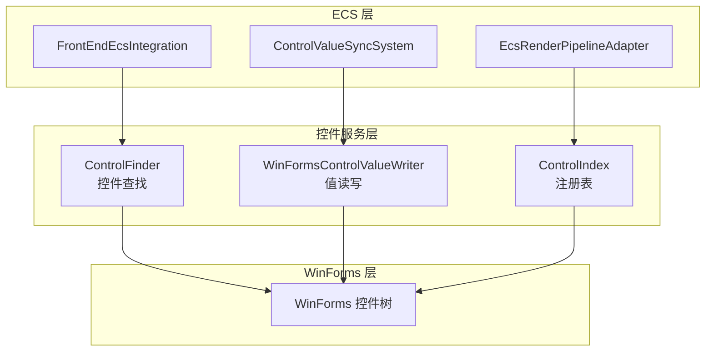

# 控件逻辑整合方案

> **版本：** v2.1
> **更新日期：** 2026-07-21
> **维护者：** WorkFlowPrj Team
>
> **配套文档：**
> - [`架构重构模式 — 常见架构缺陷与应对策略.md`](../Structuring/架构重构模式%20—%20常见架构缺陷与应对策略.md)（缺陷模式参考）
> - [`Document_Modular_Standard.md`](../Structuring/Document_Modular_Standard.md)（文档规范）
> - [`analysis_report.md`](./analysis_report.md)（原始分析报告）

---

## 目录

- [控件逻辑整合方案](#控件逻辑整合方案)
  - [目录](#目录)
  - [第一部分：背景与方案](#第一部分背景与方案)
    - [1.1 现状与问题](#11-现状与问题)
      - [1.1.1 模块介绍](#111-模块介绍)
      - [1.1.2 问题分析](#112-问题分析)
      - [1.1.3 详细问题清单](#113-详细问题清单)
        - [重复逻辑](#重复逻辑)
        - [冗余逻辑](#冗余逻辑)
        - [错误逻辑](#错误逻辑)
      - [1.1.4 职责重叠示意图](#114-职责重叠示意图)
    - [1.2 方案总览](#12-方案总览)
      - [1.2.1 设计理念](#121-设计理念)
      - [1.2.2 方案对比](#122-方案对比)
      - [1.2.3 整合后架构图](#123-整合后架构图)
    - [1.3 目录索引](#13-目录索引)
      - [现有文件清单](#现有文件清单)
      - [新增文件清单](#新增文件清单)
  - [第二部分：核心设计](#第二部分核心设计)
    - [2.0 整合方案详解](#20-整合方案详解)
      - [2.0.1 控件查找：3 套 → 1 套](#201-控件查找3-套--1-套)
      - [2.0.2 控件值读写：3 层 → 1 层](#202-控件值读写3-层--1-层)
      - [2.0.3 UI 线程调度：4 处 → 1 处](#203-ui-线程调度4-处--1-处)
      - [2.0.4 事件绑定：2 套 → 1 套](#204-事件绑定2-套--1-套)
      - [2.0.5 配置加载：2 套 → 1 套](#205-配置加载2-套--1-套)
    - [2.1 整合后接口设计](#21-整合后接口设计)
      - [2.1.1 控件查找接口](#211-控件查找接口)
      - [2.1.2 控件值读写接口](#212-控件值读写接口)
      - [2.1.3 控件注册表接口](#213-控件注册表接口)
      - [2.1.4 UI 线程调度接口](#214-ui-线程调度接口)
      - [2.1.5 类型转换辅助](#215-类型转换辅助)
    - [2.2 核心流程](#22-核心流程)
      - [2.2.1 控件查找流程（整合后）](#221-控件查找流程整合后)
      - [2.2.2 控件值读写流程（整合后）](#222-控件值读写流程整合后)
      - [2.2.3 UI 线程调度流程（整合后）](#223-ui-线程调度流程整合后)
    - [2.3 通信与适配](#23-通信与适配)
      - [2.3.1 与 ECS 系统的关系](#231-与-ecs-系统的关系)
      - [2.3.2 与 FileDriven 的共存策略](#232-与-filedriven-的共存策略)
  - [第三部分：实施步骤](#第三部分实施步骤)
    - [3.1 阶段划分](#31-阶段划分)
      - [阶段 1：清理（并行运行）](#阶段-1清理并行运行)
      - [阶段 2：合并（混合运行）](#阶段-2合并混合运行)
      - [阶段 3：优化（完全迁移）](#阶段-3优化完全迁移)
    - [3.2 优先级与顺序](#32-优先级与顺序)
      - [优先级矩阵](#优先级矩阵)
      - [推荐执行顺序](#推荐执行顺序)
    - [3.3 与现有系统的关系](#33-与现有系统的关系)
      - [集成方式](#集成方式)
      - [能力矩阵](#能力矩阵)
  - [总结](#总结)

---

## 第一部分：背景与方案

### 1.1 现状与问题

#### 1.1.1 模块介绍

`FrontEndDriven` 是 WinForms UI 的控件管理模块，提供控件查找、值读写、事件绑定、UI 线程调度、布局管理、配置加载等核心功能。当前模块包含 **78 个 .cs 文件**，分布在 `WdUI/`、`Implementation/`、`WinForms/`、`ECS/`、`Loading/`、`Utils/` 等多个子目录中。

#### 1.1.2 问题分析

对照 [`架构重构模式`](../Structuring/架构重构模式%20—%20常见架构缺陷与应对策略.md) 中定义的 6 种缺陷模式，当前模块存在以下问题：

| # | 缺陷模式 | 具体表现 | 影响 | 严重程度 |
|---|---------|---------|------|:--------:|
| 1 | **重构残留** | 10 个 `[Obsolete]` 文件未清理，新旧代码路径共存 | 构建通过但运行时行为不一致 | 🔴 |
| 2 | **逻辑分散** | ControlFinder 3 套实现、值读写 3 套实现、UI 线程调度 4 处实现 | 新增功能需修改多处，易遗漏 | 🔴 |
| 3 | **透传链过长** | `UnifiedControlService` 作为 facade 层仅透传不做处理 | 调用链 3 层，调试困难 | 🟡 |
| 4 | **职责错位** | `ControlRegistry` 和 `ControlIndex` 功能重叠但分属不同命名空间；`WdUI.Core` 包含与 `ControlFinder` 重复的 `IsDescendantOf`/`GetDepth` | 数据不一致时难以定位 | 🟡 |
| 5 | **双数据源不一致** | `ConfigLoader` 和 `WinFormsConfigurationLoader` 两套配置加载 | 配置加载行为可能不一致 | 🟡 |
| 6 | **隐式顺序依赖** | 空 catch 块（18 处）导致异常被吞噬，错误处理依赖隐式顺序 | 运行时偶发错误，难以排查 | 🔴 |

**关键指标：**

| 指标 | 数值 |
|------|------|
| 总文件数 | 78 |
| 最大文件 | `WinFormsControlValueWriter.cs`（949 行） |
| 空 catch 块 | 18 处 |
| [Obsolete] 标记文件 | 10 个 |
| 重复实现的核心功能 | 4 组 |
| 空文件/空方法 | 4 处 |
| 大文件（>400 行） | 5 个 |

#### 1.1.3 详细问题清单

##### 重复逻辑

**1. ControlFinder 三重实现**

3 套独立的控件查找实现，功能高度重叠：

| # | 实现 | 位置 | 行数 | 类型 |
|---|------|------|:----:|:----:|
| 1 | `ControlFinder` | `WdUI/Framework/Shared/ControlFinder.cs` | 353 | 静态类 |
| 2 | `ControlRegistryAwareFinder` | `Implementation/ControlRegistryAwareFinder.cs` | 344 | 实例类（实现 IControlFinder） |
| 3 | `WinFormsControlHelper` | `Implementation/WinFormsControlHelper.cs` | ~100 | 静态类 |

**重复方法对照：**

| 方法 | ControlFinder | ControlRegistryAwareFinder | WinFormsControlHelper |
|------|:---:|:---:|:---:|
| `FindByName` / `FindControlByName` | ✅ | ✅ | ✅ |
| `FindByPredicate` / `FindControlByPredicate` | ✅ | ✅ | ✅ |
| `IsDescendantOf` | ✅ | ✅ | ❌（但 WdUI.Core 有） |
| `GetDepth` | ✅ | ✅ | ❌（但 WdUI.Core 有） |
| `FindInForm` / `FindForm` | ✅ | ✅ | ❌ |
| `FindDirectChild` | ✅ | ❌ | ❌ |
| `FindRecursive` | ✅ | ❌ | ❌ |
| `FindAcrossOpenForms` | ✅ | ❌ | ❌ |
| `FindNearestConfigContainer` | ✅ | ❌ | ❌ |
| `IsWithinDepth` | ✅ | ❌ | ❌ |
| `FindControlByType<T>` | ❌ | ❌ | ✅ |
| `FindAllControlsByType<T>` | ❌ | ❌ | ✅ |
| `FindAllControlsByPredicate` | ❌ | ❌ | ✅ |

**影响：** `ControlFinder` 功能最完整（14 个方法），应作为主要实现。`WinFormsControlHelper` 功能完全被覆盖。`ControlRegistryAwareFinder` 的 9 个方法中 7 个与 `ControlFinder` 重叠。`WdUI.Core` 中的 `IsDescendantOf` / `GetDepth` 与 `ControlFinder` 完全重复。

---

**2. 控件值读写逻辑三重实现**

| # | 实现 | 位置 | 行数 |
|---|------|------|:----:|
| 1 | `WinFormsControlValueWriter` | `Implementation/WinFormsControlValueWriter.cs` | 949 |
| 2 | `CompositeValueWriter` | `Implementation/CompositeValueWriter.cs` | ~150 |
| 3 | `UnifiedControlService`（代理层） | `Implementation/UnifiedControlService.cs` | 380 |

**重复方法对照：**

| 方法 | WinFormsControlValueWriter | CompositeValueWriter | UnifiedControlService |
|------|:---:|:---:|:---:|
| `GetValue` | ✅ | ✅ | ✅（委托） |
| `SetValue` | ✅ | ✅ | ✅（委托） |
| `IsSupported` | ✅ | ✅ | ✅（委托） |
| `RegisterAdapter` | ✅ | ✅ | ✅（委托） |
| `ClearAdapters` | ✅ | ✅ | ✅（委托） |
| `WriteValue` | ✅ | ❌ | ❌ |
| `ReadValue` | ✅ | ❌ | ❌ |
| `WriteProperty` / `ReadProperty` | ✅ | ❌ | ❌ |

**调用链：** `WinFormsControlValueWriter`（18 种控件适配器）→ `CompositeValueWriter`（组合模式包装器）→ `UnifiedControlService`（服务层 facade）

**影响：** `UnifiedControlService` 的大部分方法只是简单委托到 `_writer`，没有增加业务价值。三层嵌套导致调用链过长，调试困难。

---

**3. UI 线程调度（ExecuteOnUiThread）4 处实现**

| # | 位置 | 实现方式 |
|---|------|---------|
| 1 | `WdUI/UI/WdUI.Management.cs`（AsyncUiHelper） | `control.InvokeRequired ? Invoke : 直接执行` |
| 2 | `WdUI/UI/WinFormsCommandEngine.cs` | 委托到 AsyncUiHelper |
| 3 | `WinForms/Implementation/WinFormsControlService.cs` | 独立实现（逻辑相同） |
| 4 | `Implementation/UnifiedControlService.cs` | 委托到 IEventBindingService |

**代码对比：**

AsyncUiHelper（WdUI.Management.cs）：
```csharp
public static void ExecuteOnUiThread(Control control, Action action)
{
    if (!control.InvokeRequired)
        action();
    else
        control.Invoke(action);
}
```

WinFormsControlService.cs：
```csharp
public void ExecuteOnUiThread(object control, Action action)
{
    if (control is Control c && c.InvokeRequired)
        c.Invoke(action);
    else
        action();
}
```

**差异：** 前者检查 `!InvokeRequired`，后者检查 `InvokeRequired`，逻辑等价但写法不同，增加了维护负担。

---

**4. 事件绑定逻辑 2 套实现**

| # | 实现 | 位置 | 方式 |
|---|------|------|------|
| 1 | `WinFormsControlService` | `WinForms/Implementation/WinFormsControlService.cs` | 反射 `GetEvent().AddEventHandler()` |
| 2 | `IEventBindingService` | `Abstractions/IEventBindingService.cs` | 抽象接口 |

**影响：** `WinFormsControlService` 已被标记 `[Obsolete]`，但 `IEventBindingService` 接口的实现尚未完全替代其功能。

---

**5. 配置加载逻辑 2 套**

| # | 实现 | 位置 |
|---|------|------|
| 1 | `ConfigLoader` | `Loading/ConfigLoader.cs` |
| 2 | `WinFormsConfigurationLoader` | `WinForms/Loading/WinFormsConfigurationLoader.cs` |

两者都实现配置加载，但分散在不同命名空间，职责边界不清晰。

---

**6. 控件注册表 2 套**

| # | 实现 | 位置 | 方法 |
|---|------|------|------|
| 1 | `ControlRegistry` | `WinForms/Implementation/ControlRegistry.cs` | `Register` / `Unregister` / `Find` / `TryGetValue` / `Clear` |
| 2 | `ControlIndex` | `WdUI/Framework/Shared/ControlIndex.cs` | `Register` / `Unregister` / `FindByName` / `Contains` / `Clear` / `Rebuild` |

**差异：** `ControlIndex` 多了 `Rebuild` 和 `Contains` 方法，`ControlRegistry` 多了 `TryGetValue` 方法。核心功能完全重叠。

---

**7. Convert.ChangeType 重复模式**

`WdUI.Management.cs` 中 **5 处**独立的 `Convert.ChangeType` 包装，逻辑完全相同：

```csharp
// 第 513 行
try { return (T)Convert.ChangeType(val, typeof(T)); } catch { }

// 第 525 行
try { return (T)Convert.ChangeType(val, typeof(T)); } catch { }

// 第 537 行
try { value = (T)Convert.ChangeType(val, typeof(T)); return true; } catch { }

// 第 549 行
try { return (T)(Convert.ChangeType(val, typeof(T)) ?? default(T))!; } catch { }

// 第 560 行
try { value = (T)(Convert.ChangeType(val, typeof(T)) ?? default(T))!; return true; } catch { }
```

**建议：** 提取为单一泛型辅助方法 `TryConvert<T>(object val, out T result)`。

---

##### 冗余逻辑

**1. [Obsolete] 废弃代码**

10 个文件被标记为 `[Obsolete]` 但仍保留在项目中：

| 文件 | 说明 | 建议 |
|------|------|------|
| `Utils/CommandHandler.cs` | 废弃的命令处理 | 删除 |
| `Utils/FileDialogFactory.cs` | 废弃的文件对话框工厂 | 删除 |
| `Utils/FormDisposer.cs` | 废弃的窗体释放器 | 删除 |
| `Utils/FormInitializer.cs` | 废弃的窗体初始化器 | 删除 |
| `Utils/FrameworkErrorHandler.cs` | 废弃的错误处理器 | 删除 |
| `Utils/RecursiveLogHandler.cs` | 废弃的日志处理器 | 删除 |
| `Utils/UIConfigConstants.cs` | 废弃的配置常量 | 删除 |
| `Utils/UILogger.cs` | 废弃的日志记录器 | 删除 |
| `Utils/ValueExtractionHelper.cs` | 废弃的值提取辅助 | 删除 |
| `WinForms/Implementation/WinFormsControlService.cs` | 废弃的控件服务（2 处标记） | 删除或重写 |

**整个 `Utils/` 目录全部废弃。**

---

**2. WdUI.Core 中的重复方法**

`WdUI.Core.cs`（664 行）中的 `IsDescendantOf` 和 `GetDepth` 方法与 `ControlFinder` 中的方法完全重复。`WdUI.Core` 本身是一个大文件，职责过多，同时包含控件查找辅助方法和核心 UI 管理逻辑。

---

**3. 空文件 / 空方法**

| 文件 | 行数 | 问题 |
|------|:----:|------|
| `WdUI/UI/WdUI.Layout.cs` | 371 | 无 public 方法（全是 partial class 辅助方法） |
| `WdUI/UI/WdUI.LayoutEngine.cs` | ~50 | 无 public 方法 |
| `WdUI/UI/WdUI.Container.cs` | ~50 | 无 public 方法 |
| `ECS/ContainerStrategy.cs` | 50 | `BindEvents` 方法体为空 |

---

**4. 日志记录器冗余**

| 日志记录器 | 位置 |
|------------|------|
| `FrontEndDrivenLog` | `Diagnostics/FrontEndDrivenLog.cs` |
| `WdUILog` | `WdUI/Diagnostics/WdUILog.cs` |
| `UILogger` | `Utils/UILogger.cs`（已废弃） |

`FrontEndDrivenLog` 和 `WdUILog` 功能重叠，职责边界不清晰。

---

**5. 大文件问题**

Top 5 最大文件：

| 文件 | 行数 | 大小 |
|------|:----:|:----:|
| `WinFormsControlValueWriter.cs` | 949 | 29.0 KB |
| `WdUI.Management.cs` | 812 | 29.6 KB |
| `WdUI.Core.cs` | 664 | 23.1 KB |
| `WdUI.ViewManager.cs` | 486 | 16.8 KB |
| `FrontEndEcsIntegration.cs` | 413 | 12.5 KB |

这些文件承担了过多职责，应考虑拆分。

---

##### 错误逻辑

**1. 空 catch 块（共 18 处）**

| 文件 | 数量 | 行号 | 严重程度 |
|------|:----:|------|:--------:|
| `WdUI/UI/WdUI.Management.cs` | 7 | 513, 525, 537, 549, 560 | 🔴 |
| `WdUI/Framework/ControlFactoryFramework.cs` | 5 | 187, 192, 227, 233, 249 | 🔴 |
| `Utils/UILogger.cs` | 5 | 63, 64, 72, 73, 89 | 🟡 |
| `Implementation/WinFormsControlValueWriter.cs` | 1 | 669 | 🟡 |

**最严重：WdUI.Management.cs 的 Convert.ChangeType**

```csharp
// 类型转换失败时完全静默，返回 default(T)
try { return (T)Convert.ChangeType(val, typeof(T)); } catch { }
try { value = (T)Convert.ChangeType(val, typeof(T)); return true; } catch { }
```

**问题：** 调用方无法区分"转换成功返回默认值"和"转换失败返回默认值"。

**修复建议：**
```csharp
private static T? TryConvert<T>(object val, out bool success)
{
    success = false;
    try
    {
        var result = Convert.ChangeType(val, typeof(T));
        success = true;
        return (T)result;
    }
    catch (Exception ex)
    {
        Log("ConvertType_error", new { fromType = val?.GetType().Name, toType = typeof(T).Name, error = ex.Message });
        return default;
    }
}
```

**ControlFactoryFramework.cs 的空 catch：**
```csharp
// 控件创建失败时无任何日志
catch { }
```
**问题：** 控件创建失败完全无感知，UI 上可能缺少控件但无任何提示。

**WinFormsControlValueWriter.cs 的空 catch（第 669 行）：**
```csharp
// Image.FromFile 异常被吞噬
catch { }
```
**问题：** 图片文件不存在或格式错误时静默失败。

**UILogger.cs 的空 catch：**
```csharp
catch (ObjectDisposedException) { }
catch (InvalidOperationException) { }
```
**问题：** 日志系统自身的异常被吞噬，当日志写入失败时完全无感知。

---

#### 1.1.4 职责重叠示意图

```mermaid
graph TB
    subgraph 控件查找
        CF[ControlFinder<br/>静态类 14方法]
        CRF[ControlRegistryAwareFinder<br/>实例类 9方法]
        WCH[WinFormsControlHelper<br/>静态类 6方法]
        WC[WdUI.Core<br/>IsDescendantOf/GetDepth]
    end

    subgraph 控件值读写
        WCW[WinFormsControlValueWriter<br/>18种适配器 949行]
        CVW[CompositeValueWriter<br/>组合模式包装器]
        UCS[UnifiedControlService<br/>Facade层]
        WCW --> CVW
        CVW --> UCS
    end

    subgraph 事件绑定
        WCS[WinFormsControlService<br/>反射实现 [Obsolete]]
        IEBS[IEventBindingService<br/>接口]
        UCS2[UnifiedControlService<br/>委托]
    end

    subgraph UI线程调度
        AH[AsyncUiHelper<br/>WdUI.Management]
        WCS2[WinFormsControlService<br/>独立实现]
        UCS3[UnifiedControlService<br/>委托]
        WCE[WinFormsCommandEngine<br/>委托]
    end

    subgraph 控件注册表
        CR[ControlRegistry<br/>WinForms命名空间]
        CI[ControlIndex<br/>WdUI命名空间]
    end

    subgraph 配置加载
        CL[ConfigLoader<br/>Loading命名空间]
        WCL[WinFormsConfigurationLoader<br/>WinForms.Loading命名空间]
    end
```

---

### 1.2 方案总览

#### 1.2.1 设计理念

整合方案遵循 [`架构重构模式`](../Structuring/架构重构模式%20—%20常见架构缺陷与应对策略.md) 中定义的核心设计原则：

| 原则 | 说明 | 在本方案中的应用 |
|------|------|-----------------|
| **数据所有权** | 谁拥有数据，谁负责维护 | `ControlIndex` 收归 `ControlFinder` 管理 |
| **契约优先** | 优先使用接口/抽象类定义契约 | 统一使用 `IControlFinder`、`IControlValueAccessor` 等接口 |
| **单一数据源** | 同一概念只应有一种权威表示 | 合并 `ControlRegistry` 和 `ControlIndex` |
| **显式依赖** | 依赖关系应在构造函数/初始化阶段声明 | 消除 `UnifiedControlService` 的透传层 |
| **逻辑内聚** | 同一业务规则应集中在一处 | 合并 3 套 ControlFinder 为 1 套 |

#### 1.2.2 方案对比

| 维度 | 当前方案 | 整合后方案 |
|------|----------|-----------|
| 控件查找实现数 | 3 套（ControlFinder + ControlRegistryAwareFinder + WinFormsControlHelper） | 1 套（ControlFinder 增强版） |
| 值读写实现数 | 3 层（WinFormsControlValueWriter → CompositeValueWriter → UnifiedControlService） | 2 层（WinFormsControlValueWriter → 精简服务层） |
| UI 线程调度实现数 | 4 处 | 1 处（AsyncUiHelper） |
| 控件注册表实现数 | 2 套（ControlRegistry + ControlIndex） | 1 套（合并后的 ControlIndex） |
| 配置加载实现数 | 2 套（ConfigLoader + WinFormsConfigurationLoader） | 1 套（合并后的 ConfigLoader） |
| 废弃代码 | 10 个 [Obsolete] 文件 | 全部删除 |
| 空 catch 块 | 18 处 | 0 处（全部修复） |
| 最大文件 | 949 行 | ≤ 400 行 |

#### 1.2.3 整合后架构图



---

### 1.3 目录索引

#### 现有文件清单

| 文件路径 | 当前状态 | 整合后操作 |
|---------|---------|-----------|
| `WdUI/Framework/Shared/ControlFinder.cs` | 主要实现 | **保留**，增强 |
| `Implementation/ControlRegistryAwareFinder.cs` | 重复实现 | **合并**到 ControlFinder |
| `Implementation/WinFormsControlHelper.cs` | 重复实现 | **删除** |
| `Implementation/WinFormsControlValueWriter.cs` | 主要实现 | **保留**，拆分 |
| `Implementation/CompositeValueWriter.cs` | 包装层 | **保留**，简化 |
| `Implementation/UnifiedControlService.cs` | Facade 层 | **精简**，消除透传 |
| `WinForms/Implementation/ControlRegistry.cs` | 注册表实现 | **合并**到 ControlIndex |
| `WdUI/Framework/Shared/ControlIndex.cs` | 注册表实现 | **保留**，增强 |
| `Loading/ConfigLoader.cs` | 配置加载 | **保留**，增强 |
| `WinForms/Loading/WinFormsConfigurationLoader.cs` | 配置加载 | **合并**到 ConfigLoader |
| `WinForms/Implementation/WinFormsControlService.cs` | [Obsolete] | **删除** |
| `Utils/` 目录（10 个文件） | 全部 [Obsolete] | **删除** |
| `WdUI/UI/WdUI.Management.cs` | 大文件（812 行） | **拆分** |
| `WdUI/UI/WdUI.Core.cs` | 大文件（664 行），含与 ControlFinder 重复的 IsDescendantOf/GetDepth | **拆分**，移除重复方法 |
| `WdUI/UI/WdUI.Layout.cs` | 371 行，无 public 方法 | **评估**，确认是否保留 |
| `WdUI/UI/WdUI.LayoutEngine.cs` | ~50 行，无 public 方法 | **评估**，确认是否保留 |
| `WdUI/UI/WdUI.Container.cs` | ~50 行，无 public 方法 | **评估**，确认是否保留 |
| `ECS/ContainerStrategy.cs` | ~50 行，BindEvents 方法体为空 | **修复**，补充实现或删除 |

#### 新增文件清单

| 文件路径 | 内容 |
|---------|------|
| `Utils/TypeConversionHelper.cs` | 提取 `Convert.ChangeType` 为单一泛型辅助方法 |
| `Utils/UiThreadHelper.cs` | 统一 `ExecuteOnUiThread` 实现 |

---

## 第二部分：核心设计

### 2.0 整合方案详解

> 本节对 5 组核心重复逻辑逐一给出具体的整合策略，明确"保留谁、删除谁、如何迁移"。

---

#### 2.0.1 控件查找：3 套 → 1 套

**整合策略：保留 ControlFinder，删除/委托其余实现**

| 实现 | 操作 | 理由 |
|------|------|------|
| `ControlFinder`（静态类，353 行） | **保留并增强** | 功能最完整（14 个方法），无外部依赖 |
| `ControlRegistryAwareFinder`（实例类，344 行） | **改为委托到 ControlFinder** | 保留接口 `IControlFinder` 实现，内部调用 ControlFinder 静态方法 |
| `WinFormsControlHelper`（静态类，~100 行） | **删除** | 3 个独有方法（`FindControlByType<T>` 等）合并到 ControlFinder |
| `WdUI.Core` 中的 `IsDescendantOf` / `GetDepth` | **删除** | 与 ControlFinder 完全重复，调用方改为引用 ControlFinder |

**具体变更：**

```csharp
// 变更前：ControlRegistryAwareFinder 独立实现
public class ControlRegistryAwareFinder : IControlFinder
{
    public Control? FindByName(Control root, string name)
    {
        // 344 行的独立实现...
    }
}

// 变更后：ControlRegistryAwareFinder 委托到 ControlFinder
public class ControlRegistryAwareFinder : IControlFinder
{
    public Control? FindByName(Control root, string name)
        => ControlFinder.FindByName(root, name);
    
    public bool IsDescendantOf(Control control, Control ancestor)
        => ControlFinder.IsDescendantOf(control, ancestor);
    // ...其余方法同理
}
```

**迁移路径：**
1. 将 `WinFormsControlHelper` 的 3 个独有方法（`FindControlByType<T>`、`FindAllControlsByType<T>`、`FindAllControlsByPredicate`）合并到 `ControlFinder`
2. 将 `ControlRegistryAwareFinder` 的所有方法改为委托到 `ControlFinder`
3. 删除 `WinFormsControlHelper.cs`
4. 删除 `WdUI.Core` 中的 `IsDescendantOf` / `GetDepth`
5. 更新所有引用 `WinFormsControlHelper` 的调用方

---

#### 2.0.2 控件值读写：3 层 → 1 层

**整合策略：保留 WinFormsControlValueWriter，消除 CompositeValueWriter 和 UnifiedControlService 的透传层**

| 实现 | 操作 | 理由 |
|------|------|------|
| `WinFormsControlValueWriter`（949 行） | **保留并拆分** | 核心适配器逻辑，按控件类型拆分为多个文件 |
| `CompositeValueWriter`（~150 行） | **保留但简化** | 组合模式本身有价值，但消除与 WinFormsControlValueWriter 的方法重复 |
| `UnifiedControlService`（380 行） | **精简为 facade** | 消除纯透传方法，只保留有业务逻辑的方法 |

**具体变更：**

```csharp
// 变更前：UnifiedControlService 透传
public class UnifiedControlService
{
    private readonly IControlValueAccessor _writer;
    
    public object? GetValue(object control) => _writer.GetValue(control);  // 纯透传
    public void SetValue(object control, object? value) => _writer.SetValue(control, value);  // 纯透传
    public bool IsSupported(object control) => _writer.IsSupported(control);  // 纯透传
}

// 变更后：调用方直接使用 WinFormsControlValueWriter
// UnifiedControlService 只保留有业务逻辑的方法（如组合读写、批量操作）
public class UnifiedControlService
{
    private readonly WinFormsControlValueWriter _writer;
    
    // 删除纯透传方法，调用方直接引用 _writer
    // 只保留：
    public void BatchWrite(Dictionary<string, object> values) { /* 批量写入逻辑 */ }
    public Dictionary<string, object?> BatchRead(string[] names) { /* 批量读取逻辑 */ }
}
```

**迁移路径：**
1. 将 `WinFormsControlValueWriter` 按控件类型拆分为多个文件（TextBoxAdapter、ComboBoxAdapter 等）
2. 识别 `UnifiedControlService` 中的纯透传方法，调用方改为直接使用 `WinFormsControlValueWriter`
3. `UnifiedControlService` 只保留有业务逻辑的方法

---

#### 2.0.3 UI 线程调度：4 处 → 1 处

**整合策略：提取为独立的 UiThreadHelper 静态类，所有调用方统一引用**

| 实现 | 操作 | 理由 |
|------|------|------|
| `AsyncUiHelper`（WdUI.Management.cs 内） | **提取为独立类** | 作为统一的 UiThreadHelper |
| `WinFormsCommandEngine` | **改为委托到 UiThreadHelper** | 消除重复实现 |
| `WinFormsControlService` | **已标记 [Obsolete]，删除** | 废弃代码 |
| `UnifiedControlService` | **改为委托到 UiThreadHelper** | 消除重复实现 |

**具体变更：**

```csharp
// 新增：Utils/UiThreadHelper.cs
public static class UiThreadHelper
{
    public static void ExecuteOnUiThread(Control control, Action action)
    {
        if (!control.InvokeRequired)
            action();
        else
            control.Invoke(action);
    }
    
    public static async Task RunOnUiThread(Control control, Func<Task> asyncAction)
    {
        if (!control.InvokeRequired)
            await asyncAction();
        else
            await Task.Run(async () => await control.Invoke(asyncAction));
    }
    
    public static void InvokeIfRequired(Control control, Action action)
        => ExecuteOnUiThread(control, action);
}
```

**迁移路径：**
1. 从 `WdUI.Management.cs` 提取 `AsyncUiHelper` 为独立的 `UiThreadHelper` 静态类
2. `WinFormsCommandEngine` 中调用 `AsyncUiHelper` 的地方改为调用 `UiThreadHelper`
3. `UnifiedControlService` 中调用 `IEventBindingService` 的地方改为调用 `UiThreadHelper`
4. 删除 `WinFormsControlService`（已标记 [Obsolete]）

---

#### 2.0.4 事件绑定：2 套 → 1 套

**整合策略：实现 IEventBindingService 接口，替代 WinFormsControlService 的反射实现**

| 实现 | 操作 | 理由 |
|------|------|------|
| `WinFormsControlService`（反射实现） | **删除** | 已标记 [Obsolete] |
| `IEventBindingService`（接口） | **实现并保留** | 作为统一的事件绑定入口 |

**具体变更：**

```csharp
// 新增实现：Implementation/EventBindingService.cs
public class EventBindingService : IEventBindingService
{
    public void BindEvent(object control, string eventName, Delegate handler)
    {
        var eventInfo = control.GetType().GetEvent(eventName);
        if (eventInfo == null)
            throw new ArgumentException($"Event '{eventName}' not found on {control.GetType().Name}");
        eventInfo.AddEventHandler(control, handler);
    }
    
    public void UnbindEvent(object control, string eventName, Delegate handler)
    {
        var eventInfo = control.GetType().GetEvent(eventName);
        eventInfo?.RemoveEventHandler(control, handler);
    }
}
```

**迁移路径：**
1. 实现 `IEventBindingService` 接口（将 `WinFormsControlService` 的反射逻辑迁移过来）
2. 删除 `WinFormsControlService.cs`
3. 所有调用方改为注入 `IEventBindingService`

---

#### 2.0.5 配置加载：2 套 → 1 套

**整合策略：保留 ConfigLoader，将 WinFormsConfigurationLoader 的功能合并过来**

| 实现 | 操作 | 理由 |
|------|------|------|
| `ConfigLoader`（Loading/） | **保留并增强** | 作为统一的配置加载入口 |
| `WinFormsConfigurationLoader`（WinForms/Loading/） | **合并到 ConfigLoader** | 消除重复 |

**迁移路径：**
1. 将 `WinFormsConfigurationLoader` 的独有功能合并到 `ConfigLoader`
2. 删除 `WinFormsConfigurationLoader.cs`
3. 更新所有引用 `WinFormsConfigurationLoader` 的调用方

---

### 2.1 整合后接口设计

#### 2.1.1 控件查找接口

```csharp
/// <summary>
/// 控件查找接口 — 整合后的单一入口
/// <para>合并 ControlFinder、ControlRegistryAwareFinder、WinFormsControlHelper 的功能</para>
/// </summary>
public interface IControlFinder
{
    Control? FindByName(Control root, string name);
    Control? Find(Control root, Func<Control, bool> predicate);
    Control? FindDirectChild(Control parent, string name);
    Control? FindRecursive(Control parent, string name, RecursionPolicy? policy = null);
    Control? FindByPredicate(Control parent, Func<Control, bool> predicate, RecursionPolicy? policy = null);
    Control? FindAcrossOpenForms(string controlName, RecursionPolicy? policy = null);
    Control? FindInForm(string formName, string controlName, RecursionPolicy? policy = null);
    Form? FindForm(Control? control);
    bool IsDescendantOf(Control control, Control ancestor);
    int GetDepth(Control control);
    bool IsWithinDepth(Control root, Control target, int maxDepth);

    // 类型查找（从 WinFormsControlHelper 合并）
    T? FindControlByType<T>(Control parent) where T : class;
    void FindAllControlsByType<T>(Control parent, List<T> results) where T : class;
}
```

#### 2.1.2 控件值读写接口

```csharp
/// <summary>
/// 控件值访问器接口 — 保持现有契约不变
/// </summary>
public interface IControlValueAccessor
{
    object? GetValue(object control);
    void SetValue(object control, object? value);
    bool IsSupported(object control);
    void RegisterAdapter(Type controlType, Func<object, object?> getter, Action<object, object?> setter);
    void ClearAdapters();
}
```

#### 2.1.3 控件注册表接口

```csharp
/// <summary>
/// 控件注册表接口 — 合并 ControlRegistry 和 ControlIndex
/// </summary>
public interface IControlRegistry
{
    void Register(string name, object control);
    void Unregister(string name);
    object? Find(string name);
    bool TryGetValue(string name, out object? control);
    bool Contains(string name);
    void Clear();
    void Rebuild(Control root);  // 从 ControlIndex 合并
}
```

#### 2.1.4 UI 线程调度接口

```csharp
/// <summary>
/// UI 线程调度接口 — 统一入口
/// </summary>
public static class UiThreadHelper
{
    public static void ExecuteOnUiThread(Control control, Action action);
    public static Task RunOnUiThread(Control control, Func<Task> asyncAction);
    public static void InvokeIfRequired(Control control, Action action);
}
```

#### 2.1.5 类型转换辅助

```csharp
/// <summary>
/// 类型转换辅助 — 替代 WdUI.Management.cs 中 5 处重复的 Convert.ChangeType
/// </summary>
public static class TypeConversionHelper
{
    public static T? TryConvert<T>(object val, out bool success)
    {
        success = false;
        try
        {
            var result = Convert.ChangeType(val, typeof(T));
            success = true;
            return (T)result;
        }
        catch (Exception ex)
        {
            Log("ConvertType_error",
                new { fromType = val?.GetType().Name, toType = typeof(T).Name, error = ex.Message });
            return default;
        }
    }
}
```

---

### 2.2 核心流程

#### 2.2.1 控件查找流程（整合后）

```mermaid
graph LR
    subgraph 调用方
        A[WinFormsCommandEngine]
        B[WdUI.Management]
        C[ECS Systems]
    end

    subgraph 统一入口
        D[ControlFinder<br/>静态类]
    end

    subgraph 查找策略
        E[ControlPool<br/>O(1) 查找]
        F[ControlIndex<br/>名称索引]
        G[WinForms 控件树<br/>递归遍历]
    end

    A --> D
    B --> D
    C --> D
    D --> E
    D --> F
    D --> G
```

**查找优先级：** `ControlPool（O(1)）` → `ControlIndex（名称索引）` → `WinForms 控件树（递归遍历）`

#### 2.2.2 控件值读写流程（整合后）



#### 2.2.3 UI 线程调度流程（整合后）

```mermaid
graph LR
    subgraph 调用方
        A[WinFormsCommandEngine]
        B[WdUI.Management]
        C[UnifiedControlService]
    end

    subgraph 统一入口
        D[UiThreadHelper<br/>静态类]
    end

    subgraph 执行策略
        E{control.InvokeRequired?}
        F[control.Invoke(action)]
        G[action()]
    end

    A --> D
    B --> D
    C --> D
    D --> E
    E -->|是| F
    E -->|否| G
```

---

### 2.3 通信与适配

#### 2.3.1 与 ECS 系统的关系



#### 2.3.2 与 FileDriven 的共存策略

`ControlServiceCollection.RegisterAll()` 已提供防重复保护（`_registered` + `lock`），FileDriven 先注册时自动跳过。整合后保持此机制不变。

---

## 第三部分：实施步骤

### 3.1 阶段划分

#### 阶段 1：清理（并行运行）

**目标：** 删除废弃代码，修复错误逻辑，新旧路径并行验证。

| 任务 | 说明 | 验证方式 |
|------|------|---------|
| 1.1 删除 `Utils/` 目录 | 删除 10 个 [Obsolete] 文件 | 构建通过 |
| 1.2 删除 `WinFormsControlHelper.cs` | 功能已被 ControlFinder 覆盖 | 构建通过 + 运行时测试 |
| 1.3 删除 `WinFormsControlService.cs` | 已标记 [Obsolete] | 确认无调用方后删除 |
| 1.4 修复空 catch 块 | 18 处空 catch 添加日志 | 运行时日志验证 |
| 1.5 提取 `TypeConversionHelper` | 替代 5 处重复 Convert.ChangeType | 行为一致 |
| 1.6 清理空文件/空方法 | 处理 WdUI.Layout.cs、WdUI.LayoutEngine.cs、WdUI.Container.cs、ECS/ContainerStrategy.cs | 确认无实际功能后删除或补充实现 |

#### 阶段 2：合并（混合运行）

**目标：** 消除核心功能的重复实现，新旧接口共存过渡。

| 任务 | 说明 | 验证方式 |
|------|------|---------|
| 2.1 合并 ControlFinder | ControlRegistryAwareFinder 委托到 ControlFinder | 功能测试 |
| 2.2 统一 UI 线程调度 | 4 处实现统一到 UiThreadHelper | 跨线程操作测试 |
| 2.3 合并 ControlRegistry 和 ControlIndex | 统一接口 IControlRegistry | 注册/查找功能测试 |
| 2.4 合并 ConfigLoader | WinFormsConfigurationLoader 合并到 ConfigLoader | 配置加载测试 |

#### 阶段 3：优化（完全迁移）

**目标：** 架构优化，大文件拆分，消除透传层。

| 任务 | 说明 | 验证方式 |
|------|------|---------|
| 3.1 精简 UnifiedControlService | 消除透传层，直接委托 | 功能回归测试 |
| 3.2 拆分 WinFormsControlValueWriter | 949 行 → 按控件类型拆分 | 各控件类型测试 |
| 3.3 拆分 WdUI.Management | 812 行 → 按职责拆分 | 功能回归测试 |
| 3.4 拆分 WdUI.Core | 664 行 → 移除与 ControlFinder 重复的 IsDescendantOf/GetDepth，按职责拆分 | 功能回归测试 |
| 3.5 合并日志记录器 | FrontEndDrivenLog + WdUILog → 统一日志 | 日志输出验证 |
| 3.6 实现 IEventBindingService | 替代 WinFormsControlService 的反射实现 | 事件绑定功能测试 |

---

### 3.2 优先级与顺序

#### 优先级矩阵

| 优先级 | 任务 | 风险 | 收益 | 依赖 |
|--------|------|:----:|:----:|------|
| **P0** | 修复空 catch 块 | 低 | 高 | 无 |
| **P0** | 删除废弃代码 | 低 | 高 | 无 |
| **P1** | 提取 TypeConversionHelper | 低 | 中 | P0 |
| **P1** | 统一 UI 线程调度 | 低 | 中 | P0 |
| **P2** | 合并 ControlFinder | 中 | 高 | P1 |
| **P2** | 合并 ControlRegistry/ControlIndex | 中 | 中 | P1 |
| **P3** | 精简 UnifiedControlService | 高 | 高 | P2 |
| **P3** | 大文件拆分 | 中 | 中 | P2 |

#### 推荐执行顺序

```
第 1 步：P0 — 修复空 catch + 删除废弃代码（清理后重新评估）
第 2 步：P1 — 提取公共方法 + 统一 UI 线程调度（消除小范围重复）
第 3 步：P2 — 合并核心功能（消除大范围重复）
第 4 步：P3 — 大文件拆分 + 架构优化（长期改进）
```

---

### 3.3 与现有系统的关系

#### 集成方式

| 现有模块 | 集成方式 | 整合影响 |
|---------|---------|---------|
| `FileDriven` | 通过 `ControlServiceCollection` 注册 | 无影响（防重复保护） |
| `ECS` 系统 | 直接引用 `ControlFinder`、`WinFormsControlValueWriter` | 接口不变，实现优化 |
| `WdUI` 子系统 | 内部使用 `ControlFinder`、`AsyncUiHelper` | 需更新引用路径 |
| `WinForms` 原生 | 通过 `ControlFinder` 静态方法调用 | 无影响 |

#### 能力矩阵

| 能力 | 当前提供方 | 整合后提供方 | 接口变化 |
|------|-----------|-------------|---------|
| 控件查找 | ControlFinder / ControlRegistryAwareFinder / WinFormsControlHelper | ControlFinder（增强版） | 新增类型查找方法 |
| 控件值读写 | WinFormsControlValueWriter / CompositeValueWriter / UnifiedControlService | WinFormsControlValueWriter + 精简服务层 | 不变 |
| UI 线程调度 | AsyncUiHelper / WinFormsControlService / UnifiedControlService / WinFormsCommandEngine | UiThreadHelper | 统一为静态类 |
| 控件注册表 | ControlRegistry / ControlIndex | ControlIndex（增强版） | 统一为 IControlRegistry |
| 配置加载 | ConfigLoader / WinFormsConfigurationLoader | ConfigLoader（增强版） | 不变 |
| 类型转换 | WdUI.Management（5 处重复） | TypeConversionHelper | 新增辅助类 |

---

## 总结

本方案对照 [`架构重构模式`](../Structuring/架构重构模式%20—%20常见架构缺陷与应对策略.md) 中定义的 6 种缺陷模式，对 `FrontEndDriven` 模块进行了全面分析，并按照 [`Document_Modular_Standard.md`](../Structuring/Document_Modular_Standard.md) 的三部分结构组织。

**核心目标：**

1. **消除重复** — 4 组核心功能从多套实现合并为 1 套
2. **清理废弃** — 删除 10 个 [Obsolete] 文件
3. **修复错误** — 修复 18 处空 catch 块
4. **降低复杂度** — 最大文件从 949 行降至 ≤ 400 行

**预期效果：**

| 指标 | 整合前 | 整合后 | 改善 |
|------|:------:|:------:|:----:|
| 核心功能实现数 | 4 组 × 2-4 套 | 4 组 × 1 套 | **减少 60-75%** |
| 废弃文件数 | 10 个 | 0 个 | **减少 100%** |
| 空 catch 块 | 18 处 | 0 处 | **减少 100%** |
| 最大文件行数 | 949 行 | ≤ 400 行 | **减少 58%** |
| 调用链层数 | 3 层 | 1-2 层 | **减少 33-67%** |
