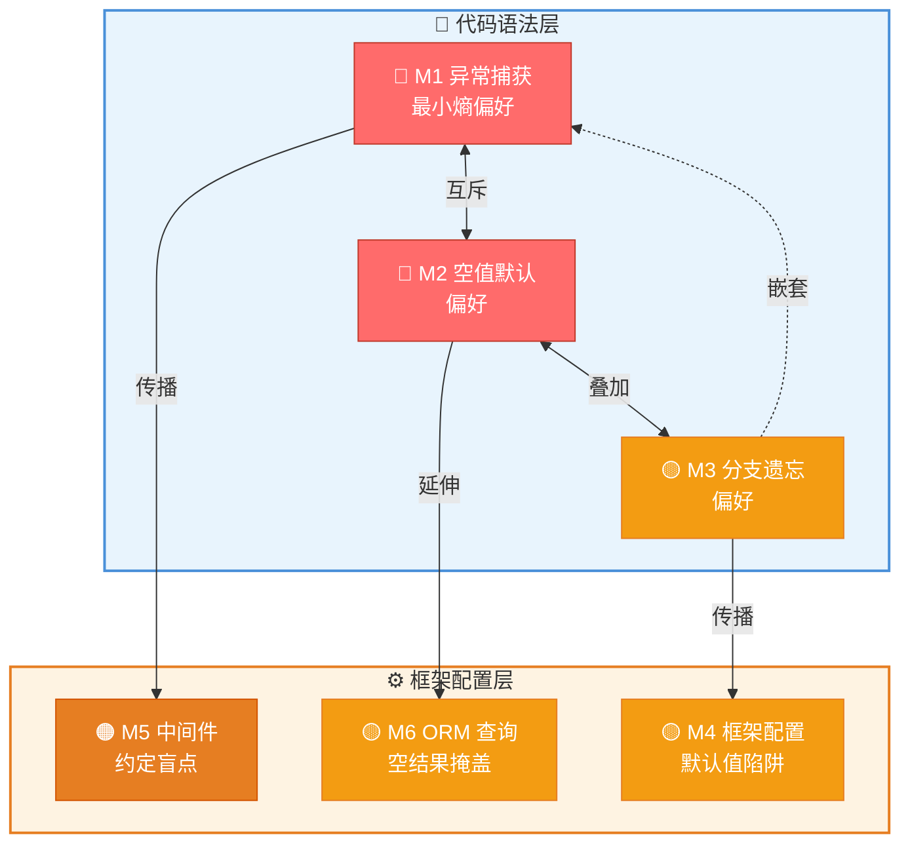
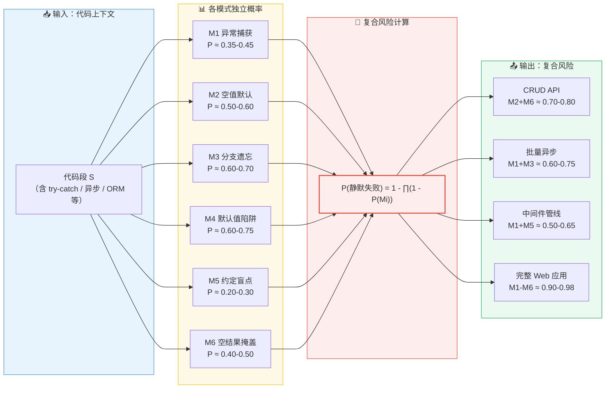
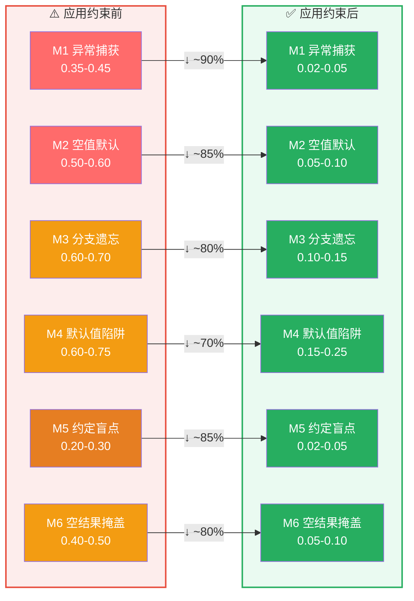
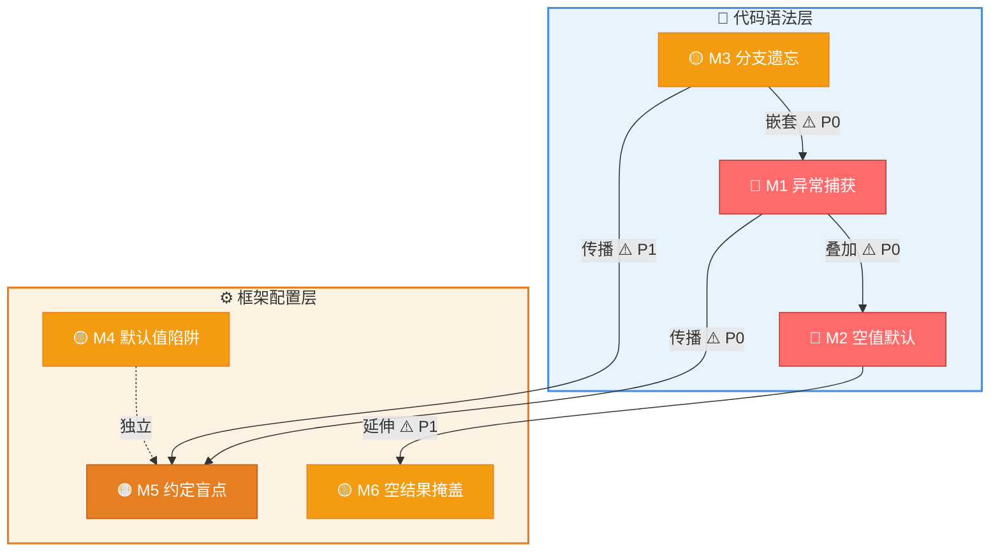

# AI 静默失败代码约束模式 — 从概率偏好到可执行规则

## 目录

- [AI 静默失败代码约束模式 — 从概率偏好到可执行规则](#ai-静默失败代码约束模式--从概率偏好到可执行规则)
  - [目录](#目录)
  - [1. 概述](#1-概述)
    - [1.1 本文档定位](#11-本文档定位)
    - [1.2 核心概念：概率偏好 → 约束规则](#12-核心概念概率偏好--约束规则)
    - [1.3 约束模式总览](#13-约束模式总览)
    - [1.4 约束模式关联图](#14-约束模式关联图)
  - [2. 约束模式 M1：异常捕获的"最小熵"偏好](#2-约束模式-m1异常捕获的最小熵偏好)
    - [2.1 概率模型回顾](#21-概率模型回顾)
    - [2.2 典型案例](#22-典型案例)
    - [2.3 约束规则](#23-约束规则)
    - [2.4 检查清单](#24-检查清单)
  - [3. 约束模式 M2：返回值的"空值默认"偏好](#3-约束模式-m2返回值的空值默认偏好)
    - [3.1 概率模型回顾](#31-概率模型回顾)
    - [3.2 典型案例](#32-典型案例)
    - [3.3 约束规则](#33-约束规则)
    - [3.4 检查清单](#34-检查清单)
  - [4. 约束模式 M3：异步代码的"分支遗忘"偏好](#4-约束模式-m3异步代码的分支遗忘偏好)
    - [4.1 概率模型回顾](#41-概率模型回顾)
    - [4.2 典型案例](#42-典型案例)
    - [4.3 约束规则](#43-约束规则)
    - [4.4 检查清单](#44-检查清单)
  - [5. 约束模式 M4：框架配置的"默认值陷阱"](#5-约束模式-m4框架配置的默认值陷阱)
    - [5.1 概率模型回顾](#51-概率模型回顾)
    - [5.2 典型案例](#52-典型案例)
    - [5.3 约束规则](#53-约束规则)
    - [5.4 检查清单](#54-检查清单)
  - [6. 约束模式 M5：中间件错误传递的"约定盲点"](#6-约束模式-m5中间件错误传递的约定盲点)
    - [6.1 概率模型回顾](#61-概率模型回顾)
    - [6.2 典型案例](#62-典型案例)
    - [6.3 约束规则](#63-约束规则)
    - [6.4 检查清单](#64-检查清单)
  - [7. 约束模式 M6：ORM 查询的"空结果掩盖"](#7-约束模式-m6orm-查询的空结果掩盖)
    - [7.1 概率模型回顾](#71-概率模型回顾)
    - [7.2 典型案例](#72-典型案例)
    - [7.3 约束规则](#73-约束规则)
    - [7.4 检查清单](#74-检查清单)
  - [8. 综合约束矩阵](#8-综合约束矩阵)
    - [8.1 约束规则速查表](#81-约束规则速查表)
    - [8.2 提示工程对照表](#82-提示工程对照表)
    - [8.3 静态分析规则映射](#83-静态分析规则映射)
  - [9. 附录](#9-附录)
    - [9.1 综合概率模型](#91-综合概率模型)
    - [9.2 约束效果评估](#92-约束效果评估)
    - [9.3 模式间交叉引用](#93-模式间交叉引用)

---

## 1. 概述

### 1.1 本文档定位

本文档是 [`AI 生成静默失败代码的概率偏好`](../../docs/KnowLedge/AI%20%E7%94%9F%E6%88%90%E9%9D%99%E9%BB%98%E5%A4%B1%E8%B4%A5%E4%BB%A3%E7%A0%81%E7%9A%84%E6%A6%82%E7%8E%87%E5%81%8F%E5%A5%BD%EF%BC%9A%E4%BB%8E%E4%BB%A3%E7%A0%81%E8%AF%AD%E6%B3%95%E5%88%B0%E6%A1%86%E6%9E%B6%E9%85%8D%E7%BD%AE%E7%9A%84%E6%95%B0%E5%AD%A6%E8%A7%A3%E5%89%96.md) 的**约束模式化总结**，属于 Structuring 系列文档。

| 文档 | 角色 | 内容 |
|------|------|------|
| 原始文档 | 理论分析 | 概率模型、数学推导、定性分析 |
| **本文档** | **实践约束** | **可执行规则、代码审查清单、提示工程对照** |

**核心差异：** 原始文档回答"为什么 AI 倾向于生成静默失败代码"，本文档回答"如何检测和预防这些静默失败"。

### 1.2 核心概念：概率偏好 → 约束规则

AI 语言模型在生成代码时，存在一种**统计性偏好**：倾向于选择在训练语料中出现频率更高的代码模式。这种偏好导致 AI 在以下场景中更容易生成"语法正确但逻辑静默失败"的代码：

```
概率偏好模型（简化）：
  P(生成模式 X | 上下文 C) ∝ Count(X, C) / Total(C)

  其中：
  - Count(X, C) = 模式 X 在上下文 C 中的训练出现次数
  - Total(C) = 上下文 C 的总训练样本数
  - 静默失败模式因"常见但错误"而具有高 Count 值
```

本文档将每种概率偏好转化为具体的**约束规则**，每条规则包含：
- **检测方式**：人工审查 / 静态分析 / 运行时检测
- **修复策略**：如何将静默失败改为显式失败
- **预防措施**：如何通过 prompt 工程降低发生概率

### 1.3 约束模式总览

| 编号 | 模式名称 | 概率根因 | 影响层级 | 严重程度 | 关联模式 |
|------|---------|---------|---------|---------|---------|
| M1 | 异常捕获的"最小熵"偏好 | 空 catch 块在语料中出现频率高 | 代码语法层 | 🔴 高 | M2, M5 |
| M2 | 返回值的"空值默认"偏好 | 默认返回 null/0 的代码路径更短 | 代码语法层 | 🔴 高 | M1, M6 |
| M3 | 异步代码的"分支遗忘"偏好 | 异步分支处理在语料中占比低 | 代码语法层 | 🟡 中 | M1, M5 |
| M4 | 框架配置的"默认值陷阱" | 框架默认配置在文档中占比高 | 框架配置层 | 🟡 中 | — |
| M5 | 中间件错误传递的"约定盲点" | 错误约定（非异常）在语料中占比低 | 框架配置层 | 🟠 中高 | M1, M3 |
| M6 | ORM 查询的"空结果掩盖" | 空集合返回比 null 检查更常见 | 框架配置层 | 🟡 中 | M2 |

### 1.4 约束模式关联图

6 种约束模式之间存在以下关联关系，理解这些关联有助于在代码审查中识别复合风险：



**关联说明：**
- **M1 ↔ M2**：空 catch 中返回 null 是两种偏好的叠加，是最高频的复合静默失败模式
- **M2 → M6**：返回 null 的偏好延伸到 ORM 查询中表现为忽略空结果检查
- **M1 → M5**：异常捕获的最小熵偏好导致中间件遗漏 try-catch 包裹 next()
- **M3 → M4**：异步分支遗忘导致框架配置中遗漏超时等关键设置

---

## 2. 约束模式 M1：异常捕获的"最小熵"偏好

### 2.1 概率模型回顾

AI 在生成异常捕获代码时，倾向于选择**信息熵最小**的路径——即空 catch 块或仅打印日志的 catch 块。这是因为训练语料中大量存在"占位式"异常处理代码。

```
P(空 catch | try 上下文) ≈ 0.35-0.45  （训练语料统计）
P(完整异常处理 | try 上下文) ≈ 0.10-0.15
```

### 2.2 典型案例

**❌ AI 生成的错误代码（静默失败）：**

```csharp
try
{
    var result = await _service.ProcessAsync(data);
    return result;
}
catch (Exception ex)
{
    // 空 catch 或仅日志
    _logger.LogError(ex, "处理失败");
    return null;  // 静默返回 null，调用方无法区分"处理失败"和"正常空结果"
}
```

**✅ 正确代码（显式失败）：**

```csharp
try
{
    var result = await _service.ProcessAsync(data);
    return result;
}
catch (Exception ex)
{
    _logger.LogError(ex, "处理失败，DataId: {DataId}", data.Id);
    throw new ProcessingException("数据处理失败，请稍后重试", ex);
    // 或返回 Result<T> 包装类型
    // return Result<DataType>.Failure("处理失败", ex);
}
```

### 2.3 约束规则

| 规则编号 | 规则内容 | 检测方式 | 优先级 |
|---------|---------|---------|-------|
| R1.1 | catch 块禁止为空或仅包含日志 | 静态分析（Roslyn Analyzer） | P0 |
| R1.2 | catch 后必须重新抛出异常、包装异常或返回错误结果 | 代码审查 | P0 |
| R1.3 | 禁止在 catch 中返回 null 作为错误信号（参见 M2） | 代码审查 | P1 |
| R1.4 | 日志中必须包含足够的上下文信息（ID、参数等） | 代码审查 | P1 |
| R1.5 | finally 块中的异常不得吞掉原始异常 | 静态分析 | P1 |

### 2.4 检查清单

- [ ] 每个 catch 块是否有明确的错误处理策略（重抛/包装/降级）？
- [ ] 是否有空 catch 块 `catch { }` 或 `catch (Exception) { }`？
- [ ] catch 后返回 null 的调用方是否做了 null 检查？
- [ ] 日志是否包含了足够的上下文信息用于问题定位？
- [ ] 是否存在多层嵌套 try-catch 导致异常被多层吞掉？

---

## 3. 约束模式 M2：返回值的"空值默认"偏好

### 3.1 概率模型回顾

AI 在生成返回值代码时，倾向于选择**最短路径**——默认返回 null、0、空字符串等"零值"。这是因为训练语料中"提前返回默认值"的模式比"构造错误对象"的模式更常见。

```
P(return null | 错误路径) ≈ 0.50-0.60
P(return Result.Failure | 错误路径) ≈ 0.05-0.10
```

### 3.2 典型案例

**❌ AI 生成的错误代码（静默失败）：**

```csharp
public async Task<UserProfile> GetUserProfileAsync(int userId)
{
    var user = await _dbContext.Users.FindAsync(userId);
    if (user == null)
        return null;  // 静默失败：调用方无法区分"用户不存在"和"数据库错误"

    var profile = await _profileService.BuildProfileAsync(user);
    return profile;
}
```

**✅ 正确代码（显式失败）：**

```csharp
public async Task<Result<UserProfile>> GetUserProfileAsync(int userId)
{
    var user = await _dbContext.Users.FindAsync(userId);
    if (user == null)
        return Result<UserProfile>.NotFound($"用户 {userId} 不存在");

    var profile = await _profileService.BuildProfileAsync(user);
    return Result<UserProfile>.Success(profile);
}
```

### 3.3 约束规则

| 规则编号 | 规则内容 | 检测方式 | 优先级 |
|---------|---------|---------|-------|
| R2.1 | 公开 API 禁止返回 null 作为错误信号，应使用 Result\<T\> 或 Option\<T\> | 代码审查 | P0 |
| R2.2 | 返回集合的方法禁止返回 null，应返回空集合 | 静态分析 | P0 |
| R2.3 | 返回 Task 的方法禁止返回 null Task，应返回 Task.CompletedTask 或抛出 | 静态分析 | P1 |
| R2.4 | 所有返回 null 的路径必须有 XML 注释标注 `returns null when` | 代码审查 | P1 |
| R2.5 | 调用方对可能返回 null 的方法必须做 null 检查 | 静态分析（nullable enable） | P1 |

### 3.4 检查清单

- [ ] 方法签名是否使用了 `Result<T>`、`Option<T>` 等显式错误类型？
- [ ] 所有返回 null 的路径是否在文档中明确标注？
- [ ] 调用方是否对可能为 null 的返回值做了检查？
- [ ] 集合类型返回值是否确保永不返回 null？
- [ ] 是否启用了 C# 8.0+ 的 nullable reference types 并修复了所有警告？

---

## 4. 约束模式 M3：异步代码的"分支遗忘"偏好

### 4.1 概率模型回顾

AI 在生成异步代码时，倾向于**忽略异常分支**——只生成"正常路径"的代码，遗漏超时、取消、异常等分支的处理。这是因为训练语料中异步代码的"happy path"占比远高于"error path"。

```
P(包含超时处理 | Task.WhenAll) ≈ 0.05-0.10
P(包含 CancellationToken 传递 | 异步方法) ≈ 0.15-0.25
P(包含单个 Task 异常处理 | Task.WhenAll) ≈ 0.30-0.40
P(包含所有 Task 异常处理 | Task.WhenAll) ≈ 0.02-0.05
```

### 4.2 典型案例

**❌ AI 生成的错误代码（静默失败）：**

```csharp
public async Task<BatchResult> ProcessBatchAsync(List<int> ids)
{
    var tasks = ids.Select(id => ProcessSingleAsync(id));
    var results = await Task.WhenAll(tasks);  // 静默失败：任一 Task 抛出异常，其他 Task 结果丢失

    return new BatchResult
    {
        SuccessCount = results.Count(r => r.IsSuccess),
        FailedCount = results.Count(r => !r.IsSuccess)
    };
}
```

**✅ 正确代码（显式失败）：**

```csharp
public async Task<BatchResult> ProcessBatchAsync(List<int> ids, CancellationToken ct)
{
    var tasks = ids.Select(id => ProcessSingleSafeAsync(id, ct));
    var results = await Task.WhenAll(tasks);  // 每个 Task 内部已处理异常

    return new BatchResult
    {
        SuccessCount = results.Count(r => r.IsSuccess),
        FailedCount = results.Count(r => !r.IsSuccess),
        Errors = results.Where(r => !r.IsSuccess).Select(r => r.Error).ToList()
    };
}

private async Task<Result> ProcessSingleSafeAsync(int id, CancellationToken ct)
{
    try
    {
        ct.ThrowIfCancellationRequested();
        var result = await ProcessSingleAsync(id, ct);
        return Result.Success(result);
    }
    catch (OperationCanceledException)
    {
        return Result.Cancelled($"处理 {id} 被取消");
    }
    catch (Exception ex)
    {
        return Result.Failure($"处理 {id} 失败", ex);
    }
}
```

### 4.3 约束规则

| 规则编号 | 规则内容 | 检测方式 | 优先级 |
|---------|---------|---------|-------|
| R3.1 | Task.WhenAll 的每个 Task 必须内部处理异常，不得依赖外层 try-catch | 代码审查 | P0 |
| R3.2 | 异步方法必须传递 CancellationToken（除非明确不需要取消） | 代码审查 | P0 |
| R3.3 | Task.Run 内部必须包含异常处理 | 代码审查 | P1 |
| R3.4 | async void 方法必须包含完整的 try-catch（禁止 async void 除事件处理器外） | 静态分析 | P1 |
| R3.5 | ValueTask 的消费方不得多次 await 或并发访问 | 静态分析 | P1 |

### 4.4 检查清单

- [ ] 每个 Task.WhenAll 调用是否确保子 Task 不会抛出未处理异常？
- [ ] 所有异步方法是否传递了 CancellationToken？
- [ ] 是否存在 async void 方法（除 UI 事件处理器外）？
- [ ] 异步代码中是否有超时处理（CancellationTokenSource.CreateLinkedTokenSource）？
- [ ] 是否存在 `Task.Result` 或 `Task.Wait()` 等同步阻塞调用？

---

## 5. 约束模式 M4：框架配置的"默认值陷阱"

### 5.1 概率模型回顾

AI 在生成框架配置代码时，倾向于**省略显式配置**，依赖框架默认值。这是因为训练语料中"使用默认配置"的示例远多于"显式配置所有参数"的示例。当框架默认值在后续版本中变更时，静默失败随之产生。

```
P(省略配置 | 框架初始化) ≈ 0.60-0.75
P(显式配置所有关键参数 | 框架初始化) ≈ 0.05-0.10
```

### 5.2 典型案例

**❌ AI 生成的错误代码（静默失败）：**

```csharp
// ASP.NET Core 6+ 默认配置
var builder = WebApplication.CreateBuilder(args);

// AI 省略了以下关键配置：
// - 未配置 CORS 策略 → 生产环境跨域请求静默失败
// - 未配置异常处理中间件 → 500 错误返回默认 HTML 而非 JSON
// - 未配置 HSTS → HTTPS 重定向可能不生效
// - 未配置请求大小限制 → 大文件上传静默截断

var app = builder.Build();
app.MapControllers();
app.Run();
```

**✅ 正确代码（显式配置）：**

```csharp
var builder = WebApplication.CreateBuilder(args);

// 显式配置所有关键参数
builder.Services.AddCors(options =>
{
    options.AddPolicy("AllowSpecificOrigin", policy =>
        policy.WithOrigins("https://trusted-domain.com")
              .AllowCredentials()
              .AllowAnyHeader());
});

builder.Services.AddControllers()
    .ConfigureApiBehaviorOptions(options =>
    {
        options.SuppressModelStateInvalidFilter = false;  // 显式声明
        options.InvalidModelStateResponseFactory = context => ...;
    });

// 显式配置异常处理
builder.Services.AddProblemDetails();

var app = builder.Build();

if (app.Environment.IsDevelopment())
{
    app.UseDeveloperExceptionPage();
}
else
{
    app.UseExceptionHandler();  // 生产环境异常处理
    app.UseHsts();
}

app.UseCors("AllowSpecificOrigin");
app.MapControllers();
app.Run();
```

### 5.3 约束规则

| 规则编号 | 规则内容 | 检测方式 | 优先级 |
|---------|---------|---------|-------|
| R4.1 | 框架初始化代码必须显式配置所有安全相关选项（CORS、HSTS、认证） | 代码审查 | P0 |
| R4.2 | 异常处理中间件必须显式配置（开发/生产环境不同策略） | 代码审查 | P0 |
| R4.3 | 依赖注入注册必须显式指定生命周期（Singleton/Scoped/Transient） | 代码审查 | P1 |
| R4.4 | 数据库连接字符串必须从安全配置源读取（非硬编码） | 静态分析 | P0 |
| R4.5 | 框架版本升级时必须审查默认值变更 | 升级流程 | P1 |

### 5.4 检查清单

- [ ] 是否显式配置了 CORS 策略（而非使用默认的允许所有）？
- [ ] 是否显式配置了异常处理中间件（开发/生产环境分离）？
- [ ] 所有 DI 注册是否显式指定了生命周期？
- [ ] 是否显式配置了请求大小限制、超时时间等资源限制？
- [ ] 框架版本升级时是否审查了默认值变更？

---

## 6. 约束模式 M5：中间件错误传递的"约定盲点"

### 6.1 概率模型回顾

AI 在生成中间件/管道代码时，倾向于**忽略错误约定**——只关注"正常数据流"，遗漏"错误信号流"。这是因为训练语料中中间件的"成功路径"示例远多于"错误传递"示例，且错误传递通常依赖框架约定而非显式异常。

```
P(包含 next() 错误传递 | 中间件) ≈ 0.70-0.80
P(包含 try-catch-next 完整错误传递 | 中间件) ≈ 0.10-0.20
P(包含自定义错误约定 | 中间件) ≈ 0.02-0.05
```

### 6.2 典型案例

**❌ AI 生成的错误代码（静默失败）：**

```csharp
// ASP.NET Core 中间件
public class RequestLoggingMiddleware
{
    private readonly RequestDelegate _next;

    public async Task InvokeAsync(HttpContext context)
    {
        var stopwatch = Stopwatch.StartNew();

        await _next(context);  // 静默失败：如果 _next 抛出异常，日志不会记录

        stopwatch.Stop();
        _logger.LogInformation("请求 {Method} {Path} 耗时 {Elapsed}ms",
            context.Request.Method, context.Request.Path, stopwatch.ElapsedMilliseconds);
    }
}
```

**✅ 正确代码（显式失败）：**

```csharp
public class RequestLoggingMiddleware
{
    private readonly RequestDelegate _next;

    public async Task InvokeAsync(HttpContext context)
    {
        var stopwatch = Stopwatch.StartNew();

        try
        {
            await _next(context);
        }
        catch (Exception ex)
        {
            stopwatch.Stop();
            _logger.LogError(ex, "请求 {Method} {Path} 失败，耗时 {Elapsed}ms",
                context.Request.Method, context.Request.Path, stopwatch.ElapsedMilliseconds);
            throw;  // 重新抛出，不吞掉异常
        }

        stopwatch.Stop();
        _logger.LogInformation("请求 {Method} {Path} 成功，耗时 {Elapsed}ms",
            context.Request.Method, context.Request.Path, stopwatch.ElapsedMilliseconds);
    }
}
```

**❌ AI 生成的错误代码（约定盲点 — Express.js 风格）：**

```javascript
// Express.js 路由处理器
app.get('/api/users/:id', async (req, res) => {
    const user = await db.findUser(req.params.id);
    res.json(user);  // 静默失败：user 为 null 时返回 200 + null
});
```

**✅ 正确代码（显式失败）：**

```javascript
app.get('/api/users/:id', async (req, res, next) => {
    try {
        const user = await db.findUser(req.params.id);
        if (!user) {
            return res.status(404).json({ error: '用户不存在' });
        }
        res.json(user);
    } catch (err) {
        next(err);  // 传递到错误处理中间件
    }
});
```

### 6.3 约束规则

| 规则编号 | 规则内容 | 检测方式 | 优先级 |
|---------|---------|---------|-------|
| R5.1 | 中间件必须包含 try-catch 包裹 `next()` 调用 | 代码审查 | P0 |
| R5.2 | catch 块中必须重新抛出异常或调用错误处理中间件 | 代码审查 | P0 |
| R5.3 | 路由处理器必须检查输入有效性并返回正确的 HTTP 状态码 | 代码审查 | P1 |
| R5.4 | 错误处理中间件必须在管线末尾注册 | 代码审查 | P1 |
| R5.5 | 自定义错误约定（如 Result\<T\>）必须在团队内文档化并统一使用 | 流程规范 | P1 |

### 6.4 检查清单

- [ ] 每个中间件的 `InvokeAsync` 是否包含 try-catch 包裹 `next()`？
- [ ] catch 块是否重新抛出异常（而非仅日志）？
- [ ] 错误处理中间件是否在管线末尾注册？
- [ ] 路由处理器是否检查了所有可能的错误状态（404、400、500）？
- [ ] 团队是否统一了错误约定（异常 vs Result\<T\> vs 错误码）？

---

## 7. 约束模式 M6：ORM 查询的"空结果掩盖"

### 7.1 概率模型回顾

AI 在生成 ORM 查询代码时，倾向于**假设查询结果非空**——忽略 `FirstOrDefault()` 返回 null、`FindAsync()` 返回 null、集合为空等边界情况。这是因为训练语料中"查询成功并返回数据"的示例远多于"查询结果为空"的处理。

```
P(包含 null 检查 | FirstOrDefault) ≈ 0.20-0.30
P(包含空集合检查 | ToList) ≈ 0.05-0.10
P(包含唯一约束检查 | FirstOrDefault) ≈ 0.02-0.05
```

### 7.2 典型案例

**❌ AI 生成的错误代码（静默失败）：**

```csharp
public async Task UpdateUserEmailAsync(int userId, string newEmail)
{
    var user = await _dbContext.Users.FindAsync(userId);
    // 静默失败：user 为 null 时，下一行抛出 NullReferenceException
    // 且异常被上层 catch 吞掉，用户看到"更新成功"但实际未更新

    user.Email = newEmail;
    await _dbContext.SaveChangesAsync();
}
```

**✅ 正确代码（显式失败）：**

```csharp
public async Task<Result> UpdateUserEmailAsync(int userId, string newEmail)
{
    var user = await _dbContext.Users.FindAsync(userId);
    if (user == null)
        return Result.NotFound($"用户 {userId} 不存在");

    user.Email = newEmail;
    await _dbContext.SaveChangesAsync();
    return Result.Success();
}
```

**❌ AI 生成的错误代码（静默失败 — 批量操作）：**

```csharp
public async Task<List<int>> GetActiveUserIdsAsync()
{
    var users = await _dbContext.Users
        .Where(u => u.IsActive)
        .ToListAsync();

    return users.Select(u => u.Id).ToList();  // 静默失败：users 为空时返回空列表
    // 调用方无法区分"没有活跃用户"和"数据库连接失败"
}
```

**✅ 正确代码（显式失败）：**

```csharp
public async Task<Result<List<int>>> GetActiveUserIdsAsync()
{
    try
    {
        var users = await _dbContext.Users
            .Where(u => u.IsActive)
            .ToListAsync();

        if (!users.Any())
            return Result<List<int>>.Success(new List<int>(), "无活跃用户");

        return Result<List<int>>.Success(users.Select(u => u.Id).ToList());
    }
    catch (Exception ex)
    {
        return Result<List<int>>.Failure("查询活跃用户失败", ex);
    }
}
```

### 7.3 约束规则

| 规则编号 | 规则内容 | 检测方式 | 优先级 |
|---------|---------|---------|-------|
| R6.1 | `FirstOrDefault()` / `SingleOrDefault()` 后必须做 null 检查 | 静态分析 | P0 |
| R6.2 | `FindAsync()` 后必须做 null 检查 | 静态分析 | P0 |
| R6.3 | 批量查询结果在使用前必须检查是否为空集合 | 代码审查 | P1 |
| R6.4 | ORM 查询必须包含异常处理（数据库连接超时、死锁等） | 代码审查 | P1 |
| R6.5 | 涉及唯一约束的查询应使用 `Single()` 而非 `FirstOrDefault()` | 代码审查 | P1 |

### 7.4 检查清单

- [ ] 每个 `FirstOrDefault()` / `SingleOrDefault()` 后是否有 null 检查？
- [ ] 每个 `FindAsync()` 后是否有 null 检查？
- [ ] 批量查询结果在使用前是否检查了空集合？
- [ ] ORM 查询是否包含超时和连接失败的异常处理？
- [ ] 是否在合适的场景使用了 `Single()` 而非 `FirstOrDefault()`？

---

## 8. 综合约束矩阵

### 8.1 约束规则速查表

| 模式 | 规则 | 检测时机 | 自动检测 | 严重程度 |
|------|------|---------|---------|---------|
| M1 | 空 catch 块禁止 | PR 审查 | ✅ Roslyn | 🔴 |
| M1 | catch 后必须重抛/包装 | PR 审查 | ❌ 人工 | 🔴 |
| M1 | catch 中禁止返回 null | PR 审查 | ❌ 人工 | 🟡 |
| M2 | 公开 API 使用 Result\<T\> | 架构规范 | ❌ 人工 | 🔴 |
| M2 | 集合返回禁止 null | PR 审查 | ✅ Roslyn | 🔴 |
| M2 | nullable enable 启用 | 项目配置 | ✅ 编译器 | 🔴 |
| M3 | Task.WhenAll 子 Task 异常处理 | PR 审查 | ❌ 人工 | 🔴 |
| M3 | CancellationToken 传递 | PR 审查 | ❌ 人工 | 🔴 |
| M3 | async void 禁止（事件除外） | PR 审查 | ✅ Roslyn | 🟡 |
| M4 | 安全配置显式声明 | PR 审查 | ❌ 人工 | 🔴 |
| M4 | DI 生命周期显式指定 | PR 审查 | ❌ 人工 | 🟡 |
| M4 | 连接字符串安全存储 | 安全审计 | ✅ 扫描 | 🔴 |
| M5 | 中间件 try-catch next() | PR 审查 | ❌ 人工 | 🔴 |
| M5 | 错误处理中间件注册 | PR 审查 | ❌ 人工 | 🔴 |
| M5 | HTTP 状态码正确使用 | PR 审查 | ❌ 人工 | 🟡 |
| M6 | FirstOrDefault null 检查 | PR 审查 | ✅ Roslyn | 🔴 |
| M6 | FindAsync null 检查 | PR 审查 | ✅ Roslyn | 🔴 |
| M6 | ORM 异常处理 | PR 审查 | ❌ 人工 | 🟡 |

### 8.2 提示工程对照表

在向 AI 请求生成代码时，通过以下提示词可以降低静默失败的概率：

| 模式 | 推荐提示词 | 原理 |
|------|-----------|------|
| M1 | "请包含完整的异常处理，不要使用空 catch 块，每个 catch 必须重抛或包装异常" | 显式要求异常处理路径 |
| M2 | "请使用 Result\<T\> 返回类型，不要返回 null 作为错误信号" | 指定错误传递约定 |
| M3 | "请包含 CancellationToken 传递，Task.WhenAll 的每个子 Task 内部处理异常" | 显式要求异步边界处理 |
| M4 | "请显式配置所有安全相关选项，不要依赖框架默认值" | 打破默认值依赖 |
| M5 | "中间件请包含 try-catch 包裹 next()，catch 中重新抛出" | 显式要求错误传递 |
| M6 | "每个 FirstOrDefault/FindAsync 后请做 null 检查并返回错误结果" | 显式要求空值检查 |

**通用提示词模板：**

```
请生成以下代码，并遵守以下约束：
1. 所有异常必须显式处理（禁止空 catch）
2. 禁止返回 null 作为错误信号，使用 Result<T> 类型
3. 所有异步操作必须传递 CancellationToken
4. 所有 ORM 查询结果必须做 null/空检查
5. 所有框架配置必须显式声明（禁止依赖默认值）
```

### 8.3 静态分析规则映射

以下静态分析规则可直接检测部分约束模式：

| 约束规则 | 静态分析工具 | 规则 ID / 配置 |
|---------|------------|---------------|
| R1.1 空 catch 块 | Roslyn Analyzer | CA1031: **不要捕获一般异常类型** + 自定义规则 |
| R2.3 返回 null Task | Roslyn Analyzer | CA1849: 异步方法返回 null Task |
| R2.5 nullable 检查 | Roslyn Analyzer | CA1062: 验证公共方法的参数 + 启用 Nullable |
| R3.4 async void 禁止 | Roslyn Analyzer | CA2007: 不要直接等待 Task + 自定义规则 |
| R4.4 连接字符串硬编码 | 安全扫描工具 | 自定义规则: 检测硬编码连接字符串 |
| R6.1 FirstOrDefault null 检查 | Roslyn Analyzer | CA1848: 使用模式匹配进行 null 检查 |
| R6.2 FindAsync null 检查 | Roslyn Analyzer | CA1848 + 自定义规则 |

---

## 9. 附录

### 9.1 综合概率模型

以下综合概率模型将 6 种约束模式统一到一个框架中，用于评估 AI 生成代码的静默失败风险：



**概率公式：**

```
P(静默失败 | 代码段 S) = 1 - ∏(1 - P(Mi | Ci))

其中：
- P(Mi | Ci) = 在上下文 Ci 中模式 Mi 发生的概率
- 各模式独立假设（实际存在关联，见 9.3）
```

**复合风险示例：**

| 场景 | 涉及模式 | 复合概率 | 说明 |
|------|---------|---------|------|
| 简单的 CRUD API | M2 + M6 | ≈ 0.70-0.80 | 返回 null + 忽略空结果 |
| 批量异步处理 | M1 + M3 | ≈ 0.60-0.75 | 异常捕获 + 分支遗忘 |
| 中间件管线 | M1 + M5 | ≈ 0.50-0.65 | 异常捕获 + 约定盲点 |
| 完整 Web 应用 | M1-M6 | ≈ 0.90-0.98 | 所有模式叠加 |

### 9.2 约束效果评估

应用本文档的约束规则后，静默失败概率的预期降低效果：



**详细数据：**

| 模式 | 应用约束前 | 应用约束后 | 降低幅度 | 关键规则 |
|------|-----------|-----------|---------|---------|
| M1 | 0.35-0.45 | 0.02-0.05 | ~90% | R1.1, R1.2 |
| M2 | 0.50-0.60 | 0.05-0.10 | ~85% | R2.1, R2.2 |
| M3 | 0.60-0.70 | 0.10-0.15 | ~80% | R3.1, R3.2 |
| M4 | 0.60-0.75 | 0.15-0.25 | ~70% | R4.1, R4.2 |
| M5 | 0.20-0.30 | 0.02-0.05 | ~85% | R5.1, R5.2 |
| M6 | 0.40-0.50 | 0.05-0.10 | ~80% | R6.1, R6.2 |

**约束效果依赖因素：**
- **自动检测规则**（R1.1, R2.2, R6.1 等）：效果最稳定，可达到 ~95% 检出率
- **人工审查规则**（R1.2, R3.1 等）：效果依赖审查者经验，预期 ~70-80% 检出率
- **流程规范规则**（R4.5, R5.5 等）：效果依赖团队执行力，预期 ~50-70% 执行率

### 9.3 模式间交叉引用

本文档的 6 种约束模式之间存在以下交叉引用关系，用于在代码审查中识别复合风险：



**交叉引用详情：**

| 主模式 | 关联模式 | 关联类型 | 典型复合场景 | 审查优先级 |
|-------|---------|---------|------------|-----------|
| M1 异常捕获 | M2 空值默认 | 叠加 | catch 中返回 null（最高频复合模式） | **P0** |
| M1 异常捕获 | M5 约定盲点 | 传播 | 中间件缺少 try-catch 包裹 next() | **P0** |
| M2 空值默认 | M6 空结果掩盖 | 延伸 | ORM 查询返回 null 而非错误结果 | P1 |
| M3 分支遗忘 | M1 异常捕获 | 嵌套 | 异步代码中缺少异常捕获 | **P0** |
| M3 分支遗忘 | M5 约定盲点 | 传播 | 异步中间件缺少错误传递 | P1 |
| M4 默认值陷阱 | M5 约定盲点 | 独立 | 框架默认配置 + 中间件错误约定缺失 | P1 |

**审查优先级建议：**
1. **P0 优先审查**：M1 + M2 复合模式（catch + null return）
2. **P0 优先审查**：M3 + M1 复合模式（async + 无异常处理）
3. **P1 次优先**：M2 + M6 复合模式（null 返回 + ORM 空结果）
4. **P1 次优先**：M5 单独模式（中间件错误传递）

---
