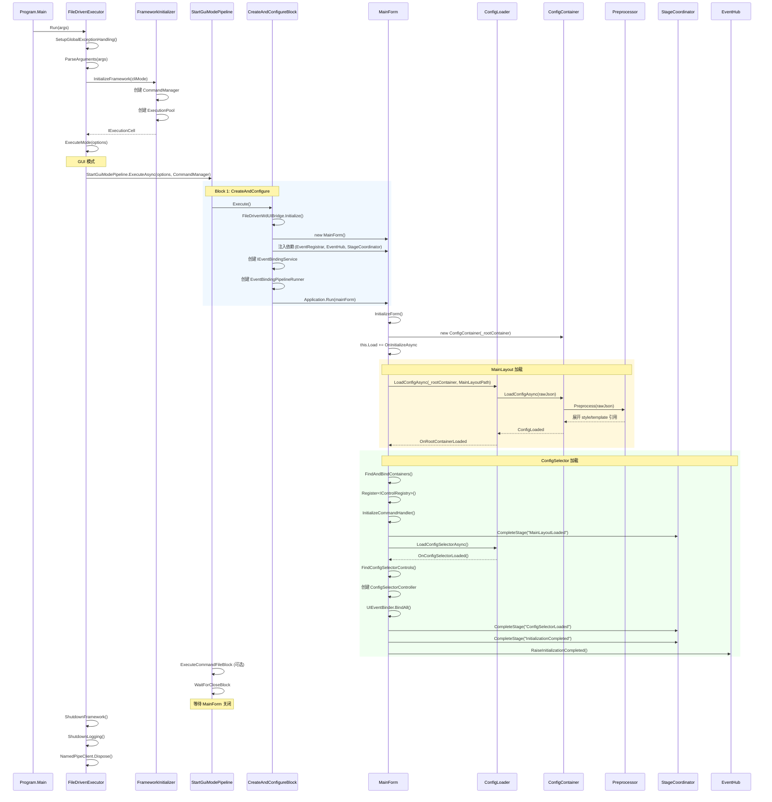
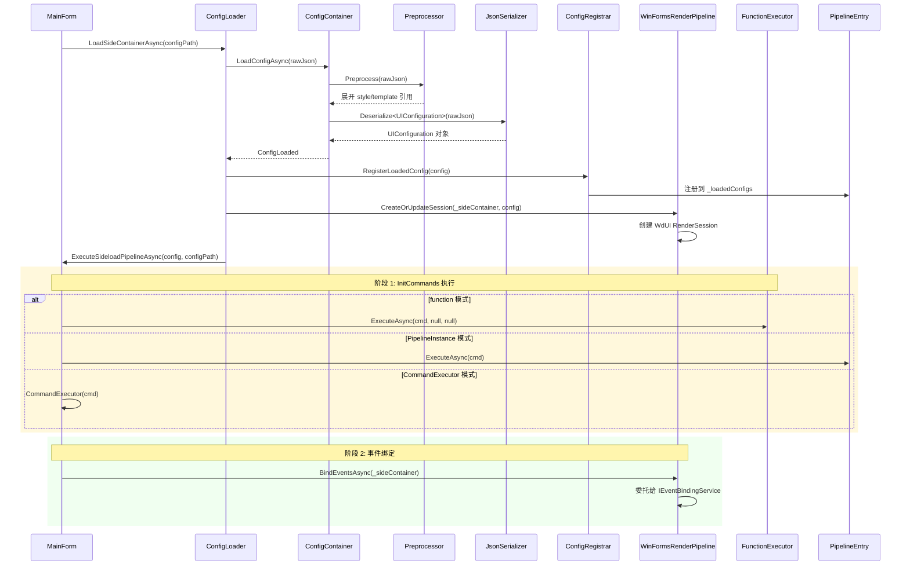
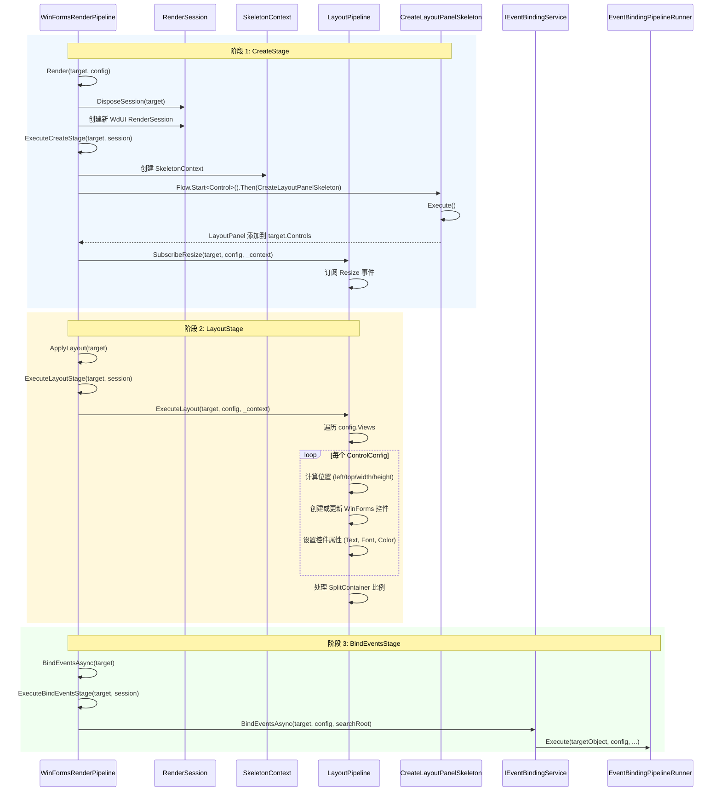
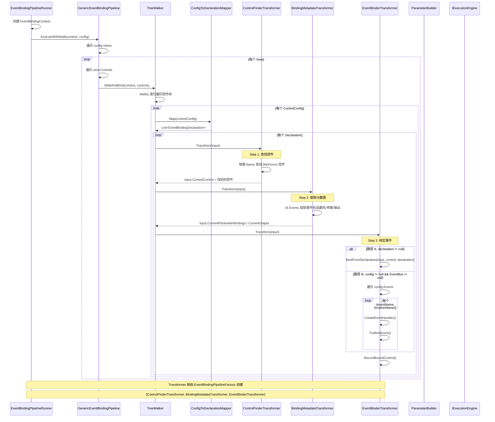
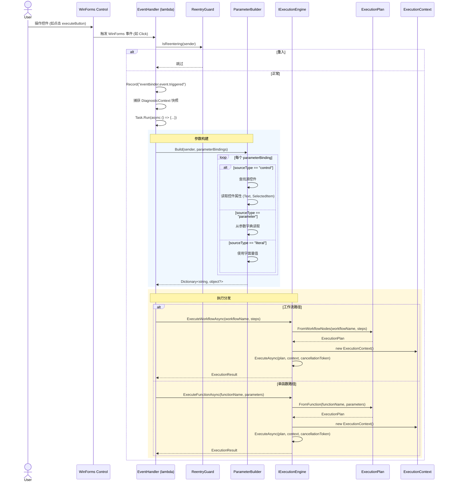
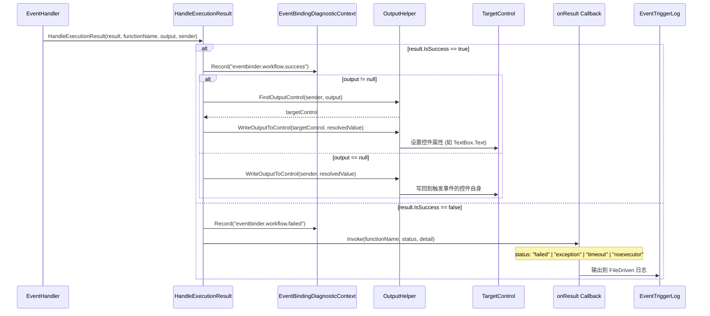

# AgentConfigUI.json 函数调用链文档

> **版本：** v3.0
> **维护者：** WorkFlowPrj Team
> **更新日期：** 2026-07-11
> **目标：** 梳理 `AgentConfigUI.json` 从启动到最终函数运行的完整链路
> **结构说明：** 本文档将调用链拆分为 6 条独立链路，每条链路使用 Mermaid 序列图表示。
> **代码参考：** 关键数据结构定义、依赖关系图、配置索引请参见 `CallChain_CodeReference.md`

---

## 目录

- [AgentConfigUI.json 函数调用链文档](#agentconfiguijson-函数调用链文档)
  - [目录](#目录)
  - [1. 调用链总览](#1-调用链总览)
  - [2. 链 1：启动加载链](#2-链-1启动加载链)
    - [2.1 调用链](#21-调用链)
    - [2.2 关键文件](#22-关键文件)
    - [2.3 关键类/接口](#23-关键类接口)
    - [2.4 数据流](#24-数据流)
  - [3. 链 2：Sideload 配置加载链](#3-链-2sideload-配置加载链)
    - [3.1 调用链](#31-调用链)
    - [3.2 关键文件](#32-关键文件)
    - [3.3 关键类/接口](#33-关键类接口)
    - [3.4 数据流](#34-数据流)
  - [4. 链 3：渲染管线链](#4-链-3渲染管线链)
    - [4.1 调用链](#41-调用链)
    - [4.2 关键文件](#42-关键文件)
    - [4.3 关键类/接口](#43-关键类接口)
    - [4.4 数据流](#44-数据流)
  - [5. 链 4：事件绑定链](#5-链-4事件绑定链)
    - [5.1 调用链](#51-调用链)
    - [5.2 关键文件](#52-关键文件)
    - [5.3 关键类/接口](#53-关键类接口)
    - [5.4 数据流](#54-数据流)
  - [6. 链 5：事件触发执行链](#6-链-5事件触发执行链)
    - [6.1 调用链](#61-调用链)
    - [6.2 关键文件](#62-关键文件)
    - [6.3 关键类/接口](#63-关键类接口)
    - [6.4 数据流](#64-数据流)
  - [7. 链 6：结果写回链](#7-链-6结果写回链)
    - [7.1 调用链](#71-调用链)
    - [7.2 关键文件](#72-关键文件)
    - [7.3 关键类/接口](#73-关键类接口)
    - [7.4 数据流](#74-数据流)
  - [8. 代码参考](#8-代码参考)


## 1. 调用链总览

| 编号 | 链路名称 | 入口 | 出口 | 核心职责 |
|------|---------|------|------|---------|
| 链 1 | **启动加载链** | `Program.Main()` | `MainForm` 就绪 + `EventHub.RaiseInitializationCompleted()` | 框架初始化、主窗口创建、MainLayout + ConfigSelector 加载 |
| 链 2 | **Sideload 配置加载链** | `MainForm.LoadSideContainerAsync()` | `UIConfiguration` 对象 | JSON 配置反序列化为强类型模型 |
| 链 3 | **渲染管线链** | `WinFormsRenderPipeline.Render()` | WinForms 控件树创建完成 | 三阶段生命周期：创建骨架 → 布局控件 → 绑定事件 |
| 链 4 | **事件绑定链** | `EventBindingPipelineRunner.Execute()` | WinForms 事件处理器绑定完成 | 3 步 Transformer：查找控件 → 提取元数据 → 绑定事件 |
| 链 5 | **事件触发执行链** | 用户操作控件 | `ExecutionResult` | 参数构建 → 函数/工作流执行 |
| 链 6 | **结果写回链** | `HandleExecutionResult()` | UI 控件更新 + 回调通知 | 结果写回目标控件 |

---

## 2. 链 1：启动加载链

### 2.1 调用链



### 2.2 关键文件

| 文件路径 | 职责 |
|---------|------|
| `FileDriven/FileDriven.Launcher/Program.cs` | 启动入口 |
| `FileDriven/FileDriven.Execution/FileDrivenExecutor.cs` | 统一执行门面，9 步流程骨架 |
| `FileDriven/FileDriven.Execution/Lifecycle/FrameworkInitializer.cs` | 框架初始化 |
| `FileDriven/FileDriven.Execution/Gui/Blocks/StartGuiModePipeline.cs` | GUI 启动管线编排 |
| `FileDriven/FileDriven.Execution/Gui/Blocks/CreateAndConfigureBlock.cs` | 创建与配置 Block |
| `FileDriven/FileDriven.UI/Core/MainForm.cs` | 主窗体 |
| `FileDriven/FileDriven.UI/WinForms/Bridge/FileDrivenWdUIBridge.cs` | WdUI 桥接 |

### 2.3 关键类/接口

| 类/接口 | 说明 |
|---------|------|
| `FileDrivenExecutor` | 继承 `FrameworkExecutor`，配置 9 步委托 |
| `FrameworkExecutor` | 基类，定义 Run() 骨架流程 |
| `StartGuiModePipeline` | Block 管线，编排 GUI 启动流程 |
| `CreateAndConfigureBlock` | 创建 MainForm 并注入依赖 |
| `MainForm` | WinForms 主窗体 |
| `ConfigContainer` | 配置容器，管理 JSON 加载 |
| `StageCoordinator` | 阶段协调器，跟踪初始化进度 |
| `EventHub` | 事件总线，广播初始化完成事件 |

### 2.4 数据流

```
输入: string[] args（命令行参数）
  → CliOptions（解析后的选项）
    → MainForm 创建 + 依赖注入
      → MainLayout JSON 加载 + 预处理
        → ConfigSelector JSON 加载 + 绑定
          → EventHub.RaiseInitializationCompleted()
输出: MainForm 窗口显示，等待用户操作
```

---

## 3. 链 2：Sideload 配置加载链

### 3.1 调用链



### 3.2 关键文件

| 文件路径 | 职责 |
|---------|------|
| `FileDriven/FileDriven.UI/Core/MainForm.cs` | `LoadSideContainerAsync` / `ExecuteSideloadPipelineAsync` |
| `FileDriven/FileDriven.UI/WinForms/Services/ConfigLoader.cs` | 配置加载器 |
| `FileDriven/FileDriven.UI/WinForms/Services/ConfigRegistrar.cs` | 配置注册器 |

### 3.3 关键类/接口

| 类/接口 | 说明 |
|---------|------|
| `ConfigLoader` | 配置加载器，封装 JSON 读取 + 反序列化 |
| `ConfigContainer` | 配置容器，管理加载生命周期 |
| `Preprocessor` | JSON 预处理器，展开 style/template 引用 |
| `UIConfiguration` | UI 配置根模型 |
| `ConfigRegistrar` | 配置注册器，将配置注册到管线 |
| `WinFormsRenderPipeline` | 渲染管线单例 |

### 3.4 数据流

```
输入: configPath（JSON 文件路径）
  → rawJson（文件原始内容）
    → Preprocessed JSON（展开 style/template）
      → UIConfiguration（强类型对象）
        → PipelineEntry._loadedConfigs（注册）
        → WdUI RenderSession（创建）
          → InitCommands 执行
          → BindEventsAsync 触发
输出: UIConfiguration 对象 + RenderSession 就绪
```

---

## 4. 链 3：渲染管线链

### 4.1 调用链



### 4.2 关键文件

| 文件路径 | 职责 |
|---------|------|
| `CsharpPrj/Operation/WdUI/WdUI.RenderPipeline.cs` | WinFormsRenderPipeline 实现 |
| `CsharpPrj/Operation/WdUI/Layout/LayoutPipeline.cs` | 布局管线 |
| `CsharpPrj/Operation/WdUI/Layout/CreateLayoutPanelSkeleton.cs` | 布局骨架创建 |

### 4.3 关键类/接口

| 类/接口 | 说明 |
|---------|------|
| `WinFormsRenderPipeline` | 渲染管线主类，管理三阶段生命周期 |
| `RenderPipelineBase<Control>` | 泛型基类，定义 Render/ApplyLayout/BindEventsAsync 骨架 |
| `IRenderSession` | 渲染会话接口 |
| `LayoutPipeline` | 布局管线，执行控件布局策略 |
| `CreateLayoutPanelSkeleton` | 创建 LayoutPanel 骨架的 Flow 步骤 |
| `IEventBindingService` | 事件绑定服务接口 |

### 4.4 数据流

```
输入: Control target（容器控件）+ UIConfiguration config
  → [CreateStage] 创建 LayoutPanel 骨架
    → [LayoutStage] 遍历 Views/Controls 创建 WinForms 控件树
      → [BindEventsStage] 触发事件绑定管线
输出: WinForms 控件树创建完成，事件绑定就绪
```

---

## 5. 链 4：事件绑定链

### 5.1 调用链



### 5.2 关键文件

| 文件路径 | 职责 |
|---------|------|
| `CsharpPrj/Share/EventBindingOrchestrator/Transformers/EventBindingPipelineRunner.cs` | 事件绑定管线执行器 |
| `CsharpPrj/Share/EventBindingOrchestrator/Transformers/GenericEventBindingPipeline.cs` | 通用事件绑定管线（3 步 Transformer 链） |
| `CsharpPrj/Share/EventBindingOrchestrator/Transformers/EventBindingPipelineFactory.cs` | 管线工厂 |
| `CsharpPrj/Share/EventBindingOrchestrator/Parameters/EventBinderTransformer.cs` | 事件绑定转换器（核心：创建 EventHandler） |
| `CsharpPrj/Share/EventBindingOrchestrator/Transformers/ControlFinderTransformer.cs` | 控件查找转换器 |
| `CsharpPrj/Share/EventBindingOrchestrator/Transformers/BindingMetadataTransformer.cs` | 绑定元数据提取转换器 |

### 5.3 关键类/接口

| 类/接口 | 说明 |
|---------|------|
| `EventBindingPipelineRunner` | 管线执行器，创建 Context 并委托给 GenericPipeline |
| `GenericEventBindingPipeline` | 通用管线，遍历控件树并执行 Transformer 链 |
| `ControlFinderTransformer` | Step 1：根据控件名查找真实 WinForms 控件 |
| `BindingMetadataTransformer` | Step 2：从 Events 配置提取绑定元数据 |
| `EventBinderTransformer` | Step 3：创建事件处理器并绑定到控件 |
| `EventBindingContext` | 事件绑定上下文，贯穿 3 步 Transformer |
| `EventBindingDeclaration` | 事件绑定声明（控件名 + 事件名 + 函数名） |
| `ConfigToDeclarationMapper` | 配置 → 声明映射器 |
| `TreeWalker<ControlConfig>` | 控件树递归遍历器 |
| `IEventBus` | 事件总线接口 |

### 5.4 数据流

```
输入: UIConfiguration（含 Events 定义）
  → EventBindingContext（运行时上下文）
    → [Step 1] ControlFinderTransformer
        输入: ControlConfig.Name
        输出: Control（真实 WinForms 控件）
    → [Step 2] BindingMetadataTransformer
        输入: ControlConfig.Events
        输出: EventBindingDeclaration（事件名 + 函数名 + 参数 + 输出）
    → [Step 3] EventBinderTransformer
        输入: Control + Declaration
        输出: EventHandler 绑定到控件
输出: WinForms 控件事件处理器绑定完成
```

---

## 6. 链 5：事件触发执行链

### 6.1 调用链



**工作流定义示例（来自 AgentConfigUI.json）：**
```json
"bindings": {
  "workflowTreeView_afterSelect": {
    "nodes": [
      { "id": "loadList",       "function": "LoadWorkflowList" },
      { "id": "populateListView","function": "PopulateListView" },
      { "id": "getFirstWorkflowName","function": "GetFirstWorkflowName" },
      { "id": "loadDetails",    "function": "LoadWorkflowDetails" },
      { "id": "loadDefaultInput","function": "LoadDefaultInput" }
    ]
  }
}
```

### 6.2 关键文件

| 文件路径 | 职责 |
|---------|------|
| `CsharpPrj/Share/EventBindingOrchestrator/Parameters/EventBinderTransformer.cs` | 事件处理器创建（CreateEventHandler） |
| `CsharpPrj/Share/EventBindingOrchestrator/Parameters/ParameterBuilder.cs` | 参数构建器 |
| `CsharpPrj/Modules/ExecutionFramework/Abstractions/IExecutionEngine.cs` | 执行引擎接口 |
| `CsharpPrj/Modules/ExecutionFramework/Abstractions/ExecutionPlan.cs` | 执行计划 |

### 6.3 关键类/接口

| 类/接口 | 说明 |
|---------|------|
| `ReentryGuard` | 重入守卫，防止事件循环 |
| `ParameterBuilder` | 参数构建器，从控件/字典/字面量构建参数字典 |
| `IExecutionEngine` | 执行引擎接口，提供 ExecuteFunctionAsync / ExecuteWorkflowAsync |
| `ExecutionPlan` | 执行计划，支持 FromFunction / FromWorkflowNodes 工厂方法 |
| `IExecutionContext` | 执行上下文接口 |
| `ExecutionResult` | 执行结果（IsSuccess / Value / ErrorMessage / ExecutionTime） |
| `StepDefinition` | 工作流步骤定义 |

### 6.4 数据流

```
输入: 用户操作控件 → EventHandler 触发
  → ParameterBuilder.Build()
      输入: sender + parameterBindings
      输出: Dictionary<string, object?>
  → IExecutionEngine.ExecuteFunctionAsync() / ExecuteWorkflowAsync()
      输入: functionName + parameters / workflowName + steps
      输出: ExecutionResult
输出: ExecutionResult（IsSuccess / Value / ErrorMessage）
```

---

## 7. 链 6：结果写回链

### 7.1 调用链



### 7.2 关键文件

| 文件路径 | 职责 |
|---------|------|
| `CsharpPrj/Share/EventBindingOrchestrator/Parameters/EventBinderTransformer.cs` | HandleExecutionResult 实现 |
| `CsharpPrj/Share/EventBindingOrchestrator/Helpers/OutputHelper.cs` | 输出帮助器 |
| `CsharpPrj/Operation/WdUI/EventBinding/DefaultEventBindingServiceWinForms.cs` | WinForms 事件绑定服务（传入 onResult 回调） |

### 7.3 关键类/接口

| 类/接口 | 说明 |
|---------|------|
| `OutputHelper` | 输出帮助器，查找目标控件并写回结果 |
| `EventBindingDiagnosticContext` | 事件绑定诊断上下文 |
| `EventTriggerLog` | 事件触发日志 |

### 7.4 数据流

```
输入: ExecutionResult + functionName + output + sender
  → OutputHelper.FindOutputControl(sender, output)
      输入: sender（触发事件的控件）+ output（输出目标名称）
      输出: targetControl（目标 WinForms 控件）
  → OutputHelper.WriteOutputToControl(targetControl, resolvedValue)
      输入: targetControl + result.Value
      输出: 控件属性更新（如 TextBox.Text = result）
  → onResult?.Invoke(functionName, status, detail)
      输入: functionName + status + detail
      输出: EventTriggerLog 日志记录
输出: UI 控件更新 + 日志记录完成
```

---

## 8. 代码参考

> 以下内容已分离到独立文档 `CallChain_CodeReference.md`：

| 章节 | 内容 | 文件 |
|------|------|------|
| **8.1 关键数据结构** | UIConfiguration、EventBindingContext、EventBindingDeclaration、FileDrivenPipelineContext | `CallChain_CodeReference.md#1-关键数据结构` |
| **8.2 依赖关系图** | 项目依赖树、命名空间调用链 | `CallChain_CodeReference.md#2-依赖关系图` |
| **8.3 配置索引** | AgentConfigUI.json 关键配置项速查表 | `CallChain_CodeReference.md#3-附录agentconfiguijson-关键配置索引` |
