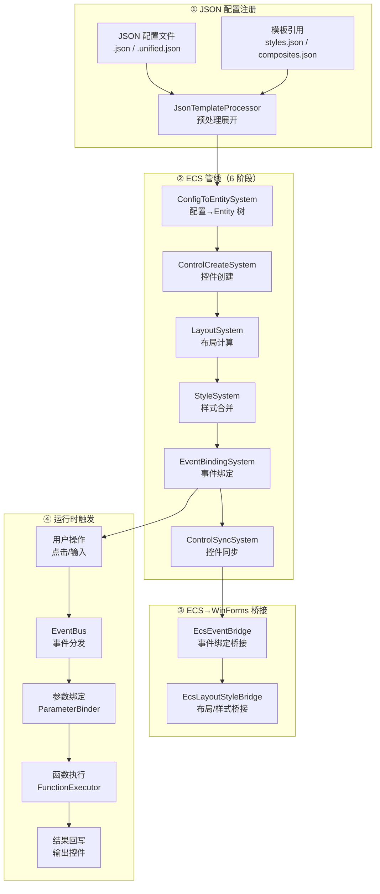
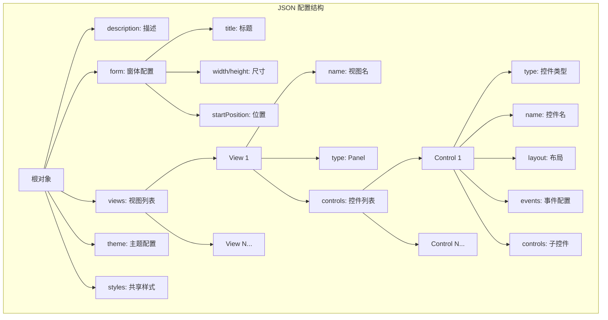
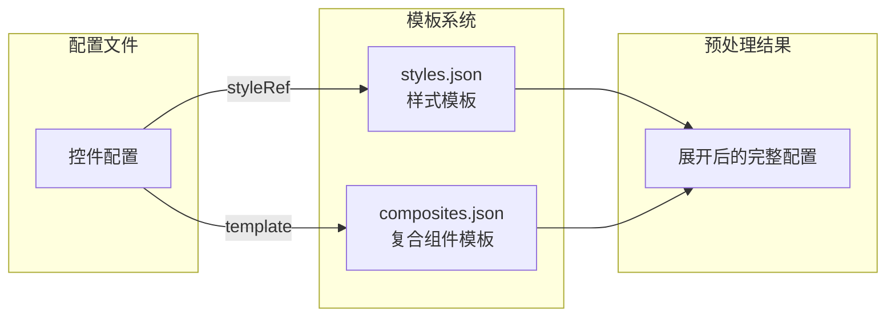
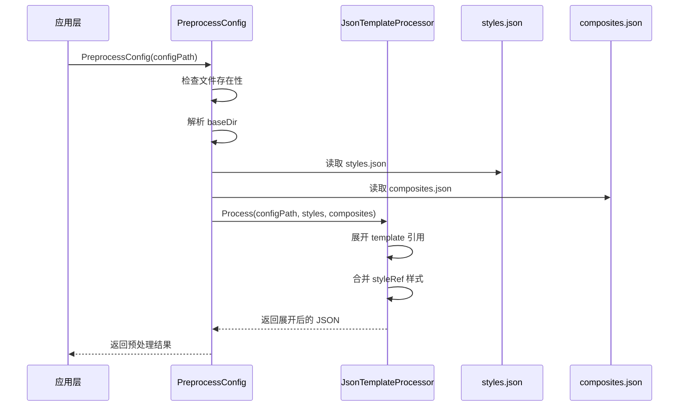
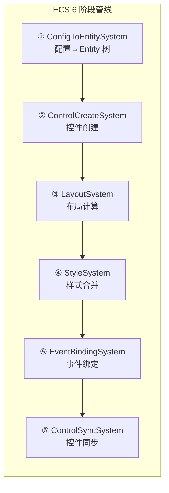
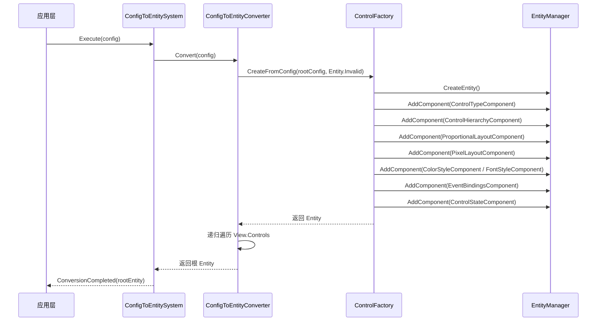
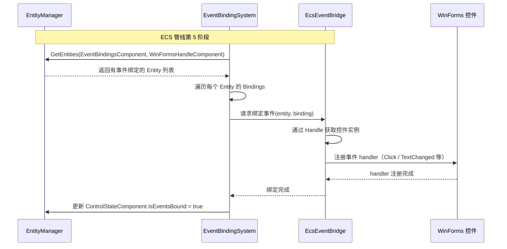
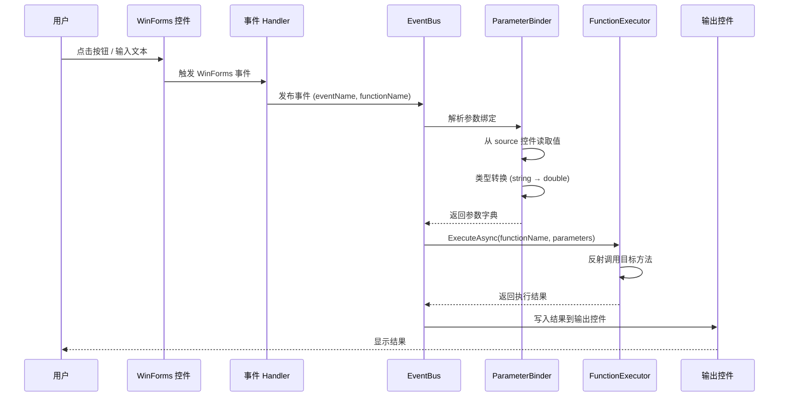
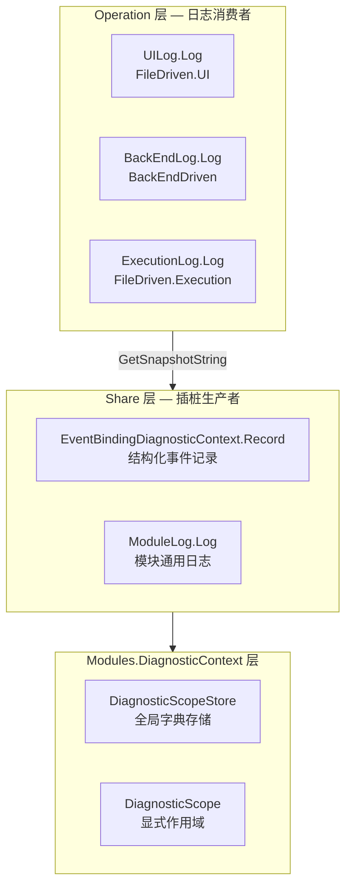

# FileDriven 控件使用流程：从 JSON 注册到事件绑定

> **版本：** v2.0
> **更新日期：** 2026-07-19
> **配套文档：** [`Architecture.md`](Architecture.md)（日志架构）、[`Implementation.md`](Implementation.md)（实现细节）

---

## 目录

- [FileDriven 控件使用流程：从 JSON 注册到事件绑定](#filedriven-控件使用流程从-json-注册到事件绑定)
  - [目录](#目录)
  - [1. 概述](#1-概述)
    - [1.1 整体流程图](#11-整体流程图)
    - [1.2 核心设计理念](#12-核心设计理念)
    - [1.3 关键文件索引](#13-关键文件索引)
  - [2. 第一站：JSON 配置注册](#2-第一站json-配置注册)
    - [2.1 配置类型](#21-配置类型)
    - [2.2 配置结构](#22-配置结构)
    - [2.3 控件配置详解](#23-控件配置详解)
    - [2.4 模板引用系统](#24-模板引用系统)
    - [2.5 示例对照](#25-示例对照)
  - [3. 第二站：配置预处理](#3-第二站配置预处理)
    - [3.1 预处理流程](#31-预处理流程)
    - [3.2 模板展开](#32-模板展开)
    - [3.3 样式合并](#33-样式合并)
  - [4. 第三站：ECS 管线（UI 渲染）](#4-第三站ecs-管线ui-渲染)
    - [4.1 ECS 管线总览](#41-ecs-管线总览)
    - [4.2 阶段 1：ConfigToEntitySystem — 配置→Entity 树](#42-阶段-1configtoentitysystem--配置entity-树)
    - [4.3 阶段 2：ControlCreateSystem — 控件创建](#43-阶段-2controlcreatesystem--控件创建)
    - [4.4 阶段 3：LayoutSystem — 布局计算](#44-阶段-3layoutsystem--布局计算)
    - [4.5 阶段 4：StyleSystem — 样式合并](#45-阶段-4stylesystem--样式合并)
    - [4.6 阶段 5：EventBindingSystem — 事件绑定](#46-阶段-5eventbindingsystem--事件绑定)
    - [4.7 阶段 6：ControlSyncSystem — 控件同步](#47-阶段-6controlsyncsystem--控件同步)
    - [4.8 控件创建映射](#48-控件创建映射)
  - [5. 第四站：ECS 事件绑定桥接](#5-第四站ecs-事件绑定桥接)
    - [5.1 概述](#51-概述)
    - [5.2 ECS 事件绑定流程](#52-ecs-事件绑定流程)
    - [5.3 EventBindingComponent 结构](#53-eventbindingcomponent-结构)
    - [5.4 EcsEventBridge 桥接机制](#54-ecseventbridge-桥接机制)
    - [5.5 运行时事件触发（ECS 视角）](#55-运行时事件触发ecs-视角)
  - [6. 第五站：运行时事件触发](#6-第五站运行时事件触发)
    - [6.1 事件触发流程](#61-事件触发流程)
    - [6.2 参数绑定](#62-参数绑定)
    - [6.3 函数执行](#63-函数执行)
    - [6.4 结果回写](#64-结果回写)
  - [7. 诊断与日志体系](#7-诊断与日志体系)
    - [7.1 分层日志架构](#71-分层日志架构)
    - [7.2 诊断快照](#72-诊断快照)
    - [7.3 事件命名规范](#73-事件命名规范)
  - [8. 完整示例：MathFunctions 生命周期](#8-完整示例mathfunctions-生命周期)
    - [8.1 配置定义](#81-配置定义)
    - [8.2 ECS 管线执行](#82-ecs-管线执行)
    - [8.4 运行时触发](#84-运行时触发)
  - [9. 常见问题排查](#9-常见问题排查)
    - [9.1 事件绑定数为 0](#91-事件绑定数为-0)
    - [9.2 控件查找失败](#92-控件查找失败)
    - [9.3 配置格式错误](#93-配置格式错误)

---

## 1. 概述

### 1.1 整体流程图



### 1.2 核心设计理念

| 理念 | 说明 |
|------|------|
| **声明式 UI** | 通过 JSON 配置声明控件结构、布局、样式和事件，无需手写 WinForms 代码 |
| **配置驱动** | 控件创建、布局计算、事件绑定全部由配置驱动，代码不包含硬编码 UI 逻辑 |
| **ECS 架构** | 控件生命周期由 6 阶段 ECS 管线管理：ConfigToEntity → ControlCreate → Layout → Style → EventBinding → Sync |
| **管线化处理** | 渲染、事件绑定均通过 StaticPipeline 编排，步骤可插拔、可复用 |
| **分层解耦** | JSON 配置（数据层）→ ECS Entity（数据模型层）→ System（逻辑层）→ WinForms（展示层） |
| **模板复用** | styles.json 定义样式模板，composites.json 定义复合组件，减少配置重复 |

### 1.3 关键文件索引

| 角色 | 文件路径 | 说明 |
|------|----------|------|
| 纯 UI 配置 | `FileDriven/DrivenConfig/JsonConfig/*.json` | 仅包含 UI 控件定义 |
| 统一配置 | `FileDriven/DrivenConfig/UnifiedConfig/*.unified.json` | UI + 函数注册合并 |
| 样式模板 | `FileDriven/DrivenConfig/TempletConfig/JsonConfig/styles.json` | 控件样式模板 |
| 复合组件 | `FileDriven/DrivenConfig/TempletConfig/JsonConfig/composites.json` | 多控件组合模板 |
| 函数注册 | `FileDriven/DrivenConfig/FunctionRegistrations/*.registration.json` | 函数注册信息 |
| 预处理 | `FileDriven/FileDriven.JsonRefer/JsonProcessing/JsonTemplateProcessor.cs` | 模板展开引擎 |
| 渲染入口 | `FileDriven/FileDriven.UI/Core/MainForm.cs` | UI 主窗体 |
| 配置加载 | `FileDriven/FileDriven.UI/WinForms/Loading/ConfigLoader.cs` | 配置加载器 |
| 事件编排 | `CsharpPrj/Share/EventBindingOrchestrator/EventBindingOrchestrator.cs` | 事件绑定编排器 |
| 管线工厂 | `CsharpPrj/Share/EventBindingOrchestrator/EventBindingPipelineFactory.cs` | 事件绑定管线工厂 |
| 控件查找 | `CsharpPrj/Modules/EventFramework/Utils/ReflectionChildControlProvider.cs` | 反射控件查找 |
| 诊断上下文 | `CsharpPrj/Share/EventBindingOrchestrator/Contexts/EventBindingDiagnosticContext.cs` | 事件绑定诊断 |
| **ECS EntityManager** | `CsharpPrj/BasicMethod/ECS/Core/EntityManager.cs` | ECS 核心：Entity/Component 管理 |
| **ECS 配置→Entity** | `CsharpPrj/BasicMethod/ECS/Systems/ConfigToEntitySystem.cs` | 第 1 阶段：配置→Entity 树 |
| **ECS 控件创建** | `CsharpPrj/BasicMethod/ECS/Systems/ControlCreateSystem.cs` | 第 2 阶段：控件创建 |
| **ECS 布局计算** | `CsharpPrj/BasicMethod/ECS/Systems/LayoutSystem.cs` | 第 3 阶段：布局计算 |
| **ECS 样式合并** | `CsharpPrj/BasicMethod/ECS/Systems/StyleSystem.cs` | 第 4 阶段：样式合并 |
| **ECS 事件绑定** | `CsharpPrj/BasicMethod/ECS/Systems/EventBindingSystem.cs` | 第 5 阶段：事件绑定 |
| **ECS 控件同步** | `CsharpPrj/BasicMethod/ECS/Systems/ControlSyncSystem.cs` | 第 6 阶段：控件同步 |
| **ECS 控件工厂** | `CsharpPrj/BasicMethod/ECS/Bridge/ControlFactory.cs` | ECS Entity 创建工厂 |
| **ECS 配置转换器** | `CsharpPrj/BasicMethod/ECS/Conversion/ConfigToEntityConverter.cs` | 配置→Entity 递归转换 |
| **ECS 事件桥接** | `CsharpPrj/BasicMethod/ECS/Bridge/EcsEventBridge.cs` | ECS→WinForms 事件绑定桥接 |
| **ECS 布局样式桥接** | `CsharpPrj/BasicMethod/ECS/Bridge/EcsLayoutStyleBridge.cs` | ECS→WinForms 布局/样式桥接 |
| **ECS Component 定义** | `CsharpPrj/Plate/TConfig/ECS/Components/` | 所有 ECS Component 定义 |

---

## 2. 第一站：JSON 配置注册

### 2.1 配置类型

系统支持两种配置格式：

| 类型 | 格式 | 说明 | 示例 |
|------|------|------|------|
| **JsonConfig** | `.json` | 纯 UI 配置，仅包含控件定义 | `ConfigSelector.json` |
| **UnifiedConfig** | `.unified.json` | UI 配置 + 函数注册合并 | `MathFunctions.unified.json` |

**UnifiedConfig 结构：**

```json
{
  "schema": "https://workflowprj/schemas/unified-config/v1",
  "version": "1.0.0",
  "description": "描述",

  "functions": [ /* 函数注册列表 */ ],

  "ui": {
    "form": { /* 窗体配置 */ },
    "views": [ /* 视图列表 */ ]
  }
}
```

### 2.2 配置结构



### 2.3 控件配置详解

**通用字段：**

| 字段 | 类型 | 必填 | 说明 |
|------|------|------|------|
| `type` | string | ✅ | 控件类型：label / button / textbox / groupbox / panel / combobox / checkbox / listview |
| `name` | string | ✅ | 控件名称，用于事件绑定和代码引用 |
| `text` | string | 否 | 控件显示的文本 |
| `layout` | object | 否 | 比例布局配置（推荐） |
| `events` | object | 否 | 事件配置 |
| `controls` | array | 否 | 子控件列表（容器类控件使用） |
| `font` | object | 否 | 字体配置 |
| `backColor` | string | 否 | 背景色（十六进制） |
| `foreColor` | string | 否 | 前景色 |
| `enabled` | bool | 否 | 是否启用 |
| `placeholder` | string | 否 | 占位符文本 |
| `readOnly` | bool | 否 | 是否只读 |
| `styleRef` | string | 否 | 引用共享样式名称 |
| `template` | string | 否 | 引用复合组件模板 |

**事件配置（events）：**

```json
"events": {
  "click": "FunctionName",           // 事件名 → 函数名
  "bindings": {
    "parameters": [                   // 参数绑定
      { "target": "a", "source": "valueATextBox", "sourceType": "control", "type": "double" }
    ],
    "output": "resultTextBox"         // 输出目标控件
  }
}
```

| 事件字段 | 对应 WinForms 事件 | 说明 |
|----------|-------------------|------|
| `click` | `Click` | 单击事件 |
| `doubleClick` | `DoubleClick` | 双击事件 |
| `textChanged` | `TextChanged` | 文本变化事件 |
| `selectedIndexChanged` | `SelectedIndexChanged` | 选中项变化事件 |
| `checkedChanged` | `CheckedChanged` | 选中状态变化事件 |

### 2.4 模板引用系统



**styles.json — 样式模板：**

```json
{
  "styles": {
    "primary-button": {
      "applyTo": ["button"],
      "properties": {
        "backColor": "#2563EB",
        "foreColor": "White",
        "font": { "size": 11, "bold": true }
      }
    },
    "title-bar": {
      "applyTo": ["label"],
      "properties": {
        "backColor": "#2563EB",
        "foreColor": "White",
        "font": { "size": 12, "bold": true },
        "layout": { "left": 0.0, "top": 0.0, "width": 1.0, "height": 0.06 }
      }
    }
  }
}
```

**composites.json — 复合组件模板：**

```json
{
  "composites": {
    "title-bar-with-text": {
      "type": "label",
      "defaults": {
        "backColor": "#2563EB",
        "foreColor": "White",
        "font": { "size": 12, "bold": true },
        "layout": { "left": 0.0, "top": 0.0, "width": 1.0, "height": 0.06 }
      },
      "parameters": {
        "name": { "required": true },
        "text": { "required": true }
      }
    },
    "action-button": {
      "type": "button",
      "defaults": {
        "backColor": "#2563EB",
        "foreColor": "White",
        "font": { "size": 11, "bold": true }
      },
      "parameters": {
        "name": { "required": true },
        "text": { "required": true },
        "eventName": { "default": "click" },
        "functionName": { "required": true }
      },
      "buildEvents": true
    }
  }
}
```

### 2.5 示例对照

**ConfigSelector.json（纯 UI 配置）：**

```json
{
  "views": [{
    "name": "ConfigSelectorView",
    "type": "Panel",
    "controls": [
      { "template": "title-bar-with-text", "name": "titleLabel", "text": "选择配置文件" },
      { "type": "textbox", "name": "searchTextBox", "placeholder": "输入配置文件名搜索..." },
      { "type": "listview", "name": "configListView", "view": "List" },
      { "type": "button", "name": "loadSelButton", "text": "加载配置", "style": "primary-button" },
      { "type": "button", "name": "browseButton", "text": "浏览...", "style": "secondary-button" }
    ]
  }]
}
```

**MathFunctions.unified.json（统一配置，含 events）：**

```json
{
  "functions": [
    { "name": "Add", "type": "delegate", "source": "FunctionStorage.MathLibrary, FileDriven.Business", "method": "Add" },
    { "name": "Subtract", "type": "delegate", ... },
    { "name": "Multiply", "type": "delegate", ... },
    { "name": "Divide", "type": "delegate", ... },
    { "name": "SetValue", "type": "workflow", ... }
  ],
  "ui": {
    "views": [{
      "name": "MainView",
      "type": "Panel",
      "controls": [
        { "type": "label", "name": "titleLabel", "text": "内置数学函数测试" },
        { "type": "groupbox", "name": "inputGroupBox", "text": "输入值", "controls": [
          { "type": "textbox", "name": "valueATextBox", "events": { "textchanged": "SetValue", "bindings": {...} } },
          { "type": "textbox", "name": "valueBTextBox", "events": { "textchanged": "SetValue", "bindings": {...} } }
        ]},
        { "type": "groupbox", "name": "functionGroupBox", "text": "数学函数", "controls": [
          { "type": "button", "name": "addButton", "text": "加法 (Add)", "events": { "click": "Add", "bindings": {...} } },
          { "type": "button", "name": "subtractButton", "text": "减法 (Subtract)", "events": { "click": "Subtract", "bindings": {...} } },
          { "type": "button", "name": "multiplyButton", "text": "乘法 (Multiply)", "events": { "click": "Multiply", "bindings": {...} } },
          { "type": "button", "name": "divideButton", "text": "除法 (Divide)", "events": { "click": "Divide", "bindings": {...} } }
        ]},
        { "type": "groupbox", "name": "resultGroupBox", "text": "结果", "controls": [
          { "type": "textbox", "name": "resultTextBox", "readOnly": true }
        ]},
        { "type": "label", "name": "statusLabel", "text": "选择数值并点击运算按钮查看结果" }
      ]
    }]
  }
}
```

---

## 3. 第二站：配置预处理

### 3.1 预处理流程



### 3.2 模板展开

`JsonTemplateProcessor.Process` 负责将配置中的 `template` 引用展开为完整控件定义：

```
输入（2417 字节）：
  { "template": "title-bar-with-text", "name": "titleLabel", "text": "选择配置文件" }

处理过程：
  1. 查找 composites.json 中 "title-bar-with-text" 的定义
  2. 获取 defaults（backColor, foreColor, font, layout）
  3. 合并 parameters（name, text）
  4. 生成完整控件定义

输出（3663 字节）：
  {
    "type": "label",
    "name": "titleLabel",
    "text": "选择配置文件",
    "backColor": "#2563EB",
    "foreColor": "White",
    "font": { "size": 12, "bold": true },
    "layout": { "left": 0.0, "top": 0.0, "width": 1.0, "height": 0.06 }
  }
```

### 3.3 样式合并

`styleRef` 引用在预处理阶段合并到控件属性中：

```
优先级：控件直接属性 > styleRef > theme 全局主题

示例：
  控件定义：
    { "type": "button", "name": "loadSelButton", "style": "primary-button" }
  
  styles.json 中 primary-button：
    { "backColor": "#2563EB", "foreColor": "White", "font": { "size": 11, "bold": true } }
  
  合并结果：
    { "type": "button", "name": "loadSelButton", "backColor": "#2563EB", "foreColor": "White", "font": { "size": 11, "bold": true } }
```

---

## 4. 第三站：ECS 管线（UI 渲染）

### 4.1 ECS 管线总览

UI 渲染由 **6 阶段 ECS 管线** 完成，每个阶段对应一个 System，按顺序执行：



| 阶段 | System | 输入 | 输出 | 说明 |
|------|--------|------|------|------|
| 1 | ConfigToEntitySystem | UIConfiguration | Entity 树（含 Component） | 递归遍历 ViewConfig→ControlConfig，为每个控件创建 Entity |
| 2 | ControlCreateSystem | Entity（未创建） | WinFormsHandleComponent | 遍历未创建的 Entity，触发 WinForms 控件实例化 |
| 3 | LayoutSystem | ProportionalLayoutComponent | ComputedLayoutComponent | 比例→像素坐标转换 |
| 4 | StyleSystem | StyleRefComponent + ColorStyleComponent + FontStyleComponent | MergedStyleComponent | 多源样式合并 |
| 5 | EventBindingSystem | EventBindingsComponent | 已注册的 WinForms 事件 handler | 遍历 EventBindingComponent，注册事件 |
| 6 | ControlSyncSystem | 所有已计算的 Component | 同步到 WinForms 控件 | 监听 ComponentUpdated 事件，实时同步 |

### 4.2 阶段 1：ConfigToEntitySystem — 配置→Entity 树

**职责：** 将预处理后的 UIConfiguration 转换为 ECS Entity 树。

**核心流程：**



**ControlFactory.CreateFromConfig 创建的 Component：**

| Component | 来源 | 说明 |
|-----------|------|------|
| `ControlTypeComponent` | config.Type / Name / Text / Enabled | 控件类型标识 |
| `ControlHierarchyComponent` | parentEntity + children | 层级关系 |
| `ProportionalLayoutComponent` | config.Layout | 比例布局（可选） |
| `PixelLayoutComponent` | config.X / Y / Width / Height | 像素布局 |
| `ColorStyleComponent` | config.Style.BackColor / ForeColor / BorderColor | 颜色样式（可选） |
| `FontStyleComponent` | config.Style.FontFamily / FontSize / Bold / Italic | 字体样式（可选） |
| `EventBindingsComponent` | config.Events | 事件绑定集合（可选） |
| `ControlStateComponent` | 初始状态（全部 false） | 生命周期跟踪 |

### 4.3 阶段 2：ControlCreateSystem — 控件创建

**职责：** 遍历未创建的控件 Entity，触发 WinForms 控件实例化。

```mermaid
flowchart TD
    CCS[ControlCreateSystem.Update] --> QUERY{查询 Entity<br/>ControlTypeComponent +<br/>ControlStateComponent}
    QUERY --> LOOP[遍历每个 Entity]
    LOOP --> CHECK{state.IsCreated?}
    CHECK -- 是 --> NEXT[下一个 Entity]
    CHECK -- 否 --> INVOKE[触发 ControlCreated 事件<br/>(entity, type, name)]
    INVOKE --> UPDATE[state.IsCreated = true<br/>state.LastUpdated = now]
    UPDATE --> NEXT
    NEXT --> LOOP
```

**关键设计：** ControlCreateSystem 不直接创建 WinForms 控件，而是通过 `ControlCreated` 事件通知外部监听者（如 EcsEventBridge）实际创建。创建完成后调用 `MarkCreated(entity, handle, controlType)` 添加 `WinFormsHandleComponent`。

### 4.4 阶段 3：LayoutSystem — 布局计算

**职责：** 将 `ProportionalLayoutComponent`（比例）转换为 `ComputedLayoutComponent`（像素）。

**计算规则：**

```
像素值 = 比例值 × 父容器尺寸

父容器尺寸来源（优先级）：
  1. 父 Entity 的 ComputedLayoutComponent（Width / Height）
  2. 沿层级向上查找 ScreenRootComponent
  3. 无父容器 → 跳过布局计算
```

**示例：**
```
layout: { "left": 0.05, "top": 0.08, "width": 0.9, "height": 0.22 }
父容器 500×480：
  left = 0.05 × 500 = 25px
  top = 0.08 × 480 = 38px
  width = 0.9 × 500 = 450px
  height = 0.22 × 480 = 106px
```

**窗口大小变化时：** 调用 `RecalculateAll()` 重置所有 `IsLayoutApplied` 标志并重新计算。

### 4.5 阶段 4：StyleSystem — 样式合并

**职责：** 合并多源样式 → `MergedStyleComponent`。

**合并优先级（从高到低）：**

1. **内联样式** — `ColorStyleComponent` / `FontStyleComponent`（控件直接属性）
2. **StyleRef 引用** — 通过 `StyleResolveRequested` 事件从外部解析命名样式
3. **默认样式** — 系统内置默认值

**合并过程：**
```
1. 初始化默认样式（BackColor="Control", ForeColor="ControlText", ...）
2. 如果有 StyleRefComponent → 解析命名样式 → 覆盖默认值
3. 如果有 ColorStyleComponent → 覆盖颜色值
4. 如果有 FontStyleComponent → 覆盖字体值
5. 写入 MergedStyleComponent
```

### 4.6 阶段 5：EventBindingSystem — 事件绑定

**职责：** 遍历 `EventBindingsComponent`，为每个 `EventBindingComponent` 注册 WinForms 事件 handler。

**绑定过程：**
```
1. 查询有 EventBindingsComponent + WinFormsHandleComponent 的 Entity
2. 遍历 Bindings 列表
3. 对每个 EventBindingComponent：
   a. 通过 WinFormsHandleComponent.Handle 获取控件实例
   b. 根据 EventName 找到对应 WinForms 事件（Click, TextChanged 等）
   c. 注册 handler：参数绑定 → 函数执行 → 结果回写
4. 更新 ControlStateComponent.IsEventsBound = true
```

### 4.7 阶段 6：ControlSyncSystem — 控件同步

**职责：** 将 ECS Component 的变更同步到 WinForms 控件实例。

**同步方式：**
- **事件驱动：** 监听 `EntityManager.ComponentUpdated` 事件
  - `ComputedLayoutComponent` 变更 → 触发 `LayoutSyncRequested` 事件
  - `MergedStyleComponent` 变更 → 触发 `StyleSyncRequested` 事件
  - `ControlStateComponent` 变更 → 触发 `StateSyncRequested` 事件
- **全量同步：** `SyncAll()` 方法遍历所有有 `WinFormsHandleComponent` 的 Entity，执行全量布局/样式同步

### 4.8 控件创建映射

| JSON type | WinForms 控件 | 说明 |
|-----------|---------------|------|
| `label` | `Label` | 标签 |
| `button` | `Button` | 按钮 |
| `textbox` | `TextBox` | 文本框 |
| `combobox` | `ComboBox` | 下拉框 |
| `checkbox` | `CheckBox` | 复选框 |
| `listview` | `ListView` | 列表视图 |
| `groupbox` | `GroupBox` | 分组框（可包含子控件） |
| `panel` | `Panel` | 面板容器（可包含子控件） |
| `numericupdown` | `NumericUpDown` | 数字选择器 |
| `progressbar` | `ProgressBar` | 进度条 |

---

## 5. 第四站：ECS 事件绑定桥接

### 5.1 概述

事件绑定在 ECS 架构中分为两个层面：

1. **ECS 内部（第 5 阶段）** — `EventBindingSystem` 遍历 `EventBindingsComponent`，为每个 `EventBindingComponent` 注册 WinForms 事件 handler
2. **ECS→WinForms 桥接** — `EcsEventBridge` 监听 ECS 事件，将 ECS 事件绑定逻辑桥接到 WinForms 控件实例

### 5.2 ECS 事件绑定流程



### 5.3 EventBindingComponent 结构

```json
{
  "EventName": "click",          // WinForms 事件名
  "FunctionName": "Add",         // 绑定的函数名
  "Parameters": [                // 参数绑定（可选）
    {
      "Target": "a",
      "Source": "valueATextBox",
      "SourceType": "control",
      "Type": "double"
    }
  ],
  "OutputTarget": "resultTextBox"  // 输出目标控件（可选）
}
```

### 5.4 EcsEventBridge 桥接机制

**职责：** 将 ECS 事件绑定逻辑桥接到 WinForms 控件实例。

**核心功能：**

| 功能 | 说明 |
|------|------|
| 控件查找 | 通过 `WinFormsHandleComponent.Handle` 获取 WinForms 控件实例 |
| 事件注册 | 根据 `EventName` 找到对应 WinForms 事件并注册 handler |
| 参数绑定 | 从源控件读取值，类型转换后传递给函数 |
| 函数执行 | 通过 `FunctionExecutor` 执行绑定的函数 |
| 结果回写 | 将函数执行结果写回目标控件 |

**事件注册映射：**

| EventName | WinForms 事件 | 说明 |
|-----------|---------------|------|
| `click` | `Control.Click` | 单击 |
| `doubleClick` | `Control.DoubleClick` | 双击 |
| `textChanged` | `Control.TextChanged` | 文本变化 |
| `selectedIndexChanged` | `ComboBox.SelectedIndexChanged` | 选中项变化 |
| `checkedChanged` | `CheckBox.CheckedChanged` | 选中状态变化 |

### 5.5 运行时事件触发（ECS 视角）


---

## 6. 第五站：运行时事件触发

### 6.1 事件触发流程



### 6.2 参数绑定

参数绑定配置示例：

```json
"bindings": {
  "parameters": [
    { "target": "a", "source": "valueATextBox", "sourceType": "control", "type": "double" },
    { "target": "b", "source": "valueBTextBox", "sourceType": "control", "type": "double" }
  ],
  "output": "resultTextBox"
}
```

| 字段 | 说明 |
|------|------|
| `target` | 函数参数名 |
| `source` | 源控件名称 |
| `sourceType` | 源类型：`control`（从控件取值） |
| `type` | 目标类型：`double` / `string` / `int` |

### 6.3 函数执行

函数注册信息：

```json
{
  "name": "Add",
  "type": "delegate",
  "source": "FunctionStorage.MathLibrary, FileDriven.Business",
  "method": "Add",
  "parameters": [
    { "name": "a", "type": "System.Double" },
    { "name": "b", "type": "System.Double" }
  ]
}
```

执行过程：
1. `FunctionExecutor.ExecuteAsync("Add", args)` 被调用
2. 通过反射加载 `FunctionStorage.MathLibrary` 类型
3. 调用 `Add(double a, double b)` 方法
4. 返回计算结果

### 6.4 结果回写

执行结果通过 `output` 配置回写到目标控件：

```
"output": "resultTextBox"
```

回写过程：
1. 从 EventBindingContext 获取输出目标控件名
2. 通过 ControlRegistry 或递归查找找到控件实例
3. 设置控件的 Text 属性为结果值

---

## 7. 诊断与日志体系

### 7.1 分层日志架构



| 层 | 使用方式 | 示例 |
|----|----------|------|
| **Operation** | `XxxLog.Log(msgId, data)` | `UILog.Log("MainForm_LoadSideContainerAsync_entry", new { configPath })` |
| **Share** | `EventBindingDiagnosticContext.Record(eventName, data)` | `Record("pipeline.execute_with_walk.start", new { targetType, viewCount })` |
| **Modules** | 无日志，通过测试维护 | 错误通过异常向上传播 |

### 7.2 诊断快照

事件绑定完成后，通过 `EventBindingDiagnosticContext.GetSnapshotString()` 获取诊断快照：

```json
{
  "name": "EventBinding",
  "createdAt": "2026-07-18T14:15:02.6347085Z",
  "elapsedMs": 16,
  "events": [
    {
      "eventName": "orchestrator.execute_with_walk.entry",
      "relativeMs": 9,
      "data": {
        "targetType": "ConfigContainer",
        "targetName": "sideContainer",
        "searchRootProvided": true,
        "searchRootType": "ConfigContainer"
      }
    },
    {
      "eventName": "pipeline.execute_with_walk.start",
      "relativeMs": 9,
      "data": {
        "targetType": "ConfigContainer",
        "viewCount": 1,
        "hasSearchRoot": true
      }
    },
    {
      "eventName": "pipeline.execute_with_walk.complete",
      "relativeMs": 9,
      "data": {
        "boundCount": 0,
        "skippedCount": 0,
        "message": "事件绑定完成: 0 成功, 0 跳过"
      }
    }
  ]
}
```

### 7.3 事件命名规范

**格式：** `领域.组件.动作[.状态]`

| 领域 | 事件名 | 含义 |
|------|--------|------|
| orchestrator | `orchestrator.execute_with_walk.entry` | 编排器入口 |
| pipeline | `pipeline.execute_with_walk.start` | 管线遍历绑定开始 |
| pipeline | `pipeline.execute_with_walk.complete` | 管线遍历绑定完成 |
| pipeline | `pipeline.orchestrator.start` | 管线编排器开始 |
| pipeline | `pipeline.execute_with_walk.views_detail` | 视图详情 |
| pipeline | `pipeline.execute_with_walk.views_empty` | 视图为空 |
| eventbinder | `eventbinder.transform.entry` | 转换器入口 |
| eventbinder | `eventbinder.function.success` | 函数执行成功 |
| eventbinder | `eventbinder.function.exception` | 函数执行异常 |
| controlfinder | `controlfinder.config_validation_warning` | 配置验证警告 |

---

## 8. 完整示例：MathFunctions 生命周期

### 8.1 配置定义

`MathFunctions.unified.json` 定义了：
- 5 个函数（Add / Subtract / Multiply / Divide / SetValue）
- 1 个视图（MainView），包含 5 个控件组
- 6 个控件有 events 定义（2 个 textbox + 4 个 button）

### 8.2 ECS 管线执行

```
LoadSideContainerAsync("MathFunctions.unified.json")
  → ConfigLoader.LoadSideContainerAsync(sideContainer, configPath, loadLock, logMessage)
    → 反序列化 JSON → 提取 ui 节 → 创建 UIConfiguration
  → ECS 管线执行（6 阶段）：
    
    阶段 1 — ConfigToEntitySystem.Execute(config)
      → ConfigToEntityConverter.Convert(config)
        → ControlFactory.CreateFromConfig(rootConfig, Entity.Invalid)
          → 创建根 Entity + 所有 Component
        → 递归遍历 MainView.Controls
          → titleLabel → 创建 Entity + Component
          → inputGroupBox → 创建 Entity + Component
            → valueATextBox → 创建 Entity + Component（含 EventBindingsComponent）
            → valueBTextBox → 创建 Entity + Component（含 EventBindingsComponent）
          → functionGroupBox → 创建 Entity + Component
            → addButton → 创建 Entity + Component（含 EventBindingsComponent）
            → subtractButton → 创建 Entity + Component（含 EventBindingsComponent）
            → multiplyButton → 创建 Entity + Component（含 EventBindingsComponent）
            → divideButton → 创建 Entity + Component（含 EventBindingsComponent）
          → resultGroupBox → 创建 Entity + Component
            → resultTextBox → 创建 Entity + Component
          → statusLabel → 创建 Entity + Component
      → 返回根 Entity（含 13 个子 Entity）
    
    阶段 2 — ControlCreateSystem.Update()
      → 遍历 13 个 Entity
      → 对每个未创建的 Entity 触发 ControlCreated 事件
      → EcsEventBridge 监听事件 → 创建 WinForms 控件实例
      → 调用 MarkCreated() 添加 WinFormsHandleComponent
    
    阶段 3 — LayoutSystem.Update()
      → 遍历有 ProportionalLayoutComponent 的 Entity
      → 比例→像素坐标转换 → 添加 ComputedLayoutComponent
    
    阶段 4 — StyleSystem.Update()
      → 遍历有 ColorStyleComponent / FontStyleComponent 的 Entity
      → 合并样式 → 添加 MergedStyleComponent
    
    阶段 5 — EventBindingSystem.Update()
      → 遍历有 EventBindingsComponent 的 Entity
        → valueATextBox: EventBindingsComponent(Bindings=[{EventName=textchanged, FunctionName=SetValue}])
          → EcsEventBridge 注册 TextChanged handler
        → valueBTextBox: 同上
        → addButton: EventBindingsComponent(Bindings=[{EventName=click, FunctionName=Add}])
          → EcsEventBridge 注册 Click handler
        → subtractButton: 同上（FunctionName=Subtract）
        → multiplyButton: 同上（FunctionName=Multiply）
        → divideButton: 同上（FunctionName=Divide）
      → 更新 ControlStateComponent.IsEventsBound = true（6 个 Entity）
    
    阶段 6 — ControlSyncSystem.SyncAll()
      → 同步所有 ComputedLayoutComponent → 控件位置/大小
      → 同步所有 MergedStyleComponent → 控件样式
      → 同步所有 ControlStateComponent → 控件启用/可见性
```

### 8.4 运行时触发

```
用户点击 "加法 (Add)" 按钮
  → WinForms Button.Click 事件触发
  → EventBus 分发 → 参数绑定 (valueATextBox.Text → a, valueBTextBox.Text → b)
  → FunctionExecutor.ExecuteAsync("Add", {a=3.0, b=5.0})
  → 反射调用 MathLibrary.Add(3.0, 5.0)
  → 返回 8.0
  → 结果回写到 resultTextBox.Text = "8.0"
```

---

## 9. 常见问题排查

### 9.1 事件绑定数为 0

**现象：** 诊断快照显示 `boundCount=0, skippedCount=0`

**排查步骤：**

| 步骤 | 检查项 | 方法 |
|------|--------|------|
| 1 | 配置中是否有 events 定义 | 检查 JSON 中控件是否包含 `"events": { "click": "..." }` |
| 2 | EventsDictionary 是否为空 | 在 ControlTreeWalk 的 CHECK 节点添加断点 |
| 3 | SearchRoot 是否正确 | 检查 `ctx.SearchRoot` 是否为 `sideContainer` |
| 4 | 控件名称是否匹配 | 检查配置中的 `name` 与 WinForms 控件实例的 `Name` 是否一致 |
| 5 | 控件是否在 SearchRoot 下 | 使用 `ReflectionChildControlProvider.GetChildControls` 递归查找 |

**典型原因：**

1. **配置中缺少 events 定义** — 控件没有 `"events"` 字段
2. **SearchRoot 为 null** — `EventBindingOptions.SearchRoot` 未设置，导致 ControlFinder 找不到控件
3. **控件名称不匹配** — 配置中的 `name` 与渲染后控件的 `Name` 不一致
4. **控件不在 SearchRoot 下** — 控件被添加到其他容器，不在指定的查找根下

### 9.2 控件查找失败

**现象：** ControlFinderStep 返回 null，控件被标记为 Skipped

**排查步骤：**

| 步骤 | 检查项 | 方法 |
|------|--------|------|
| 1 | 控件是否已创建 | 检查渲染日志中是否有该控件的创建记录 |
| 2 | 控件 Name 是否设置 | 使用 WinForms 调试工具检查控件实例的 Name 属性 |
| 3 | 查找路径是否正确 | 确认 SearchRoot 包含目标控件 |
| 4 | 反射权限 | 检查 ReflectionChildControlProvider 是否能访问控件集合 |

### 9.3 配置格式错误

**现象：** 加载配置时抛出异常或返回 null

**排查步骤：**

| 步骤 | 检查项 | 方法 |
|------|--------|------|
| 1 | JSON 格式 | 使用 JSON 验证工具检查格式 |
| 2 | schema 版本 | 检查 `"schema"` 字段是否匹配 |
| 3 | 必填字段 | 检查 `type`、`name` 是否缺失 |
| 4 | 模板引用 | 检查 `template` 名称是否在 composites.json 中定义 |
| 5 | 样式引用 | 检查 `styleRef` 名称是否在 styles.json 中定义 |
| 6 | 事件绑定格式 | 检查 `events` 中的函数名是否在 functions 中注册 |


