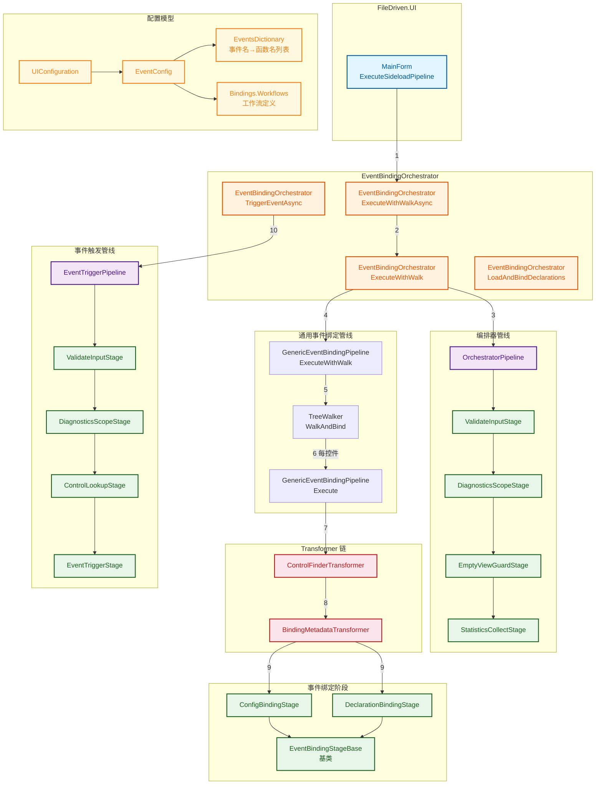
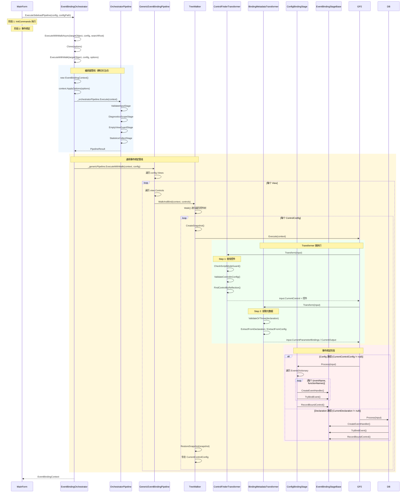
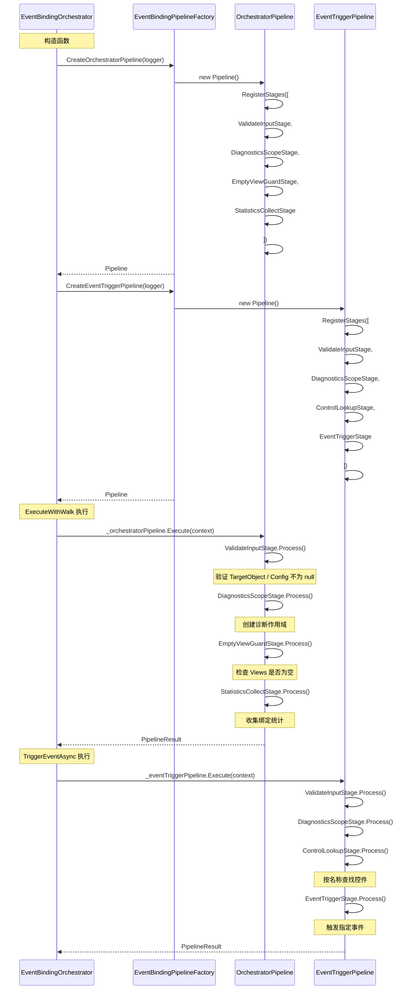
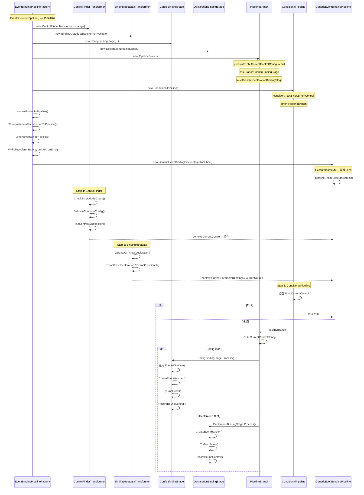
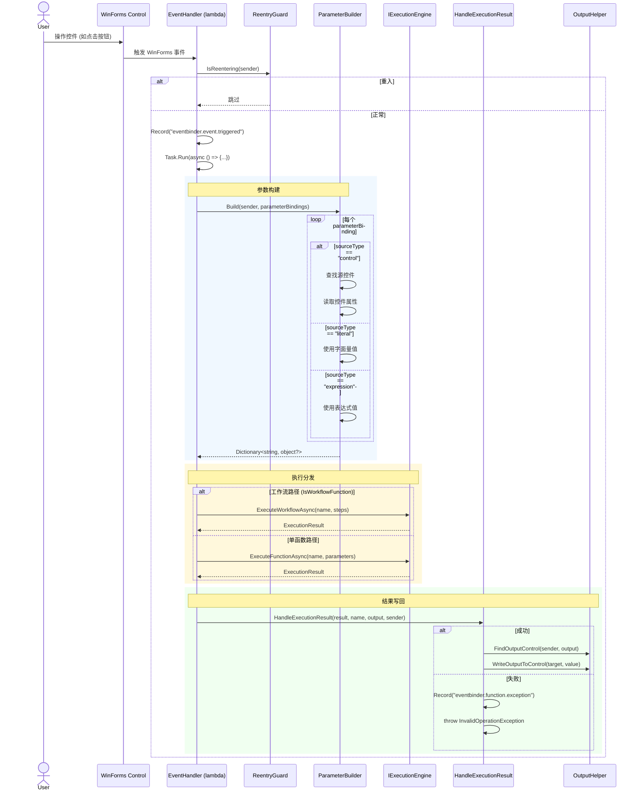
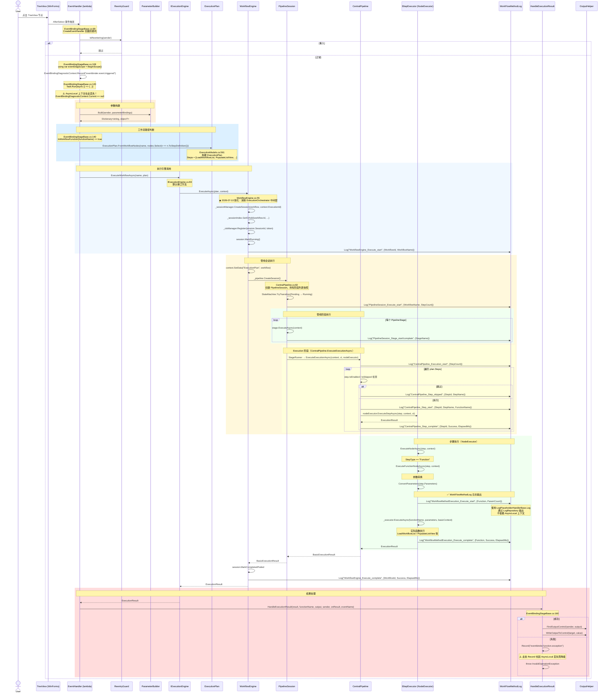

# 事件绑定调用链文档

> **版本：** v1.0
> **维护者：** WorkFlowPrj Team
> **更新日期：** 2026-07-13
> **目标：** 梳理 `EventBindingOrchestrator` 模块的文件目录结构和函数调用链
> **结构说明：** 本文档包含文件目录树、核心调用链 Mermaid 图、关键数据流和代码参考。
> **关联文档：** `CallChain.md` — AgentConfigUI.json 完整调用链；`CallChain_CodeReference.md` — 关键数据结构定义

---

## 目录

- [事件绑定调用链文档](#事件绑定调用链文档)
  - [目录](#目录)
  - [1. 文件目录结构](#1-文件目录结构)
    - [1.1 Share 层：EventBindingOrchestrator](#11-share-层eventbindingorchestrator)
    - [1.2 配置模型层：ConfigurationModels](#12-配置模型层configurationmodels)
    - [1.3 FileDriven.UI 层](#13-filedrivenui-层)
  - [2. 核心调用链](#2-核心调用链)
    - [2.1 调用链总览](#21-调用链总览)
    - [2.2 链 1：Sideload 事件绑定链](#22-链-1sideload-事件绑定链)
    - [2.3 链 2：编排器管线链](#23-链-2编排器管线链)
    - [2.4 链 3：通用事件绑定管线链](#24-链-3通用事件绑定管线链)
    - [2.5 链 4：事件触发链](#25-链-4事件触发链)
  - [3. 关键数据流](#3-关键数据流)
    - [3.1 Config 路径数据流](#31-config-路径数据流)
    - [3.2 Declaration 路径数据流](#32-declaration-路径数据流)
  - [4. 工作流执行调用链（AgentConfigUI.json TreeView 点击）](#4-工作流执行调用链agentconfiguijson-treeview-点击)
    - [4.1 配置定义](#41-配置定义)
    - [4.2 完整调用链](#42-完整调用链)
    - [4.3 关键文件与行号](#43-关键文件与行号)
    - [4.4 日志体系对比](#44-日志体系对比)
    - [4.5 关键问题：AsyncLocal 上下文丢失](#45-关键问题asynclocal-上下文丢失)
    - [4.6 数据流](#46-数据流)
    - [4.7 关键代码参考](#47-关键代码参考)
  - [5. 代码参考](#5-代码参考)
    - [5.1 关键文件速查表](#51-关键文件速查表)
    - [5.2 关键类/接口速查表](#52-关键类接口速查表)

---

## 1. 文件目录结构

### 1.1 Share 层：EventBindingOrchestrator

```
CsharpPrj/Share/EventBindingOrchestrator/
│
├── EventBindingOrchestrator.cs              # 编排器 - 协调事件绑定管线
├── DefaultEventMappingRegistry.cs           # 默认事件映射注册表
├── ReflectionControlFinderStrategy.cs       # 反射控件查找策略
├── ReflectionEventBinderStrategy.cs         # 反射事件绑定策略
│
├── Abstractions/
│   ├── EventBindingOptions.cs               # 事件绑定配置选项
│   ├── EventTriggerServiceBase.cs           # 事件触发服务基类
│   ├── IControlFinderStrategy.cs            # 控件查找策略接口
│   ├── IEventMappingRegistry.cs             # 事件映射注册表接口
│   ├── IEventTriggerService.cs              # 事件触发服务接口
│   ├── IUISubsystemInitializer.cs           # UI 子系统初始化器接口
│   └── IWinFormsEventBinderStrategy.cs      # WinForms 事件绑定策略接口
│
├── Contexts/
│   ├── EventBindingContext.cs               # 事件绑定上下文（核心上下文）
│   ├── EventBindingDiagnosticContext.cs     # 诊断上下文
│   ├── BindingResult.cs                     # 绑定结果
│   ├── FrameworkContext.cs                  # 框架上下文
│   └── FrameworkOptions.cs                  # 框架选项
│
├── Controls/
│   ├── ControlTreeWalker.cs                 # 控件树遍历器
│   ├── ControlTreeWalkerTransformer.cs      # 控件树遍历转换器
│   ├── WinFormsControlNode.cs               # WinForms 控件节点
│   ├── WinFormsControlTree.cs               # WinForms 控件树
│   ├── WinFormsEventBus.cs                  # WinForms 事件总线
│   ├── WinFormsThreadDispatcher.cs          # WinForms 线程调度器
│   └── WinFormsValueAccessor.cs             # WinForms 值访问器
│
├── Diagnostics/
│   └── EventNames.cs                        # 事件名称常量定义
│
├── Models/
│   ├── EventBindingInfo.cs                  # 事件绑定信息
│   ├── EventBindingInput.cs                 # 事件绑定输入
│   ├── EventBindingOutput.cs                # 事件绑定输出
│   ├── EventTriggerResult.cs                # 事件触发结果
│   └── WorkflowDefinitionEntry.cs           # 工作流定义条目（旧版，带 ToStepDefinition）
│
├── Parameters/
│   ├── EventBindingDeclaration.cs           # 事件绑定声明
│   ├── EventBindingHelper.cs                # 事件绑定辅助方法
│   ├── EventBindingResolver.cs              # 事件绑定解析器
│   ├── EventBindingValidator.cs             # 事件绑定验证器
│   ├── EventRequest.cs                      # 事件请求
│   ├── ParameterBuilder.cs                  # 参数构建器
│   └── Output/                              # 输出辅助
│
├── Stages/                                  # ★ 管线阶段（核心）
│   ├── ConfigBindingStage.cs                # Config 路径事件绑定阶段
│   ├── DeclarationBindingStage.cs           # Declaration 路径事件绑定阶段
│   ├── EventBindingStageBase.cs             # 事件绑定阶段基类
│   ├── ControlLookupStage.cs                # 控件查找阶段
│   ├── DiagnosticsScopeStage.cs             # 诊断作用域阶段
│   ├── EmptyViewGuardStage.cs               # 空视图守卫阶段
│   ├── EventTriggerStage.cs                 # 事件触发阶段
│   ├── StatisticsCollectStage.cs            # 统计收集阶段
│   └── ValidateInputStage.cs                # 输入验证阶段
│
├── Transformers/                            # ★ 转换器（管线核心逻辑）
│   ├── GenericEventBindingPipeline.cs       # 通用事件绑定管线
│   ├── EventBindingPipelineFactory.cs       # 管线工厂
│   ├── BindingMetadataTransformer.cs        # 绑定元数据提取转换器
│   └── ControlFinderTransformer.cs          # 控件查找转换器
│
└── Utils/
    └── ReflectionCache.cs                   # 反射缓存
```

### 1.2 配置模型层：ConfigurationModels

```
CsharpPrj/Share/UniversalMiddleware/ConfigurationModels/Models/
├── EventConfig.cs                           # 事件配置 + EventConfigConverter（反序列化）
└── WorkflowDefinitionEntry.cs               # 工作流定义条目（新版，纯 POCO）
```

### 1.3 FileDriven.UI 层

```
FileDriven/FileDriven.UI/
├── MainForm.cs                              # 主窗体（调用 ExecuteSideloadPipeline）
└── ...                                      # 其他 UI 相关文件
```

---

## 2. 核心调用链

### 2.1 调用链总览



### 2.2 链 1：Sideload 事件绑定链

从 `MainForm.ExecuteSideloadPipeline` 到 `EventBindingOrchestrator.ExecuteWithWalk` 的完整链路。



### 2.3 链 2：编排器管线链

`EventBindingOrchestrator` 内部两条管线（编排器管线 + 事件触发管线）的 Stage 组合。



### 2.4 链 3：通用事件绑定管线链

`GenericEventBindingPipeline` 内部 Transformer 链的创建和执行流程。



### 2.5 链 4：事件触发链

用户操作控件后的事件触发和执行链路。



---

## 3. 关键数据流

### 3.1 Config 路径数据流

```
AgentConfigUI.json
  → EventConfigConverter 反序列化
    → EventConfig.EventsDictionary（事件名 → 函数名列表）
    → EventConfig.Bindings.Workflows（工作流定义）
      → UIConfiguration.Views[].Controls[].Events
        → EventBindingOrchestrator.ExecuteWithWalk()
          → EventBindingContext（运行时上下文）
            → [编排器管线] ValidateInput → DiagnosticsScope → EmptyViewGuard → StatisticsCollect
              → [GenericEventBindingPipeline] WalkAndBind 遍历控件树
                → [Step 1] ControlFinderTransformer
                    输入: ControlConfig.Name
                    输出: Control（真实 WinForms 控件）
                → [Step 2] BindingMetadataTransformer
                    输入: ControlConfig.Events
                    输出: CurrentParameterBindings / CurrentOutput / WorkflowDefinitions
                → [Step 3] ConfigBindingStage
                    输入: Control + EventsDictionary
                    输出: EventHandler 绑定到控件
```

### 3.2 Declaration 路径数据流

```
EventBindingDeclaration 列表
  → EventBindingOrchestrator.LoadAndBindDeclarations()
    → EventBindingContext（运行时上下文）
      → [编排器管线] ValidateInput → DiagnosticsScope
        → [GenericEventBindingPipeline] Execute() 逐声明执行
          → [Step 1] ControlFinderTransformer
              输入: Declaration.ControlName
              输出: Control（真实 WinForms 控件）
          → [Step 2] BindingMetadataTransformer
              输入: Declaration.Parameters / OutputTarget
              输出: CurrentParameterBindings / CurrentOutput
          → [Step 3] DeclarationBindingStage
              输入: Control + Declaration
              输出: EventHandler 绑定到控件
```

---

## 4. 工作流执行调用链（AgentConfigUI.json TreeView 点击）

> **目标：** 追踪 `AgentConfigUI.json` 中 `workflowTreeView` 的 `afterselect` 事件从触发到函数执行的完整调用链。
> **关键问题：** 工作流路径的日志输出机制与单函数路径不同，涉及 `AsyncLocal` 上下文丢失和 `WorkFlowMethodLog` 两条日志体系。
> **★ 2026-07-13 重构：** 消除 `ExecutionOrchestrator` 中间层，调用链简化为 `WorkflowEngine` → `PipelineSession` → `CentralPipeline`。

### 4.1 配置定义

`AgentConfigUI.json` 中 `workflowTreeView` 的事件配置：

```json
{
  "type": "treeview",
  "name": "workflowTreeView",
  "events": {
    "afterselect": "workflowTreeView_afterSelect",
    "bindings": {
      "workflows": {
        "workflowTreeView_afterSelect": {
          "displayName": "TreeView 选中后加载工作流列表并选中第一个",
          "nodes": [
            { "id": "loadList",         "function": "LoadWorkflowList",    "parameters": {},                          "outputKey": "workflowList" },
            { "id": "populateListView", "function": "PopulateListView",    "parameters": { "workflowListJson": "@loadList.result" } },
            { "id": "getFirstWorkflowName", "function": "GetFirstWorkflowName", "parameters": { "workflowListJson": "@loadList.result" }, "outputKey": "workflowName" },
            { "id": "loadDetails",      "function": "LoadWorkflowDetails", "parameters": { "workflowName": "@getFirstWorkflowName.workflowName" }, "outputTarget": "workflowDetailTextBox" },
            { "id": "loadDefaultInput", "function": "LoadDefaultInput",    "parameters": { "workflowName": "@getFirstWorkflowName.workflowName" }, "outputTarget": "inputTextBox" }
          ]
        }
      }
    }
  }
}
```

### 4.2 完整调用链



### 4.3 关键文件与行号

| 步骤 | 文件 | 行号 | 说明 |
|------|------|------|------|
| 事件触发 | `EventBindingStageBase.cs` | ~99 | `CreateEventHandler` 创建委托 |
| 重入检查 | `EventBindingStageBase.cs` | ~105 | `IsReentering(sender)` |
| 诊断作用域 | `EventBindingStageBase.cs` | ~108 | `using var eventDiagScope = BeginScope()` |
| 事件记录 | `EventBindingStageBase.cs` | ~112 | `Record("eventbinder.event.triggered")` |
| 异步执行 | `EventBindingStageBase.cs` | ~120 | `Task.Run(async () => {...})` — ⚠️ AsyncLocal 丢失 |
| 参数构建 | `EventBindingStageBase.cs` | ~125 | `ParameterBuilder.Build(sender, parameterBindings)` |
| 工作流判断 | `EventBindingStageBase.cs` | ~140 | `IsWorkflowFunction(functionName)` |
| 构建 ExecutionPlan | `ExecutionModels.cs` | 561 | `ExecutionPlan.FromWorkflowNodes(name, nodes)` |
| 执行工作流 | `IExecutionEngine.cs` | 83 | `ExecuteWorkflowAsync` 默认接口方法 |
| 执行引擎入口 | `WorkflowEngine.cs` | 55 | `ExecuteCoreAsync` — 创建会话、注册 CTS |
| 引擎日志 | `WorkflowEngine.cs` | 75-78 | `Log("WorkflowEngine_Execute_start", ...)` |
| 管线会话 | `CentralPipeline.cs` | 82 | `CreateSession()` — 创建 PipelineSession |
| 会话执行 | `PipelineSession.cs` | 60 | `ExecuteAsync` — 遍历阶段 |
| 阶段日志 | `PipelineSession.cs` | 80-95 | `Log("PipelineSession_Stage_start/complate", ...)` |
| 步骤执行 | `CentralPipeline.cs` | 130-160 | `ExecuteExecutionAsync` — 遍历 plan.Steps |
| 步骤日志 | `CentralPipeline.cs` | 145-155 | `Log("CentralPipeline_Step_start/complate", ...)` |
| 节点执行 | `NodeExecutor` (WorkFlowMethod) | — | `ExecuteNodeAsync` → `ExecuteFunctionNodeAsync` |
| 函数日志 | `WorkFlowMethodLog` | — | `Log("WorkflowMethodExecution_Execute_start", ...)` |
| 结果处理 | `EventBindingStageBase.cs` | ~160 | `HandleExecutionResult` |
| 输出写回 | `EventBindingHelper.cs` | — | `FindOutputControl` / `WriteOutputToControl` |

### 4.4 日志体系对比

| 特性 | EventBindingDiagnosticContext.Record | WorkFlowMethodLog.Log |
|------|--------------------------------------|----------------------|
| **依赖** | `AsyncContext<DiagnosticContext>` (AsyncLocal) | `LogPlaceholderHandlerBase` (独立体系) |
| **AsyncLocal 影响** | ✅ 受影响 — Task.Run 内部丢失上下文 | ❌ 不受影响 — 独立日志体系 |
| **输出目标** | `DiagnosticContext` → 快照字符串 | `LogRepository` → 控制台/文件 |
| **降级行为** | 无上下文时 → `Debug.WriteLine` (Release 不可见) | 无降级，始终输出 |
| **调用位置** | 事件触发阶段（绑定阶段之外） | 函数执行阶段（NodeExecutor 内部） |
| **可见性** | 仅在诊断作用域内可见 | 始终可见 |

### 4.5 关键问题：AsyncLocal 上下文丢失

```
Task.Run 外部（主线程）                    Task.Run 内部（线程池线程）
┌─────────────────────────────┐          ┌─────────────────────────────┐
│ AsyncContext<DiagCtx>.Current │          │ AsyncContext<DiagCtx>.Current │
│   = DiagnosticContext       │          │   = null                    │
│                             │          │                             │
│ BeginScope() 创建作用域     │          │ Record() → ctx == null      │
│ Record() → ✅ 正常记录      │          │   → Debug.WriteLine 降级    │
└─────────────────────────────┘          └─────────────────────────────┘
```

**影响范围：**
- `EventBindingDiagnosticContext.Record("eventbinder.event.triggered")` — 在 Task.Run **外部**，✅ 正常
- `EventBindingDiagnosticContext.Record("eventbinder.function.success")` — 在 Task.Run **内部**，❌ 降级
- `EventBindingDiagnosticContext.Record("eventbinder.function.exception")` — 在 Task.Run **内部**，❌ 降级
- `WorkFlowMethodLog.Log(...)` — 在 NodeExecutor **内部**，✅ 正常（独立日志体系）

### 4.6 数据流

```
用户点击 TreeView
  → AfterSelect 事件
    → EventHandler (CreateEventHandler 创建)
      → [诊断] Record("eventbinder.event.triggered")  ✅
      → Task.Run(async () => {
          → [诊断] Record(...)  ❌ AsyncLocal 丢失
          → ParameterBuilder.Build(sender, bindings)
          → ExecutionPlan.FromWorkflowNodes(name, nodes)
            → ExecutionPlan { Steps: [LoadWorkflowList, PopulateListView, ...] }
          → IExecutionEngine.ExecuteWorkflowAsync(name, plan)
            → WorkflowEngine.ExecuteAsync(plan, context)
              → [日志] Log("WorkflowEngine_Execute_start")  ✅
              → CentralPipeline.CreateSession() → PipelineSession
              → PipelineSession.ExecuteAsync(workflow, context)
                → [日志] Log("PipelineSession_Execute_start")  ✅
                → 遍历 PipelineStage:
                  → [日志] Log("PipelineSession_Stage_start/complate")  ✅
                  → Execution 阶段: CentralPipeline.ExecuteExecutionAsync
                    → [日志] Log("CentralPipeline_Execution_start")  ✅
                    → 遍历 Steps:
                      → [日志] Log("CentralPipeline_Step_start")  ✅
                      → NodeExecutor.ExecuteFunctionNodeAsync(step, context)
                        → [日志] Log("WorkflowMethodExecution_Execute_start")  ✅
                        → _executor.ExecuteAsync(functionName, parameters, context)
                          → LoadWorkflowList() / PopulateListView() / ...
                        → [日志] Log("WorkflowMethodExecution_Execute_complete")  ✅
                      → [日志] Log("CentralPipeline_Step_complete")  ✅
                    → 下一个 Step...
                  → 下一个 Stage...
                → [日志] Log("PipelineSession_Execute_complete")  ✅
              → [日志] Log("WorkflowEngine_Execute_complete")  ✅
          → HandleExecutionResult(result, ...)
            → [诊断] Record(...)  ❌ AsyncLocal 丢失
            → OutputHelper.WriteOutputToControl(target, value)
        })
```

### 4.7 关键代码参考

**EventBindingStageBase.cs — CreateEventHandler（事件触发入口）：**
```csharp
// ~Line 99: 创建事件处理委托
EventHandler handler = async (sender, e) =>
{
    using var eventDiagScope = EventBindingDiagnosticContext.BeginScope();  // ~108
    EventBindingDiagnosticContext.Record("eventbinder.event.triggered", new { eventName, functionName });  // ~112

    if (ReentryGuard.IsReentering(sender)) return;  // ~105

    _ = Task.Run(async () =>  // ~120 — ⚠️ AsyncLocal 丢失
    {
        var parameters = ParameterBuilder.Build(sender, parameterBindings);  // ~125

        if (IsWorkflowFunction(functionName))  // ~140
        {
            var workflowDef = GetWorkflowDefinition(functionName);
            var result = await _executionEngine.ExecuteWorkflowAsync(
                functionName, workflowDef.Nodes.Select(n => n.ToStepDefinition()));
            await HandleExecutionResult(result, functionName, output, sender, onResult, eventName);
        }
        else
        {
            var result = await _executionEngine.ExecuteFunctionAsync(functionName, parameters);
            await HandleExecutionResult(result, functionName, output, sender, onResult, eventName);
        }
    });
};
```

**ExecutionModels.cs — ExecutionPlan.FromWorkflowNodes：**
```csharp
// ~Line 561
public static ExecutionPlan FromWorkflowNodes(
    string workflowName,
    IEnumerable<StepDefinition> nodes)
{
    return new ExecutionPlan
    {
        Id = $"wf_{workflowName}_{Guid.NewGuid():N}",
        Name = $"Workflow: {workflowName}",
        Steps = new List<StepDefinition>(nodes)
    };
}
```

**WorkflowDefinitionEntry.cs — WorkflowNodeEntry.ToStepDefinition：**
```csharp
// ~Line 50
public TConfig.StepDefinition ToStepDefinition()
{
    return new TConfig.StepDefinition
    {
        Id = $"step_{FunctionName ?? Id}",
        Name = FunctionName ?? Id,
        StepType = "Function",
        FunctionName = FunctionName,
        Parameters = Parameters
    };
}
```

**WorkflowEngine.cs — ExecuteCoreAsync（执行引擎入口）：**
```csharp
// ~Line 55
private async Task<TConfig.ExecutionResult> ExecuteCoreAsync(
    TConfig.ExecutionPlan workflow,
    TConfig.IExecutionContext context,
    CancellationToken cancellationToken = default)
{
    var session = _sessionManager.CreateSession(workflow, context.ExecutionId);
    session.MarkRunning();
    var sessions = _sessionIndex.GetOrAdd(workflow.Id, _ => new List<IExecutionSession>());
    lock (sessions) { sessions.Add(session); }
    var cts = _ctsManager.Register(session.SessionId, cancellationToken);

    WorkFlowMethodLog.Log("WorkflowEngine_Execute_start",
        new { WorkflowId = workflow.Id, WorkflowName = workflow.Name });

    try
    {
        context.SetData("ExecutionPlan", workflow);
        using var pipelineSession = _pipeline.CreateSession();
        var result = await pipelineSession.ExecuteAsync(workflow, context, cts.Token);
        // ... 处理结果
    }
}
```

**PipelineSession.cs — ExecuteAsync（管线会话执行）：**
```csharp
// ~Line 60
public async Task<BasicExecutionResult> ExecuteAsync(
    TConfig.ExecutionPlan workflow,
    TConfig.IExecutionContext context,
    CancellationToken cancellationToken = default)
{
    StateMachine.TryTransitionFrom(Pending, Running);
    WorkFlowMethodLog.Log("PipelineSession_Execute_start",
        new { WorkflowName = workflow.Name, StepCount = workflow.Steps.Count });

    foreach (var stage in _stages)
    {
        WorkFlowMethodLog.Log("PipelineSession_Stage_start", new { StageName = stage.Name });
        var result = await stage.ExecuteAsync(context, cancellationToken);
        WorkFlowMethodLog.Log("PipelineSession_Stage_complete",
            new { StageName = stage.Name, Success = result.IsSuccess, ElapsedMs = ... });
    }
}
```

**CentralPipeline.cs — ExecuteExecutionAsync（步骤执行阶段）：**
```csharp
// ~Line 130
private static async Task<BasicExecutionResult> ExecuteExecutionAsync(
    TConfig.IExecutionContext context,
    CancellationToken cancellationToken,
    INodeExecutor nodeExecutor)
{
    var plan = (TConfig.ExecutionPlan)context.Items["ExecutionPlan"];
    WorkFlowMethodLog.Log("CentralPipeline_Execution_start",
        new { StepCount = plan.Steps.Count });

    foreach (var step in plan.Steps)
    {
        if (!step.IsEnabled || step.IsSkipped)
        {
            WorkFlowMethodLog.Log("CentralPipeline_Step_skipped",
                new { StepId = step.Id, StepName = step.Name });
            continue;
        }

        WorkFlowMethodLog.Log("CentralPipeline_Step_start",
            new { StepId = step.Id, StepName = step.Name, FunctionName = step.FunctionName });

        var result = await nodeExecutor.ExecuteStepAsync(step, context, cancellationToken);

        WorkFlowMethodLog.Log("CentralPipeline_Step_complete",
            new { StepId = step.Id, Success = result.IsSuccess, ElapsedMs = result.ExecutionTime.TotalMilliseconds });

        if (!result.IsSuccess)
            return result;
    }

    return BasicExecutionResult.Success();
}
```

---

## 5. 代码参考

### 5.1 关键文件速查表

| 文件路径 | 职责 |
|---------|------|
| `CsharpPrj/Share/EventBindingOrchestrator/EventBindingOrchestrator.cs` | 编排器，协调事件绑定管线，提供 3 个入口（ExecuteWithWalk / LoadAndBindDeclarations / TriggerEventAsync） |
| `CsharpPrj/Share/EventBindingOrchestrator/Transformers/GenericEventBindingPipeline.cs` | 通用事件绑定管线，遍历控件树并执行 Transformer 链 |
| `CsharpPrj/Share/EventBindingOrchestrator/Transformers/EventBindingPipelineFactory.cs` | 管线工厂，创建编排器管线、事件触发管线和通用管线 |
| `CsharpPrj/Share/EventBindingOrchestrator/Transformers/ControlFinderTransformer.cs` | Step 1：根据控件名查找真实 WinForms 控件 |
| `CsharpPrj/Share/EventBindingOrchestrator/Transformers/BindingMetadataTransformer.cs` | Step 2：从 Events 配置提取绑定元数据 |
| `CsharpPrj/Share/EventBindingOrchestrator/Stages/EventBindingStageBase.cs` | 事件绑定阶段基类，包含 CreateEventHandler / TryBindEvent / HandleExecutionResult |
| `CsharpPrj/Share/EventBindingOrchestrator/Stages/ConfigBindingStage.cs` | Config 路径事件绑定阶段，遍历 EventsDictionary |
| `CsharpPrj/Share/EventBindingOrchestrator/Stages/DeclarationBindingStage.cs` | Declaration 路径事件绑定阶段，从声明绑定 |
| `CsharpPrj/Share/EventBindingOrchestrator/Stages/ValidateInputStage.cs` | 输入验证阶段 |
| `CsharpPrj/Share/EventBindingOrchestrator/Stages/DiagnosticsScopeStage.cs` | 诊断作用域阶段 |
| `CsharpPrj/Share/EventBindingOrchestrator/Stages/EmptyViewGuardStage.cs` | 空视图守卫阶段 |
| `CsharpPrj/Share/EventBindingOrchestrator/Stages/StatisticsCollectStage.cs` | 统计收集阶段 |
| `CsharpPrj/Share/EventBindingOrchestrator/Stages/ControlLookupStage.cs` | 控件查找阶段（事件触发管线） |
| `CsharpPrj/Share/EventBindingOrchestrator/Stages/EventTriggerStage.cs` | 事件触发阶段（事件触发管线） |
| `CsharpPrj/Share/EventBindingOrchestrator/Contexts/EventBindingContext.cs` | 事件绑定上下文，三层存储（Config/Session/Transient） |
| `CsharpPrj/Share/EventBindingOrchestrator/Parameters/EventBindingDeclaration.cs` | 事件绑定声明（控件名 + 事件名 + 函数名） |
| `CsharpPrj/Share/EventBindingOrchestrator/Parameters/EventBindingHelper.cs` | 事件绑定辅助方法（反射查找、输出解析） |
| `CsharpPrj/Share/EventBindingOrchestrator/Parameters/ParameterBuilder.cs` | 参数构建器，从控件/字面量/表达式构建参数字典 |
| `CsharpPrj/Share/EventBindingOrchestrator/Parameters/EventBindingValidator.cs` | 事件绑定声明验证器 |
| `CsharpPrj/Share/EventBindingOrchestrator/Parameters/EventBindingResolver.cs` | 事件绑定解析器，从配置中提取绑定信息 |
| `CsharpPrj/Share/EventBindingOrchestrator/Abstractions/EventBindingOptions.cs` | 事件绑定配置选项 |
| `CsharpPrj/Share/EventBindingOrchestrator/Diagnostics/EventNames.cs` | 事件名称常量定义 |
| `CsharpPrj/Share/EventBindingOrchestrator/Utils/ReflectionCache.cs` | 反射缓存 |
| `CsharpPrj/Share/UniversalMiddleware/ConfigurationModels/Models/EventConfig.cs` | 事件配置 + EventConfigConverter 反序列化 |
| `CsharpPrj/Share/UniversalMiddleware/ConfigurationModels/Models/WorkflowDefinitionEntry.cs` | 工作流定义条目（新版，纯 POCO） |
| `FileDriven/FileDriven.UI/Core/MainForm.cs` | 主窗体，调用 ExecuteSideloadPipeline |

### 5.2 关键类/接口速查表

| 类/接口 | 说明 |
|---------|------|
| `EventBindingOrchestrator` | 编排器，实现 IEventBindingService，协调 3 条管线 |
| `GenericEventBindingPipeline` | 通用管线，遍历控件树并执行 3 步 Transformer 链 |
| `EventBindingPipelineFactory` | 管线工厂，静态方法创建所有管线实例 |
| `ControlFinderTransformer` | 控件查找转换器，多策略查找（配置验证 + 反射回退） |
| `BindingMetadataTransformer` | 绑定元数据提取转换器，从 Declaration/Config 提取参数和输出 |
| `EventBindingStageBase` | 事件绑定阶段基类，提供 CreateEventHandler / TryBindEvent / HandleExecutionResult |
| `ConfigBindingStage` | Config 路径绑定阶段，遍历 EventsDictionary |
| `DeclarationBindingStage` | Declaration 路径绑定阶段，从声明绑定 |
| `EventBindingContext` | 事件绑定上下文，三层存储（Config/Session/Transient） |
| `EventBindingDeclaration` | 事件绑定声明，实现 IDeclaration 接口 |
| `EventBindingOptions` | 配置选项，集中承载所有可选参数 |
| `EventBindingValidator` | 声明验证器，使用 BasicMethod.Declarative 框架 |
| `EventBindingResolver` | 配置解析器，从 UIConfiguration 提取绑定信息 |
| `ParameterBuilder` | 参数构建器，支持 control/literal/expression 三种 SourceType |
| `EventBindingHelper` | 静态辅助方法，反射查找、输出解析、控件名称获取 |
| `Pipeline` | Modules.Pipeline 管线编排器 |
| `PipelineBranch<T>` | 条件分支管线 |
| `ConditionalPipeline<T>` | 条件守卫管线 |
| `IEventBus` | 事件总线接口 |
| `IEventBinderStrategy` | 事件绑定策略接口 |
| `IControlFinderStrategy` | 控件查找策略接口 |
| `IEventMappingRegistry` | 事件映射注册表接口 |
| `IExecutionEngine` | 执行引擎接口（ExecuteFunctionAsync / ExecuteWorkflowAsync） |
| `ITypeConversionService` | 类型转换服务接口 |
| `IEventNameNormalizer` | 事件名规范化接口 |
| `ErrorCollector` | 错误收集器（线程安全） |
| `EventBindingDiagnosticContext` | 诊断上下文（BeginScope / Record / CaptureSnapshot） |
