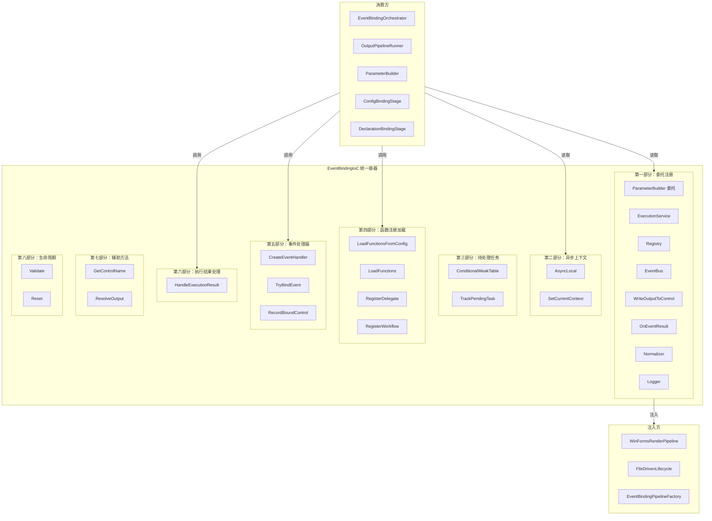
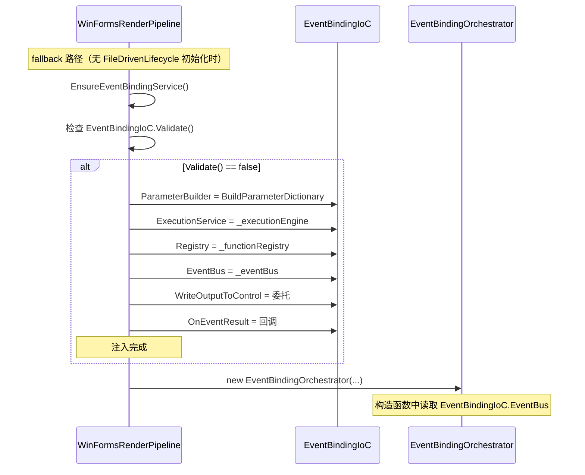
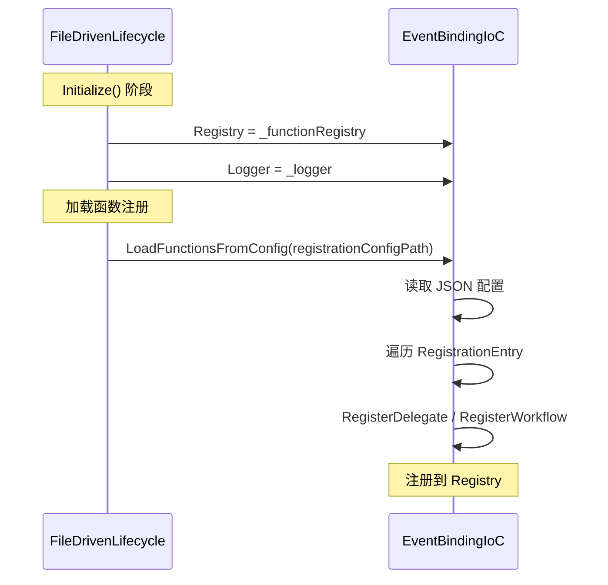
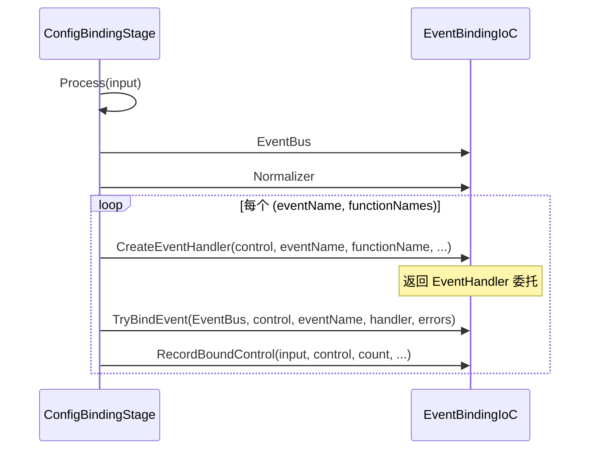
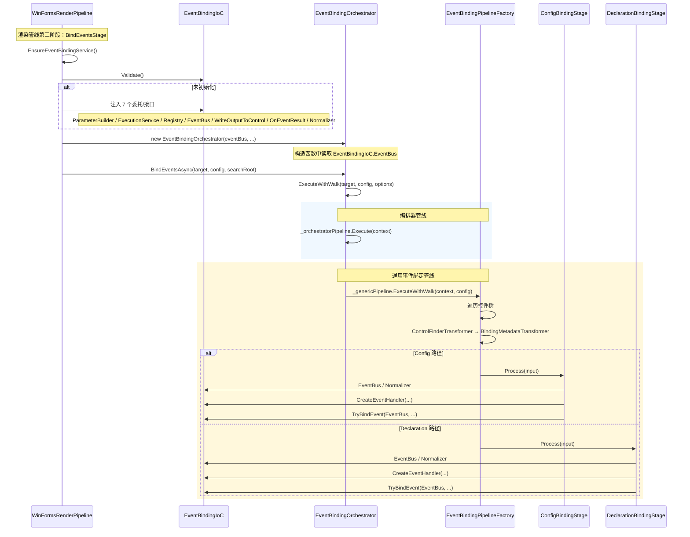
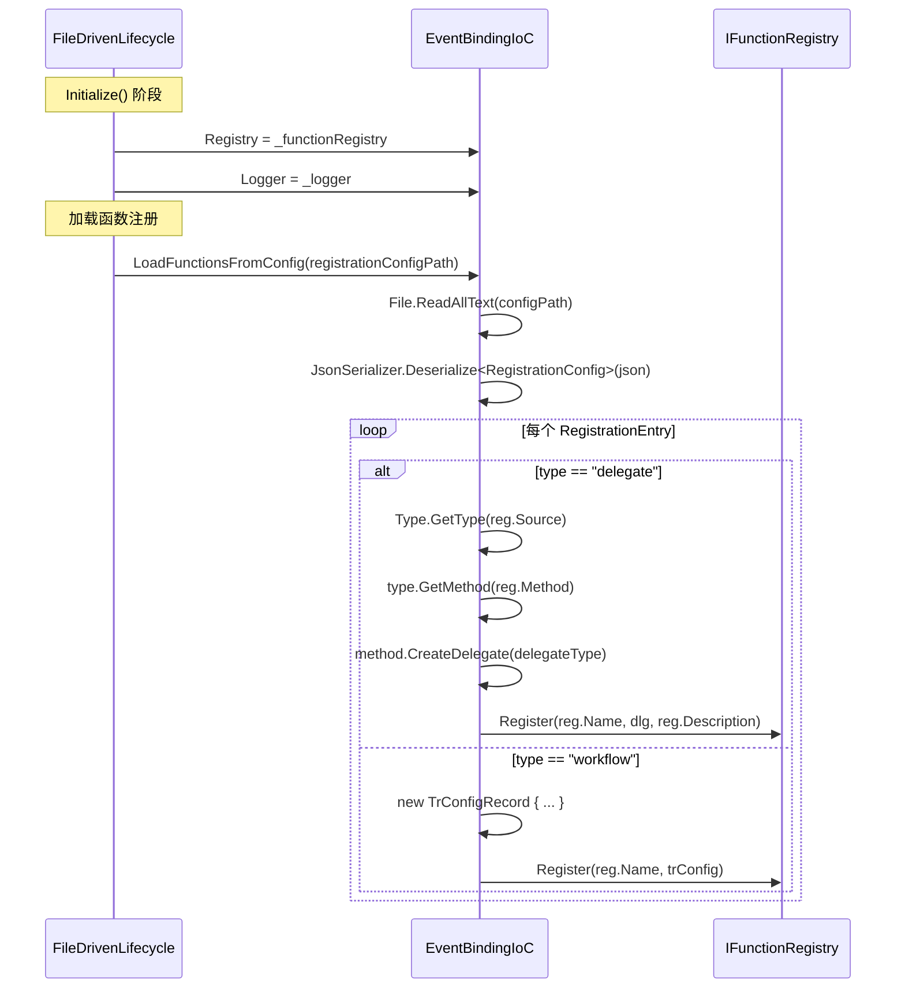
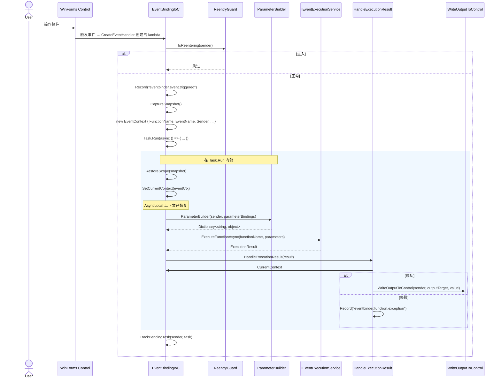
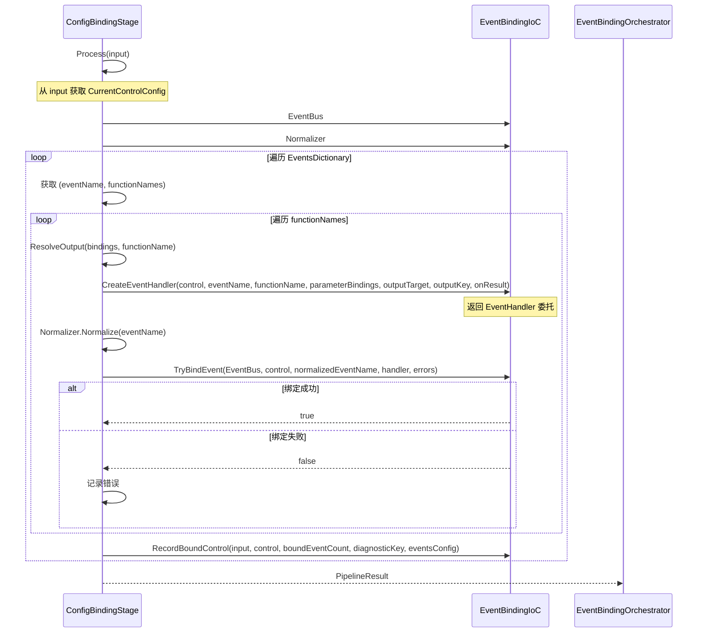

# IoC 重构后的调用链文档

> **版本：** v1.0
> **维护者：** WorkFlowPrj Team
> **更新日期：** 2026-07-16
> **目标：** 描述 `EventBindingIoC` 统一容器重构后的调用链变化
> **关联文档：** `EventBinding_CallChain.md` — 事件绑定完整调用链；`IoC_Refactoring_Plan.md` — 重构规划

---

## 目录

- [IoC 重构后的调用链文档](#ioc-重构后的调用链文档)
  - [目录](#目录)
  - [1. 重构概述](#1-重构概述)
    - [1.1 重构目标](#11-重构目标)
    - [1.2 整合清单](#12-整合清单)
    - [1.3 文件变化](#13-文件变化)
  - [2. EventBindingIoC 架构](#2-eventbindingioc-架构)
    - [2.1 8 个组成部分](#21-8-个组成部分)
    - [2.2 架构图](#22-架构图)
  - [3. 注入点分布](#3-注入点分布)
    - [3.1 WinFormsRenderPipeline（fallback 路径）](#31-winformsrenderpipelinefallback-路径)
    - [3.2 FileDrivenLifecycle（初始化路径）](#32-filedrivenlifecycle初始化路径)
    - [3.3 ConfigBindingStage / DeclarationBindingStage（绑定路径）](#33-configbindingstage--declarationbindingstage绑定路径)
  - [4. 消费点分布](#4-消费点分布)
    - [4.1 EventBindingOrchestrator（编排器）](#41-eventbindingorchestrator编排器)
    - [4.2 OutputPipelineRunner（输出管线）](#42-outputpipelinerunner输出管线)
    - [4.3 ParameterBuilder（参数构建器）](#43-parameterbuilder参数构建器)
    - [4.4 CreateEventHandler（事件处理器创建）](#44-createeventhandler事件处理器创建)
  - [5. 调用链变化对比](#5-调用链变化对比)
    - [5.1 委托注册变化](#51-委托注册变化)
    - [5.2 异步上下文变化](#52-异步上下文变化)
    - [5.3 事件处理器创建变化](#53-事件处理器创建变化)
    - [5.4 函数注册加载变化](#54-函数注册加载变化)
    - [5.5 待处理任务管理变化](#55-待处理任务管理变化)
  - [6. 关键场景调用链](#6-关键场景调用链)
    - [6.1 场景 1：WinFormsRenderPipeline fallback 注入](#61-场景-1winformsrenderpipeline-fallback-注入)
    - [6.2 场景 2：FileDrivenLifecycle 初始化](#62-场景-2filedrivenlifecycle-初始化)
    - [6.3 场景 3：事件触发执行](#63-场景-3事件触发执行)
    - [6.4 场景 4：ConfigBindingStage 事件绑定](#64-场景-4configbindingstage-事件绑定)
  - [7. 更新后的文件目录结构](#7-更新后的文件目录结构)
    - [7.1 Share 层：EventBindingOrchestrator](#71-share-层eventbindingorchestrator)
    - [7.2 已删除的文件](#72-已删除的文件)
  - [8. 生命周期管理](#8-生命周期管理)
    - [8.1 初始化顺序](#81-初始化顺序)
    - [8.2 Validate 验证](#82-validate-验证)
    - [8.3 Reset 重置](#83-reset-重置)

---

## 1. 重构概述

### 1.1 重构目标

将事件绑定调用链中所有**带状态的组件**集中到 `EventBindingIoC` 统一容器中管理，消除状态分散问题。

**核心原则：**
1. 所有带状态的组件集中管理
2. 无状态组件（EventBindingHelper、Transformers）保持独立
3. 应用层组件（WinFormsRenderPipeline）保持独立，只通过 IoC 获取依赖
4. 接口定义（IEventExecutionService、IFunctionRegistry 等）保持独立

### 1.2 整合清单

| 编号 | 原组件 | 原位置 | 整合到 EventBindingIoC 的部分 |
|------|--------|--------|-------------------------------|
| 1 | `EventBindingServiceLocator` | `BackEndDriven/` | 委托注册（ParameterBuilder、ExecutionService、Registry、EventBus、WriteOutputToControl、OnEventResult） |
| 2 | `EventBindingStageBase` | `WorkFlowMethod/EventBinding/` | `CreateEventHandler()`、`TryBindEvent()`、`HandleExecutionResult()`、`_pendingTasks` |
| 3 | `EventContextScope` | `WorkFlowMethod/EventBinding/` | `AsyncLocal<EventContext>` 上下文管理 |
| 4 | `FunctionRegistrationLoader` | `WorkFlowMethod/EventBinding/` | `LoadFunctionsFromConfig()`、`LoadFunctions()` |
| 5 | `EventBindingStageOptions` | `WorkFlowMethod/EventBinding/` | 配置选项（已内联到方法参数） |
| 6 | WdUI.RenderPipeline 硬编码 | `WdUI/` | 委托注册 + WriteOutputToControl |

### 1.3 文件变化

**删除（5 个文件）：**

| 文件 | 行数 | 说明 |
|------|------|------|
| `BackEndDriven/EventBindingServiceLocator.cs` | ~80 | 委托注册 → EventBindingIoC 属性 |
| `WorkFlowMethod/EventBinding/EventBindingStageBase.cs` | ~300 | 事件处理器创建 + 执行结果处理 → EventBindingIoC 方法 |
| `WorkFlowMethod/EventBinding/ConfigBindingStage.cs` | ~120 | Config 路径绑定 → 引用 EventBindingIoC |
| `WorkFlowMethod/EventBinding/DeclarationBindingStage.cs` | ~100 | Declaration 路径绑定 → 引用 EventBindingIoC |
| `WorkFlowMethod/EventBinding/EventBindingStageOptions.cs` | ~30 | 配置选项 → 内联 |

**创建（1 个文件）：**

| 文件 | 行数 | 说明 |
|------|------|------|
| `Share/EventBindingOrchestrator/EventBindingIoC.cs` | ~745 | 统一 IoC 容器，8 个部分 |

**修改（6 个文件）：**

| 文件 | 变更内容 |
|------|---------|
| `WdUI/WdUI.RenderPipeline.cs` | `EventBindingServiceLocator` → `EventBindingIoC` |
| `FileDriven/FileDriven.Business/FileDrivenLifecycle.cs` | `EventBindingServiceLocator` → `EventBindingIoC` |
| `Share/EventBindingOrchestrator/Invoke/ConfigBindingStage.cs` | `EventBindingStageBase` → `EventBindingIoC` |
| `Share/EventBindingOrchestrator/Invoke/DeclarationBindingStage.cs` | `EventBindingStageBase` → `EventBindingIoC` |
| `Share/EventBindingOrchestrator/Transformers/EventBindingPipelineFactory.cs` | `EventBindingStageBase` → `EventBindingIoC` |
| `Share/EventBindingOrchestrator/EventBindingOrchestrator.cs` | 注释更新 |
| `WorkFlowMethod/Output/OutputPipelineRunner.cs` | `EventContextScope.Current` → `EventBindingIoC.CurrentContext` |
| `WorkFlowMethod/Parameters/ParameterBuilder.cs` | `EventContextScope.Current` → `EventBindingIoC.CurrentContext` |

---

## 2. EventBindingIoC 架构

### 2.1 8 个组成部分

| 部分 | 区域 | 职责 | 原组件 |
|------|------|------|--------|
| **第一部分** | 委托注册 | 7 个委托/接口属性，供外部注入 | EventBindingServiceLocator |
| **第二部分** | 异步上下文 | `AsyncLocal<EventContext>` 管理 | EventContextScope |
| **第三部分** | 待处理任务 | `ConditionalWeakTable` 跟踪 Task | EventBindingStageBase._pendingTasks |
| **第四部分** | 函数注册加载 | 从 JSON 加载 delegate/workflow 注册 | FunctionRegistrationLoader |
| **第五部分** | 事件处理器 | `CreateEventHandler()` + `TryBindEvent()` + `RecordBoundControl()` | EventBindingStageBase |
| **第六部分** | 执行结果处理 | `HandleExecutionResult()` | EventBindingStageBase |
| **第七部分** | 辅助方法 | `GetControlName()` + `ResolveOutput()` | EventBindingHelper |
| **第八部分** | 生命周期 | `Validate()` + `Reset()` | 新增 |

### 2.2 架构图



---

## 3. 注入点分布

### 3.1 WinFormsRenderPipeline（fallback 路径）

**文件：** `CsharpPrj/Operation/WdUI/WdUI.RenderPipeline.cs`

**注入内容：**

| EventBindingIoC 属性 | 注入值 | 触发条件 |
|---------------------|--------|---------|
| `ParameterBuilder` | `BuildParameterDictionary` 委托 | fallback 路径 |
| `ExecutionService` | `_executionEngine` | fallback 路径 |
| `Registry` | `_functionRegistry` | fallback 路径 |
| `EventBus` | `_eventBus` | fallback 路径 |
| `WriteOutputToControl` | `WriteOutputToControl` 委托 | fallback 路径 |
| `OnEventResult` | `OnEventResult` 回调 | fallback 路径 |

**调用链：**



### 3.2 FileDrivenLifecycle（初始化路径）

**文件：** `FileDriven/FileDriven.Business/FileDrivenLifecycle.cs`

**注入内容：**

| EventBindingIoC 属性 | 注入值 | 触发条件 |
|---------------------|--------|---------|
| `Registry` | `_functionRegistry` | 初始化时 |
| `Logger` | `_logger` | 初始化时 |

**调用链：**



### 3.3 ConfigBindingStage / DeclarationBindingStage（绑定路径）

**文件：** `CsharpPrj/Share/EventBindingOrchestrator/Invoke/ConfigBindingStage.cs`
**文件：** `CsharpPrj/Share/EventBindingOrchestrator/Invoke/DeclarationBindingStage.cs`

**注入内容：**

| EventBindingIoC 属性 | 读取位置 | 用途 |
|---------------------|---------|------|
| `EventBus` | `Process()` | 传递给 `TryBindEvent()` |
| `Normalizer` | `Process()` | 事件名称规范化 |
| `ParameterBuilder` | `CreateEventHandler()` | 参数构建委托 |
| `ExecutionService` | `CreateEventHandler()` | 函数执行服务 |
| `Registry` | `CreateEventHandler()` | 函数注册表 |
| `WriteOutputToControl` | `HandleExecutionResult()` | 结果写回 |
| `OnEventResult` | `CreateEventHandler()` | 结果回调 |

**调用链：**



---

## 4. 消费点分布

### 4.1 EventBindingOrchestrator（编排器）

**文件：** `CsharpPrj/Share/EventBindingOrchestrator/EventBindingOrchestrator.cs`

**消费内容：**

| EventBindingIoC 属性/方法 | 用途 |
|--------------------------|------|
| `EventBus` | 传递给 GenericEventBindingPipeline 和 EventTriggerPipeline |

**说明：** 编排器本身不直接调用 EventBindingIoC 的方法，而是将 `EventBus` 通过构造函数参数传递给管线阶段。管线阶段（ConfigBindingStage/DeclarationBindingStage）在 `Process()` 中读取 `EventBindingIoC.EventBus`。

### 4.2 OutputPipelineRunner（输出管线）

**文件：** `CsharpPrj/Operation/WorkFlowMethod/Output/OutputPipelineRunner.cs`

**消费内容：**

| EventBindingIoC 属性/方法 | 用途 |
|--------------------------|------|
| `CurrentContext` | 获取当前事件上下文中的 `Sender` 和 `OutputTarget` |

**代码示例：**
```csharp
// 重构前
var ctx = EventContextScope.Current;

// 重构后
var ctx = EventBindingIoC.CurrentContext;
```

### 4.3 ParameterBuilder（参数构建器）

**文件：** `CsharpPrj/Operation/WorkFlowMethod/Parameters/ParameterBuilder.cs`

**消费内容：**

| EventBindingIoC 属性/方法 | 用途 |
|--------------------------|------|
| `CurrentContext` | 获取 `FunctionName` 和 `Registry`，用于参数过滤 |

**代码示例：**
```csharp
// 重构前
var eventCtx = EventContextScope.Current;

// 重构后
var eventCtx = EventBindingIoC.CurrentContext;
```

### 4.4 CreateEventHandler（事件处理器创建）

**文件：** `CsharpPrj/Share/EventBindingOrchestrator/EventBindingIoC.cs`（第五部分）

**消费内容（在 lambda 内部）：**

| EventBindingIoC 属性/方法 | 用途 |
|--------------------------|------|
| `ParameterBuilder` | 构建函数参数字典 |
| `ExecutionService` | 执行函数/工作流 |
| `SetCurrentContext()` | 在 Task.Run 入口设置 AsyncLocal 上下文 |
| `TrackPendingTask()` | 跟踪 Task 避免 GC 回收 |
| `HandleExecutionResult()` | 处理执行结果 |
| `WriteOutputToControl` | 写回结果到 UI 控件 |
| `OnEventResult` | 回调通知 |

---

## 5. 调用链变化对比

### 5.1 委托注册变化

```diff
- // 旧：EventBindingServiceLocator（BackEndDriven）
- EventBindingServiceLocator.ParameterBuilder = BuildParameterDictionary;
- EventBindingServiceLocator.ExecutionService = _executionEngine;
- EventBindingServiceLocator.Registry = _functionRegistry;
- EventBindingServiceLocator.EventBus = _eventBus;
- EventBindingServiceLocator.WriteOutputToControl = WriteOutputToControl;
- EventBindingServiceLocator.OnEventResult = OnEventResult;

+ // 新：EventBindingIoC（Share.EventBindingOrchestrator）
+ EventBindingIoC.ParameterBuilder = BuildParameterDictionary;
+ EventBindingIoC.ExecutionService = _executionEngine;
+ EventBindingIoC.Registry = _functionRegistry;
+ EventBindingIoC.EventBus = _eventBus;
+ EventBindingIoC.WriteOutputToControl = WriteOutputToControl;
+ EventBindingIoC.OnEventResult = OnEventResult;
```

### 5.2 异步上下文变化

```diff
- // 旧：EventContextScope（WorkFlowMethod.EventBinding）
- var ctx = EventContextScope.Current;
- using var scope = EventContextScope.SetCurrentContext(eventCtx);

+ // 新：EventBindingIoC（Share.EventBindingOrchestrator）
+ var ctx = EventBindingIoC.CurrentContext;
+ using var scope = EventBindingIoC.SetCurrentContext(eventCtx);
```

### 5.3 事件处理器创建变化

```diff
- // 旧：EventBindingStageBase.CreateEventHandler（实例方法）
- public EventHandler CreateEventHandler(
-     object control, string eventName, string functionName, ...)
- {
-     // 使用实例字段：_executionEngine, _parameterBuilder, _eventBus 等
- }

+ // 新：EventBindingIoC.CreateEventHandler（静态方法）
+ public static EventHandler CreateEventHandler(
+     object control, string eventName, string functionName, ...)
+ {
+     // 使用静态属性：ExecutionService, ParameterBuilder, EventBus 等
+ }
```

### 5.4 函数注册加载变化

```diff
- // 旧：FunctionRegistrationLoader（独立类，实例方法）
- var loader = new FunctionRegistrationLoader(registry, logger);
- loader.LoadFunctionsFromConfig(configPath);

+ // 新：EventBindingIoC.LoadFunctionsFromConfig（静态方法）
+ EventBindingIoC.LoadFunctionsFromConfig(configPath);
+ // 前提：EventBindingIoC.Registry 和 EventBindingIoC.Logger 已注入
```

### 5.5 待处理任务管理变化

```diff
- // 旧：EventBindingStageBase._pendingTasks（实例字段）
- private readonly ConditionalWeakTable<object, List<Task>> _pendingTasks = new();
- _pendingTasks.GetOrCreateValue(sender).Add(task);

+ // 新：EventBindingIoC.TrackPendingTask（静态方法）
+ EventBindingIoC.TrackPendingTask(sender, task);
```

---

## 6. 关键场景调用链

### 6.1 场景 1：WinFormsRenderPipeline fallback 注入



### 6.2 场景 2：FileDrivenLifecycle 初始化



### 6.3 场景 3：事件触发执行



### 6.4 场景 4：ConfigBindingStage 事件绑定



---

## 7. 更新后的文件目录结构

### 7.1 Share 层：EventBindingOrchestrator

```
CsharpPrj/Share/EventBindingOrchestrator/
│
├── EventBindingIoC.cs                       # ★ 新增：统一 IoC 容器（745 行）
├── EventBindingOrchestrator.cs              # 编排器 - 协调事件绑定管线
├── DefaultEventMappingRegistry.cs           # 默认事件映射注册表
├── ReflectionControlFinderStrategy.cs       # 反射控件查找策略
├── ReflectionEventBinderStrategy.cs         # 反射事件绑定策略
│
├── Abstractions/
│   ├── EventBindingOptions.cs               # 事件绑定配置选项
│   ├── EventTriggerServiceBase.cs           # 事件触发服务基类
│   ├── IControlFinderStrategy.cs            # 控件查找策略接口
│   ├── IEventMappingRegistry.cs             # 事件映射注册表接口
│   ├── IEventTriggerService.cs              # 事件触发服务接口
│   ├── IUISubsystemInitializer.cs           # UI 子系统初始化器接口
│   └── IWinFormsEventBinderStrategy.cs      # WinForms 事件绑定策略接口
│
├── Contexts/
│   ├── EventBindingContext.cs               # 事件绑定上下文（核心上下文）
│   ├── EventBindingDiagnosticContext.cs     # 诊断上下文
│   ├── BindingResult.cs                     # 绑定结果
│   ├── FrameworkContext.cs                  # 框架上下文
│   └── FrameworkOptions.cs                  # 框架选项
│
├── Controls/
│   ├── ControlTreeWalker.cs                 # 控件树遍历器
│   ├── ControlTreeWalkerTransformer.cs      # 控件树遍历转换器
│   ├── WinFormsControlNode.cs               # WinForms 控件节点
│   ├── WinFormsControlTree.cs               # WinForms 控件树
│   ├── WinFormsEventBus.cs                  # WinForms 事件总线
│   ├── WinFormsThreadDispatcher.cs          # WinForms 线程调度器
│   └── WinFormsValueAccessor.cs             # WinForms 值访问器
│
├── Diagnostics/
│   └── EventNames.cs                        # 事件名称常量定义
│
├── Invoke/                                  # ★ 新增：事件绑定阶段（从 Stages/ 迁移）
│   ├── ConfigBindingStage.cs                # Config 路径事件绑定阶段
│   └── DeclarationBindingStage.cs           # Declaration 路径事件绑定阶段
│
├── Models/
│   ├── EventBindingInfo.cs                  # 事件绑定信息
│   ├── EventBindingInput.cs                 # 事件绑定输入
│   ├── EventBindingOutput.cs                # 事件绑定输出
│   ├── EventTriggerResult.cs                # 事件触发结果
│   └── WorkflowDefinitionEntry.cs           # 工作流定义条目
│
├── Parameters/
│   ├── EventBindingDeclaration.cs           # 事件绑定声明
│   ├── EventBindingHelper.cs                # 事件绑定辅助方法
│   ├── EventBindingResolver.cs              # 事件绑定解析器
│   ├── EventBindingValidator.cs             # 事件绑定验证器
│   ├── EventRequest.cs                      # 事件请求
│   ├── ParameterBuilder.cs                  # 参数构建器
│   └── Output/                              # 输出辅助
│
├── Stages/                                  # ★ 已删除：ConfigBindingStage.cs / DeclarationBindingStage.cs / EventBindingStageBase.cs
│                                            #   已迁移到 Invoke/ 目录
│
├── Transformers/
│   ├── GenericEventBindingPipeline.cs       # 通用事件绑定管线
│   ├── EventBindingPipelineFactory.cs       # 管线工厂
│   ├── BindingMetadataTransformer.cs        # 绑定元数据提取转换器
│   └── ControlFinderTransformer.cs          # 控件查找转换器
│
└── Utils/
    └── ReflectionCache.cs                   # 反射缓存
```

### 7.2 已删除的文件

以下 5 个文件已在 IoC 重构中删除，其功能已整合到 `EventBindingIoC.cs`：

| 文件路径 | 功能去向 |
|---------|---------|
| `CsharpPrj/Operation/BackEndDriven/EventBindingServiceLocator.cs` | → EventBindingIoC 第一部分（委托注册） |
| `CsharpPrj/Operation/WorkFlowMethod/EventBinding/EventBindingStageBase.cs` | → EventBindingIoC 第三/五/六部分（待处理任务 + 事件处理器 + 执行结果处理） |
| `CsharpPrj/Operation/WorkFlowMethod/EventBinding/ConfigBindingStage.cs` | → EventBindingIoC 第五部分引用（已迁移到 Invoke/） |
| `CsharpPrj/Operation/WorkFlowMethod/EventBinding/DeclarationBindingStage.cs` | → EventBindingIoC 第五部分引用（已迁移到 Invoke/） |
| `CsharpPrj/Operation/WorkFlowMethod/EventBinding/EventBindingStageOptions.cs` | → 内联到方法参数 |

---

## 8. 生命周期管理

### 8.1 初始化顺序

```
1. FileDrivenLifecycle.Initialize()
   ├── EventBindingIoC.Registry = _functionRegistry
   ├── EventBindingIoC.Logger = _logger
   └── EventBindingIoC.LoadFunctionsFromConfig(configPath)

2. WinFormsRenderPipeline.EnsureEventBindingService()（fallback）
   ├── EventBindingIoC.ParameterBuilder = BuildParameterDictionary
   ├── EventBindingIoC.ExecutionService = _executionEngine
   ├── EventBindingIoC.Registry = _functionRegistry
   ├── EventBindingIoC.EventBus = _eventBus
   ├── EventBindingIoC.WriteOutputToControl = 委托
   └── EventBindingIoC.OnEventResult = 回调

3. EventBindingOrchestrator 构造函数
   └── 读取 EventBindingIoC.EventBus

4. ConfigBindingStage / DeclarationBindingStage.Process()
   ├── 读取 EventBindingIoC.EventBus
   ├── 读取 EventBindingIoC.Normalizer
   └── 调用 EventBindingIoC.CreateEventHandler()
```

### 8.2 Validate 验证

```csharp
// 验证所有必需的委托是否已注册
EventBindingIoC.Validate();
// 返回 false 表示 ParameterBuilder / ExecutionService / EventBus 任一为 null
```

### 8.3 Reset 重置

```csharp
// 重置所有注册（用于测试和清理）
EventBindingIoC.Reset();
// 将所有属性置为 null，AsyncLocal 上下文清空
```
