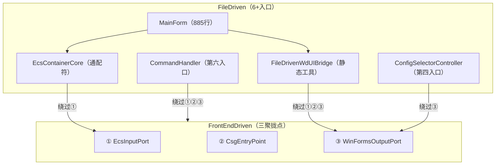
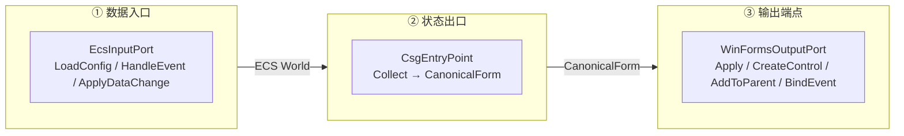
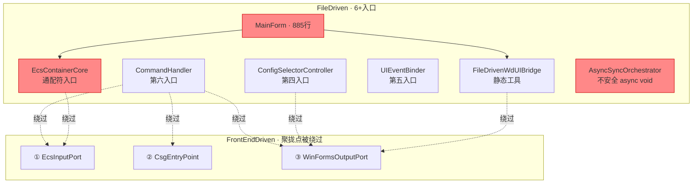
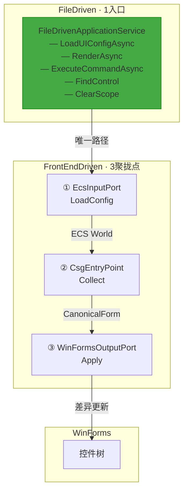

# FileDriven ↔ FrontEndDriven 聚拢点重构方案

> **修订日期**：2026-07-25
> **涉及项目**：FileDriven、FrontEndDriven（CsharpPrj/Operation/FrontEndDriven）
> **涉及模块**：FileDriven.Execution、FrontEndDriven.Ports、FrontEndDriven.Initial
> **触发事件**：ConfigSelector 加载时 "在创建窗口句柄之前，不能在控件上调用 Invoke 或 BeginInvoke"

---

## 一、背景与问题

### 1.1 异常概要

运行时异常：

```
[ERROR] Failed to load ConfigSelector:
  在创建窗口句柄之前，不能在控件上调用 Invoke 或 BeginInvoke。
```

错误发生在 `LoadConfigSelectorAsync` 中，根因是 `AsyncSyncOrchestrator.FireAndForget` 的 `async void` 将负载推入非 UI 线程，导致后续 `WinFormsRenderBridge.RegisterLifecycleHandlers → BeginInvoke` 跨线程调用时抛出句柄异常。

### 1.2 架构级问题清单

| 编号 | 问题 | 说明 | 严重程度 |
|------|------|------|----------|
| P0 | **FileDriven 入口过多** | MainForm、EcsContainerCore、FileDrivenWdUIBridge、ConfigSelectorController、CommandHandler、UIEventBinder 各自暴露公共方法 | 高 |
| P1 | **EcsContainerCore 通配符** | 一个类集配置加载、阶段执行、子容器管理于一身，外部可绕过所有聚拢点直接操作 ECS 管线 | 高 |
| P2 | **FrontEndDriven 三聚拢点未收敛** | EcsInputPort、CsgEntryPoint、WinFormsOutputPort 已定义，但 FileDriven 几乎全部绕过 | 高 |
| P3 | **线程模型隐式分散** | BeginInvoke/Invoke/InvokeOnUI 散布在 10+ 文件中，手动反射调用无统一抽象 | 中 |
| P4 | **Controller 模式引入第四入口** | ConfigSelectorController 绕过 WinFormsOutputPort 直接操作 WinForms 控件 | 中 |
| P5 | **MainForm 代码膨胀** | 单一文件 885 行，承担了配置加载、控件查找、事件绑定、命令执行等多重职责 | 中 |

### 1.3 异常根因链

```
FileDriven 入口过多 + EcsContainerCore 通配符
    ↓
FireAndForget 将 LoadConfigSelectorAsync 推入非 UI 线程
    ↓
_contentContainer.LoadConfiguration（非 UI 线程）
    ↓
InitializePipeline → _renderBridge.RegisterLifecycleHandlers(_pendingView)
    ↓
hostControl.BeginInvoke —— WinForms 要求调用方必须是 UI 线程
    ↓
❌ InvalidOperationException: "在创建窗口句柄之前，不能在控件上调用 Invoke 或 BeginInvoke"
```

---

## 二、架构原则与职责边界

### 2.1 分层原则

```
Application Layer: FileDriven
  ├─ 职责: 应用编排、配置管理、脚本执行、生命周期编排
  ├─ 约束: 不得直接触碰 ECS World、ControlPool、CanonicalForm、WinForms 控件
  └─ 入口: 唯一 FileDrivenApplicationService

Rendering Layer: FrontEndDriven
  ├─ 职责: ECS World 管理、CSG 转换、WinForms 控件差异更新
  ├─ 入口: EcsInputPort / CsgEntryPoint / WinFormsOutputPort
  └─ 对 FileDriven 暴露: 仅通过三个聚拢点的公共接口
```

### 2.2 聚拢点原则

| 原则 | 说明 |
|------|------|
| **唯一公共入口** | FileDriven 只有 `FileDrivenApplicationService` 一个对外门面 |
| **数据流向单向** | 配置/事件 → EcsInputPort → ECS World → CsgEntryPoint → CanonicalForm → WinFormsOutputPort → WinForms |
| **渲染层不引用应用层** | FrontEndDriven 不得引用 FileDriven 的任何类型 |
| **线程显式** | 所有跨线程边界由 IUIDispatcher 统一管控 |
| **零绕过** | FileDriven 不得直接调用 EcsContainerCore、ControlPool、或任何 WinForms 控件方法 |

### 2.3 当前调用关系（问题态）



---

## 三、FrontEndDriven 三聚拢点定义（保持不变）

### 3.1 三个聚拢点



### 3.2 端口定义

| 聚拢点 | 职责 | 核心方法 | 文件位置 |
|--------|------|----------|----------|
| ① EcsInputPort | 所有进入 ECS World 的数据的唯一入口 | `LoadConfig(config) → Entity`<br/>`HandleEvent(entity, eventName, args)`<br/>`ApplyDataChange<T>(entity, newValue)` | `CsharpPrj/Operation/FrontEndDriven/Ports.cs` |
| ② CsgEntryPoint | ECS World 状态 → CanonicalForm 的唯一转换出口 | `Collect() → CanonicalForm` | `CsharpPrj/Operation/FrontEndDriven/Ports.cs` |
| ③ WinFormsOutputPort | CanonicalForm → WinForms 控件的唯一输出端点 | `Apply(CanonicalForm) → int`<br/>`ApplyValueChange(Entity, control, value)`<br/>`CreateControl(Entity, controlType)`<br/>`AddToParent(ChildEntity, ParentEntity)`<br/>`BindEvent(control, eventName, functionName, bindingData)` | `CsharpPrj/Operation/FrontEndDriven/Ports.cs` |

### 3.3 已有基础设施（复用）

| 组件 | 用途 | 变动 |
|------|------|------|
| `EcsRenderPipeline` | 阶段编排（CreateStage → RenderStage） | 内部使用，不对外暴露 |
| `WinFormsRenderBridge` | CSG Apply 触发调度 | 内部使用，注入 IUIDispatcher |
| `EcsContainerCore` | 容器 Core 封装 | 内部使用，不对外暴露 |

### 3.4 新增基础设施

| 组件 | 位置 | 说明 |
|------|------|------|
| `IUIDispatcher` | `TConfig/Abstractions/IUIDispatcher.cs` | 统一线程调遣抽象 |
| `WinFormsUIDispatcher` | `FrontEndDriven/Services/WinFormsUIDispatcher.cs` | WinForms 实现，持有泵送窗口确保句柄就绪 |

---

## 四、FileDriven 单聚拢点设计（核心变更）

### 4.1 新类：FileDrivenApplicationService

```csharp
/// <summary>
/// FileDriven 唯一聚拢点 —— 应用层对外的唯一入口
/// 所有外部调用（MainForm、CLI、脚本引擎）通过此类路由。
/// 内部调用 FrontEndDriven 的三个收敛点完成具体工作。
/// 替换：EcsContainerCore.LoadConfiguration + FileDrivenWdUIBridge.FindAndBindContainers
///       + MainForm.LoadConfigSelectorAsync + CommandHandler
/// </summary>
public sealed class FileDrivenApplicationService : IDisposable
{
    // ── FrontEndDriven 三聚拢点（DI 注入）──
    private readonly EcsInputPort _ecsInput;
    private readonly CsgEntryPoint _csgEntry;
    private readonly WinFormsOutputPort _winFormsOutput;

    // ── 基础设施（DI 注入）──
    private readonly IUIDispatcher _dispatcher;
    private readonly IStageCoordinator _stages;
    private readonly EcsRenderPipeline _pipeline;
    private readonly IConfigLoader _configLoader;

    // ── 内部状态 ──
    private readonly Dictionary<UIScope, Control> _scopeControls = new();

    public FileDrivenApplicationService(
        EcsInputPort ecsInput,
        CsgEntryPoint csgEntry,
        WinFormsOutputPort winFormsOutput,
        IUIDispatcher dispatcher,
        IStageCoordinator stages,
        EcsRenderPipeline pipeline,
        IConfigLoader configLoader)
    {
        _ecsInput = ecsInput ?? throw new ArgumentNullException(nameof(ecsInput));
        _csgEntry = csgEntry ?? throw new ArgumentNullException(nameof(csgEntry));
        _winFormsOutput = winFormsOutput ?? throw new ArgumentNullException(nameof(winFormsOutput));
        _dispatcher = dispatcher ?? throw new ArgumentNullException(nameof(dispatcher));
        _stages = stages ?? throw new ArgumentNullException(nameof(stages));
        _pipeline = pipeline ?? throw new ArgumentNullException(nameof(pipeline));
        _configLoader = configLoader ?? throw new ArgumentNullException(nameof(configLoader));
    }
```

#### 4.1.1 配置加载 —— LoadUIConfigAsync

替换 `EcsContainerCore.LoadConfiguration` + `FileDrivenWdUIBridge.FindAndBindContainers` + `MainForm.LoadConfigSelectorAsync`

```csharp
    /// <summary>
    /// 加载 UI 配置到指定作用域
    /// 内部经过：configLoader → EcsInputPort.LoadConfig → ExecuteCreationStage
    /// </summary>
    public async Task<Entity> LoadUIConfigAsync(
        UIScope scope, string configPath, Control hostControl)
    {
        _dispatcher.AssertUIThread();

        // ① 加载配置（FileDriven 的配置管理）
        var config = await _configLoader.LoadAsync(configPath);

        // ② 通过 EcsInputPort 唯一入口加载到 ECS World —— 聚拢点 ①
        var rootEntity = _ecsInput.LoadConfig(config);

        // ③ 注册根容器到 ControlPool（供 WinFormsOutputPort 使用）
        _pipeline.RegisterRootContainer(hostControl);

        // ④ 创建控件实例
        _pipeline.ExecuteCreationStage();

        // ⑤ 记录容器作用域
        _scopeControls[scope] = hostControl;

        return rootEntity;
    }
```

#### 4.1.2 渲染管线执行 —— RenderAsync

替换 `EcsContainerCore.ExecuteLayoutStage` + `ExecuteRenderStage` 的零散调用

```csharp
    /// <summary>
    /// 执行完整渲染管线
    /// UI 线程：CsgEntryPoint.Collect → WinFormsOutputPort.Apply
    /// </summary>
    public async Task RenderAsync()
    {
        await _dispatcher.InvokeAsync(() =>
        {
            // 聚拢点 ②：ECS World → CanonicalForm
            var form = _csgEntry.Collect();

            // 聚拢点 ③：CanonicalForm → WinForms 控件差异更新
            _winFormsOutput.Apply(form);
        });
    }
```

#### 4.1.3 UI 命令执行 —— ExecuteCommandAsync

替换 `CommandHandler` + 部分 `UIEventBinder`

```csharp
    /// <summary>
    /// 执行 UI 命令
    /// 命令类型：click / set / sideload / exec 等
    /// </summary>
    public async Task<OperationResult> ExecuteCommandAsync(string command)
    {
        return await _dispatcher.InvokeAsync(async () =>
        {
            // 命令解析 → 路由 → 执行
            // ...
        });
    }
```

#### 4.1.4 控件查找与清理

替换 `FileDrivenWdUIBridge.FindConfigSelectorControls` + `ClearSideContainer`

```csharp
    /// <summary>
    /// 按名称查找控件，委托给 ControlPool（已注册的控件均可查找）
    /// </summary>
    public Control? FindControl(string name)
        => _pipeline.ControlPool?.GetControl(name);

    /// <summary>
    /// 清理指定作用域的容器
    /// </summary>
    public void ClearScope(UIScope scope)
    {
        if (_scopeControls.TryGetValue(scope, out var control))
        {
            _pipeline.Clear();  // 清除 ECS 数据
            _scopeControls.Remove(scope);
        }
    }

    public void Dispose()
    {
        _scopeControls.Clear();
    }
}
```

### 4.2 UIScope 枚举

```csharp
/// <summary>
/// UI 配置作用域
/// </summary>
public enum UIScope
{
    MainLayout,   // 主布局
    Content,      // 内容区（ConfigSelector 等）
    Side          // 侧边容器（动态加载的配置）
}
```

### 4.3 新 MainForm（薄层）

```csharp
public class MainForm : Form
{
    private readonly FileDrivenApplicationService _app;
    private readonly IStageCoordinator _stages;
    private ContainerView _rootView = null!;

    public MainForm(FileDrivenApplicationService app, IStageCoordinator stages)
    {
        _app = app ?? throw new ArgumentNullException(nameof(app));
        _stages = stages ?? throw new ArgumentNullException(nameof(stages));

        InitializeForm();

        // 创建根 ContainerView（作为 Form 的唯一子控件）
        _rootView = new ContainerView { Dock = DockStyle.Fill };
        Controls.Add(_rootView);

        this.Load += OnLoadAsync;
    }

    private async void OnLoadAsync(object? sender, EventArgs e)
    {
        try
        {
            // 步骤 1：加载并渲染 MainLayout
            await _app.LoadUIConfigAsync(
                UIScope.MainLayout,
                JsonConfigService.MainLayoutPath,
                _rootView);
            _stages.CompleteStage("MainLayoutLoaded", true);

            // 步骤 2：加载并渲染 ConfigSelector（到内容区）
            await _app.LoadUIConfigAsync(
                UIScope.Content,
                JsonConfigService.ConfigSelectorPath,
                FindContentPanel());
            _stages.CompleteStage("ConfigSelectorLoaded", true);

            // 步骤 3：完整渲染
            await _app.RenderAsync();
            _stages.CompleteStage("InitializationCompleted", true);
        }
        catch (Exception ex)
        {
            _stages.CompleteStage("InitializationCompleted", false, ex.Message);
        }
    }

    private Control FindContentPanel()
        => _app.FindControl("contentPanel") ?? this;
}
```

### 4.4 IUIDispatcher 接口

```csharp
/// <summary>
/// UI 线程调遣抽象 —— 所有跨线程操作通过此接口
/// 统一替代散落在各处的 BeginInvoke/Invoke/InvokeOnUI
/// </summary>
public interface IUIDispatcher
{
    /// <summary>当前是否在 UI 线程上</summary>
    bool IsUIThread { get; }

    /// <summary>在 UI 线程上异步执行（Post，不等待完成）</summary>
    void Post(Action action);

    /// <summary>在 UI 线程上同步执行（Send，阻塞当前线程）</summary>
    void Send(Action action);

    /// <summary>在 UI 线程上异步执行并等待完成</summary>
    Task InvokeAsync(Func<Task> asyncFunc);

    /// <summary>在 UI 线程上异步执行有返回值的操作并等待结果</summary>
    Task<T> InvokeAsync<T>(Func<Task<T>> asyncFunc);

    /// <summary>断言当前在 UI 线程上，否则抛 InvalidOperationException</summary>
    void AssertUIThread();
}
```

### 4.5 WinFormsUIDispatcher 实现

```csharp
/// <summary>
/// IUIDispatcher 的 WinForms 默认实现
/// 持有泵送窗口确保 BeginInvoke 句柄始终就绪
/// </summary>
public sealed class WinFormsUIDispatcher : IUIDispatcher
{
    private readonly Control _pumpControl;

    public WinFormsUIDispatcher()
    {
        _pumpControl = new Control();
        _pumpControl.CreateControl();  // 确保句柄创建
    }

    public bool IsUIThread =>
        SynchronizationContext.Current is WindowsFormsSynchronizationContext;

    public void Post(Action action)
    {
        if (IsUIThread) action();
        else _pumpControl.BeginInvoke(action);  // 句柄已就绪，安全
    }

    public void Send(Action action)
    {
        if (IsUIThread) action();
        else _pumpControl.Invoke(action);
    }

    public async Task InvokeAsync(Func<Task> asyncFunc)
    {
        if (IsUIThread)
            await asyncFunc();
        else
            await Task.Factory.FromAsync(
                _pumpControl.BeginInvoke(asyncFunc),
                _pumpControl.EndInvoke);
    }

    public async Task<T> InvokeAsync<T>(Func<Task<T>> asyncFunc)
    {
        if (IsUIThread)
            return await asyncFunc();
        var result = await Task.Factory.FromAsync(
            _pumpControl.BeginInvoke(asyncFunc),
            ar => (T)_pumpControl.EndInvoke(ar));
        return result;
    }

    public void AssertUIThread()
    {
        if (!IsUIThread)
            throw new InvalidOperationException(
                "当前操作必须在 UI 线程上执行。请通过 IUIDispatcher.InvokeAsync 封送。");
    }
}
```

---

## 五、消除的类与职责迁移

### 5.1 删除类

| 类名 | 位置 | 当前职责 | 迁移至 |
|------|------|----------|--------|
| `FileDrivenWdUIBridge` | `FrontEndDriven/WinForms/Services/` | 静态工具，创建容器、查找控件、清理 | 职责归入 `FileDrivenApplicationService` + `WinFormsOutputPort` |
| `ConfigSelectorController` | `FrontEndDriven/WinForms/` | 配置列表增删改查 | 数据操作由 `EcsInputPort.DataChanged` 事件驱动 |
| `UIEventBinder` | `FrontEndDriven/WinForms/EventBinding/` | 事件绑定 | 事件绑定已在 `EventBindingSystem` 管线中统一处理 |
| `CommandHandler` | `FrontEndDriven/WinForms/` | 命令解析执行 | 归入 `FileDrivenApplicationService.ExecuteCommandAsync` |

### 5.2 封装/瘦身类

| 类名 | 当前状态 | 目标状态 |
|------|----------|----------|
| `EcsContainerCore` | 对外暴露，外部可直接调用 | 仅 FrontEndDriven 内部使用 |
| `WinFormsRenderBridge` | 对外暴露 RegisterLifecycleHandlers | 注入 IUIDispatcher 后内部使用 |
| `MainForm` | 885 行，承担配置加载/控件查找/事件绑定 | 约 150 行，仅编排阶段 |

### 5.3 保留/增强类

| 类名 | 变动 |
|------|------|
| `EcsInputPort` | 不变，增加线程断言守卫 |
| `CsgEntryPoint` | 不变 |
| `WinFormsOutputPort` | 注册 IUIDispatcher 引用，公共方法前置线程断言 |
| `EcsRenderPipeline` | RegisterRootContainer 保留 |
| `AsyncSyncOrchestrator` | `FireAndForget` 标记 `[Obsolete("使用 IUIDispatcher.Post 替代")]` |
| `UILogger` | `InvokeOnUI`/`AppendTextSafe` 标记 `[Obsolete]`，内部委托给 IUIDispatcher |

### 5.4 依赖注入注册变更

```csharp
// 新增注册
services.AddSingleton<IUIDispatcher, WinFormsUIDispatcher>();
services.AddSingleton<FileDrivenApplicationService>();

// 删除注册（原保留行）
// services.AddSingleton<ConfigSelectorController>();
// services.AddSingleton<UIEventBinder>();
// services.AddSingleton<CommandHandler>();
```

---

## 六、阶段化实施步骤

### 阶段 1：基础设施搭建（低风险）

**步骤 1.1**：创建 IUIDispatcher 接口 + WinFormsUIDispatcher 实现

| 改动文件 | 操作 | 说明 |
|----------|------|------|
| `TConfig/Abstractions/IUIDispatcher.cs` | 新增 | UI 线程调遣抽象接口 |
| `FrontEndDriven/Services/WinFormsUIDispatcher.cs` | 新增 | WinForms 默认实现 |
| `ServiceCollectionExtensions.cs` | 修改 | 注册到 IoC 容器 |

> **验证**：单元测试确认 Post/Send/InvokeAsync 在 UI/非 UI 线程上的行为

---

**步骤 1.2**：创建 FileDrivenApplicationService 骨架

| 改动文件 | 操作 | 说明 |
|----------|------|------|
| `FileDriven/FileDriven.Execution/Services/FileDrivenApplicationService.cs` | 新增 | FileDriven 唯一聚拢点 |
| `FileDriven/FileDriven.Execution/Models/UIScope.cs` | 新增 | UI 配置作用域枚举 |

> **验证**：编译通过

---

**步骤 1.3**：WinFormsRenderBridge 接入 IUIDispatcher

| 改动文件 | 操作 | 说明 |
|----------|------|------|
| `WinFormsRenderBridge.cs` | 修改 | 构造函数注入 IUIDispatcher，替换 `hostControl.BeginInvoke` → `_dispatcher.Post` |

> **验证**：运行 `math_browser_simple_test.json` 确认不抛出跨线程异常

---

### 阶段 2：聚拢点整合（中等风险）

**步骤 2.1**：FileDrivenApplicationService 实现 `LoadUIConfigAsync`

| 改动文件 | 操作 | 说明 |
|----------|------|------|
| `FileDrivenApplicationService.cs` | 修改 | 整合 configLoader + EcsInputPort + pipeline |

> **验证**：MainLayout 加载正常显示

---

**步骤 2.2**：MainForm 瘦身

| 改动文件 | 操作 | 说明 |
|----------|------|------|
| `MainForm.cs` | 修改 | 删除 FindAndBindContainers/LoadConfigSelectorAsync 等逻辑，改为调用 `FileDrivenApplicationService` |

> **验证**：完整 UI 启动流程正常，ConfigSelector 显示正常

---

**步骤 2.3**：消除 Controller + Binder + Handler

| 改动文件 | 操作 |
|----------|------|
| `ConfigSelectorController.cs` | 删除 |
| `UIEventBinder.cs` | 删除 |
| `CommandHandler.cs` | 删除 |

> **验证**：配置选择、配置加载、命令执行功能正常

---

### 阶段 3：清理与继承（低风险）

**步骤 3.1**：标记废弃接口

| 改动文件 | 操作 |
|----------|------|
| `AsyncSyncOrchestrator.cs` | `FireAndForget` → `[Obsolete]` |
| `UILogger.cs` | `InvokeOnUI`/`AppendTextSafe` → `[Obsolete]` |
| `FileDrivenWdUIBridge.cs` | 类级别 → `[Obsolete]` |

> **验证**：编译时出现废弃警告，运行时无行为变化

---

**步骤 3.2**：删除废弃类（可选，在确认无外部引用后）

| 改动文件 | 操作 |
|----------|------|
| `FileDrivenWdUIBridge.cs` | 删除 |
| `EcsContainerCore.cs` | 重新定位为 internal |

> **验证**：搜索 `BeginInvoke`/`Invoke` 调用，确认所有跨线程调用通过 IUIDispatcher 路由

---

## 七、验证标准

| 编号 | 验证项 | 方法 | 验收标准 |
|------|--------|------|----------|
| V1 | ConfigSelector 加载不抛异常 | 运行 `math_browser_simple_test.json` | ConfigSelectorLoaded 阶段正常完成 |
| V2 | sideload 命令正常 | 运行含 sideload 的脚本 | 侧边配置加载正常 |
| V3 | CSG Apply 始终在 UI 线程 | WinFormsRenderBridge 增加线程日志 | 从未出现非 UI 线程执行记录 |
| V4 | AppendTextSafe 不抛异常 | 全量命令测试 | 日志输出从未出现 Invoke/BeginInvoke 异常 |
| V5 | MainForm 代码量 | 行数统计 | < 200 行 |
| V6 | 无 Obsolete 类引用 | 代码分析 | 项目中无文件引用已标记废弃的类 |
| V7 | 线程模型统一 | 搜索 `BeginInvoke`/`Invoke` 调用 | 所有跨线程调用通过 IUIDispatcher 路由 |

---

## 附录 A：重构前后架构对比

### 重构前（6+ 入口 → 绕过聚拢点）



### 重构后（单入口 → 严格聚拢）



---

## 附录 B：跨线程异常的架构根因与消除原理

### B.1 根因分析

WinForms 的 `Control.BeginInvoke(Delegate)` 有一个隐性前置条件：

> **调用 BeginInvoke 时，Control 的句柄必须已创建。**

若句柄未创建，BeginInvoke 会隐式触发 `CreateHandle()`，而创建句柄**必须在 UI 线程上执行**。

```
非 UI 线程 → control.BeginInvoke(action)
    ↓
control.InvokeRequired 触发句柄检查
    ↓
句柄未创建 → 在当前线程（非 UI）上 CreateHandle
    ↓
❌ InvalidOperationException: "在创建窗口句柄之前，不能在控件上调用 Invoke 或 BeginInvoke"
```

### B.2 旧方案为什么不能彻底解决问题

简单加 `this.BeginInvoke` 包裹只能让 `LoadConfigSelectorAsync` 在 UI 线程上启动，但：

- `async void` 内部的 `await` 续体可能通过 `ConfigureAwait(false)` 离开 UI 线程
- 其他入口（`ConfigSelectorController`、`CommandHandler`）仍有跨线程风险
- 没有统一的线程守卫，每次修复一个入口意味着人工审计所有路径

### B.3 新方案如何消除

`WinFormsUIDispatcher` 在构造时创建一个隐藏的 `Control` 并立即 `CreateControl()`，确保泵送控件的句柄始终就绪：

```
非 UI 线程:
  _dispatcher.Post(action)
    → _pumpControl.BeginInvoke(action)   ← 句柄已创建，安全
    → UI 线程执行 action                   ← 始终在 UI 线程
```

三层保护：

| 保护层 | 机制 | 效果 |
|--------|------|------|
| **泵送控件** | 隐藏 Control 提前 CreateControl() | 所有 BeginInvoke 句柄就绪，不触发隐式 CreateHandle |
| **FromAsync 模式** | `Task.Factory.FromAsync(BeginInvoke, EndInvoke)` | async/await 续体通过 AsyncCallback 回到 UI 线程 |
| **线程断言** | `AssertUIThread()` | 运行时守卫，非 UI 线程执行路径立即报错 |

---

## 附录 C：新增文件清单

| 文件 | 路径 | 新文件/修改 | 阶段 |
|------|------|-------------|------|
| `IUIDispatcher.cs` | `TConfig/Abstractions/IUIDispatcher.cs` | 新增 | 1.1 |
| `WinFormsUIDispatcher.cs` | `FrontEndDriven/Services/WinFormsUIDispatcher.cs` | 新增 | 1.1 |
| `FileDrivenApplicationService.cs` | `FileDriven/FileDriven.Execution/Services/FileDrivenApplicationService.cs` | 新增 | 1.2 |
| `UIScope.cs` | `FileDriven/FileDriven.Execution/Models/UIScope.cs` | 新增 | 1.2 |
| `WinFormsRenderBridge.cs` | `FrontEndDriven/Initial/RenderPipeline/WinFormsRenderBridge.cs` | 修改 | 1.3 |
| `ServiceCollectionExtensions.cs` | `FileDriven.Execution/ServiceCollectionExtensions.cs` | 修改 | 1.1 |

---

## 附录 D：相关文档链接

| 文档 | 说明 |
|------|------|
| [FrontEndDriven Ports.cs](/CsharpPrj/Operation/FrontEndDriven/Ports.cs) | 三聚拢点定义（EcsInputPort / CsgEntryPoint / WinFormsOutputPort） |
| [EcsRenderPipeline.cs](/CsharpPrj/Operation/FrontEndDriven/Initial/RenderPipeline/EcsRenderPipeline.cs) | 管线阶段编排 |
| [WinFormsRenderBridge.cs](/CsharpPrj/Operation/FrontEndDriven/Initial/RenderPipeline/WinFormsRenderBridge.cs) | CSG Apply 触发调度 |
| [EcsContainerCore.cs](/CsharpPrj/Operation/FrontEndDriven/ControlLookup/Container/EcsContainerCore.cs) | 容器 Core 封装 |
| [MainForm.cs](/FileDriven/FileDriven.Execution/Initial/MainForm.cs) | 重构目标文件（885行 → 150行） |