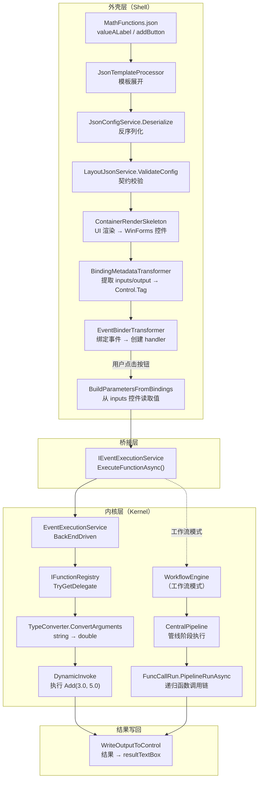
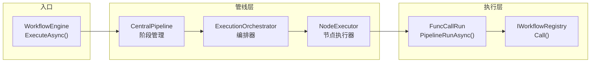

# MathFunctions.json 数据使用路径分析

> **基于**：`CommandFramework_WorkflowExecution_外壳与内核关系.md` 理论  
> **起点**：`FileDriven/DrivenConfig/JsonConfig/MathFunctions.json` → `valueALabel` (type: "label")  
> **范围**：配置加载 → UI 渲染 → 事件绑定 → 函数执行 → 工作流整合  
> **日期**：2026-07-04

---

## 目录

1. [调用链总览图](#1-调用链总览图)
2. [配置加载路径](#2-配置加载路径)
3. [事件绑定路径](#3-事件绑定路径)
4. [工作流整合路径](#4-工作流整合路径)
5. [控件数据使用路径对比](#5-控件数据使用路径对比)
6. [关键代码文件映射表](#6-关键代码文件映射表)

---

## 1. 调用链总览图

### 1.1 外壳与内核分层

```
┌─────────────────────────────────────────────────────────────────────────┐
│                         外 壳 层（Shell Layer）                          │
│                                                                         │
│  FileDriven 框架           EventTriggerFramework        FrontEndDriven  │
│  ┌─────────────────┐     ┌──────────────────────┐    ┌──────────────┐  │
│  │ JsonConfigService│     │ EventBindingPipeline │    │ UIEventBinder│  │
│  │ JsonTemplate     │────→│ BindingMetadata      │    │ ConfigContr  │  │
│  │ Processor        │     │ EventBinder          │    │ oller        │  │
│  │ LayoutJsonService│     │ ScriptModeGuard      │    │              │  │
│  └────────┬────────┘     └──────────┬───────────┘    └──────────────┘  │
│           │                         │                                   │
│           │    JSON 配置加载         │    事件绑定/触发                  │
│           ▼                         ▼                                   │
│    UIConfiguration           EventHandler (async void)                  │
│    WinForms Label/TextBox    BuildParametersFromBindings()              │
│                                                                         │
└───────────────────────────────┬─────────────────────────────────────────┘
                                │
                    IEventExecutionService.ExecuteFunctionAsync()
                    （外壳→内核的桥接点）
                                │
                                ▼
┌─────────────────────────────────────────────────────────────────────────┐
│                         内 核 层（Kernel Layer）                          │
│                                                                         │
│  BackEndDriven              CommandFramework          WorkflowExecution │
│  ┌──────────────────┐     ┌──────────────────┐    ┌──────────────────┐ │
│  │EventExecutionSvc │     │ FunctionExecutor  │    │ WorkflowEngine   │ │
│  │TypeConverter     │────→│ ArgumentBuilder   │    │ CentralPipeline  │ │
│  │IFunctionRegistry │     │ DynamicInvoke     │    │ ExecutionOrch    │ │
│  └──────────────────┘     └──────────────────┘    │ FuncCallRun      │ │
│                                                    └──────────────────┘ │
│                                                                         │
└─────────────────────────────────────────────────────────────────────────┘
```

### 1.2 完整数据流（从 JSON 到函数执行）



---

## 2. 配置加载路径

### 2.1 路径总览

```
MathFunctions.json
  │  { "type": "label", "name": "valueALabel", "text": "Value A:",
  │    "layout": { "left": 0.05, "top": 0.2, "width": 0.15, "height": 0.25 } }
  │
  ▼ 步骤1: 模板展开
JsonTemplateProcessor.Process(path)
  │  → GraphKeyFrameUsings.CreateReferencePreprocessor(baseDir)
  │  → 裸名转换（bare name → @prefix）
  │  → JsonPipelineRegistry.Process（展开 style/template/extends 引用）
  │
  ▼ 步骤2: 反序列化
JsonConfigService.Deserialize(processedJson)
  │  → JsonSerializer.Deserialize<UIConfiguration>(json)
  │  → 生成 UIConfiguration 对象树
  │    → Views[0].Controls[0] = ControlConfig { Type="label", Name="valueALabel", ... }
  │
  ▼ 步骤3: 契约校验
LayoutJsonService.ValidateConfig(config, strictMode)
  │  → ContractValidator.Validate(config, strictMode)
  │
  ▼ 步骤4: UI 渲染
ContainerRenderSkeleton.Render(config)
  │  → 递归遍历 Controls 树
  │  → 遇到 type="label" → 创建 WinForms Label 控件
  │  → layout 数据 → Label.Left/Label.Top/Label.Width/Label.Height（按比例计算）
  │  → text = "Value A:" → Label.Text
  │  → name = "valueALabel" → Label.Name
  │
  ▼ 结果
WinForms Label 控件（位置: 5%左, 20%上, 15%宽, 25%高）
```

### 2.2 关键代码

#### 2.2.1 模板展开 — `JsonTemplateProcessor.cs`

```csharp
// FileDriven/FileDriven.JsonRefer/JsonProcessing/JsonTemplateProcessor.cs
public static string? Process(string? path = null, string? json = null)
{
    // 路径模式：委托给 preprocessor（内部包含文件读取 → 裸名转换 → 管线处理）
    if (path != null)
        return ProcessFileViaPreprocessor(path);
    // JSON 字符串模式：直接处理，避免临时文件 I/O 往返
    else if (json != null)
        return ProcessJsonDirectly(json);
}
```

#### 2.2.2 反序列化 — `JsonConfigService.cs`

```csharp
// FileDriven/FileDriven.JsonRefer/JsonProcessing/JsonConfigService.cs
public static async Task<UIConfiguration?> LoadConfigAsync(string configPath, bool strictMode = true)
{
    // 先执行模板预处理（展开 style/template/extends 引用），再反序列化
    var processedJson = PreprocessConfig(configPath);
    var config = JsonFileService.Instance.DeserializeConfig(processedJson);
    return config;
}
```

#### 2.2.3 UI 渲染 — `ContainerRenderSkeleton.cs`

```csharp
// FileDriven/FileDriven.UI/Layout/Skeletons/ContainerRenderSkeleton.cs
// 递归遍历 Controls 树，根据 type 创建对应 WinForms 控件
// type="label" → new Label() { Text = config.Text, Name = config.Name }
// layout 数据 → 按比例计算 Left/Top/Width/Height
```

### 2.3 label "valueALabel" 的配置数据映射

| JSON 字段 | 值 | 目标属性 | 说明 |
|-----------|-----|---------|------|
| `type` | `"label"` | 控件类型 | 决定创建 `System.Windows.Forms.Label` |
| `name` | `"valueALabel"` | `Label.Name` | 用于 `FindByName` 查找 |
| `text` | `"Value A:"` | `Label.Text` | 显示文本 |
| `layout.left` | `0.05` | `Label.Left` | 相对位置 5%（按容器宽度计算） |
| `layout.top` | `0.2` | `Label.Top` | 相对位置 20%（按容器高度计算） |
| `layout.width` | `0.15` | `Label.Width` | 相对宽度 15% |
| `layout.height` | `0.25` | `Label.Height` | 相对高度 25% |

---

## 3. 事件绑定路径

### 3.1 路径总览

```
用户点击 "Add (+)" 按钮
  │
  ▼ 步骤1: 事件触发
EventBinderTransformer.CreateEventHandler() 创建的 async void handler 被调用
  │
  ▼ 步骤2: 脚本模式检查
handler 内部检查 IsScriptExecutionMode
  │  → 运行时模式：继续执行
  │  → 脚本模式：跳过（记录警告）
  │
  ▼ 步骤3: 参数构建
BuildParametersFromBindings(ctrl, valueAccessor)
  │  → 从 Control.Tag 读取 inputs 绑定信息
  │    Tag["inputs"] = ["valueATextBox", "valueBTextBox"]
  │  → 遍历 inputNames
  │    → WinFormsControlService.FindByName(form, "valueATextBox") → TextBox
  │    → valueAccessor.GetValue(textBox) → "3"
  │    → WinFormsControlService.FindByName(form, "valueBTextBox") → TextBox
  │    → valueAccessor.GetValue(textBox) → "5"
  │  → 返回 ["3", "5"]
  │
  ▼ 步骤4: 运行时解析 IEventExecutionService
var resolvedService = AppServiceProvider.Resolve<IEventExecutionService>()
  │  → 解析到 BackEndDriven.EventExecutionService
  │
  ▼ 步骤5: 执行函数（外壳→内核桥接）
var execResult = await resolvedService.ExecuteFunctionAsync("Add", ["3", "5"])
  │
  ▼ 步骤6: 类型转换（内核层入口）
EventExecutionService.ExecuteFunctionAsync("Add", ["3", "5"])
  │  → IFunctionRegistry.TryGetDelegate("Add", out del)
  │  → 获取 Add 委托: (double a, double b) => a + b
  │  → targetTypes = [double, double]
  │  → TypeConverter.ConvertArguments(["3", "5"], [double, double])
  │    → double.Parse("3") → 3.0
  │    → double.Parse("5") → 5.0
  │  → del.DynamicInvoke(3.0, 5.0) → 8.0
  │  → 返回 ExecutionResult { Success=true, Value=8.0 }
  │
  ▼ 步骤7: 检查执行结果
if (!execResult.Success) → 抛出异常
  │  → 成功：继续
  │
  ▼ 步骤8: 结果写回
WriteOutputToControl(ctrl, 8.0, valueAccessor)
  │  → 从 Control.Tag 读取 output 绑定信息
  │    Tag["output"] = "resultTextBox"
  │  → WinFormsControlService.FindByName(form, "resultTextBox") → TextBox
  │  → valueAccessor.SetValue(textBox, "8")
  │
  ▼ 结果
resultTextBox 显示 "8"
```

### 3.2 关键代码

#### 3.2.1 元数据提取 — `BindingMetadataTransformer`

```csharp
// EventBindingTransformers.cs 第95-159行
public class BindingMetadataTransformer : ITransformer<EventBindingContext, EventBindingContext>
{
    public EventBindingContext Transform(EventBindingContext input)
    {
        // 从 EventConfig 中提取 output/inputs 元数据
        var output = EventBindingHelper.ResolveOutput(bindings, eventsConfig, "");
        var inputs = bindings.Inputs is { Count: > 0 }
            ? new List<string>(bindings.Inputs) : null;

        // 保存到 Control.Tag
        SaveControlParameters(control, output, inputs);
        return input;
    }

    protected virtual void SaveControlParameters(object control, string? output, List<string>? inputs)
    {
        var tag = winFormsControl.Tag as Dictionary<string, object>;
        tag["output"] = output;    // "resultTextBox"
        tag["inputs"] = inputs;    // ["valueATextBox", "valueBTextBox"]
    }
}
```

#### 3.2.2 事件绑定 — `EventBinderTransformer`

```csharp
// EventBindingTransformers.cs 第181-321行
public class EventBinderTransformer : ITransformer<EventBindingContext, EventBindingContext>
{
    public EventBindingContext Transform(EventBindingContext input)
    {
        // 遍历标准事件（Click, TextChanged 等）
        foreach (var (eventName, getter) in StandardEventMappings)
        {
            var funcNames = getter(eventsConfig);
            if (funcNames is { Count: > 0 })
            {
                var handler = CreateEventHandler(ctrl, eventName, funcNames[0], binder, _valueAccessor);
                BindEvent(ctrl, eventName, handler, binder, config, eventsConfig, eventName);
            }
        }
        // 遍历自定义事件
        if (eventsConfig.CustomEvents is { Count: > 0 }) { ... }
    }
}
```

#### 3.2.3 参数构建 — `BuildParametersFromBindings`

```csharp
// EventBindingTransformers.cs 第471-508行
private static object?[]? BuildParametersFromBindings(Control ctrl, IControlValueAccessor? valueAccessor)
{
    // 从 Tag 中读取 inputs 绑定信息
    if (ctrl.Tag is Dictionary<string, object> tag &&
        tag.TryGetValue("inputs", out var inputsObj) &&
        inputsObj is List<string> inputNames && inputNames.Count > 0)
    {
        var parameters = new object?[inputNames.Count];
        var form = ctrl.FindForm();

        for (int i = 0; i < inputNames.Count; i++)
        {
            var inputControl = WinFormsControlService.Instance.FindByName(form, inputNames[i]);
            inputValue = valueAccessor.GetValue(inputControl);
            parameters[i] = inputValue?.ToString() ?? string.Empty;
        }
        return parameters;
    }
}
```

#### 3.2.4 函数执行 — `EventExecutionService`

```csharp
// BackEndDriven/Execution/EventExecutionService.cs 第67-132行
public async Task<ExecutionResult> ExecuteFunctionAsync(string functionName, object?[]? parameters)
{
    // 1. 查找函数委托
    _functionRegistry.TryGetDelegate(functionName, out var del);

    // 2. 类型转换（string → double）
    var methodParams = del.Method.GetParameters();
    var targetTypes = methodParams.Select(p => p.ParameterType).ToArray();
    var convertedParams = TypeConverter.ConvertArguments(parameters, targetTypes);

    // 3. 执行
    var result = del.DynamicInvoke(convertedParams);

    // 4. 等待异步结果
    if (result is Task task) { await task; result = task.GetType().GetProperty("Result")?.GetValue(task); }

    return ExecutionResult.Ok(result);
}
```

#### 3.2.5 结果写回 — `WriteOutputToControl`

```csharp
// EventBindingTransformers.cs 第514-540行
private static void WriteOutputToControl(Control ctrl, object? resultValue, IControlValueAccessor? valueAccessor)
{
    // 从 Tag 中读取 output 绑定信息
    if (ctrl.Tag is Dictionary<string, object> tag &&
        tag.TryGetValue("output", out var outputObj) &&
        outputObj is string outputName && !string.IsNullOrWhiteSpace(outputName))
    {
        var outputControl = WinFormsControlService.Instance.FindByName(form, outputName);
        valueAccessor.SetValue(outputControl, resultText);
    }
}
```

### 3.3 MathFunctions.json 中的事件绑定配置

```json
{
  "type": "button",
  "name": "addButton",
  "text": "Add (+)",
  "layout": { "left": 0.05, "top": 0.55, "width": 0.15, "height": 0.1 },
  "events": {
    "bindings": {
      "output": "resultTextBox",
      "inputs": ["valueATextBox", "valueBTextBox"]
    },
    "click": ["Add"]
  }
}
```

| 字段 | 值 | 用途 |
|------|-----|------|
| `events.bindings.output` | `"resultTextBox"` | 函数结果写入的目标控件 |
| `events.bindings.inputs` | `["valueATextBox", "valueBTextBox"]` | 函数参数的来源控件列表 |
| `events.click` | `["Add"]` | Click 事件触发的函数名 |

---

## 4. 工作流整合路径

### 4.1 当前路径 vs 工作流路径

```
当前路径（直接函数执行）：
  EventBinderTransformer
    → IEventExecutionService.ExecuteFunctionAsync("Add", ["3","5"])
    → EventExecutionService (BackEndDriven)
    → IFunctionRegistry.TryGetDelegate → DynamicInvoke
    → 返回 ExecutionResult { Value = 8.0 }

工作流整合路径（未来）：
  EventBinderTransformer
    → IEventExecutionService.ExecuteFunctionAsync("MathOperationsWorkflow", ["Add","3","5"])
    → EventExecutionService (BackEndDriven)
    → IFunctionRegistry.TryGetDelegate → 获取工作流执行委托
    → WorkflowEngine.ExecuteAsync(workflow, context)
      → CentralPipeline.ExecuteAsync(workflow, context)
        → ExecutionOrchestrator.OrchestrateAsync()
          → NodeExecutor.ExecuteAsync()  // 逐个执行工作流节点
          → FuncCallRun.PipelineRunAsync()  // 递归执行函数调用链
    → 返回 ExecutionResult { Value = 8.0 }
```

### 4.2 工作流引擎架构



### 4.3 关键代码

#### 4.3.1 WorkflowEngine — 工作流引擎入口

```csharp
// WorkflowExecution/Engine/WorkflowEngine.cs 第63-119行
private async Task<TConfig.ExecutionResult> ExecuteCoreAsync(
    Models.WorkflowDefinition workflow, IWorkflowContext context, CancellationToken cancellationToken)
{
    var session = _sessionManager.CreateSession(workflow, context.ExecutionId);
    session.MarkRunning();

    var result = await _orchestrator.OrchestrateAsync(workflow, context, cts.Token);

    if (result.IsSuccess) session.MarkCompleted();
    else session.MarkFailed(result.ErrorMessage, result.Exception);

    return result;
}
```

#### 4.3.2 CentralPipeline — 中央管线

```csharp
// WorkflowExecution/Pipeline/CentralPipeline.cs 第78-132行
public async Task<BasicExecutionResult> ExecuteAsync(
    WorkflowDefinition workflow, IWorkflowContext context, CancellationToken cancellationToken)
{
    var stages = GetResolvedStages();
    foreach (var stage in stages)
    {
        var result = await stage.ExecuteAsync(context, cancellationToken);
        if (!result.IsSuccess) return result;
    }
    return BasicExecutionResult.Success(null);
}
```

#### 4.3.3 FuncCallRun — 函数管线执行引擎

```csharp
// WorkflowExecution/Execution/FuncCallRun.cs 第96-145行
public static async Task<List<object?>> PipelineRunAsync(
    FuncPipelineParameters funcPipeline, IWorkflowRegistry functionRegistry,
    FuncExecutionContext context, int depth = 0)
{
    var result = new List<object?>();
    foreach (var call in funcPipeline.Calls)
    {
        // 递归执行子管线
        if (call.PipelineGroup != null)
            parameter = await PipelineRunAsync(call.PipelineGroup, functionRegistry, context, depth + 1);

        // 执行函数
        if (functionRegistry.HasFunction(call.FuncName))
            parameter = functionRegistry.Call(call.FuncName, callContext);

        result.Add(parameter);
    }
    return result;
}
```

### 4.4 工作流整合方案

#### 方案 A：函数级整合（当前可行）

将 `Add`/`Subtract`/`Multiply`/`Divide` 注册为工作流函数，通过 `WorkflowMethodUsage` 统一入口执行：

```csharp
// 注册工作流函数
WorkflowMethodUsage.RegisterFunction("Add", ctx => {
    var a = (double)ctx.Parameters["0"];
    var b = (double)ctx.Parameters["1"];
    return a + b;
});

// EventExecutionService 中调用
var result = await WorkflowMethodUsage.CallBridgedFunctionAsync("Add", wfContext);
```

#### 方案 B：工作流级整合（未来）

定义 `MathOperationsWorkflow` 工作流，包含多个节点：

```json
{
  "workflow": {
    "id": "MathOperationsWorkflow",
    "nodes": [
      { "symbol": "input", "funcName": "ValidateInput", "params": ["a", "b"] },
      { "symbol": "operation", "funcName": "SelectOperation", "params": ["op"] },
      { "symbol": "execute", "funcName": "ExecuteMath", "params": ["a", "b", "op"] },
      { "symbol": "format", "funcName": "FormatResult", "params": ["result"] }
    ]
  }
}
```

通过 `WorkflowEngine.ExecuteAsync(workflow, context)` 执行完整工作流。

---

## 5. 控件数据使用路径对比

### 5.1 控件角色对比

| 控件名 | 类型 | 配置时使用 | 运行时使用 | 事件绑定角色 |
|--------|------|-----------|-----------|------------|
| `valueALabel` | label | layout → 位置/大小<br/>text → 显示文本 | 纯展示 | **无**（无 events 定义） |
| `valueBLabel` | label | layout → 位置/大小<br/>text → 显示文本 | 纯展示 | **无**（无 events 定义） |
| `resultLabel` | label | layout → 位置/大小<br/>text → 显示文本 | 纯展示 | **无**（无 events 定义） |
| `valueATextBox` | textbox | layout → 位置/大小 | 用户输入值 | **inputs[0]**（被 addButton 引用） |
| `valueBTextBox` | textbox | layout → 位置/大小 | 用户输入值 | **inputs[1]**（被 addButton 引用） |
| `resultTextBox` | textbox | layout → 位置/大小 | 显示结果 | **output**（addButton 的结果目标） |
| `addButton` | button | layout → 位置/大小 | 触发事件 | **click → "Add"**（事件源） |
| `subtractButton` | button | layout → 位置/大小 | 触发事件 | **click → "Subtract"**（事件源） |
| `multiplyButton` | button | layout → 位置/大小 | 触发事件 | **click → "Multiply"**（事件源） |
| `divideButton` | button | layout → 位置/大小 | 触发事件 | **click → "Divide"**（事件源） |

### 5.2 label "valueALabel" 的完整数据路径

```
MathFunctions.json
  │  valueALabel: { type:"label", text:"Value A:", layout:{...} }
  │
  ├── 配置加载阶段 ──────────────────────────────────────────────
  │   JsonTemplateProcessor.Process()       → 模板展开
  │   JsonConfigService.Deserialize()       → UIConfiguration
  │   ContainerRenderSkeleton.Render()      → WinForms Label
  │     ├── layout.left=0.05   → Label.Left   = containerWidth * 0.05
  │     ├── layout.top=0.2     → Label.Top    = containerHeight * 0.2
  │     ├── layout.width=0.15  → Label.Width  = containerWidth * 0.15
  │     ├── layout.height=0.25 → Label.Height = containerHeight * 0.25
  │     ├── text="Value A:"    → Label.Text   = "Value A:"
  │     └── name="valueALabel" → Label.Name   = "valueALabel"
  │
  ├── 事件绑定阶段 ──────────────────────────────────────────────
  │   BindingMetadataTransformer.Transform()
  │     → label 没有 events 定义 → 跳过（ScriptModeGuard 不处理）
  │     → label 没有 events.bindings → 不保存元数据到 Tag
  │   EventBinderTransformer.Transform()
  │     → label 没有 events → 跳过（control.Events == null）
  │
  └── 运行时阶段 ────────────────────────────────────────────────
      label 控件仅用于展示 "Value A:" 文本
      不参与任何事件处理或数据流
      它的 name "valueALabel" 未被任何按钮的 inputs 引用
```

### 5.3 textbox "valueATextBox" 的完整数据路径

```
MathFunctions.json
  │  valueATextBox: { type:"textbox", text:"", layout:{...} }
  │
  ├── 配置加载阶段 ──────────────────────────────────────────────
  │   同 label 流程 → WinForms TextBox
  │     ├── layout → 位置/大小
  │     ├── text="" → TextBox.Text = ""（初始为空）
  │     └── name="valueATextBox" → TextBox.Name = "valueATextBox"
  │
  ├── 事件绑定阶段 ──────────────────────────────────────────────
  │   textbox 没有 events 定义 → 跳过事件绑定
  │   但它的 name 被 addButton 的 bindings.inputs 引用
  │
  └── 运行时阶段 ───────────────────────────────────────────────
      用户输入值（如 "3"）
      ↓
      用户点击 addButton
      ↓
      BuildParametersFromBindings() 被调用
        → 从 addButton.Tag["inputs"] 读取 ["valueATextBox", "valueBTextBox"]
        → WinFormsControlService.FindByName(form, "valueATextBox")
        → 找到 valueATextBox TextBox 控件
        → valueAccessor.GetValue(textBox) → "3"
        → 作为参数传入 Add("3", "5")
```

---

## 6. 关键代码文件映射表

### 6.1 外壳层（Shell）

| 阶段 | 文件路径 | 关键类/方法 | 行号 |
|------|---------|------------|------|
| JSON 加载 | `FileDriven/FileDriven.JsonRefer/JsonProcessing/JsonConfigService.cs` | `LoadConfigAsync()` | 197-235 |
| 模板展开 | `FileDriven/FileDriven.JsonRefer/JsonProcessing/JsonTemplateProcessor.cs` | `Process()` | 75-113 |
| 反序列化 | `FileDriven/FileDriven.JsonRefer/JsonProcessing/JsonConfigService.cs` | `Deserialize()` | 96-111 |
| 契约校验 | `FileDriven/FileDriven.UI/Layout/LayoutJsonService.cs` | `ValidateConfig()` | 35-57 |
| UI 渲染 | `FileDriven/FileDriven.UI/Layout/Skeletons/ContainerRenderSkeleton.cs` | `Render()` | - |
| 元数据提取 | `CsharpPrj/Operation/EventTriggerFramework/EventBinding/EventBindingTransformers.cs` | `BindingMetadataTransformer.Transform()` | 99-130 |
| 事件绑定 | `CsharpPrj/Operation/EventTriggerFramework/EventBinding/EventBindingTransformers.cs` | `EventBinderTransformer.Transform()` | 211-321 |
| 参数构建 | `CsharpPrj/Operation/EventTriggerFramework/EventBinding/EventBindingTransformers.cs` | `BuildParametersFromBindings()` | 471-508 |
| 结果写回 | `CsharpPrj/Operation/EventTriggerFramework/EventBinding/EventBindingTransformers.cs` | `WriteOutputToControl()` | 514-540 |
| 事件管线 | `CsharpPrj/Operation/EventTriggerFramework/EventBinding/EventBindingPipeline.cs` | `CreateFullBindingPipeline()` | 71-83 |
| 管线执行器 | `CsharpPrj/Operation/EventTriggerFramework/EventBinding/EventBindingPipeline.cs` | `EventBindingPipelineRunner.Execute()` | 144-180 |
| UI 事件绑定 | `CsharpPrj/Operation/FrontEndDriven/WinForms/EventBinding/UIEventBinder.cs` | `BindAll()` | 90-94 |

### 6.2 桥接层

| 阶段 | 文件路径 | 关键类/方法 | 行号 |
|------|---------|------------|------|
| 执行服务接口 | `CsharpPrj/Share/EventBindingOrchestrator/Abstractions/IEventExecutionService.cs` | `ExecuteFunctionAsync()` | 68 |
| 执行结果 | `CsharpPrj/Share/EventBindingOrchestrator/Abstractions/IEventExecutionService.cs` | `ExecutionResult` | 25-51 |

### 6.3 内核层（Kernel）

| 阶段 | 文件路径 | 关键类/方法 | 行号 |
|------|---------|------------|------|
| 函数执行 | `CsharpPrj/Operation/BackEndDriven/Execution/EventExecutionService.cs` | `ExecuteFunctionAsync()` | 67-132 |
| 类型转换 | `CsharpPrj/Share/ParameterResolver/Converter/TypeConverter.cs` | `ConvertArguments()` | - |
| 工作流引擎 | `CsharpPrj/Operation/WorkFlowMethod/WorkflowExecution/Engine/WorkflowEngine.cs` | `ExecuteCoreAsync()` | 63-119 |
| 中央管线 | `CsharpPrj/Operation/WorkFlowMethod/WorkflowExecution/Pipeline/CentralPipeline.cs` | `ExecuteAsync()` | 78-132 |
| 执行编排 | `CsharpPrj/Operation/WorkFlowMethod/WorkflowExecution/Engine/ExecutionOrchestrator.cs` | `OrchestrateAsync()` | 46-56 |
| 函数管线 | `CsharpPrj/Operation/WorkFlowMethod/WorkflowExecution/Execution/FuncCallRun.cs` | `PipelineRunAsync()` | 96-145 |
| 统一入口 | `CsharpPrj/Operation/WorkFlowMethod/WorkflowMethodUseage.cs` | `WorkFlowMethodUsage` | 107-943 |

---

## 附录 A：外壳与内核关系理论映射

### A.1 分层定义

| 层 | 职责 | 包含模块 | 与"外壳与内核"理论的对应 |
|----|------|---------|------------------------|
| **外壳层** | UI 交互、配置加载、事件绑定 | FileDriven, EventTriggerFramework, FrontEndDriven | 负责"做什么"（what）— 用户操作和 UI 响应 |
| **桥接层** | 外壳→内核的调用转换 | IEventExecutionService, AppServiceProvider | 负责"如何连接"（how to connect） |
| **内核层** | 函数执行、工作流编排、参数处理 | BackEndDriven, CommandFramework, WorkflowExecution | 负责"怎么做"（how）— 业务逻辑执行 |

### A.2 数据流方向

```
外壳层（Shell）                   内核层（Kernel）
┌──────────────┐                ┌──────────────┐
│ JSON 配置     │─── 声明式 ───→│ 函数注册表    │
│ UI 控件       │─── 事件 ────→│ 函数执行器    │
│ 绑定元数据    │─── 参数 ────→│ 类型转换器    │
│ 结果展示      │←── 返回值 ──│ 执行结果      │
└──────────────┘                └──────────────┘
```

### A.3 关键设计原则

1. **外壳不依赖内核的具体实现**：通过 `IEventExecutionService` 接口桥接，运行时从 `AppServiceProvider` 解析
2. **内核不感知外壳的 UI 框架**：`EventExecutionService` 不依赖 WinForms，只操作 `IFunctionRegistry`
3. **数据转换发生在桥接层**：`TypeConverter.ConvertArguments()` 负责 string → double 的类型转换
4. **工作流是内核的扩展**：`WorkflowEngine` 提供更复杂的编排能力，通过 `FuncCallRun.PipelineRunAsync()` 递归执行函数链

---

> **文档版本**：v1.0  
> **分析依据**：`CommandFramework_WorkflowExecution_外壳与内核关系.md`  
> **分析范围**：`MathFunctions.json` → `valueALabel` / `valueATextBox` → 事件绑定 → 函数执行 → 工作流整合  
> **下次更新**：工作流整合方案实施后
