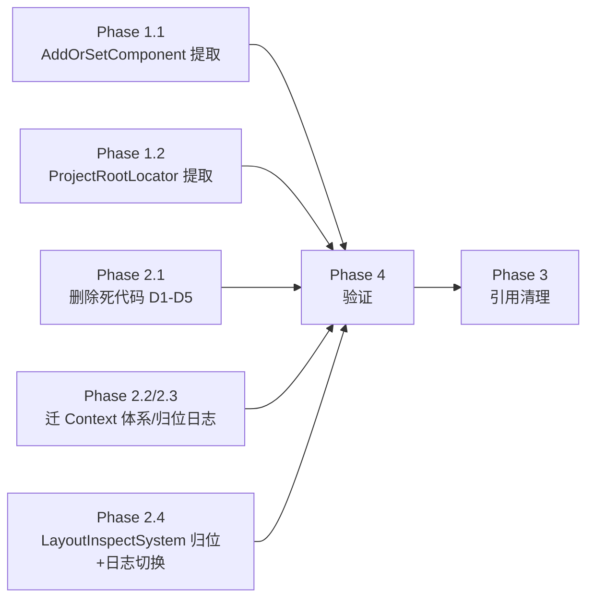

# 命令系统残留清理与共享扩展提取重构方案

> **文档日期**：2026-08-02
> **适用范围**：`CsharpPrj/Operation/FrontEndDriven` / `CsharpPrj/Operation/BackEndDriven` / `CsharpPrj/Share/CommandFramework` / `FileDriven`
> **前序**：`docs/analysis/migration_plan_frontend_to_backend_20260802.md`（阶段 1/2 已完成，本方案为阶段 3/4 收尾）
> **目标**：
> 1. **提取共享扩展到 `Share/CommandFramework`**——消除 `AddOrSetComponent`、项目根目录查找的多份重复实现
> 2. **彻底迁移/清理命令系统残留**——删除死代码、修正归属混乱文件、明确 UI 专属命令归属，使 `FrontEndDriven.CommandExecution` 命名空间彻底退役

---

## 一、现状盘点

### 1.1 重复逻辑（同一逻辑多份实现）

| # | 逻辑 | 位置 | 现状 | 严重度 |
|---|------|------|------|--------|
| R1 | `AddOrSetComponent<T>` | `BackEndDriven/CommandExecution/EntityManagerExtensions.cs` | 迁移时新增的同名等价实现，注释明确承认"FrontEndDriven 无法引用（单向依赖）" | 高 |
| R1 | `AddOrSetComponent<T>` | `FrontEndDriven/Shared/Abstractions/EntityManagerExtensions.cs` | 原版，仍被 `Ports.cs`/`LayoutSystem.cs`/`ConfigDrivenControlFactory.cs` 使用 | 高 |
| R2 | 项目根目录向上查找（`.git` 主标记 + `.sln/.gitignore` 次要标记） | `BackEndDriven/CommandExecution/CommandCoordinator.cs` → `CommandSystemBase.FindProjectRoot/FindProjectRootUpward` | 自包含复制，注释承认因循环依赖无法引用 `PathMananger` | 高 |
| R2 | 同上 | `FrontEndDriven/Shared/Utils/PathMananger.cs` → `FindProjectRootUpward/FindUpwardByMarker` | 权威实现（含配置缓存/多策略） | 高 |
| R2 | 同上（`.sln` 向上查找） | `BackEndDriven/Utilities/BuiltInPathStrategies.cs` → `ProjectPathStrategy.FindProjectRoot` | 第三套向上查找，仅 `.sln` 标记 | 高 |

### 1.2 死代码（零外部调用，可安全删除）

| # | 文件 | 类型 | 证据 |
|---|------|------|------|
| D1 | `FrontEndDriven/CommandExecution/Ports/CommandOutputPort.cs` | `CommandOutputPort`/`CommandSnapshot`/`CommandResultRow` | 全解决方案搜索仅定义处出现，零调用方 |
| D2 | `FrontEndDriven/CommandExecution/Context/CommandExecutionResult.cs` | `CommandExecutionResult` | 零调用方（与 CommandFramework 同名泛型类型混淆源） |
| D3 | `FrontEndDriven/CommandExecution/Abstractions/ICommandContext.cs` | `ICommandContext` | 零调用方 |
| D4 | `FrontEndDriven/CommandExecution/Context/CommandRuntimeContext.cs` | `CommandRuntimeContext`（实现 `Container.Abstractions.IRuntimeContext`） | 零调用方，仅依赖 D1/D2 上下文 |
| D5 | `FrontEndDriven/CommandExecution/Core/TemplatePreprocessSkeleton.cs` | `TemplatePreprocessSkeleton`（命名空间 `FileDriven.UI.Layout.Skeletons`） | 全解决方案搜索仅定义处出现，零调用方（并非归属混乱，而是死代码） |

### 1.3 归属混乱（物理位置 ≠ 命名空间/逻辑归属）

| # | 文件 | 实际命名空间 | 物理位置 | 应归属 |
|---|------|-------------|---------|--------|
| M1 | `CommandExecution/Diagnostics/ExecutionLog.cs` | `FileDriven.Execution.Diagnostics` | FrontEndDriven | **FileDriven.Execution**（`FileDriven.Execution/Diagnostics/`）——⚠️ 归位有前置条件：`FileDriven.Execution.csproj` 已引用 `FrontEndDriven.csproj`，FrontEndDriven 内部 3 处 `using FileDriven.Execution.Diagnostics`（CommandOutputPort / CommandRuntimeContext / LayoutInspectSystem）未清除前直接归位将形成 `FrontEndDriven → FileDriven.Execution` 反向环（编译失败）。必须先经 §2.1 删除 D1/D4 + 经 §2.4 切换 LayoutInspectSystem 日志通道 |
| M3 | `CommandExecution/Context/CommandPipelineContext.cs` + `ContextKeys.cs` + `ExecutionOptions.cs` + `PipelineContextExtensions.cs` | `FrontEndDriven.CommandExecution.Context` | FrontEndDriven | **BackEndDriven/CommandExecution/Context/**（与命令 System/组件同层；`CommandPipelineContext` 是实现 `IBackEndPipelineContext` 的命令执行框架核心类型，不是应用层类型） |

> **关键证据 M3**：`CommandPipelineContext` 是命令管线执行上下文，**语义归属 BackEndDriven（执行框架层）**，绝非应用层类型：
> - 继承 `CommandFramework.Models.CommandContext`（共享层）
> - **实现 `BackEndDriven.Abstractions.IBackEndPipelineContext`**（后端执行接口），使用 `BackEndDriven.Models.CommandLineResult`
> - 使用 `Modules.DiagnosticContext.BatchContextData` + `Share.TaskStatusPool`
> - 外部使用方（调用方 ≠ 所有者）：`FileDriven.Execution/Pipeline/PipelineFactory.cs`（`CentralPipeline<CommandPipelineContext>`）、`FileDrivenPipelineRunner.cs`、`CommandResultBuilder.cs`、`CommandExecutionSkeleton.cs`、`CommandSandboxPort.cs`、`FileDriven.Utilities/ScriptLoadSkeleton.cs`、`FrameworkInitializer.cs`
> - **原则**：把实现 `IBackEndPipelineContext` 的上下文放到 FileDriven（应用层）= 执行框架核心类型被应用层占据 = 职责倒置

### 1.4 归属判定原则（防再犯同类倒置）

| 原则 | 说明 | 示例 |
|------|------|------|
| **执行框架语义 → BackEndDriven** | 命令执行的核心类型（命令上下文/命令组件/命令协调器/命令端口）归属执行框架层 | `CommandPipelineContext` 实现 `IBackEndPipelineContext` → BackEndDriven |
| **UI 渲染语义 → FrontEndDriven** | 依赖 WinForms 控件树/ECS 渲染组件的类型归属 UI 驱动框架 | `LayoutInspectSystem`（依赖 `ControlInfoComponent`/`Application.OpenForms`） |
| **共享基础设施 → CommandFramework** | 跨执行层/UI 层/应用层复用的工具/扩展归属公共共享层 | `AddOrSetComponent`、`ProjectRootLocator` |
| **命名空间声明处 = 物理归属处** | 命名空间前缀已声明在其他项目（如 `FileDriven.*`）的类型，物理位置应归位到命名空间对应项目 | `ExecutionLog`（`FileDriven.Execution.Diagnostics`）→ 归位 FileDriven.Execution |
| **调用方 ≠ 所有者** | 谁被谁依赖不重要，重要的是类型语义属于哪一层；应用层（FileDriven）只应是调用方而非执行框架核心类型的所有者 | FileDriven 使用 `CommandPipelineContext` 但所有权在 BackEndDriven |

### 1.5 跨项目依赖方向隐患

| # | 问题 | 位置 | 说明 |
|---|------|------|------|
| A1 | FrontEndDriven → BackEndDriven（编译期） vs BackEndDriven → FrontEndDriven（运行时注册）方向冲突 | `FrontEndDriven.csproj` 引用 `BackEndDriven.csproj`；`ClickSetGetSystems.cs` 经 `AppServiceProvider.Resolve<IControlFinder>()` 依赖 FrontEndDriven 适配器 | 靠 Service Locator 规避循环依赖，缺失注册时静默失败 |

---

## 二、重构方案

### Phase 1：共享扩展提取到 `Share/CommandFramework`

#### 1.1 提取 `AddOrSetComponent` → CommandFramework

**目标**：单一实现，BackEndDriven/FrontEndDriven 统一引用。

| 步骤 | 动作 |
|------|------|
| 1.1.1 | 在 `CsharpPrj/Share/CommandFramework/Extensions/EntityManagerExtensions.cs` 新建共享扩展类（命名空间 `CommandFramework.Extensions` 或 `ECS.Core`，视现有 GlobalUsings 惯例） |
| 1.1.2 | 迁移逻辑（与现有两版 100% 一致）：`if (entityManager.HasComponent<T>(entity)) SetComponent; else AddComponent;` |
| 1.1.3 | **删除** `BackEndDriven/CommandExecution/EntityManagerExtensions.cs` |
| 1.1.4 | **删除** `FrontEndDriven/Shared/Abstractions/EntityManagerExtensions.cs` |
| 1.1.5 | 调用方统一 `using`（BackEndDriven 命令系统 / FrontEndDriven Ports/LayoutSystem/ConfigDrivenControlFactory） |

**可行性**：`CommandFramework.csproj` 已引用 `BasicMethod.csproj`（其引用 `ECS.csproj`），`EntityManager`/`Entity`/`IComponent` 传递可用。

#### 1.2 统一项目根目录查找 → CommandFramework

**目标**：三份向上查找合并为一份。

| 步骤 | 动作 |
|------|------|
| 1.2.1 | 在 `CsharpPrj/Share/CommandFramework/Utilities/ProjectRootLocator.cs` 新建（命名空间 `CommandFramework.Utilities`），实现 `.git` 主标记 + `.sln/.gitignore` 次要标记的向上查找（以 `PathMananger.FindProjectRootUpward` 行为为准，含"第一遍全程扫 .git"修复） |
| 1.2.2 | **删除** `CommandSystemBase.FindProjectRoot/FindProjectRootUpward`（`BackEndDriven/CommandExecution/CommandCoordinator.cs`），`ResolveConfigPath` 改用 `ProjectRootLocator` |
| 1.2.3 | **删除** `ProjectPathStrategy.FindProjectRoot`（`BackEndDriven/Utilities/BuiltInPathStrategies.cs`），构造函数委托 `ProjectRootLocator` |
| 1.2.4 | `PathMananger`（FrontEndDriven）内部 `FindProjectRootUpward`/`FindUpwardByMarker` 改为委托 `ProjectRootLocator`（保留 `PathMananger` 公共 API 与配置缓存不变，仅收敛查找核心） |

> **依据**：`CommandFramework` 是 BackEndDriven/FrontEndDriven/FileDriven 三方的公共依赖（`FileDriven.*.csproj` 均引用），路径工具放此处无循环依赖风险；`PathMananger` 属 FileDriven 公共 API 不移动，仅内部委托。

---

### Phase 2：命令系统残留彻底迁移/清理

> 目标：`FrontEndDriven/CommandExecution/` 目录清空或仅余 UI 专属内容，`FrontEndDriven.CommandExecution.*` 命名空间退役。

#### 2.1 删除死代码（D1-D5）

| 步骤 | 动作 | 文件 |
|------|------|------|
| 2.1.1 | 删除 `CommandOutputPort`/`CommandSnapshot`/`CommandResultRow` | `CommandExecution/Ports/CommandOutputPort.cs` |
| 2.1.2 | 删除 `CommandExecutionResult`（避免与 CommandFramework 泛型 `CommandExecutionResult<T>` 混淆） | `CommandExecution/Context/CommandExecutionResult.cs` |
| 2.1.3 | 删除 `ICommandContext` | `CommandExecution/Abstractions/ICommandContext.cs` |
| 2.1.4 | 删除 `CommandRuntimeContext` | `CommandExecution/Context/CommandRuntimeContext.cs` |
| 2.1.5 | 删除 `TemplatePreprocessSkeleton`（并入 D 类死代码） | `CommandExecution/Core/TemplatePreprocessSkeleton.cs` |

#### 2.2 迁移 `CommandPipelineContext` 体系 → BackEndDriven

| 步骤 | 动作 | 源 → 目标 |
|------|------|----------|
| 2.2.1 | 迁移 `CommandPipelineContext`（含 `EventBindingResolverExtensions`） | `CommandExecution/Context/CommandPipelineContext.cs` → `BackEndDriven/CommandExecution/Context/CommandPipelineContext.cs`（命名空间 `BackEndDriven.CommandExecution.Context`） |
| 2.2.2 | 迁移 `ContextKeys` / `ExecutionOptions` / `PipelineContextExtensions` | 同上目录，随主类迁移 |
| 2.2.3 | 更新调用方 `using` | 调用方 `FrontEndDriven.CommandExecution.Context` → `BackEndDriven.CommandExecution.Context`：FileDriven.Execution（PipelineFactory/FileDrivenPipelineRunner/CommandResultBuilder/CommandExecutionSkeleton/CommandSandboxPort/FrameworkInitializer）+ FileDriven.Utilities（ScriptLoadSkeleton） |
| 2.2.4 | `FileDrivenPipelineRunner.ExecutePipelineCore` 中的 `CommandPipelineContext` 相关依赖同步调整 | FileDriven.Execution/Pipeline/ |

**可行性**：
- `BackEndDriven.csproj` 已引用 `CommandFramework.csproj` + `TConfig.csproj` + `BasicMethod.csproj` + `EventBindingOrchestrator.csproj` + `TaskStatusPool.csproj` + `DiagnosticContext.csproj` → 继承 `CommandContext`、实现 `IBackEndPipelineContext`、使用 `TConfig.ContextFrame.Abstractions.IContext`、`BatchContextData`、`TSPoolPipelineContext` 全部满足。
- 依赖方向正确：`CommandPipelineContext`（执行框架核心类型）归 BackEndDriven，FileDriven 经 `FrontEndDriven → BackEndDriven` 传递依赖作为**调用方**使用，无循环。

#### 2.3 迁移归属混乱文件 → FileDriven

> ⚠️ **循环依赖前置条件**：`FileDriven.Execution.csproj` 已引用 `FrontEndDriven.csproj`（方向 `FileDriven.Execution → FrontEndDriven`），FrontEndDriven 内 3 处 `using FileDriven.Execution.Diagnostics`（CommandOutputPort / CommandRuntimeContext / LayoutInspectSystem）。**若先归位 `ExecutionLog`，FrontEndDriven 内使用方需反向引用 `FileDriven.Execution` → 形成双向环，编译失败。** 归位 `ExecutionLog` 必须排在删除 D1/D4 + LayoutInspectSystem 日志通道切换（§2.4.2）**之后**。

| 步骤 | 动作 | 源 → 目标 |
|------|------|----------|
| 2.3.1 | 归位 `ExecutionLog`（前置：§2.1 删除 D1/D4 + §2.4.2 日志通道切换后，FrontEndDriven 侧零 `using FileDriven.Execution.Diagnostics`） | `CommandExecution/Diagnostics/ExecutionLog.cs` → `FileDriven/FileDriven.Execution/Diagnostics/ExecutionLog.cs`（命名空间不变 `FileDriven.Execution.Diagnostics`，物理位置归位） |

#### 2.4 明确 `LayoutInspectSystem` 归属（UI 专属命令，保留 FrontEndDriven）

| 步骤 | 动作 |
|------|------|
| 2.4.1 | `LayoutInspectSystem` **保留在 FrontEndDriven**（依赖 `ControlInfoComponent`/`ParentEntityComponent`/`SplitterPanelComponent` + `Application.OpenForms`，属 UI 渲染组件域） |
| 2.4.2 | **日志通道切换**：`ExecutionLog.Log`（`FileDriven.Execution.Diagnostics`）→ `FrontEndDrivenLog.Log`——消除 FrontEndDriven → FileDriven.Execution 反向引用，解除 §2.3 归位 `ExecutionLog` 的循环依赖前置条件 |
| 2.4.3 | 从 `CommandExecution/ECS/` 移入 `FrontEndDriven/CommandExecution/` 之外的位置（如 `FrontEndDriven/ControlRender/Commands/LayoutInspectSystem.cs`），**脱离 `CommandExecution` 目录语义** |
| 2.4.4 | 保持经 `CommandSystemCoordinator.RegisterSystem` 扩展点注册（`FileDrivenPipelineRunner` 不变），继承 `BackEndDriven.CommandExecution.CommandSystemBase` 不变 |
| 2.4.5 | 命名空间改为 `FrontEndDriven.ControlRender.Commands`（或保留 `FrontEndDriven.CommandExecution.ECS` 别名导入，二选一，推荐前者） |

---

### Phase 3：项目引用清理

| 步骤 | 动作 | 项目 |
|------|------|------|
| 3.1 | 清理 FrontEndDriven.csproj 中仅因命令系统残留存在的引用（`Pipeline`/`Container`/`ExecutionFramework` 若经 2.1-2.3 删除后零使用则移除） | `FrontEndDriven.csproj` |
| 3.2 | 确认 `CommandPipelineContext` 迁出后 FrontEndDriven 不再被 FileDriven 依赖 `CommandExecution` 命名空间 | grep 复核 |

---

### Phase 4：验证清单

```bash
# 四链路构建
dotnet build CsharpPrj/Operation/BackEndDriven/BackEndDriven.csproj
dotnet build CsharpPrj/Operation/FrontEndDriven/FrontEndDriven.csproj
dotnet build CsharpPrj/MainProj.sln
dotnet build FileDriven/FileDriven.sln
# 预期：四链路均 0 警告 0 错误
```

| 验证项 | 命令 |
|--------|------|
| 无 `FrontEndDriven.CommandExecution|CommandOutputPort|CommandRuntimeContext|CommandExecutionResult`(非泛型) 残留引用 | `grep -rn "FrontEndDriven.CommandExecution\|CommandOutputPort\|CommandRuntimeContext" CsharpPrj FileDriven --include="*.cs"` |
| 无 `EntityManagerExtensions` 重复定义 | grep 两项目 |
| 无 `FindProjectRoot` 重复定义 | grep 两项目 |
| UI 冒烟 | 加载配置 + `click`/`set`/`get`/`exec`/`layout` 命令行为正常 |

---

## 三、风险与缓解

| 风险 | 等级 | 缓解 |
|------|------|------|
| `CommandPipelineContext` 迁移波及 FileDriven 6+ 文件 | 高 | Phase 2.2 单独 commit；先 grep 全量调用方；使用命名空间别名过渡（保留 `FrontEndDriven.CommandExecution.Context` 别名一个版本） |
| `ExecutionLog` 归位触发 FrontEndDriven ↔ FileDriven.Execution 循环依赖 | 高 | 强制顺序：删 D1/D4（§2.1）→ LayoutInspectSystem 日志切 `FrontEndDrivenLog`（§2.4.2）→ grep 确认 FrontEndDriven 侧零 `using FileDriven.Execution.Diagnostics` → 再归位（§2.3.1）；编译器报错指引遗漏点 |
| `AddOrSetComponent` 提取后命名空间差异导致调用方编译断连 | 中 | Phase 1.1 单独 commit；编译器报错指引遗漏点 |
| 删除 `CommandOutputPort` 若存在动态反射/字符串调用 | 低 | 全量 grep 已确认为死代码；构建验证兜底 |
| `PathMananger` 委托 `ProjectRootLocator` 后行为差异 | 中 | 以 `PathMananger.FindProjectRootUpward` 现有行为（含 .git 全程扫描修复）为基准迁移，`ResetProjectRootCache` 语义不变 |
| L1 层级约束（命令执行架构变更需元级见证授权） | 中 | 变更集中于文件归属/共享层提取，不改命令语义；按 `.clinerules/axioms.md` L1 修改流程记录 |

---

## 四、执行顺序与依赖关系



**独立性**：Phase 1（1.1/1.2）与 Phase 2（2.1-2.4）互不阻塞，可按任意顺序单独提交；Phase 3 必须在 2.1-2.3 完成后执行。