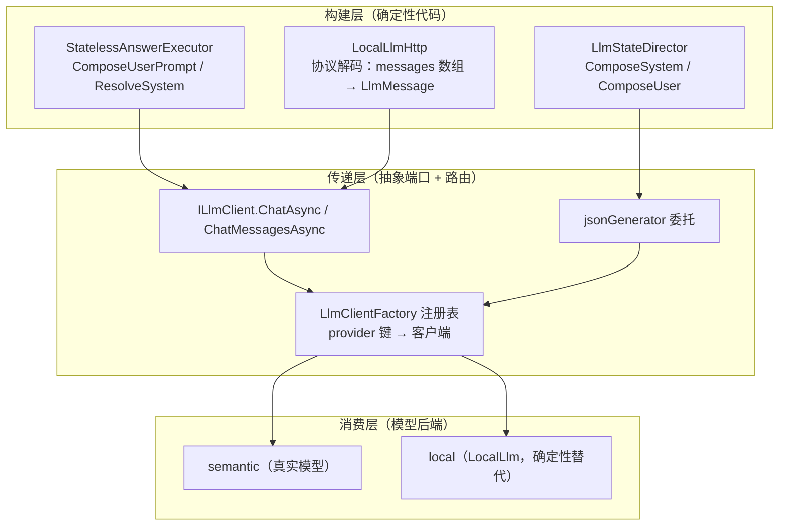
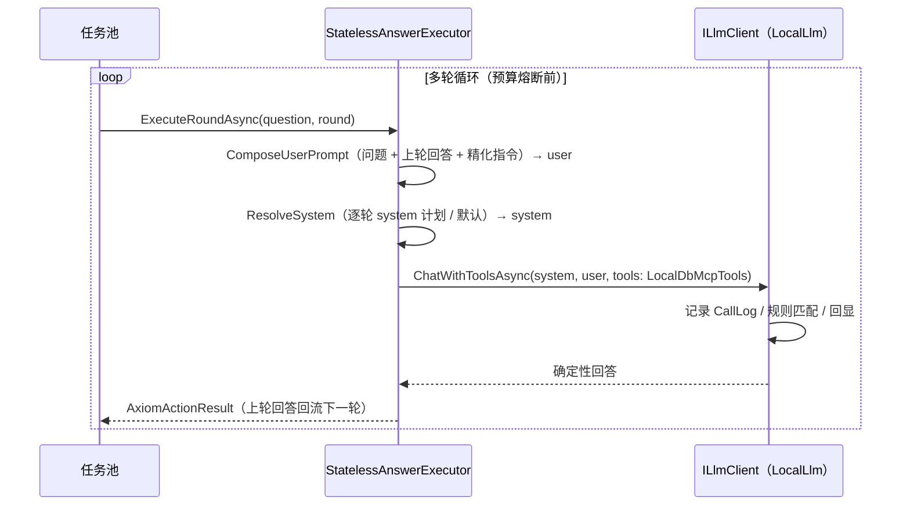
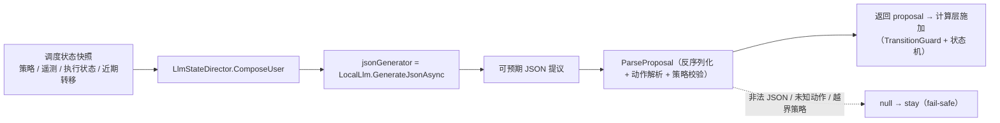
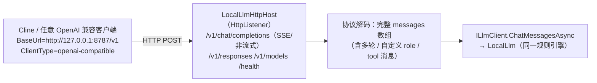
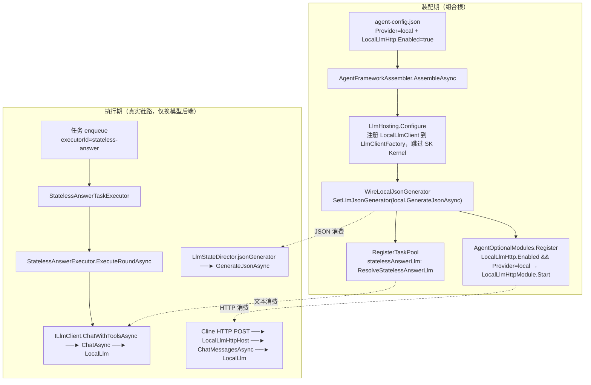
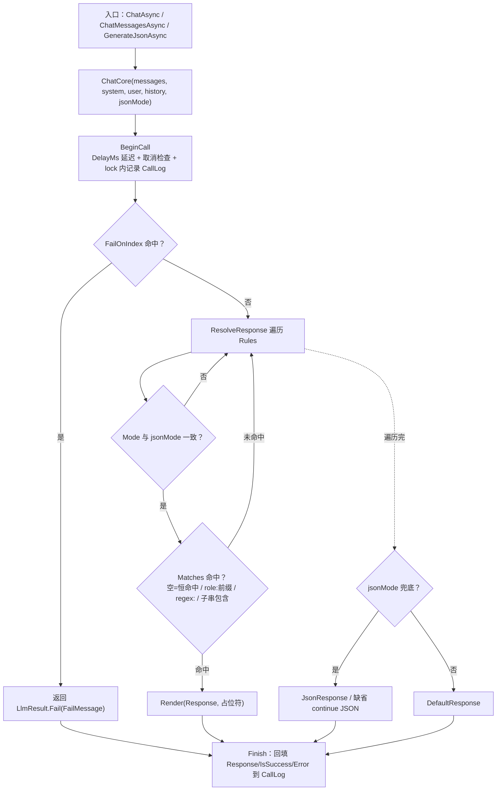

# 本地 LLM 联调（LocalLlm / LocalLlmHttp）：完全模拟调用与显式上下文传递

> **核心论点 A（完全模拟调用 → 适配任何 Agent 框架）**：LocalLlm 是 `ILlmClient` 抽象的**完整实现**（`ChatAsync` / `ChatMessagesAsync` / `GenerateJsonAsync`，外加默认实现的 `ChatWithToolsAsync`），任何消费该抽象的框架 / 执行端——stateless-answer、Hybrid 调度、未来任意 executor——都**零改动、零侵入**接入同一本地后端；LocalLlmHttp 更把这条通道**协议化**：任何 OpenAI 兼容客户端（含 Cline）把 `baseUrl` 指向本地端点即可命中同一规则引擎。本地联调因此是**框架无关的通用模拟通道**。
>
> **核心论点 B（为 Cline / Claude 型模型显式构建「本来无法构建」的对话历史）**：真实模型调用中，**对话历史由模型 / 协议端内部管理**——Cline（openai-responses 协议）、Claude 等模型的调用方无法精确控制「模型实际看到的对话历史」：压缩、截断、缓存、系统注入都发生在黑盒内部。本地联调把消息数组作为 `ChatMessagesAsync` 的显式参数，以 `LocalLlmCallRecord.History` 全量记录 + `{history}` / `{messages}` 占位符回显，使「送入模型的对话历史」从**模型内部不可见状态**变成**调用方可构建、可观测、可断言、可回放的数据**；**LocalLlmHttp 使该能力经 HTTP 协议直达 Cline**。
>
> **一句话结论**：本地联调以「完整实现 `ILlmClient` + OpenAI 兼容 HTTP 端点」获得**任何 Agent 框架 / 任何 OpenAI 兼容客户端的通用适配性**，以「把消息数组显式化为数据」获得**对 Cline / Claude 型模型对话历史的显式构建能力**，从而把「传给执行端的上下文」从黑盒变为**显式、确定、可审计**——零成本、可重复、可回归地验证上下文管线。

---

## 1. 背景与动机

### 1.1 黑盒问题

真实 LLM 调用是一个**不可观测、不可控的黑盒**：

- **上下文不可见**：无法精确知道「最终送入模型的那串 `system` / `user` / `history` / 消息数组」到底是什么；
- **结果不可回归**：同样输入每次输出都不同，无法做确定性回归；
- **有外部依赖**：需要真实 API Key、产生真实计费、受网络 / 限流 / 超时影响；
- **故障难复现**：超时、限流、挂起难以稳定复现，也无法编排「故障演练」。

### 1.2 问题本质：上下文管线的可验证性

在构建 / 调试「上下文管线」（把用户问题、历史、分级提示词、调度状态组装成送给执行端的上下文）时，黑盒特性使「验证上下文是否正确构建与传递」几乎不可能。这是「**可观测性债务**」的典型形态：关键中间产物（上下文）无日志、无探针、无回放，缺陷只能靠「最终行为」间接推断，归因成本极高。

**定义**：上下文管线 = 从原始输入出发，经确定性变换（提示词拼接、逐轮计划选中、状态编码、协议解码），到 LLM 消费点（`ChatAsync` / `ChatMessagesAsync` / `GenerateJsonAsync` / HTTP 端点）的完整数据流。其**可验证性**由三个条件决定：

1. **可观测**——每个消费点收到的上下文可被读取；
2. **可控制**——给定上下文，消费点输出可被精确预期；
3. **可重复**——相同输入必得相同输出，支持回归。

真实 LLM 三者皆缺；本地联调三者皆备：确定性、可配置、可观测的本地后端**完整走真实调用链**，把管线从不可验证变为可精确验证。

---

## 2. 核心价值

### 2.1 完全模拟调用：一个 `ILlmClient` 实现，适配任何 Agent 框架（论点 A）

LocalLlm 是 `ILlmClient` 抽象的**完整实现**，消费方视角的三个入口全部归一：

| 入口 | 服务对象 | 说明 |
|------|---------|------|
| `ChatAsync(system, user, history)` | stateless-answer 等文本消费方 | 便捷重载：构造消息数组后归一到 `ChatCore` |
| `ChatMessagesAsync(messages)` | **任何传入完整消息数组的调用方**（含 LocalLlmHttp） | **规则引擎唯一入口**：保留任意 role 序列（自定义 role / 多轮 / tool 消息） |
| `GenerateJsonAsync(system, user)` | Hybrid 调度导演（JSON 消费方） | `jsonMode=true` 走同一 `ChatCore` |
| `ChatWithToolsAsync(...)` | 带工具执行端（stateless-answer 现状） | **接口默认实现**，回退 `ChatAsync`（LocalLlm 忽略 tools） |

由于 `ILlmClient` 是所有 LLM 消费方的唯一端口（`LlmClientFactory` 注册表 + `AgentOrchestrator.SetLlmJsonGenerator`），**任何消费该抽象的框架 / 执行端都自动获得本地模拟能力**；而 `LocalLlmHttp` 把该端口进一步**协议化**为 OpenAI 兼容 HTTP 端点，使**外部 OpenAI 兼容客户端（Cline 等）**把 `baseUrl` 指向本地即命中同一规则引擎：

- stateless-answer（P0）：经 `LlmHosting.ResolveStatelessAnswerLlm` 命中 `ChatAsync` / `ChatWithToolsAsync`；
- Hybrid 调度（P1）：经 `WireLocalJsonGenerator` 命中 `GenerateJsonAsync`；
- **Cline / 任意 OpenAI 兼容客户端（P1.5）**：`Agents.cline.BaseUrl=http://127.0.0.1:8787/v1 + ClientType=openai-compatible` → 经 `LocalLlmHttp` 命中 `ChatMessagesAsync`；
- **未来任意 executor / Agent 框架**：只要依赖 `ILlmClient`，`Provider=local` 即自动覆盖，无需单独写测试代码。

这对应工程原则「**不复制、不旁路、只替换末端**」：测的是真链路，只是换了模型后端；链路中任何装配 / 路由 / 签名缺陷都会像真实调用一样暴露。

### 2.2 显式构建与传递上下文（论点 B：对话历史显式化）

本地联调让「上下文如何被构建、如何被传递」均可见：

| 上下文片段 | 真实 LLM | 本地联调（LocalLlm） |
|-----------|----------|---------------------|
| `system`（提示词模板 / 逐轮 system 计划） | 黑盒，最终值不可见 | 可注入、可断言（`CallLog[i].System`） |
| `user`（问题 / 上轮回答 / 精化指令拼接） | 黑盒 | 可注入、可断言（`CallLog[i].User`） |
| 完整消息数组（多轮历史 / 自定义 role / tool 消息） | 模型 / 协议端内部管理 | `ChatMessagesAsync` 全量保留 + `CallLog[i].History` + `{messages}` 回显 |
| JSON 提议（调度导演上下文） | 黑盒 | 由 `GenerateJsonAsync` 返回可预期 JSON |

**消息数组的特殊地位**：在上下文各片段中，完整消息数组是唯一「真实调用下会脱离调用方控制」的——`system` / `user` 送入即定，而真实模型的对话历史由模型 / 协议端内部管理（压缩 / 截断 / 缓存 / 系统注入均不可见、不可构建）。本地联调打破这一限制：

| history 的形态 | 真实 LLM（Cline / Claude 型） | 本地联调（LocalLlm / LocalLlmHttp） |
|---------------|------------------------------|--------------------------------------|
| 谁管理历史 | 模型 / 协议端内部（黑盒） | **调用方显式传入**（`ChatMessagesAsync` 的 `messages` 参数 / HTTP 请求体） |
| 能否显式构建 | ❌ 无法控制压缩 / 截断 / 注入 | ✅ 送入什么就是什么 |
| 能否观测 | ❌ 模型内部状态不可见 | ✅ `LocalLlmCallRecord.History` 全量记录 |
| 能否断言 / 回放 | ❌ | ✅ `CallLog` 逐条回放；`{history}` / `{messages}` 回显进回答 |
| 外部客户端可达性 | — | ✅ **经 LocalLlmHttp HTTP 端点直达 Cline 等 OpenAI 兼容客户端** |

> 一句话：**本地联调把「对话历史」从模型内部不可见的状态变量，变成调用方可显式构建、可观测、可断言、可回放的一等数据**；LocalLlmHttp 使该能力跨越进程边界、经 HTTP 协议为 Cline 等外部客户端所用——这正是「为 Cline / Claude 这种模型显式构建本来无法构建的对话历史」的落地形态。

### 2.3 可观测与可审计

`LocalLlmClient` 内置 `CallLog`（每次调用的 `Index / System / User / History / Response / IsSuccess / Error`）与 `EchoInput` 回显：

- `EchoInput` 开启时，回答回显 `user` 原文，在 `ur_outputs` 中**直接看到每轮实际传入的上下文**——「所见即所传」（WYSIWYG for context）；
- `CallLog` 逐条回放调用历史，定位「上下文在哪一步被拼错」。

**学术视角**：`CallLog` 是「结构化调用日志 + 回放」的轻量实现，对应可观测性三支柱（Logging / Tracing / Metrics）中的前两者；`EchoInput` 是**透传探针**，把输入端原样呈现在消费端。

### 2.4 确定性回归

相同输入 → 相同输出（纯确定性），可在 CI / 联调中**稳定重复**上下文管线用例，便于快照对比与回归。这使「**黄金主测试**（Golden Master / 快照回归）」成为可能：把一次合法运行的 `CallLog` 快照固化为基线，改动后重跑 diff，任何上下文构建逻辑的回归都在快照差异中现形。

### 2.5 零成本、环境隔离与故障演练

- **零 Token / 零计费 / 离线可用**：无凭据、无网络依赖；CI、无 Key 环境、沙箱均跑通完整链路（ISO 25010 可移植性；12-Factor Config：同一二进制、仅配置不同）；
- **故障演练**：`DelayMs`（延迟注入）+ `FailOnIndex / FailMessage`（错误注入）——Chaos Engineering 的**确定性变体**，开发期即可编排验证熔断 / 超时 / 失败落库 / 降级路径，而无需真实触发限流或断网。

### 2.6 学术定位：测试替身谱系中的 LocalLlm

Meszaros《xUnit Test Patterns》（2007）将测试替身分为五类：

| Test Double | 定义 | LocalLlm 的对应 / 差异 |
|-------------|------|----------------------|
| **Stub** | 对特定输入返回固定应答 | ✅ `Rules`：按 `Match` 命中返回预设响应 |
| **Spy** | 记录调用信息供事后断言 | ✅ `CallLog`：全量记录 |
| **Fake** | 可工作的简化实现 | ✅ 确定性简化「模型」，但**走真实调用链** |
| **Dummy** | 仅占位，从不真正使用 | 不适用——LocalLlm 被真实执行 |
| **Mock** | 预设行为 + 严格期望验证 | 部分对应——规则即预设，但验证靠事后审计 |

**关键差异**：传统 Test Double 是**测试期临时替换物**；LocalLlm 是**配置驱动的生产后端**（与 `semantic` 并列注册于 `LlmClientFactory`），可长期融入联调 / 回归 / 离线 / 演示工作流。它是依赖倒置（DIP）下 `ILlmClient` 抽象的一个**一等实现端口**，而非测试桩。

---

## 3. 上下文管线模型

### 3.1 三层模型



- **构建层**：纯确定性代码（含协议解码），是「上下文是否正确组装」的验证对象——本地联调让这层输出显式可见；
- **传递层**：抽象与路由，是「上下文是否正确传递」的验证对象——本地联调**完整执行**这层，仅替换末端；
- **消费层**：唯一允许不确定性的层——本地联调把它从「随机黑盒」替换为「确定性白盒」。

### 3.2 可验证性三条件在管线上的落点

| 可验证性条件 | 构建层 | 传递层 | 消费层 |
|-------------|--------|--------|--------|
| 可观测 | `CallLog` 记录每次进入消费层的 `System/User/History` | 调用链符号可 grep、可断点 | `EchoInput` 回显入消费端原文 |
| 可控制 | 逐轮计划 / 模板可配置 | provider 键可切换 | `Rules` / `JsonResponse` 精确控制输出 |
| 可重复 | 确定性拼接 | 路由确定性 | 纯确定性响应 |

### 3.3 stateless-answer 管线（文本通道）



> **现状说明（重要）**：`StatelessAnswerExecutor` 当前把「上轮回答 + 精化指令」**内联进 `user` 文本**（`ComposeUserPrompt`），并调用 `ChatWithToolsAsync(system, prompt, tools: LocalDbMcpTools.GetTools())`。`ChatWithToolsAsync` 是 `ILlmClient` 的**默认接口实现**：LocalLlm 未重写它，故工具参数被忽略、直接回退 `ChatAsync`（与「零工具」语义一致）。多轮历史在 stateless 路径下存在于 `user` 中，用 `{user}` 回显 / `CallLog[i].User` 验证历史累积。

### 3.4 Hybrid 调度管线（JSON 通道，P1）



> 返回的 JSON 提议可由 `LocalLlm.JsonResponse` 精确控制，从而验证调度决策链。注意 `LlmStateDirector` 的 **fail-safe 设计**（失败 / 解析异常 → `null(stay)`）同样可编排验证：配置规则返回非法 JSON，观察导演是否安全回退。

### 3.5 LocalLlmHttp 通道：Cline 等 OpenAI 兼容客户端接入（P1.5）



**SingleImplementation 设计**：`LocalLlmHttpHost` 传输层仅做协议编解码，回答逻辑**唯一委托 `ILlmClient.ChatMessagesAsync`**——与进程内 stateless-answer / Hybrid 调度共用同一规则引擎，不复制逻辑。协议请求的完整消息数组作为 `messages` 传入，命中 `CallLog.History` 记录与 `{messages}` / `{history}` 回显，使「**传给 Cline 的对话历史**」可观测、可回放。端点一览：

| 端点 | 协议 | 说明 |
|------|------|------|
| `POST /v1/chat/completions` | OpenAI 标准聊天补全 | 支持 `stream` SSE / 非流式；`messages` 数组直通后端 |
| `POST /v1/responses` | Responses 协议最小子集 | `instructions` 作 system，`input` 数组作 history/user |
| `GET /v1/models` | 模型清单 | 返回 `LocalLlmHttpOptions.Model`（默认 `local-llm`） |
| `GET /health`、`/healthz` | 健康检查 | 服务存活探针 |

> **这是核心论点 B 的落地通道**：Cline 走完整编码代理协议（`openai-responses` / `openai-compatible`），但 `baseUrl` 指向本地端点后，其发送的完整消息数组（含多轮历史）被 `LocalLlmHttp` 解码并经 `ChatMessagesAsync` 进入确定性规则引擎——「模型实际看到的历史」第一次在本地可观测、可回显、可断言。

---

## 4. 实现机制（工程细节）

### 4.1 装配与调用链



关键符号落点（均已核实于 `Projects/Agent/src`）：

| 符号 | 文件 | 职责 |
|------|------|------|
| `LocalLlmClient` / `LocalLlmOptions` / `LocalLlmRule` / `LocalLlmCallRecord` | `Agent.Contract/Llm/LocalLlmClient.cs` | 本地后端实现与配置模型 |
| `ILlmClient`（抽象） | `Agent.Contract/Llm/ILlmClient.cs` | 统一 LLM 端口（`ChatAsync` / `ChatMessagesAsync` / `ChatWithToolsAsync` 默认实现） |
| `LlmMessagePartitioner` | `Agent.Contract/Llm/LlmMessagePartitioner.cs` | 消息数组分区单一实现（抽取最后 system/user 作槽位，其余归 history） |
| `LocalLlmHttpHost` / `LocalLlmHttpOptions` / `LocalLlmHttpModule` | `Agent.Modules/LocalLlmHttp/` | OpenAI 兼容 HTTP 服务端（传输层委托 `ChatMessagesAsync`） |
| `LlmClientFactory` | `Agent.Runtime/State/Infrastructure/LlmClientFactory.cs` | provider 注册表（`Register` / `Get`） |
| `LlmHosting` | `Agent.Launcher/Composition/LlmHosting.cs` | `ResolveProvider` / `Configure` / `ResolveStatelessAnswerLlm` |
| `AgentOptionalModules.Register` | `Agent.Launcher/Composition/AgentOptionalModules.cs` | 按开关装配可选模块（含 LocalLlmHttp，失败降级） |
| `ClineAgentExecutor` / `ClineExecutorFunction` | `Agent.Modules/Cline/` | 编码代理执行端；请求级 / 配置级 `BaseUrl`+`ClientType` 覆盖 → 走 LocalLlmHttp |

### 4.2 LocalLlmClient 内部决策算法（三入口归一）

`ChatAsync` / `ChatMessagesAsync` / `GenerateJsonAsync` 全部归一到 `ChatCore`，差异仅在 `jsonMode` 与消息来源：



**语义要点**：

- **规则引擎唯一入口是 `ChatMessagesAsync`**：`ChatAsync` / `GenerateJsonAsync` 经 `BuildMessages` 构造 `[system] + history + [user]` 消息数组后归入同一 `ChatCore`，保证任何入口的规则语义一致；
- **`Mode` 是规则的通道门**——`text` 规则只服务文本入口，`json` 规则只服务 `GenerateJsonAsync`；
- 规则按声明顺序**首次命中即返回**（顺序即优先级）；
- **`Matches` 匹配完整消息数组文本**（`JoinMessages` = 全部消息 `role: content` 拼接），支持三种模式：`role:<角色>:<子串>`（按角色定制，子串空=该角色存在即命中）、`regex:`（正则，`IgnoreCase|Singleline`）、其余子串包含（大小写不敏感）；空 = 恒命中；
- **占位符**：`{system}` `{user}` `{history}`（既有）+ `{messages}`（完整消息结构）+ `{last_assistant}` `{last_message}`（按位置）+ `{role:<角色名>}`（按角色聚合）；`{history}` / `{messages}` 渲染为 `"role: content"` 多行拼接；
- `_calls` 是**跨通道共享的全局调用计数**——`FailOnIndex` 的「第 N 次」指进程内第 N 次 LLM 调用（文本 + JSON + HTTP 合并计数）。

### 4.3 配置字段全表

`agent-config.json → AgentConfig:LocalLlm`（唯一权威，避免拷贝漂移）：

| 字段 | 默认值 | 语义 | 典型用途 |
|------|--------|------|---------|
| `DefaultResponse` | `"（本地后端）已处理问题：{user}"` | 文本模式兜底响应（模板） | 通用文本联调 |
| `Rules` | `[]` | 规则表（`Match` / `Mode` / `Response`） | 按上下文形态精确应答 |
| `JsonResponse` | `null` | JSON 模式兜底（object 或 JSON 字符串） | Hybrid 调度 JSON 提议 |
| `EchoInput` | `false` | 回显 user 进回答 | 审计 / 演示「所见即所传」 |
| `DelayMs` | `0` | 每调用模拟延迟（毫秒） | 超时 / 挂起熔断演练 |
| `FailOnIndex` | `-1` | 第 N 次调用（0 起）模拟失败；`-1` = 永不 | 失败落库 / 重试 / 熔断演练 |
| `FailMessage` | `"（本地后端）主动返回失败。"` | 失败错误信息 | 错误路径断言 |

规则条目（`LocalLlmRule`）：

| 字段 | 语义 |
|------|------|
| `Match` | 空 / 空白 = 恒命中；`role:<角色>:<子串>` = 按角色定制（仅匹配该角色消息，子串空 = 角色存在即命中）；`regex:` 前缀 = 正则（`IgnoreCase\|Singleline`，匹配完整消息文本）；其余 = 子串包含（大小写不敏感） |
| `Mode` | `text`（默认，服务文本入口）/ `json`（服务 `GenerateJsonAsync`） |
| `Response` | 命中响应（占位符 `{system}` `{user}` `{history}` `{messages}` `{last_assistant}` `{last_message}` `{role:名}` `{index}`；`Mode=json` 时可填 JSON 字符串 / 对象） |

`agent-config.json → AgentConfig:LocalLlmHttp`（HTTP 服务端，新增）：

| 字段 | 默认值 | 语义 |
|------|--------|------|
| `Enabled` | `false` | 是否启动 HTTP 服务端（须 `Provider=local`，否则本地客户端未注册会降级） |
| `ListenPrefix` | `"http://127.0.0.1:8787/"` | 监听前缀（HttpListener 前缀，末尾须 `/`；非管理员需 `netsh http add urlacl` 预留） |
| `Model` | `"local-llm"` | 对外暴露的模型名（`/v1/models` 与响应体 `model` 字段） |

Cline 接入（`AgentConfig.Agents.<name>`）：

| 字段 | 当前值 | 效果 |
|------|--------|------|
| `BaseUrl` | `http://127.0.0.1:8787/v1` | 该 agent 的模型端点指向 LocalLlmHttp |
| `ClientType` | `openai-compatible` | 走 OpenAI 兼容协议（命中 `/v1/chat/completions`） |

### 4.4 通道、线程安全与生命周期

- **单实例多通道**：同一 `LocalLlmOptions` 实例同时服务文本（`ChatAsync` / `ChatWithToolsAsync`）、JSON（`GenerateJsonAsync`）、消息数组（`ChatMessagesAsync`，含 HTTP 解码）与 HTTP 外部客户端，共享 `_calls` 计数与 `CallLog`，由 `Mode` 门控规则匹配，互不污染；
- **`GenerateJsonAsync` 不在 `ILlmClient` 接口上**，经 `WireLocalJsonGenerator` 以委托注入接入 `AgentOrchestrator`（鸭子类型端口，更轻但编译器不强制，见 §9）；
- **`ChatWithToolsAsync` 是接口默认实现**：LocalLlm 未重写，工具参数被忽略、回退 `ChatAsync`；SK 后端则支持 Function Calling——「调用方传工具、后端决定是否启用」；
- **`LocalLlmHttp` 生命周期**：`AgentOptionalModules.Register` 按 `Enabled && Provider=local` 调用 `LocalLlmHttpModule.Start`，宿主注册进 orchestrator 的 Disposable 生命周期；启动失败（如 ACL 未预留）**降级为可用性降级**，聚合进降级清单并显式日志，不阻断 Agent 启动；
- **线程安全**：`_calls` 递增与 `CallLog` 追加在 `lock(_lock)` 内完成，`CallLog` 以 `IReadOnlyList` 暴露只读视图；多任务并发不丢记录；
- **计数语义**：`Index` 从 0 起、进程内单调递增，跨全部通道共享——既是 `FailOnIndex` 定位依据，也是审计回放时间轴；
- **生命周期**：`Configure` 期创建单例并注册进 `LlmClientFactory`，与语义后端同生命周期；`ResolveProvider` 决定生效键：`StatelessAnswer.Provider` 优先于 `Llm.Provider`，缺省 `semantic`。

### 4.5 配置驱动切换

| 配置键 | 值 | 效果 |
|--------|-----|------|
| `AgentConfig:Llm.Provider` | `local` / `semantic` | 全局后端选择 |
| `AgentConfig:StatelessAnswer.Provider` | `local` / `semantic` | 优先级高于 `Llm.Provider` |
| `AgentConfig:LocalLlm` | 模板 / 规则 / JSON / 回显 / 延迟 / 故障 | 本地后端行为 |
| `AgentConfig:LocalLlmHttp` | `Enabled` / `ListenPrefix` / `Model` | HTTP 服务端开关与端点 |
| `AgentConfig:Agents.<name>.BaseUrl / ClientType` | `http://127.0.0.1:8787/v1` + `openai-compatible` | Cline 等外部客户端走本地端点 |

**学术视角**：这是**策略模式**的配置层落地——`ILlmClient` 为策略接口，多个客户端为可互换策略，`LlmClientFactory` 为注册表（服务定位器），provider 键为选择器；同时符合 **12-Factor Config**（配置与代码分离、同一二进制环境无关切换）。`Configure` 在 provider=local 时**跳过 SK Kernel 构建**（避免读凭据导致装配降级），保证「无 Key 环境也能完整装配」；HTTP 端点进一步实现「**本地即服务**」——外部客户端无需任何 SDK，仅需一个 baseUrl。

---

## 5. 与「真实 LLM / 测试 Mock」对比

### 5.1 三后端对比

| 维度 | 真实 LLM（semantic） | 测试 Mock | 本地后端（LocalLlm + LocalLlmHttp） |
|------|---------------------|-----------|-------------------------------------|
| 定位 | 生产 | 测试桩 | **一等后端 / 基础替代** |
| 输出 | 模型生成 | 固定假数据 | 模板 + 规则 + JSON 生成，随输入变化 |
| 上下文可观测 | 黑盒 | 无 | `CallLog` / `EchoInput` 可审计 |
| **对话历史可构建性** | **模型 / 协议端内部管理，调用方无法显式构建**（Cline / Claude 型） | 无 | **`ChatMessagesAsync` 全量保留 + `CallLog.History` + `{history}`/`{messages}` 回显，可构建、可断言** |
| **框架适配性** | 绑定自身协议 | 绑定测试代码 | **完整实现 `ILlmClient` + OpenAI 兼容 HTTP 端点，适配任何消费抽象或任何 OpenAI 兼容客户端** |
| 外部客户端可达性 | — | — | **✅ LocalLlmHttp：Cline 等 baseUrl 指向即命中** |
| 确定性 | 否 | 是 | 是 |
| 成本 / 依赖 | 计费、凭据、网络 | 零 | 零 |
| 故障编排 | 难 | 无 | `DelayMs` / `FailOnIndex` |
| 走真实链路 | — | 否（另起通道） | **是**（仅换模型后端） |
| 生命周期 | 生产常驻 | 测试期临时 | 可长期融入联调 / 回归 / 离线 / 演示 |

### 5.2 学术框架映射

| 学术概念 | LocalLlm 的对应 | 工程收益 |
|----------|----------------|---------|
| Test Double（Fake / Stub / Spy，Meszaros 2007） | 确定性简化实现 + 规则应答 + CallLog | 测试期可用的「假模型」 |
| 依赖倒置原则（DIP） / 策略模式 / 服务定位器 | `ILlmClient` 抽象 + 工厂注册表 + provider 键 | 消费方不感知后端；配置驱动切换 |
| 可观测性三支柱（Log/Trace/Metric） | `CallLog` + `EchoInput` 透传探针 | 上下文中间产物可回放、可断言 |
| 黄金主测试（Golden Master / 快照回归） | 同输入同输出 + 快照 diff | CI 回归护栏 |
| 故障注入（Chaos Engineering 确定性变体） | `DelayMs` 延迟注入 + `FailOnIndex` 错误注入 | 熔断 / 重试 / 降级路径可编排验证 |
| 契约测试（Contract Testing） | `ILlmClient` 即契约；LocalLlmHttp 即 OpenAI 兼容契约 | 换后端 / 换客户端不破坏消费方 |
| 12-Factor Config / ISO 25010 可移植性 | 外部化配置 + 凭据无关 | 无 Key 环境完整装配 |
| 上下文工程（Context Engineering） | 消息数组显式化、「所见即所传」 | 执行端行为可归因 |
| 黑盒 / 白盒 | 管线白盒化 | 中间产物可观测 |

---

## 6. 使用指南

### 6.1 配置切换（启用 / 回切）

`Agent/Config/agent-config.json`（**单一权威，本文不重复拷贝以免漂移**）：

```jsonc
// 启用本地后端：stateless-answer / 调度 / HTTP 均命中 LocalLlm，不调 DeepSeek
"StatelessAnswer": { "Provider": "local" },
"LocalLlm": { /* 模板/规则/JSON/回显/延迟/故障 */ },
"LocalLlmHttp": { "Enabled": true, "ListenPrefix": "http://127.0.0.1:8787/", "Model": "local-llm" },
// Cline 指向本地端点（openai-compatible 协议）
"Agents": { "cline": { "Provider": "deepseek", "BaseUrl": "http://127.0.0.1:8787/v1", "ClientType": "openai-compatible" } }
```

回切真实 LLM：把 `StatelessAnswer.Provider`（或 `Llm.Provider`）改为 `"semantic"`（或删除该键），删除 `LocalLlm` / `LocalLlmHttp` 节，并还原 `Agents.<name>.BaseUrl` 为真实端点即可。**建议**：回切前保留一次本地联调快照（§6.5），作为「上下文基线」对照归因。

> 字段语义唯一权威 = `Agent/Config/agent-config.json` + `Agent.Contract/Llm/LocalLlmClient.cs` 的 `LocalLlmOptions` + `Agent.Modules/LocalLlmHttp/LocalLlmHttpOptions.cs`；未配置规则时由 `ResolveResponse` 代码兜底。
> **非管理员账号监听前需预留 URL ACL**：`netsh http add urlacl url=http://127.0.0.1:8787/ user=Everyone`；未预留时 LocalLlmHttp 启动降级（不阻断 Agent）。

### 6.2 规则扩展与消息回显

- `Match`：空 = 恒命中；`role:<角色>:<子串>` = 按角色定制；`regex:` 前缀 = 正则；其余 = 子串包含（大小写不敏感）。**匹配完整消息数组文本**；
- `Mode`：`text` / `json`（通道门，互不串扰）；
- `Response`：占位符 `{system}` `{user}` `{history}` `{messages}` `{last_assistant}` `{last_message}` `{role:名}` `{index}`。

```jsonc
// 用 {messages} 回显完整消息数组：验证经 HTTP 传入 Cline 的完整对话结构
{ "Match": "regex:历史|history", "Mode": "text",
  "Response": "本轮收到的完整消息数组：\n{messages}" }

// 用 {role:user} 聚合所有 user 消息：验证多轮历史是否逐轮累积
{ "Match": "role:user:", "Mode": "text",
  "Response": "全部 user 消息：\n{role:user}" }

// 用 {last_assistant} 取最近一次助手回答：验证「上轮回答 → 本轮」闭环
{ "Match": "role:assistant:", "Mode": "text",
  "Response": "最近一次助手回答：\n{last_assistant}" }
```

> 真实模型（Cline / Claude 型）：历史在协议端内部，调用方永远看不到「模型实际收到的历史」；本地联调：`{messages}` / `{history}` / `{role:名}` 把送入内容原样渲染进回答，配合 `CallLog` 全量记录，**多轮历史的累积、截断、保留策略全部显式可见、可断言**。

### 6.3 故障演练

| 场景 | 配置 | 验证目标 |
|------|------|---------|
| 超时 / 挂起熔断 | `DelayMs: 5000`（超过消费方超时阈值） | 超时路径、熔断状态转移 |
| 第 N 次调用失败 | `FailOnIndex: 2` | 失败落库、重试、连续失败计数 |
| 解析失败（调度降级） | `json` 规则返回非法 JSON | `LlmStateDirector` fail-safe → `null(stay)` |
| 空响应 | 规则返回空串 | 消费方空内容处理 |
| HTTP 启动失败 | 删除 urlacl 预留 | LocalLlmHttp 降级日志 + Cline 腿连接拒绝可感知 |

> `FailOnIndex` 计数跨文本 / JSON / HTTP 通道共享，编排时按「进程内第 N 次 LLM 调用」理解。

### 6.4 审计与断言（CallLog 用法）

1. **断言上下文组装**：`CallLog[i].User` 含问题原文、`[上轮回答]`、`[精化指令]` 分段（stateless 默认模板）；命中逐轮计划时断言为该轮显式内容；
2. **断言多轮闭环（stateless 内联路径）**：`CallLog[i+1].User` 应包含 `CallLog[i].Response`——历史经 `user` 累积，用 `{user}` 回显规则可在 `ur_outputs` 直接核对；
3. **断言消息数组显式化（HTTP / ChatMessagesAsync 路径）**：`CallLog[i].History` 应等于送入的完整消息数组（除分区槽位）；`{messages}` 回显规则把完整结构呈现在回答中，肉眼核对「送入 Cline 的消息序列」；
4. **断言调度编码**：JSON 通道记录（`Mode=json` 命中）的 `User` 应含 `当前策略 / 可用策略集 / 遥测 / 近期转移` 四要素；
5. **断言失败路径**：触发 `FailOnIndex` 后，该记录 `IsSuccess=false`、`Error=FailMessage`，下游应有失败落库 / 熔断记录。

### 6.5 快照回归与 CI

1. 配置 `EchoInput: true` + 固定规则集，跑一次标准用例（含 HTTP 用例：`curl http://127.0.0.1:8787/v1/chat/completions`），导出 `CallLog`（JSON 序列化）作为**基线快照**（连同 `ur_outputs` 结果）；
2. 上下文构建逻辑改动后重跑 diff：任何 `System/User/History/Response` 差异即上下文回归；
3. 纳入 CI：无 Key 环境直接 build + 跑本地用例（零凭据、零计费、确定性）；每次合并前跑快照回归防静默漂移；故障演练用例（§6.3）纳入 nightly；
4. 与真实 LLM 冒烟测试（每日少量真实调用）互为补充：**本地联调保回归，真实模型保语义**。

---

## 7. 验证记录（2026-08-16 实测）

- `dotnet build Agent/Agent.sln` → **0 警告 0 错误**；
- `dotnet build FileDriven/FileDriven.sln` → 0 错误（同步 GUI 部署，解决双轨风险）；
- GUI 端到端运行 `运行测试GUI模式.ps1 "Agent\answer_task_test.json"`：
  - `ur_outputs` 新增 `id=10`：`{"decision":"TripTerminated","rounds":3,"durationMs":6.8768}`；
  - `durationMs=6.87ms` 极快、无真实 API → **stateless-answer 真实调用链命中了 `LocalLlm`**（跑 3 轮 `ChatAsync`）；
  - `TripTerminated` 为 stateless 质量规则未 pass 导致（回答未达标 → 预算熔断），属业务语义，非本地后端失败（对比实现前：真实 DeepSeek 任务恒 Running / 挂起）。

**复现步骤**：确认 `StatelessAnswer.Provider=local` 且 `LocalLlm.DelayMs=0`（避免延迟干扰时序断言）→ `dotnet build Agent/Agent.sln` → 运行 `运行测试GUI模式.ps1 "Agent\answer_task_test.json"` → 在 `ur_outputs` 观察本地后端回显（`EchoInput=true` 时）→ 需审计时读 `LocalLlmClient.CallLog` 逐条核对每轮 `System/User/Response`。

**HTTP 通道冒烟（LocalLlmHttp）**：`AgentOptionalModules` 装配日志出现 `AgentOptionalModules_LocalLlmHttp_started`；`curl http://127.0.0.1:8787/health` → `{"status":"ok","service":"LocalLlmHttp"}`；`curl http://127.0.0.1:8787/v1/models` 返回 `local-llm`；Cline 步经 `BaseUrl=127.0.0.1:8787` 命中的调用在 `CallLog` 留下 `History` 完整记录。

---

## 8. 边界与后续（P0 / P1 / P1.5 / P2）

| 阶段 | 覆盖路径 | 状态 |
|------|---------|------|
| **P0** | stateless-answer 文本（`ILlmClient.ChatAsync` / `ChatWithToolsAsync`） | ✅ 已实现 |
| **P1** | Hybrid 调度 JSON（`LlmStateDirector.jsonGenerator`） | ✅ 已实现（`WireLocalJsonGenerator`） |
| **P1.5** | LocalLlmHttp（OpenAI 兼容端点，Cline 等 baseUrl 指向） | ✅ 已实现（`AgentOptionalModules` 装配，启动失败降级） |
| **P2** | 直跑 CLI / 后台入口、可观测事件、Cline 协议端原生桥接、文档化 | ⏳ 后续 |

> **Cline 协议端现状**：Cline 已能经 **OpenAI 兼容 HTTP 通道**（`BaseUrl=http://127.0.0.1:8787/v1 + ClientType=openai-compatible`）命中本地规则引擎——走完整编码代理协议，仅模型端点 / 协议切换，对话历史经 `ChatMessagesAsync` 全量可观测。这是核心论点 B 的**已落地形态**。P2 保留「Cline 协议端原生桥接到 `ILlmClient` 抽象」作为可选演进，不阻塞当前通道。

---

## 9. 局限性与设计权衡

| # | 局限 | 说明 | 缓解 |
|---|------|------|------|
| 1 | **占位符是字符串替换，非结构化模板** | `{messages}` 等为纯文本替换，无法表达结构化消息数组、工具调用参数 | 结构断言在 CallLog 层做，而非依赖回显文本 |
| 2 | **`DelayMs` 用 `Thread.Sleep` 同步阻塞** | 异步链路中同步阻塞线程，不模拟异步等待语义；并发下消耗线程池 | 超时演练优先用小延迟 + 消费方阈值；失败用 `FailOnIndex` |
| 3 | **`CallLog` 内存无界增长** | 长驻进程记录只增不减 | 按需导出清理；P2 可观测事件时加容量上限 |
| 4 | **规则顺序即优先级，`regex:` 错误静默不命中** | 高优先级规则须在前；正则写错 `catch` 后返回 false，易误判「规则无效」 | 规则少量、语义正交；出问题先查正则 |
| 5 | **与真实模型的行为差异** | 验证「上下文管线正确性」，不验证「模型响应质量」 | 语义冒烟仍需少量真实调用（§6.5） |
| 6 | **provider=local 完全跳过 SK Kernel** | Function Calling、S2 工具路径无法在 local 下演练（`ChatWithToolsAsync` 在 LocalLlm 回退 ChatAsync，tools 被忽略） | 工具路径用真实 / 注入语义客户端 |
| 7 | **`GenerateJsonAsync` 非接口成员** | 委托注入（鸭子类型），编译器不强制签名一致 | 接线处保留断言 / 日志；可评估提升为接口成员 |
| 8 | **单实例计数共享** | `FailOnIndex` 的「第 N 次」跨文本 / JSON / HTTP 通道共享，多场景计数耦合 | 单场景演练先重启 / 清零 |
| 9 | **LocalLlmHttp 依赖 `HttpListener` 平台 + ACL** | 仅 Windows/支持平台可用；非管理员需 `netsh urlacl` 预留；SSE 为最小实现（单 chunk） | 启动失败显式降级日志；ACL 步骤写入文档；P2 可评估 Kestrel |
| 10 | **Responses 协议为最小子集** | `/v1/responses` 仅支持非流式 `message` 输出，不支持工具调用 / reasoning 等扩展 | 按需扩展；Cline 兼容走 `/v1/chat/completions` 优先 |

---

## 10. 结论

本地联调（`LocalLlm` / `LocalLlmHttp`）的核心价值是**把上下文管线从黑盒变成显式、确定、可审计**。两条主线论点贯穿全文：

**论点 A —— 完全模拟调用适配任何 Agent 框架**：`LocalLlm` 是 `ILlmClient` 的完整实现（三入口归一 + 默认实现），任何消费该抽象的框架 / 执行端都能以 `Provider=local` 零改动接入；`LocalLlmHttp` 把通道协议化，**任何 OpenAI 兼容客户端（含 Cline）经 baseUrl 即命中同一规则引擎**。本地联调是**框架无关的全局基础设施**，而非某个框架的测试附属品。

**论点 B —— 为 Cline / Claude 型模型显式构建本来无法构建的对话历史**：真实模型的对话历史由模型 / 协议端内部管理（压缩 / 截断 / 缓存 / 注入均不可见、不可构建）；本地联调把消息数组变成 `ChatMessagesAsync` 的显式参数，以 `CallLog.History` 全量记录 + `{history}` / `{messages}` 回显，使「送入模型的历史」成为**可构建、可观测、可断言、可回放**的数据——并经 **LocalLlmHttp 直达 Cline**。

由此导出四条工程价值：① 显式构建上下文（规则 / 模板按消息数组精确应答）；② 显式传递上下文（走真实调用链，验证通道、多轮闭环与跨框架适配）；③ 显式可观测（`CallLog` + `EchoInput` 可回放、可断言）；④ 零成本 / 确定性 / 可回归 / 可故障演练。

**价值边界**：它验证**上下文是否被正确构建与传递**，不验证**模型对上下文的响应质量**——本地联调保回归，真实模型保语义，两者各司其职。因此，本地联调应被视作与真实 LLM **同等地位的后端通道**（`local` 与 `semantic` 并列、按配置切换），而非临时的测试替身。

---

## 11. 运行时测试模式开关（统一 LLM 网关）

> 本节新增（本地联调测试模式）：把既有门控咽喉扩展为**统一 LLM 网关**（门控 + 路由 + 观测），提供**运行时开关**在「所有 LLM 调用走本地联调」与「按配置后端」间切换，**不改变任何消费方调用流程**。

### 11.1 动机与设计

`Provider=local` 是**装配期**一次性决定的。若要"开启后所有 LLM 调用改走本地联调"（含 Cline-Answer-Cline 等跨执行端链路），需要运行时开关。不采用"改各消费端为运行时解析"（侵入调用流程），而是在 **`ILlmClient` 抽象内部**引入路由代理作为唯一可路由实现：

```
  stateless-answer ──► ILlmClient ─► LlmRoutingClient（统一网关路由代理） ─┬─► LocalLlmClient（本地规则/CallLog）
  Hybrid 导演(JSON) ─► GenerateJson ─► LlmRoutingClient                    ┤
  Cline ─► LocalLlmHttp:8787 ──►(注入的 _client)─► LlmRoutingClient        ┴─► SemanticKernelLlmClient（配置后端）
```

- **门控不变**：`GlobalLlmGate`（所有 LLM 入口单一裁决）保持门控职责；本能力只在其旁加"路由"切面，不产生第二个"所有 LLM 入口"，符合 `StateRootSingleSource` / `TH-12`。
- **调用流程不变**：stateless-answer / Hybrid 导演 / `LocalLlmHttpHost` / Cline 在装配期拿到的就是路由代理，运行时开关只改变代理内部路由，消费端零改动。

### 11.2 组件

| 组件 | 位置 | 职责 |
|------|------|------|
| `LlmMode` | `Agent.State/Infrastructure/LlmMode.cs` | 进程级运行时开关门面：`LocalOnly`、`LocalHttpEndpoint`、`CallLog`、`EnsureLocalInfrastructure()`（惰性启动 8787） |
| `LlmRoutingClient` | `Agent.State/Infrastructure/LlmRoutingClient.cs` | `ILlmClient` + `ILlmJsonGenerator` 路由代理：本地后端 + 配置后端，按 `LlmMode.LocalOnly` 路由 |
| `ILlmJsonGenerator` | `Agent.Contract/Llm/ILlmJsonGenerator.cs` | JSON 生成端口（`GenerateJsonAsync`）；LocalLlm / SemanticKernel 均实现 |
| 装配 | `LlmHosting.Configure` / `AgentFrameworkAssembler.WireLocalJsonGenerator` / `AgentOptionalModules` | 总是注册本地后端 + 装配路由代理；Hybrid 导演挂路由生成器；LocalLlmHttp 用路由代理作 `_client` |
| 命令 | `AgentUi_LocalTestSet` / `LocalTestToggle` / `GetLocalTestStatus` / `GetLocalTestCallLog` | UI/脚本开关与观测（AgentUiLibraryRuntime） |
| UI | `AgentRuntimeUI.json` inputGroup 底部 | 开启/关闭/状态/CallLog 控件（不新增页） |

### 11.3 用法

- **开启**：`AgentUi_LocalTestSet(enabled=true)`（或 UI「🧪 开启」按钮）→ `LlmMode.LocalOnly=true` + `EnsureLocalInfrastructure()`（确保 8787 启动）→ 所有 LLM 调用（含 Cline-Answer-Cline 跨执行端）路由到确定性本地后端。
- **审计**：`AgentUi_GetLocalTestCallLog` 回显 `CallLog`（每轮实际传入的 system/user/history），供框架级测试断言/回放（Golden Master 快照回归）。
- **关闭**：`enabled=false` → 回配置后端。
- 脚本：`DrivenConfig/Scripts/Agent/agent_local_test_chain_test.json`（开关 + 状态 + 跨模块链路 + CallLog）。

### 11.4 边界（诚实标注）

- **配置 provider=local**（当前开发默认）时开关开启/关闭均为本地（本地即配置后端）；开关的"真实↔本地"切换意义在配置 provider=真实（如 deepseek）时体现。
- **LocalLlmHttp 平台依赖**（HttpListener + ACL）：惰性启动失败降级诊断；Cline 腿届时连接拒绝，UI 状态应明示。
- **诚实边界不变**：本地联调验证上下文管线、不验证模型语义；`ChatWithToolsAsync` 在 local 下忽略 tools。
- **防静默触网保持**：`GuardExternalLlm` 护栏不变——配置 `DeclaredLocal` 时禁止注册外部后端，回切真实受原护栏约束。
