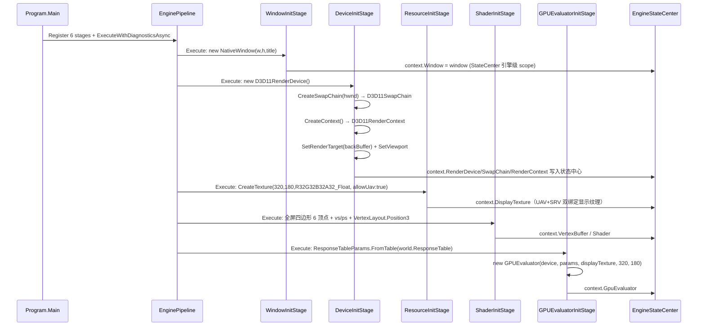
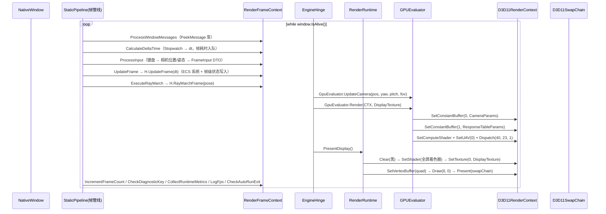

# 基础渲染层：调用链分析与功能实现文档

> 分析对象：`Engine/GameEditor.Graphics`（抽象层）+ `Engine/GameEditor.Graphics.D3D11`（D3D11 实现层）+ `Engine/GameEditor.Windowing`（原生窗口）
> 分析日期：2026-08-18 ｜ 目标框架：net10.0-windows ｜ 图形 API：Vortice.Direct3D11 2.x（DX11.1）

---

## 1. 层定位与职责边界

基础渲染层是整个 Engine 的"绘图底座"，向上对 ECS / 虚拟矩阵 / Scene 聚合层提供**与后端无关的图形抽象**，向下封装 D3D11 资源生命周期与绘制状态机。

```text
                    ┌─────────────────────────────────────────────┐
                    │         GameEditor.Scene（聚合层）            │
                    │  EngineHinge / GPUEvaluator / SliceRenderer  │
                    └──────────────┬──────────────────────────────┘
                                   │ 依赖抽象接口（无后端实现知识）
                    ┌──────────────▼──────────────────────────────┐
                    │      GameEditor.Graphics（抽象层/接口）       │
                    │  IRenderDevice / IRenderContext / ITexture  │
                    │  IShader / ISwapChain / IGPUEvaluator ...   │
                    └──────────────┬──────────────────────────────┘
                                   │ 实现
                    ┌──────────────▼──────────────────────────────┐
                    │  GameEditor.Graphics.D3D11（D3D11 实现层）    │
                    │  D3D11RenderDevice / D3D11RenderContext ...  │
                    └──────────────┬──────────────────────────────┘
                                   │ HWND / 消息循环
                    ┌──────────────▼──────────────────────────────┐
                    │   GameEditor.Windowing.NativeWindow（Win32） │
                    └─────────────────────────────────────────────┘
```

### 1.1 三层内部职责划分

| 子项目 | 角色 | 核心内容 |
|---|---|---|
| `GameEditor.Graphics` | **抽象层（接口 + 模型）** | 12 个渲染接口 + 4 个数据模型；零后端依赖，仅依赖 `TConfig.GameMath` 基元 |
| `GameEditor.Graphics.D3D11` | **实现层** | 全部接口的 D3D11 落地；运行时 HLSL 编译（VS/PS/CS） |
| `GameEditor.Windowing` | **窗口底座** | Win32 原生窗口封装：注册类、创建窗口、消息泵、尺寸/关闭事件 |

### 1.2 抽象接口全景（GameEditor.Graphics/Interfaces）

| 接口 | 定位 | 关键成员 |
|---|---|---|
| `IRenderDevice` | **资源工厂**（单例，进程级） | `CreateContext` / `CreateVertexBuffer` / `CreateIndexBuffer` / `CreateShader` / `CreateTexture` / `LoadTexture` / `CreateSwapChain` / `CreateComputeShader` / `CreateStructuredBuffer` / `CreateUnorderedAccessView` |
| `IRenderContext` | **绘制状态机**（每绘制器一个） | `Clear` / `SetViewport` / `SetShader` / `SetVertexBuffer` / `SetIndexBuffer` / `SetTexture` / `UpdateTexture` / `SetConstantBuffer<T>` / `DrawIndexed` / `Draw` / `Present` |
| `IGPUEvaluator` | GPU 光线步进求值器 | `UpdateCamera` / `UpdateEditOps` / `Render(context, renderTarget)` |
| `ITexture` | 纹理资源 | `Width` / `Height` / `Format` |
| `IVertexBuffer` / `IIndexBuffer` / `IBuffer` | 几何与结构化缓冲 | `Layout`+`VertexCount` / `IndexCount` / `ElementCount`+`ElementSize` |
| `IShader` / `IComputeShader` | 着色器资源 | `Name`（编译期名字，运行时编译） |
| `ISwapChain` | 交换链 | `Resize` / `GetBackBufferTexture` |
| `IUnorderedAccessView` | 计算输出视图 | 空标记接口（实现持有原生 UAV） |

### 1.3 数据模型（GameEditor.Graphics/Models）

- **`PixelFormat`**：5 种格式 —— R32/R32G32/R32G32B32/R32G32B32A32 Float、R8G8B8A8 UNorm。（注：D3D11/DXGI 不支持 24 位 RGB 缓冲格式，故无 R8G8B8。）
- **`VertexElement`**：语义名（POSITION/COLOR/NORMAL/TEXCOORD…）+ 语义索引 + 格式，是 InputLayout 的声明来源。
- **`VertexLayout`**：元素集合 + 预制布局（`Position3` / `Position3Color4` / `Position3Normal3`）+ `GetStride()` 计算顶点步长。
- **`RenderCommand`**：命令基类（`SortKey`），三个派生：
  - `DrawMeshCommand`：顶点/索引缓冲 + Shader + 世界/视图/投影矩阵（完整 3D 绘制）。
  - `DrawGizmoCommand`：调试线框绘制（缓冲 + 颜色 + 变换）。
  - `DrawSliceCommand`：切片绘制（SliceValue / 视图尺寸 / CellSize / 平面 / 变换 / 切片纹理）。

> 说明：`RenderCommand` 体系当前为**预留的渲染命令列表**（为将来渲染队列/排序做准备），实际帧路径直接调用 `IRenderContext` 命令式 API（见 §4.2）。

---

## 2. D3D11 实现层功能实现详解

### 2.1 D3D11RenderDevice —— 设备与资源工厂

**构造（设备创建）链路**：

```text
new D3D11RenderDevice()
  → D3D11.D3D11CreateDevice(null, DriverType.Hardware, None,
        [Level_11_1, 11_0, 10_1, 10_0], out device, out immediateContext)
  → DXGI.CreateDXGIFactory2<IDXGIFactory2>(false)
```

要点：
- **FeatureLevel 降级链**：优先 11.1，逐级降到 10.0，保证兼容性。
- 持有 `ID3D11Device` + **immediate context** + `IDXGIFactory2` 三件套；`CreateContext()` 返回的所有 `D3D11RenderContext` **共享同一个 immediate context**（即 `RenderRuntime.Context` 与 `SliceRenderer` 内部 context 实际操作同一设备上下文）。

**资源创建实现**（关键细节）：

| 工厂方法 | 实现要点 |
|---|---|
| `CreateVertexBuffer<T>` | `Marshal.SizeOf<T>` 计算字节数 → `CreateBuffer(Default usage, VertexBuffer)` → 逐元素 `StructureToPtr` 拷入堆内存 → `SubresourceData` 初始化 |
| `CreateIndexBuffer` | 同理，`uint[]` → R32 索引缓冲 |
| `CreateTexture(w,h,fmt)` | Dynamic + `CpuAccessFlags.Write` + ShaderResource 绑定（CPU 可逐帧更新，切片路径用） |
| `CreateTexture(w,h,fmt,allowUav)` | Default + ShaderResource\|UnorderedAccess 绑定（GPU 计算输出 + 采样，显示纹理用） |
| `CreateTexture(w,h,fmt,data,rowPitch)` | Default 资源 + 初始数据子资源初始化（一次性上传） |
| `LoadTexture(filePath)` | 仅支持 `.raw/.rgba`（R8G8B8A8），平方根推断宽高；其它格式抛 `NotSupportedException` |
| `CreateSwapChain(hwnd,w,h)` | `SwapChainDescription1`：R8G8B8A8_UNorm、`Usage.RenderTargetOutput`、**2 缓冲**、`FlipSequential`、`AlphaMode.Ignore`；`CreateSwapChainForHwnd` |
| `CreateShader(vs,ps[,layout])` | `D3D11Shader` 内完成编译 + 可选 InputLayout |
| `CreateComputeShader(hlsl)` | `D3D11ComputeShader` 内编译 `CSMain` / `cs_5_0` |
| `CreateStructuredBuffer<T>` | `ResourceOptionFlags.BufferStructured`；可写时加 UAV 绑定；SRV 自动创建 |
| `CreateUnorderedAccessView(texture)` | 从 `D3D11Texture.TextureResource` 建 UAV |

### 2.2 D3D11Shader —— 运行时着色器编译

- 入口 `CompileShader(code, entryPoint, profile)`：UTF-8 编码源码（追加 `\0`）→ `D3DCompiler.Compiler.Compile`。
- VS 编译目标 `vs_5_0`（`VSMain`），PS 编译目标 `ps_5_0`（`PSMain`），失败抛出含错误 blob 文本的 `InvalidOperationException`。
- 传入 `VertexLayout` 时，按元素顺序**累加 offset** 生成 `InputElementDescription[]` → `CreateInputLayout`。
- 编译产物生命周期：`vsBlob`/`psBlob` 用后即弃（`using`），仅保留 `ID3D11VertexShader/PixelShader/InputLayout`。

### 2.3 D3D11RenderContext —— 绘制状态机

**构造时一次性设置的固定状态**：

| 状态 | 配置 | 用途 |
|---|---|---|
| 采样器 | `MinMagMipLinear` + 三向 Clamp + `Never` 比较 | 纹理采样（绑定 PS slot 0） |
| 光栅化 | Solid + **CullMode.None**（无背面剔除）+ 深度裁剪开 | 全屏四边形/切片无需剔除 |
| 深度模板 | `DepthEnable=false`（关闭深度测试） | 后处理/全屏路径不依赖深度 |

**每帧/每次绘制路径**（GPU 光线步进路径为例，详见 §4.2）：

```text
SetConstantBuffer(0, CameraParams)        // slot0：相机/步进参数（VS+PS 同时绑定）
SetConstantBuffer(1, ResponseTableParams) // slot1：响应表（来自世界单一事实源）
SetComputeShader(cs)                      // 计算阶段切换
SetUnorderedAccessView(0, uav)            // u0：显示纹理
Dispatch(groupX, groupY, 1)               // 每 8x8 线程组
```

**常量缓冲优化**：`_constantBuffers` 按 `(slot, size)` 缓存复用；同 slot 且尺寸未变 → 直接 `Map(WriteDiscard)` 覆盖；尺寸变化 → 重建。动态缓冲 + WriteDiscard 避免 GPU 阻塞。

**CPU 上传纹理**：`UpdateTexture` 用 `Map`/`Unmap` + 按 `rowPitch` **逐行内存拷贝**（处理纹理行对齐，src 行间距与 dst `mapped.RowPitch` 可能不同）。

**Present 语义**：`Present(swapChain)` → `SwapChain.Present(0, None)` → **重新绑定 RTV/DSV**（Present 后渲染目标会自动解绑，重绑避免后续 Clear/Draw 无目标可画）。

### 2.4 D3D11Texture —— 多形态纹理

三种构造路径：

1. **动态纹理**（DeviceContext 版）：Dynamic/Write + SRV —— 切片像素路径使用；`SetData(byte[], rowPitch)` 泛型/非泛型 Map-Unmap 更新。
2. **初始数据纹理**（无 Context）：`SubresourceData` 一次性上传，CPU 不再可写。
3. **文件纹理**：仅 `.raw/.rgba`，`GCHandle` 钉住字节数组后上传。

> 注意：动态纹理的 `UpdateTexture` 由 `IRenderContext` 完成（context 持有 Map 能力），`SetData` 是纹理自身的便捷重载——两条路径并存，切片路径实际走 `IRenderContext.UpdateTexture`。

### 2.5 D3D11SwapChain —— 交换链

- `ResizeBuffers(2, w, h, R8G8B8A8_UNorm, None)`：双缓冲重建。
- `GetBackBufferTexture()` 返回 `ID3D11Texture2D` 的**原生指针**（供 DeviceInitStage 建立 RTV）；`GetBackBuffer()` 返回托管对象（供 `SetRenderTarget`）。

### 2.6 NativeWindow —— Win32 窗口底座

- 注册窗口类（`WNDCLASSEX` + `RegisterClassEx`）→ `CreateWindowEx(WS_OVERLAPPEDWINDOW)` → 居中并**钳制到屏幕尺寸**（避免尺寸不一致）。
- `ProcessMessages()`：`PeekMessage` 非阻塞泵 + `TranslateMessage/DispatchMessage`。
- 消息处理：`WM_SIZE` → 更新宽高 + 触发 `Resized` 事件；`WM_DESTROY` → `PostQuitMessage` + 触发 `Closed`。
- `IsAlive()`：`!IsDisposed && IsWindow(hwnd)` —— 帧循环退出条件。

---

## 3. 渲染资源的初始化调用链（管线阶段）

渲染层资源由 `GameEditor.Scene/Pipeline/Stages/*` 按严格顺序组装。依赖关系要求：**窗口 → 设备 → 资源 → 着色器 → GPU 求值器**。



### 3.1 阶段间的前置校验（硬约束）

| 阶段 | 前置条件 | 失败行为 |
|---|---|---|
| `DeviceInitStage` | `context.Window != null` | 抛 `InvalidOperationException("Window must be initialized before DeviceInit")` |
| `ResourceInitStage` | `context.RenderDevice != null` | 同上（"RenderDevice must be initialized..."） |
| `ShaderInitStage` | `context.RenderDevice != null` | 同上 |
| `GPUEvaluatorInitStage` | `RenderDevice` + `World` + `DisplayTexture` 三者齐备 | 按缺失项逐一报错 |

每个阶段均通过 `DiagnosticScope.Record` 记录 `engine.<stage>.init/complete/error` 事件，产出诊断快照。

### 3.2 显示纹理的双重身份（关键设计）

`ResourceInitStage` 创建 `DisplayTexture`：

```text
CreateTexture(320, 180, R32G32B32A32_Float, allowUav: true)
  = BindFlags.ShaderResource | BindFlags.UnorderedAccess
  = Default Usage（GPU 专属，CPU 不可写）
```

- **作为 UAV（u0）**：GPU 光线步进计算着色器直接写入，结果即画面内容。
- **作为 SRV（t0）**：`PresentDisplay` 全屏四边形像素着色器采样上屏。

**零拷贝设计**：计算输出与上屏采样共用同一张纹理，中间不经过 CPU 回读。

### 3.3 资源释放链路（EngineCompositionLifecycle）

`Program.Main` 结束时 `stateCenter.Shutdown()` → `EngineCompositionLifecycle.AppShutdown()` **按依赖逆序释放**：

```text
Shader → VertexBuffer → DisplayTexture → RenderContext → GpuEvaluator → SwapChain → RenderDevice → NativeWindow
```

后创建先释放；单资源 Dispose 失败不阻断其余（try/catch 包裹）。引擎级资源生命周期为**进程级**（跨场景存活），场景销毁（ScopeDestroyed）不触碰。

---

## 4. 运行时调用链分析

### 4.1 帧循环总链路（组合根视角）

`Program.Main` 使用 `StaticPipeline<RenderFrameContext>` 编排 10 个帧步骤：



> 计算着色器 8×8 线程组：`groupX = (320+7)/8 = 40`，`groupY = (180+7)/8 = 23`，共 920 组。

### 4.2 GPU 光线步进路径（主渲染路径）

`GPUEvaluator.Render` 完成"相机参数 → GPU 常量缓冲 → 计算着色器调度"：

1. **CPU 侧相机基向量**：`CameraMath.BuildForward(yaw,pitch)`（绕 Y 轴旋转 + 俯仰）→ `BuildRight = Normalize(Cross(forward, Up))` → `up = Cross(right, forward)`。
2. **CameraParams（cb0）**：camPos/forward/right/up + fov + maxDist(=`maxSteps*stepSize`=30) + maxSteps(20) + rt 尺寸 + seed(42)，`StructLayout.Sequential` 保证 HLSL 布局对齐（Vec3 后补 4 字节 pad）。
3. **ResponseTableParams（cb1）**：R0–R3 四张 4×4 矩阵按行展开为 16 个 `float4`，由 `world.ResponseTable` 导出（CPU/GPU 单一事实源）。
4. **内嵌 HLSL** 镜像 CPU 端地形：`GetMicroState`（高度 = 8 + SimpleNoise×12，与 CPU `TerrainBaseGen` 参数一致）→ `ComputeMacro`（R0 矩阵线性变换）→ `CSMain` 光线步进（与 CPU `RayMarcher` 相同的 NDC/方向构造、边界 ±500、命中判据 `macro.w > 0.1`、雾效 `exp(-dist*0.002)`、天空渐变兜底）。

> 差异说明：GPU 端 `ComputeMacro` 当前只应用 **R0 基础响应矩阵**，未应用 R1–R3 能量修正项（CPU 端完整应用）。这是阶段 C 之后遗留的已知边界（详见 `EngineHinge_Design.md` 阶段 E）。

### 4.3 切片渲染路径（辅助路径）

`SliceRenderer.PresentSlice`（纯纹理上屏，采样职责已剥离至 EngineHinge）：

```text
EnsureTextureSize(w,h)          // 尺寸变化时重建动态纹理 + 像素缓冲
UpdateSliceTexture(pixels)      // Buffer.BlockCopy → IRenderContext.UpdateTexture（rowPitch = w*4）
Clear(0.1,0.1,0.1) → SetViewport → SetShader(切片着色器)
SetVertexBuffer(quad) → SetIndexBuffer(indices) → SetTexture(0, sliceTexture)
DrawIndexed(6, 0) → Present(swapChain)
```

- 全屏四边形：4 顶点（POSITION + TEXCOORD0）+ 6 索引（`{0,1,2, 2,1,3}`）。
- 切片着色器：VS 透传（`float4(position,1.0)` 直达裁剪空间），PS 采样 `t0` 输出。
- `SliceRenderer` 持有**独立的** `D3D11RenderContext`（由 `IRenderDevice.CreateContext()` 创建，但底层共享同一 immediate context）。

### 4.4 三条上屏路径的汇合点

| 路径 | 画面来源 | 上屏方式 | 所属组件 |
|---|---|---|---|
| GPU 光线步进 | 计算着色器写 DisplayTexture（UAV） | 全屏四边形采样 DisplayTexture | `RenderRuntime.PresentDisplay` |
| CPU 切片采样 | EngineHinge 采样的 RGBA 像素 | 动态纹理 → 全屏四边形 | `SliceRenderer.PresentSlice` |
| （预留）网格/线框 | 顶点缓冲绘制 | `DrawMeshCommand`/`DrawGizmoCommand` | RenderCommand 体系（未接入帧循环） |

---

## 5. 与上下层的关键交互

### 5.1 上游依赖（本层依赖什么）

- **`TConfig.GameMath`**（基元层）：`Vec2/Vec3/Matrix4x4/Color/SlicePlane` —— 接口签名、模型字段全部使用共享基元，**不依赖任何上层业务模块**（EngineHinge 设计目标：渲染层不再引用 VirtualMatrix）。
- **`ECS.Core`（BasicMethod）**：`IGPUEvaluator` 签名使用 `TConfig.ECS.Entity` 别名（GlobalUsings），仅类型引用。
- **Vortice.* 2.x**：Direct3D11 / DXGI / D3DCompiler / Mathematics。

### 5.2 下游消费（谁使用本层）

| 消费者 | 用途 |
|---|---|
| `DeviceInitStage` | 创建设备/交换链/上下文，绑定后缓冲为渲染目标 |
| `ResourceInitStage` | 创建 UAV 显示纹理 |
| `ShaderInitStage` | 创建全屏四边形 + 上屏着色器 |
| `GPUEvaluatorInitStage` / `GPUEvaluator` | 创建计算着色器 + UAV，每帧调度 |
| `RenderRuntime`（EngineHinge 内） | 聚合 Context/SwapChain/DisplayTexture/VertexBuffer/Shader，`PresentDisplay` |
| `SliceRenderer` | 独立渲染上下文 + 切片纹理上屏 |
| `EngineCompositionLifecycle` | 进程退出时按逆序释放全部渲染资源 |

### 5.3 数据流边界

```text
虚拟矩阵（MacroState）──采样──► EngineHinge.SampleSlice ──RGBA 字节──► SliceRenderer ──► 屏幕
世界响应表（ResponseTable）──► ResponseTableParams（GPU 常量缓冲）──► 计算着色器 ──► DisplayTexture ──► 屏幕
```

渲染层接口中**不出现 MacroState**：切片路径在 EngineHinge 的采样边界将 MacroState 转为 RGBA 像素，GPU 路径通过 `ResponseTableParams` 数值传递——业务类型不泄漏进渲染抽象。

---

## 6. 关键设计要点与约束

1. **抽象-实现分离**：Graphics 只含接口/模型；具体后端（D3D11）通过 csproj 引用注入，替换后端（如 Vulkan）只新增实现项目。
2. **单一设备上下文**：所有 `IRenderContext` 共享设备 immediate context —— 代价是不同渲染器之间切换需手动保存/恢复状态（当前各路径独立设置全部状态，可接受）。
3. **零拷贝显示链路**：DisplayTexture 同时是 UAV 输出与 SRV 采样源。
4. **状态延迟装配**：渲染目标（RTV/DSV）在 `DeviceInitStage` 用 `GetBackBuffer()` 显式绑定，Present 后由 context 自动重绑。
5. **运行时编译**：VS/PS/CS 全部字符串内嵌、运行期 D3DCompiler 编译；便于热改 shader，但首次创建有编译开销。
6. **资源逆序释放**：组合生命周期 AppShutdown 保证依赖方先于被依赖方释放。
7. **计算着色器与 CPU 地形参数一致性风险**：GPU `GetMicroState` 高度参数（8.0 + noise×12.0）与 CPU `TerrainBaseGen`（HeightOffset=8, HeightScale=12）手工保持同步，属已知维护边界（阶段 E 演进点）。

---

## 7. 演进方向

- 接入 `RenderCommand` 列表：实现绘制命令收集 → 排序 → 回放，支撑多对象网格渲染。
- GPU 地形函数从 `World.BaseGen` 生成 HLSL，消除 CPU/GPU 双份地形代码。
- 文件纹理支持扩展（ImageSharp / Vortice.WIC 解码 png/jpg）。
- 窗口 `Resized` 事件接入 `SwapChain.Resize` + 视口更新（当前窗口尺寸变化未触发交换链重建）。
