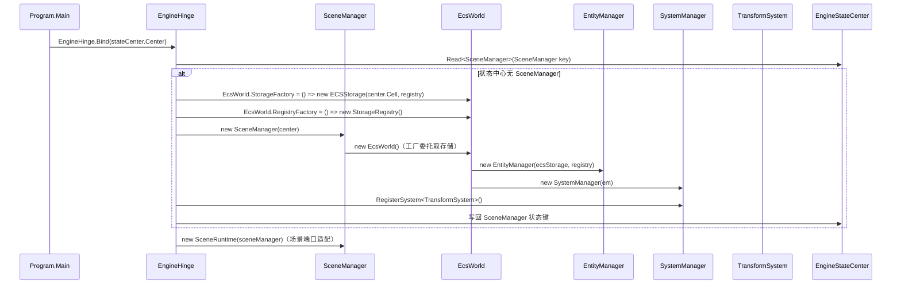
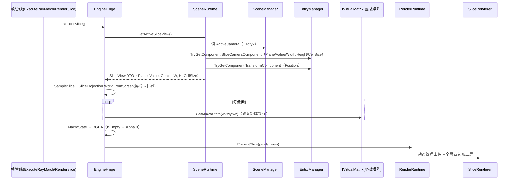

# ECS 层：调用链分析与功能实现文档

> 分析对象：`Engine/GameEditor.ECS`（引擎侧组件与系统）+ `CsharpPrj/BasicMethod/ECS`（ECS.Core 框架，ECSFrame.cs）+ `Engine/GameEditor.Scene/SceneManager.cs`（场景门面）
> 分析日期：2026-08-18 ｜ 框架：自研 ECS.Core（Archetype 存储 + 读写锁）

---

## 1. 层定位与职责边界

ECS 层承载"实体-组件-系统"三要素，是场景对象的组织模型。它与虚拟矩阵（世界数据）和渲染层（绘制能力）解耦——**ECS 层不采样世界、不直接绘制**，仅通过聚合层 `EngineHinge` 的端口与 DTO 与上下层交换信息。

```text
                 ┌──────────────────────────────────────────┐
                 │         GameEditor.ECS（引擎侧组件）       │
                 │  Name/Transform/WorldMatrix/MeshRenderer/ │
                 │  Camera/SliceCamera + TransformSystem     │
                 └──────────────┬───────────────────────────┘
                                │ 继承/实现
                 ┌──────────────▼───────────────────────────┐
                 │      ECS.Core（框架，CsharpPrj）           │
                 │  EcsWorld / EntityManager / SystemManager │
                 │  SystemBase / Archetype 存储体系           │
                 └──────────────┬───────────────────────────┘
                                │ 包装
                 ┌──────────────▼───────────────────────────┐
                 │  GameEditor.Scene.SceneManager            │
                 │  CreateGameObject/Camera/SliceCamera      │
                 │  SetParent/Destroy/Find/Update            │
                 └──────────────┬───────────────────────────┘
                                │ 被 EngineHinge 持有（场景端口）
                                ▼
                 GameEditor.Scene.EngineHinge（三层聚拢点）
```

### 1.1 代码分布与依赖

| 项目 | 内容 | 依赖 |
|---|---|---|
| `CsharpPrj/BasicMethod/ECS`（ECS.Core） | 框架核心：`EcsWorld`/`EntityManager`/`SystemManager`/`SystemBase`/`ISystem` + Archetype 存储（ArchetypeManager/Archetype/Chunk）| `TConfig.ECS`（Entity/IComponent 基元）|
| `CsharpPrj/Plate/TConfig/ECS` | 基元：`Entity`（Id+Version 版本化句柄）、`IComponent` 标记接口 | 无 |
| `GameEditor.ECS` | 引擎侧 6 组件 + 1 系统（TransformSystem） | ECS.Core、TConfig.GameMath |
| `GameEditor.Scene/SceneManager.cs` | 场景门面：GameObject 创建/查询/层级/销毁 | ECS.Core、GameEditor.ECS、StateCenter |

### 1.2 组件清单（GameEditor.ECS/Components.cs + TransformComponent.cs）

| 组件 | 字段 | 用途 |
|---|---|---|
| `NameComponent` | `string Value` | 实体命名，SceneManager 用其建索引表 |
| `TransformComponent` | `Position/Rotation/Scale` + `ParentEntityId/Version` | 局部变换 + 父实体句柄（版本化防悬挂） |
| `WorldMatrixComponent` | `Matrix4x4 Value` + `int DirtyVersion` | 世界矩阵缓存（TransformSystem 产出） |
| `MeshRendererComponent` | `MeshAssetId/MaterialAssetId/Enabled` | 渲染挂接（预留：资产 Id 驱动） |
| `CameraComponent` | `Fov/NearClip/FarClip/AspectRatio/Type` | 透视/正交相机参数（预留：3D 相机） |
| `SliceCameraComponent` | `Plane/SliceValue/ViewWidth/ViewHeight/CellSize` | **切片相机**：驱动切片渲染路径 |

> 注：`SlicePlane` 枚举已合并归位至 `TConfig.GameMath`（一处定义，ECS 与虚拟矩阵共用），ECS 组件直接引用。

---

## 2. ECS.Core 框架核心实现

### 2.1 基元：Entity（版本化句柄）

```csharp
public readonly struct Entity { public readonly int Id, Version; ... }
public static readonly Entity Invalid = new(-1, -1);
public bool IsValid => Id >= 0 && Version >= 0;
```

- **Id + Version 双元组**：Id 复用 + Version 递增 → 悬挂引用可被检测（`IsEntityValid` 校验）。
- `IComponent` 为空标记接口，所有组件为 `struct`（值语义，cache 友好）。

### 2.2 EntityManager —— 实体/组件操作门面

- 底层由 `ArchetypeManager` 实现存储（`CsharpPrj/BasicMethod/ECS/Archetype/`，Archetype + Chunk 稀疏存储）。
- **全部操作包在 `ReaderWriterLockSlim` 读写锁**内（`ReadLockScope`/`WriteLockScope`），支持递归锁——多线程安全。

**关键 API 语义**：

| API | 锁 | 语义 |
|---|---|---|
| `CreateEntity()` | 写 | 分配 Id/Version，触发 `EntityCreated` 事件 |
| `DestroyEntity(e)` | 写 | 有效性校验 → `EntityDestroying` → Archetype 销毁 → `EntityDestroyed` |
| `AddComponent<T>` / `RemoveComponent<T>` | 写 | 变更后触发 `ComponentAdded/Removed` 事件 |
| `GetComponent<T>` | 读 | 无效实体/缺组件时抛异常 |
| `SetComponent<T>` | 写 | 记录 old 值，触发 `ComponentUpdated(entity, type, old, new)` |
| `AddOrSetComponent<T>` | 写 | **原子 Add-or-Set**：同一写锁内 Has → Set / 否则 Add，消除 check-then-act 竞态 |
| `TryGetComponent<T>` | 读 | 无异常版本，返回 bool + out |
| `HasComponent<T>` | 读 | 有效性 + 存在性 |
| `GetEntities<T>()` / `GetEntities(params Type[])` | 读 | Archetype 查询 → 快照 List |
| `Clear()` | 写 | 全清并逐个触发 `EntityDestroyed` |

### 2.3 SystemManager —— 系统注册与调度

- `RegisterSystem<T>()`：实例化 → `Initialize(em)` 注入 EntityManager → 加入列表 + 类型索引。
- `UpdateAll(dt)`：**按注册顺序**执行所有 `Enabled` 系统的 `Update(dt)`（无优先级排序，顺序即依赖序）。
- `Dispose()`：释放所有 `IDisposable` 系统。

### 2.4 EcsWorld —— 世界聚合

- `EcsWorld` 聚合 `EntityManager` + `SystemManager`。
- **静态工厂可插拔**：`StorageFactory` / `RegistryFactory` 两个静态委托，默认构造器从中取 ECS 存储后端——使 ECS 框架可以复用到任意存储（EngineHinge 复用 StateCenter 的根 cell，见 §4.1）。
- `Update(dt)` → `SystemManager.UpdateAll(dt)`；`CreateQuery()` 暴露 EntityQueryBuilder（预留查询构建器）。

---

## 3. TransformSystem —— 层级变换系统

引擎侧唯一实际运行的 ECS 系统，职责：**把局部变换层级折叠为世界矩阵并缓存**。

```mermaid
flowchart TD
    A[每帧 Update(dt)] --> B[_version++]
    B --> C[GetEntities TransformComponent]
    C --> D{TryGetComponent Transform}
    D -->|yes| E[CalculateWorldMatrix]
    E --> F{Has WorldMatrixComponent}
    F -->|yes| G[SetComponent new WorldMatrix v=_version]
    F -->|no| H[AddComponent new WorldMatrix v=_version]
    D -->|no| I[跳过该实体]
    G --> J[下一实体]
    H --> J
```

### 3.1 世界矩阵计算

```text
localMatrix = T(Position) * R(YawPitchRoll(Rot.Y, Rot.X, Rot.Z)) * S(Scale)
worldMatrix = HasParent ? localMatrix * GetWorldMatrix(parent) : localMatrix
```

- **层级折叠**：父实体优先（因单遍遍历顺序不保证父先于子，`CalculateWorldMatrix` 递归调用 `GetWorldMatrix(parent)`；父也有缓存时直接命中）。
- **缓存一致性**：`GetWorldMatrix(entity)` 优先返回 `DirtyVersion == _version` 的缓存；否则实时计算。`_version` 每帧递增，保证缓存只在本帧有效——**脏标记即帧号**。

### 3.2 设计取舍

- **无逐实体脏传播**：每帧全量重算所有 Transform（当前场景规模小，全量重算开销可忽略；无增量更新复杂度）。
- 世界矩阵是独立组件（`WorldMatrixComponent`），渲染/其他系统只需读取缓存组件，**不依赖系统调用顺序**。

---

## 4. SceneManager 与场景编排调用链

### 4.1 创建链路（EngineHinge.CreateSceneManager）



> 关键点：**ECS 存储复用 StateCenter 根 cell 的 Session 层**（键前缀 `ecs:`），ECS 实体数据与引擎状态同源持久化，且与引擎状态键命名空间不冲突。

### 4.2 实体创建链路

`SceneManager.CreateGameObject`（所有创建路径的公共底座）：

```text
CreateGameObject(name, pos, rot, scale)
  → EntityManager.CreateEntity()                 // 分配版本化句柄
  → AddComponent(NameComponent(name))
  → AddComponent(TransformComponent(pos, rot, scale, parent: default))
  → _namedEntities[name] = entity                // 命名索引（后进覆盖同名）
  → new GameObject(entity, em)                   // 门面包装返回
```

| 门面方法 | 追加逻辑 | 副作用 |
|---|---|---|
| `CreateCamera` | + `CameraComponent(type)` | 设为 `ActiveCamera` + `PublishSceneState()` |
| `CreateSliceCamera` | + `SliceCameraComponent(plane, sliceValue)` | 设为 `ActiveCamera` + `PublishSceneState()` |
| `SetParent(child, parent)` | 更新 Transform 的 ParentEntity | 下一帧 TransformSystem 折叠出新世界矩阵 |
| `DestroyGameObject` | 移除命名索引 → 清 ActiveCamera → `DestroyEntity` | + `PublishSceneState()` |
| `Clear` | 清索引/相机 → `EntityManager.Clear()` | + `PublishSceneState()` |
| `FindEntityByName` / `FindEntitiesByPrefix` | 命名表 + `IsEntityValid` 双重校验 | 只读 |

### 4.3 GameObject 门面

`GameObject` 包装 `(Entity, EntityManager)`，提供强类型属性访问器：

- `Transform`（get/set）、`Camera`、`SliceCamera`、`MeshRenderer`（可空 get；set 时自动 Add/Set/Remove 三分支）。
- `Name`（只读，从 NameComponent 取）、`Id`（Entity.Id）。

> 门面是"语法糖 + 正确性约束"：`SetParent` 走门面会校验组件存在；直接对 `GameObject.Transform` 赋值不会校验——调用方需自行保证组件已存在。

### 4.4 每帧系统驱动链路

```text
Program.Main → StaticPipeline.UpdateFrame step
  → EngineHinge.UpdateFrame(input)
    → SceneRuntime.RunSystems(dt) → SceneManager.Update(dt)
      → EcsWorld.Update(dt) → SystemManager.UpdateAll(dt)
        → [TransformSystem.Update(dt)]（当前仅此一个系统）
    → 帧级状态写入 StateCenter（DeltaTime/CameraPosition/Yaw/Pitch）
```

### 4.5 场景状态发布（PublishSceneState）

`SceneManager` 在相机/实体集合变化时，向 StateCenter **场景级 scope** 写入：

- `EngineStateKeys.ActiveCameraName`（激活相机实体的 Name）
- `EngineStateKeys.EntityCount`（EntityManager.GetEntityCount()）

供诊断面板/编辑器读取，实现"ECS 状态 ↔ 外部观察"的解耦通道。

---

## 5. ECS → 渲染/虚拟矩阵 的综合调用链

ECS 层不直接触碰虚拟矩阵与渲染，而是通过 `EngineHinge` 的两个端口完成信息交换。

### 5.1 切片渲染链路（ECS 驱动的跨层全链路）



**DTO 契约（EngineHinge 单文件内定义）**：

```csharp
public readonly record struct SliceView(
    SlicePlane Plane, int Value, Vec3 Center,
    int Width, int Height, float CellSize);
```

- ECS 组件的知识（Plane/Value/View 尺寸）被**折叠进 DTO**，虚拟矩阵与渲染层只认 DTO，不感知组件结构。
- 无激活切片相机（`ActiveCamera == null` 或缺少组件）→ `GetActiveSliceView()` 返回 null → `RenderSlice()` 直接返回（安全空转）。

### 5.2 相机输入链路（反向：输入 → ECS）

```text
ProcessInput（键盘）→ CameraPose DTO → EngineHinge.RayMarchFrame(pose)
  → GpuEvaluator.UpdateCamera(...)          // 渲染层消费，不经 ECS
```

> 当前实现中相机姿态由 `RenderFrameContext` 直接持有（帧级状态），**尚未写入 ECS TransformComponent**。这是阶段 E 演进点：真实实体 + 相机组件驱动步进路径（`CameraPose` DTO 已为将来 `ActiveCamera.Transform → CameraPose` 预留契约）。

### 5.3 ECS 与虚拟矩阵的关系边界

| 维度 | ECS | 虚拟矩阵 |
|---|---|---|
| 数据 | 场景对象/相机/层级（组件化） | 函数化体素世界（Micro/MacroState） |
| 查询 | EntityManager + 命名表 | GetMacroState(x,y,z) |
| 变更 | 组件 Add/Set/Remove + 事件 | ChunkedEditStore 编辑操作 |
| 交互 | **无直接引用**；经 SliceView/采样 DTO | 无感知 |

两者唯一的运行时交互点是 `EngineHinge.RenderSlice`：ECS 决定"看哪里"（SliceView），虚拟矩阵回答"那里有什么"（VoxelSample→像素）。

---

## 6. 关键设计要点与约束

1. **版本化实体句柄**：Entity = Id + Version，配合 `IsEntityValid`，避免悬垂引用踩踏（父实体销毁后子实体 Transform 的 Parent 引用自然失效）。
2. **写锁内原子性**：`AddOrSetComponent` 解决并发"双 AddComponent"竞态——同一实体同时被多线程回写时的幂等语义。
3. **系统调度 = 注册顺序**：SystemManager 无优先级机制，跨系统依赖靠注册次序保证（当前仅 TransformSystem 单系统，无次序风险）。
4. **全量重算 + 帧号脏标记**：TransformSystem 每帧全量重算并缓存（DirtyVersion = 帧号），渲染读取零计算。
5. **存储可插拔**：`EcsWorld.StorageFactory` 静态委托使 ECS 框架可挂在任意 `IECSStorage`（Engine 挂在 StateCenter 根 cell，实现"状态与实体同源"）。
6. **ECS 不依赖渲染/虚拟矩阵**：组件只用 `TConfig.GameMath` 基元；跨层信息全部经 `EngineHinge` 端口 + DTO，无业务类型穿透。
7. **预留组件**：`MeshRendererComponent` / `CameraComponent` 已定义未接入帧路径，接口先行，便于后续 3D 网格渲染扩展。

---

## 7. 演进方向

- **相机实体驱动步进路径**：将 `RenderFrameContext` 的相机姿态迁移到 `TransformComponent`，`ActiveCamera.Transform → CameraPose` 自动组装（阶段 E）。
- **多系统调度**：引入系统依赖排序/并行（TransformSystem 可与其他系统并行）。
- **MeshRenderer 落地**：接入 `RenderCommand` 队列（DrawMeshCommand），用 AssetDatabase 的 Mesh/Material 资产驱动网格渲染。
- **查询构建器**：`EcsWorld.CreateQuery()` 已有骨架，可用于多组件过滤查询（如"同时含 Transform + MeshRenderer 的实体"）。
- **增量脏传播**：父变换变更时只重算子树，替代每帧全量重算。
