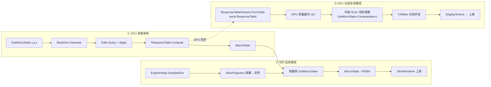
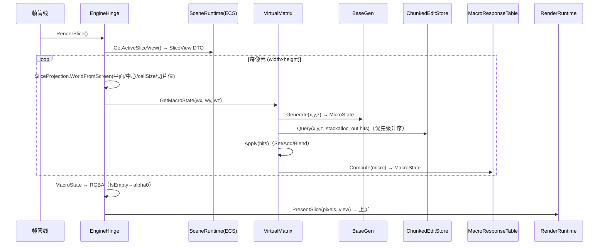

# 虚拟矩阵层：调用链分析与功能实现文档

> 分析对象：`Engine/GameEditor.VirtualMatrix`（函数化体素世界）
> 分析日期：2026-08-18 ｜ 定位：世界数据源 —— 基础渲染层与 ECS 层都围绕它的采样结果工作

---

## 1. 层定位与职责边界

虚拟矩阵层（VirtualMatrix）是一个**函数化体素世界**：世界不是预先烘焙好的体素数组，而是由「基元生成器（BaseGen）+ 编辑存储（EditStore）+ 响应表（ResponseTable）」三者组合，**按需即时计算**任意坐标的状态。

```text
                         ┌─────────────────────────────────────┐
                         │           IVirtualMatrix             │
                         │  GetMacroState / BaseGen / Edits /   │
                         │  ResponseTable                       │
                         └──────┬────────┬──────────┬──────────┘
                                │        │          │
                 ┌──────────────▼──┐ ┌───▼────────┐ ┌▼───────────────┐
                 │   IBaseGen      │ │ IEditStore │ │ MacroResponse-  │
                 │ 地形/噪声生成器  │ │ 分块编辑存储│ │ Table 响应表    │
                 │  TerrainBaseGen │ │ Chunked-   │ │ Micro→Macro 映射│
                 │  Simple/Noise   │ │ EditStore  │ │                │
                 └─────────────────┘ └────────────┘ └────────────────┘
```

### 1.1 核心数据流（一次采样）

```text
GetMacroState(x, y, z)
  ──► MicroState micro = BaseGen.Generate(x,y,z)      // ① 基元生成：材质/能量原始状态
  ──► EditOp hits[] = Edits.Query(x,y,z)              // ② 编辑查询：命中该点的用户编辑
  ──► micro = Apply(micro, hits[i])                   // ③ 编辑叠加：Set/Add/Blend
  ──► MacroState = ResponseTable.Compute(micro)       // ④ 响应映射：Micro → 可视 Macro
```

### 1.2 文件清单与职责

| 文件 | 职责 |
|---|---|
| `IVirtualMatrix.cs` / `VirtualMatrix.cs` | 世界门面 + 采样管线编排 |
| `MicroState.cs` | 七通道微状态（M/B/F/V + E0/E1/E2），含预定义材质常量 |
| `MacroState.cs` | 密度 + RGB 宏状态，`IsEmpty`/`Symbol` 可视化 |
| `MacroResponseTable.cs` | R0–R3 四张 4×4 响应矩阵，`Compute` + `GetRow` 导出 |
| `IBaseGen.cs` / `TerrainBaseGen.cs` / `SimpleBaseGen.cs` / `NoiseBaseGen.cs` | 基元生成器层级 |
| `IEditStore.cs` / `ChunkedEditStore.cs` / `EditOp.cs` | 编辑操作存储与查询 |
| `Math/NoisePrimitives.cs` | 哈希噪声 / ValueNoise2D/3D / FBM |
| `Math/Rendering/CameraMath.cs` | 相机基向量（yaw/pitch → forward/right/up） |
| `Math/Rendering/SliceProjection.cs` | 切片平面屏幕→世界坐标映射 |
| `Math/Rendering/RayMarcher.cs` | CPU 并行光线步进（兜底/验证路径） |
| `Math/Numerics.cs` | `MathEx.ToByte`（float→byte 颜色量化） |

---

## 2. 数据模型实现

### 2.1 MicroState —— 七通道微状态

```csharp
public readonly struct MicroState
{
    public readonly float M, B, F, V;      // 材质通道
    public readonly float E0, E1, E2;      // 能量/环境修正通道
}
```

| 通道 | 语义（代码注释推断） | 典型值范围 |
|---|---|---|
| `M` | 物质密度（Matter） | 0（空气/水）~ 0.7（石头） |
| `B` | 缓冲/次生密度 | 0 ~ 0.2 |
| `F` | 流动/填充 | 0 ~ 0.3 |
| `V` | 空隙/体积（Void） | 0 ~ 1（空气 = 1） |
| `E0/E1/E2` | 能量修正三轴（风化/孔隙/湿度等） | 0 ~ 0.3 |

**预定义材质常量**：

| 常量 | M | B | F | V | E0 | E1 | E2 |
|---|---|---|---|---|---|---|---|
| `Air` | 0 | 0 | 0 | 1 | 0 | 0 | 0 |
| `Stone` | 0.7 | 0.1 | 0.1 | 0.1 | 0.05 | 0 | 0 |
| `Dirt` | 0.3 | 0.2 | 0.1 | 0.4 | 0.20 | 0.10 | 0.05 |
| `Grass` | 0.2 | 0.2 | 0.3 | 0.3 | 0.30 | 0.05 | 0.15 |
| `Sand` | 0.5 | 0.1 | 0.1 | 0.3 | 0.25 | 0.02 | 0 |
| `Water` | 0 | 0 | 1 | 0 | 0 | 0 | 1 |

运算：`+`（逐通道相加，Add 编辑用）、`Lerp(a,b,t)`（0.5 混合，Blend 编辑用）。

### 2.2 MacroState —— 可视宏状态

```csharp
public readonly struct MacroState
{
    public readonly float Density, R, G, B;
    public const float DensityThreshold = 0.1f;
    public bool IsEmpty => Density <= DensityThreshold;
    public char Symbol { get; }   // 密度<0.5→' '；B>0.5→'~'(水)；R>0.4→'#'(岩)；G>0.25→'@'(草)；否则'%'
}
```

- **密度 + RGB** 是渲染的直接输入（切片像素 / 光线步进着色）。
- `Symbol` 供控制台 ASCII 可视化（`VirtualMatrixDemo.ShowSlice` 使用）。
- `IsEmpty` 用于切片路径 alpha 通道（空体素透明）。

### 2.3 MacroResponseTable —— Micro → Macro 响应映射

四张 **4×4 矩阵**（行 = 输出通道，列 = 输入通道 M/B/F/V）：

| 矩阵 | 角色 |
|---|---|
| `R0` | 基础线性变换：Density/Color 主体（第一行输出密度，其余三行输出 RGB） |
| `R1` | E0 能量修正（风化：负向密度/颜色调整） |
| `R2` | E1 能量修正（孔隙：双向微调） |
| `R3` | E2 能量修正（湿度/环境：负向微调） |

**Compute 公式**：

```text
density = d0 + E0*d1 + E1*d2 + E2*d3        // 密度可负（空气）
R/G/B   = clamp(base + E0*R1 + E1*R2 + E2*R3, 0, 1)   // 颜色钳制
其中 d0 = R0[0,0]*M + R0[0,1]*B + R0[0,2]*F + R0[0,3]*V   （其余行/矩阵同理）
```

**快速空路径优化**：若 MicroState 全零（`M==B==F==E0==E1==E2==0`，如 Air 变体）直接返回 `default`（Density=0），跳过 16 次乘加——空气体素采样零开销。

**GPU 单一事实源**：`GetRow(table, row)` 导出 `System.Numerics.Vector4` 行向量 → `ResponseTableParams.FromTable` 组装 GPU 常量缓冲（cb1），保证 **CPU 采样与 GPU 求值共用同一组响应值**（阶段 C 成果）。

---

## 3. 基元生成器（IBaseGen 实现族）

### 3.1 层级结构

```text
IBaseGen (Generate(x,y,z) → MicroState)
  └── TerrainBaseGen（抽象：地形分层的公共逻辑）
        ├── SimpleBaseGen（单哈希噪声）
        └── NoiseBaseGen（FBM 分形噪声 + 生物群系材质）
```

### 3.2 TerrainBaseGen —— 地形分层核心

**常量**：`SeaLevel=8`、`HeightScale=12f`、`HeightOffset=8f`。

**Generate 逻辑**（每体素 O(1)，无缓存）：

```text
height  = 8 + ComputeHeight(x,z) * 12          // 抽象高度函数（子类实现）
groundY = round(height)

y > groundY:
    y <= SeaLevel(=8) ──► Water               // 海平面以下的空气柱 → 水
    else              ──► Air                 // 高空 → 空气
y == groundY           ──► GetSurfaceMaterial(x,z)   // 地表材质（子类定制）
groundY-3 <= y < groundY──► Dirt               // 地表下 3 层 → 泥土
y < groundY-3          ──► GetDeepMaterial(x,y,z,groundY)  // 深层材质（子类定制）
```

### 3.3 SimpleBaseGen —— 确定性单噪声

`ComputeHeight = SimpleNoise(x,z)`：单次整数哈希（`(x*374761393) ^ (z*668265263) ^ (seed*2147483647)` → 二次混合）→ `HashToFloat * 2 - 1`（范围 [-1,1]）。用于演示/性能验证（`--demo` 与默认 BackendInitStage 使用）。

### 3.4 NoiseBaseGen —— FBM 分形地形

```text
ComputeHeight:
  continent = Fbm(x*0.005, z*0.005, 4, seed)      // 大陆尺度 ×1.5
  hills     = Fbm(x*0.02,  z*0.02,  3, seed+1)   // 丘陵尺度   ×0.5
  detail    = Fbm(x*0.1,   z*0.1,   2, seed+2)   // 细节尺度   ×(2/HeightScale)
  height    = continent*1.5 + hills*0.5 + detail*(2/12)

GetSurfaceMaterial（生物群系）:
  moisture    = Fbm(x*0.01, z*0.01, 3, seed+100)
  temperature = Fbm(x*0.008, z*0.008, 3, seed+200)
  moisture<0.35 && temperature>0.6 ──► Sand（干旱炎热 → 沙）
  else                              ──► Grass

GetDeepMaterial（深层风化）:
  porosity   = ValueNoise3D(x*0.1, y*0.1, z*0.1, seed+300) * 0.1
  weathering = max(0, (groundY-y)*0.001 + 0.02)   // 越深风化越弱（表面强）
  → MicroState(0.7, 0.1, 0.1, 0.1, porosity, weathering, 0)
```

### 3.5 NoisePrimitives —— 噪声原语

| 函数 | 实现 |
|---|---|
| `Hash2D/Hash3D` | 整数坐标 + seed 混合（乘数：374761393/668265263/1274126177/2147483647），双重位混合（`h ^ h>>13` × 素数 → `h ^ h>>16`） |
| `HashToFloat` | 低 24 位映射 [0,1) |
| `ValueNoise2D` | 四角点哈希 → 双线性插值，**smoothstep（`u=x²(3-2x)`）消除格点不连续** |
| `ValueNoise3D` | 八角点三线性插值 + 三轴 smoothstep |
| `Fbm` | 多倍频叠加：振幅每倍频 ×0.5，频率 ×2，归一化（除以总振幅） |

---

## 4. 编辑存储（IEditStore 实现）

### 4.1 EditOp —— 编辑操作单元

```csharp
public readonly struct EditOp
{
    public readonly int MinX, MinY, MinZ, MaxX, MaxY, MaxZ;  // AABB 盒（含端点）
    public readonly EditType Type;     // Set=0 / Add=1 / Blend=2
    public readonly MicroState State;
    public readonly uint Priority;     // 低者先应用（升序）
}
```

- `Voxel(x,y,z,type,state,priority)`：单体素快捷构造（Min==Max）。
- `AsAabb()` / `Contains(x,y,z)` / `Intersects(...)`：AABB 几何判定（Aabb 位于 `TConfig.GameMath`）。
- `EditType` 语义：
  - **Set**：`micro = op.State`（绝对覆盖，放置/挖掘）
  - **Add**：`micro = micro + op.State`（增量叠加，风化/充能）
  - **Blend**：`micro = MicroState.Lerp(micro, op.State, 0.5f)`（半混合）

### 4.2 ChunkedEditStore —— 分块空间索引

**结构**：`Dictionary<long, List<EditOp>>`，chunk 边长默认 32（须为 2 的幂，`BitOperations.Log2` 求移位量）。

**关键实现**：

| 操作 | 算法 |
|---|---|
| `Add(op)` | 由 op 的 AABB 计算跨过的 chunk 范围（`Min>>shift .. Max>>shift`）→ **在每一个重叠 chunk 复制插入** → `TotalCount++` |
| `Query(x,y,z,span,out count)` | 定位唯一 chunk（`x>>shift`）→ 线性扫描 list，`op.Contains(x,y,z)` 命中收集（上限 32，stackalloc 缓冲）→ 命中>1 时**插入排序按 Priority 升序**（保证低优先级先应用，编辑叠加顺序确定） |
| `Remove(predicate)` | 全 chunk 逆序遍历删除；`HashSet<EditOp>` 去重计数（跨 chunk 重复副本只计一次）；空 chunk 键回收 |
| `CountInChunk` / `TotalCount` | 诊断计数 |

**ChunkKey 编码**：`ax | (ay<<21) | (az<<42)`，每轴 21 位（Offset=2^20 偏移到非负）→ 单 long 键，无 Tuple 装箱。

**性能特征**：查询 = 一次字典定位 + 至多 chunk 内 O(n) 扫描。编辑稀疏时接近 O(1)；`TotalCount` 维护于 Add/Remove，O(1) 读取。

---

## 5. VirtualMatrix —— 采样管线编排

```csharp
public sealed class VirtualMatrix : IVirtualMatrix
{
    public MacroState GetMacroState(int x, int y, int z)
    {
        MicroState micro = _baseGen.Generate(x, y, z);          // ① 基元生成
        Span<EditOp> hits = stackalloc EditOp[32];             // ② 栈上查询缓冲
        _edits.Query(x, y, z, hits, out int count);
        for (int i = 0; i < count; i++)
            micro = Apply(micro, hits[i]);                      // ③ 编辑叠加（优先级序）
        return _response.Compute(micro);                        // ④ 响应映射
    }

    public MacroState GetMacroState(in Vec3 worldPos)           // 浮点重载
    {
        int x = (int)MathF.Floor(worldPos.X);                   // 世界坐标 → 体素坐标（floor）
        int y = (int)MathF.Floor(worldPos.Y);
        int z = (int)MathF.Floor(worldPos.Z);
        return GetMacroState(x, y, z);
    }
}
```

- **无缓存、纯函数**：同一坐标两次采样结果确定（BaseGen 确定性 + EditStore 有序）——demo 用 `(7,5,-3)` 两次查询验证确定性。
- **栈上缓冲**：最多 32 个命中编辑，零堆分配（热路径友好）。
- 构造函数：`new VirtualMatrix(baseGen, edits, response?)` —— response 缺省自建，实现"生成器/编辑/响应"三件套可独立替换（IoC 风格）。

---

## 6. 渲染数学工具（供上层消费）

### 6.1 CameraMath —— 相机基向量

```text
forward = (cos(yaw)*cos(pitch), sin(pitch), sin(yaw)*cos(pitch))
right   = Normalize(Cross(forward, Up))
up      = Cross(right, forward)
```

被两条渲染路径共用：`GPUEvaluator.Render`（CPU 算基向量 → 常量缓冲）与 `Program.ProcessInput`（WASD 移动方向）。

### 6.2 SliceProjection —— 屏幕 → 世界映射

```text
WorldFromScreen(plane, screenX, screenY, position, halfW, halfH, cellSize, sliceValue)

XZ 平面: world = (pos.X + (sx-halfW)*cell, sliceValue, pos.Z + (sy-halfH)*cell)
XY 平面: world = (pos.X + (sx-halfW)*cell, pos.Y + (sy-halfH)*cell, sliceValue)
YZ 平面: world = (sliceValue, pos.Y + (sy-halfH)*cell, pos.Z + (sx-halfW)*cell)
```

- 以 `position`（切片相机 Transform.Position）为视图中心，屏幕坐标偏移 × cellSize 得到世界坐标。
- 切片值（`sliceValue`）固定被采样平面坐标。
- 被 `EngineHinge.SampleSlice` 每像素调用（切片路径的核心映射）。

### 6.3 RayMarcher —— CPU 光线步进（验证/兜底路径）

`RayMarcher.Render(byte[] buf, w, h, world, camPos, forward, right, up, config)`：

- **`Parallel.For` 行并行**逐像素：NDC 坐标 → 光线方向（fov 锥体 + 宽高比）→ 步进循环。
- 步进参数：`RayMarchConfig(MaxSteps=20, StepSize=1.5, Fov, EnableAdaptiveStep)`，`MaxDist = 30`。
- **密度积分**：`density += macro.Density * stepSize`；颜色按密度加权累积；`density > 1` 提前终止。
- **自适应步长**：命中时恢复基准步长；未命中且累积密度低时步长 ×2（上限 8×）——空区域大步跳跃加速。
- **边界裁剪**：|pos| > 500 停止（与世界范围一致）。
- 着色：命中 → `light = 0.8 + 0.2|dir.y|` × 雾效 `exp(-dist*0.002)`；未命中 → 天空渐变（`0.5+0.2t, 0.6+0.2t, 1.0`）。
- 输出 `RGBA`（alpha=255）。

> 与 GPU 端 `GPUEvaluator` 内嵌 HLSL 逻辑高度同构（相同的 NDC/步进/着色公式），CPU 版是 GPU 版的"可调试镜像"。

---

## 7. 虚拟矩阵的综合调用链（三层视角）

### 7.1 三种消费路径汇总



| 路径 | 入口 | 消费的矩阵能力 | 生产内容 |
|---|---|---|---|
| ① CPU 体素采样 | `world.GetMacroState`（int/Vec3 双入口） | BaseGen + Edits + ResponseTable | MacroState（demo 验证/诊断） |
| ② 切片路径 | `EngineHinge.RenderSlice` → `SampleSlice` | SliceProjection + ① | RGBA 像素 → 屏幕 |
| ③ GPU 步进路径 | `EngineHinge.RayMarchFrame` → `GPUEvaluator.Render` | ResponseTable（cb1）+ HLSL 地形镜像 | DisplayTexture → 屏幕 |

### 7.2 完整时序（切片路径，含三层）



### 7.3 响应表单一事实源链路

```text
MacroResponseTable（CPU 采样）
        │  GetRow(table,row) → Vector4
        ▼
ResponseTableParams.FromTable(world.ResponseTable)   ← GPUEvaluatorInitStage 组装一次
        ▼
GPU 常量缓冲 cb1（SetConstantBuffer(1, params)）      ← 每帧 Render 上传
        ▼
HLSL: R0..R3 = float4x4(Rx_row0..3) → ComputeMacro
```

改 CPU 表一处 → GPU 自动同步（阶段 C 后无硬编码 R0–R3 残留）。

---

## 8. 关键设计要点与约束

1. **函数化世界（无存储体素）**：世界状态 = 生成器 + 编辑叠加 + 响应映射的纯函数；内存占用与可见范围解耦，支持无限世界。
2. **采样确定性**：BaseGen 纯哈希噪声 + EditStore 有序应用（Priority 升序插入排序）→ 同坐标结果稳定。
3. **分层数据模型**：MicroState（物理材质）与 MacroState（可视输出）分离，响应表作为两者间的可调映射层——材质系统与渲染解耦。
4. **编辑分块索引**：32³ chunk + 21bit long 键 + 栈上查询缓冲，编辑稀疏时查询 O(1) 级。
5. **响应表双端同步**：`GetRow` 导出 Vector4 使 CPU/GPU 共用一组参数（阶段 C 已落地）。
6. **CPU/GPU 地形函数双份**：GPU HLSL `GetMicroState` 手工镜像 CPU `TerrainBaseGen` 参数（8+noise×12）——属已知边界，未来从 `BaseGen` 生成 HLSL（阶段 E）。
7. **GPU 仅用 R0**：GPU `ComputeMacro` 只应用基础矩阵 R0，R1–R3 能量修正仅 CPU 生效——切片与步进两路径画面在含能量编辑时可能不一致（已知差异）。

---

## 9. 演进方向

- **GPU 基元生成统一**：HLSL 地形函数由 `BaseGen` 运行时生成（消除双份维护，阶段 E 核心）。
- **响应表扩展**：行/列可配置化（目前 4 表 × 4 行硬编码常量），支持外部 JSON 调参。
- **编辑时空索引**：Query 从 chunk 内线性扫描升级为空间树（当前至多 32 命中限制对稠密编辑不友好）。
- **CPU/GPU 一致性校验**：`--demo` 模式对比切片路径与 GPU 路径输出，自动化验证 R1–R3 差异。
- **流式生成**：BaseGen 按需生成已具备；可增加异步预生成/可见范围调度，支撑大世界漫游。
