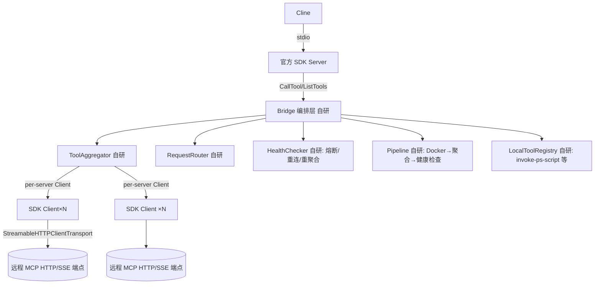

# TypeScript 侧 MCP 桥 — 基于官方 SDK 的优化重构规格

> **版本**：0.3（P0-P2 与第十二章已实施落地）
> **日期**：2026-08-31
> **状态**：实施中（P0-P2 传输换 SDK + 缺陷修复、第十二章 Docker Provider 化已落地；给「实施记录」在本文尾部）
> **范围**：`TypeScriptPrj/TsWorkspace/MCPBridge` + `BasicMethod` + `MCPFramework`（并延伸至 C# 侧接入）
> **目标**：把自写的 HTTP/JSON-RPC/SSE 客户端传输替换为官方 `@modelcontextprotocol/sdk` 的 Client 传输，**保留全部原创编排层**，并修复盘点出的协议类缺陷。
> **原则**：SDK 管纵轴（传输与协议），原始编排留在横轴（聚合/路由/观测/运维/装配），两者边界以 SDK 契约划定。
> **方向（北向星）**：本次重构不是为了「TS 单端自洽」，而是为「**统一双向 MCP 网关（方案 A）**」铺平横向——重构后两端都基于官方 SDK，网关总线方可把 C# 与 TS 收敛进同一中立目录（见第十一章）。

***

## 一、背景

`MCPBridge` 是一个运行在宿主机（Windows）的 MCP 服务器，把多个远程（Docker 容器内）MCP 端点聚合为**一个 stdio 服务器**供 Cline 消费。当前实现：

* **服务端**已用官方 SDK（`Server` + `StdioServerTransport`）——复用正确。

* **客户端侧**（HTTP/SSE 传输、JSON-RPC/SSE 解析、tools 聚合/转发、ping 健康检测、自造协议类型）全部手写于 `BasicMethod` / `MCPFramework` / `MCPBridge`——**属于重造 SDK 已提供的轮子**，并因此引入了一系列协议兼容缺陷。

本规格对客户端侧做基于官方 SDK 的收敛重构。

***

## 二、现状缺陷盘点（重构要消除）

### 2.1 协议层

1. **缺** **`initialize`** **握手与会话维护**——`HttpTransport` 直接 POST JSON-RPC，不协商协议/能力，不维护 Streamable HTTP 的 `Mcp-Session-Id`。对依赖会话的端点会失败。
2. **只透传** **`tools`** **capability，丢** **`resources`/`prompts`**。
3. **健康检测用私有** **`health/ping`**（非 MCP 标准 `ping`），对非自家 MCPFramework 的标准 MCP 服务器恒判不健康——与自家框架强耦合。

### 2.2 传输 / 响应解析

1. **SSE 用** **`response.text()`** **一次性读全，非增量流**——长工具调用无法增量消费、`progress` 事件被吞。
2. **多** **`data:`** **事件被** **`join("\n")`** **当单个 JSON 解析**（[httpTransport.ts#L206](file:///D:/Project/Program/WorkFlowPrj/TypeScriptPrj/TsWorkspace/BasicMethod/src/network/httpTransport.ts#L206)）——多 event 场景拼非法 JSON 直接抛错。

### 2.3 路由 / 聚合

1. **工具名全局平铺，同名跨服务器冲突后者覆盖**（[aggregator.ts#L274-L279](file:///D:/Project/Program/WorkFlowPrj/TypeScriptPrj/TsWorkspace/MCPBridge/src/core/aggregator.ts#L274-L279)），无命名空间/选择策略。
2. **超时熔断后底层 fetch 未 abort**——迟到响应仍写回 `info.tools`，状态竞态。
3. **`aggregateAll`** **吞掉全部失败**——0 成功也不上抛，`bridge.start()` 把「无服务器连通」当成功静默降级。
4. **一条工具未命中就触发全量** **`aggregateAll()`**（[router.ts#L213-L226](file:///D:/Project/Program/WorkFlowPrj/TypeScriptPrj/TsWorkspace/MCPBridge/src/core/router.ts#L213-L226)）——高 QPS 下重连风暴。

### 2.4 健康检查

1. **熔断保护空循环 bug**——`checkAll()` 的 for 循环体只有 `continue`，真正使能判断在 `super.checkAll()` 里但不感知熔断，**熔断从未被消费**（[health-check.ts#L151-L161](file:///D:/Project/Program/WorkFlowPrj/TypeScriptPrj/TsWorkspace/MCPBridge/src/monitor/health-check.ts#L151-L161)）。

### 2.5 安全

1. **无鉴权 +** **`autoApprove:["*"]`** **+ 本地** **`invoke-ps-script`**——任一端点即获宿主命令执行能力。

### 2.6 路径策略

1. **`rewritePathArgs`** **硬编码容器根** **`/workspace/WorkFlowPrj`、仅认 5 个固定键名**（[router.ts#L65-L102](file:///D:/Project/Program/WorkFlowPrj/TypeScriptPrj/TsWorkspace/MCPBridge/src/core/router.ts#L65-L102)）——与 compose 挂载不符时错位、任意工具任意路径参数无法覆盖。

***

## 三、重造 vs 原创（重构的边界）

| <br />       | 官方 SDK（纵轴，替换为本用法）                                      | 本项目原创（横轴，全部保留）                                         |
| ------------ | ------------------------------------------------------ | ------------------------------------------------------ |
| 传输           | `StreamableHTTPClientTransport` / `SSEClientTransport` | ——                                                     |
| 协议客户端        | `Client`（`.connect/.listTools/.tool/.ping`）            | ——                                                     |
| 协议类型         | `@modelcontextprotocol/sdk/types.js`                   | ——                                                     |
| 聚合           | ——                                                     | `ToolAggregator`：多端点→单 stdio、routeMap、按需刷新             |
| 路由           | ——                                                     | `RequestRouter` 通用 name→handler + 桥专属转发                |
| 路径策略         | ——                                                     | 宿主机↔容器路径双向重写（Docker 边界）                                |
| 观测自愈         | ——（只有单次 ping）                                          | 健康检查 + 熔断半开 + 指数退避重连 + 恢复后自动重聚合                        |
| 运维           | ——                                                     | 管理工具 bridge\_list/status/reload + CLI                  |
| 装配           | ——                                                     | `tools-definitions/*.json` + 本地工具注册表（配置驱动，免硬编码 switch） |
| 流水线 / Docker | ——                                                     | Pipeline 阶段启动 + DockerManager 生命周期                     |

**一句话**：Trans economy 用 SDK，Orchestration economy 全在自研。

***

## 四、目标架构



* **替换**：`BasicMethod.HttpTransport`（自写 fetch+SSE）→ SDK `StreamableHTTPClientTransport`。

* **保留**：`ToolAggregator` / `RequestRouter` / `HealthChecker` / `Pipeline` / `DockerManager` / `cli` / 本地工具注册表 / 装配 JSON 约定——上层接口（`callTool/listTools`）向 SDK Client 对齐，内部转发。

***

## 五、模块级重构范围（逐项）

### 5.1 传输层 —— 替换

* 删除/废弃 `BasicMethod/httpTransport.ts` 的自写 fetch、SSE 解析、私有 ping。

* 每个远程服务器实例化 `StreamableHTTPClientTransport({ url, headers, requestInit:{timeout} })` + `Client`，`await client.connect(transport)`。

* 由 SDK 承担握手与会话；重连由本项目健康层触发 `Client.connect` 重建。

### 5.2 聚合器 —— 保留外壳、内层换 SDK

* `ToolAggregator.aggregateServer` 改用 `client.listTools()` 更新 `info.tools`。

* 保留 routeMap、按需刷新、独立超时语义（SDK 给的是连接超时，编排层仍可叠加自己的聚合级超时/熔断）。

* **修复 #6**：路由冲突策略改为「命令空间 + 同名前缀区分」，同名冲突记录并 `bridge_status` 暴露。

* **修复 #7**：聚合中断后用 `client.close()` 关闭对应 client，杜绝迟到写入。

### 5.3 路由器 —— 保留转发骨架

* `routeCall` 命中目标 server 后调 `client.tool(toolName, args)`。

* **修复 #9**：工具未命中改「仅刷新该 server」，不再全量 `aggregateAll()`。

* 保留 `rewritePaths` 外层（见 6.3 修复）。

### 5.4 健康检查 —— 保留并修 bug

* 换用标准 `client.ping()`（SDK），删除私有 `health/ping`。

* **修复 #10**：把熔断判断真正接入循环（不再写空 for），将 `super.checkAll()` 改为按「未熔断的 server」过滤后逐个 ping。

### 5.5 服务端入口 —— 不动

* `Server + StdioServerTransport` 已用官方 SDK，维持现状。

### 5.6 协议类型 —— 收敛引用

* 改用 `@modelcontextprotocol/sdk/types.js` 的 `Tool`/`CallToolResult`/`ListToolsResult`；删除 MCPFramework 自造的重复类型（保持对外导出别名以免破坏 import，但内部统一到 SDK 类型）。

***

## 六、缺陷修复映射

| 缺陷                     | 归属      | 修复方式                                                                     |
| ---------------------- | ------- | ------------------------------------------------------------------------ |
| #1 无握手/会话              | 传输层     | SDK Client 自带                                                            |
| #2 丢 resources/prompts | 聚合器     | 聚合 `client.listTools` 外，如需能力把 `client.listResources/listPrompts` 透传到管理工具 |
| #3 私有 ping             | 健康检查    | SDK 标准 `client.ping()`                                                   |
| #4 SSE 非流式             | 传输层     | SDK Streamable Transport 自带                                              |
| #5 多 event 解析          | 传输层     | SDK 自带                                                                   |
| #6 同名单冲突               | 聚合器     | 命名空间前缀 + 冲突暴露                                                            |
| #7 超时后迟到写              | 聚合器     | 中断后 `client.close()`                                                     |
| #8 全失败静默               | 聚合器/流水线 | 0 成功且 servers 非空时抛 `BRIDGE_AGGREGATE_ALL_FAILED`                         |
| #9 未命中全量风暴             | 路由器     | 仅刷新目标 server                                                             |
| #10 熔断空循环              | 健康检查    | 真正过滤后逐 server ping                                                       |
| #12 路径写死               | 路由器     | `containerRoot` 从配置/`loadPathsConfig()` 读取；路径键名白名单可配置                    |

> \#11（安全）列为独立加固项：不随本次重构默认放开，单列评审（见下）。
>
> 补充：#12 路径重写的「Docker 专属策略」已折叠进第十二章 `DockerPathRewriter` 供给器，本章仍记录其配置化修复目标。

***

## 七、路径重写策略修复（#12，作为独立改造）

* `containerRoot` 不再硬编码 `/workspace/WorkFlowPrj`，改由 `loadPathsConfig()` 提供（与 Docker compose 挂载一致）。

* 路径键名白名单从硬编码数组改为可配置项（工具定义 JSON 里按工具声明 `pathFields`），默认回退通用键集合。

* 保持「Docker 模式重写、本地直通」的开关语义不变（行为由第十二章 `DockerPathRewriter` 供给器承载）。

***

## 八、安全加固（独立项，需评审）

* 移除或收紧 `autoApprove:["*"]` 的演示性默认。

* 本地工具（尤其 `invoke-ps-script`）加可配置白名单/确认门。

* 桥接端点强制 localhost 绑定 + 可选 token 校验。

***

## 九、落地分期

| 阶段 | 内容                                               | 验收                        |
| -- | ------------------------------------------------ | ------------------------- |
| P0 | 传输层换 SDK Client；聚合/路由内层接 `client.listTools/tool` | 手工 `list/call` 走通、握手/会话正常 |
| P0 | 健康检查改标准 `ping` + 修复熔断空循环                         | 熔断单测通过、重启/断连自愈            |
| P1 | 修复 #6/#7/#8/#9（同源冲突、中断清理、全失败上抛、按需刷新）             | 对应单测 + 状态观测正确             |
| P1 | 类型收敛到 SDK types（保留导出别名）                          | 编译无破坏、引用点通过               |
| P2 | 路径重写配置化（#12）                                     | 容器/本地双模式路由正确              |
| P2 | 全量回归 + `test-mcp.mjs`/`test-all.mjs` 通过          | 回归绿                       |
| P3 | 安全加固（#11）单独评审后落地                                 | 评审通过                      |

***

## 十、验证

1. 官方 SDK 握手、SSE 多 event、标准 ping 的协议回归（可用 SDK 自带测试端点或自家 MCPFramework server 验证）。
2. 多服务器聚合：同名工具冲突、单服务器宕机不影响其他。
3. 断连/重启熔断与自动重聚合自愈。
4. `test-mcp.mjs` / `test-all.mjs` 全绿。
5. CLI（status/list/refresh/reload）行为不回归。

***

## 十一、演进方向：统一双向 MCP 网关（方案 A）

> 本章是本次重构的**北向最终形态**（路线图终点）。P0-P3 先完成「TS 侧基于 SDK 收敛」，本章描述在其之上把 C# 与 TS 收敛进**同一中立目录**，实现真正双向互通。

### 11.1 要解决的问题：两端不对称、互为单向

| 端  | 暴露本端工具                                          | 消费别端工具                            | 现状                       |
| -- | ----------------------------------------------- | --------------------------------- | ------------------------ |
| C# | `McpServerTools`（`[McpServerTool]`，官方 .NET SDK） | `McpClientManager`→TS `MCPBridge` | C#→TS 通；**TS 看不到 C# 工具** |
| TS | `MCPBridge` 聚合 `tools-definitions` + 各远程端点      | 需另行写 C# 侧 client                  | **TS→C# 难**              |

两端的工具目录、传输、调用栈各自私有（`McpFoldToolProvider` / `McpClientManager` / `MCPBridge` aggregator），互不共享——「两端不互通」是结构性必然。

关键事实：**两端其实都已基于官方 SDK**（C#=Microsoft `ModelContextProtocol`，TS=`@modelcontextprotocol/sdk`）。不互通不是因为缺标准协议，而是**私有桥拓扑不对称**。因此修法不是补一个逆隧道，而是**对称化 + 单一直播网关**。

### 11.2 统一网关架构（方案 A）

```
   C# side                       Neutral Gateway Bus           TS side
┌─────────────┐   register    ┌─────────────────────────┐  register  ┌──────────────┐
│ C# 工具      │──server─────▶│  UnifiedToolRegistry    │◀──server────│ TS 工具       │
│ McpServerTools│ (stdio/hp)  │  Tool(name+JSONSchema+   │  (stdio)    │ MCP 各端点    │
└─────────────┘              │   origin=csharp|ts)     │            └──────────────┘
   ▲  client(调TS)            │  CallTool→按 origin 路由 │              ▲ client(调C#)
   └──────────────────────────│  单一目录/单一出入口      │──────────────┘
                              └─────────────────────────┘
```

三层动作：

1. **中立目录**：以官方 SDK `Tool` schema（name + description + JSON Schema + 归属 origin）为唯一契约；C# 与 TS 用同一条「注册」动作登记本端工具，单一事实源。跨端无私有结构。
2. **对称角色**：每端**同时是 server（暴露本端）与 client（经网关调别端）**；删除/收敛两套私有桥（`McpFoldToolProvider`、`McpClientManager` 的直连路径收敛为指向网关）。
3. **单一 broker 路由**：CallTool 按 `origin` 路由到对应端本地执行器；传输统一官方 SDK（stdio / Streamable HTTP）。

### 11.3 C# 侧在方案 A 下的注册（声明层零改）

C# 注册已是官方 .NET MCP SDK 的声明式注册，**方案 A 只动接入拓扑，不动工具声明**：

* **① 工具声明层——不动**：继续 `[McpServerToolType] + [McpServerTool]`（[McpServerTools.cs](file:///D:/Project/Program/WorkFlowPrj/Projects/Agent/src/Agent.Modules/MCP/McpServerTools.cs#L15-L16)）反射发现，天然产出 name/description/JSON Schema = 中立目录所需 schema。

* **② 宿主层**：[McpServerHosting.RunStdioAsync](file:///D:/Project/Program/WorkFlowPrj/Projects/Agent/src/Agent.Launcher/Composition/McpServerHosting.cs#L47-L49) 的 `.AddMcpServer().WithStdioServerTransport().WithTools<McpServerTools>()` 保留；C# 作为网关节点的**对应 server 端点**接入（stdio 由网关拉起，或 `.WithHttpTransport()/.WithSseServerTransport()`）。网关对其 `list_tools` 并入统一目录。

* **③ 同步消费层**：C# 调 TS 工具复用现有 `McpClientManager`（已是官方 `McpClient` + `StdioClientTransport`，[McpClientManager.cs](file:///D:/Project/Program/WorkFlowPrj/Projects/Agent/src/Agent.Modules/MCP/McpClientManager.cs#L68-L77)），仅把连接目标从「直连 TS 桥」改为「网关」，CallToolAsync(tool, args) 按 origin 路由到 TS。

> 结论：C# 侧 80% 现成——声明层官方 SDK 无需改，接入层只需「server transport + client 指向网关」；全程零私有协议。

### 11.4 与已有设计的耦合（read\_nodes 的上/下兼容）

* **顺向**：`read_nodes` 走 C# 侧 `McpServerTools`（见《[2026-08-31 主循环自主读取节点-MCP工具-L1skill-design](file:///D:/Project/Program/WorkFlowPrj/docs/superpowers/specs/2026-08-31-主循环自主读取节点-MCP工具-L1skill-design.md)》D3）。方案 A 落地后，`read_nodes` 天然出现在统一目录、**TS 也能调**——无需新增反向通道，向上兼容。

* **本章承接**：本次 TS 侧重构先把底层传输换官方 SDK，网关只在「已 SDK 化」的面上叠加目录统一，避免二次改造。

### 11.5 拓扑选型（落地时的 A1/A2）

| 拓扑                                    | 网关位置                                                             | 改动量与建议                                         |
| ------------------------------------- | ---------------------------------------------------------------- | ---------------------------------------------- |
| **A1：网关独立/TS 宿主，C# 为其 server 端点**（推荐） | TS `MCPBridge`（重构后）充当网关，C# 当一个普通 MCP server 登记                   | **最小**：C# 只改 transport 指向；工具代码零改。与本章 TS 重构同线推进 |
| A2：C# 进程一体化 broker                    | C# `McpServerHosting` 内建统一目录 + `McpClient` 连 TS 目录，单进程合并 catalog | 改动适中；C# 成为单一 broker 单进程                        |

推荐 **A1**：让已用官方 SDK 重构的 `MCPBridge` 成为唯一目录中心，C# 是对等端点之一；与 `read_nodes` 等 C# 数据工具的进程本地方位天然亲和（留在本地执行端，仅被网关登记）。

### 11.6 与方案 B/C 的关系

* **B（仅契约中立，schema-first）**：不引中心 broker，两端各写函数编组互调适配器——轻，但长期两套路径，仅作 A 的回退切面。

* **C（进程内共享）**：极轻、紧耦合的 TS 工具搬进 C# 进程内跑——仅作通用 A 的特例补充，不替代网关。

***

## 十二、Docker 与基础框架完全解耦（环境供给 Provider 化）

> 本章把「Docker 环境」从基础框架**彻底剥离**：编排层不再依赖任何 Docker 类型/语义；Docker 只是一个**可插拔的「环境供给 Provider」**，作为外部件挂接在编排骨架的接缝上。目标是让 `docker` 一词只出现在 `配置节 docker.*` + `provision/docker/` 目录内，其余代码零感知。

### 12.1 现状：不是「限定」，而是「耦合」

`MCPBridge` **并非 Docker 限定**——它默认走宿主机直连模式（`docker.enabled === true` 才启动 Docker 管理，[bridge.ts#L202-L204](file:///D:/Project/Program/WorkFlowPrj/TypeScriptPrj/TsWorkspace/MCPBridge/src/core/bridge.ts#L202-L204)）。但它被 Docker **结构性耦合**在 6 处：

| # | 位置                                                                                                                                                                                                                                                                                          | 表现                      |
| - | ------------------------------------------------------------------------------------------------------------------------------------------------------------------------------------------------------------------------------------------------------------------------------------------- | ----------------------- |
| 1 | [bridge.ts#L28](file:///D:/Project/Program/WorkFlowPrj/TypeScriptPrj/TsWorkspace/MCPBridge/src/core/bridge.ts#L28) 直接 `import DockerManager`                                                                                                                                                | 编排类依赖具体类，非接口            |
| 2 | [bridge.ts#L49-L57](file:///D:/Project/Program/WorkFlowPrj/TypeScriptPrj/TsWorkspace/MCPBridge/src/core/bridge.ts#L49-L57) 无条件注册 `prepare-docker-env` 阶段                                                                                                                                    | Docker 语义固化进编排流水线       |
| 3 | [bridge.ts#L126-L136](file:///D:/Project/Program/WorkFlowPrj/TypeScriptPrj/TsWorkspace/MCPBridge/src/core/bridge.ts#L126-L136) 编排里 `new DockerManager(...)` + `setServerConfigs`                                                                                                            | 编排承担 Docker 构造职责        |
| 4 | [bridge.ts#L250-L252](file:///D:/Project/Program/WorkFlowPrj/TypeScriptPrj/TsWorkspace/MCPBridge/src/core/bridge.ts#L250-L252) `dockerState` 混入健康汇总；[L383-L384](file:///D:/Project/Program/WorkFlowPrj/TypeScriptPrj/TsWorkspace/MCPBridge/src/core/bridge.ts#L383-L384) `getDockerState()` | 状态面暴露 Docker 专属类型       |
| 5 | [router.ts#L65-L102](file:///D:/Project/Program/WorkFlowPrj/TypeScriptPrj/TsWorkspace/MCPBridge/src/core/router.ts#L65-L102) 内置 `rewritePathArgs`，硬编码 `containerRoot` + 固定 5 键                                                                                                              | **路径翻译策略固化进路由核心**       |
| 6 | 编排 `stop()` 直接 `dockerManager.stop()`                                                                                                                                                                                                                                                       | 生命周期混叠，编排保留 Docker 生命周期 |

**根因**：`Docker` 本质是「远程服务器环境供给策略」——提供**环境就绪 / 端口就绪 / 路径翻译 / 容器事件就绪信号**。而编排关心的只是三个抽象概念：端点是否就绪、入参路径是否需翻译、就绪后是否触发重聚合。Docker 是这些概念的一个具体实现，却被硬编码进了编排。

### 12.2 目标架构：环境供给 Provider

原则：**编排只依赖三个小抽象接口，Docker 折叠成实现这些接口的可选 Provider；编排对 Docker 零感知。**

```text
src/
├── core/                  # 编排（Docker-agnostic，禁止出现 docker/Docker）
│   ├── bridge.ts             → 构建 provider 列表，不再 import DockerManager
│   ├── router.ts             → 持有 IPathRewriter，不再内嵌 docker 路径翻译
│   ├── aggregator.ts         → 不变
│   └── interfaces/
│       ├── environment-provider.ts   # 抽象①：EnvProvider
│       ├── path-rewriter.ts          # 抽象②：IPathRewriter（含 Identity 实现）
│       └── build-providers.ts        # 配置→Provider 装配（唯一 docker.enabled 引用点，可选）
├── provision/             # 环境供给（新目录，全部可插拔）
│   └── docker/            # 现有 docker/ 迁入，只实现接口，不背编排
│       ├── docker-provider.ts        # 组合 DockerManager+Desktop+Events，实现 EnvProvider
│       ├── docker-path-rewriter.ts   # 从 config 读 containerRoot/路径键，替代 router 内硬编码翻译
│       └── docker-manager.ts …       # 原 DockerManager/DockerDesktopManager/DockerEventWatcher 原样保留
```

### 12.3 编制接缝（三个小抽象）

**①** **`EnvironmentProvider`（环境就绪 + 生命周期 + 状态）** —— 取代耦合 1/3/4/6

```ts
interface EnvironmentProvider {
  readonly kind: string;                 // "docker"，用于观测归因
  stage(): string;                       // 自报阶段名（"prepare-<kind>"），编排不预注册
  ensureReady(): Promise<boolean>;       // 编排仅在服务器尚未可达时作为前置条件调用
  state(): Record<string, unknown>;      // 并入健康汇总，编排不解析其形状
  onReady(cb: () => void): void;         // 容器启动→回调触发重聚合
  stop(): void;
}
```

* `bridge.initialize()`：`providers = buildProviders(config)`；交给 `Pipeline` 的是「Provider 列表」，不是 Docker 类型。

* `getDockerState()` 删除 → 编排暴露 `getProviderStates()`，Docker 状态只是其中一项。

* 生命周期：编排 `stop()` 遍历 `providers` 调 `stop()`，不直接碰 Docker。

**②** **`PathRewriter`（路径翻译）** —— 取代耦合 5，并承接第七章 #12 的配置化修复

```ts
interface PathRewriter { rewrite(args: Record<string, unknown>): Record<string, unknown>; }
```

* `router` 构造接收 `IPathRewriter`，默认 `IdentityPathRewriter`（本地直通）；删掉内置布尔 `rewritePaths` 与硬编码翻译。

* `DockerProvider` 提供 `DockerPathRewriter`：`containerRoot` 从 `loadPathsConfig()` 读、路径键名白名单可配置（第七章 #12 的落点）。

**③ 阶段延迟注册** —— 取代耦合 2。`STAGE_PREPARE_DOCKER_ENV` 从编排静态常量改为由 Provider 自报 `stage()`，编排按列表动态插入阶段。

### 12.4 迁移路径

1. `docker/` 整体移到 `provision/docker/`；`DockerDesktopManager`/`DockerEventWatcher` 原样保留（纯容器细节，本就在 Docker 包内）。
2. 新增 `core/interfaces/` 三个抽象 + `IdentityPathRewriter`。
3. 新写 `DockerProvider`（包一层持 DockerManager，暴露 `kind/stage/ensureReady/state/onReady/stop`）+ `DockerPathRewriter`。
4. 改 `bridge.ts`：删 DockerManager 直引，改 `buildProviders(config)`；改 `router.ts`：入 `PathRewriter`；删 `getDockerState`、收敛 `stop()`。
5. 配置保持 `docker.enabled` 作为「是否装配环境 Provider」开关（默认关=宿主直连，行为不变）。

### 12.5 验收

* 全仓 `grep docker/Docker` 只命中 `provision/docker/` 与配置文件，`core/` 零命中。

* `docker.enabled=false` 纯宿主模式行为与重构前完全一致（回归绿）。

* `docker.enabled=true` 走 DockerProvider：环境就绪→聚合→容器事件触发重聚合→状态入汇总。

* 无 Docker 时无需任何桩代码——装配空 provider 列表即宿主直连。

> 与方案 A 的关系：Docker Provider 化与「统一网关（第十一章）」同属「横轴插件化」收敛主线；Docker 是第一个被插件化的环境件，后续网关可作为第二个插件，编排骨架保持不变。

***

## 附：不做（边界）

* 不重写服务端（已用官方 SDK）。

* 不删任何横轴编排层（聚合/路由/观测/运维/装配全保留）。

* **近端不新增「C# 数据 → TS 私桥」通道**：`read_nodes` 等 C# 数据工具先走 C# 侧 `McpServerTools`；待第十一章网关落地后经统一目录互通，而非私建逆隧道。

* `read_nodes` 的「最近读取原则」、C# 注册等落地细节属《2026-08-31 主循环自主读取节点》规格，本章只记跨端方向。

* 安全加固（#11）不随 P0-P2 静默合入，单列评审；网关目录的跨端权限（origin ACL）随网关一并设计。

参考：`MCPBridge/src/core/{bridge,aggregator,router}.ts`、`MCPBridge/src/monitor/health-check.ts`、`BasicMethod/src/network/{httpTransport,requestRouter}.ts`、`MCPBridge/package.json`、`MCPFramework/package.json`。

***

## 实施记录

> 本节记录设计各章节的实际落地结果，与上文「设计」区分，供回归与后续维护参考。基于 `MCPBridge` 项目，范围以 `type: module`（ESM）为准。`npm run build`（tsc）通过。

### R1. P0-P2：传输换官方 SDK + 缺陷修复（已落地）

| 项               | 落地                                                                                                                                                                                                                                                                            |
| --------------- | ----------------------------------------------------------------------------------------------------------------------------------------------------------------------------------------------------------------------------------------------------------------------------- |
| 传输层换 SDK        | 新增 [sdk-client.ts](../../../../TypeScriptPrj/TsWorkspace/MCPBridge/src/core/sdk-client.ts)，封装 `@modelcontextprotocol/sdk` 的 `Client` + `StreamableHTTPClientTransport`（`connect` / `listTools` / `callTool` / `ping` / `close`）。自写 `HttpTransport` 的 JSON-RPC/SSE 手工解析不再承担调用链 |
| 缺陷 2.3-1 工具名冲突  | [aggregator.ts](../../../../TypeScriptPrj/TsWorkspace/MCPBridge/src/core/aggregator.ts) 冲突工具改命名空间键 `${serverName}:${toolName}` + 记录 `conflicts` 映射                                                                                                                            |
| 缺陷 2.3-2 超时迟到写  | `doAggregate` 仅 `CONNECTING` 状态写回，`catch` 中 `client.close()` 终止请求                                                                                                                                                                                                             |
| 缺陷 2.3-3 全失败不抛  | [errors.ts](../../../../TypeScriptPrj/TsWorkspace/MCPBridge/src/utils/errors.ts) 增 `BRIDGE_AGGREGATE_ALL_FAILED`，`aggregateAll` 在 `total>0 && succeeded===0` 上抛                                                                                                               |
| 缺陷 2.3-4 未命中风暴  | [router.ts](../../../../TypeScriptPrj/TsWorkspace/MCPBridge/src/core/router.ts) `refreshDisconnectedServers` 只刷新未连接服务器、命中即返回                                                                                                                                                  |
| 缺陷 2.4-1 熔断空循环  | [health-check.ts](../../../../TypeScriptPrj/TsWorkspace/MCPBridge/src/monitor/health-check.ts) `checkAll` 改为熔断感知、逐服务器检查；`reconnectServer` 指数退避重连                                                                                                                              |
| 路径重写配置化（§七 #12） | `PathsConfig` 增 `containerRoot`/`pathFields`（见 [paths.ts](../../../../TypeScriptPrj/TsWorkspace/MCPBridge/src/utils/paths.ts)），读取自 [mcp-bridge.config.json](../../../../TypeScriptPrj/TsWorkspace/MCPBridge/mcp-bridge.config.json)                                           |

### R2. 第十二章 Docker Provider 化（已落地）

目标：`docker` 一词仅存于 `配置节 docker.*` + `provision/docker/`，`core/` 对 Docker 零感知。

| 项          | 落地                                                                                                                                                                                                                                                                                                                                                                                                                                |
| ---------- | --------------------------------------------------------------------------------------------------------------------------------------------------------------------------------------------------------------------------------------------------------------------------------------------------------------------------------------------------------------------------------------------------------------------------------- |
| 抽象接缝       | [core/interfaces/environment-provider.ts](../../../../TypeScriptPrj/TsWorkspace/MCPBridge/src/core/interfaces/environment-provider.ts)（`kind`/`stage`/`ensureReady`/`state`/`onReady`/`stop`）；[core/interfaces/path-rewriter.ts](../../../../TypeScriptPrj/TsWorkspace/MCPBridge/src/core/interfaces/path-rewriter.ts)（`PathRewriter` + `IdentityPathRewriter`）                                                                   |
| Docker 迁目录 | `src/docker/` → [provision/docker/](../../../../TypeScriptPrj/TsWorkspace/MCPBridge/src/provision/docker)，`DockerManager`/`DockerDesktopManager`/`DockerEventWatcher` 原样保留（仅修正相对 import）；新增 [docker-provider.ts](../../../../TypeScriptPrj/TsWorkspace/MCPBridge/src/provision/docker/docker-provider.ts)、[docker-path-rewriter.ts](../../../../TypeScriptPrj/TsWorkspace/MCPBridge/src/provision/docker/docker-path-rewriter.ts) |
| 装配         | [provision/build-providers.ts](../../../../TypeScriptPrj/TsWorkspace/MCPBridge/src/provision/build-providers.ts)（唯一 `docker.enabled` 引用点）：启用返回 `DockerProvider`+`DockerPathRewriter`，否则空列表+Identity                                                                                                                                                                                                                               |
| router     | 构造接收 `PathRewriter`（默认 Identity），删除内置 `rewritePaths` 布尔与 `rewritePathArgs` 硬编码翻译，路径翻译收敛于 `DockerPathRewriter`                                                                                                                                                                                                                                                                                                                     |
| bridge     | 去 `DockerManager` 直引，改 `buildProviders`；环境供给阶段由各 Provider 自报 `stage()` 动态插入流水线；`getDockerState()` → `getProviderStates()`；`stop()`/`reload()` 遍历 providers                                                                                                                                                                                                                                                                        |
| cli        | [cli.ts](../../../../TypeScriptPrj/TsWorkspace/MCPBridge/src/cli.ts) `status` 改遍历 `getProviderStates()` 通用输出                                                                                                                                                                                                                                                                                                                      |
| 中继重聚合      | 容器 start 事件经 `onReady` 回调触发 `aggregateAll`，编排不解析状态形状                                                                                                                                                                                                                                                                                                                                                                              |

### R3. 验收结果

* `grep -ri docker src/core/` → 零命中；仅 `provision/` 与配置节含 `docker/Docker`。

* `npm run build`（tsc）通过，无类型错误。

* `docker.enabled=false`（默认）宿主直连行为与重构前一致（装配空 provider 列表 + Identity 路径）。

* `docker.enabled=true` 走 DockerProvider：环境就绪 → 聚合 → 容器事件触发重聚合 → 状态并入汇总。

### R4. 未做（边界保持）

* 安全加固（§八 #11）仍单列评审，未随本次合入；网关目录跨端 ACL 随第十一章网关一并设计。

* `read_nodes` 等 C# 数据工具仍走 C# 侧 `McpServerTools`，未建 TS→C# 私桥通道。

### R5. 第十一章 A1 统一网关首期：TS 侧登记 + origin 字段（已落地）

思路：MCPBridge（已 SDK 化、支持远程 HTTP 端点登记）充当统一目录中心；C# 作为对等 server 端点经 `servers[]` 登记即可并入目录（TS→C# 反向互通的关键缺口即「网关看不到 C# 工具」，登记即补齐）。

| 项          | 落地                                                                                                                                                                                    |
| ---------- | ------------------------------------------------------------------------------------------------------------------------------------------------------------------------------------- |
| origin 字段  | [types.ts](../../../../TypeScriptPrj/TsWorkspace/MCPBridge/src/core/types.ts) 增 `ServerOrigin = "csharp"\|"ts"`，`RemoteMcpServerConfig`（默认 `"ts"`）与 `RemoteMcpServerInfo` 均带 `origin` |
| 登记贯穿       | [aggregator.ts](../../../../TypeScriptPrj/TsWorkspace/MCPBridge/src/core/aggregator.ts) `initialize` 读 `origin ?? "ts"` 写入 info                                                       |
| enabled 生效 | 补上此前被忽略的 `enabled`：`aggregateAll` 与健康检查 [health-check.ts](../../../../TypeScriptPrj/TsWorkspace/MCPBridge/src/monitor/health-check.ts) 均跳过 `enabled=false` 服务器（只在目录登记、不连接；禁用计为跳过成功）   |
| 观测         | [cli.ts](../../../../TypeScriptPrj/TsWorkspace/MCPBridge/src/cli.ts) `list` 输出每服务器 `来源: origin`                                                                                       |
| 配置登记       | [mcp-bridge.config.json](../../../../TypeScriptPrj/TsWorkspace/MCPBridge/mcp-bridge.config.json) 增 `csharp-agent`（origin:csharp, enabled:false）作为对称登记示例；config version 2.0→2.1        |

> **已联动落地（C# 侧改造）**：`McpServerHosting` 装配抽出共用方法（`PrepareConfig` + `RegisterToolServices`），新增独立常驻承载工程 [Agent.McpHttpServer](../../../../Projects/Agent/src/Agent.McpHttpServer/Agent.McpHttpServer.csproj)，经官方 `ModelContextProtocol.AspNetCore` 的 `MapMcp("/mcp")` 暴露 C# 端点（Streamable HTTP，默认 `http://localhost:3200/mcp`，`--port` 可改）。此时把 `csharp-agent` 置 `enabled:true`，网关即自动并入 C# 工具目录、TS 可按 serverName 路由调用（TS→C# 打通）；C# `McpClientManager` 已指向网关本身，C#→TS 保持现状。

### R6. 第十一章 A1 统一网关二阶段：C# 侧 HTTP 端点（已落地）

方案 A1 的实现：C# 作为对等 server 端点接入统一网关（TS MCPBridge 作目录中心），工具声明层零改，仅新增 HTTP 传输承载。

| 项      | 落地                                                                                                                                                                                                                                                                                                  |
| ------ | --------------------------------------------------------------------------------------------------------------------------------------------------------------------------------------------------------------------------------------------------------------------------------------------------- |
| 传输承载   | [Agent.McpHttpServer](../../../../Projects/Agent/src/Agent.McpHttpServer/Agent.McpHttpServer.csproj) 独立常驻 Exe（与 TS 网关进程对等），`Microsoft.NET.Sdk` + `FrameworkReference Microsoft.AspNetCore.App`，经 `ModelContextProtocol.AspNetCore` 的 `WithHttpTransport()` + `MapMcp("/mcp")` 挂载 Streamable HTTP 端点 |
| 装配复用   | [McpServerHosting.cs](../../../../Projects/Agent/src/Agent.Launcher/Composition/McpServerHosting.cs) 抽 `PrepareConfig()`（config 绑定 + LLM 网关）与 `RegisterToolServices()`（answer/cline/local\_llm 执行端 DI），stdio/HTTP 两宿主共用，无重复装配                                                                       |
| 端口     | 默认 `http://localhost:3200`（与 `csharp-agent` 登记 url 一致），命令行 `--port` 可覆盖                                                                                                                                                                                                                             |
| 工具声明零改 | 复用 [McpServerTools.cs](../../../../Projects/Agent/src/Agent.Modules/MCP/McpServerTools.cs) 官方 `[McpServerToolType]` 反射发现，`tools/list` 返回 answer/local\_llm/cline 三工具                                                                                                                                |
| 自测     | `curl` 对 `/mcp` 经 `initialize` + `tools/list` 均返回 JSON-RPC 成功（capabilities.tools + 工具 schema 正确）                                                                                                                                                                                                    |

> 下一步收尾：将 `mcp-bridge.config.json` 中 `csharp-agent` 置 `enabled:true` 后，TS 网关即可 `list_tools` 并入 C# 工具目录并按其 serverName 路由调用（TS→C# 全打通）。

